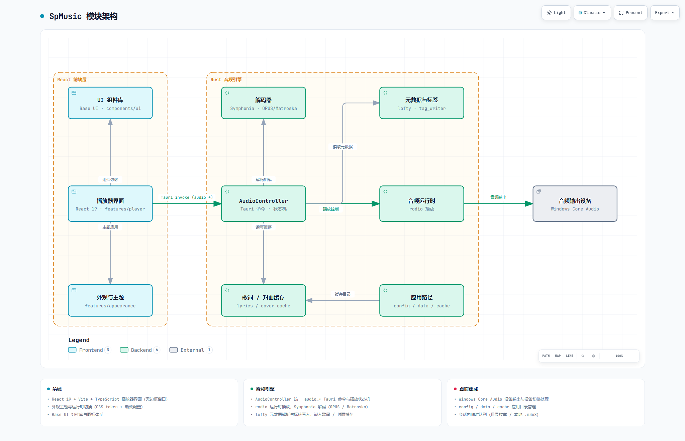

# SpMusic

SpMusic 是一个本地优先的桌面音乐播放器项目，目标是构建轻量、稳定、可维护、体验良好的本地音乐播放与管理工具。项目使用 Tauri + Rust + React + TypeScript + Vite，播放器界面基于 shadcn/ui 与 Tailwind CSS 构建。

项目不提供在线音乐平台、在线曲库搜索、内容推荐或版权音乐服务；核心价值是播放和管理用户自有的本地音频内容。

## 模块架构



- 交互式架构图（深 / 浅主题切换、缩放、搜索、关系追踪、PNG/SVG 导出）：[spmusic-architecture.html](docs/architecture/spmusic-architecture.html)
- 图规范文件（Archify JSON）：[spmusic-architecture.json](docs/architecture/spmusic-architecture.json)

## 当前状态

- 技术栈：Tauri 2、Rust、React、TypeScript、Vite、Tailwind CSS、shadcn/ui。
- 前端：已完成播放器界面主体（封面、歌曲信息、播放控制、进度、音量、队列、歌词、设置与 Empty State），并具备外观主题定制基础。
- 后端：已实现 Rust/Tauri 真实本地音频播放后端，覆盖播放、暂停、继续、停止、seek、音量、进度状态、状态事件与输出设备切换处理。
- 曲库：显式选择音乐文件夹后，递归汇总其中的歌曲到“全部歌曲”，并保留文件夹选择供下次启动扫描；不会自动创建播放列表。
- 播放列表：本地 `.m3u8` 可作为歌曲引用清单导入并持久化，导入不改变当前播放或扩大曲库；也可从“全部歌曲”选择歌曲创建会话内清单。
- 队列：用户选中单个音频文件后，仍可生成同目录非递归、只读的会话内临时队列。
- 元数据：读取基础标签；存在嵌入式歌词或封面时展示，缺失时使用后备状态。
- 兼容性：已建立基于仓库确定性合成语料的格式兼容性矩阵（当前证据以 Windows x64 为主）。
- 文档：已建立需求索引、路线图、Sprint 计划、发布计划、架构与实现说明，并内置本地文档工作台。

> 说明：上述播放、队列、歌词 / 封面等能力目前处于“已实现候选 / 待验收”状态。代码与自动检查证据已经存在，但 v0.1 综合真实播放验证（SP-018）、Tauri 制品构建与制品 smoke（SP-019）尚未完成，因此本项目尚未对外宣布“已验证”或“已发布”。版本号也尚未对齐：`package.json` 仍为 `0.0.0`，`src-tauri` 为 `0.1.0`。

## 当前能力

### 播放器界面

- 无边框桌面窗口壳层与窗口控制条。
- 当前歌曲信息（标题、艺术家、专辑、封面）与播放控制（播放 / 暂停 / 上一首 / 下一首 / 停止）。
- 播放进度与 seek，音量控制。
- 队列面板、歌词面板、更多操作菜单与设置对话框。
- 无歌曲时的 Empty State 与最小错误状态。

### 真实本地音频播放

后端通过 `rodio` + Symphonia 解码并输出到系统默认音频设备，前端通过 Tauri command 调用。已注册命令包括 `audio_open_source`、`audio_load_file`、`audio_list_folder_tracks`、`audio_play`、`audio_pause`、`audio_stop`、`audio_seek`、`audio_set_volume`、`audio_get_state`、`audio_get_current_track` 等，并通过 `audio_state_changed` 全局事件推送状态变更。

输出设备变化时（Windows 优先使用原生 Core Audio 通知），后端会暂停并释放旧输出流，下次播放时重建到当前默认输出设备。

### 曲库与播放列表

- 在“全部歌曲”空态中选择音乐文件夹，或通过更多菜单继续添加。扫描包含子文件夹，按歌曲路径去重；文件夹来源保存在应用数据目录的 `library-folders.v1.json` 中，重启后重新扫描。
- 文件夹只提供曲库歌曲，播放列表只保存歌曲引用。导入文件夹或 M3U8 清单不会加载首歌或打断当前播放；M3U8 引用的外部歌曲不会因此被扫描入曲库。
- 导入本地 `.m3u8` 时，仅接受本地音频路径；绝对路径允许指向清单所在目录之外，缺失条目仍保留，播放时提示并跳过。此入口不支持网络 HLS。
- 已导入 M3U8 的最后一次成功清单快照保存在应用数据目录的 `library-playlists.v1.json` 中。重启时恢复名称、歌曲顺序和引用，并重新检查歌曲是否可用；原 M3U8 文件被移动、删除或修改不会改变已导入快照，重新导入同一来源才更新它。
- 从“全部歌曲”选择歌曲并填写名称，可新建播放列表；自建清单目前仅保留在本次会话中。清空歌曲文件夹选择不会删除已导入或自建的清单，也不会停止当前播放。

### 会话内临时队列

- 选择音频文件后，对该文件所在目录执行一次非递归、只读的受支持扩展名枚举，结果按文件名稳定排序，形成当前会话临时队列。
- 支持上一首、下一首、直接选择和自然结束切换；队列不持久化、不编辑、不导入导出。
- 播放曲库歌曲或播放列表中的歌曲时，播放队列使用对应的歌曲引用；队列与持久化的 M3U8 清单分别管理。

### 标签、歌词与封面

- 从当前音频文件读取基础标签（标题、艺术家、专辑、年份、音轨号等）。
- 存在嵌入式歌词或封面时在播放器界面展示，不存在时使用明确的后备状态。
- 未播放的清单也会独立读取列表卡片、侧栏和详情中可见歌曲的封面；封面加载按可视范围限制并发与缓存，不需要先加载或播放音频。
- 不做网络 / sidecar 歌词获取、逐字歌词或标签 / 封面 / 歌词编辑。

### 外观定制

- 内置外观主题基础与运行时切换，支持 CSS token 与动效配置，后续可扩展为更完整的视觉自定义。

### 本地文档工作台

仓库内置独立的本地文档工作台，用于集中浏览、全文搜索、筛选、预览、编辑、新建、移动、重命名、删除和检查 Markdown 文档。它使用单独端口，不依赖 SpMusic 播放器前端或 Tauri 进程。详见下方“本地文档工作台”。

## 验证与证据边界

- 自动检查：`npm run lint`、`npm run build`、`cargo fmt -- --check`、`cargo check`、`cargo test` 已在任务记录中通过（详见 [Sprint 计划](docs/sprint-plan.md) 与相关任务卡）。
- 格式兼容性：[音频格式能力矩阵](docs/audio-compatibility/format-capability-matrix.md) 基于仓库内确定性合成语料，对 MP3、FLAC、AAC / M4A、ALAC、Ogg Vorbis / Opus、WebM、Matroska / FLAC、WAV、AIFF、CAF 等组合验证了解码、duration 与 seek；标签 / 歌词 / 封面仅对部分组合有证据。`verified` 只表示指定语料与检查维度通过，不代表所有同扩展名文件均兼容。
- 平台：当前自动与实现证据主要来自 Windows x64；macOS、Linux、ARM64 尚未认证。
- 未完成：SP-018 综合真实播放验证（含声卡实机可听播放）与 SP-019 制品构建 / 制品 smoke / 版本一致性尚未完成；在这些证据产生前，README 不把这些能力写成“已验证 / 已发布”。

## 本地开发

安装依赖：

```bash
npm install
```

启动前端开发服务器：

```bash
npm run dev
```

启动 Tauri 桌面应用：

```bash
npm run tauri dev
```

执行代码检查：

```bash
npm run lint
```

构建前端产物：

```bash
npm run build
```

预览前端构建结果：

```bash
npm run preview
```

构建 Tauri 桌面制品：

```bash
npm run tauri build
```

后端（Rust）检查与测试：

```bash
cd src-tauri
cargo fmt -- --check
cargo check
cargo test
```

音频语料生成与验证（FFmpeg 仅用于生成 CC0 测试语料，不进入应用运行时）：

```bash
node tools/audio-compatibility/generate-fixtures.mjs generate
node tools/audio-compatibility/generate-fixtures.mjs verify
node tools/audio-compatibility/generate-fixtures.mjs self-check
```

## 本地文档工作台

开发模式启动：

```bash
npm run docs
```

浏览器访问 `http://127.0.0.1:4175`。可通过环境变量 `DOCS_MANAGER_PORT` 修改端口。

构建并运行独立产物：

```bash
npm run docs:build
npm run docs:start
```

执行文档服务的边界测试：

```bash
npm run docs:test
```

工作台会扫描仓库中的 Markdown 文件，并监听磁盘变更。`docs/`、`README.md`、`GIT_WORKFLOW.md` 和 PM Agent 管理的 `.agents/prompt/*.md` / `.agents/prompt/templates/*.md` 可编辑；选择 `PM Agent` 时会自动显示 PM 管理的 Agent 提示词和模板。其他内部 Markdown 可按需显示，但默认不进入普通文档列表。新建、移动和重命名仍限制在 `docs/` 目录，保存使用内容版本检查避免覆盖外部编辑器中的新修改。

## v0.1 范围与发布状态

v0.1 的目标是“真实本地播放可发布闭环”：在已完成播放器界面上，实现可验证的真实本地音频播放链路，并完成综合验证、Tauri 制品构建、制品 smoke 与版本一致性收口。

当前发布收口任务状态（详见 [Sprint 计划](docs/sprint-plan.md)）：

- SP-016（真实音频后端）、SP-017（前端真实播放接入）：实现候选，待 SP-018 验收。
- SP-018（综合真实播放验证）：就绪，未完成。
- SP-019（制品、版本一致性与制品 smoke）：就绪，未完成。
- SP-020（需求基线重整）、SP-021（架构契约对齐）：就绪 / 进行中。
- SP-010（README 收口）：本文档对应任务，最终结论依赖上述验证结果。

## 不支持的能力

以下能力属于后续版本或延期范围，当前仓库不应被理解为已经支持：

- 自动文件监控、数据库与完整媒体库索引。
- 播放列表编辑、删除与导出，自建清单持久化，以及播放队列、播放历史、收藏与进度持久化。
- 网络 HLS / 直播流与 M3U8 导出；现有 M3U8 导入仅处理本地音频引用。
- 网络 / sidecar / 逐字歌词，歌词、封面与标签编辑。
- 电脑系统级桌面字幕浮层与对应系统 API（界面上的 CC 控件是 UI 边界，不是系统字幕功能）。
- CUE 分轨与 M4B 章节的公共交互契约（后端仅有解析模型，未暴露公共能力）。
- FFmpeg 运行时 fallback 与“支持所有常见格式”类承诺。
- FTP / SMB / WebDAV 等网络存储播放。
- 真实频谱分析、高级 DSP、独占音频输出。
- 插件系统、插件市场与扩展运行时。
- 在线音乐平台、在线曲库搜索、内容推荐、版权音乐服务、账号与云同步。
- macOS、Linux、ARM64 等尚无构建与实机证据的平台认证。

## 文档入口

- [需求索引](docs/requirements.md)
- [路线图](docs/roadmap.md)
- [Sprint 计划](docs/sprint-plan.md)
- [发布计划](docs/release-plan.md)
- [总体架构](docs/architecture/overall-architecture.md)
- [真实音频播放架构](docs/architecture/real-audio-playback.md)
- [播放列表曲目标签摘要契约](docs/architecture/playlist-track-summaries.md)
- [播放列表时长缓存契约](docs/architecture/playlist-duration-cache.md)
- [播放器界面 UI 规格](docs/ui/player-shell.md)
- [前端架构实现说明](docs/implementation/frontend-architecture.md)
- [真实音频后端实现说明](docs/implementation/real-audio-backend.md)
- [音频格式能力矩阵](docs/audio-compatibility/format-capability-matrix.md)
- [解码兼容性基线](docs/audio-compatibility/decoder-baseline.md)
- [v0.1 历史需求](docs/requirements/v0-1-foundation.md)（部分内容已被 2026-07 范围决策覆盖）
- [v0.2 播放列表 UI 候选需求](docs/requirements/v0-2-playlist-ui-prototype.md)
- [变更记录](docs/changes/)（bug 与优化记录）

## 项目结构

```text
.
├── .agents/             # 项目协作 Agent 注册表、提示词和模板
├── agent-prompt/        # Agent 提示词镜像
├── docs/                # 需求、路线图、计划、任务、架构、UI、实现与变更记录
├── public/              # 前端静态资源
├── src/                 # React 前端源码（播放器、外观、UI 组件、文档工作台）
├── src-tauri/           # Tauri / Rust 桌面应用与音频后端
├── test-fixtures/       # 确定性合成音频语料
├── tools/               # 文档工作台与音频语料工具
├── GIT_WORKFLOW.md      # Git 工作流约定
├── package.json         # npm 脚本和前端依赖
└── README.md            # 项目说明
```

## 协作约定

- 项目使用 Codex Agent 协作，Agent 注册表与提示词位于 `.agents/prompt/`，协作说明见 [AGENTS.md](AGENTS.md)。
- Git 工作流约定见 [GIT_WORKFLOW.md](GIT_WORKFLOW.md)。
