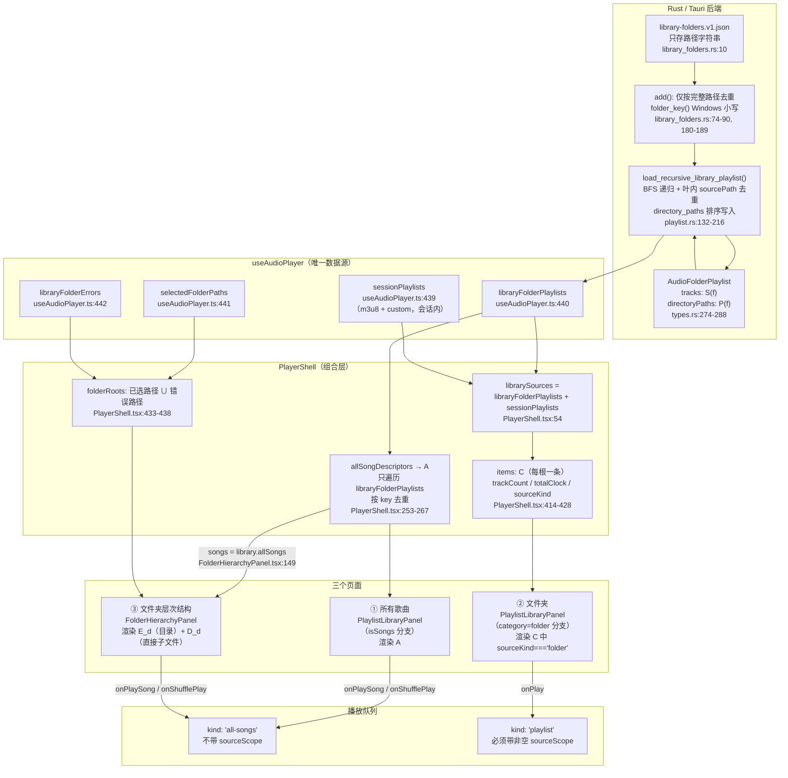

# 媒体库三页面（所有歌曲 / 文件夹 / 文件夹层次结构）数据关系与并包关系现状

## 摘要

媒体库的「所有歌曲」「文件夹」「文件夹层次结构」三个页面共用**同一条数据链路**：Rust 递归扫描结果落在 `useAudioPlayer` 的 `libraryFolderPlaylists`，经 `PlayerShell` 组合成一个聚合歌曲列表 `A`（`allSongs`，跨根按路径去重）与一组根卡片 `C_f`（每根一条，不去重），再由两个面板分别渲染。

三者**不构成严格嵌套并包**关系。集合层面 `set(A) = set(⋃_f C_f)` 成立，但多重集层面不成立（`A` 去重、`C_f` 不去重）；同时层次结构页的目录歌曲集合 `D_d` 取自 `A` 而非 `C_f`，并且**层次结构页的「播放/随机播放」范围是递归子树，而其「可见歌曲列表」只显示直接子文件**——显示范围与播放范围口径不同。

本文只记录**现状**。「建议/改进方向」集中在第 10 章，与现状严格分开。

## 1. 背景与范围

### 1.1 背景

用户即将「实现并完善」媒体库三页面。在动手前需要一份可追溯的现状描述，避免把「当前实现」与「期望设计」混为一谈。本文由架构侧对代码做只读核对产出，所有结论标注文件与行号。

### 1.2 覆盖范围

- 三个页面的**定义、路由与挂载条件**
- 三个页面的**数据来源、集合公式、排序、搜索范围、去重策略**
- 三个页面的**播放入口与播放队列 `kind`**
- 三者之间**真实的集合关系（含反例）**
- 当前**已知不一致与缺陷**的客观记录

### 1.3 不在范围内

- 播放列表详情页（`route.view === 'tracks'`，由 `OwnedPlaylistPanel` / `PlaylistPanel` 渲染）的完整行为，仅在需要解释「点开文件夹卡片之后」时提及
- 专辑 / 艺术家 / 流派 / 年份 / 作曲家 / 播放列表 / 流 / 队列 / 书签 / 最常播放 等其余分类（其中多数在 `PlaylistLibraryPanel` 中走「尚未接入数据」空态）
- 视觉与动效设计、布局档位系统（`useCollectionLayout`）的内部规则
- 曲目标签摘要通道、时长通道、封面通道的**内部契约**（见 `docs/architecture/playlist-track-summaries.md`、`playlist-duration-cache.md`、`playlist-artwork-loading.md`）
- 任何实现改动

## 2. 符号与术语

| 符号 | 含义 | 定义位置 |
| --- | --- | --- |
| `f` | 一个已选库根（library root folder） | `src-tauri/src/library_folders.rs` |
| `S(f)` | 根 `f` 的递归扫描结果：`AudioFolderPlaylist.tracks`，根内**已递归全量**，后端按 `sourcePath` 去重 | `src-tauri/src/audio/playlist.rs:132-216`（去重 L191，排序 L197-203） |
| `P(f)` | 根 `f` 的扫描目录列表 `AudioFolderPlaylist.directoryPaths` | `src-tauri/src/audio/types.rs:278-281`；填充 `playlist.rs:156`、`playlist.rs:209` |
| `A` | 「所有歌曲」页面的歌曲集合 `library.allSongs` | `PlayerShell.tsx:253-267`（构建）、`:295`（发布） |
| `C_f` | 「文件夹」页面上根 `f` 的卡片（`PlaylistLibraryItem`） | `PlayerShell.tsx:414-428`；`PlayerLibraryPanel` 见 `PlaylistLibraryPanel.tsx:112` |
| `D_d` | 「文件夹层次结构」页在目录 `d` 下显示的歌曲集合（直接子文件） | `FolderHierarchyPanel.tsx:152-153` |
| `E_d` | 「文件夹层次结构」页在目录 `d` 下的目录条目集合 | `FolderHierarchyPanel.tsx:150`；`folderHierarchy.ts:36-67` |
| `key` | 歌曲行身份 = `normalizeAudioSourcePath(sourcePath)`（**仅统一分隔符，保留大小写**） | `playlistTrackSummary.ts:59-62` |
| `scope` | 列表身份 = `` `${sourceKind}\u0000${normalizeAudioSourcePath(sourcePath)}` `` | `useAudioPlayer.ts:229-231` |
| `trackId` | 曲目身份 = `local-` + blake3(规范化路径 **to_lowercase**) 前 16 hex | `src-tauri/src/audio/source.rs:348-356` |

> 注意 `key` 与 `trackId` 的大小写策略**相反**：`key` 保留大小写，`trackId` 的散列输入被 `to_lowercase()`。此不对称列入第 9 章缺陷 D2。

## 3. 数据流图



## 4. 三页面的定义与路由

### 4.1 分类定义

`src/features/player/model/mediaLibraryCategories.ts:42-44`：

| `id` | `label` |
| --- | --- |
| `songs` | 所有歌曲 |
| `folder` | 文件夹 |
| `folders` | 文件夹层次结构 |

路由类型（`mediaLibraryCategories.ts:64`）：

```ts
type MediaLibraryRoute = { view: 'overview' } | { view: 'category'; categoryId: MediaLibraryCategoryId } | { view: 'tracks' }
```

### 4.2 路由切换

`selectLibraryCategory()`（`PlayerShell.tsx:71-77`）：

- 切换分类时统一设置 `route = { view: 'category', categoryId }`
- `categoryId === 'folders'` 时**清空 `folderLocation`**（`:75`）——即每次从分类侧栏进入层次结构都会回到根列表，不保留上次浏览位置
- `categoryId === 'songs'` 时把 `playlistEntryPosition` 重置为 `target: 'top'`（`:76`）

### 4.3 实际挂载条件

页面选择发生在 `PlayerSurface.tsx`，三者互斥：

| 页面 | 挂载条件 | 位置 |
| --- | --- | --- |
| 媒体库总览 | `route.view === 'overview'` → `MediaLibraryPanel` | `PlayerSurface.tsx:3014` |
| ③ 文件夹层次结构 | `route.view === 'category' && categoryId === 'folders'` → `FolderHierarchyPanel` | `PlayerSurface.tsx:3015` |
| ①② 及其余分类 | `library.isOpen && route.view !== 'overview'` 且非上面那条 → `PlaylistLibraryPanel` | `PlayerSurface.tsx:3016-3033` |
| 播放列表详情 | `!library.isOpen`（即 `route.view === 'tracks'`）→ `OwnedPlaylistPanel` | `PlayerSurface.tsx:3034` |

其中 `library.isOpen` 由 `PlayerShell.tsx:410` 定义为 `libraryRoute.view !== 'tracks'`。

> 结论：`folder` 与 `songs` 两个分类由**同一个组件** `PlaylistLibraryPanel` 渲染，靠 `categoryId` 分支；`folders` 是**独立组件** `FolderHierarchyPanel`。这是理解「为什么三者行为不完全一致」的第一层原因。

### 4.4 `PlaylistLibraryPanel` 内的分类分支

`PlaylistLibraryPanel.tsx:107-112`：

```ts
const library = playlist.library!
const categoryId = library.route?.view === 'category' ? library.route.categoryId : 'playlists'
const category = mediaLibraryCategories.find((item) => item.id === categoryId)!
const isSongs = categoryId === 'songs'
const hasDataSource = isSongs || categoryId === 'playlists' || categoryId === 'folder'
const categoryItems = useMemo(() => categoryId === 'playlists' ? library.items.filter((item) => item.sourceKind !== 'folder') : categoryId === 'folder' ? library.items.filter((item) => item.sourceKind === 'folder') : [], [categoryId, library.items])
```

要点：

- `categoryId` 在非 `category` 路由下退化为 `'playlists'`（`:108`）；由于详情页不渲染本组件，该退化实际只在防御路径上生效
- **`sourceKind` 过滤是互补的**：`folder` 页取 `=== 'folder'`，其余分类（`playlists` 页）取 `!== 'folder'`
- `hasDataSource` 只覆盖 `songs` / `playlists` / `folder`，其余分类走「尚未接入数据」空态（`PlaylistLibraryPanel.tsx:541`）

### 4.5 `sourceKind` 的类型事实

| 层 | 取值 | 证据 |
| --- | --- | --- |
| UI 类型 | `'folder' \| 'm3u8' \| 'custom'` | `playerUiViewModel.ts:141` |
| 前端 DTO 类型 | `'folder' \| 'm3u8' \| 'custom'` | `audioCommands.ts:318` |
| Rust 枚举 | `Folder` \| `M3u8`（**仅两值**） | `src-tauri/src/audio/types.rs:290-295` |

`'custom'` 是**纯前端**取值，只由两处产生：

- `createPlaylist()`：`sourcePath = custom:<uuid>`（`useAudioPlayer.ts:1251-1270`）
- `selectPlaybackQueueTrack()` 生成的播放快照：`sourcePath = queue:<kind>:<uuid>`（`useAudioPlayer.ts:3933-3940`）

会话内 `custom` 列表持久化有专门校验（`playbackSessionStorage.ts:34-43`，含 `sourcePath.startsWith('custom:')` / `'queue:'` 的分支一致性检查），持久化对 `sourceKind` 的白名单见 `:28`。

## 5. 三者对照表

| 维度 | ① 所有歌曲 | ② 文件夹 | ③ 文件夹层次结构 |
| --- | --- | --- | --- |
| 渲染组件 | `PlaylistLibraryPanel`（`isSongs` 分支，`PlaylistLibraryPanel.tsx:488-516`） | `PlaylistLibraryPanel`（`category=folder` 分支，`:517-541`） | `FolderHierarchyPanel`（`PlayerSurface.tsx:3015`） |
| 路由 | `{ view:'category', categoryId:'songs' }` | `{ view:'category', categoryId:'folder' }` | `{ view:'category', categoryId:'folders' }` + 内部 `folderLocation` 状态 |
| **数据源** | `library.allSongs`（= `A`） | `library.items` 过滤 `sourceKind === 'folder'`（= `C`） | `library.allSongs`（= `A`）+ `library.folderRoots` |
| **集合公式** | `A = dedup_key(⨄_f S(f))`，`f` 遍历 `libraryFolderPlaylists` | `C = { c_f : f ∈ 已选根 }`，`card(f).trackCount = |S(f)|` | `E_d = { 直接子目录 }`；`D_d = { x ∈ A : parent(x.sourcePath) = d }` |
| 是否含 `sessionPlaylists` | 否（`:256` 只遍历 `libraryFolderPlaylists`） | 是（`librarySources` 含 `sessionPlaylists`，但文件夹页按 `sourceKind==='folder'` 过滤，而 `sessionPlaylists` 只承载 `m3u8`/`custom`） | 否（`songs` 来自 `A`；`folderRoots` 来自 `selectedFolderPaths`） |
| **排序** | `compareByQuickIndex(track.title, ...)`（`:162`） | `compareByQuickIndex(item.name, ...)`（`:159`） | 目录：`localeCompare(name,'zh-CN',{numeric:true})`（`folderHierarchy.ts:66`）<br/>歌曲：`localeCompare(title,'zh-CN',{numeric:true})`（`FolderHierarchyPanel.tsx:153`） |
| 排序分组/导航 | A-Z 快速索引可用（`:558` 条件 `categoryId==='playlists' \|\| (isSongs && 非 loading)`） | **无快速索引**（同上条件不含 `folder`），但排序仍按 A-Z 分组键 | 无快速索引 |
| **搜索范围** | `` `${title} ${artist} ${album}` ``（`:161`） | `item.name` 名称（`:158`） | 目录：`` `${name} ${parentName}` ``（`:151`）<br/>歌曲：`` `${title} ${artist} ${album}` ``（`:153`） |
| **去重策略** | 跨根按 `key` 去重，保留首次遍历到的那根的 `scope`（`:253-267`） | **不去重**：每根一张卡片，卡片内条数直接取该根 `tracks.length` | 目录内歌曲按 `folderPath(sourcePath)` 去重（`folderHierarchy.ts:56-61`）；`D_d` 继承 `A` 的去重结果 |
| **播放队列 `kind`** | `'all-songs'`（`onPlaySong` / `onShufflePlay`，`PlayerShell.tsx:451-453`） | `'playlist'` + `sourceScope: scope`（`library.onPlay`，`PlayerShell.tsx:445-450`） | `'all-songs'`（同样经 `onPlaySong` / `onShufflePlay`，`FolderHierarchyPanel.tsx:212-216`、`:257`） |
| 播放/随机候选集合 | `visibleSongs`（搜索过滤后、仅 `available`） | `visible`（搜索过滤后的卡片） | **`candidates`**：直接子文件 + 各可见子目录的递归歌曲，按 `key` 去重、仅 `available`（`:203-211`） |
| 统计口径 | 无总数展示；行数 = `A` 长度 | `trackCount = S(f).length` + `totalClock` 来自时长通道 `formatPlaylistDurationLabel()`（`PlayerShell.tsx:421-427`） | hero 元数据用 `recursiveSongs.length` + 前端就地求和 `totalClock()`（`FolderHierarchyPanel.tsx:288`、`:43-47`）；目录卡片用 `directory.songs`（递归）就地求和（`FolderHierarchyCard.tsx:30-37`） |
| 加载态 | `allSongsMetadataStatus === 'loading'` → `PlaylistMetadataLoading`（`:488`） | 无专门加载态；卡片随 `folderRoots` 状态渲染 | 目录卡片立即出现；歌曲区仅在 `metadataLoading && directSongs.length` 时显示加载（`:315`） |
| 空态 | 「暂无歌曲」+「选择文件夹」按钮（`:517`） | 「暂无文件夹」+「选择文件夹」按钮（`:541`） | 「尚未选择文件夹」/「文件夹为空」/「没有匹配的文件夹或歌曲」（`:330`） |

补充事实：

- **`A` 的 `scope` 归属被固定为首次遍历到的那根**（`PlayerShell.tsx:256-264`）。因此 `A` 中的行带着「某根」的 `scope`，而该行在层次结构页可能显示在**另一个根**的目录树下（路径判定），见第 8 章。
- **层次结构页的「显示」与「播放」口径不同**：`D_d` 只含直接父目录相等的文件（`:152`），但 `candidates` 会把每个可见子目录的**递归**歌曲都并入播放队列（`:203-211`）。也就是说目录层级页显示不递归、播放却递归。详见第 7 章。

## 6. 后端契约（与三页面直接相关的部分）

### 6.1 扫描结果 `AudioFolderPlaylist`

`src-tauri/src/audio/types.rs:274-288`：

```rust
pub struct AudioFolderPlaylist {
    pub directory_path: String,
    pub directory_name: String,
    /// Successfully enumerated directories for a recursive library scan.
    /// Other playlist sources leave this absent.
    #[serde(skip_serializing_if = "Option::is_none")]
    #[ts(optional)]
    pub directory_paths: Option<Vec<String>>,
    pub source_kind: AudioPlaylistSourceKind,
    pub source_path: String,
    pub source_name: String,
    pub selected_index: usize,
    pub tracks: Vec<AudioFolderTrackRef>,
}
```

关键事实：

1. `tracks` 是**递归全量**结果，不是单目录结果（`playlist.rs:132-216` 为 BFS 遍历）
2. 遍历时跳过符号链接与目录重解析点（`playlist.rs:176-178`），并做 canonical 包含性检查 `normalized.starts_with(root)`（`playlist.rs:179-186`），防止越出所选根
3. 文件去重键为 **canonical 路径**（`playlist.rs:191` `sources.insert(normalized.clone())`）
4. `tracks` 排序为 `file_name` 小写 → `file_name` → `source_path`（`playlist.rs:197-203`）
5. `directory_paths` 为**成功枚举**的目录集合（含根本身，`playlist.rs:156`），排序后写入（`:204`）；不可读子目录被跳过并 warn（`:151-154`），**不出现在** `directory_paths` 中
6. `directory_paths` 为 `Option`：库扫描始终 `Some`，其他来源（M3U8 / 自定义）为 `None`

### 6.2 库根注册表

`src-tauri/src/library_folders.rs`：

| 事实 | 证据 |
| --- | --- |
| 文件名为 `library-folders.v1.json`，只存路径字符串数组 | `:10`、`:45-50`、`:130-135` |
| `add()` 仅按**完整路径**去重，**不做父子包含检测** | `:74-90`（比较 L84） |
| `folder_key()` 在 Windows 上 `to_lowercase()`，其他平台保持原样 | `:180-189` |
| 读取时**保留**不可用目录（避免临时掉盘抹掉用户选择） | `:123-127` |
| 入库前 `canonicalize()`，失败则保留原路径 | `:176` |
| 拒绝空路径、相对路径、含 `..` 的路径、非目录 | `:156-175` |

### 6.3 前端身份函数

`useAudioPlayer.ts:229-231`：

```ts
export function playlistScope(playlist: AudioFolderPlaylist): string {
  return `${playlist.sourceKind}\u0000${normalizeAudioSourcePath(playlist.sourcePath)}`
}
```

`playlistTrackSummary.ts:59-62`：

```ts
export function normalizeAudioSourcePath(sourcePath: string): string {
  // Rust canonicalizes DTO paths; the frontend only unifies separators and preserves case/UNC identity.
  return sourcePath.replaceAll('\\', '/')
}
```

`folderHierarchy.ts:4-24` 全部基于 `normalizeAudioSourcePath` + 去尾斜杠，**无大小写折叠**：

```ts
folderPath(path)      = normalize(path).replace(/\/+$/, '') || '/'
parentFolder(path)    = folderPath(path).slice(0, lastIndexOf('/'))   // 无 '/' 或位于 0 时返回 '/'
folderName(path)      = 末段
insideFolder(path, d) = normalized === root || normalized.startsWith(`${root}/`)
```

## 7. 播放入口与队列 `kind`

### 7.1 队列 origin 契约

`playbackQueue.ts:5-11`：

```ts
export type PlaybackQueueOrigin = Readonly<{
  kind: 'all-songs' | 'playlist'
  sourceScope?: string
  sourcePlaylist?: AudioFolderPlaylist
}>
```

校验（`playbackQueue.ts:27-42`）：

- `kind === 'all-songs'` → **必须** `sourceScope === undefined && sourcePlaylist === undefined`（`:30`）
- `kind === 'playlist'` → **必须** `typeof sourceScope === 'string' && sourceScope` 非空（`:31`），并对 `sourcePlaylist` 做严格结构校验（`:32-41`）

即：**「所有歌曲」队列在契约上刻意不携带 `sourceScope`**——聚合播放不属于任何单根。这一点与「文件夹」页路径形成明确分工。

### 7.2 三页面播放入口

| 页面 | 交互 | 调用 | 队列 `kind` | 位置 |
| --- | --- | --- | --- | --- |
| ① 所有歌曲 | 头部「播放」/ 紧凑控制器「播放」 | `playSongs()` → `library.onPlaySong(target.scope, target.trackId, candidates)` | `all-songs` | `PlaylistLibraryPanel.tsx:398-403` → `PlayerShell.tsx:451-452` |
| ① 所有歌曲 | 头部/控制器「随机播放」 | `shuffleSongs()` → `library.onShufflePlay(entries)` | `all-songs` | `PlaylistLibraryPanel.tsx:405-412` → `PlayerShell.tsx:453` |
| ① 所有歌曲 | 点击单曲卡片 | `handleSongActivate()` → `onPlaySong(scope, trackId, visibleSongs)` | `all-songs` | `PlaylistLibraryPanel.tsx:229-233` |
| ② 文件夹 | 头部「播放」 | `library.onPlay(playTarget.scope)` → `selectPlaybackQueueTrack({kind:'playlist', sourceScope, entries: item.tracks})` | `playlist` | `PlayerShell.tsx:445-450` |
| ② 文件夹 | 「随机播放」 | `playListsRandomly()` 随机选一张卡 → `library.onPlay(scope)` | `playlist` | `PlaylistLibraryPanel.tsx:413-417` |
| ② 文件夹 | 点击卡片 | `activate(scope)` → 非多选态走 `library.onSelect`（**浏览，不播放**） | — | `PlaylistLibraryPanel.tsx:315-322` |
| ③ 层次结构 | 头部「播放」/ 控制器「播放」 | `play()` → **`library.onPlaySong(target.scope, target.trackId, entries)`** | `all-songs` | `FolderHierarchyPanel.tsx:212-216` |
| ③ 层次结构 | 「随机播放」 | `library.onShufflePlay?.(candidates.map(...))` | `all-songs` | `FolderHierarchyPanel.tsx:257`、`:295` |
| ③ 层次结构 | 点击单曲 | `play(key)` → `entries = visibleSongs`（**仅直接子文件**） | `all-songs` | `FolderHierarchyPanel.tsx:212-216`、`:328` |

### 7.3 层次结构页的播放范围（重要，易误判）

`FolderHierarchyPanel.tsx:203-211`：

```ts
const candidates = useMemo(() => {
  const candidates = location ? [...visibleSongs] : []
  for (const directory of visibleDirectories) if (!currentSelection.active || currentSelection.keys.has(`folder:${directory.path}`)) candidates.push(...directory.songs)
  const seen = new Set<string>()
  return candidates.filter(item => {
    if (!item.available || (currentSelection.active && location && !currentSelection.keys.has(item.key) && !visibleDirectories.some(dir => currentSelection.keys.has(`folder:${dir.path}`) && insideFolder(item.sourcePath, dir.path))) || seen.has(item.key)) return false
    seen.add(item.key); return true
  })
}, [location, visibleSongs, visibleDirectories, currentSelection])
```

而 `play()`（`:212-216`）：

```ts
const play = (key?: string) => {
  const entries = key ? visibleSongs.filter(item => item.available) : candidates
  const target = key ? entries.find(item => item.key === key) : entries[0]
  if (target && !playlist.isOpenAudioDisabled) library.onPlaySong?.(target.scope, target.trackId, entries.map(({ scope, trackId }) => ({ scope, trackId })))
}
```

因此层次结构页存在**两套播放范围**：

| 触发 | `entries` | 递归性 |
| --- | --- | --- |
| 「播放」按钮 / 「随机播放」/ 控制器 | `candidates` = 当前目录直接子文件 ∪ 每个可见子目录的**递归**歌曲 | **递归**（等价于当前子树的全部可用歌曲） |
| 点击某一首歌 | `visibleSongs`（仅 `available`） | **不递归**（仅当前目录直接子文件） |

在根层（`location === null`）时，`visibleDirectories` 是全部根，`directory.songs` 是各根的递归歌曲，因此「播放文件夹歌曲」按钮实际会播放**整个媒体库**（按 `key` 去重、仅可用）。

> 关键结论：层次结构页显示的是「非递归的直接子项」，但它的批量播放入口是「递归子树」。二者口径不同，且与「所有歌曲」页的 `A` 不等于同一集合（`candidates` 受当前目录与搜索过滤约束）。

### 7.4 `candidates` 中的 `scope` 来源

`candidates` 元素来自 `visibleSongs` 与 `directory.songs`，两者都是 `AllSongsItem`，其 `scope` 由 `A` 构建时固定（`PlayerShell.tsx:256-264`）。因此：

- 队列 `kind` 为 `all-songs`，`sourceScope` 不参与（契约要求缺省）
- 但 `entries` 中每条仍带 `scope`，用于在 `findPlaylistForScope(scope)` 中解析描述符（`useAudioPlayer.ts:3912-3923`）
- 若同一文件因重叠根而归属另一根的 `scope`，播放仍可解析（该根的 `tracks` 也包含此文件）

### 7.5 队列构造落点

`useAudioPlayer.ts:3905-3956` `selectPlaybackQueueTrack()`：

```ts
playbackQueue: selection.kind === 'all-songs' ? { kind: 'all-songs' }
  : { kind: 'playlist', sourceScope: selection.sourceScope, ...(custom 源则附 sourcePlaylist) },
```

`sourcePath` 形如 `queue:<kind>:<uuid>`（`:3934`）。失败条件包括：描述符不存在（`：3922` 拒绝陈旧快照）、`kind==='playlist'` 但 `sourceScope` 无对应列表（`:3930`）。

## 8. 并包关系专章

### 8.1 结论

**三个页面不构成严格的嵌套并包关系。** 只存在以下两条稳定关系：

1. `set(A) = set(⨄_f S(f))` —— 集合层面相等；**多重集层面不等**（`A` 去重，`⨄_f C_f` 不去重）
2. `D_d ⊆ A` —— 恒成立，因为 `D_d` 是对 `A` 的过滤结果（`FolderHierarchyPanel.tsx:149-152`），而非对 `S(f)` 的过滤

**不成立**的关系：

| 命题 | 是否成立 | 原因 |
| --- | --- | --- |
| `A ⊆ ⋃_f C_f`（多重集意义） | 集合意义成立 | `A` 的元素全部来自某个 `S(f)` |
| `C_f ⊆ A`（逐根） | **多重集意义不成立** | `C_f` 未去重；`A` 已去重 |
| `D_d ⊆ C_f`（某根目录 ⊆ 该根卡片） | **对象层面不成立** | `D_d` 元素是 `AllSongsItem`（带 `A` 的 `scope`），`C_f` 是 `PlaylistLibraryItem`（卡片摘要）；两者不是同一抽象，只在「文件路径集合」层面可比 |
| `A = ⨄_f S(f)` | **不成立** | `A` 去重，`⨄` 不去重 |
| 三页面共享同一「当前根」概念 | **不成立** | 所有歌曲/层次结构页的播放不带 `sourceScope`；仅文件夹页带 |

### 8.2 反例场景

**反例 1：重叠根导致 `⨄C_f` 重复，而 `A` 不重复**

同时选择 `D:\Music` 与 `D:\Music\Rock`。注册表 `add()` 只按完整路径去重、**不做父子包含检测**（`library_folders.rs:74-90`），因此两个根都会入库并被分别扫描。

- `S(D:\Music)` 包含 `Rock` 下全部文件；`S(D:\Music\Rock)` 也包含这些文件
- `⨄_f C_f` = `S(Music) ⊎ S(Rock)` → Rock 内每个文件**出现两次**
- `A = dedup_key(⨄_f S(f))` → Rock 内每个文件**只出现一次**
- 「文件夹」页会显示两张平级卡片，其歌曲集合为**真包含**关系（`set(C_Rock) ⊂ set(C_Music)`）

即三者中只有「所有歌曲」页做了跨根去重；而它在去重时**丢弃了第二个根的归属信息**（保留首次遍历到的 `scope`，`PlayerShell.tsx:256-264`）。

**反例 2：`D_d` 的成员带「另一根」的 `scope`**

承接反例 1：假设 `libraryFolderPlaylists` 顺序为 `[Music, Rock]`。`A` 中 Rock 内的文件由 `Music` 先遇到，`scope` 绑定为 `Music` 的 scope。

- 从「文件夹层次结构」进入 `Rock` 根，`insideFolder(item.sourcePath, Rock.path)` 为真 → 该文件**显示在 Rock 树下**
- 但该行的 `scope` 是 `Music` 的 scope
- 而「文件夹」页 `Rock` 卡片的 `trackCount` 来自 `S(Rock)`，与 `A` 的归属无关

于是「这一行属于哪个根」在两个页面上给出**不同答案**：层次结构页按**路径**归属，所有歌曲页按**首次遍历**归属，文件夹页按**卡片**归属。

**反例 3：不可用根在两侧表现不同**

某根拔盘后：

- 注册表保留该路径（`library_folders.rs:123-127`）→ `selectedFolderPaths` 仍含它
- `folderRoots` 由 `selectedFolderPaths ∪ 错误路径` 构造，`status` 为 `'error'` 或 `'loading'`（`PlayerShell.tsx:433-438`）
- 「文件夹」页：该根**仍有卡片**（`trackCount = 0`，因为该根的 `AudioFolderPlaylist` 不存在，`items` 里没有它 → 实际上它不会出现在 `items` 里）

> 精确修正：`items` 由 `librarySources` 构造（`PlayerShell.tsx:414`），而 `librarySources` 只含成功扫描到的 `AudioFolderPlaylist`。**扫描失败的根不会产生卡片**，但会出现在 `folderRoots` 中。因此两侧的「不可用根」可见性并不对称：层次结构页能看到并展示错误态（`FolderHierarchyPanel.tsx:308`），文件夹页看不到任何条目。

**反例 4：`key` 与 `trackId` 的大小写策略相反，可能破坏行身份唯一性**

- `key` 保留大小写（`playlistTrackSummary.ts:59-62`）
- `trackId` 的散列输入被 `to_lowercase()`（`source.rs:348-356`）

若同一文件被两处以不同大小写报告（例如通过不同根或不同卷挂载），`A` 会得到**两行不同 `key` 但相同 `trackId`** 的记录。后果：

- React 列表 key 用 `item.key`（`PlaylistLibraryPanel.tsx:508`），不会冲突
- 但「当前播放」高亮用 `item.trackId === playlist.currentTrackId`（`:509`）→ **两行同时高亮**
- `allSongsPresentation` 中 `activeRows` 以 `trackId` 为键（`PlayerShell.tsx:274`）→ 后写覆盖前写

---

**反例 5：层次结构页「显示集合」与「播放集合」不同构**

同一目录 `d`：

- 显示：`D_d = { x ∈ A : parent(x.sourcePath) = d }`（不递归，`:152`）
- 批量播放：`candidates ⊇ ⋃_{子目录 c} (递归歌曲)`（递归，`:203-211`）
- 单曲播放：`visibleSongs`（不递归，`:213`）

因此「你在这一页看到的歌」既不等于「点播放会播的歌」，也不等于「点某一首会排队的歌」。这是三页面中最容易在实现/测试阶段被误判为缺陷、但实际是当前设计的一处口径分裂。

## 9. 已知不一致与缺陷（现状记录）

> 编号 `D1`…`D13`。前 8 条来自任务卡的侦察清单，已逐条用代码复核；复核结论与影响描述以本文件为准。`D9` 之后为本轮核对新增。

### D1 去重时机不一致（`A` 去重、`C_f` 不去重）

- **证据**：`PlayerShell.tsx:253-267`（`A` 用 `seen` 去重）；`PlayerShell.tsx:421`（`C_f` 的 `trackCount = item.tracks.length` 直接取后端结果）；`library_folders.rs:74-90`（注册表只按完整路径去重，无父子检测）
- **现象**：重叠根（如 `D:\Music` 与 `D:\Music\Rock`）下，`⋃C_f` 重复计数，`A` 不重复
- **影响**：「所有歌曲」页与「文件夹」页的歌曲总量口径不同；同一首歌在文件夹页被两次计入

### D2 大小写策略不对称（`key` 保留、`trackId` 折叠、注册表折叠）

- **证据**：`playlistTrackSummary.ts:59-62`（保留大小写，注释明示为保留 case/UNC 身份）；`source.rs:348-356`（`to_lowercase()` 后散列）；`library_folders.rs:180-189`（Windows 上 `to_lowercase()`）
- **现象**：三层使用三种大小写策略。注册表视 `D:\Music` 与 `D:\music` 为同一根；`key` 视为不同；`trackId` 视为同一曲目
- **影响**：`A` 可能出现「`key` 不同、`trackId` 相同」的重复行，导致双高亮与元数据互相覆盖（详见 8.2 反例 4）
- **补充**：`to_lowercase()` 是 Unicode 折叠，对某些脚本可能改变字节长度，进而影响散列输入（不改变「同路径同 id」的性质，但会让 id 与显示路径不再一一对应）

### D3 目录路径比较全部为大小写敏感的严格字符串比较，前端无兜底

- **证据**：`folderHierarchy.ts:4-24` 三个函数均无大小写折叠；`FolderHierarchyPanel.tsx:75`（根匹配 `folderPath(root.path) === folderPath(requested?.rootPath ?? '')`）；`FolderHierarchyPanel.tsx:152`（`directSongs` 用 `parentFolder(...) === folderPath(...)`）；`folderHierarchy.ts:37`、`:115`
- **现象**：正确性完全依赖后端 canonicalize 输出的大小写稳定（`library_folders.rs:176`、`playlist.rs:122-128`）
- **影响**：若根路径与扫描结果的路径大小写不一致，`location` 会退化为 `null`（`:75`）→ 静默回到根列表；`directSongs` 会为空 → 歌曲「掉层」

### D4 `A` 的 `scope` 归属被首次遍历固定，与路径归属可能冲突

- **证据**：`PlayerShell.tsx:256-264`（`scope` 取首个遇到的根）；`FolderHierarchyPanel.tsx:149-152`（按路径归属）；`PlayerShell.tsx:278-281`（`summariesByScope[scope]` 取该 `scope` 的摘要）
- **现象**：见 8.2 反例 2
- **影响**：同一行在两页面「属于哪个根」的答案不同；摘要/时长/封面按 `scope` 取用，重叠根下可能取到非预期根的元数据

### D5 空目录/空根在两侧可见性不一致

- **证据**：`folderHierarchy.ts:65`（隐藏条件 `status === 'ready' && complete && songs.length === 0`）；`PlaylistLibraryPanel.tsx:112`（文件夹页无任何空态过滤）
- **现象**：层次结构页隐藏「已确认完整且为空」的目录；文件夹页卡片不做空过滤
- **修正**：扫描失败的根**不会**出现在文件夹页（`items` 来自成功的 `librarySources`），但会出现在 `folderRoots` 并在层次结构页显示错误态（`FolderHierarchyPanel.tsx:308`）。因此「文件夹页永远显示根卡」只在**扫描成功**的前提下成立
- **影响**：用户在一个页面看到空目录/空根，在另一个页面看不到

### D6 「选择文件夹」入口分布（原侦察结论有误，此处更正）

- **原结论**：`library.onSelectFolders` 只在 `!location` 的空状态分支出现，已在根内浏览时必须先 `goUp` 到顶
- **实测证据**：`library.onSelectFolders` 在 `FolderHierarchyPanel.tsx` 出现 **3 处**：
  - `:231` 根层更多菜单 `renderRootMore()`
  - `:264` 目录层 hero 更多菜单 `renderHeroActions()` 内
  - `:330` 空状态按钮（`!location` 分支）
- **结论**：在目录内**可以**通过 hero 更多菜单直接导入新根，无需先 `goUp`。原侦察结论不成立
- **仍然成立的观察**：`selectLibraryCategory('folders')` 会清空 `folderLocation`（`PlayerShell.tsx:75`），因此从分类侧栏进入层次结构总会回到根列表

### D7 「选择文件夹」按钮语义歧义

- **证据**：`FolderHierarchyCard.tsx:53`

```tsx
aria-label={selectMode ? `选择文件夹 ${directory.name}` : `打开文件夹 ${directory.name}`}
```

- **现象**：非多选态点击是**浏览下钻**（`enter(directory)`，`FolderHierarchyPanel.tsx:222-228`）；多选态点击是**勾选**（`toggleSelect`，`:202`）。真正的「导入根」动作统一是 `library.onSelectFolders`，与卡片点击无关
- **影响**：同一 UI 文案体系里，「选择文件夹」既指「勾选一张卡」也指「通过对话框导入库根」，无障碍名与行为不一致

### D8 排序策略不一致（快速索引分组 vs 纯 locale 排序）

- **证据**：`PlaylistLibraryPanel.tsx:159`、`:162` 用 `compareByQuickIndex`（`quickIndex.ts:11-36`，先按 A-Z/数字/其他分组，组内 `localeCompare(...,{numeric:true})`）；`FolderHierarchyPanel.tsx:153` 与 `folderHierarchy.ts:66` 用 `localeCompare(name,'zh-CN',{numeric:true})`
- **现象**：含中文、数字、符号的歌名在三页面排序结果不同；层次结构页使用显式 `'zh-CN'`，`compareByQuickIndex` 组内用 `undefined` 区域（跟随运行环境）
- **影响**：跨页面同一批歌曲顺序不一致；跨机器（区域设置不同）`A`/`C` 的顺序可能漂移

### D9（新增）「所有歌曲」页标题与分类标签不一致

- **证据**：分类标签为「所有歌曲」（`mediaLibraryCategories.ts:42`）；标题被覆盖为「全部歌曲」（`PlaylistLibraryPanel.tsx:469` `title={isSongs ? '全部歌曲' : category.label}`）；无障碍标签仍用 `category.label`（如 `:473-479` 的 `播放${category.label}`）
- **现象**：同一页面同时出现「所有歌曲」和「全部歌曲」两种称谓
- **影响**：文案与无障碍名不一致，后续做多语言/文案统一时容易漏改

### D10（新增）`recursiveSongs` 并非死代码，但只用于统计展示

- **证据**：`FolderHierarchyPanel.tsx:154` 定义；唯一使用点是 `:288` hero 元数据：

```tsx
metadata={<p className="playlist-hero-meta"><icons.music aria-hidden="true" />{recursiveSongs.length}{totalClock(recursiveSongs) ? ` | ${totalClock(recursiveSongs)}` : ''}</p>}
```

- **结论**：`recursiveSongs` **被使用**，用于 hero 上的「递归歌曲数 | 递归总时长」。它不是死代码
- **仍然存在的问题（口径分裂）**：hero 显示的是**递归**数量与时长（`:288`、`:43-47`），而页面列出的歌曲是**非递归**的 `visibleSongs`（`:153`）。用户看到「120 首」但列表里只有 5 行时没有解释
- **影响**：计数与列表长度不一致，容易被误报为缺陷

### D11（新增）三页面统计口径与数据来源不同

- **证据**：
  - 文件夹页卡片：`trackCount = item.tracks.length`（后端 `S(f)` 长度，含不可用文件）+ `totalClock` 由**时长通道**生成，含 `统计中…`/`时长未知`/`统计失败` 三态（`PlayerShell.tsx:421-427`、`playlistDuration.ts:91-99`）
  - 层次结构页根/目录卡片：`count = directory.songs.length`（`folderEntries` 产出，递归）+ 前端就地求和，且只要有可用曲目缺时长就**整体不显示时长**（`FolderHierarchyCard.tsx:30-37`）
  - 层次结构页 hero：`recursiveSongs` 就地求和（`FolderHierarchyPanel.tsx:288`）
- **现象**：三处「歌曲数与总时长」来自三条不同路径（后端长度 / 时长通道聚合 / 前端就地求和），格式与缺失语义互不相同
- **影响**：同一根在文件夹页与层次结构页显示的时长可能不同（前者有「统计中…」渐进态，后者直接不给）；格式也不同（`formatPlaylistDurationLabel` 省小时位，`FolderHierarchyCard.summary()` 恒显示 `h:mm:ss`）

### D12（新增）层次结构页的目录推导存在「完整目录列表为空时不可达」的降级分支

- **证据**：`folderEntries()` 的 `complete = owner?.directoryPaths !== undefined`（`folderHierarchy.ts:62`）；降级提示在 `FolderHierarchyPanel.tsx:306`：

```tsx
{location && root?.status === 'ready' && root.directoryPaths === undefined ? <p ...>当前目录由歌曲路径还原；重新选择文件夹可读取完整目录。</p> : null}
```

- **推导**：`root.status === 'ready'` 要求 `folderRoots` 中该路径能在 `libraryFolderPlaylists` 里找到对应 source（`PlayerShell.tsx:433-438`）；而库扫描一定写出 `Some(directory_paths)`（`playlist.rs:209`）。因此「`status === 'ready'` 且 `directoryPaths === undefined`」在当前代码路径下不会同时成立
- **结论（推断，非观测）**：`complete` 实际恒为 `true`，隐藏规则退化为「隐藏已就绪且为空的目录」，`:306` 的降级提示与 `folderHierarchy.ts:51-52` 中「从歌曲路径反推目录」的降级用途在库扫描路径下不可达
- **影响**：该分支当前无实际作用，但会误导后续维护者以为存在「无 directoryPaths 的 ready 根」

### D13（新增）层次结构页搜索范围与文件夹页搜索范围不一致

- **证据**：文件夹页只匹配卡片名称 `item.name`（`PlaylistLibraryPanel.tsx:158`）；层次结构页目录匹配 `` `${item.name} ${item.parentName}` ``（`FolderHierarchyPanel.tsx:151`）
- **现象**：搜索父目录名（如「Rock」）时，层次结构页能匹配到其子目录，文件夹页不能
- **影响**：同类操作在两页面命中结果不同

### D14（新增）文件夹页排序分组有 A-Z 语义但无快速索引控件

- **证据**：快速索引渲染条件为 `categoryId === 'playlists' || (isSongs && 非 loading)`（`PlaylistLibraryPanel.tsx:558`），不含 `folder`；但 `visible` 的排序仍使用 `compareByQuickIndex`（`:159`，产生 A-Z 分组顺序）
- **现象**：文件夹页列表呈 A-Z 分组顺序，却没有可用的快速跳转导航
- **影响**：交互能力与排序语义不匹配

### D15（新增）层次结构页 `folderLocation` 失效时静默回退，但状态未清理

- **证据**：`FolderHierarchyPanel.tsx:75`（`location` 匹配不到根时置 `null`，回到根列表）；`PlayerShell.tsx:45`（`folderLocation` 由 `PlayerShell` 持有，无对应清空逻辑）；`PlayerShell.tsx:429-432`（原样下发 `folderLocation`）
- **现象**：根被移除/路径失配后，面板显示根列表，但 `PlayerShell` 的 `folderLocation` 仍为非空旧值
- **影响**：返回/面包屑等依赖 `folderLocation` 的路径可能与当前可见内容不一致；只有 `selectLibraryCategory('folders')`（`:75`）或 `goUp` 到顶（`FolderHierarchyPanel.tsx:219`）才会重置

### D16（新增）「所有歌曲」页与「文件夹层次结构」页的歌曲全集相同但排序/去重时机不同

- **证据**：两页都读 `library.allSongs`（`PlaylistLibraryPanel.tsx:160`、`FolderHierarchyPanel.tsx:149`）；排序分别在 `:162` 与 `:153`
- **现象**：同一集合 `A`，两个页面给出不同顺序
- **影响**：这既是对 `D8` 的具体化，也是「同集合不同视图」的现有事实，实现改版时不要误以为两处数据源不同

## 10. 建议与改进方向（提案，非现状）

> 本章全部为**提案**，尚未实施，也不代表已批准范围。现状描述请看第 4–9 章。

### 10.1 先统一「口径」而不是先改 UI

建议在动手实现前先明确并写死三个口径，避免改一处坏一处：

| 待决口径 | 候选方案 | 取舍要点 |
| --- | --- | --- |
| 歌曲身份（是否大小写敏感） | (A) 全部折叠大小写；(B) 全部保留大小写 | Windows 上折叠更符合用户直觉，但与 `normalizeAudioSourcePath` 注释中的「保留 UNC/case 身份」冲突；需先确认 UNC 场景是否真实存在 |
| 卡片计数语义（是否递归） | (A) 一律递归；(B) 一律直接子项 | 层次结构页 hero 已是递归，列表是直接子项；二者必须选一个并向用户表述清楚 |
| 根归属（`scope`） | (A) 路径归属；(B) 首遇归属 | 当前混用；统一为路径归属可消除 D4，但会让 `A` 的行不再携带稳定 `scope`，需按 `key` 反查根 |

### 10.2 建议优先修的低风险项

1. **D9 文案统一**：`PlaylistLibraryPanel.tsx:469` 的 `'全部歌曲'` 与分类标签统一
2. **D14 快速索引补齐或排序降级**：给 `folder` 分类加快速索引，或让其排序与「无索引」一致
3. **D13 搜索范围对齐**：两页面统一「名称 + 父目录名」或统一只用名称
4. **D10 计数与列表一致性**：hero 的递归计数旁明确标注为「含子文件夹」，或改用直接子项口径

### 10.3 建议按缺陷簇处理的结构项

1. **去重唯一化（D1/D2/D4）**：把「歌曲身份」与「根归属」拆成两个独立概念——身份用统一规范化函数（单点定义，三页面共用），归属改为按路径计算，而不是在构造 `A` 时固化。这样 `A`、`C_f`、`D_d` 三者的关系可以被显式写成文档并测试
2. **重叠根治理（D1）**：两种方向
   - 在注册表 `add()` 增加父子包含检测/规范化为最简根集合（需要 Rust 侧改动，且要定义「用户显式选择子目录」是否合法）
   - 或保持注册表不变，在前端构造 `librarySources` 时跳过「已被其它根包含」的根（纯前端，但会改变「文件夹」页可见卡片数）
   - 取舍：前者从数据源头消除重复，后者改动面小但会让「已选根数」与「卡片数」不一致
3. **播放口径收敛（7.3 / 反例 5）**：给层次结构页明确一个「当前作用域」概念（目录 / 子树），并让显示范围、批量播放、单曲播放三者由同一个作用域参数派生；当前实现是三个独立表达式

### 10.4 暂不建议做的事

- 不建议为此引入新的全局状态库或抽象层：三个页面已经共用 `librarySources` / `allSongs`，问题在于**口径不统一**而非**共享不足**
- 不建议在本次「完善页面」中改动时长/标签/封面三条通道的内部契约（属于 `playlist-track-summaries.md`、`playlist-duration-cache.md`、`playlist-artwork-loading.md` 的范围）
- 不建议顺带引入 `directoryPaths` 缺失时的降级路径设计（D12 表明该分支当前不可达）；应先确认是否需要「非库来源的目录树」这一能力

## 11. 架构验收标准（用于后续实现与验证）

以下标准可直接转化为测试断言：

1. 对任意已选根集合 `F`，满足 `set(library.allSongs 的 key) == set(⋃_{f∈F} S(f) 的 key)`；且 `|library.allSongs| == |set(...)|`（即 `A` 内 `key` 唯一）
2. `|library.allSongs| == Σ_f |S(f)|` 当且仅当任意两个根的歌曲集合不相交；重叠根场景下前者严格小于后者（当前实现即如此，D1）
3. 对任意目录 `d`，`D_d` 中每一项的 `key` 均存在于 `A`（`D_d ⊆ A`）
4. 层次结构页 hero 显示的歌曲数等于该目录子树内 `A` 的项数（当前由 `recursiveSongs` 保证）
5. 「文件夹」页卡片点击进入的详情页，其行数等于该根 `S(f).length`（后端递归全量、不分目录）
6. 播放入口与 `kind` 的对应关系满足第 7.2 章表格；特别地，`kind === 'all-songs'` 的 origin **不得**携带 `sourceScope`（`playbackQueue.ts:30` 的校验必须通过）
7. 对任意根 `f`，「所有歌曲」页总行数与「文件夹」页所有卡片 `trackCount` 之和的关系可被明确说明（不重叠时相等，重叠时前者更小）

## 12. 附录 A：文件与关键行号索引

| 主题 | 文件 : 行 |
| --- | --- |
| 分类标签 / 路由类型 | `mediaLibraryCategories.ts:41-64` |
| 数据源状态 | `useAudioPlayer.ts:439-442` |
| `librarySources` 合并 | `PlayerShell.tsx:54` |
| `A` 构建（去重、`scope` 固化） | `PlayerShell.tsx:253-267` |
| `A` 发布 / 表现合并 | `PlayerShell.tsx:270-297` |
| `C` 卡片构造（`trackCount`/`totalClock`/`sourceKind`） | `PlayerShell.tsx:414-428` |
| `folderRoots` 构造（含错误路径） | `PlayerShell.tsx:433-438` |
| 页面挂载分流 | `PlayerSurface.tsx:3014-3034` |
| 分类分支 / 互补过滤 | `PlaylistLibraryPanel.tsx:107-112` |
| 文件夹页排序与搜索 | `PlaylistLibraryPanel.tsx:157-159` |
| 所有歌曲排序与搜索 | `PlaylistLibraryPanel.tsx:160-162` |
| 所有歌曲播放入口 | `PlaylistLibraryPanel.tsx:229-233`、`:398-412` |
| 文件夹页播放入口 | `PlaylistLibraryPanel.tsx:413-417` |
| 标题覆盖（「全部歌曲」） | `PlaylistLibraryPanel.tsx:469` |
| 快速索引渲染条件 | `PlaylistLibraryPanel.tsx:558` |
| 层次结构页数据装配 | `FolderHierarchyPanel.tsx:149-154` |
| `candidates`（递归播放集合） | `FolderHierarchyPanel.tsx:203-211` |
| `play()`（批量 vs 单曲） | `FolderHierarchyPanel.tsx:212-216` |
| hero 递归统计 | `FolderHierarchyPanel.tsx:288` |
| 目录推导与隐藏规则 | `folderHierarchy.ts:36-67` |
| 路径工具（大小写敏感） | `folderHierarchy.ts:4-24` |
| 队列 origin 类型与校验 | `playbackQueue.ts:5-42` |
| 队列构造 | `useAudioPlayer.ts:3905-3956` |
| `scope` 定义 | `useAudioPlayer.ts:229-231` |
| `key` 规范化 | `playlistTrackSummary.ts:59-62` |
| 排序比较器 | `quickIndex.ts:11-36` |
| 库扫描（递归 / 去重 / 排序 / directoryPaths） | `playlist.rs:132-216` |
| 库根注册表（去重 / 大小写 / 保留不可用） | `library_folders.rs:74-90`、`:123-127`、`:156-189` |
| `trackId`（小写散列） | `source.rs:348-356` |
| DTO 字段 | `audio/types.rs:274-304` |
| `sourceKind` 前端类型 | `audioCommands.ts:318-325` |
| UI `sourceKind` 类型 | `playerUiViewModel.ts:134-151` |
| 时长标签格式 | `playlistDuration.ts:91-99` |
| 渲染窗口阈值（`count > 100`） | `useAllSongsRenderWindow.ts:8` |

## 13. 附录 B：本文件对早期侦察结论的修正

本节记录本轮**以代码为准**的核对结果，供追溯。凡与早期口述结论不一致处，一律以本文件正文（带行号证据）为准。

| 项 | 早期结论 | 代码事实 | 证据 |
| --- | --- | --- | --- |
| 文件路径 | `src/features/player/PlayerShell.tsx` 等 | 三个面板均在 `src/features/player/components/` 下 | 实际路径 |
| `recursiveSongs` | 计算后未被使用（死代码） | **被使用**：hero 元数据展示递归数量与总时长 | `FolderHierarchyPanel.tsx:154`、`:288` |
| 层次结构页播放是否经过统一入口 | 绕开了 `PlayerShell` 的 `onPlaySong`，属「第三套逻辑」 | **未经绕开**：`play()` 内部调用的正是 `library.onPlaySong`（`:215`），即 `PlayerShell.tsx:451-452`。真正的差异在于 `entries` 集合由本地 `candidates`/`visibleSongs` 组合，而非入口不同 | `FolderHierarchyPanel.tsx:212-216`、`PlayerShell.tsx:451-452` |
| 层次结构页播放是否递归 | 不递归 | **显示不递归、批量播放递归、单曲播放不递归**（三种口径） | `:152-153` vs `:203-211` vs `:213` |
| 层次结构页导入新根 | 只能在 `!location` 的空状态分支 | 共 3 处入口，含根层与目录层更多菜单 | `:231`、`:264`、`:330` |
| 文件夹页是否总显示根卡 | 根卡永远显示 | 仅在**扫描成功**时成立；扫描失败的根只出现在 `folderRoots`，不出现在 `items` | `PlayerShell.tsx:414`、`:433-438` |
| `sourceKind` 取值 | 三值 `folder`/`m3u8`/`custom` | 前端三值成立；**Rust 只有两值**（无 `custom`），`custom` 为纯前端取值 | `playerUiViewModel.ts:141`、`audio/types.rs:290-295` |
| 排序比较器 | `compareByQuickIndex` 组内亦为 `zh-CN` | 组内使用 `localeCompare(left, right, undefined, {numeric:true})`，区域跟随运行环境；`zh-CN` 仅出现在层次结构页 | `quickIndex.ts:35`、`FolderHierarchyPanel.tsx:153` |
