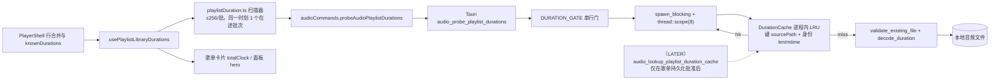

# 播放列表总时长缓存与增量重算契约

## 摘要

目标 1（**导入 / 载入歌单即开始统计总时长**）在代码层面**已经满足**：播放器一载入歌单，`usePlaylistLibraryDurations` 就在隐藏的列表视图之外启动统计，且不等用户打开列表、不等补水泵。用户实际感知的问题不是"没有开始算"，而是"**每次都从头重算，且算得慢**"：每批只有 16 条、同一时刻只有 1 个在途批次、全表串行（跨歌单也串行）、没有跨打开 / 跨重启的记忆；另外列表卡片上的时长在标签通道完成前会显示「时长未知」，看起来像"没在算"。

本期裁决：**采纳方案 C 的方向，但把它拆成两层，只批准第一层**。

- 已批准（本期可实施）：Rust 侧**进程内、按文件身份校验的时长缓存** + **带缓存的批量通道**（每批 ≤256、固定 8 个 worker），前端只对"真正未知"的路径发请求。这一步不改任何 DTO，不改前端可见语义，却同时解决"重复计算"和"算得慢"。
- 已定义、未授权（留给"歌单持久化"任务）：**跨进程持久化**。本文定义它的记录格式、存放位置、失效规则与读取命令契约，但明确要求**不得在本期落盘**，且**不得为了让时长落盘而在歌单持久化未批准前单独引入磁盘缓存**。

两条硬边界：时长**仍然只有一个权威通道**（`audio_probe_playlist_durations`，写入缓存的也必须是这条通道的结果）；`audio_probe_playlist_track_summaries` **继续不含 `durationMs`**（见 R1 的新措辞）。

## 背景

- 用户原话意译：导入歌单时就要开始统计总时长；歌单将长期存储，以后只需读取，增删改歌曲后才更新时长，避免每次打开都重复计算。
- 上一轮（`playlist-track-summaries.md`）已建立"载入即读、按 scope 缓存、pass generation 守卫、整轮一次落地、失败降级不回环"的前端模式，本文件沿用同一套模式，只把"标签"换成"时长"。
- 既有事实（2026-10-19 已核实，见下节）：时长通道每次探测都要打开文件并按 ADTS 扫描 → symphonia 头信息 → lofty → 解码器 `total_duration()` 的顺序走，成本明显高于只读标签；而它**没有任何缓存**，所以同一个文件在每次应用启动、每次歌单重载、甚至每次"等价刷新"都会被重新探测一遍。
- 本轮不涉及媒体库、数据库、SQLite、全库扫描或跨设备同步。

## 范围

1. **现状核对结论**（目标 1 是否满足、用户实际感知到什么）。
2. **裁决表**：对方案 A / B / C 的取舍与本期最小可交付范围。
3. **本期批准契约**：Rust 进程内时长缓存（键、身份校验、容量、淘汰、线程与门模型）+ 复用 `audio_probe_playlist_durations` 命令（批上限 16 → 256、worker 1 → 8）+ 前端增量探测规则。
4. **跨进程持久化契约（已定义、未授权实施）**：记录格式、存放位置、失效规则、读取命令 `audio_lookup_playlist_duration_cache` 的语义，以及它与"歌单持久化"任务之间的边界。
5. **前端职责与守卫**：缓存作用域、与 `knownDurations` 的优先级、何时允许触发重新探测。
6. **必须不回归的不变式**、**风险清单**、**既有文档同步义务**、**Test Agent 验收清单**。

## 不在范围内

- **不做** 歌单持久化（存储格式、导入导出、增删改歌曲的用户流程、歌单文件格式）。该功能仍未批准，见 `docs/roadmap.md` 与 `docs/requirements.md` 的 Deferred 列表。
- **不做** 磁盘缓存的实际写入（本期不创建任何新目录、不写任何新文件）；持久化契约只定义不自造。
- **不做** 把时长并入标签摘要通道（`audio_probe_playlist_track_summaries` 的 DTO 不变）。
- **不做** 内容哈希（BLAKE3）作为默认身份校验——那需要整文件读取，成本高于探测本身；仅在慢盘 / 低精度时间戳分级下作为可选项（见「文件身份校验」）。
- **不做** 文件系统监听（不引入 `notify` 等依赖）、不做后台全库预热、不做启动时扫描。
- **不改** `AudioPlaybackState`、`audio_state_changed`、500ms 轮询、`audio_track_details_changed`；不新增事件通道。
- **不改** `audio_hydrate_track` 补水泵的窗口与并发；不改封面通道（SPXR v1、`audio/covers`、96 MiB 预算）。

## 现状事实（只读核对，2026-10-19）

以下每条都在代码中确认过，不再依赖推断。

| # | 事实 | 证据 |
| --- | --- | --- |
| F1 | ~~"载入即算"已成立~~ **更正（2026-10-20 实施中发现并修复）**：`loadFolderPlaylistSelection` 是**先** `await loadPlaylistTrackOrSkip(...)`（首曲要打开解码器、读元数据，冷盘可长达 1.5 s+），**之后**才 `activatePlaylistScope`，而 `folderPlaylist` 只在那之后才有值。因此时长扫描实际被首曲加载**串行阻塞**，用户在首曲播起来之前返回列表页只能看到「统计中…」。修复方式：加载开始前把歌单描述符单独发布为 `pendingDurationPlaylist`，`playlistDurationTracks` / `playlistDurationScope` 优先取它；`activatePlaylistScope` 完成后清空。实测（1800 首、首曲加载 1.5 s、每批 60 ms）：首个时长批次由 `@1642ms` 提前到 `@40ms`，总量就绪由 ~2453 ms 提前到 ~733 ms。| [useAudioPlayer.ts](../../src/features/player/hooks/useAudioPlayer.ts) 2509-2535、3232-3240；回归用例 `duration scan starts in parallel with the first track load`（`playlistStatisticsPreload.browser.test.mjs`） |
| F2 | 标签摘要 pass 与时长 pass 是两条**互不等待**的通道，各自独立启动。 | `ensurePlaylistSummaries`（useAudioPlayer 835-859、2512）与 `usePlaylistLibraryDurations` 的 effect 无先后依赖 |
| F3 | 时长扫描**串行**：`createPlaylistDurationScanner` 用 `tail` 串行化所有调用（含不同歌单），同一时刻**只有 1 个在途批次**；每批 16 条。 | [playlistDuration.ts](../../src/features/player/model/playlistDuration.ts) 93-131；`usePlaylistDuration.ts` 5 行共享 `scanDuration` 单例；Rust `MAX_BATCH_PATHS = 16` |
| F4 | 后端批次内也是**逐条串行**（`.map(probe_one)`），没有内部并发。 | [playlist_duration.rs](../../src-tauri/src/audio/playlist_duration.rs) 35-38 |
| F5 | 结果**只存内存**：`completedRef` 只活在这个 hook 实例里；组件卸载 / 刷新 / 重启即全部丢失。`sessionPlaylists` 也只是 `useState`（无持久化）。 | `usePlaylistDuration.ts` 35-36、41；`useAudioPlayer.ts` 424 |
| F6 | 已知时长（`knownDurations`）只在**活动 scope** 生效，且只能从活动歌单的行数据反推（要求 `duration > 0`）；非活动歌单完全靠探测。 | `PlayerShell.tsx` 96-109；`usePlaylistDuration.ts` 54、59、89（`noKnownDurations`） |
| F7 | 时长探测**不是纯头读取**：`is_adts_content`（开文件读 2 字节）→ ADTS 走 `symphonia_scanned_duration`（**逐包全文件扫描**）→ 否则 `symphonia_duration`（开文件读头）→ 失败回退 `lofty_duration`（再开一次文件）→ 再失败回退 `open_source().total_duration()`（打开解码器）。 | [duration.rs](../../src-tauri/src/audio/duration.rs) 15-98 |
| F8 | 时长没有缓存层；但同目录已有两套成熟先例：`lyrics_cache.rs`（`track_id` 为键 + mtime/len 指纹 + 有界 LRU，锁内只 stat）与 `cover_cache.rs`（内容哈希命名 + 直写，无上限）。 | [lyrics_cache.rs](../../src-tauri/src/audio/lyrics_cache.rs) 26-150；[cover_cache.rs](../../src-tauri/src/audio/cover_cache.rs) 53-82 |
| F9 | 歌单**卡片**上的总时长在标签 pass 完成前会走回退分支显示「时长未知」（而不是「统计中…」），因为此时 `metadataStatus` 仍为 `loading` 但卡片并不消费它。 | `PlayerShell.tsx` 195-198、218；[PlaylistLibraryPanel.tsx](../../src/features/player/components/PlaylistLibraryPanel.tsx) 237 |
| F10 | `resolvePlaylistDuration` 只有"全部可用文件时长已知"才发布数字；`knownDurations`（补水来源）**优先于**探测结果。 | `playlistDuration.ts` 42-68、48-52 |
| F11 | 现有浏览器测试锁死了：批量 ≤16、`maxActive === 1`、"等价刷新仍重新探测"（`assert probeCount === 2`）。 | `playlistStatisticsPreload.browser.test.mjs` 136-137、168、269（"replacement waits for pending native batch"） |

## 裁决表

### 对方案的裁决

| # | 候选方案 | 裁决 | 理由 / 修正 |
| --- | --- | --- | --- |
| 1 | **A：纯前端内存优化**（把 `knownDurations` 扩展到所有会话歌单，靠标签摘要行补水） | **否决**（只保留其中一半） | 头条理由：**摘要行按契约没有 `durationSeconds`**（`playlistTrackRowFromSummary` 恒为 0，且这是 `playlist-track-summaries.md` R1 定下的不可破坏决定）。要让 A 生效，必须先把时长塞回摘要行，等于重开 R1。另一半（把 `knownDurations` scope 化）是**正确的方向**，并入本期一起做（见裁决 5）。 |
| 2 | **B：Rust 进程内时长缓存 + 批量并发** | **采纳为本期实施层** | 成本最低、语义最窄、不需要任何持久化授权或新目录；直接消除"每次打开都重复计算"的**进程内**部分，并把 16/批串行改成 256/批 8 worker。DTO 不变，前端只在"真正未知"时才发请求 → 现有前端测试语义几乎不动。 |
| 3 | **C：可持久化时长缓存契约** | **部分采纳：契约采纳、实施延后** | 方向正确，但持久化本身**依赖尚未批准的歌单持久化功能**。本期只定义记录格式、位置、失效规则与只读查询命令的语义并声明"未授权落盘"。擅自先落盘会产生第二套失效语义与一个无主的磁盘目录，与 `overall-architecture.md`「不设计…播放列表持久化」及 `playlist-artwork-loading.md`「不在启动时同步扫描衍生缓存」冲突。 |
| 4 | **把时长并入 `audio_probe_playlist_track_summaries`** | **继续禁止**（禁令精化，见下方新不变式） | 两条通道的失败模型不同（标签失败即降级文本；时长失败会翻面总量），线程/门模型也不同（摘要 4 线程纯读；时长要付解码探测成本）。合并后单批 256 个"标签 + 解码探测"的尾延迟会把列表首帧一起拖慢。**正确的合并方式是反过来的**：时长通道在内部复用"读标签"的廉价步骤（`lofty` 头信息预热），而不是让标签通道背时长。 |
| 5 | **`knownDurations` scope 化** | **同意，并入本期** | 现在只有活动 scope 有已知时长，非活动歌单在补水泵还没跑过时只能靠探测。配合 B，让"任何 scope 的已知时长"都能先占位、只探测真正的缺口。**但不得改变优先级**：`knownDurations` 仍然优先于探测/缓存结果（F10 不变）。 |
| 6 | **前端最终数字的守卫规则**（整轮一次 setState、不中途发布部分和） | **同意，保持不变** | 已有测试（失败不发布部分和）必须原样通过。 |
| 7 | **把批上限直接改成 256，且前端常量与 Rust 常量各自硬编码** | **不同意（改为单一常量来源）** | Rust 侧改为 `pub const MAX_DURATION_BATCH_PATHS: usize = 256`，TS 侧新增 `AUDIO_PLAYLIST_DURATION_BATCH_LIMIT` 并**注释声明与 Rust 同源**；两处必须同一次提交修改（沿用摘要通道 R11 的教训）。 |

### 本期最小可交付范围（MUST）

1. Rust：新增 `src-tauri/src/audio/duration_cache.rs`（进程内 `DurationCache`，见契约 D1）。
2. Rust：`playlist_duration.rs` 改为 `spawn_blocking` + `std::thread::scope` 固定 8 worker + 每项先查缓存；`MAX_BATCH_PATHS` 16 → 256；`DURATION_GATE` 保留（时长批之间仍互斥，避免多批同时把磁盘打满）。
3. 缓存**只缓存确定的结果**：`Some(ms)` 与 `None`（已确认未知）；**不缓存错误**（错误重试成本低，缓存错误会让"文件被修好后永远读不出时长"）。
4. TS：`AUDIO_PLAYLIST_DURATION_BATCH_LIMIT = 256`；`createPlaylistDurationScanner` 的批大小引用该常量。
5. TS：`usePlaylistLibraryDurations` 的 `knownDurations` 由"仅活动 scope"改为"按 scope 提供"（语义见 F1 契约段），且**不改变优先级**。
6. 测试与文档同步：见「既有文档的同步义务」与「Test Agent 验收清单」。

### 明确留给"歌单持久化"任务（LATER，需 PM 批准后才可开工）

1. 缓存落盘（新建 `AppPaths.cache_dir()/playlist_durations/`）、读取、原子写、上限与清理。
2. 新命令 `audio_lookup_playlist_duration_cache`（见契约 D2）。
3. 歌单条目"增删改"的用户流程、歌单文件格式、以及"哪些条目需要重算"的计算方。

## 质量属性

| 属性 | 约束 |
| --- | --- |
| 性能 | 命中缓存时单文件成本 = 1 次 `metadata`（stat）；未命中成本不变（不得因为加缓存而多开文件）。整批 256 的并发上限固定为 8 worker，不得用无限并发掩盖延迟。 |
| 启动速度 | 生命周期跟随 `AudioController`（进程内、无预热、无磁盘扫描）；不改变启动顺序，不在启动时读取任何索引。 |
| 内存占用 | 每条目 ≈ 路径（canonical 字符串，通常 < 260 B）+ 数字，1791 首约 0.6 MB 量级；上限按条目数 + 路径字节总和双限（`MAX_ENTRIES = 20_000`、`MAX_PATH_BYTES = 8 MiB`），LRU 淘汰。 |
| 跨平台一致性 | 身份校验只依赖 `fs::metadata` 的 `len` 与 `modified()`；`modified()` 不可用时退化为"不缓存"而不是"缓存且假定不变"。 |
| 可测试性 | `DurationCache` 是纯内存 + 真实临时文件即可测（仿 `lyrics_cache.rs` 测试）；`probe_playlist_durations` 可在 `tauri::async_runtime::block_on` 内直接调用并断言"第二次探测不再打开文件"。 |
| 可维护性 | 缓存逻辑收敛在独立模块；`playlist_duration.rs` 只通过 `cache.get_or_probe` 与之交互；不得让 `duration.rs` 反向依赖 `duration_cache.rs`。 |
| 扩展性 | 进程内缓存与将来的磁盘缓存共用同一个"键 + 身份"定义；DTO 只可增量加字段（前端校验忽略未知字段，沿用摘要通道 R10 规则）。 |
| 权限最小化 | 本期**不新增目录、不新增写权限、不新增网络访问**；持久化阶段只能在 `AppPaths.cache_dir()` 内写入（与 `audio/covers`、歌词缓存同级），不得写入用户音乐目录或歌单文件所在目录。 |

## 建议边界与调用方向



依赖方向规则（必须成立）：

1. `duration_cache.rs` 只依赖 `source.rs`（`input_path` / `track_id` 风格）与标准库；**不得**引用 `metadata`、`cover_cache`、`lyrics_cache`、`tag_writer`、`controller`、`runtime`。
2. `duration.rs` **不得**引用 `duration_cache.rs`（缓存是调用方的关注点，`decode_duration` 保持无状态）。
3. `playlist_duration.rs` 是唯一同时引用"缓存"与"decode_duration"的模块；缓存实例通过参数传入（`impl Fn` / `Option<&DurationCache>`），便于测试注入空缓存。
4. 前端缓存（`completed` map）与后端缓存**互不替代**：前端缓存决定"要不要发请求"，后端缓存决定"发了请求之后要不要打开文件"。

## 数据契约

### D1 进程内时长缓存（本期，Rust）

```rust
// src-tauri/src/audio/duration_cache.rs
pub(crate) struct DurationCache { /* Mutex<Inner>; 锁内只做 stat 与哈希表操作 */ }

/// 一个文件时刻的身份。任一分量缺失或读不到 => 不可校验 => 不缓存。
#[derive(Debug, Clone, PartialEq, Eq)]
pub(crate) struct SourceIdentity {
    pub len: u64,
    pub modified_nanos: i128, // SystemTime 相对 UNIX_EPOCH 的纳秒；超出范围即视为不可用
}

/// 缓存结果。刻意分三种：已知 / 已确认未知 / 不可判定（不缓存）。
pub(crate) enum DurationOutcome {
    Known(u64),      // duration_ms；>= 1
    Unknown,         // 探测成功但容器没有可用时长（对应 DTO 的 durationMs: null, error: null）
    Unavailable,     // 无法校验身份或探测出错：不写入缓存，也不读缓存
}

impl DurationCache {
    pub(crate) const MAX_ENTRIES: usize = 20_000;
    pub(crate) const MAX_PATH_BYTES: usize = 8 * 1024 * 1024;

    /// key 必须由调用方用 `input_path(&source_path)` 得到的 `PathBuf` 的
    /// canonicalize 结果（失败时退化为原样路径）转小写后的字符串；
    /// 与 `source::track_id` 的稳定化口径一致，但不带 `local-` 前缀。
    pub(crate) fn get_or_probe<F>(&self, key: &str, path: &Path, probe: F) -> DurationOutcome
    where
        F: FnOnce(&Path) -> DurationOutcome;

    pub(crate) fn invalidate(&self, key: &str);
    pub(crate) fn len(&self) -> usize;      // 测试与 tracing 用
}
```

语义（必须逐条实现）：

1. **锁粒度**：锁内只做 `fs::metadata` 与哈希表读写；真正的 `decode_duration` 在锁外执行，随后 double-checked 回填（沿用 `lyrics_cache.rs` 的成熟模式）。锁中毒时必须 `tracing::warn` + 降级为直接探测，绝不 panic、绝不让命令失败。
2. **命中判定**：`metadata(path)` 成功且 `(len, modified_nanos)` 与条目一致 → 命中。任何不一致（含文件消失）→ 视为未命中并删除旧条目，再走探测。
3. **回填判定**：探测返回 `Known` 或 `Unknown` **且** 探测前后各取一次 `metadata` 且两次身份一致 → 回填。探测期间 `metadata` 失败或前后不一致（文件正在被写）→ **不回填**（避免把"写一半的文件"的时长固化）。
4. **不缓存错误**：`decode_duration` 返回 `Err` 时只把错误交还调用方，绝不写负缓存。理由：错误多由临时占用 / 权限 / 半写文件引起，负缓存会让用户在修好文件后仍然看不到时长，且需要另一个 TTL 语义。
5. **淘汰**：`entries.len() > MAX_ENTRIES` 或累计 key 字节 > `MAX_PATH_BYTES` 时，从 LRU 队首淘汰直到同时满足；淘汰是 O(1) 摊还，不做全表扫描。
6. **生命周期**：`Arc<DurationCache>` 由 `AudioController` 持有，`Drop` 即释放全部条目；不跨进程、不跨 `AudioController` 重建。不允许暴露任何 TTL——身份即失效依据，加 TTL 会让行为不可预测。
7. **不缓存 `Unavailable`**：不可判定 ≠ 未知，永不写入。
8. **key 与路径的关系**：key 是稳定化后的路径字符串，条目里同时保存**探测时实际使用的 `PathBuf`**（用于之后的 stat）。不要用 `track_id`（`local-` 前缀是前端身份，语义不同）。

### 修改后的命令：`audio_probe_playlist_durations`（本期）

命令名称、输入、输出、错误码**全部不变**（保持前端与既有测试的兼容），只有以下三条内部约束改变：

```ts
// 输入（不变）
type AudioProbePlaylistDurationsInput = { paths: string[] }
// 输出（不变，顺序保持，长度恒等于 paths.length）
type AudioPlaylistDurationItem = {
  sourcePath: string                    // 原样回显请求字符串
  durationMs: number | null             // null = 探测成功但没有可用时长
  error: AudioCommandError | null       // 与 durationMs 恰好一个非空
}
```

| 项 | 旧值 | 新值 | 说明 |
| --- | --- | --- | --- |
| 每批上限 | 16（`INVALID_PATH`） | **256**（`INVALID_PATH`） | 上限是 IPC / 尾延迟约束；`paths` 为空仍返回 `[]` 且不触碰文件系统。 |
| 批次内并发 | 1（`.map(probe_one)`） | **`min(8, 路径数)` 个 `thread::scope` worker**，按下标写回结果槽以保序 | 与 `playlist_summary.rs::probe_batch` 同构（原子计数器领取下标 + 槽位保序）。 |
| 串行门 | `DURATION_GATE` | **保留** `DURATION_GATE` | 时长批之间仍互斥：8 个 worker 已经能打满磁盘序贯带宽，多批并发只会让每个批都变慢并放大机械盘抖动。`DURATION_GATE` 与 `TRACK_SUMMARY_GATE` 继续分离。 |
| 缓存 | 无 | 每项先 `get_or_probe` | 命中时不打开任何解码器；`durationMs` 语义不变。 |
| 逐项 panic | 整批 `INTERNAL_ERROR` | 该 item `INTERNAL_ERROR`，其它项不受影响 | 与摘要通道一致（`catch_unwind` 包裹单路径）。 |

不变的部分（必须逐条保留）：`input_path` 校验（空串 / 全空白 → `INVALID_PATH`）、`validate_existing_file`（不存在 → `FILE_NOT_FOUND`；非普通文件 → `INVALID_PATH`）、`sourcePath` 原样回显、`durationMs === 0` 永不出现（`Known` 恒 ≥ 1）、worker join 失败 → `INTERNAL_ERROR` 且门被释放。

### D2 跨进程持久化（已定义、**本期未授权实施**）

**存放位置**：`AppPaths.cache_dir()/playlist_durations/`，与 `audio/covers` 同级；**不得**写在用户音乐目录、不得写在歌单文件旁边、不得写进 `data_dir`（它不是用户数据，是纯派生缓存，可随时删除）。

**记录格式**（版本化、单文件一个 scope、文件名 = `blake3(scope_key)` 前 16 hex + `.json`）：

```ts
type PlaylistDurationCacheFile = {
  version: 1                        // 不匹配即整体丢弃，不尝试迁移
  scopeKey: string                  // 前端 playlistScope(playlist) 原值，仅用于排障
  playlistSourcePath: string        // 生成该记录时的歌单来源路径（m3u8/目录），仅用于排障
  entries: Array<{
    sourcePath: string              // 原样（不归一化），作为匹配键
    len: number                     // 文件字节数，安全整数
    modifiedNanos: number           // 修改时间（UNIX 纪元纳秒），超出安全整数范围则用 minMs 兜底见下
    durationMs: number | null       // null = 已确认未知
    recordedAt: number              // 写入时间（UNIX 毫秒），仅用于排障与整体过期判断
  }>
}
```

边界与硬化要求：

- **合法上限**：单文件 `entries` 上限 20 000；单文件 8 MiB；超过即视为损坏（`INTERNAL_ERROR` 不返回、按"无缓存"处理）。
- **原子写**：同目录独占临时文件 → 完整写入 → `rename` 发布（Windows 上先 `remove_file` 目标再 `rename`，失败时保留临时文件不阻塞）。本期不实现。
- **顺序**：读取时按 `sourcePath` 建索引；同一 `sourcePath` 出现多次取**第一条**并记 warning。
- **未授权**：任何在"歌单持久化"批准之前自行实现的磁盘写入都将被 Review 驳回（见 R6）。

### D3 持久化只读查询命令（LATER，提前定义语义以免后手改契约）

```ts
// 名称：audio_lookup_playlist_duration_cache
// 语义：只读查询，不探测、不打开音频、不写盘；文件不存在/损坏 => 全部不命中，不报错。
type AudioLookupPlaylistDurationCacheInput = {
  scopeKey: string              // playlistScope(playlist) 原值
  paths: string[]               // ≤256；用于校验身份
}
type AudioLookupPlaylistDurationCacheOutput = {
  items: Array<{
    sourcePath: string          // 原样回显
    durationMs: number | null   // 命中且身份一致时的时长；null 表示"缓存里没有或已失效"
    hit: boolean                // true 仅当存在条目且 len/mtime 与当前文件一致
  }>
  cacheFileFound: boolean       // 仅用于埋点，前端不得据此改变行为
}
```

强制约束：**该命令不得触发探测**（不得调用 `decode_duration` / `open_source*`），不得写盘，不得 cache 缺失时自动补齐（补齐是 `audio_probe_playlist_durations` 的职责）。

### 前端契约（本期）

```ts
// 新增常量，与 Rust MAX_DURATION_BATCH_PATHS 同源（同一提交）
export const AUDIO_PLAYLIST_DURATION_BATCH_LIMIT = 256
```

`usePlaylistLibraryDurations(sources, scope, librarySources, knownDurationsByScope)`：

1. 签名由 `knownDurations: ReadonlyMap<string, number>` 改为
   `knownDurationsByScope: ReadonlyMap<string, ReadonlyMap<string, number>>`；
   或在 `LibraryDurationSource` 上增加 `knownDurations` 字段。二选一，**不得**同时保留旧的全局参数和 scope 参数（避免"两个来源同时生效"）。
2. 每个 task 只把**自己 scope 的** known 传给扫描器；跨 scope 的 known **不得**串用（同一首歌可能属于多个歌单，但 known 的合法性来自该歌单的行数据）。
3. 扫描器的跳过规则（必须与现状一致）：`available === false` 跳过；`validDuration(entry.durationMs)` 跳过；其余按 256/批探测，重复路径去重。
4. `resolvePlaylistDuration` 的优先级**不变**：`knownDurations`（scope 内）> 探测结果。后端缓存只是让探测更快，**绝不允许**出现"缓存值覆盖 known 值"的路径（known 来自当前补水/播放，更新鲜）。
5. 发布规则**不变**：整轮结束才发布；失败不发布部分和；不自动重试成环。
6. 卡片展示：当某 scope 的时长通道仍在 `loading`，卡片 `totalClock` 允许继续回退，但**不得**因为本变更改变回退文案（`formatPlaylistDurationLabel` 不动）。

## 文件身份校验：接口语义与失效规则（问题 3 的正面回答）

| 场景 | 期望行为 | 实现要求 |
| --- | --- | --- |
| 正常文件，未变 | 命中 | `len` + `modified` 一致 |
| **0 字节文件** | **不缓存**（`Unavailable`），每次仍会尝试探测 | 探测前若 `len == 0` 直接返回 `Unavailable`；0 字节不可能是合法音频，缓存它只会把"文件正在被复制"固化 |
| 文件大小相同但内容被替换（换了一首同长度曲目） | 若 mtime 也一致 → **会命中旧值（已知限制）**；否则失效 | 这是本方案接受的成本取舍；缓解：这类替换必然伴随 mtime 变化（除 FAT/粗粒度或刻意回填时间戳）；如将来出现实际误报，由 `playlistSourcePath` 变化或版本号提升来兜底，**不引入内容哈希**（见下） |
| mtime 精度粗（1 s 或 2 s，FAT 为 2 s） | 同秒内改写可能漏检 | 每次写歌单文件（LATER）或应用重启（LATER）都会重新校验；进程内缓存的生命周期本身就短；不对此加 TTL |
| mtime 不可读 / 早于纪元 / 溢出 | **不缓存**（`Unavailable`） | 统一走 `SystemTime::duration_since(UNIX_EPOCH)`，失败即不可用；`i128` 纳秒存储避免 2038/2106 类问题 |
| 网络盘 / UNC 路径 | 行为一致但更慢 | 允许命中（`len` + `modified` 在 SMB 上可用）；`metadata` 失败即不缓存；**不因为"慢"就假定不可信**，也不需要新命令 |
| 文件消失 / 权限变化 | 未命中并删除条目 | `metadata` 失败 → 删除条目 → 交给探测 → 逐项 `FILE_NOT_FOUND` / `UNREADABLE_FILE` |
| 同一路径的多种拼写（`./`、大小写、`\\?\`） | 命中同一 key | key 用 `canonicalize` 后小写；canonicalize 失败才退化 |

**是否需要 `audio_stat` 类命令：不需要，也不应新增。**

- 前端无法、也不需要"预判命中"：它应当直接发批量探测，让后端用缓存把命中项做成零成本。若新增 `audio_stat` 让前端自己算身份，会出现"前端身份判定"与"后端身份判定"两套实现，且前端拿不到 mtime 的精确表示（JSON number 精度、时区、精度丢失）——这正是要避免的双源。
- 唯一的真实需求是**可观测**：`audio_probe_playlist_durations` 的 tracing 应记录 `cache_hits` / `cache_misses` / `worker_count` / `elapsed_ms`，Test Agent 用它证明"第二次探测不再打开文件"。

**是否需要内容哈希：不需要（默认禁止）。** 哈希要求整文件读取；FLAC 整文件读的成本高于一次头信息探测，会把"省时间"变成"更慢"。仅当未来出现"mtime 不可信 + 实测误报"的证据时，由 PM 批准在**持久化层**做可选的分级策略（`len < 阈值` 且 mtime 精度可疑时才算哈希），本期不预留开关。

## 缓存作用域与生命周期（问题 4 的正面回答）

| 维度 | 本期（进程内） | LATER（持久化） |
| --- | --- | --- |
| 作用域 | **全局按路径**（不含 scope） | **按 scope 组织、按路径匹配**（同一个文件出现在两个歌单时各存一份，但读取时仍以路径 + 身份为准） |
| 为什么全局按路径 | 时长是**文件属性**，不是歌单属性；同一首歌在两个歌单里时长必然相同。按 scope 分键会让同一文件被重复探测 | 持久化后文件变大、删除粒度需要跟着歌单走，所以落盘按 scope 分文件 |
| 进程内 vs 磁盘 | 仅进程内；`Drop` 即清空 | `cache_dir/playlist_durations/*.json`，可随时删除 |
| 上限与淘汰 | `MAX_ENTRIES = 20_000`，`MAX_PATH_BYTES = 8 MiB`，LRU | 同上（进程内）+ 磁盘上限（文件数 / 总字节，数值由持久化任务依基线确定） |
| 与 `knownDurations` 的优先级 | **known 优先**；缓存只加速探测 | 同左 |
| 与探测错误的优先级 | **错误 > 缓存**（缓存不存错误，因此不存在"错误被缓存"） | 同左 |
| 失效触发器 | 身份变化、条目淘汰、进程退出 | 身份变化、条目淘汰、歌单增删改后由歌单任务显式 `invalidate` 或整体重写、`version` 升级 |

**"knownDurations 是否要与缓存合并成一个来源"：不合并。** 两者生命周期与可信度不同（known 来自当前会话的补水与播放，缓存来自历史探测），合并会让 `resolvePlaylistDuration` 的语义和既有测试全部失效，也会重新打开时长双源问题。

## 必须交给实现 Agent 的风险清单

| 编号 | 风险 | 机制 | 缓解 / 验收 |
| --- | --- | --- | --- |
| **R1** | 时长双源（既有禁令，**新措辞**） | 若有人把 `durationMs` 加进 `audio_probe_playlist_track_summaries`，标签通道与时长通道会各自发布总时长，`PlayerShell.knownDurations` 从行数据反推后会覆盖探测值，总量在 ADTS/AAC 上可跳数百毫秒 | **新不变式**：「播放列表时长的**唯一权威通道**是 `audio_probe_playlist_durations`（及其内部缓存）。任何其它批量通道（含 `audio_probe_playlist_track_summaries`）**不得**返回 `durationMs`。缓存**不是**第二个权威：它只能由该通道的探测结果写入、只能被该通道读出，并且必须携带可校验的文件身份（`len` + `modified`）；身份不一致时必须回落到重新探测。前端"已知时长"（knownDurations）仍优先于任何缓存值。」验收：摘要 DTO 序列化断言不含 `durationMs`；缓存模块无独立写入口（无"从前端写入缓存"的 command）。 |
| **R2** | 跨进程持久化抢跑 | 实现者看到本文的 D2 就顺手写 `cache_dir/playlist_durations` | 本期明确不实现；PR 中出现对该目录的任何 `fs::write` 即驳回；Test Agent 断言"运行测试后 `cache_dir` 下不新增 `playlist_durations` 目录" |
| **R3** | 缓存把 0 时长 / 半写文件固化 | `len == 0` 或探测期间文件正在增长时回填，之后永远命中 | `len == 0` → `Unavailable`；回填前 double-check 身份；回填前后不一致则不写 |
| **R4** | 负缓存被滥用 | 为了"省掉错误重试"把 `Err` 也缓存，用户在修好文件后仍看不到时长 | 只缓存 `Known` / `Unknown`；`Err` 永不缓存；验收：损坏文件 → 修复 → 再探测能拿到时长且未重启 |
| **R5** | 缓存掩盖真实文件变更 | 同长度替换 + 同 mtime（粗粒度或刻回填） | 接受为已知限制；不引入哈希；验收记录该限制；若将来出现用户可见误报，返回 PM 决定是否在持久化层做分级哈希 |
| **R6** | 磁盘目录无主增长 | 持久化若不做上限与清理，会像 `audio/covers` 一样成为第二个无界目录 | LATER 阶段必须同时交付上限与清理；在此之前不新建任何目录 |
| **R7** | 前端常量与 Rust 常量漂移 | 16/256 两端各写一份 | 单一常量名 + 同源注释 + 同一次提交；TS 在 `invoke` 前拒绝超限并直接降级 |
| **R8** | 批上限放大后单批尾延迟变长 | 256 条 × 机械盘 + ADTS 全扫描，最坏单批可能数百 ms 到秒级 | 固定 8 worker；保留 `DURATION_GATE`；前端仍按批顺序、同一时刻 1 个在途批；验收记录 256 条批的 p50/p95 与"首个可见总量"的时间 |
| **R9** | 并发打开解码器影响正在播放的曲目 | 8 个 worker 同时 `open_source` 会与播放线程争抢 IO / 句柄 | worker 数固定为常量并要求实测记录；`decode_duration` 已优先用头信息路径；验收：批量探测期间切歌不出现额外延迟或爆音 |
| **R10** | 锁内做重 I/O | 在 `Mutex` 内调用 `decode_duration` 会让 8 worker 退化为串行 | 锁内只 stat；探测在锁外；double-checked 回填；验收：缓存 miss 的 8 并发吞吐与"无缓存但 8 worker"一致 |
| **R11** | 缓存掩盖 `decode_duration` 的 provider 差异 | 不同 provider（symphonia / lofty / 解码器）对同一文件可能有几十 ms 差异，命中缓存后不再复现差异 | 缓存只保存**最终 `duration_ms`**，不保存 provider；不要求 provider 稳定；前端不展示 provider |
| **R12** | 打破既有前端测试 | 批上限 16→256、"等价刷新仍重新探测"、`maxActive === 1`、取消语义都被测试锁死 | 允许的改动只有"每批路径数从 ≤16 变为 ≤256"；**不得**放宽 `maxActive === 1`、不得取消"等价刷新重新探测"、不得让取消后残留批继续发布。测试改动必须逐条在提交说明中列出（见 AC-14） |
| **R13** | `knownDurations` scope 化改变优先级 | 两个来源同时生效或 known 被缓存覆盖 | 签名只保留 scope 版本；`resolvePlaylistDuration` 的合并顺序不动；验收：非活动歌单的 known 能被用上，且活动歌单总量与改动前完全一致 |
| **R14** | 缓存条目爆炸 | 用户反复导入大量目录，路径条目无界增长 | 双上限 + LRU；验收：容量上限测试（用小 capacity）证明淘汰顺序正确 |
| **R15** | 慢盘 / 网络盘把缓存收益吃掉 | 网络盘每次 stat 也慢，命中率再高也快不了多少 | 不把"慢盘变快"写成目标；只承诺"不再重复打开解码器"；验收记录本地盘与网络盘两组 |
| **R16** | 把"载入即算"误读为"没在算" | 卡片在标签 pass 完成前显示「时长未知」 | 不改文案（属 UI/UX 范围）；本文件只记录事实 F9，若要改必须另立 UI 任务并同步 `playlistCopy` |

## 必须不回归的不变式

1. **单一时长权威**：见 R1 新措辞；摘要通道 DTO 不含 `durationMs`；缓存无外部写入口。
2. **只缓存由权威通道产生的结果**：缓存只能被 `probe_playlist_durations` 写入与读取；不得接受前端提供的时长值。
3. **身份即失效**：没有可校验身份的条目不得命中，也不得写入；不引入 TTL。
4. **不缓存错误**。
5. **无新增磁盘写入（本期）**：不新建目录、不写文件；`audio_probe_playlist_durations` 依旧是纯读。
6. **不打开解码器做非必要工作**：缓存命中路径不得调用 `decode_duration` / `open_source*` / `read_metadata`。
7. **有界批量**：≤256 路径/批；≤8 worker；跨批串行（`DURATION_GATE`）；前端同一时刻 1 个在途批。
8. **顺序保持与逐项错误**：`Vec` 长度与顺序恒等于请求；除超限与 worker join 失败外不整批失败；单路径 panic 只污染该项。
9. **前端发布语义不变**：整轮一次 setState；失败不发布部分和；不自动重试成环；`knownDurations` 优先。
10. **导航与补水不变**：`queueTracks` 身份、补水泵窗口/2 并发、封面通道、`AudioPlaybackState`、事件通道全部不动。
11. **不新增 Tauri 命令（本期）**：命令清单保持 21 个；`audio_lookup_playlist_duration_cache` 属 LATER。

## 既有文档的同步义务

| 文档 | 谁改 | 必须写入的内容 |
| --- | --- | --- |
| `docs/architecture/real-audio-playback.md` | Architecture Agent（下次编辑时） | ①「范围」第 49 行的 21 个命令清单**不变**（本期不新增命令），但补一句：`audio_probe_playlist_durations` 每批上限为 256、进程内带身份校验的时长缓存，见 `playlist-duration-cache.md`。②新增或改写 `audio_probe_playlist_durations` 小节，写入"批上限 256 / 8 worker / 保留 `DURATION_GATE` / 缓存只加速不改变语义"。③「契约一致性与偏差 → 与批准范围一致」表新增一行：「播放列表时长 | 时长唯一权威为 `audio_probe_playlist_durations`；进程内缓存以 `len + mtime` 校验身份、只缓存探测结果、不缓存错误；批量标签通道不含时长。」④「不在范围内」补一句：不做跨进程时长索引（持久化时长缓存需歌单持久化批准）。 |
| `docs/architecture/playlist-track-summaries.md` | Architecture Agent（下次编辑时） | ①「演进路径」第 2 条"DTO 追加 `durationMs`"必须标注 **Superseded**，指向本文件的 R1。②「范围 / 不在范围内」中的禁令原文保留，并追加一句「禁令的精化措辞见 `playlist-duration-cache.md` R1」。③R17 行改为指向本文件。 |
| `docs/architecture/playlist-artwork-loading.md` | Architecture Agent（下次编辑时） | 「吞吐」行（当前写"列表标签摘要是第三条有界通道…"）追加：「时长通道是第四条有界通道：每批 ≤256、进程内 ≤8 个探测线程、`DURATION_GATE` 批间串行、前端同一时刻 1 个在途批次。」「启动」行追加：「时长缓存为进程内、无预热、启动时不扫描任何索引。」 |
| `docs/architecture/overall-architecture.md` | Architecture Agent | 不需要改：本期不引入持久化，仍与「不设计播放列表持久化」一致；LATER 阶段获批时才需要在此补持久化边界。 |
| `docs/implementation/real-audio-backend.md` | Rust/Tauri Agent | 刷新「已注册 Tauri command」清单与"时长缓存"模块说明（与本文 D1 对齐）。 |
| `docs/implementation/frontend-architecture.md` | Frontend/Documentation Agent | 补一句：时长通道的批上限常量与 Rust 同源；`knownDurations` 改为按 scope。 |
| `README.md` | Documentation Agent | 文档索引在「播放列表曲目标签摘要批量读取契约」之后追加本文件链接。 |
| `docs/decisions/` | PM Agent | 建议（非本轮产物）在歌单持久化立项时补一条决策记录：「时长缓存随歌单落盘 vs 独立派生缓存」，本文已给出倾向（独立派生缓存 + 按 scope 分文件）。 |

## Test Agent 验收清单

**Rust / 契约（本期）**

- [ ] **AC-01** 批上限：257 路径整批 `INVALID_PATH`；256 路径被接受（即使全部无效）；空 `paths` 返回 `[]` 且不触碰文件系统（临时目录快照证明）。
- [ ] **AC-02** 顺序 / 重复 / 回显：同一路径重复、含 `./` 的等价路径、含 Unicode 与空格的路径，输出长度与顺序一致、`sourcePath` 逐字相同，且**同一路径在一次批内只探测一次**（tracing 计数或注入 probe 计数证明）。
- [ ] **AC-03** 并发：256 条批的 worker 数为 `min(8, n)`；`maxActive` 语义（同一时刻一个在途批）由前端测试覆盖，Rust 侧断言 `DURATION_GATE` 仍串行化两个并发调用。
- [ ] **AC-04** 缓存命中：同一路径连续两次调用，第二次不打开解码器（用 tracing `cache_hits` 或注入计数器证明），`durationMs` 完全相同。
- [ ] **AC-05** 身份失效：改写文件（改变 mtime 或 len）后再次调用 → 重新探测并返回新值。
- [ ] **AC-06** 0 字节：`len == 0` 的文件不写入缓存（连续两次调用都重新探测/报错，且内存条目数不增）。
- [ ] **AC-07** 错误不缓存：先对损坏文件探测（返回 `UNSUPPORTED_FORMAT`/`UNREADABLE_FILE`），再用合法音频替换同一路径并（若 mtime 未变则）确认行为符合契约——至少证明"错误没有写进缓存"（条目数、或直接以 `Known` 覆盖后仍能重新探测）。
- [ ] **AC-08** 已知未知（`durationMs: null, error: null`）可被缓存，但**不得**变成 `0`。
- [ ] **AC-09** 淘汰：用小 capacity 构造超限，LRU 最久未用条目被淘汰；`MAX_PATH_BYTES` 超限同样触发淘汰。
- [ ] **AC-10** 锁与 panic：注入 panic 的单项只让该项返回 `INTERNAL_ERROR`，其它项正常，`DURATION_GATE` 被释放，下一批可用；锁中毒降级为直探不 panic。
- [ ] **AC-11** 只读与预算：批量探测前后音频文件字节与 mtime 不变；`cache_dir` 与 `config_dir` 的文件集合与字节不变（本期证明"没有新增磁盘写入"）。
- [ ] **AC-12** 模块边界：`duration_cache.rs` 不引用 `metadata` / `cover_cache` / `lyrics_cache` / `tag_writer` / `controller` / `runtime`；`duration.rs` 不引用 `duration_cache`。
- [ ] **AC-13** 摘要通道不含时长：`audio_probe_playlist_track_summaries` 的序列化输出中不存在 `durationMs`（沿用既有断言），且本期未改动该 DTO。

**前端 / 回归（本期）**

- [ ] **AC-14** 既有行为逐条保留（`playlistStatisticsPreload.browser.test.mjs`）：批量 `≤ 256`（原 `≤ 16` 断言改为 `≤ 256`，必须在提交说明中显式列出该行变更）、`maxActive === 1`、进入列表 / 切歌不重复探测、等价刷新保留旧总量但后台重探、多列表缓存与取消、失败不发布部分和、卸载后不发布迟到结果。**任何其它断言的放宽都视为回归。**
- [ ] **AC-15** scope 化 knownDurations：非活动歌单的已知时长能被用上（不触发探测即可发布）；活动歌单的总量与改动前**完全一致**（同一 fixture 前后比对）。
- [ ] **AC-16** 常量同源：TS 侧 `AUDIO_PLAYLIST_DURATION_BATCH_LIMIT` 与 Rust 侧 `MAX_DURATION_BATCH_PATHS` 都为 256，且超限时前端在 `invoke` 前抛错并降级（不无限 loading）。
- [x] **AC-14a** 扫描与首曲加载并行（2026-10-20 新增，见 F1 更正）：首曲加载被 gate 住时，`audio_probe_playlist_durations` 必须已经发出至少 1 个批次；此时总量仍为 `loading`（未发布部分和）。回归用例：`duration scan starts in parallel with the first track load`。**若此断言失败，即代表 "统计中…" 会重新出现在返回列表页的场景里。**
- [ ] **AC-17** 不回归的 UI 语义：卡片 `totalClock`、面板 hero、`统计中…` / `统计失败` / `时长未知` 文案与改动前一致；点击行播放目标正确；上一首/下一首与四种 shuffle 不变。

**证据 / 性能（本期）**

- [ ] **AC-18** 冷 / 热对比：同一 1791 首列表，冷启动（空缓存）与第二次载入（缓存命中）分别记录总耗时、每批 p50/p95、`cache_hits`/`cache_misses`、`worker_count`，并确认热路径无解码器打开。
- [ ] **AC-19** 播放期间批量探测不干扰播放：探测 256 条批的同时切歌 / 播放，记录无明显额外延迟与无音频异常。

**LATER（歌单持久化批准后另行验收，本期不执行）**

- [ ] **AC-20** `audio_lookup_playlist_duration_cache` 不触发探测、不写盘；文件缺失 / 损坏 / `version` 不匹配 → 全部 `hit: false` 且不报错。
- [ ] **AC-21** 落盘原子性：写入中断后重启，读到的是旧版本或新版本，不是半个 JSON；磁盘上限与清理生效。
- [ ] **AC-22** 增删改后增量：删除一首不重算其余；新增一首只探测该首；改路径只改该项。

## 风险（超出实现清单的架构层风险）

- 本文的 D2/D3 是**契约先行**：如果后续"歌单持久化"任务改变歌单身份（例如改用稳定 ID 而不是 `playlistScope`），`scopeKey` 与 `playlistSourcePath` 的含义必须由该任务重新定义 D2 的 `scopeKey` 字段，而不是让 `playlistScope` 悄悄改变。届时需要本文的修订版。
- 若前端把"缓存命中"当成"数据新鲜"，会开始省略 `knownDurations` 的更新路径；这会让刚编辑过的文件（例如重新编码）在播放前显示旧时长。R1 已把 known 的优先级钉死，Frontend Agent 不得改动 `resolvePlaylistDuration` 的合并顺序。
- 本期把批上限从 16 提到 256，会让"首个可见总量"的粒度变粗（第一批覆盖 256 首而不是 16 首）——对 1791 首的列表总耗时是改善，但对 40 首的小列表没有任何影响（单批）。若将来出现 300–500 首列表"等第一批才出数"的观感问题，应由 UI 决定是否展示"统计中…"而不是回到小批量。
- 缓存只解决"重复计算"，不解决"第一次打开仍是全量探测"。真正的"长期存储后只读"必须靠 LATER 的持久化，且它依赖歌单持久化本身——不要用本期的缓存去承诺用户"以后再也不会算"。

## 建议下一负责 Agent

- **Rust/Tauri Agent（本期先行）**：实现 `duration_cache.rs`、`playlist_duration.rs` 的 8 worker + 256 上限 + 缓存接入，并交付 AC-01～AC-13。
- **Frontend Agent（可与上并行，写集不重叠）**：`AUDIO_PLAYLIST_DURATION_BATCH_LIMIT` 与 `createPlaylistDurationScanner` 的批大小、`usePlaylistLibraryDurations` 的 scope 化 known，以及 AC-14～AC-17。
- **Test Agent**：独立执行 AC-01～AC-19，重点 AC-04 / AC-05 / AC-11 / AC-14（"没有新增磁盘写入"与"既有前端语义未被放宽"）。
- **Documentation Agent**：`README.md` 索引与 `docs/implementation/*` 同步。
- **PM Agent**：决定是否把「歌单持久化」立项；立项后以本文 D2/D3 为输入，再交 Architecture Agent 出修订版与决策记录。
