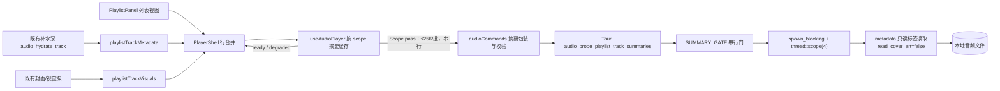

# 播放列表曲目标签摘要批量读取契约

## 摘要

当前播放列表的行文本（标题 / 艺术家 / 专辑）由前端**伪造**：`playlistTrackSummaries` 把艺术家和专辑填成播放列表名，非活动列表浏览路径则退化为 `本地音频`；真实标签只能通过重路径 `audio_hydrate_track`（校验 + 打开解码器 + 解码时长 + 读标签 + 写封面缓存 + 读 sidecar 歌词）在**可见窗口**内按 2 并发逐首补齐。因此 1791 首的列表在用户滚动到某一行之前，该行必然是假数据。

本文批准新增一条**只读标签批量通道** `audio_probe_playlist_track_summaries`：一次请求最多 256 个路径，只读标签、不打开解码器、不写任何文件、不读 sidecar 歌词，顺序保持、逐项错误；前端在列表激活/浏览时对整表分块跑一次，按 scope 缓存并在整轮结束后一次性落地，列表在落地前显示明确的加载态而不是假数据。

与 Lead 提出的草案相比，本文的关键变更有：不返回 `durationMs`（避免出现时长双源翻面，见「必须交给实现 Agent 的风险清单」R1）；线程模型收敛为「单 `spawn_blocking` + `std::thread::scope` 4 线程 + 独立串行门」，不新建常驻线程池；摘要使用**独立状态槽**，既不写入 `playlistTrackMetadata`（首写优先会截断后续补水），也不写入 `queueTracks`（会改变导航依赖身份）；守卫改为 scope 键 + pass generation，而不是全局 epoch。

## 背景

- 占位来源一：[useAudioPlayer.ts](../../src/features/player/hooks/useAudioPlayer.ts) 的 `playlistTrackSummaries`（约 236-245 行）在 `activatePlaylistScope` 里为全表生成 `title = fileNameTitle(fileName)`、`artist = playlistDisplayName(playlist)`、`album = playlistDisplayName(playlist)`（缺失文件为 `<name> · 歌曲未找到`）。
- 占位来源二：[PlayerShell.tsx](../../src/features/player/components/PlayerShell.tsx)（约 58-60 行）浏览非活动会话列表时用 `audioTrackToTrack(audioFolderTrackPlaceholder(item))` 建行，艺术家/专辑变成 `本地音频`。
- 唯一的真实来源：`audio_hydrate_track` → [source.rs](../../src-tauri/src/audio/source.rs) `hydrate_track_ref` → `validate_existing_file` + `open_source`（完整解码器打开）+ `decode_duration` + `read_metadata`（[metadata.rs](../../src-tauri/src/audio/metadata.rs) 会经 `cover_cache.rs` 写封面到应用缓存目录，并在无内嵌歌词时扫父目录读 `.lrc`）。前端由 `setVisiblePlaylistTrackIds` / `pumpPlaylistMetadataHydration` 限制在可见窗口、2 并发。
- 实测（Lead，用户真实列表 `D:\SpMusic\.codex\网易-我喜欢.m3u8`，1791 条存在条目，多数为 E:\Music 下的 FLAC/MP3）：`lofty` 以 `ParseOptions::new().read_cover_art(false)` 读全部 1791 首标签，8 线程 56 ms、4 线程 36 ms，前 40 首 1-3 ms；`symphonia` 头信息时长探测约 0.25 ms/首。即「只读标签」比现行补水路径便宜约 3 个数量级。
- 已有同类先例：`audio_probe_playlist_durations`（[playlist_duration.rs](../../src-tauri/src/audio/playlist_duration.rs)），16 路径/批、`spawn_blocking` + `OnceLock<Arc<Mutex<()>>>` 串行门、逐项 `{sourcePath, durationMs, error}` DTO、前端在 [audioCommands.ts](../../src/features/player/services/audioCommands.ts) 严格校验。
- 用户明确选择「列表加载时读完整表的标签，让用户看/滚之前数据就已经在」。

## 范围

- 定义 `audio_probe_playlist_track_summaries` 的输入 / 输出 DTO、批上限、错误语义、只读边界、线程与门模型。
- 定义前端按 scope 的摘要缓存、启动时机、分块与单飞、代次守卫、落地（commit）策略、淘汰上限与降级语义。
- 定义列表行 / 队列行的合并顺序与视觉一致性规则，以及「不得伪造文本」的约束。
- 列出必须同步修改的既有架构文档与必须原样保留的不变式文本。
- 给出 Test Agent 可直接映射的验收清单。

## 不在范围内

- 不实现持久化标签索引、媒体库、mtime 增量扫描、后台全库预热、SQLite 或任何磁盘缓存。
- 不改变封面通道：`audio_load_playlist_cover_pixels` 的 SPXR v1 契约、`audio/covers` 原图缓存、列表封面 session generation、96 MiB 受管预算全部不动。
- 不改变时长权威：`audio_probe_playlist_durations` 与 `usePlaylistLibraryDurations` / `playlistDuration.ts` 的语义本轮不变。
- 不通过既有重路径实现摘要：摘要路径严禁调用 `hydrate_track_ref` / `read_metadata` / `open_source*` / `decode_duration`（那会写封面缓存、读 sidecar 歌词并打开解码器）。
- 不引入新事件通道（`audio_state_changed` / `audio_track_details_changed` 不变），不把摘要放进轮询。
- 不新增 Rust 依赖、权限、网络访问或插件边界。

## 质量属性

| 属性 | 约束 |
| --- | --- |
| 性能 | 单批 256 路径在后端为 10 ms 量级；1791 首约 7 批。并发上限固定（每 scope 1 个在途批次、进程内 4 个标签读线程），不得用无限并发掩盖延迟。 |
| 启动速度 | 命令只在用户打开或浏览播放列表时按需调用，不在应用启动、不在启动时扫描磁盘。 |
| 内存占用 | 摘要按 scope 缓存，量级约 0.5–0.7 MB/1791 首；缓存 scope 数必须设上限（建议 8，LRU）。不驻留歌词、封面字节或 data URL。 |
| 跨平台一致性 | DTO 与平台无关；路径由 Rust 原样回显，前端按索引映射到 `AudioFolderTrackRef.id`，不依赖分隔符或大小写。 |
| 可测试性 | 命令可被 Rust 单测直接调用（含空批、超限、缺失、损坏文件、并发/取消/panic）；前端可注入假 `probe` 走确定性单测。 |
| 可维护性 | 只读模块不得 import `cover_cache` / `lyrics_cache` / `tag_writer` / `source::open_source` / `duration::decode_duration`；边界靠模块引用与测试双重固定。 |
| 扩展性 | DTO 只可**增量**加字段；前端校验必须忽略未知字段、严格校验位置与类型，避免后端加字段导致整表降级。 |
| 权限最小化 | 只读取用户显式打开的列表所指明的本地音频路径；不写文件、不新增目录、不访问网络。 |

## 建议边界与调用方向



职责与写入边界：

| 归属 | 范围 | 说明 |
| --- | --- | --- |
| Architecture Agent | 本文件 | 只读评审；不改任何 `src/`、`src-tauri/` 文件。 |
| Rust/Tauri Agent | `src-tauri/src/audio/playlist_summary.rs`（新）、`types.rs`、`metadata.rs`（新增只读函数）、`audio/mod.rs`、`src-tauri/src/lib.rs` | DTO 契约的权威方；必须同时补 ts-rs/camelCase 序列化测试与只读边界测试。 |
| Frontend Agent | `services/audioCommands.ts`、`hooks/useAudioPlayer.ts`、`components/PlayerShell.tsx`、`components/PlaylistPanel.tsx`、`model/playerUiViewModel.ts`、`model/audioTrackModel.ts`（如需新映射函数） | 摘要缓存、门控、行合并、加载态；不得改动补水泵的窗口语义。 |
| UI/UX Agent | 加载态视觉与文案（`model/playerCopy.ts`） | 必须与「尚未打开音频」空态区分。 |
| Test Agent | 独立验收 | 见「Test Agent 验收清单」。 |
| Documentation Agent | `README.md` 文档索引、`docs/implementation/*` 同步 | 见「既有文档的同步义务与必须保留的不变式」。 |

## 决策裁决（对 Lead 草案逐项）

| # | Lead 决策 | 裁决 | 理由 / 修正 |
| --- | --- | --- | --- |
| 1 | 新命令 `audio_probe_playlist_track_summaries`，输入 `{paths: string[]}` | **同意** | 与 `audio_probe_playlist_durations` 同构，复用既有前端严格校验与逐项错误习惯；后端保持无状态（不引入 playlist session）。 |
| 2 | 输出 `{sourcePath, summary／null, error／null}`，顺序保持 | **同意**（补充不变式） | 必须显式规定 `summary` 与 `error` 恰好一个非空；`sourcePath` 原样回显（不归一化、不改大小写）；`error` 复用既有 `AudioCommandError`。 |
| 3 | `summary` 字段集：title/artist/album/albumArtist/durationMs/bitDepth/sampleRateHz/bitrateKbps/codec | **变更** | **移除 `durationMs`**（见风险清单 R1：会出现时长双源与总量翻面，且 ADTS/AAC 上 lofty 估算与 `decode_duration` 的 packet-scan 可差数百毫秒）。其余字段保留，`codec` 必须沿用「扩展名大写」推导（见「命令契约」字段语义表）。 |
| 4 | 批上限 256，超限返回 `INVALID_PATH` | **同意** | 上限是 IPC 负载/延迟约束而非 CPU 约束；与 duration 命令的错误码保持一致（枚举内无 `INVALID_ARGUMENT`）；TS 端必须在 `invoke` 前用同一常量拒绝。 |
| 5 | 新模块 + `spawn_blocking` + 4 线程内部池 + 独立串行门 | **变更（简化）** | 不需要常驻自定义线程池：**1 次 `spawn_blocking` 内用 `std::thread::scope` 起 `min(4, 分块数)` 个线程**即可，配合独立 `SUMMARY_GATE`；permit 必须由阻塞 worker 持有（取消调用方不得提前释放）。严禁向 OPT-0001 单线程解析 worker 投递任务。 |
| 6 | 前端摘要缓存由 `useAudioPlayer` 持有 | **同意**（修正键与生命周期） | 缓存键为 **`playlistScope(playlist)` 字符串 + pass generation**，**不随 `playlistScopeEpochRef` 清空**；`activatePlaylistScope` 现有的清理块**不得**加入摘要（否则激活前的在途结果被丢弃，见风险清单 R6）。 |
| 7 | 按 epoch 守卫，切 scope 丢弃旧结果 | **变更** | scope 切换**不取消**已启动的 pass：结果只写自己的 scope key，由 `passGeneration` 与描述符快照校验，污染风险为零；用全局 epoch 会让「浏览→激活」这一正常流程丢结果。 |
| 8 | 分块调用、整轮结束标记 ready（含失败降级） | **同意**（补充落地策略） | 中途只累积到 ref，**整轮结束一次性 setState**（避免 1791 行分 7 次发布引起 7 次整列表重渲与几何重测）。失败即 `degraded`，不得自动重试循环。 |
| 9 | 保持 `audio_hydrate_track` 窗口化补水泵不动 | **同意** | 它仍是歌词、封面 `filePath`、`hasLocalArtwork`、音频格式与行时长的唯一来源；摘要**不得**写 `hasLocalArtwork`、不得写歌词、不得成为时长权威。 |
| 10 | 列表行由摘要构建，落地前显示加载态 | **同意**（补充条件） | 加载态不得复用 `Empty` 的「尚未打开音频」文案；不得吞掉一次性 `entryPosition`（当前曲定位 / 回到顶部）——行落地后必须再执行一次；搜索在未 ready 时禁用或明确提示。 |
| 11 | 行视觉与后续补水结果一致（同一回退规则） | **同意** | 回退规则固定为：`title → 文件名去扩展名`、`artist → albumArtist → 本地音频`、`album → 本地音频`；`codec` 与 `audioFormat` 必须与 `read_embedded_metadata` 同源同算法，否则补水后行内格式文案会变。 |

额外批准：本命令**不做后端缓存、不做磁盘缓存、不做 mtime 索引**。以实测成本（整表 36–56 ms）为由引入第二套失效语义属过度设计，且与「不建立媒体库 / 不做持久索引」的既定边界冲突。

## 命令契约

### `audio_probe_playlist_track_summaries`

用途：为播放列表的**整表**读取展示用标签快照（标题、艺术家、专辑、专辑艺术家、音频格式），供列表在用户查看前就绪。**不是**歌曲详情通道，不替代 `audio_hydrate_track`。

输入：

```ts
type AudioProbePlaylistTrackSummariesInput = {
  paths: string[]
}
```

输出（顺序保持，长度恒等于 `paths.length`）：

```ts
type AudioPlaylistTrackSummaryItem = {
  sourcePath: string                     // 原样回显请求字符串
  summary: AudioPlaylistTrackSummary | null
  error: AudioCommandError | null        // 复用既有 { code, message, recoverable }
}

type AudioPlaylistTrackSummary = {
  title: string | null
  artist: string | null
  album: string | null
  albumArtist: string | null
  bitDepth: number | null
  sampleRateHz: number | null
  bitrateKbps: number | null
  codec: string | null
}
```

字段语义：

| 字段 | 语义 | 必须与既有实现一致的点 |
| --- | --- | --- |
| `sourcePath` | 请求中的字符串**原样**回显（不 canonicalize、不改大小写、不换分隔符）。前端按**索引**映射到描述符 id，不按路径字符串重建 id。 | 与 duration 命令相同。 |
| `title` / `artist` / `album` / `albumArtist` | 取自 `primary_tag().or(first_tag())`，**原样**取值，不做 trim、不把空串转 null。空白归一化由前端 `nonEmptyText` 负责。 | 与 `metadata.rs::metadata_from_tag` 完全一致；`albumArtist` 走 `ItemKey::AlbumArtist`。 |
| `bitDepth` / `sampleRateHz` / `bitrateKbps` | 取自 `tagged_file.properties()`。 | 与 `AudioFormatMetadata` 同源同类型。 |
| `codec` | **必须是** `path.extension()` 转大写，**不是**容器真实 codec 名。 | 与 `read_embedded_metadata` 一致；否则补水后行内格式文案会从 `FLAC` 变成其它字符串。 |
| 无标签但可读 | `summary` 非空，文本字段可为 null；这是「标签缺失」，**不是**错误。 | 与 `read_metadata` 的「无标签返回空字段」一致。 |

显式禁止出现在 DTO 中：`lyrics`、`coverArt`（含 `filePath` / `dataUrl` / `byteLen`）、`genre` / `year` / `trackNumber` / `discNumber` / `comment`、`durationMs`、文件大小、mtime、解码结果。新增字段只能追加且必须保持"展示用、非解码、非歌词、非封面"。

硬约束（验收必须逐条证明）：

1. **只读标签**：实现使用 `Probe::open(path)?.options(ParseOptions::new().read_cover_art(false)).guess_file_type()?.read()`（`options` 必须在 `guess_file_type` 之前，`guess_file_type` 会保留 options）。
2. **不写任何文件**：不写音频标签、不写 `audio/covers`、不写任何缓存或索引；不得调用 `read_metadata`（它会经 `cover_art_from_tag` 写封面缓存）。
3. **不读 sidecar 歌词**：不得调用 `read_sidecar_lyrics*` / `resolve_sidecar_lyrics` / `LyricsCache`。
4. **不打开解码器**：不得调用 `open_source` / `open_source_fast` / `SymphoniaAudioSource`，也不得调用 `decode_duration`。
5. **不 import 写能力**：本模块不得引用 `tag_writer`（沿用 OPT-0002 的只读路径不变式）。
6. **批量有界**：`paths.len() > 256` 整批拒绝（`INVALID_PATH`），不做部分执行；`paths` 为空返回 `[]` 且不触碰文件系统。
7. **逐项错误**：单个路径的任何错误只进 `item.error`，不得使整批失败；唯一的整批失败是超限与 worker 失败（`INTERNAL_ERROR`）。
8. **不触达运行时**：不得投递到 OPT-0001 的解析 worker、不得与音频 runtime 线程共享状态或锁。

错误语义：

| 情况 | 结果 |
| --- | --- |
| 空串 / 全空白路径 | `item.error.code = INVALID_PATH` |
| 路径不存在 | `FILE_NOT_FOUND` |
| 存在但不是普通文件（目录等） | `INVALID_PATH` |
| 打不开 / 读 IO 失败 | `UNREADABLE_FILE` |
| 无法识别为受支持容器 | `UNSUPPORTED_FORMAT` |
| 标签读取成功但没有标签 | `summary` 非空、字段可全为 null、`error = null` |
| 批内某路径失败 | 其它项不受影响，顺序与长度不变 |
| 批量超过 256 | 整个命令返回 `INVALID_PATH`（`Vec` 不返回） |
| 阻塞 worker join 失败 / panic | `INTERNAL_ERROR`，串行门必须被释放，下一批可正常执行 |

所有逐项错误的 `recoverable` 为 `true`（批内继续）。

线程与门模型：

```rust
const MAX_BATCH_PATHS: usize = 256;
const SUMMARY_WORKERS: usize = 4;
static SUMMARY_GATE: OnceLock<Arc<Mutex<()>>> = OnceLock::new();
```

- 入口：`pub async fn probe_playlist_track_summaries(input) -> Result<Vec<AudioPlaylistTrackSummaryItem>, AudioCommandError>`。
- 先做超限 / 空批判断（不触碰文件），再 `SUMMARY_GATE.lock_owned().await`，把 permit **移入** `spawn_blocking` 闭包（照抄 [playlist_duration.rs](../../src-tauri/src/audio/playlist_duration.rs) 的 `run_duration_worker` 模式），在闭包内用 `std::thread::scope` 起 `min(SUMMARY_WORKERS, 分块数)` 个线程按下标写回结果槽以保序。
- `SUMMARY_GATE` 与 `DURATION_GATE` **必须分开**：duration 单批要付出解码探测成本，摘要批是毫秒级；共用一个门会让摘要在 duration 全库扫描期间排队等待。
- 注册：`audio/mod.rs` 增加 `mod playlist_summary;` 与 `pub use playlist_summary::probe_playlist_track_summaries;`；`lib.rs` 增加 `#[tauri::command] async fn audio_probe_playlist_track_summaries(...)` 并加入 `generate_handler!`（位置建议紧随 `audio_probe_playlist_durations`）。

## 前端缓存与门控契约

状态（`useAudioPlayer` 持有，唯一所有者）：

```ts
type PlaylistTrackSummaryRow = Pick<
  PlaylistTrackVisual,
  'id' | 'title' | 'artist' | 'album' | 'fileExtension' | 'coverTone' | 'audioFormat'
> // 刻意不含 durationSeconds / hasLocalArtwork

type PlaylistScopeTrackSummaries = {
  status: 'loading' | 'ready' | 'degraded'
  passGeneration: number
  trackIdsKey: string                          // 提交前用于校验描述符未变
  byTrackId: Readonly<Record<string, PlaylistTrackSummaryRow>>
}
```

- 存储：`useRef<Map<scope, PlaylistScopeTrackSummaries>>`（累积与守卫）+ 一份 `useState<Readonly<Record<scope, PlaylistScopeTrackSummaries>>>`（渲染用，整轮一次发布）。
- **不得**写入 `playlistTrackMetadata`：`commitPlaylistTrackMetadata` 是首写优先（`if (playlistTrackMetadataRef.current[id]) return`），摘要抢先落地会让后续补水提供的歌词 / 封面 / `hasLocalArtwork` / 时长被静默丢弃。
- **不得**写入 `queueTracks`：`queueTracks` 是 `resolveNextTrackIndex`、`queueTrackIndexRef`、`prefetchAdjacentPlaylistTracks`、`changeFolderTrack`、`selectQueueTrack` 的输入与依赖，改写会带来身份抖动与重复预取，却对导航没有任何收益。

启动时机（三者合一，缺一漏都会把等待拉长）：

1. 用户打开的列表：在 `loadFolderPlaylistSelection` 内、`await loadPlaylistTrackOrSkip(...)` **之前**就要启动整表 pass（否则首曲加载 + 补水完成后才开始，用户已经看到了列表）。
2. 浏览非活动会话列表：`PlayerShell.browsePlaylist(scope)` 调用 `ensurePlaylistTrackSummaries(scope)`。
3. 兜底：`activatePlaylistScope` 时若该 scope 无缓存或无在途 pass，则启动。

对外 API（建议）：`ensurePlaylistTrackSummaries(scope: string): void`（幂等）+ 读取用 `playlistTrackSummaries: Readonly<Record<scope, PlaylistScopeTrackSummaries>>`。

分块与单飞：

- 单 scope 内按 256 路径分块，**同一时刻仅 1 个在途批次**；跨 scope 同样串行（同一时刻进程内只有 1 个在途 `invoke`），但活动 / 正在浏览的 scope 的 pass 优先于后台 scope。
- 已在缓存中且 `status !== 'loading'` 的 scope 不重复发起；pass 进行中被再次 `ensure` 不产生第二个 pass（幂等）。

守卫（每个批次的响应提交前必须全部成立，否则丢弃）：

1. `store.get(scope)?.passGeneration === passGeneration`（同 scope 有更新 pass 时旧批作废）。
2. 响应逐项校验：`response[i].sourcePath === requestPaths[i]`、`summary`/`error` 恰好一个非空、`code` 为字符串、数值字段为 `number | null`；**未知额外字段必须忽略**（前向兼容），非法则整批按 protocol error 处理。
3. 提交前重新比对 scope 内描述符 id 序列摘要（`trackIdsKey`）：不一致（列表被替换 / 重排 / 删除）则丢弃整轮、把该 scope 置回 `loading` 并发起新 pass；若该 scope 已不在 `sessionPlaylists` 中，则直接删除缓存条目。
4. 映射按**索引**：`byTrackId[requestDescriptors[i].id] = row`，行 id 来自描述符快照，绝不从 `sourcePath` 重新推导。

落地与降级：

- 整轮结束（全部批次返回 / 提前中止）后**一次** `setState`：全部批次成功 → `ready`；任一失败 → `degraded`（保留已成功项）。
- 批次抛错即中止该 scope 剩余批次（协议错与 invoke 错同处理），**不做自动重试**，避免渲染循环重试与错误放大；`degraded` 的行按「行合并与视觉一致性」的回退规则渲染。
- 任何路径下都不得长期停留在 `loading`；`degraded` 也必须渲染真实回退行。
- 淘汰：摘要缓存按 scope 保留最近使用的至多 8 个（或等价字节上限），超出按 LRU 丢弃；淘汰只影响未来重进，不影响当前 scope 的 `ready`。
- 组件卸载清理（沿用现有 effect cleanup 的位置）清空 map 与 state；`activatePlaylistScope` 的清理块**保持只清 `playlistTrackMetadata` / `playlistTrackVisuals` / 队列**，不清摘要。

## 行合并与视觉一致性

`PlayerShell` 的合并顺序必须为：

```ts
const row = { ...queueTrack, ...summaryRow, ...playlistTrackMetadata[queueTrack.id], ...playlistTrackVisuals[queueTrack.id] }
```

即：摘要 < 补水元数据 < 窗口视觉。这样补水一旦落地就会覆盖摘要（值通常相同，因此不产生重绘），`hasLocalArtwork` 仍然只能由补水/视觉写入。

回退规则（与 `audioTrackToPlaylistVisual` 完全一致，不得另立一套）：

| 行字段 | 取值 |
| --- | --- |
| `title` | `nonEmptyText(summary.title) ?? fileNameTitle(descriptor.fileName)` |
| `artist` | `nonEmptyText(summary.artist) ?? nonEmptyText(summary.albumArtist) ?? '本地音频'` |
| `album` | `nonEmptyText(summary.album) ?? '本地音频'` |
| `fileExtension` | `fileExtension(descriptor.fileName)` |
| `coverTone` | `coverToneForTrackId(id)`（与补水一致，不新增随机值） |
| `audioFormat` | `{ bitDepth, sampleRateHz, bitrateKbps, codec }`（`codec` 为扩展名大写） |
| `hasLocalArtwork` | **不写**（保持 `undefined`）。[PlaylistCard.tsx](../../src/features/player/components/PlaylistCard.tsx) 已把 `undefined` 定义为「未知」：不显示音符图标、不闪空封面。 |
| `durationSeconds` | 本轮**不由摘要提供**；行时长继续来自补水或时长探测。 |

删除伪造文本（不可只靠 UI 遮住）：

- `playlistTrackSummaries(playlist)` 不再写 `artist = playlistName` / `album = playlistName`，改为中性空串（`artist: ''`、`album: ''`）。`TrackSummary` 的字段是必填字符串，用空串是为了让任何遗漏路径最多显示空白，**不可能**再次把播放列表名当成艺术家。
- 缺失文件的信息由既有机制承载：`unavailableTrackIds` → 卡片 `data-unavailable` 与「暂不可用」徽标；播放尝试时 `missingPlaylistTrackError` 的 toast。**不需要**用伪造的 `· 歌曲未找到` 承载。
- `PlayerShell` 浏览非活动列表的 `audioFolderTrackPlaceholder` 建行路径改为摘要行；摘要缺失时用中性行（`fileNameTitle` + 空艺术家）。

队列面板同一规则：`PlayerQueueViewModel.tracks` 必须消费同一份合并后的行（当前 `queue.tracks` 直接取 `queueTracks`，仍会显示伪造艺术家）。两条面板不得出现同一首歌文本不一致。

## 既有文档的同步义务与必须保留的不变式

本变更必须由 owner 同步以下文档（Architecture Agent 本次只写本文件，其余为移交项）：

1. **`docs/architecture/real-audio-playback.md`**（Architecture Agent，下次编辑时）
   - 「范围」中的 command 清单需加入新命令（该处现有「13 个已注册 command」表述已过时，`lib.rs` 现为 19 个，新增后 20 个，必须一并校正）。
   - 「Command 契约」新增 `audio_probe_playlist_track_summaries` 小节（可直接搬运本文「命令契约」）。
   - 「数据契约」新增 `AudioProbePlaylistTrackSummariesInput` / `AudioPlaylistTrackSummaryItem` / `AudioPlaylistTrackSummary`。
   - 「元数据边界」新增一条：批量标签摘要只读标签、`read_cover_art(false)`、不写封面缓存、不读 sidecar `.lrc`、不打开解码器、不改文件。
   - 「不在范围内」新增：不做播放列表标签索引/缓存/后台全库扫描/mtime 增量索引。
   - 「契约一致性与偏差 → 与批准范围一致」表：新增「播放列表标签摘要批量读取」行，并把既有行改写为（**原文必须保留并追加**）：
     > 元数据低频传输 | `AudioPlaybackState` 与 `audio_state_changed` 保持轻量；路径、歌词、封面、完整标签只经低频 `AudioTrackRef` / `audio_hydrate_track` 传输。`audio_probe_playlist_track_summaries` 是另一条**请求/响应式、按列表 scope 整表单次**的批量通道，只返回展示用标签快照（不含歌词、封面、data URL、时长），不进入 `audio_state_changed`、播放进度轮询或任何事件 payload，也不替代 `audio_hydrate_track` 的完整详情。
   - 「验收标准」与「风险」各新增一条（批量通道不得退化为解码/封面读取）。

2. **`docs/architecture/playlist-artwork-loading.md`**（Architecture Agent，下次编辑时）
   - 本文与「启动」不变式**不冲突，但必须精确改写**，否则会被读成冲突。质量属性表「启动」行由
     > 不在打开列表时预解码整库，也不在启动时同步扫描整个衍生缓存。

     改为
     > 不在打开列表时预解码整库（不打开解码器、不解码音频、不生成封面），也不在启动时同步扫描整个衍生缓存；允许在列表激活时批量**只读标签**（`audio_probe_playlist_track_summaries`，每批 ≤256、纯读、不写盘、不读 sidecar 歌词），它不构成解码或封面工作。

   - 「吞吐」行在「前端元数据和视觉补水分别最多两个活动任务」之后追加：`列表标签摘要是第三条有界通道：每 scope 同时 1 个在途批次、跨 scope 串行、进程内 4 个读线程`。「不能通过无限并发掩盖延迟」必须原样保留。
   - 「当前数据流与契约」第 2 条的「元数据补水与封面补水各有有限任务数，过期结果不会写入新列表」必须原样保留；可在其前后追加摘要通道的 scope 守卫描述。
   - 候选一 / 二 / 三（缩略图缓存、虚拟化、传输优化）**全部不受影响**：摘要不写 `audio/covers`、不改变 SPXR v1、不解码图片。

3. **`docs/implementation/frontend-architecture.md`**（Frontend/Documentation Agent）：第 437 行「前端必须分离两类状态……」段落需追加一句摘要通道的边界（请求/响应式批量、不含歌词与封面、不进高频状态）。

4. **`docs/implementation/real-audio-backend.md`**（Rust/Tauri Agent）：「已注册 Tauri command」清单已落后于实现（缺 `audio_probe_playlist_durations` 等），建议一并刷新并加入新命令。

5. **`README.md`**（Documentation Agent）：文档索引在「真实音频播放架构」之后追加本文件链接。

6. 建议（非本轮产物）：`docs/decisions/2026-10-19-playlist-track-summaries.md` 记录「批量只读标签 vs 扩大补水窗口」的取舍；需 PM Agent 决定是否立项。

## 必须不回归的不变式

1. 无磁盘写入：不写音频文件、不写 `audio/covers`、不写任何缓存 / 索引 / 临时文件。
2. 不打开解码器：不使用 `open_source*`、`SymphoniaAudioSource`、`decode_duration`。
3. 不读 sidecar 歌词、不读封面字节；不受理 `read_metadata` 的副作用路径。
4. 有界批量：≤256 路径/批；每 scope ≤1 在途批；进程内 ≤4 个标签读线程；单 scope 分块数 = `ceil(N/256)`。
5. 顺序保持与逐项错误：`Vec` 长度与顺序恒等于请求；除超限与 worker 失败外不得整批失败。
6. Scope 与代次守卫：过期批次只能被丢弃，绝不能写入另一个 scope 或以旧描述符写入新列表。
7. 优雅降级：`ready` 与 `degraded` 都必须渲染真实行；任何失败路径都不得停留在加载态。
8. 封面与 `hasLocalArtwork` 不受影响：摘要不写 `hasLocalArtwork`；`audio_load_playlist_cover_pixels`、列表封面 session、96 MiB 预算、SPXR v1 均不变。
9. 既有补水泵不改：`audio_hydrate_track`、`setVisiblePlaylistTrackIds`、`pumpPlaylistMetadataHydration` / `pumpPlaylistVisualHydration` 的窗口与 2 并发语义保持原样。
10. 高频通道不变：`AudioPlaybackState` 字段、`audio_state_changed`、500ms 轮询、`audio_track_details_changed` 均不新增摘要数据；不新增事件通道。
11. 时长权威不变：时长仍由 `audio_probe_playlist_durations` / 补水提供，摘要不提供 `durationMs`。
12. 导航语义不变：`queueTracks` 的结构、顺序与身份不被摘要改写。

## 必须交给实现 Agent 的风险清单

| 编号 | 风险 | 机制 | 缓解 / 验收 |
| --- | --- | --- | --- |
| R1 | 时长双源翻面 | 若摘要带 `durationMs`：`PlayerShell.knownDurations` 由行数据反推，`resolvePlaylistDuration` 让 known 优先于探测结果，摘要落地后总量会从探测值跳到标签值；ADTS/AAC 上 lofty 时长为码率估算，`decode_duration` 有专用 packet-scan 路径，二者可差数百毫秒；`playlistCardContentShape` 的 format 位也会随之翻转 | 本轮从 DTO 移除 `durationMs`，行时长维持现状。若 PM 坚持，必须同时把 `usePlaylistLibraryDurations` 的 known 映射改为 scope 化并规定「同一 scope 内已发布的时长不得被另一来源改写」 |
| R2 | 列表整表几何重测 | `playlistCardContentShape` / `shapeKey` 依赖 `durationSeconds`、`fileExtension`、`audioFormat`；若摘要在行已挂载后提供 `audioFormat`，`shapeKey` 变化触发 `usePlaylistContentWindow` 重新测量 1791 张卡片 | 摘要落地必须早于行挂载（加载态 → ready 才渲染行）；验收要求「ready 之后不得再因摘要触发整表重测」 |
| R3 | 补水被静默截断 | `commitPlaylistTrackMetadata` 是首写优先；摘要写进 `playlistTrackMetadata` 会让后续歌词 / 封面 / `hasLocalArtwork` / 时长永不落地 | 摘要使用独立状态槽；验收：ready 后仍能观察到补水带来的歌词与封面 |
| R4 | 导航依赖身份抖动 | 写 `queueTracks` 会产生新数组 → `trackSummaryEqual` 不等 → `changeFolderTrack` / `selectQueueTrack` / `prefetchAdjacentPlaylistTracks` 依赖变化并重复触发；`resolveNextTrackIndex` 读 `category ?? album`（本地音频恒有 `category`） | 摘要只做 overlay，不改 `queueTracks`；验收：上一首 / 下一首 / 四种 shuffle 行为与改动前一致 |
| R5 | 行 ↔ 描述符错配 | 用 `sourcePath` 重算 `local-` 短哈希会引入大小写 / 分隔符 / UNC 归一化差异，导致 `queueTrackIndexRef` / `findIndex` 查不到 id | 严格按响应索引映射到请求时的描述符 `id`；验收：点击任意行播放的正是该行 |
| R6 | 激活前的结果被丢 | `activatePlaylistScope` 会 `playlistScopeEpochRef += 1` 并清空补水状态；摘要若沿用全局 epoch，则「打开列表时立即启动」的 pass 会在激活时整轮作废 | 摘要用 scope key + pass generation，不用全局 epoch；`activatePlaylistScope` 的清理块不得触碰摘要 |
| R7 | 切列表 / 重排 / 删除后的迟到批次 | 浏览 A 后立刻切到 B，A 的剩余批次仍在飞；未来若支持列表重排 / 删除，描述符 id 序列会变 | 三条守卫（passGeneration、逐项回显、`trackIdsKey`）+ scope 不存在即删缓存；验收：快速连续切换 5 个列表后无错行、无串数据 |
| R8 | 内存与状态 churn | 1791 行 × 8 字段字符串约 0.5–0.7 MB/scope；逐批 setState 会重渲整表 7 次 | 单 scope 一次发布；缓存 scope 数 LRU ≤8；验收：DevTools 记录无逐批重渲 |
| R9 | 高频通道被污染 | 有人把摘要塞进 `AudioPlaybackState` 或新开事件通道"顺便"送达 | 契约禁止；验收：`AudioPlaybackState` 序列化字段与事件 payload 与改动前完全一致 |
| R10 | 前端校验过严导致整表降级 | 若校验拒绝未知字段，后端将来加字段会让 1791 行全部降级 | 校验规则：忽略未知字段、严格校验长度 / 位置 / 必填类型 |
| R11 | 批上限双端漂移 | TS 与 Rust 各写一个 256，任一改动都会让整批被拒 | 两端常量必须同源注释并同时修改；TS 端在 `invoke` 前拒绝并直接标记 `degraded`（不是无限 loading） |
| R12 | 并发与磁盘争用 | 4 线程对机械盘可能无收益；误投递到 OPT-0001 单线程解析 worker 会阻塞当前曲目解析 | 线程数固定为常量并有实测记录；模块不得引用解析 worker / runtime；验收：批量读期间切歌不出现额外延迟 |
| R13 | 只读边界回归 | 图省事复用 `read_metadata` 会写封面缓存 + 读 sidecar `.lrc`，直接违反 OPT-0002 与本文不变式 | 模块引用测试 + 「带内嵌封面的文件批读后，`cache/audio/covers` 文件数与字节不变、`.lrc` 未被读取」证据 |
| R14 | 慢盘 / 网络盘 | 每项 2 次 `stat`（`exists` + `is_file`）；1791 项在网络盘会显著变慢 | 验收记录本地盘与网络盘两组数据；不因慢盘放弃"整表预读"（用户已明确选择该取舍） |
| R15 | 加载态吞掉定位与搜索 | 一次性 `entryPosition`（当前曲定位 / 回到顶部）与搜索都依赖行的存在；面板空态文案是「尚未打开音频」 | 加载态不复用 `Empty` 文案、不设置 `initialPositionAppliedRef = true`；行落地后重新执行一次定位；未 ready 时禁用搜索并提示 |
| R16 | 误以为「歌曲未找到」必须由文本承载 | 现有伪造艺术家里携带了缺失信息 | 缺失信息由 `unavailableTrackIds` + 「暂不可用」徽标 + 播放时 toast 承载；不得为信息量保留占位 |
| R17 | 为非活动列表算总量时双源并存 | `usePlaylistLibraryDurations` 目前只对活动 scope 传入 `knownDurations`，其余 scope 全量走解码探测 | 本轮不改变；若后续要让摘要参与时长，必须同时把 known 映射 scope 化，避免两套来源并存 |

## 备选方案与取舍

- **方案 A：保持现状（窗口化补水）** — 不满足用户需求：1791 首中未滚动到的行永远是伪造文本；搜索也建立在假数据上。放弃。
- **方案 B：把补水窗口/并发放大到整库** — 每首要打开解码器、解码时长、写封面缓存、扫父目录 `.lrc`，比只读标签贵约 3 个数量级，且违反 [playlist-artwork-loading.md](./playlist-artwork-loading.md) 与 BUG-0016 确立的有界并发不变式。放弃。
- **方案 C：新增只读标签批量命令（采纳）** — 成本数量级最低、语义最窄（只读、无写、无解码）、可逐项降级、可复用 duration 命令的成熟模式。
- **方案 D：后端带 mtime 的持久标签缓存 / 索引** — 引入第二套失效语义与磁盘写入边界，属媒体库范围，需 PM 另批。本轮放弃。
- **方案 E：一次请求返回整库（不分块）** — 违反有界批量，且失败时无法部分降级，也无法在慢盘上给用户渐进反馈。放弃。
- **方案 F：用事件流式推送摘要** — 需要新事件通道与背压，且与「元数据不进事件 payload」不变式冲突。放弃。

## 演进路径

1. 本轮：只读标签批量通道 + scope 缓存 + 加载态；时长、封面、补水泵全部不动。
2. 可选下一步（需证据）：DTO 追加 `durationMs`，让摘要预占时长探测的重复工作，并把 `usePlaylistLibraryDurations` 的 known 映射 scope 化；前提是 ASTS/AAC 与 `decode_duration` 的一致性有实测数据。
3. 可选（需 PM 批准）：媒体库范围内的持久标签索引，届时摘要命令可成为索引填充的读取原语，但命令契约与只读边界保持不变。
4. 稳定边界：Rust 侧"只读、不解码、不写盘、逐项错误、有界批量"，前端侧"scope 键缓存 + pass generation 守卫 + 一次性落地"，这两条在后续演进中不得改变。

## 验收标准

- 本文档存在且包含完整 front matter（`doc_id: ARCH-PLAYLIST-TRACK-SUMMARIES`，`owner_agent: Architecture Agent`）。
- `audio_probe_playlist_track_summaries` 的输入、输出、字段语义、错误语义、批上限与只读边界在本文件可被实现 Agent 直接转写。
- 文档明确 `summary` / `error` 互斥、`sourcePath` 原样回显、`codec` 用扩展名大写推导、本轮不含 `durationMs`。
- 文档明确摘要不得写入 `playlistTrackMetadata` 与 `queueTracks`，且不得写 `hasLocalArtwork`。
- 文档明确 `audio_hydrate_track` 窗口化补水泵、封面通道、时长通道、高频状态通道全部不变。
- 文档给出既有文档（`real-audio-playback.md`、`playlist-artwork-loading.md`）需要保留与改写的具体文本。
- 文档给出「Test Agent 验收清单」中的全部检查项，可逐条映射为验证动作。

## Test Agent 验收清单

**Rust / 契约**

- [ ] AC-01 序列化为 camelCase：`sourcePath` / `summary` / `albumArtist` / `bitDepth` / `sampleRateHz` / `bitrateKbps` / `codec`，且不存在 `source_path` 等下划线键。
- [ ] AC-02 顺序、重复与回显：同一路径重复出现、含 `./` 的等价路径、含 Unicode 与空格路径，输出长度与顺序与请求一致、`sourcePath` 逐字相同。
- [ ] AC-03 空批：`{"paths": []}` 返回 `[]`，且不产生任何文件系统访问（可用不存在路径 + 临时目录快照证明）。
- [ ] AC-04 超限：257 路径被整批拒绝且 `code === "INVALID_PATH"`；256 路径被接受（即使全为无效项）。
- [ ] AC-05 逐项错误码：空串 / 目录路径 → `INVALID_PATH`；不存在 → `FILE_NOT_FOUND`；损坏文件 → `UNSUPPORTED_FORMAT` 或 `UNREADABLE_FILE`；其它项仍成功。
- [ ] AC-06 无标签文件：`summary` 非空、文本字段为 null、`error` 为 null。
- [ ] AC-07 只读证明：对含内嵌封面的音频批读前后，音频文件字节与 mtime 不变；`cache/audio/covers` 文件数与字节不变；同名 `.lrc` 不被读取（可用改名/删除 `.lrc` 后结果不变 + 代码级引用检查双重证明）。
- [ ] AC-08 模块引用检查：`playlist_summary.rs` 不引用 `cover_cache` / `lyrics_cache` / `tag_writer` / `open_source` / `decode_duration` / `read_metadata`。
- [ ] AC-09 `codec` 与补水一致：同一文件由摘要与 `audio_hydrate_track` 得到的 `audioFormat` 四字段完全相同（含 `codec` 为扩展名大写）。
- [ ] AC-10 门隔离与释放：worker panic 返回 `INTERNAL_ERROR` 且下一批可用；调用方取消不提前释放 permit；摘要批不被 duration 门阻塞（或至少不互相串行化到可观测的等待）。
- [ ] AC-11 性能记录：在用户真实列表规模（约 1800 项）上记录总耗时、每批 p50/p95、线程数，并确认期间无解码器打开、无磁盘写入。

**前端 / 归约**

- [ ] AC-12 加载 → ready：列表打开后先出现明确加载态（非「尚未打开音频」），随后一次性出现完整真实行；不存在任何帧显示播放列表名充当艺术家/专辑。
- [ ] AC-13 降级：注入使第二批抛错的假 probe → 该 scope 进入 `degraded`，行按 `title→文件名 / artist→本地音频 / album→本地音频` 渲染，且不重试、不停留加载态。
- [ ] AC-14 scope 守卫：A → B → A 快速切换、以及在 A 的 pass 在途时激活 A，均不得把 A 的数据写进 B，也不得丢掉 A 的合法结果；scope 不在 `sessionPlaylists` 时缓存被删除。
- [ ] AC-15 合并优先级：补水落地后行的 `hasLocalArtwork` 由补水写入（`undefined` → 真实布尔），摘要不写该字段；补水值覆盖摘要值且不产生可见文本闪变。
- [ ] AC-16 一次发布 / 无整表重测：一轮 pass 只产生一次摘要 state 更新；ready 之后不再因摘要触发 `shapeKey` 变化或整表几何重测。
- [ ] AC-17 面板一致性：播放列表面板与队列面板对同一首显示相同文本；`playlistDisplayName` 不再出现在行构建路径（代码检查 + 搜索验证）。
- [ ] AC-18 行为不回归：当前曲定位 / 回到顶部仍生效；搜索在 ready 后可用且命中真实标签；上一首 / 下一首 / 四种 shuffle；点击行播放目标正确；封面仍异步补齐；时长总量显示与改动前一致。

**手动 / 矩阵**

- [ ] AC-19 素材矩阵：有完整标签、部分标签、无标签、文件缺失、文件损坏、超长中文标签 / 混排、FLAC 24bit、MP3 VBR、AAC/ADTS 各若干，对照补水结果人工抽检 20 行。
- [ ] AC-20 慢盘：在网络盘或限速盘上重复 AC-12，记录观感与耗时，确认加载态可感知且不误报失败。

## 风险（超出实现清单的架构层风险）

- 若实现方把「列表加载时读整库标签」自行扩张为「加载时读整库元数据（歌词/封面）」，会直接推翻 [playlist-artwork-loading.md](./playlist-artwork-loading.md) 的启动与吞吐不变式，并使 BUG-0016 类内存问题回归。
- 摘要与时长/封面通道的三条并行通道需靠本文的守卫与无写入边界维持一致性；缺少 AC-14 / AC-16 的自动化，回归会以"偶发错行 / 偶发卡顿"形式出现，难以定位。
- 本轮不移除 `audio_probe_playlist_durations` 的全库探测，因此在"标签已全读"的前提下仍会打开解码器做时长探测（约 1791 次文件打开）。这是刻意保留的次要成本，避免在无 ADTS 证据时引入时长双源。
- `sessionPlaylists` 本身无上限增长（既有行为），摘要缓存的上限只能约束本条通道；若将来列表数量变大，需要 PM 决策列表生命周期。

## 建议下一负责 Agent

- **Rust/Tauri Agent**：实现「命令契约」中的命令、DTO、模块与门模型，并补齐 AC-01～AC-11 的 Rust 证据。
- **Frontend Agent**：实现「前端缓存与门控契约」「行合并与视觉一致性」，移除伪造文本，并补齐 AC-12～AC-18。
- **UI/UX Agent**：定义加载态视觉与文案（`appCopy.playlistPage`），与空态明确区分。
- **Test Agent**：独立执行「Test Agent 验收清单」全部检查项，重点是 AC-07 / AC-08 / AC-14 / AC-16。
- **Documentation Agent**：「既有文档的同步义务与必须保留的不变式」中 `README.md` 与 `docs/implementation/*` 的同步；`real-audio-playback.md` / `playlist-artwork-loading.md` 的正文改动仍归 Architecture Agent。
- **PM Agent**：决定是否需要独立决策记录，以及是否批准"摘要预占时长探测"的后续阶段。
