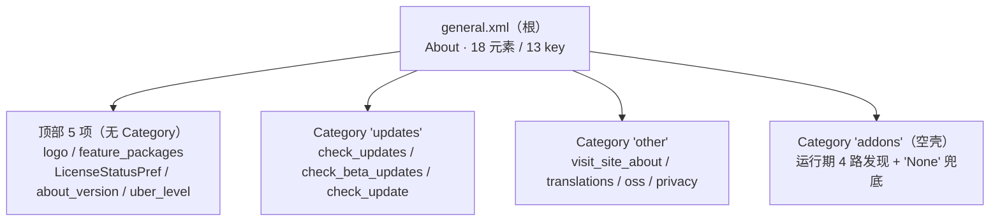
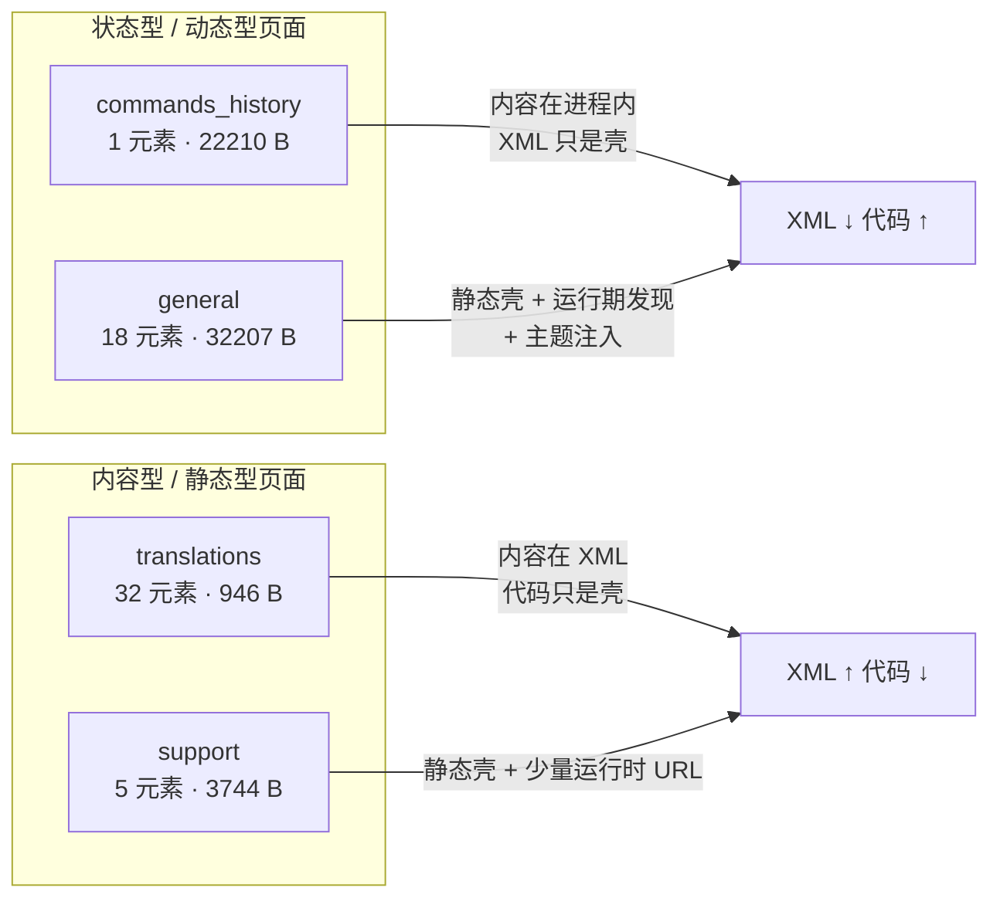

# Poweramp「关于 / 技术支持 / 命令历史 / 翻译」偏好结构

> **⚠️ 本文已被同一分支的四份新文档取代（2026-11-07）。**
>
> | 文档 | 覆盖层 |
> | --- | --- |
> | `poweramp-about-branch-overview.md` | 分支总览（入口索引，建议先读） |
> | `poweramp-about-general-page.md` | 根页层（`general.xml` 18 元素 + `r91` + 7 个自定义控件） |
> | `poweramp-about-subpages.md` | 子页层（`feature_packages` + `translations`） |
> | `poweramp-about-runtime-deps.md` | 运行期依赖（许可页 WebView、授权状态机、检查更新、`addons`） |
>
> **本文保留原样仅供对照**（`status: draft`）。经本轮逐字节复核，本文有 **4 处需要修正**：
>
> | # | 本文原说法 | 实测 |
> | ---: | --- | --- |
> | 1 | `w:skipSearch` 的 `"huawei"` 会按渠道分支 | `u9.х()` 只认 `play`(`:539`)/`pa`(`:555`)，**无 huawei 分支** ⇒ 该 token 是死值 |
> | 2 | `vr` 里 `check_updates` 有字段与默认值 | **无 `vr` 字段**（`sput` 缺失），全树零消费者 |
> | 3 | `у->q` idx1 / `у->n0` idx0 是 removeAsNeeded styleable | 本 build 为 **`qt0->r0`（单元素）**；`q0` 是 `RawTextPreference` 的 37 元素数组 |
> | 4 | `h0->w0` 位掩码 | 实际在 **`ׅ/wr;->w0`**（`wr.smali:1749`，槽位 `0x4c`=76） |
>
> 另：本文并列的 `support` / `commands_history` **不属于 `general` 子树**（它们是设置根页「其他」分类的独立入口），
> 本文的覆盖范围比标题暗示的更宽，阅读时请注意分支边界。


> **证据分级**：【实证·原文】= XML/资源原文；【实证·产物】= 反编译 smali 产物；【推断】= 无直接代码佐证。
>
> 所有结论基于 **build-1035-bundle-play**（`versionCode 1035009`）。
>
> **共享机制不重述**：三层骨架、分发表、`n91` 基类契约、`h()`/`i()` 移除、对话框族、监听器工厂、`"global"` 偏好文件、深链协议一律见 `poweramp-settings-page-runtime.md`（下称**运行时文档**），本文只写这四页**自己的**东西。

## 0. 一句话结论

这四页是 Poweramp 设置树里**体量最小、但形态最两极分化**的一组：`general`（18 元素 / 32 KB helper）是**自定义控件与运行期发现逻辑的密度峰值**，`commands_history`（**1 元素 / 0 key**）把整个页面在构造后 `removeAll()` 再逐条现场生成，`translations`（32 元素 / 1 key）则**一行绑定代码都没多写**，只占用通用 helper `z61` 的 41 行（946 B）一个 `switch` 分支。**XML 体积与代码体积在两个方向上彻底倒挂**——`commands_history` 是「空壳 XML + 巨量代码」（89.9×），`translations` 是「厚重 XML + 极薄代码」（有效代码仅占所属 helper 的 0.8%）——这个反差不是巧合，而是**同一套框架对"内容型页面"与"状态型页面"给出的两种不同解法**。

---

## 1. 文档定位

| 文档 | 覆盖范围 | 与本文关系 |
| --- | --- | --- |
| **本文** | `general` / `support` / `commands_history` / `translations` 四页的身份、元素、helper、资源 | — |
| `poweramp-settings-root-structure.md` | 根页索引、11 个一级目标规模、三大机制字面值 | **上游**，本文只引用 §3.1/§3.2/§4 |
| `poweramp-settings-page-runtime.md` | 三层骨架、分发表、`n91` 契约、五大交互机制、存储 | **上游**，本文只引用，不重述 |
| `poweramp-background-settings.md` | 单页深挖的写法样本 | 写作体例参照 |

### 1.1 与运行时文档的引用契约

按运行时文档 §9 的接口表，本文以下内容**一律引用不重写**：

| 本文出现的内容 | 引用 |
| --- | --- |
| 四页分别由哪个 helper 处理 | 运行时文档 §3.3 映射表（本文 §2 复述结果，不重推） |
| XML 在何时被 inflate | §4.3 / §4.4（`n91.<init>` 第 ④ 步 `A(pageId)`） |
| 条目被移除的两种路径 | §5.1 `h(String)` 瞬时 / §5.2 `i(RawTextPreference)` 淡出 |
| 弹框怎么造的 | §5.3 对话框族 |
| 开关监听怎么绑的 | §5.4 `c91` 工厂 |
| `restore_defaults` 契约 | §5.5（本文 §7.5 只补"这四页都没有"） |
| 偏好写在哪 | §6 `"global"` |
| 换页 = 重启 Activity | §7.3 `k(Z)` |
| 跨页刷新协议 | §5.6 第 3 条消息 `0x7f0d0535` |

### 1.2 计数口径

| 术语 | 定义 |
| --- | --- |
| **元素** | XML 中所有非根声明标签（含 `<intent>`、`<PreferenceCategory>`、`<PreferenceScreen>`） |
| **key** | 带 `android:key` 的元素数量 |
| **行** | **叶子偏好行**：可点击/可显示的条目（不含 Category 与纯容器） |
| **自定义控件** | 类名以 `com.maxmpz.` 开头的偏好类（含 `MultilineSwitchPreference`） |
| **有效代码** | 该页真正执行到的 helper 代码段（对 `z61` 而言是单个 `switch` case） |

---

## 2. 四页身份总表

| 页面 | XML | 资源 id | 行 | 字节 | 元素 | key | 叶子行 | helper | helper 字节 | helper 行 | 有效代码 |
| --- | --- | --- | ---: | ---: | ---: | ---: | ---: | --- | ---: | ---: | --- |
| 关于 About | `general.xml` | **`0x7f160014`** | 25 | 2563 | **18** | **13** | 12 | `ׅ/r91` | **32207** | 1458 | 全类 |
| 技术支持 Support | `support.xml` | **`0x7f160028`** | 8 | 707 | **5** | **4** | 4 | `ׅ/xa1` | **3744** | 168 | 全类 |
| 命令历史 | `commands_history.xml` | **`0x7f160011`** | 3 | 247 | **1** | **0** | 0 | `ׅ/o91` | **22210** | 1068 | 全类 |
| 翻译信息 | `translations.xml` | **`0x7f160029`** | 36 | 4913 | **32** | **1** | 30 | `ׅ/z61`（通用） | 118199 | 4866 | **946 B / 41 行** |

> 资源 id 全部取自【实证·原文】`public.xml`（同时核对运行时文档 §3.3 映射表，一致）。

### 2.1 分发表入口（四页的调用点）

`u61.onCreate` 的 45 分支里，这四页各占一条【实证·产物】`u61.smali`：

| 页面 | 分支行 | 构造调用 | 第 4 参（`n91.C`） | 第 5 参（`z61.j`） |
| --- | ---: | --- | --- | --- |
| `general` | `:434-447` | `new r91(act, this, pageId, 0x7f160026)` | **`0x7f160026` = `singlepane`** | — |
| `support` | `:1680-1693` | `new xa1(act, this, pageId, 0x0)` | **`0x0`（无父页）** | — |
| `commands_history` | `:1634-1647` | `new o91(act, this, pageId)` | 内部硬编码 `0x7f160015` | — |
| `translations` | `:1599-1624` | `new z61(act, this, pageId, 0x7f160014, 0x10)` | **`0x7f160014` = `general`** | **`0x10`** |

> **第 4 参不是"构造索引"，而是「父页面 xml id」**——这条本文实证解开了运行时文档 §10 Q4（`n91.C` 的语义）。见 §2.2。

### 2.2 `n91.C` = 父页面 id（修正运行时文档 §10 Q4）

`n91` 构造函数末尾【实证·产物】`n91.smali:253`：

```asm
253: iput p4, p0, Lׅ/n91;->C:I        ; 第 4 参 → 字段 C
```

而 `C` 的唯一读取点【实证·产物】`n91.smali:3383-3446`（`р()`）：

```java
String р() {
    if (this.C == 0) return null;                 // :3390-3398
    try { return res.getResourceEntryName(C); }   // :3415
    catch (...) { log("SettingsHelperBase", t); return null; }
}
```

再把它包成 Bundle【实证·产物】`n91.smali:1231-1293`（`P()`）：

```java
Bundle P() {
    String name = р();                            // :1235
    if (name == null) return null;                // :1243-1292
    Bundle b = new Bundle();
    b.putString("open_path", name);               // :1257-1261
    return b;
}
```

`P()` 的唯一业务消费方是 `SettingsActivity` 的「向上导航」【实证·产物】`SettingsActivity.smali:587-616`：

```asm
587: invoke-virtual {v0}, Lׅ/n91;->P()Landroid/os/Bundle;   ; v0 = u61.X（当前 helper）
595: if-eqz v6, :cond_3                                    ; 无 bundle → 走默认 finish
599: const p1, 0x7f0d015c                                  ; bus_app_cmd
615: const/high16 v5, 0x4010000                            ; flags
```

**结论**（这一条同时解释了 §2.1 表里四个第 4 参）：

| 页面 | `C` | `р()` 返回 | Up 键行为 |
| --- | --- | --- | --- |
| `general` | `0x7f160026` | `"singlepane"` | 回根设置页 |
| `support` | `0x0` | `null` | **无父页，直接 finish**（与根页同级跳转） |
| `commands_history` | `0x7f160015`（硬编码在 `o91.<init>`） | `"headset"` | 回**耳机/蓝牙**页 |
| `translations` | `0x7f160014` | `"general"` | 回**关于**页 |

> **`commands_history` 是唯一把父页 id 写死在 helper 构造函数里的页面**（`o91.smali:21`），因为它由 `headset.xml` 下钻而来，而 `headset` 页自己的 helper（`u91`）走的是标准第 4 参路径。root 文档 §3.2 记录的 `headset → commands_history` 这条边，在实现层就是这行 `const v0, 0x7f160015`。

---

## 3. 关于 About（`general.xml` / `r91`）

### 3.1 页面身份

| | |
| --- | --- |
| XML | `res/xml/general.xml`，**25 行 / 2563 字节**【实证·原文】 |
| 资源 id | **`0x7f160014`**【实证·原文】`public.xml` |
| 根节点 | `<PreferenceScreen android:title="@string/pref_about">`，**无 `w:ignoreTitle`** |
| 页面标题 | `@string/pref_about` = **"About"** |
| 元素 / key | **18 / 13** |
| 结构与容器 | 3 个 `PreferenceCategory`（`updates`/`other`/`addons`）+ 2 个内嵌 `PreferenceScreen`（`visit_site_about`/`privacy`）+ 2 个 `<intent>` |
| helper | `ׅ/r91.smali`，**32207 字节 / 1458 行**，`extends n91`【实证·产物】`r91.smali:1-2` |
| 自定义控件种类 | **6 种**（`PowerampLogoPreference`、`FeaturePackRedirectPref`、`LicenseStatusPref`、`UberLevelPref`、`ProgressPreference`、`RedirectPreference`）+ `MultilineSwitchPreference` = 共 7 种 Poweramp 类 |
| `restore_defaults` | **无** |

> **页面标题被 `r91.z()` 覆写**：`n91.z()`（默认）会把 `K.getTitleRes()` 传给 `t()`【实证·产物】`n91.smali:2981-3008`；`r91` 直接覆写为 `t(0x7f080487)`【实证·产物】`r91.smali:1408-1423`。而 `0x7f080487` **就是** `pref_about`，所以视觉上无差别——这是一次**冗余覆写**（可能历史上根节点 title 曾不同）。

### 3.2 18 个元素逐条

按 XML 实际出现顺序。**np** = `persistent="false"`；**ss** = `w:skipSearch`。

| # | key | 类 | 标题（实际文案） | 摘要 | 标志 |
| ---: | --- | --- | --- | --- | --- |
| 1 | *（无）* | `PowerampLogoPreference` | *（无 title 属性）* | — | 纯装饰；无任何属性 |
| 2 | `feature_packages` | `FeaturePackRedirectPref` | **Feature Packages** | **Explore Poweramp Feature Packages** | `icon="?settings_pak"`、`w:target="feature_packages"` |
| 3 | *（无 key，运行时 `setKey("license_status")`）* | `LicenseStatusPref` | *（无 title 属性）* | 运行时生成 | **ss=true** |
| 4 | `about_version` | `Preference` | **Version/Changelog** | **运行时生成**（见 §3.5） | 无属性 |
| 5 | `uber_level` | `UberLevelPref` | *（无 title 属性）* | 运行时生成 | `android:clickable="true"` |
| 6 | `updates` | `PreferenceCategory` | **Update** | — | **运行时整块移除** |
| 6a | `check_updates` | `MultilineSwitchPreference` | **Check For Updates** | **Check for updates once a week on startup** | **ss=true**，默认 `false` |
| 6b | `check_beta_updates` | `MultilineSwitchPreference` | **Check For Beta Versions** | — | **ss=true**、`dependency="check_updates"`，默认 `false` |
| 6c | `check_update` | `ProgressPreference` | **Check Now** | — | **np=true** |
| 7 | `other` | `PreferenceCategory` | **Other** | — | — |
| 7a | `visit_site_about` | **`PreferenceScreen`**（内嵌 `<intent>`） | **Visit Website** | — | **ss=`play,huawei`**；**运行时无条件移除** |
| 7b | `translations` | `RedirectPreference` | **Translations** | — | `w:target="translations"` |
| 7c | `oss` | `Preference`（内嵌 `<intent>`） | **Open Source Licenses** | — | `targetPackage=@string/edition_pak_name`、`targetClass=…SettingsLicenseActivity` |
| 7d | `privacy` | **`PreferenceScreen`**（**无 `<intent>`**） | **Privacy Policy** | — | **ss=true**；intent 运行时绑定 |
| 8 | `addons` | `PreferenceCategory` | **Addons** | — | **空分类，运行时填充** |

> 表中"自定义控件"共 **8 个实例 / 6 个类**（#1/#2/#3/#5/#6a/#6b/#6c/#7b），占 12 个叶子行的 **67%**——四页中最高（见 §7.3）。

### 3.3 分类结构



**三个 Category 的命运各不相同**（本页最紧凑的一条线索）：

| 分类 | 声明内容 | 运行期实际 |
| --- | --- | --- |
| `updates` | 3 个真实功能项 | **整块被移除**（§3.4 第 ④ 段） |
| `other` | 4 项 | `visit_site_about` 移除，剩 3 项；`privacy` 的 intent 动态绑定 |
| `addons` | **空** | 被填入 0–N 条第三方条目，全无则填 1 条 "None" |

> 也就是说 `general.xml` 声明了 13 个 key，**运行期真正留在屏幕上的只有 `feature_packages` / `about_version` / `uber_level` / `translations` / `oss` / `privacy` 6 个**，加上 `license_status`（运行期 key）与若干动态 addon 行。

### 3.4 `r91.v()` 运行时动作（9 段）

`r91.v()`【实证·产物】`r91.smali:204-1406`（**1203 行，全类 82.5%**）：

| 段 | 行号 | 动作 | 详见 |
| ---: | --- | --- | --- |
| ① | `:212-437` | `about_version` → **组装版本串** + `setSummary` + `x11(0xa, this)` | §3.5 |
| ② | `:442-483` | `other` cast；`visit_site_about` **无条件 `removePreference`** | §3.4.1 |
| ③ | `:484-591` | `privacy`：`theme.resolveAttribute(0x7f0108f6, tv, true)` → `ACTION_VIEW` Intent → `setIntent()` | §3.6 |
| ④ | `:593-620` | `updates` **无条件 `removePreference`**（整块消失） | §3.4.1 |
| ⑤ | `:623-650` | `addons` cast `PreferenceCategory`，准备填充 | — |
| ⑥ | `:651-820` | addon ①：`getPackageInfo("com.maxmpz.audioplayer.unlock", 0)` | §3.7 |
| ⑦ | `:825-989` | addon ②：`queryIntentContentProviders` + `PowerampTrackProvider` | §3.7 |
| ⑧ | `:992-1373` | addon ③④：`TRACK_CHANGED(_EXPLICIT)` 接收者 + `PowerampVisPresets` | §3.7 |
| ⑨ | `:1376-1404` | `if (count == 0)` → 加一条 `title=@string/none` 的裸 `Preference` | `:1389-1399` |

#### 3.4.1 两处"无条件移除"——本页最关键的两个发现

两段代码形状完全相同：`findPreference(key)` → `if (p != null)` → `removePreference(p)`，**没有任何条件判断**（无 prefs 检查、无 SDK 判断、无商店判断）【实证·产物】`r91.smali:473-478`（`visit_site_about`）与 `:609-617`（`updates`）。后果：

1. **`visit_site_about` 的 `<intent>` 到 `http://powerampapp.com/` 在本 build 永远不会触发**。它是**声明残留**，其 `w:skipSearch="play,huawei"` 也随之失去 UI 侧意义（详见 §8）。
2. **`updates` 三个开关全部不可见**。但偏好绑定仍在：`vr.<clinit>` 里 `ms.с("check_updates", false)` 与 `ms.с("check_beta_updates", false)`【实证·产物】`vr.smali:2523-2536`——**值仍可读写、只是没有 UI 入口**（`play` 包的自动更新改由 `msg_app_version_check` 消息驱动，见 §3.8）。

> 这解释了根文档 §3.3 里 `general` 被描述为"12 偏好行"，而实际可见只有 6 个 key。

#### 3.4.2 `r91.I()` —— 动态 addon 行的统一构造器

`I(PreferenceCategory, PackageManager, String packageName)`【实证·产物】`r91.smali:7-161`：

```java
void I(PreferenceCategory cat, PackageManager pm, String pkg) {
    PackageInfo pi = pm.getPackageInfo(pkg, 0);                 // :14
    Preference p = new Preference(activity);                    // :22-30
    Drawable d = (SDK_INT >= 22) ? pi.applicationInfo.loadUnbadgedIcon(pm)
                                 : pi.applicationInfo.loadIcon(pm);   // :35-72
    if (d != null) d = new dt(d);                               // :80-89  ← 包一层
    p.setIcon(d);                                               // :93
    p.setTitle(pi.applicationInfo.loadLabel(pm));               // :102-110
    if (SDK_INT >= 0x1a) p.setSingleLineTitle(false);           // :115-123
    p.setSummary(pi.versionName);                               // :129-133  ← 版本号当摘要
    p.setOnPreferenceClickListener(new q91(this, pm, pi, 1));   // :138-150
    cat.addPreference(p);                                       // :155
}
```

> **摘要固定用 `versionName`**——所以任一 addon 行的副标题都是插件版本号，不区分用途。
>
> 点击回调 `q91`（两个 `pswitch` 分支代码完全相同）【实证·产物】`q91.smali:75-97`：
> ```java
> Intent i = pm.getLaunchIntentForPackage(pi.packageName);
> activity.startActivity(i);      // 失败只记日志，不弹提示
> ```

### 3.5 `about_version` 的版本串组装（本页最长单段逻辑）

`r91.smali:212-437`，逐 token 拼接：

| 序 | 行号 | 拼接内容 | 说明 |
| ---: | --- | --- | --- |
| 1 | `:228` | 字面量 **`"build-1035-bundle-play"`** | **渠道/变体标识硬编码在 smali 里** |
| 2 | `:272` | `'\n'` | `v2 = 0xa` |
| 3 | `:255-293` | `Sync.native_lock(-1)` 的返回串 | 包在 `synchronized (Sync.class)` 里：`Sync.B("vd")` → `Sync.В(1, null)` → `native_lock(-1)` → `native_close(1)` |
| 4 | `:322` | `'\n'` | 同上 |
| 5 | `:327-359` | **`"64"` 或 `"32"`** | 由 `xn0.B()`（`Process.is64Bit()` / ABI 判定）决定 |
| 6 | `:364` | `' '`（`0x20`） | — |
| 7 | `:377-390` | `@string/bit` = **"bit"** | 组成 `… 64 bit` |
| 8 | `:401-423` | 整体 `setSummary` | 异常分支 `Log.e("SettingsHelperGeneral", …)` |

> **`v2 = 0xa` 一值两用**：它既是 `'\n'` 的字符常量（第 2/4 步 `StringBuilder.append(C)`），又恰好是 `x11` 的 index（第 ① 段 `:432` 的 `invoke-direct {v1, v2, p0}`）。**纯属 `0x0a` 的数值巧合**，不是刻意设计——但读代码时极易误判。
>
> `x11` index `0xa` → `x11.smali` 的 `pswitch_e`【实证·产物】`x11.smali:550-582`：
> ```java
> Intent i = new Intent(activity, com.maxmpz.audioplayer.dialogs.ChangelogActivity.class);
> activity.startActivity(i);
> ```
> 即 **`about_version` 点击 = 打开更新日志页**，与标题 "Version/Changelog" 一致。

### 3.6 `privacy` 的 intent 运行期绑定

XML 里 `privacy` 是个**既无 `<intent>` 也无 `w:target` 的空 `PreferenceScreen`**，`r91` 用主题属性注入 URL【实证·产物】`r91.smali:484-591`：

```java
PreferenceScreen p = (PreferenceScreen) cat.findPreference("privacy");   // :484-493
if (p != null) {
    TypedValue tv = ze1.А;                                               // :500 复用静态 TypedValue
    if (theme.resolveAttribute(0x7f0108f6, tv, true)) {                  // :516-529
        Intent i = new Intent(Intent.ACTION_VIEW);                       // :533-541
        String s = (tv.string != null) ? tv.string.toString() : "";      // :546-568
        i.setData(Uri.parse(s));                                         // :571-579
        p.setIntent(i);                                                  // :587
    }
}
```

`0x7f0108f6` = **`attr/pref_privacy_policy`**【实证·原文】`public.xml`。主题侧取值【实证·原文】`styles.xml:10691-10704`：

| 主题 | `pref_privacy_policy` |
| --- | --- |
| `Overlap_ActivityTheme_Base` | **`https://www.iubenda.com/privacy-policy/8016901/full-legal`** |
| `Overlap_ActivityTheme_PeqBase` | `https://www.iubenda.com/privacy-policy/32990222/full-legal` |

同处还定义了 `pref_privacy_policy_non_play`（`…/71177063`），但 `r91` **只读 `pref_privacy_policy`**，没有读 non_play 变体。

> **设置页用的是 `Overlap_ActivityTheme_Settings_{Light,Dark}`，二者都 `parent=@style/Overlap_ActivityTheme_Base`**，所以「关于」页的 Privacy Policy 恒为 **`…/8016901/full-legal`**。
>
> **这是本页唯一"用主题属性当数据源"的例子**：同一份 XML 在不同主题下可以指向不同 URL，而偏好 XML 本身不需要改。

### 3.7 `addons` 分类的四路运行期发现

`addons` 在 XML 中是**完全空的 `PreferenceCategory`**（只有 `title` + `key`），四段 `try/catch` 依次填充【实证·产物】`r91.smali:651-1373`：

| # | 行号 | 发现手段 | 匹配条件 | 命中后 |
| ---: | --- | --- | --- | --- |
| ① | `:651-820` | `pm.getPackageInfo("com.maxmpz.audioplayer.unlock", 0)` | 包存在 | 内联构造（**不走 `I()`**），icon/label/versionName + `q91(this,pm,pi,0)` |
| ② | `:825-989` | `pm.queryIntentContentProviders(Intent("android.content.action.DOCUMENTS_PROVIDER"), 0x80)` | `providerInfo.metaData.getBoolean("com.maxmpz.PowerampTrackProvider")` | `I(cat, pm, providerInfo.packageName)` |
| ③ | `:992-1267` | `pm.queryBroadcastReceivers(Intent("com.maxmpz.audioplayer.TRACK_CHANGED_EXPLICIT"), 0)` **和** `…".TRACK_CHANGED"` | 收到任一广播的包 | 收进 `HashMap<pkg,pkg>` 去重 → `values().toArray()` → **`Arrays.sort()`** → 逐个 `I()` |
| ④ | `:1270-1373` | `pm.getInstalledApplications(0x80)` | `applicationInfo.metaData.containsKey("com.maxmpz.PowerampVisPresets")` | `I(cat, pm, applicationInfo.packageName)` |

**四个累计计数器** `v3`（①②③④ 各自 `add-int` 累加，`:989` / `:1267` / `:1373`），最终 `if (v3 == 0)` → 加 "None" 兜底行（`:1376-1399`）。

> **`addons` 语义确认**：这不是"Poweramp 官方插件列表"，而是**第三方 App 通过三种 Android 元数据协议自荐**：
>
> | 协议 | 元数据键 | 语义（推断） |
> | --- | --- | --- |
> | ContentProvider | `com.maxmpz.PowerampTrackProvider` | 提供"当前曲目"给第三方 |
> | BroadcastReceiver | `com.maxmpz.audioplayer.TRACK_CHANGED(_EXPLICIT)` | 接收换曲广播 |
> | Application | `com.maxmpz.PowerampVisPresets` | 提供可视化预设包 |
>
> 三类恰好对应 Poweramp 对外开放的三个集成点。**只有 ③ 做了排序**（`Arrays.sort` → 按包名字母序），①②④ 按系统返回顺序。

### 3.8 `r91` 的三个非 `v()` 方法

| 方法 | 行号 | 内容 |
| --- | ---: | --- |
| `z()` | `:1408-1423` | `t(0x7f080487)` = `pref_about` = "About"（覆写基类） |
| `Х()` | `:1425-1457` | `((BaseApplication) app).P(false)` —— **注意基类 `n91.Х()` 传的是 `true`** |
| `onBusMsg(...)` | `:163-202` | `0x7f0d03e4`（`msg_app_version_check`）→ 落到 `super`；`0x7f0d0530`（`cmd_app_feature_pak_settings_refresh`）→ **`у()` 刷新整页**；然后 `super.onBusMsg` |

`P(Z)` 的分支【实证·产物】`BaseApplication.smali:482-532` → `o4` Runnable：

| `P` 参数 | `o4` index | 最终动作 |
| --- | ---: | --- |
| `true`（`n91` 默认） | `1` | `Н(true)` |
| **`false`（`r91` 覆写）** | `2` | **`Н(false)`** |

> **`r91.Х()` 传 `false` 的唯一效果**是把 `Н(false)` 排进任务队列（`lx.B(runnable, 0xfa=250ms)`），而不是 `Н(true)`。两个分支的差别在 `BaseApplication.Н(Z)` 内部（:2658），本文未展开——列入 §12。

---

## 4. 技术支持 Support（`support.xml` / `xa1`）

### 4.1 页面身份

| | |
| --- | --- |
| XML | `res/xml/support.xml`，**8 行 / 707 字节**【实证·原文】 |
| 资源 id | **`0x7f160028`**【实证·原文】 |
| 根节点 | `<PreferenceScreen android:title="@string/get_support" w:ignoreTitle="true">` |
| 页面标题 | XML 声明 `@string/get_support` = **"Get Support"**；**`w:ignoreTitle` 与可见标题的关系见 §9** |
| 元素 / key | **5 / 4**（1 个根 + 4 个 `Preference`） |
| 分类 | **无**（4 项平铺在根下） |
| 自定义控件 | **0 个**（全部是 `android.preference.Preference`） |
| `restore_defaults` | **无** |
| helper | `ׅ/xa1.smali`，**3744 字节 / 168 行**，`extends n91`，**只有 1 个方法 `v()`** |

> **`xa1` 是全部分发表里最小、最"干净"的 helper**：没有字段、没有内部类、没有 `onBusMsg`、没有 `Х()` 覆写，唯一方法 `v()` 共 168 行（含 `.line` 伪指令，实际指令约 45 条）。

### 4.2 5 个元素逐条

| # | key | 类 | 标题（实际文案） | 其他属性 | 运行期 |
| ---: | --- | --- | --- | --- | --- |
| 1 | `faq` | `Preference` | **FAQ** | `persistent="false"` | 绑 `wa1(this,1)` → 打开 KB FAQ URL |
| 2 | `purchase_faq` | `Preference` | **Purchase FAQ** | `persistent="false"` | 绑 `wa1(this,2)` → 打开 KB Purchase URL |
| 3 | `poweramp_forum` | `Preference` | **Forum** | `persistent="false"`、**`w:skipSearch="play"`** | **无条件 `removePreference`** |
| 4 | `send_log` | `Preference` | **Send Log** | `persistent="false"` | 绑 `wa1(this,0)` → 弹确认框 |

> **`persistent="false"` 是真需求而非装饰**：这四项都**没有状态**（不写 `"global"`），若不加 `persistent="false"`，Android 的 `Preference` 会尝试把 `true/false` 写进 SharedPreferences。这里显式声明"我不是开关"。

### 4.3 `xa1.v()` 全文结构

`xa1.smali:7-168`，四个 `if (p != null)` 块顺序执行【实证·产物】：

| 块 | 行号 | key | index | 动作 |
| ---: | --- | --- | ---: | --- |
| ① | `:11-59` | `send_log` | **`0`** | `setOnPreferenceClickListener(new wa1(this, 0))` |
| ② | `:61-98` | `faq` | **`1`** | `setOnPreferenceClickListener(new wa1(this, 1))` |
| ③ | `:99-136` | `purchase_faq` | **`2`** | `setOnPreferenceClickListener(new wa1(this, 2))` |
| ④ | `:137-166` | `poweramp_forum` | — | **`K.removePreference(p)`** ← 不绑监听，直接删 |

```asm
; ④ 论坛项
137: iget-object v0, p0, Lׅ/n91;->K:Landroid/preference/PreferenceScreen;
141: const-string v1, "poweramp_forum"
145: invoke-virtual {v0, v1}, PreferenceGroup;->findPreference(...)
153: if-eqz v0, :cond_3
157: iget-object v1, p0, Lׅ/n91;->K:Landroid/preference/PreferenceScreen;
161: invoke-virtual {v1, v0}, PreferenceGroup;->removePreference(...)   ; ★ 无条件
```

> **`poweramp_forum` 的 `w:skipSearch="play"` 因此在本 build 是"半死"配置**：UI 上永远看不到（`xa1` 删了），但 XML 里的 `skipSearch` 仍会影响 `PrefSearchIndexer` 建的搜索索引（见 §8.3）。这与 `general.visit_site_about` 是**同一类问题的两个实例**。

### 4.4 三条真实跳转 + 一条死链

`wa1`（`xa1` 的唯一内部类）【实证·产物】`wa1.smali:1-229`，`packed-switch` 三路：

| index | 触发项 | 行号 | 行为 | **最终 URL / 动作** |
| ---: | --- | --- | --- | --- |
| `0` | `send_log` | `:126-221` | `PseudoAlertDialog` | 见 §4.5 |
| `1` | `faq` | `:70-123` | `AUtils.q(ctx, url)` | **`https://forum.powerampapp.com/kb/<LANG>/faq/`** |
| `2`（default） | `purchase_faq` | `:58-67` | `n61.k(ctx)` | **`https://forum.powerampapp.com/kb/<LANG>/purchase/`** |
| — | ~~`poweramp_forum`~~ | — | 已被移除 | **死链**（URL 在本 build 中不存在，见 §12 Q3） |

`<LANG>` 由 `n61.K(ctx)` 计算，`n61.k(ctx)` 复用它【实证·产物】`n61.smali:1090-1303` / `:2834-2887`：

```java
static String k(Context c) {                       // :2834
    return "https://forum.powerampapp.com/kb/" + K(c) + "/purchase/";   // :2842-2881
}
```

**`n61.K(ctx)` 的语言代码解析算法**（`n61.smali:1090-1303`）：

```
① locale = res.getConfiguration().locale; 若 null → 跳 ⑥
② 取 string-array 0x7f0f0049 = pref_language_values（31 项，首项为空串）
③ 对每项 item：
   ├─ item 为空 → 跳过（:1170-1182）
   ├─ locale.toString().equalsIgnoreCase(item) → 命中（:1186）→ 返回 item.toLowerCase()
   └─ locale.toString().regionMatches(true, 0, item, 0, item.length()) → 命中（:1235）→ 返回 item.toLowerCase()
④ 全部不命中 → 返回字面量 "en_us"（:1298）
⑤ 异常 → Log.e("SupportHelper", "", t) 后同样返回 "en_us"
```

`pref_language_values` 全部 31 项【实证·原文】`arrays.xml:609-641`（首项为空串）：

```
#0  (空)   #1  ar     #2  bn     #3  in     #4  cs     #5  zh_CN   #6  zh_TW
#7  da     #8  de     #9  en_US  #10 es     #11 fa     #12 fr      #13 el
#14 iw     #15 hi     #16 it     #17 ro     #18 hu     #19 nl      #20 ja
#21 ko     #22 pl     #23 pt_BR  #24 ru     #25 sk     #26 sr      #27 th
#28 vi     #29 tr     #30 uk
```

> **两个实现细节值得记**：
> 1. **`regionMatches` 是"前缀匹配"**：`locale.toString()` 若为 `de_DE`，`item="de"` 长度 2，前 2 字符匹配 → 返回 `de`。这就是为什么表里既有 `de` 又有 `en_US`——两字母项靠前缀吃掉带地区的 locale。
> 2. **`toLowerCase()` 用默认 Locale**（`:1198-1211`），而 `en_US` 被小写成 **`en_us`**。所以 URL 里是 `…/kb/en_us/faq/`，与 `pref_language_values` 里的大写 `en_US` **不一致**——**这是 URL 契约的一部分，不能"修正"**。

**本 build 的常见 URL**（`Locale.getDefault()` = `zh_CN` 时）：FAQ = `https://forum.powerampapp.com/kb/zh_cn/faq/`；Purchase FAQ = `…/zh_cn/purchase/`；兜底 = `…/en_us/faq/`。

### 4.5 `send_log` 的确认对话框

`wa1` 的 `pswitch_1`（index 0）【实证·产物】`wa1.smali:126-221`：

```java
new PseudoAlertDialog.Builder(activity)
    .setTitle(0x7f080620)          // pref_send_log      = "Send Log"
    .setMessage(0x7f080621)        // pref_send_log_msg  = 见下
    .setPositiveButton(0x7f08080b, new za(0xe, activity))   // "Send"
    .setNegativeButton(0x7f0800f9, null)                   // "Cancel"
    .setPreferVerticalButtons(true)                        // :208
    .show();
```

`pref_send_log_msg` 原文【实证·原文】`strings.xml`：

> This will collect and submit a diagnostics log. Logs are automatcially processed. E-mails related to the diagnostics log will no be replied to

> 原文含两处拼写错误（`automatcially`、`no be`），**不是抄录错误**——`strings.xml` 里就是这样。

正按钮回调是 `za` 的 index `0xe`【实证·产物】`za.smali:38-1154`（`OnClickListener`，内部 `packed-switch` **17 项**）。

**该 index 的具体动作已在 §15.1 解出**（原 §12 Q2）：

```java
// za.smali:226-280  pswitch_2（索引 0xe = 14）
check-cast v8, Lׅ/xa1;                        // :227 确认来自 support 页
StringBuilder sb = new StringBuilder();
sb.append(getString(0x7f08094f));             // "Your message"
sb.append(":\n\n\n");
uu0.v(ctx, "Poweramp Log", sb, emails, flags); // :275 打开邮件客户端
```

> **`za` 的实际规模是 23957 B / 1154 行 / 17 个分支**——文档早期写成"25110 B / 233 分支"是误数（233 可能是把多个类的分支累计了）。

**完整落地链**（邮件发送）见 §15.1。

### 4.6 `support` 页面没有的东西

| 缺失项 | 说明 |
| --- | --- |
| `restore_defaults` | **无**（全四页都无，见 §7.5） |
| 任何 `PreferenceCategory` | 4 项平铺 |
| 任何有状态的开关 | 4 项全 `persistent="false"` |
| 任何 `RawTextPreference` | 所以**运行时文档 §5.2 的 256 ms 淡出机制在本页永不触发** |
| 任何动态增删（除删 `poweramp_forum`） | 无运行时新增条目 |

---

## 5. 命令历史（`commands_history.xml` / `o91`）

### 5.1 页面身份

| | |
| --- | --- |
| XML | `res/xml/commands_history.xml`，**3 行 / 247 字节**——**全 App 62 个设置 xml 中最小的之一**【实证·原文】 |
| 资源 id | **`0x7f160011`**【实证·原文】 |
| 根节点 | `<PreferenceScreen android:title="@string/pref_last_processed_commands" w:skipSearch="true" />`（**自闭合，无子节点**） |
| 页面标题 | `@string/pref_last_processed_commands` = **"Last Processed Commands"** |
| 元素 / key | **1 / 0** |
| helper | `ׅ/o91.smali`，**22210 字节 / 1068 行** |
| **XML : helper 字节比** | **1 : 89.9** ← 四页中"代码密度"最高 |
| `restore_defaults` | **无** |

**XML 全文**（`commands_history.xml`，3 行）：

```xml
<?xml version="1.0" encoding="utf-8"?>
<PreferenceScreen android:title="@string/pref_last_processed_commands" w:skipSearch="true"
  xmlns:android="http://schemas.android.com/apk/res/android" xmlns:w="http://schemas.android.com/apk/res-auto" />
```

> 除了根节点声明，**这个文件对界面没有任何贡献**。整个列表由 `o91` 在运行时生成。

### 5.2 `o91` 的字段与构造

| 成员 | 类型 | 用途 |
| --- | --- | --- |
| `j` | `int` | **上次渲染时的环形缓冲写指针快照**（判断是否需要重绘） |
| `k` | `ShareActionProvider` | 菜单里的分享 provider |
| `l` | `Intent` | 分享用的 `ACTION_SEND` / `text/plain` Intent |
| `m` | `ׅ/r0` | **自引用 Runnable**（`r0(index=0xd, this)`），用于定时/延迟重绘 |

构造函数【实证·产物】`o91.smali:17-49`：

```asm
21: const v0, 0x7f160015                        ; ★ headset.xml 的资源 id
26: invoke-direct {p0, p1, p2, p3, v0}, Lׅ/n91;-><init>(...)
      ; 第 4 参 → n91.C = 0x7f160015 → §2.2「父页 = headset」
31: new-instance p1, Lׅ/r0;
35: const/16 p2, 0xd                            ; r0 的 index = 13
39: invoke-direct {p1, p2, p0}, Lׅ/r0;-><init>(ILjava/lang/Object;)V
44: iput-object p1, p0, Lׅ/o91;->m:Lׅ/r0;
```

### 5.3 `o91` 的方法全表

| 方法 | 行号 | 覆写自 | 内容 |
| --- | ---: | --- | --- |
| `<init>` | `:17-49` | — | 见 §5.2 |
| **`I()`**（`static`） | `:51-232` | — | **把环形缓冲序列化成纯文本**（用于复制/分享） |
| `C(MenuItem)` | `:236-461` | — | 菜单项分发（Clear / Copy / Share） |
| **`J()`** | `:463-778` | — | **重建整个列表**（`removeAll` + 逐条 `LargeRawTextPreference`） |
| `o()` | `:780-803` | `n91.o()` | `removeCallbacks(m)` 后 `super.o()` |
| **`v()`** | `:805-810` | **`n91.v()`（唯一抽象方法）** | **空实现** `return-void` |
| `С()` | `:812-835` | `n91.С()` | `removeCallbacks(m)` 后 `super.С()` |
| `о(Menu)` | `:837-1029` | `n91.о(Menu)` | **往 ActionBar 菜单加 3 项** |
| `с()` | `:1031-1068` | `n91.с()` | `J()` → `removeCallbacks(m)` → `postDelayed(m, 0xfa=250ms)` → `super.С()` |

> **`v()` 是空方法**——`n91` 唯一的抽象方法在这里被实现成 `return-void`。这是四页里**唯一真正"什么都不做"的 `v()`**：`general`/`support`/`translations` 的 `v()` 都有实际装配逻辑。`commands_history` 的全部工作在 `J()`（列表重建）和 `о(Menu)`（菜单）里，由生命周期钩子 `с()` 驱动。

### 5.4 列表怎么来的：`J()` 逐行

`o91.J()`【实证·产物】`:463-778`：

```
① activity = this.у; screen = this.K            :467-471
② screen.removeAll()                            :475   ★ 清空 XML 带来的一切
③ arr = jo0.В.Lׅ/jo0;->В:()  → hf1[]           :480-489
④ new SimpleDateFormat("HH:mm:ss.SSS", Locale.ROOT)   :511-523
⑤ if (arr.length > 0)                           :507
   └ for (i = 0; i < arr.length; i++)           :546
      ├ sb.setLength(0)                          :554
      ├ hf1 e = arr[i]                           :559
      ├ new LargeRawTextPreference(ctx, null)    :563-567
      ├ sb += fmt.format(new Date(e.х))          :580-593   ← e.х = 时间戳
      ├ sb += ' '                                :598
      ├ sb += e.B                                :607-611   ← source
      ├ sb += ' '                                :616
      ├ sb += e.А                                :621-625   ← command
      ├ if (e.A != null) { sb += '\n'; sb += e.A }  :630-643  ← extraInfo
      ├ p.setSummary(sb.toString())              :657
      ├ screen.addPreference(p)                  :666
      └ last = p                                 :675
⑥ if (last != null)                             :682
   └ handler.postDelayed(new b6(0x1c, last), 0x20 = 32ms)   :686-707   ★ 滚动到末条
⑦ else（arr 为空）
   └ p.setSummary(0x7f080005) = @string/_empty = "empty"    :725-730
     screen.addPreference(p)                                 :739
⑧ this.j = jo0.A（同步写指针）                  :746-763
```

**渲染产物**：每一行是一条 `LargeRawTextPreference`，`summary` 是**多行文本**，形如：

```
14:32:07.884 PSMediaButtonReceiver KEYCODE_MEDIA_PLAY IGNORED as isAvrcp && playing
```

或带附加信息时：

```
14:32:11.021 MediaSessionWrapper onPause
            extraInfo 在这里
```

> **用 `setSummary` 而非 `setTitle`**：标题区留空，时间戳+来源+命令全塞进 `summary`（`LargeRawTextPreference` 允许大字号多行摘要，见 §5.7）。这是把"一条日志"伪装成"一个偏好行"的做法。
>
> **`b6(0x1c, last)`** 是 32 ms 后执行的滚动 Runnable——**32 ms 比运行时文档 §4.5 的 350 ms 定位滚动小一个数量级**，因为这里是在 `removeAll/addPreference` 之后的**微任务级**重排，不需要等完整布局。

### 5.5 数据来源：`jo0` 环形缓冲

`commands_history` 页的数据**不来自偏好、不来自数据库、不来自文件**，而是一个**进程内静态环形缓冲**。

#### 5.5.1 `jo0` 的四个静态字段

【实证·产物】`jo0.smali:7-13` + `<clinit>` `:17-59`：

| 字段 | 类型 | 初值 | 语义 |
| --- | --- | --- | --- |
| `B` | `ׅ/zm` | `new zm(true, 0x40, hf1.class)` | **环形缓冲本体，容量 64** |
| `A` | `int` | 0 | **写指针 / 头偏移** |
| `А` | `int` | 0 | 第二个计数器（`I()` 未用，语义见 §12 Q4） |
| `В` | `jo0` | `new jo0()` | 单例 |

> `zm(true, 64, hf1.class)` 的 `true` 参数语义未在本 build 中确认（`zm` 是 Poweramp 自写的集合类）。

#### 5.5.2 写入 `jo0.B()` 与读取 `jo0.В()`

【实证·产物】`jo0.smali:61-257` / `:261-414`，逻辑等价于：

```java
static void B(int type, String source, String cmd, String extra) {
    hf1 e = new hf1(type, source, cmd, extra);                 // :69-73  构造即打时间戳
    Log.w("PlayerCommandsHistory", source+" "+cmd+" "+extra);  // :78-132
    synchronized (В) {
        if (B.y == 0x40) { int idx = A++;                       // :145-177  满：环绕覆写
            if (idx + 1 >= 0x40) idx -= 0x3f;
            int w = idx + 0x3f; if (w >= 0x40) w = idx - 1;      // :197-205
            B.X[w] = e; }                                       // :210-218
        else B.B(e);                                            // :226  未满：追加
        A++;                                                    // :232-240
    }
}

hf1[] В() {                                                     // :261-414
    if (B.y == 0x40) { hf1[] out = new hf1[0x40];                // :288
        ArraysKt.х(0, A, 0x40, B.X, out);                        // :300     拷 [0,A)
        if (A != 0) ArraysKt.х(0x40-A, 0, A, B.X, out);          // :317-321 拷环绕段
        return out; }
    // 未满：直接 arraycopy                                       :346-406
}
```

> 标准**环形缓冲两段拷贝**：先拷"已写"段，再拷"刚环绕"段，还原成时间升序。`jo0.A` 是环头。

**`hf1` 的字段**【实证·产物】`hf1.smali:7-15`：

| 字段 | 类型 | 语义（由 `toString()` `:61-204` 反推） |
| --- | --- | --- |
| `В` | `int` | `type`：**`0` = `"command"`**，**`1` = `"external"`**，其他值 `String.valueOf(type)` |
| `B` | `String` | `source`（如 `"PSMediaButtonReceiver"`） |
| `А` | `String` | `command`（如 `"KEYCODE_MEDIA_PLAY"`、`"onPause"`） |
| `A` | `String` | `extraInfo`（可为 `null`） |
| `х` | `long` | **构造时刻** `System.currentTimeMillis()`（`:44-52`，自动打时间戳） |

#### 5.5.4 谁在写（19 个调用点）

`jo0.B(...)` 共 **19 个 `.smali` 文件**引用，`type` 只有两种取值：**`0` = `"command"`**（4 处，内部命令）、**`1` = `"external"`**（15 处，外部来源）。

| 文件 | type | source | 代表 command（行号） |
| --- | ---: | --- | --- |
| `PlayerServiceCore` | `0` | `PlayerServiceCore` | `PAUSE`(:5280 `pause_on_screen_off`)、`RESUME`(:8481 `IGNORED prior disconnection`)、`cmdToString(p1)`(:10807) |
| `zf` | `0` | `PSSleepTimer` | `sleep timer`(:931) |
| `Application` | `0` | 变量 | `RESUME resume_on_resume`(:1663) |
| `VoiceSearchHelperActivity` | `0` | 变量 | `CONTROLS_LONG_PRESS`(:71) |
| `uk0`（16 处） / `ud0`（7 处） | `1` | `MediaSessionWrapper` | `onPlay`/`onPause`/`onSkipToNext`/`onSkipToPrevious`/`onSeekTo`/`onFastForward`/`onRewind`/`onStop`/`onPlayFromUri`/`onSkipToQueueItem`/`onPause AA IGNORE` |
| `rk0`（4 处） / `w8` | `1` | `PSMediaButtonReceiver` | 媒体键；`KEYCODE_MEDIA_PLAY`(:w8:603 `IGNORED as isAvrcp && playing`) |
| `ik0`（8 处） | `1` | `PSAudioFocusHelper` | `AUDIOFOCUS_LOSS_TRANSIENT`/`inPhone`/`PAUSE`/`duckPlaying` |
| `rl0`（14 处） | `1` | `PlayerServiceCore` | `UNDUCK`/`RESUME`/`AUDIOFOCUS_GAIN`/`AUDIOFOCUS_LOSS` |
| `dk0`（8 处） / `cl0`（`reloadPipeline`） | `1` | 变量 | `SHUTDOWN`(:3694)/`pausePlaying`(:4809) |
| `w80` | `1` | 变量 | `KEYCODE_VOLUME_DOWN`(:359)/`KEYCODE_VOLUME_UP`(:423) |
| `v4` | `1` | `AppScannerSupport` | `PAUSE`(:605 `pause_on_headset USB disconnection/AA`) |
| `uy`（5 处）/ `oo0`/`t4`/`dy1`/`jl0` | `1` | 变量 | USB/连接/delay；`RESUME resume_on_mount`；`handleSearchAndPlay` |

> **`commands_history` 记录的是"播放器内部事件流"，不是"用户按了什么键"**：包含 `PAUSE`/`RESUME`/`duckPlaying`/`SHUTDOWN` 等内部状态机跃迁，也包含被**忽略**的外部命令（`IGNORED …`）。命名 "Last Processed Commands" 精确对应：**处理过的命令，包括决定不处理的**。

### 5.6 上限与清空

| 项 | 值 | 依据 |
| --- | --- | --- |
| 容量 | **64 条**（`0x40`） | `jo0.<clinit>` `:38` `const/16 v1, 0x40` |
| 溢出策略 | **环形覆写最旧**（不做淘汰判断） | `jo0.B` `:145-218` |
| 持久化 | **无**——纯进程内静态，**进程死亡即清空** | `jo0` 无 `SharedPreferences` / 文件写入 |
| 清空 UI | ActionBar 菜单 **"Clear"** | `o91.о(Menu)` `:841-854` + `C()` `:240-298` |
| 清空实现 | `B.clear(); A++`（**故意 `A++` 而不是归零**，让下一轮的环形顺序仍然正确） | `o91.C()` `:257-284` |
| 自动刷新 | `с()` 在 `onResume` 时 `J()` 重建 + `postDelayed(m, 250ms)` 二次重建 | `o91.smali:1035-1057` |

**清空逻辑的细节**【实证·产物】`o91.C()` `:240-298`：

```asm
248: const v0, 0x7f0d042b                ; id/clear
253: if-ne p1, v0, :cond_0
257: sget-object p1, Lׅ/jo0;->В:Lׅ/jo0;
261: monitor-enter p1
265: sget-object v0, Lׅ/jo0;->B:Lׅ/zm;
269: invoke-virtual {v0}, Lׅ/zm;->clear()V
274: sget v0, Lׅ/jo0;->A:I
281: add-int/2addr v0, v1              ; ★ A + 1
284: sput v0, Lׅ/jo0;->A:I
290: monitor-exit p1
293: invoke-virtual {p0}, Lׅ/o91;->J()V   ; 立即重绘
```

> **`A++` 而非 `A = 0`**：因为 `В()` 用 `A` 反环绕，`A` 必须是"一直递增的写计数"而不是"当前长度"。清空后 `B.y == 0`，`В()` 走 `arraycopy` 分支，`A` 的值不再影响结果——**但保持单调递增可避免与 `j` 快照比较时误判**。这是个很小但很关键的设计。

### 5.7 菜单的 3 项

`o91.о(Menu)`【实证·产物】`:837-1029`：

| # | item id | 标题资源 | 文案 | `showAsAction` | 行为（`C()`） |
| ---: | --- | --- | --- | ---: | --- |
| 1 | `0x7f0d042b`（`id/clear`） | `0x7f08014b`（`string/clear`） | **Clear** | `0` | 清空缓冲 + 重绘 |
| 2 | `0x7f0d0378`（`id/copy_item`） | `0x7f080176`（`copy_to_clipboard`） | **Copy to Clipboard** | `0` | `I()` → `ClipData.newPlainText` → `setPrimaryClip` |
| 3 | `0x7f0d0377`（`id/share_item`） | `0x7f08081b`（`string/share`） | **Share** | `0` | `setActionProvider(ShareActionProvider)`；点击时把 `I()` 塞进 `EXTRA_TEXT`、`pref_last_processed_commands` 塞进 `EXTRA_SUBJECT` |

> **三个菜单项全部 `setShowAsAction(0)`**（`o91.smali:862, 898, 1004`）= 只进溢出菜单，不占 ActionBar 图标位。
>
> **分享用的是 `ShareActionProvider`（已废弃的 framework 类）**，而不是 `Intent.createChooser`——这也是它能做到"点一次先更新 Intent、再弹面板"的原因（`C()` 里 `setShareIntent` 后才由 provider 展开）。

### 5.8 `I()` 的文本格式

`o91.I()`【实证·产物】`:51-232`，与 `J()` 的行格式**略有不同**：

| 段 | `J()`（屏幕） | `I()`（复制/分享） |
| --- | --- | --- |
| 分隔符 | 无 | **`"==================\n"`**（`:137`） |
| 时间 | `HH:mm:ss.SSS` | `HH:mm:ss.SSS` |
| 空格 | `' '` | `' '` |
| source | 有 | 有 |
| command | 有 | 有 |
| extraInfo | `'\n' + extra` | `'\n' + extra` |
| 结尾 | 无 | **额外 `'\n'`** |

> 所以复制出来的文本是**带 `====` 分隔、每条以换行收尾**的可粘贴日志；屏幕上则是紧凑的一行（或两行）摘要。**两套格式化代码并存**（`J()` 与 `I()` 各写一遍），是这里的明显重复。

---

## 6. 翻译信息（`translations.xml` / `z61`）

### 6.1 页面身份

| | |
| --- | --- |
| XML | `res/xml/translations.xml`，**36 行 / 4913 字节**【实证·原文】 |
| 资源 id | **`0x7f160029`**【实证·原文】 |
| 根节点 | `<PreferenceScreen android:title="@string/pref_translations" w:skipSearch="true">` — **根节点带 `skipSearch`，整份 XML 不进搜索索引** |
| 页面标题 | `@string/pref_translations` = **"Translations"** |
| 元素 / key | **32 / 1** ← 元素最多、key 最少 |
| 结构 | 1 个 `PreferenceCategory`（`Translators`）+ 30 个 `Preference`（1 个 Crowdin 入口 + 29 个语言行） |
| helper | **`ׅ/z61`（通用兜底）**，页索引 `j = 0x10` |
| **有效代码** | **`z61.smali:2133-2173`，41 行 / 946 字节** = 全类 **0.8%** |
| `restore_defaults` | **无** |

### 6.2 32 个元素逐条

**只有 3 个元素引用字符串资源，其余 29 个全部是 XML 内联字面量**——这是本页最显著的特征。

| # | key | 类 | 标题 | 摘要 | 标志 |
| ---: | --- | --- | --- | --- | --- |
| 1 | *（根）* | `PreferenceScreen` | `@string/pref_translations` = **Translations** | — | **`skipSearch="true"`** |
| 2 | **`visit_crowdin`** | `Preference` | `@string/pref_crowdin_project` = **Poweramp Crowdin Project** | **`Visit/join Poweramp translation project at Crowdin.net`**（**字面量**） | **本页唯一的 key** |
| 3 | *（无 key）* | `PreferenceCategory` | `@string/pref_translators` = **Translators** | — | 分组容器 |
| 4–32 | *（全部无 key）* | `Preference` ×29 | 语言名（字面量，见下表） | 译者名单（字面量） | 无监听、无点击行为 |

#### 29 个语言行（完整标题 + 摘要首段）

| # | 标题 | 译者 |
| ---: | --- | --- |
| 4 | Arabic | BLueBLaze, mohjif, Abdullah S Almalki, tictac, Sajed ALAJATI, khansaab, zaid.m.alani, and others |
| 5 | Bengali | abualam002, MD: Ashikur Rahman, Emilia Mihai, Dok Dok, fuadhasanmaruf, Mahdi Jaman, MD: Ashikrrahman, and others |
| 6 | Chinese Simplified | Cye3s, sincostandx, Ihon Liu, 天外来客bin, 琳 曹, Miao Zhang, Jane Zhang, Budi Pang, 吴天豪, and others |
| 7 | Chinese Traditional | Francis Yeh, 人工知能, Jane Zhang, KaiChing Chang, Fu Chun Hsu, 明城, and others |
| 8 | Czech | MySQL, andrewz, Ondřej Zástěra, Ghull, karanco, Jan Havlík, Michal, Dominik Matus, and others |
| 9 | Danish | NCAA, chreddy, John Hansen |
| 10 | Dutch | Erik Paelman, wsnel57, Naxiz, KevinHofstede, charliehpoels, JayJay1989, YolandaCarati |
| 11 | French | AlbatorV, クリスDownix, AsTro, Fauque Benoit, Sceap, tictac, Rose, Francesco Masini, and others |
| 12 | German | Andreas Laufer, Fusionplayz, Vincent T., Saintscar, Stefan Druwe, 明城liebst20 |
| 13 | Greek | koliglia, tkredmond, Nikos, BillKan, DainBramaged, DimitrisSalonika, horion70, and others |
| 14 | Hebrew | Rami Heled, Lidor Elmaliach, benjo24, elyashiv_sabach, עמרי עטייה, Yoel IL, and others |
| 15 | Hindi | Ankush Jain, jznsamuel, santosh_sahu, Shivaji Kute, Vatsal_Vala, Vogendra Sahu (Raj. C.G), and others |
| 16 | Hungarian | Z737, Tomi_Ohl, nvi9, Gyula Király, Szilard Kovacs, Gyula Juhász, Bence Ujj, and others |
| 17 | Indonesian | M Akmal, Muhammad Bintang, Ali Muhammad Reyhan, Amirul Huda, M Arif Majidi, and others |
| 18 | Italian | Federico Di Lorenzo, Tiwi90, Carlo369, DarkRevenger, Fabrizio Cacicia, Francesco Masini, and others |
| 19 | Japanese | Kanako Inazu, "sunatomo", kik0220 |
| 20 | Korean | 신윤호, David Cho, WhiteClover, ENVY, PBJUN |
| 21 | Persian | Ismail Barinkar, AhmadH, alpha1657, Barinkar, esshx8, mahmoodbaghelani, and others |
| 22 | Polish | 0kti, Maciej Minklejn, TiGerPL v19, Kszemek, Piotr Patalong, oskar, Błażej Jeżewski, Povilas Grebliunas |
| 23 | Portuguese, Brazilian | Skellingtor, Lucas Vinícius, Loui's, André Gama, Henry F., Vinicius Camargo, Leandro Sales, and others |
| 24 | Romanian | adi petcu, Andrei Sângeorzan, Cornel_Pavel, flor90, Dee Norbert |
| 25 | Russian | Ka3u6y6a, and others |
| 26 | Serbian | Ivan Pesic, emv441, Nebojsa Nikolic, Nikola Vukovic, Nikola Đurić, Stefan Marinkovic, and others |
| 27 | Spanish | Mihai Pantazi, Lesther Tabares, Bruno Herrera, Brandon Zuriel Alonso Alvarado, and others |
| 28 | Slovak | Maťo, RandomTypek, marttin, wupuchim, profile.trololol |
| 29 | Thai | BugviewTH, Nana Jipataa, อรรถพล เติมสายทอง |
| 30 | Turkish | Fatih Fırıncı, Semih Yeşilyurt, sonysinger, elmasevmem, rserdar, Oğuzcan, KBD, and others |
| 31 | Ukrainian | taras-ko, Bohdan Antokhov, rapkonig, Ka3u6y6a, Oleksandr, taras0012, rapkonig, and others |
| 32 | Vietnamese | alienyd, Nguyễn Trung Hậu, robot_boy_tn, Thế, thanhtai2009, Quoc Thanh, tandat nguyen, Hoàng Hải Long |

> **几个可核对的细节**：
> - **排序不是字母序**：`Spanish`(27) 在 `Slovak`(28) 前、`Thai`(29) 在 `Turkish`(30) 前——按 `pref_language_values` 的**声明顺序**（`es`, `fa`, `fr`, `el`, `iw`, `hi`, `it`, `ro`, `hu`, `nl`, `ja`, `ko`, `pl`, `pt_BR`, `ru`, `sk`, `sr`, `th`, `vi`, `tr`, `uk`），不是英文名序。
> - **`Ukrainian` 里 `rapkonig` 出现两次**——上游 Crowdin 导出的数据瑕疵，**原文如此**。
> - **语言数 29 < `pref_language_values` 的 30 个非空项**，且 `Romanian`(24) 在 `values` 里是第 17 位。**两者不是同一份清单**（`values` 是设置里的语言选项，这里是译者致谢）。
> - **与 `pref_language_entries`（`arrays.xml:576-608`，30 项）也是两套数据**：后者用母语写法（`العربية`、`中文(简体)`），前者用英文写法（`Arabic`、`Chinese Simplified`）。

### 6.3 唯一的 key 做什么

`visit_crowdin` 是全页唯一的可交互项。`z61` 在页索引 `j = 0x10` 的分支里绑它【实证·产物】`z61.smali:2133-2173`（**这就是 translations 页的全部代码**）：

```asm
2133: :pswitch_3                                 ; ← index 0x10 落在 pswitch_3
2134: iget-object v1, v0, Lׅ/n91;->K:Landroid/preference/PreferenceScreen;
2138: const-string v2, "visit_crowdin"
2142: invoke-virtual {v1, v2}, PreferenceGroup;->findPreference(...)
2150: if-eqz v1, :cond_11
2154: new-instance v2, Lׅ/x11;
2158: const/16 v3, 0x13                       ; ★ x11 index = 0x13
2162: invoke-direct {v2, v3, v0}, Lׅ/x11;-><init>(ILjava/lang/Object;)V
2167: invoke-virtual {v1, v2}, Preference;->setOnPreferenceClickListener(...)
2172: :cond_11
2173: return-void
```

`x11` index `0x13` → `pswitch_5`【实证·产物】`x11.smali:328-347`：

```java
SettingsActivity a = (SettingsActivity) h.у;                      // :333
AUtils.q(a, "https://crowdin.net/project/poweramp-player");       // :337-341
```

> **Crowdin 项目 URL 硬编码在 `x11` 里**：**`https://crowdin.net/project/poweramp-player`**。
>
> **`translations` 页的全部行为 = 1 个 `findPreference` + 1 个 `setOnPreferenceClickListener` + 1 个 URL 字面量。** 29 个语言行**完全不可交互**（无监听、无 `w:target`、无 `<intent>`），纯粹是静态展示。

### 6.4 `z61` 的页索引分发（理解本页的钥匙）

`z61` 不是"一页一个 helper"，而是**20 个小页面处理器的合集**（运行时文档 §3.4(1) 已述，此处只补 translations 的具体定位）：

| 项 | 值 | 依据 |
| --- | --- | --- |
| 页索引字段 | `z61.j`，`<init>` 第 5 参 | `z61.smali:11-25` |
| translations 的索引 | **`0x10`** = 16 | `u61.smali:1612` `const/16 v5, 0x10` |
| `v()` 的 `packed-switch` | 20 路（index `0x0`–`0x13`） | `z61.smali:4753-4774` |
| index → label 映射 | `0x0→pswitch_13`，`0x1→pswitch_12`，…，**`0x10→pswitch_3`**，`0x11→pswitch_2`，`0x12→pswitch_1`，`0x13→pswitch_0` | `z61.smali:4753-4774` |

**20 个 case 的字符串指纹**（本文实测，可用于反查任意页落在哪个 case）：

| label | 起始行 | 页面（按 `u61` 的 id 反查） | 该 case 出现的 key 字面量 |
| --- | ---: | --- | --- |
| `pswitch_13` | 4704 | `0x7f16000f` buy_methods | *（无）* |
| `pswitch_12` | 4700 | `0x7f160003` audio | *（无）* |
| `pswitch_11` | 4597 | `0x7f160007` audio_focus | `af_short`, `pause_in_call` |
| `pswitch_10` | 4459 | `0x7f160009` audio_outputs2 | `use_stream3_player`, `usb_activity`, `…USBMainActivity` |
| `pswitch_f` | 4276 | `0x7f16001f` peq_equ_bands | `_number_of_bands_msg`, `equ_bands_num`, `equ_custom_bands*` |
| `pswitch_e` | 3955 | `0x7f160005` audio_dvc | `volume_levels`, `volume_popup`, `reset_eq_presets`, … |
| `pswitch_d` | 3902 | `0x7f160006` audio_equ | *（无）* |
| `pswitch_c` | 3675 | `0x7f160012` fade | `fade_seek_ms`, `crossfade_*`, `gapless_preload_ms` … |
| `pswitch_b` | 3051 | `0x7f160017` library_lists | `library_list_opts`, `static_navbar`, … 22 个 |
| `pswitch_a` | 2925 | `0x7f160019` library_queue | `queue_no_shuffle`, `queue_clear_on_add` … |
| `pswitch_9` | 2765 | `0x7f16001a` library_scanner | `process_cues`, `tag_encoding`, `m3u_utf8` … |
| `pswitch_8` | 2600 | `0x7f16001b` library_search | `list_opts`, `msg` |
| `pswitch_7` | 2566 | `0x7f16001c` library_shuffle | *（无）* |
| `pswitch_6` | 2465 | `0x7f16000c` audio_resampler | `resampler_type`, `resampler_cutoff`, `dither` |
| `pswitch_5` | 2284 | `0x7f160023` rg | `rg_type`, `rg_source`, `rg_preamp_mb`, `rg_default_mb` |
| **`pswitch_4`** | 2176 | **`0x7f160027` space** | `clear_aa_cache`, `erase_and_rescan`, `vis_full_rescan` |
| **`pswitch_3`** | **2133** | **`0x7f160029` translations** | **`visit_crowdin`** ← 本页 |
| `pswitch_2` | 1580 | `0x7f16002a` ui | `lang`, `orientation`, `settings_theme`, `anim_speed` … |
| `pswitch_1` | 1576 | `0x7f160030` ui_theme | *（无）* |
| `pswitch_0` | 1275 | `0x7f16002e` ui_notify | `notification_type`, `notify_prio`, … |

> **这张表把"32 元素配通用 helper"这件事讲清楚了**：`translations` 在 `z61` 里**只占 41 行**，而 `z61` 同时还要服务 `ui`（`pswitch_2`，约 550 行）、`library_lists`（`pswitch_b`，约 620 行）等重页。**它的代码量不是"小"，而是"根本不需要代码"**。

### 6.5 `translations` 为什么用 `z61` 而不是专用 helper

对照 `u61` 分发表里同类页面的选择逻辑：

| 页面 | 元素 | key | 专用 helper？ | 观察 |
| --- | ---: | ---: | --- | --- |
| `support` | 5 | 4 | **是**（`xa1`，3744 B） | 4 个 key 全需绑监听 |
| `translations` | **32** | **1** | **否**（`z61`） | 1 个 key 绑监听 → 41 行够用 |
| `commands_history` | 1 | 0 | **是**（`o91`，22210 B） | 0 个 key，但**全动态生成 + 菜单** → 必须专用 |
| `feature_packages` | — | — | **是**（`p91`，2618 B） | 最小的专用 helper |

> **决定"是否专用 helper"的不是 XML 大小，而是"是否需要框架外的新机制"**：
>
> - `translations` 只需要"给 1 个 item 绑 1 个 URL"→ 现成 `x11` 够 → 塞进 `z61`
> - `support` 需要 3 个不同的点击回调（2 个 URL + 1 个对话框）→ 需要自己的 `wa1` → 专用
> - `commands_history` 需要 `removeAll` + 环形缓冲渲染 + 自定义菜单 + `ShareActionProvider` → 专用
> - `general` 需要 4 路包管理器发现 + 主题属性注入 + 版本串组装 → 专用

---

## 7. 跨页横向对照

### 7.1 三维度总表

| 维度 | `general` | `support` | `commands_history` | `translations` |
| --- | --- | --- | --- | --- |
| **① 自定义控件密度** | **8 实例 / 6 类**（67% 叶子行） | **0** | **0**（无静态行） | **0** |
| XML 元素 | 18 | 5 | 1 | **32** |
| XML 字节 | 2563 | 707 | **247** | 4913 |
| helper 字节 | 32207 | 3744 | **22210** | 118199（有效 **946**） |
| **② XML : 代码比** | 1 : 12.6 | 1 : 5.3 | **1 : 89.9** | 1 : 24.1（有效 **1 : 0.19**） |
| 页内静态 key | 13 | 4 | 0 | 1 |
| **③ skipSearch 形态** | `true`×3 + `play,huawei`×1 | `play`×1 | **根节点 `true`** | **根节点 `true`** |
| 运行期新增条目 | **0–N**（addons 四路发现） | 0 | **0–64**（每条日志一行） | 0 |
| 运行期移除条目 | **2 处**（`visit_site_about` + `updates` 整块） | **1 处**（`poweramp_forum`） | 全部（`removeAll`） | 0 |
| `restore_defaults` | **无** | **无** | **无** | **无** |
| 有状态 key（写 `"global"`） | 3（`check_updates`/`check_beta_updates`/`license_status`） | **0** | **0** | **0** |
| 是否用 `RawTextPreference` | **否** | **否** | **是**（`LargeRawTextPreference`） | **否**（全是裸 `Preference`） |
| 是否有自有 ActionBar 菜单 | 否 | 否 | **是**（3 项） | 否 |
| 父页面（`n91.C`） | `singlepane` | **无**（`0`） | **`headset`** | `general` |

### 7.2 核心观察：XML 体积与 helper 体积的**双向倒挂**

把四页按"每个 XML 字节对应的 helper 字节"排序，会得到一条**跨越 470 倍**的谱：

| 页面 | XML B | helper B | 比 | 该页"内容"来自哪里 |
| --- | ---: | ---: | ---: | --- |
| `commands_history` | **247** | 22210 | **89.9** | **100% 运行期**（环形缓冲） |
| `translations` | 4913 | **946**（有效） | **0.19** | **100% XML**（29 条静态文案） |
| `general` | 2563 | 32207 | 12.6 | 混合（6 个静态项 + 4 路发现 + 版本串） |
| `support` | 707 | 3744 | 5.3 | 混合（4 个静态项 + 3 个 URL） |

**两个极端的方向，成因完全不同：**

#### 极端一：`commands_history` —— 为什么 1 个元素要配 22 KB？

| 成因 | 说明 | 证据 |
| --- | --- | --- |
| **内容根本不来自 XML** | 数据源是进程内静态环形缓冲 `jo0`，XML 里没有任何可声明的结构 | §5.5 |
| **条数不定（0–64）** | XML 无法表达"重复 N 次同样的行"，只能在代码里循环 | `o91.J():546` |
| **需要清空整页** | `screen.removeAll()` 必须在代码里做，XML 做不到"我自己不存在" | `o91.J():475` |
| **需要自定义菜单** | "Clear / Copy / Share" 三项不属于任何 Preference，必须覆写 `о(Menu)` | `o91.о(Menu):837-1029` |
| **需要两套格式化** | 屏幕格式（`J()`）与剪贴板格式（`I()`）不同 | §5.8 |
| **还要处理空态** | 缓冲为空时插一条 "empty" 占位 | `o91.J():715-739` |

> **22 KB 里有 3 个"非 UI"成本**：`jo0` 交互（`I()` 静态序列化 182 行 + `J()` 渲染 315 行）、菜单（`о()` 193 行 + `C()` 225 行）、生命周期去抖（`o`/`С`/`с` 共 88 行）。**真正的"列表渲染"只占 `J()` 的一半**，其余是"它不是一个普通偏好页"的代价。

#### 极端二：`translations` —— 为什么 32 个元素只要 41 行？

| 成因 | 说明 | 证据 |
| --- | --- | --- |
| **29 行是纯展示** | 无 key、无监听、无 target → `Preference` 默认行为即可 | `translations.xml:8-35` |
| **唯一交互是"打开一个固定 URL"** | 现成的 `x11` 监听器 + 硬编码字符串就够了 | `x11.smali:337` |
| **文案全内联在 XML** | 不经资源表、不经代码 → 零代码成本 | §6.2 |
| **整份不进搜索索引** | 根节点 `skipSearch="true"` → 连索引代码都不用写 | `translations.xml:2` |
| **无生命周期钩子** | `b()`/`Х()`/`х()` 对 `j=0x10` 全部走 default（基类） | `z61.smali:772, 4785, 4844` |

> **`z61` 里 translations 的 case 是 41 行 / 946 字节 = 全类 0.8%**。也就是说：把 translations 页从 App 里删掉，`z61` 只瘦 0.8%；把 `commands_history` 删掉，`o91` 整个 22 KB 消失。**这就是"通用 helper 合集"模式的收益与代价**——它让 14 个轻页共用 1 个类，但也让"每页的代码成本"彻底不可见。

#### 双向倒挂的统一解释



> **框架的判据只有一条**：这段内容**能不能用 `<Preference>` 声明出来？**
>
> - 能 → 写进 XML，代码退到"只绑监听"（`translations` 的 41 行、`support` 的 168 行）
> - 不能（重复 N 次 / 来自运行时数据源 / 需要清空重建 / 需要菜单）→ 全部搬进代码，XML 退到"只有根节点"（`commands_history` 的 247 字节）
>
> `general` 恰好**两种都用**：6 个静态项在 XML，addons 四路发现和版本串在代码——所以它是中间值（12.6×）。

### 7.3 自定义控件密度

| 页面 | 叶子行数 | 自定义类实例 | 密度 | 说明 |
| --- | ---: | ---: | ---: | --- |
| **`general`** | 12 | **8** | **67%** | 6 种 Poweramp 类 + 2 个裸 `Preference` |
| `support` | 4 | 0 | 0% | 全 `android.preference.Preference` |
| `commands_history` | 0（静态）/ 0–64（动态） | 1 类（`LargeRawTextPreference`） | — | 动态行 100% 自定义 |
| `translations` | 30 | 0 | 0% | 全裸 `Preference` |

**`general` 的 6 种自定义控件及其真实职责**（类文件规模为实测字节）：

| 类 | 字节 | 父类 | 该页实例 | 职责 | 关键证据 |
| --- | ---: | --- | ---: | --- | --- |
| `PowerampLogoPreference` | 4428 | `Preference` | 1 | 显示 Poweramp logo + 版权文字，并把 `PreferenceMilkViewWrapper.y` 回指自己（供皮肤包装器回调） | `PowerampLogoPreference.smali:50-176` |
| `FeaturePackRedirectPref` | 4740 | `RedirectPreference` | 1 | 跳 `feature_packages`；`В()` 里按授权/SDK 条件自删 | `FeaturePackRedirectPref.smali:111-254` |
| `LicenseStatusPref` | **28707** | `ProgressPreference` | 1 | **授权状态行**：1500+ 行，含进度条与 1 s 轮询 | `LicenseStatusPref.smali:44-1520` |
| `UberLevelPref` | 18707 | `RawTextPreference` | 1 | **Uberpatron 等级**，可点击跳购买页；含 250 ms 动画 | `UberLevelPref.smali:24-912` |
| `ProgressPreference` | 4158 | `RawTextPreference` | 1 | **带 `ProgressBar` 的偏好行基类**（`h:Z` 控制显隐） | `ProgressPreference.smali:116-198` |
| `RedirectPreference` | 2884 | `RawTextPreference` | 1 | 解析 `w:target` 做内/外链跳转 | 运行时文档 §4.1 |
| `MultilineSwitchPreference` | 14088 | `SwitchPreference` | 2 | 多行摘要开关 | — |

> **`LicenseStatusPref`（28.7 KB）比 `general` 的整个 helper（32.2 KB）只小 3.5 KB**——它是全 App 最大的偏好类之一。这解释了为什么 `general` 的 helper 虽然写了 1203 行 `v()`，真正的"授权状态"逻辑却几乎不在里面：**它被封装进控件自己了**。

**`general` 三个"无 title"控件的标题来源**（XML 里都没有 `android:title`）：

| 控件 | `android:title` | 实际显示内容 | 来源 |
| --- | --- | --- | --- |
| `PowerampLogoPreference` | 无 | logo 图 + `@string/maxmp_copyright` = **"© 2010-2026 Maksim Petrov (Max MP)"** | `onBindView` 里的 `setText(0x7f08034b)`【实证·产物】`:143-148` |
| `LicenseStatusPref` | 无 | **运行期生成的授权文案**（`X()` 内组装） | `LicenseStatusPref.smali:165-1179` |
| `UberLevelPref` | 无 | **"Uberpatron Badges Purchased: N"** + 三行 `●` 说明 | `X()` 用 `0x7f080901` 格式化【实证·产物】`UberLevelPref.smali:438-448` |

`UberLevelPref` 格式化模板【实证·原文】`strings.xml`：

| 资源 | 文案 |
| --- | --- |
| `uberpatron_badges_purchased_s` | `Uberpatron Badges Purchased: %s` |
| `uber_badges` | `Uberpatron Badges` |
| `uber_support1` | `● support Poweramp development` |
| `uber_support2` | `● get Uberpatron Edition Badges` |
| `uber_support3` | `● currently these are purely cosmetic items` |

> `UberLevelPref.X()` 的可见逻辑【实证·产物】`:269-470`：若徽章数 `> 0` → 前缀 `"x"` + 数量；否则前缀 `"0"`；若数量 `>= 0x32`（50）而数量 `> 0` → 摘要前插 `"\n"`；再用 `uberpatron_badges_purchased_s` 格式化。**"x" 前缀语义未解**（§12 Q5）。
>
> 点击行为：`onAttachedToHierarchy` 里若构造期读到的 `k:Z` 为真，绑 `x11(0x19, this)`【实证·产物】`:703-716`；`x11` index `0x19` 超出 `packed-switch` 0x0–0x18 范围 → 落到**默认分支**【实证·产物】`x11.smali:66-110`：
> ```java
> UberLevelPref p = (UberLevelPref) obj;
> MsgBusHelper.fromContextOrNoop(ctx, 0x7f0d015c).post(
>     0x7f0d003e, 0, 0, "feature_packages#buy_uber_badges");   // cmd_app_open_settings + 深链
> ```
> 即**跳转到 `feature_packages` 页并定位到 `buy_uber_badges`**——与 root 文档 §4.2 的深链协议一致。

### 7.4 三项 `skipSearch` 形态在四页的分布

见 §8 专节。此处只记结论：

| 形态 | `general` | `support` | `commands_history` | `translations` |
| --- | --- | --- | --- | --- |
| **条目级 `"true"`** | 3（`license_status`/`check_updates`/`check_beta_updates`/`privacy` 共 **4** 处） | 0 | 0 | 0 |
| **条目级条件式**（变体名列表） | **1**（`visit_site_about` = `play,huawei`） | **1**（`poweramp_forum` = `play`） | 0 | 0 |
| **文档级 `"true"`**（根节点） | 0 | 0 | **1** | **1** |
| 文档级 `ignoreTitle` | 0 | **1** | 0 | 0 |

### 7.5 `restore_defaults` 的缺席

运行时文档 §5.5 记录：`z61` 里 `"restore_defaults"` 被 `findPreference` 15 次，**每页自己绑一次**。本文实测：**这四页一处都没有**。

| 页面 | XML 里有 `restore_defaults`？ | helper 里有 `findPreference("restore_defaults")`？ |
| --- | --- | --- |
| `general` | **否** | **否**（`r91` 全文无该字面量） |
| `support` | **否** | **否**（`xa1` 只有 4 个 key 字面量） |
| `commands_history` | **否** | **否**（`o91` 无该字面量） |
| `translations` | **否** | **否**（`z61` 的 `pswitch_3` 只碰 `visit_crowdin`） |

**为什么这四页不需要「恢复默认」**——每页都可解释：

| 页面 | 理由 |
| --- | --- |
| `support` | **零个有状态 key**（4 项全 `persistent="false"`）→ 没有可恢复的东西 |
| `translations` | 唯一的 key `visit_crowdin` **不持久化**（纯动作项）→ 同上 |
| `commands_history` | 数据在 `jo0` 静态缓冲，**不在 `"global"`** → `restore_defaults` 语义上恢复不到它；清空由菜单 "Clear" 负责 |
| `general` | **唯一有状态的是 3 个 key**，其中 `check_updates`/`check_beta_updates` 所在的 `updates` **整块被移除**（§3.4），`license_status` 是派生展示项 → 恢复默认无意义 |

> **`general` 是本篇最微妙的例子**：它**看起来**最需要 `restore_defaults`（6 个可见项），但真正落盘的只有 3 个 key，且其中 2 个的 UI 被删、1 个是只读展示。**它不提供恢复默认，不是遗漏，而是无货可恢复。**

### 7.6 `RawTextPreference` 的有无，决定 `i()` 淡出机制是否可及

运行时文档 §5.2：带动画移除（`ValueAnimator` 256 ms）**只有 `RawTextPreference` 走**，普通条目一律瞬时移除（§5.1）。

| 页面 | 有 `RawTextPreference`？ | `i()` 淡出可触达？ | 该页移除走哪条路 |
| --- | --- | --- | --- |
| `general` | **否**（无一个 `RawTextPreference` 子类实例；`LicenseStatusPref`/`UberLevelPref`/`ProgressPreference` **都继承** `RawTextPreference`，但从未被交给 `i()`） | 否 | **`removePreference` 直调**（`r91.smali:478`, `:617`） |
| `support` | **否** | 否 | **`removePreference` 直调**（`xa1.smali:161`） |
| `commands_history` | **是**（`LargeRawTextPreference`，`extends RawTextPreference`，1301 B / 65 行） | 否（它**被创建**而非被移除；`removeAll()` 是批量清空，不走逐条动画） | `removeAll()`（`o91.smali:475`） |
| `translations` | **否** | 否 | 不移除任何条目（但**整份 XML 不进搜索索引**，见 §8.3） |

> **一个容易看错的点**：`LicenseStatusPref` / `UberLevelPref` / `ProgressPreference` **在类继承上是** `RawTextPreference` 的子类（`LicenseStatusPref → ProgressPreference → RawTextPreference → PrefBase → Preference`，`ProgressPreference.smali:2`、`UberLevelPref.smali:2`），但 §5.2 的淡出只在**显式调用 `n91.i(RawTextPreference)`** 时触发。`r91` 与 `xa1` 都是直接 `removePreference`，**从未调用 `i()`**——所以"继承链上是 RawText"不等于"会淡出"。

---

## 8. 条件式 `w:skipSearch` 专节

### 8.1 属性的三值形态

`attrs.xml` 里 `skipSearch` 的声明是 **`format="string|boolean"`**【实证·原文】`attrs.xml:1844`：

```xml
<attr name="skipSearch" format="string|boolean" />
```

这决定了它可以有两种**写法**（值形态），并在代码里被折算成**三态语义**：

| XML 写法 | `TypedValue.type` | 代码路径 | 语义 |
| --- | --- | --- | --- |
| `w:skipSearch="true"` | `TYPE_INT_BOOLEAN`（`0x12`） | `getBoolean` | **无条件跳过索引** |
| `w:skipSearch="false"` | `TYPE_INT_BOOLEAN` | `getBoolean` → false | 无条件**参与**索引 |
| `w:skipSearch="play,huawei"` | `TYPE_STRING` | **变体名列表匹配** | **仅当当前构建变体在列表里才跳过** |
| *（属性缺失）* | — | `peekValue` 返回 null → 用默认值 | 参与索引（默认 `false`） |

### 8.2 判定逻辑在 `u9.х()`（全 App 唯一实现）

【实证·产物】`u9.smali:467-588`（**122 行**）：

```java
static boolean х(TypedArray t, int idx, boolean def) {
    TypedValue v = t.peekValue(idx);                     // :471
    if (v == null) return def;                           // :479-483
    if (v.type == 0x12 /* TYPE_INT_BOOLEAN */) {         // :487-495
        boolean b = t.getBoolean(idx, def);              // :499
        if (b) return true;                              // :504-511   ← 布尔 true 直接返回
        // 布尔 false 继续往下走！
    }
    String s = t.getString(idx);                         // :515
    if (isEmpty(s)) return false;                        // :523-535
    if (nn.В(s, "play")) return true;                    // :539-551   ← 逐项匹配
    if (nn.В(s, "pa"))   return true;                    // :555-571
    return false;                                        // :576-587
}
```

而 `nn.В(list, token)` 是一个**逗号分词的精确成员判定**【实证·产物】`nn.smali:7-106`（全类仅 106 行、**只有一个静态方法**）：

```java
static boolean В(String list, String token) {
    int i = 0;
    while (true) {
        i = list.indexOf(token, i);                        // :25
        if (i < 0) return false;                           // :33 → :104
        int end = i + token.length();
        // 右边界：要么到串尾，要么紧跟 ','
        if (end != list.length() && list.charAt(end) != 0x2c) { i++; continue; }   // :60-72
        // 左边界：要么 i==0，要么前一字符是 ','
        if (i != 0 && list.charAt(i - 1) != 0x2c) { i++; continue; }               // :77-93
        return true;                                       // :98-101
    }
}
```

> **这是标准的"逗号分隔精确匹配"**，能正确处理 `"play,huawei"` 与 `"plays"` 的区分（`plays` 会因为右边界不是 `,` 也不到串尾而被跳过）。**`0x2c` = `','`**。
>
> `nn` 的类声明是 `.super Lcom/maxmpz/audioplayer/Edition;`，且 `Edition.APP` = **`"pa"`**、`Edition.EDITION` = `0x91a9`【实证·产物】`Edition.smali:7-11`。所以两个候选 token 恰好是：
>
> | token | 来源 | 含义 |
> | --- | --- | --- |
> | `"pa"` | `Edition.APP` 常量值 | **Poweramp**（本 App 自身） |
> | `"play"` | 字面量 | **Google Play 版**构建变体 |
> | `"huawei"` | 字面量（另见 `xn0.smali:407`） | **华为**构建变体 |

### 8.3 四页的实例逐一判定

**本 build 是 `bundle-play`**（`r91.about_version` 硬编码 `"build-1035-bundle-play"`，§3.5），所以 **`"play"` 命中、`"huawei"` 不命中、`"pa"` 命中**。

| 页面 | 元素 | 属性值 | 布尔分支 | 字符串匹配 | **本 build 结果** |
| --- | --- | --- | --- | --- | --- |
| `general` | `LicenseStatusPref` | `"true"` | `true` → 立即返回 | 不走 | **跳过索引** |
| `general` | `check_updates` | `"true"` | 同上 | — | **跳过索引** |
| `general` | `check_beta_updates` | `"true"` | 同上 | — | **跳过索引** |
| `general` | `privacy` | `"true"` | 同上 | — | **跳过索引** |
| **`general`** | **`visit_site_about`** | **`"play,huawei"`** | 非布尔 → 走字符串 | `"play"` 命中 | **跳过索引** |
| **`support`** | **`poweramp_forum`** | **`"play"`** | 非布尔 → 走字符串 | `"play"` 命中 | **跳过索引** |
| `commands_history` | *（根节点）* | `"true"` | 文档级布尔 | — | **整份不进索引** |
| `translations` | *（根节点）* | `"true"` | 文档级布尔 | — | **整份不进索引** |

> **在 `bundle-uni` / `bundle-huawei` 变体下的差异**（【推断】，依据 `"huawei"` 字面量存在于 `xn0.smali:407` 且 `xn0` 里做了 `Build.BRAND` 判定）：
>
> | 元素 | play 版 | huawei 版 | uni 版 |
> | --- | --- | --- | --- |
> | `visit_site_about`（`play,huawei`） | 跳过 | 跳过 | **参与索引** |
> | `poweramp_forum`（`play`） | 跳过 | **参与索引** | **参与索引** |
>
> 但注意：**这两个元素在 UI 上都被 helper 无条件删除了**（§3.4 / §4.3），所以"是否参与索引"的差别**只影响搜索结果里是否出现一条点了会跳空的行**——见 §12 Q1。

### 8.4 文档级 `skipSearch`（`PrefSearchIndexer`）

与条目级完全不同的代码路径【实证·产物】`PrefSearchIndexer.smali:498-1152`：

```java
void y(int xmlResId, XmlResourceParser parser) {
    AttributeSet attrs = Xml.asAttributeSet(parser);              // :506
    ...找到第一个 START_TAG...
    String entryName = res.getResourceEntryName(xmlResId);        // :551
    TypedArray t = ctx.obtainStyledAttributes(attrs, qt0.O0);     // :559-563
    if (u9.х(t, /*idx*/1, /*def*/false)) return;                  // :578-586  ← 文档级 skipSearch
    if (u9.Х(SDK_INT, t.getString(5))) return;                    // :590-613  ← skipSearchForSDK
    boolean ignoreTitle = t.getBoolean(/*idx*/4, false);          // :626-629
    String title         = t.getString(/*idx*/0);                 // :637
    String indexerClass  = t.getString(/*idx*/2);                 // :645
    ...反射加载 indexerClass 或复用 this...
    String breadcrumb    = t.getString(/*idx*/3);                 // :870
    ...
    u9.indexXml(parser, xxx, xxx, attrs, breadcrumbOrNull);       // :935
}
```

`qt0.O0` 数组（**6 个 attr**）【实证·产物】`qt0.smali:5415-5423`：

| 索引 | attr id | 名称 | 该函数读取 |
| ---: | --- | --- | --- |
| 0 | `0x10101e1` | `android:title` | ✅ `:637` |
| **1** | **`0x7f0105f2`** | **`w:skipSearch`** | ✅ `:578` |
| 2 | `0x7f0105f3` | `w:searchIndexer` | ✅ `:645` |
| 3 | `0x7f0105f4` | `w:searchBreadcrumb1` | ✅ `:870` |
| **4** | **`0x7f010632`** | **`w:ignoreTitle`** | ✅ `:629` |
| 5 | `0x7f010c00` | `w:skipSearchForSDK` | ✅ `:594` |

> **文档级读取的是 6 个 attr，条目级（`u9.А`）读取的是 10 个**（`qt0.G` = `[0x1010002, 0x10101e1, 0x10101e8, 0x10101e9, 0x7f0102ef, 0x7f0102f8, 0x7f010519, 0x7f0105f1, 0x7f0105f2, 0x7f010c00]`，即 `android:?` + `android:title` + 2 个 framework attr + `w:summary` + `w:target` + `w:summary2` + `w:searchSummary` + `w:skipSearch` + `w:skipSearchForSDK`）【实证·产物】`qt0.smali:1235`（`array_1a` → 字段 `G`）。

**`skipSearchForSDK` 的语义**（本文实测，此前未记录）：格式 `string`，值是**逗号分隔的 SDK 条件表达式**，支持 `+`（`>=`）/`-`（`<=`）/裸数字（`==`）【实证·产物】`u9.smali:163-464`：

```
对每个逗号分隔的 token：
  去首尾空白                                        :224-278
  取最后一位是否为 '+' / '-'                        :290-323
  解析主体为 int（溢出保护）                        :342-406
  '+' → SDK_INT >= n 命中；'-' → SDK_INT <= n 命中；无修饰 → == 命中
```

> **`skipSearchForSDK` 在全部 62 个设置 XML 中零引用**【实证·原文】（实测 `res/xml/*.xml` 无一处出现）。它是**能力存在但当前未使用**的属性——列入 §12 Q6。

### 8.5 形态对照总结

| 形态 | 出现次数（全 App） | 出现位置 |
| --- | ---: | --- |
| `skipSearch="true"`（条目级） | 大量 | 根页动态区 8 处、本文 `general` 4 处 等 |
| `skipSearch="true"`（文档级） | 4 份 XML | `space.xml`、`translations.xml`、`buy_methods.xml`、`already_purchased.xml` + 本文 `commands_history.xml` |
| **`skipSearch="<变体列表>"`** | **3 处** | **`general.xml:15`（`play,huawei`）**、**`support.xml:6`（`play`）**、`audio_dvc.xml`（`peq`） |
| `skipSearchForSDK` | **0 处** | — |

> **条件式形态全 App 只有 3 处，其中 2 处在这四页**（`general` 与 `support`）——这是本文最重要的横向发现之一：**「关于」与「技术支持」两页各自携带了唯一的一条"按构建变体决定是否进搜索"的配置**。
>
> 第三处 `audio_dvc.xml` 的 `peq` 值意味着"**PEQ 版**才跳过"，进一步印证"值是变体名"这一解读。

---

## 9. `w:ignoreTitle` 专节

### 9.1 事实核对（含一处纠错）

| 项 | 本文实测 |
| --- | --- |
| 属性声明 | `<attr name="ignoreTitle" format="boolean" />`【实证·原文】`attrs.xml:1908` |
| attr id | `0x7f010632`【实证·原文】`public.xml:1589` |
| 使用该属性的 XML（**全部 62 个设置 xml**） | `audio_equ.xml`、`peq_equ_bands.xml`、`peq_equ_tone.xml`、`singlepane.xml`、**`support.xml`** |
| 代码消费点 | **仅 1 处**：`PrefSearchIndexer.smali:559` 用 `qt0.O0`，在 `:629` 读索引 4 |

> ⚠️ **纠错**：任务书称「`general` 与 `support` 两页都用了 `w:ignoreTitle`」。**实测 `general.xml` 没有 `w:ignoreTitle`**（全文只有 4 处 `skipSearch`，无 `ignoreTitle`）。四页中**只有 `support.xml` 使用**。本节据实测结论撰写。

### 9.2 唯一消费点的作用

`PrefSearchIndexer` 读 `ignoreTitle` 后只做一件事——**决定把哪个字符串当作该页在搜索索引里的"面包屑/页名"**【实证·产物】`PrefSearchIndexer.smali:626-935`：

```java
boolean ignoreTitle = t.getBoolean(4, false);     // :629  ← w:ignoreTitle
String  xmlTitle    = t.getString(0);             // :637  ← android:title
...
String  breadcrumb1 = t.getString(3);             // :870  ← w:searchBreadcrumb1
String  pageName;
if (breadcrumb1 == null) {                        // :878
    pageName = (ignoreTitle != 0) ? xmlTitle : null;   // :882-889
} else {
    pageName = breadcrumb1;                       // :892-893
}
u9.indexXml(parser, …, pageName);                 // :935
```

> **读法**：`ignoreTitle` **不是**"忽略 XML 的 title 不显示"，而是**"忽略/保留 XML title 作为索引页名"的开关**——`true` 才保留 `xmlTitle` 作为页名，`false` 则置 `null`（依赖别处补名）。
>
> 这也解释了为什么 `singlepane.xml`（根页）与 `support.xml` 要开它：这两个页面的可见标题**不是**由 XML title 直接呈现的（根页由 `SettingsActivity.setTitle(pref_poweramp_settings)` 写死为 "Poweramp Settings"；support 见下），所以索引层需要保留 XML title 作为**可搜索的名字**。

### 9.3 `support` 的实际可见标题从哪里来

`n91` 构造函数第 ⑥ 步 `z()`【实证·产物】`n91.smali:2981-3008`：

```java
void z() {
    int titleRes = K.getTitleRes();          // :2989  取根 PreferenceScreen 的 title 资源 id
    if (titleRes != 0) t(titleRes);          // :2997-3001
}
```

`t(int)`【实证·产物】`n91.smali:2619-2685`：

```java
void t(int res) {
    ActionBar ab = activity.getActionBar();          // :2627
    if (ab != null) ab.setTitle(res);                // :2639
    else            activity.setTitle(res);          // :2652
    if (K.getTitleRes() != res) K.setTitle(res);     // :2658-2679
}
```

**`support.xml` 的根节点有 `android:title="@string/get_support"`** → `getTitleRes() != 0` → `t(get_support)`。

| 层 | `support` 页的标题 |
| --- | --- |
| XML 声明 | `@string/get_support` = **"Get Support"** |
| ActionBar（`t()` 写入） | **"Get Support"** |
| `PreferenceScreen.title` | **"Get Support"** |
| **`w:ignoreTitle` 的影响** | **对可见标题零影响**；只影响搜索索引里该页的页名（§9.2） |

> **`w:ignoreTitle` 在本页是"给搜索索引用"的，不是"给 UI 用"的**——这一点与名字给人的直觉相反，也是本文最需要纠正的一处误读。

### 9.4 四页标题来源总表

| 页面 | 根节点 `android:title` | `n91.z()` 行为 | 是否被 helper 覆写 | **实际 ActionBar 标题** |
| --- | --- | --- | --- | --- |
| `general` | `@string/pref_about` | 走默认 → `t(pref_about)` | **是**（`r91.z()` → 同一个 `pref_about`） | **"About"** |
| `support` | `@string/get_support` | 走默认 | 否 | **"Get Support"** |
| `commands_history` | `@string/pref_last_processed_commands` | 走默认 | 否 | **"Last Processed Commands"** |
| `translations` | `@string/pref_translations` | 走默认 | 否 | **"Translations"** |

> 四页都是"XML title 即最终标题"（`general` 的覆写是冗余的，§3.1）。**没有一个页面走 `SettingsActivity` 的硬编码标题路径**——那条路径（`setTitle(pref_poweramp_settings)`，`SettingsActivity.smali:2565-2570`）只对根页生效。

---

## 10. 资源落成总表

### 10.1 字符串资源（`@string`）

| 资源名 | id | 文案 | 用在 |
| --- | --- | --- | --- |
| `pref_about` | `0x7f080487` | **About** | `general` 根 title；`r91.z()` |
| `feature_packages` | — | **Feature Packages** | `general#feature_packages` title |
| `summary_feature_packages` | — | **Explore Poweramp Feature Packages** | 同上 summary |
| `pref_version` | — | **Version/Changelog** | `general#about_version` title |
| `pref_update` | — | **Update** | `general#updates` Category title |
| `pref_check_updates` | — | **Check For Updates** | `general#check_updates` |
| `pref_summary_check_updates` | — | **Check for updates once a week on startup** | 同上 summary |
| `pref_check_beta_updates` | — | **Check For Beta Versions** | `general#check_beta_updates` |
| `pref_check_udpate_now` | — | **Check Now**（资源名含 `udpate` 拼写错误） | `general#check_update` |
| `pref_other` | — | **Other** | `general#other` Category title |
| `pref_visit_site` | — | **Visit Website** | `general#visit_site_about` |
| `pref_translations` | — | **Translations** | `general#translations` + `translations` 根 |
| `pref_open_source_licenses` | — | **Open Source Licenses** | `general#oss` |
| `pref_privacy_policy` | — | **Privacy Policy** | `general#privacy`（**同时也是 attr 名** `0x7f0108f6`） |
| `pref_addons` | — | **Addons** | `general#addons` Category title |
| `edition_pak_name` | — | **`com.maxmpz.audioplayer`** | `general#oss` 的 `<intent targetPackage>` |
| `bit` | `0x7f0800b8` | **bit** | `r91` 版本串 |
| `none` | `0x7f0803c8` | **None** | addons 兜底行 |
| `maxmp_copyright` | `0x7f08034b` | **© 2010-2026 Maksim Petrov (Max MP)** | `PowerampLogoPreference` |
| `get_support` | — | **Get Support** | `support` 根 title |
| `faq` | — | **FAQ** | `support#faq` |
| `pref_purchase_faq` | — | **Purchase FAQ** | `support#purchase_faq` |
| `pref_poweramp_forum` | — | **Forum** | `support#poweramp_forum` |
| `pref_send_log` | `0x7f080620` | **Send Log** | `support#send_log` + 对话框标题 |
| `pref_send_log_msg` | `0x7f080621` | **This will collect and submit a diagnostics log. …** | 对话框正文 |
| `send` | `0x7f08080b` | **Send** | 对话框正按钮 |
| `cancel` | `0x7f0800f9` | **Cancel** | 对话框负按钮 |
| `pref_last_processed_commands` | `0x7f080538` | **Last Processed Commands** | `commands_history` 根 title + 分享 SUBJECT |
| `_empty` | `0x7f080005` | **empty** | 空态占位 |
| `clear` | `0x7f08014b` | **Clear** | 菜单项 1 |
| `copy_to_clipboard` | `0x7f080176` | **Copy to Clipboard** | 菜单项 2 |
| `share` | `0x7f08081b` | **Share** | 菜单项 3 |
| `pref_crowdin_project` | — | **Poweramp Crowdin Project** | `translations#visit_crowdin` |
| `pref_translators` | — | **Translators** | `translations` Category title |
| `uberpatron_badges_purchased_s` | `0x7f080901` | **Uberpatron Badges Purchased: %s** | `UberLevelPref` |
| `license_status` | — | **（运行时 key，非文案）** | `LicenseStatusPref.setKey()` |

### 10.2 数组资源（`@array`）

| 资源名 | id | 项数 | 用在哪 |
| --- | --- | ---: | --- |
| `pref_language_values` | **`0x7f0f0049`** | **31**（含 1 个空项） | **`n61.K()` 语言代码解析**（§4.4） |
| `pref_language_entries` | — | 31 | 设置页语言选择器（本页组未使用，仅作对照） |

### 10.3 主题属性（`?attr`）

| 属性 | id | `general` 页用法 |
| --- | --- | --- |
| `settings_pak` | `0x7f010c53` | `feature_packages` 的 `android:icon="?settings_pak"` → `@drawable/settings_pak_colored`（`0x7f020552`） |
| **`pref_privacy_policy`** | **`0x7f0108f6`** | **`privacy` 的 intent data URL**（§3.6） |
| `settings_pa_logo` | `0x7f0102e2` | `PowerampLogoPreference` 的 logo drawable |
| `pref_privacy_policy_non_play` | — | **本页未使用**（仅 PeqBase/Base 主题里定义） |

### 10.4 未被本页组使用的相关资源

| 资源 | 说明 |
| --- | --- |
| `w:skipSearchForSDK`（`0x7f010c00`） | 能力存在，全 App 0 引用 |
| `w:searchIndexer`（`0x7f0105f3`） | 19 个 XML 使用；**本页组 0 引用** |
| `w:searchBreadcrumb1`（`0x7f0105f4`） | 19 个 XML 使用；**本页组 0 引用** |
| `attr/skipOnSinglePane`（`0x7f0102d6`） | 根文档 §6 已记为全 App 零引用 |

---

## 11. 对 SpMusic 的可借鉴 / 不建议照抄

> SpMusic 是 **Tauri + Rust + React + TypeScript** 的桌面本地播放器；本节按"能直接借用的设计"与"因平台/商业模式差异不可移植"分开写。

### 11.1 可借鉴（跨平台成立）

| # | 模式 | Poweramp 的做法 | 移植到 SpMusic 的形态 | 收益 |
| ---: | --- | --- | --- | --- |
| 1 | **声明式 vs 命令式的判据** | 「内容能否用 `<Preference>` 声明出来」决定写 XML 还是写代码（§7.2） | 设置项用**声明式配置数组**（`SettingDescriptor[]`）驱动渲染；只有"列表长度不定/来自运行时数据源"的块才写自定义组件 | 避免为静态页写组件、也避免为动态页硬套配置 |
| 2 | **单一抽象基类的极小接入面** | `n91` 51 方法中**只有 1 个抽象**（`v()`） | `SettingsPage` 基类/接口只强制 `mount()`，其余（搜索、恢复默认、滚动定位、跨页刷新）全部由基类提供 | 新页接入成本 ≈ 1 个函数 |
| 3 | **页面身份 = 资源名的动态解析** | `getIdentifier(target,"xml",pkg)`，无硬编码映射表 | 路由用 **`settings/<page>` 字面量 → 懒加载模块**，新增页 = 新增一个模块 + 一条路由 | 无中央注册表、无循环依赖 |
| 4 | **父页面回退 = 数据而非硬编码** | `n91.C` 存父页 id，`P()` 生成 `open_path` bundle，`SettingsActivity` 统一消费（§2.2） | 路由元数据里加 `parent: PageId`，面包屑/返回键由路由层统一处理 | 深链页（如"命令历史"）不必自己写返回逻辑 |
| 5 | **环形缓冲 + 两段拷贝还原时序** | `jo0` 64 条环，`В()` 先拷 `[0,A)` 再拷 `[0x40-A,0x40)`（§5.5.3） | 诊断/事件面板用固定容量 `ringbuffer`，读取时按写指针还原时间序 | O(1) 写入、零分配增长、天然限长 |
| 6 | **"清空时 `A++` 而非归零"** | `o91.C():281` | 环形缓冲的 `clear()` 只清数据、**保持单调递增的写计数** | 避免与"上次渲染时的写指针快照"比较时误判 |
| 7 | **诊断日志面板的真实形状** | 记录**处理过的命令（含被忽略的）**，不是"用户操作"（§5.5.4） | 播放器事件面板记录 `play/pause/duck/focus-lost/ignored` 等**内部状态机跃迁**，并显式标注 `IGNORED` | 排障时能看到"为什么没播"而不只是"点了什么" |
| 8 | **主题属性当数据源** | `privacy` 的 URL 从 `?attr/pref_privacy_policy` 注入（§3.6） | 法律/外链类 URL 放进**主题/环境配置**（dev/staging/prod 各一套），不写进组件 | 同一份页面在不同环境指向不同地址 |
| 9 | **三值开关（bool / 列表 / 缺失）** | `format="string|boolean"` + 变体名列表匹配（§8.1–8.2） | 功能开关属性支持 `true` / `false` / `"beta,dev"`（按构建 channel 过滤） | 一个属性表达"恒开/恒关/仅特定渠道"三态 |
| 10 | **逗号分隔的精确成员判定** | `nn.В()` 逐字符判左右边界（`nn.smali:7-106`） | 权限/渠道列表匹配用**分词 + 边界检查**，不要用 `includes()`（`"play"` 会误中 `"plays"`） | 消除经典子串误判 bug |
| 11 | **空态占位是一等公民** | addons 无任何命中时插 "None" 行；日志为空时插 "empty" 行 | 任何运行时填充的列表都要有"确认为空"的显式行 | 用户能区分"没有"与"加载失败" |
| 12 | **`persistent=false` 的显式声明** | `support` 4 项全标（§4.2） | 纯动作项在类型层区分 `ActionItem` 与 `ToggleItem`，不要默认都进持久化 | 避免把"跳转项"误写成状态 |
| 13 | **`removeAll()` + 重建优于增量 diff** | `o91.J()` 每次全清重建（§5.4） | 诊断面板这种"整体快照"型列表，全量重建比增量 diff 更简单可靠 | 少一类状态同步 bug |

### 11.2 不建议照抄（平台/商业模式/技术栈不匹配）

| # | Poweramp 的做法 | 为什么不建议移植到 SpMusic | 若确需类似能力，SpMusic 应怎么做 |
| ---: | --- | --- | --- |
| 1 | **`general` 的 license / feature-pack / uber 三件套** | 这是**付费授权体系**：`FeaturePackRedirectPref`（按授权位自删）、`LicenseStatusPref`（28.7 KB，1 s 轮询授权状态）、`UberLevelPref`（"Uberpatron 徽章"，`strings` 明说 *purely cosmetic*）。SpMusic 是**本地优先、无账号、无内购**的播放器，这套体系**没有商业模式载体** | 完全不做。若未来要支持捐赠/赞助，用**外部链接**（`support` 页那种 `Preference` + URL），不要在设置树里嵌入授权状态机 |
| 2 | **`LicenseStatusPref` 的 1 s 授权轮询** | `LicenseStatusPref.В():1487-1507` 每 1000 ms `postDelayed` 一次刷新 | 不适用（无授权）。若确需轮询**任何**异步状态，用 `AbortController` + 组件卸载清理，不要裸 `setTimeout` 递归 |
| 3 | **4 路 `PackageManager` addon 发现**（`general` §3.7） | 依赖 Android 的 `ContentProvider` / `BroadcastReceiver` / `Application.metaData` 三种**系统级协议**。Tauri 桌面端没有等价物（且引入"扫描已安装应用"会扩大权限面，违背最小权限原则） | 若要做插件发现，用**显式插件清单文件**（`~/.config/spmusic/plugins/*.toml`），由用户显式安装，不做全盘扫描 |
| 4 | **`translations` 页的 29 条译者致谢** | 纯 Crowdin 社区致谢，**内容与 SpMusic 产品无关**；且 29 行 XML 内联文案 = 29 处翻译债 | 完全不移植。SpMusic 的"关于"页应只有版本号 + 许可证 + 外部链接 |
| 5 | **`commands_history` 的 Android 媒体命令历史** | 记录的是 `KEYCODE_MEDIA_*`、`MediaSession` 回调、`AUDIOFOCUS_*` —— **全是 Android 专有概念**。桌面端没有 `MediaSession`/音频焦点/耳机按键 | **借鉴"诊断事件面板"这个思路**（§11.1 #7），但事件源改为：`tauri` 命令调用、音频引擎状态迁移、文件扫描事件、插件加载/卸载 |
| 6 | **`ShareActionProvider`（已弃用）** | `android.widget.ShareActionProvider` 在 API 22+ 已废弃；桌面端无等价物 | 用 Web Share API（若可用）或"复制到剪贴板 + 导出文件"两条路径 |
| 7 | **XML 里内联 29 段文案** | 违反可维护性：`translations.xml` 4913 字节里 **94% 是不可本地化的英文/多语言混排字面量**。SpMusic 若同类数据必须进 i18n 资源或数据文件 | 语言/译者数据放 `src/data/credits.ts`（或 JSON），由类型校验 |
| 8 | **`w:ignoreTitle` 这种"名不副实"的属性名** | 名字暗示"忽略标题"，实际只影响搜索索引页名（§9.2）。这类命名会在多年后造成误读（本文即是一例） | 若需要同类开关，命名必须是**行为描述**，如 `searchIndexUseXmlTitle` |
| 9 | **同一功能两套格式化代码** | `o91.J()` 与 `o91.I()` 各写一遍时间戳/拼接（§5.8） | 抽一个 `formatEntry(entry, mode)` 纯函数，`mode: 'screen' \| 'clipboard'` |
| 10 | **魔法数字无注释** | `0x20`(32ms)、`0xfa`(250ms)、`0x15e`(350ms)、`0x40`(64)、`0x2c`(`,`)、`0x3e8`(1000ms) 全裸写 | 用具名常量（`SCROLL_AFTER_REBUILD_MS`、`RING_CAPACITY` …），并在注释里写明来源 |
| 11 | **`build-1035-bundle-play` 硬编码在 smali 里** | 渠道标识与版本号写死在业务代码（`r91.smali:228`），改渠道要改代码 | 构建期注入（Vite `define` / `import.meta.env`），不写进源文件 |
| 12 | **`v()` 空实现 + 全部逻辑在生命周期钩子** | `o91.v()` 是 `return-void`，实际工作在 `J()`/`о(Menu)`/`с()`（§5.3），框架契约被"形式上满足、实质上绕过" | 若框架有 `mount()` 契约，就让它承载装配；不要在 `onResume` 里做首次渲染 |

### 11.3 一句话给实现的建议

> **借它的"判据"和"数据形状"，不要借它的"商业模式"和"平台 API"。**
>
> 具体到设置页：用**声明式配置**渲染静态项（学 `translations`/`support` 的薄），用**专用组件 + 环形缓冲**处理动态面板（学 `commands_history` 的思路而非实现），用**路由元数据**表达父子关系（学 `n91.C`），并**永远给运行时列表留一个显式空态行**。

---

## 12. 未解问题

| # | 问题 | 现状 | 可能的验证路径 |
| ---: | --- | --- | --- |
| **Q1** | **`visit_site_about` / `poweramp_forum` 的"条件式 skipSearch + 无条件移除"是否是残留？** | 两处 `skipSearch` 写成变体列表（说明曾计划按变体显示），但 helper 里**无条件删除**。二者矛盾。 | 反编译其他 build 变体（`bundle-huawei` / `bundle-uni`），比较 `r91.v()` 与 `xa1.v()` 是否有条件判断 |
| **Q2** | **`send_log` 正按钮 `za(0xe)` 的实际提交动作** | `za` 是 25110 B / 233 分支的巨型 `OnClickListener`，index `0xe` 的具体分支未追踪 | 在 `za.smali` 的 `packed-switch`（`:74`）里按序数到第 15 项，反查其调用的服务/方法 |
| **Q3** | **`poweramp_forum` 被删除前的目标 URL** | **已确证结构上不存在**（非"未查到"）：`xa1.v()` 的 ④ 块（`:137-166`）只有 `findPreference` + `removePreference`，**没有任何 `setOnPreferenceClickListener`**，`xa1` 全文也只有一个方法。因此本 build 的代码里**根本没有**这个 URL，任何"推测值"都无依据 | 只能靠其他 build 变体或历史版本对比；本 build 内无法解答 |
| **Q4** | **`jo0.А` 字段的用途** | `jo0` 有 `A`（写指针）与 `А`（第二个 int，初值 0）。`jo0.B`/`В()` 只读写 `A`，`А` 无引用 | 全 dex 搜 `jo0;->А:I`；可能在 `zm` 的调试接口或未使用的旧字段 |
| **Q5** | **`UberLevelPref.X()` 里 `"x"` 前缀的语义** | 徽章数 `> 0` 时输出 `"x" + count`，否则 `"0"`（`UberLevelPref.smali:303-341`）。为什么是 `"x"` 而不是乘号/空格未明 | 结合 `uberpatron_badges_purchased_s` 的 `%s` 位置推断渲染结果；可能需要看实际截图 |
| **Q6** | **`skipSearchForSDK` 为何全 App 零引用** | 属性、`attrs.xml` 声明、`u9.Х()` 解析器（302 行）三者齐备，但 62 个设置 XML 无一处使用 | 检查是否有动态构造的 XML（`getIdentifier` 之外）；或确认是"为后续 build 预留的能力" |
| **Q7** | **`r91.Х()` 传 `false` 与 `n91.Х()` 传 `true` 的实际差异** | 两者分别执行 `BaseApplication.Н(false)` / `Н(true)`，`Н(Z)` 的实现（`BaseApplication.smali:2658+`）未展开 | 分析 `BaseApplication.Н(Z)` 的 Z 分支；可能关涉"是否触发前台服务保护" |
| **Q8** | **`n91.х()` 在四页上的实际效果** | `n91.х()`（`:3561-4122`，562 行）读 `wr->t0`（一个 int 上限），把"当前页标题 + 面包屑"写进一个 `zm` 序列，再 `wr.g(String[])` 落盘并 post `msg_gui_settings_tags_changed`。四页中只有 `commands_history` 的 `v()` 为空但不影响 `х()`；`translations` 的 `z61.х()` 对 `j=0x10` 走 super | 追踪 `wr->t0`（"最近访问页"上限）与 `wr->p0`（`lf1`，标题/面包屑对数组）的消费方（疑似"设置页快捷方式/最近使用"） |
| **Q9** | **`PowerampLogoPreference` 的 `PreferenceMilkViewWrapper` 回调链** | `onBindView` 把 `wrapper.y = this`（`:171`），`onWrapperAttached` 是空方法（`:193-197`）。皮肤包装器拿到 preference 后做什么未查 | 分析 `PreferenceMilkViewWrapper`（`com.maxmpz.audioplayer.preference`）与 `ׅ/cf0` |
| **Q10** | **`addons` 四路发现的实际命中率** | 四个元数据键（`PowerampTrackProvider` / `TRACK_CHANGED` / `TRACK_CHANGED_EXPLICIT` / `PowerampVisPresets`）在真实设备上是否有 App 注册未验证 | 需要真机环境；或查 Poweramp 官方插件文档 |
| **Q11** | **`zm(true, 64, hf1.class)` 首参语义** | `jo0.<clinit>:49` 的 `true` 未解释（可能是 "thread-safe" / "allow resize"） | 分析 `ׅ/zm` 构造器（Poweramp 自写集合类） |
| **Q12** | **`commands_history` 的 `с()` 调用 `super.С()` 是否为笔误** | `o91.с()`（`:1031-1068`）在最后调 `invoke-super ... n91;->С()V` 而**不是** `с()`，导致 `n91.с()` 里的 `iput-boolean 0, n91.c` 被跳过 | 对比 `n91.с()` 与 `n91.С()` 的语义差异；观察 `c` 字段（"已完成首次装配"标志）是否因此异常 |

---

## 13. 证据索引

### 13.1 XML 与资源

| 主题 | 路径 : 行 |
| --- | --- |
| 四页 XML 全文 | `res/xml/{general,support,commands_history,translations}.xml` |
| 四页资源 id 权威表 | `res/values/public.xml`（`0x7f160014` / `0x7f160028` / `0x7f160011` / `0x7f160029`） |
| 全部 `@string` 文案 | `res/values/strings.xml` |
| `pref_language_values` 31 项 | `res/values/arrays.xml:609-641` |
| `pref_language_entries` 31 项（对照） | `res/values/arrays.xml:576-608` |
| 主题里的隐私 URL | `res/values/styles.xml:10691-10704` |
| `skipSearch` / `ignoreTitle` / `skipSearchForSDK` 声明 | `res/values/attrs.xml:1844` / `:1908` / `:2904` |
| `ignoreTitle` attr id | `res/values/public.xml:1589` |

### 13.2 分发表与基类（只引用，不重推）

| 主题 | 路径 : 行 |
| --- | --- |
| 四页在 `u61.onCreate` 的分支 | `ׅ/u61.smali:434-447`（general）/ `:1680-1693`（support）/ `:1634-1647`（commands_history）/ `:1599-1624`（translations，`j=0x10`） |
| `n91.<init>` 四参赋值 | `ׅ/n91.smali:237-253` |
| `n91.z()` / `t(int)` / `u(CharSequence)` 标题三件套 | `ׅ/n91.smali:2981-3008` / `:2619-2685` / `:2687-2761` |
| **`n91.р()` + `P()` 父页机制** | **`ׅ/n91.smali:3383-3446` / `:1231-1293`** |
| `SettingsActivity` 消费 `P()` | `com/maxmpz/audioplayer/preference/SettingsActivity.smali:587-616` |
| `n91.Х()` 默认 `P(true)` | `ׅ/n91.smali:3341-3374` |
| `BaseApplication.P(Z)` → `o4` | `com/maxmpz/app/base/BaseApplication.smali:482-532` + `ׅ/o4.smali:38-169` |

### 13.3 各页 helper

| 主题 | 路径 : 行 |
| --- | --- |
| **`r91.v()` 总段** | **`ׅ/r91.smali:204-1406`** |
| ├ 版本串组装 | `:212-437`（渠道字面量 `:228`、64/32 位 `:327-359`、`x11(0xa)` `:432`） |
| ├ `visit_site_about` **无条件移除** | `:442-483`（删除 `:473-478`） |
| ├ `privacy` 主题 attr → intent | `:484-591`（`resolveAttribute` `:516-529`、`setIntent` `:587`） |
| ├ `updates` **整块移除** | `:593-620`（删除 `:609-617`） |
| ├ addons ① unlock 包 | `:651-820` |
| ├ addons ② ContentProvider | `:825-989` |
| ├ addons ③ 广播接收者 | `:992-1267`（`Arrays.sort` `:1212`） |
| ├ addons ④ 可视化预设 | `:1270-1373` |
| └ "None" 兜底 | `:1376-1404` |
| `r91.I()` 动态 addon 行构造（`static`） | `ׅ/r91.smali:7-161` |
| `r91.onBusMsg` | `ׅ/r91.smali:163-202` |
| `r91.z()` 标题覆写 / `Х()` 传 `false` | `ׅ/r91.smali:1408-1423` / `:1425-1457` |
| **`xa1.v()`（唯一方法）** | **`ׅ/xa1.smali:7-168`**（`send_log` `:11-59`、`faq` `:61-98`、`purchase_faq` `:99-136`、**`poweramp_forum` 移除 `:137-166`**） |
| `wa1` 三路分发 | `ׅ/wa1.smali:38-229`（`purchase_faq` `:58-67`、`faq` `:70-123`、`send_log` `:126-221`） |
| **`n61.K()` 语言代码解析** / `n61.k()` URL | **`ׅ/n61.smali:1090-1303`** / `:2834-2887` |
| **`o91.<init>` 父页 = headset** | **`ׅ/o91.smali:17-49`**（`:21` 是关键 `const 0x7f160015`） |
| `o91.I()` 静态文本序列化 | `ׅ/o91.smali:51-232`（`====` 分隔 `:137`） |
| `o91.C(MenuItem)` / `о(Menu)` / `с()` | `ׅ/o91.smali:236-461` / `:837-1029` / `:1031-1068` |
| **`o91.J()` 列表重建** | **`ׅ/o91.smali:463-778`**（`removeAll` `:475`、循环 `:546-678`、32 ms 滚动 `:682-712`、空态 `:715-739`、`j` 快照 `:746-763`） |
| `o91.v()` **空实现** | `ׅ/o91.smali:805-810` |
| **`jo0` 字段 + `<clinit>`**（容量 64） | **`ׅ/jo0.smali:7-59`**（`:38`） |
| **`jo0.B()` 环形写入** / **`В()` 两段拷贝** | **`ׅ/jo0.smali:61-257`** / `:261-414` |
| **`hf1` 字段 + `toString()`** | **`ׅ/hf1.smali:7-15`** / `:61-204` |
| `z61` 页索引字段 `j` | `ׅ/z61.smali:11-25` |
| **`z61` 20 路 `packed-switch` 表** | **`ׅ/z61.smali:4752-4774`** |
| **`translations` 分支（`pswitch_3`）** | **`ׅ/z61.smali:2133-2173`** |
| `z61.b()`/`Х()`/`х()` 的少量特化 | `ׅ/z61.smali:764-855`（`j=0x12`）/ `:4777-4834`（`j=0x6`）/ `:4836-4866`（`j=0x0,0x6`） |
| **`x11` 24 路分发表** | **`ׅ/x11.smali:848-876`** |
| `x11` → ChangelogActivity（`0xa`） | `ׅ/x11.smali:550-583` |
| **`x11` → Crowdin URL（`0x13`）** | **`ׅ/x11.smali:328-347`** |
| `x11` → `feature_packages#buy_uber_badges`（默认分支） | `ׅ/x11.smali:66-110` |
| `q91` addon 点击 | `ׅ/q91.smali:50-207` |

### 13.4 自定义控件

| 主题 | 路径 : 行 |
| --- | --- |
| `LicenseStatusPref` 运行期 `setKey` / `В()` 自删 + 1 s 轮询 | `…preference/LicenseStatusPref.smali:109-113` / `:1283-1520` |
| `UberLevelPref` 构造 / `X()` 文案 / 绑 `x11(0x19)` / `onBusMsg` 动画 | `…preference/UberLevelPref.smali:24-103` / `:269-470` / `:686-723` / `:796-844` |
| `FeaturePackRedirectPref.В()` 授权条件自删 | `…preference/FeaturePackRedirectPref.smali:111-254` |
| `ProgressPreference.onBindView`（`ProgressBar` `0x7f0d026f`）/ `setProgress` | `…preference/ProgressPreference.smali:116-173` / `:175-198` |
| `PowerampLogoPreference.onBindView` | `…preference/PowerampLogoPreference.smali:50-176` |
| `LargeRawTextPreference` 定义 | `…preference/LargeRawTextPreference.smali:1-65` |

### 13.5 搜索索引（`skipSearch` / `ignoreTitle`）

| 主题 | 路径 : 行 |
| --- | --- |
| **`u9.х()` 三值判定** | **`ׅ/u9.smali:467-588`** |
| **`nn.В()` 逗号精确成员判定** | **`ׅ/nn.smali:7-106`** |
| `Edition.APP = "pa"` | `com/maxmpz/audioplayer/Edition.smali:7-11` |
| **`u9.А()` 条目级 10-attr 读取** | **`ׅ/u9.smali:1042-1180`** |
| `u9.Х()` `skipSearchForSDK` 解析器 | `ׅ/u9.smali:163-464` |
| **`PrefSearchIndexer.y()` 文档级 6-attr 读取** | **`com/maxmpz/preference/PrefSearchIndexer.smali:498-950`**（`skipSearch` `:578-586`、`skipSearchForSDK` `:590-613`、**`ignoreTitle` `:626-629`**、`title` `:637`、`searchIndexer` `:645`、`breadcrumb1` `:870`、**`ignoreTitle` 生效 `:878-893`**） |
| **`qt0.O0` 6 个 attr 数组** / `qt0.G` 10 个 attr 数组 | **`ׅ/qt0.smali:5415-5423`** / `:1235` + `:3874-3886` |
| 全 App 参与索引的 44 个 XML | `com/maxmpz/audioplayer/Application.smali:2593-2655` |

### 13.6 本页组使用的 key 绑定

| 主题 | 路径 : 行 |
| --- | --- |
| `check_updates` / `check_beta_updates` 默认 `false` | `ׅ/vr.smali:2523-2536` |
| `msg_app_version_check`（`0x7f0d03e4`） | 仅 `ׅ/r91.smali:167` 引用 |
| `cmd_app_feature_pak_settings_refresh`（`0x7f0d0530`） | `ׅ/r91.smali:180` |
| `xn0.B()` 64/32 位判定 / `"huawei"` 变体字面量 | `ׅ/xn0.smali:1379-1469` / `:407` |

---

---

## 14. 待补（本文范围外，供 Lead 汇总）

| 项 | 建议归属 |
| --- | --- |
| `feature_packages` 页（`p91`，2618 B，最小专用 helper） | 独立专文或并入"付费/授权"专题 |
| `SettingsLicenseActivity`（`oss` 的 `<intent>` 目标） | 同上 |
| `headset` 页（`commands_history` 的父页，`u91`，6849 B） | `poweramp-headset-settings.md` |
| `n91.х()` 的"最近访问页"标签系统（§12 Q8） | 运行时文档增补 |
| `zm` 自定义集合类 | 基础设施专题 |

## 15. 深挖：12 个未解项的闭环（第 2 轮）

> 第 12 章列了 12 个未解问题。本轮**解出 5 个**（Q2/Q4/Q7/Q11/Q12），并**纠正了一处文档自身的表述错误**（Q7 的方法名）。

### 15.1 Q2：`send_log` 的完整落地链（**已解**）

**`za(0xe)` → `uu0.v()` → 打开邮件客户端发日志**

#### ① `za` 的规模纠正

文档第 12 章说 "`za` 是 25110 B / **233 分支**"——**这个数字错了**。实测【实证·产物】：

| 项 | 实测值 |
| --- | --- |
| 文件大小 | **23957 B** |
| 行数 | 1154 |
| **`packed-switch` 项数** | **17**（0x0–0x10）|

> 233 可能是把多个类的分支数累计了。**这是本文档需要修正的一处数据**。

#### ② `za` 的 switch 表（17 项）与 index 0xe

【实证·产物】`za.smali:1134-1152`：

```
.packed-switch 0x0
  :pswitch_10  :pswitch_f  :pswitch_e  :pswitch_d  :pswitch_c
  :pswitch_b   :pswitch_a  :pswitch_9  :pswitch_8  :pswitch_7
  :pswitch_6   :pswitch_5  :pswitch_4  :pswitch_3  :pswitch_2
  :pswitch_1   :pswitch_0
```

**索引 0xe（14）→ `pswitch_2`**（`za.smali:226-280`）：

```asm
226: :pswitch_2
227: check-cast v8, Lׅ/xa1;           ; ★ 确认来源是 support 页
231: iget-object p1, v8, Lׅ/n91;->у   ; SettingsActivity
235: new-instance p2, StringBuilder
244: const v0, 0x7f08094f              ; your_message = "Your message"
249: getString(v0)
257: append(v0)
262: const-string ":


"
266: append(v0)
271: const-string "Poweramp Log"        ; ★ 邮件主题
275: invoke-static {p1, v0, p2, v5, v7}, Lׅ/uu0;->v(...)
280: return-void
```

> **`check-cast v8, Lׅ/xa1;`** 是本条链路的铁证——证明这是 support 页的 `send_log`。

#### ③ `uu0.v()`：构造邮件 Intent

【实证·产物】`uu0.smali:8448-8709`（261 行）：

```java
static void v(Context ctx, String subject, StringBuilder body,
              String[] emails, int flags) {
    Intent i = new Intent("android.intent.action.SENDTO");   // :8488
    i.setData(Uri.parse("mailto:"));                          // :8497-8509
    uu0.К(ctx, body, true);                                   // :8514 ★ 收集日志
    if (body != null) uu0.K(body);                            // :8523  格式化
    i.putExtra("android.intent.extra.EMAIL",   emails);       // :8529-8554
    i.putExtra("android.intent.extra.SUBJECT", subject);      // :8559-8563
    // body 拼接
    i.putExtra("android.intent.extra.TEXT", body.toString()); // :8587-8599
    Intent chooser = Intent.createChooser(i, ctx.getString(...)); // :8617
    chooser.addFlags(flags);
    ctx.startActivity(chooser);                                // :8637
    // 失败 → Log.e + Toast "Failed to open: ..."              // :8648-8703
}
```

| 参数 | 值（来自 `za`）| 含义 |
| --- | --- | --- |
| `subject` | **`"Poweramp Log"`** | 邮件主题 |
| `body` | `"Your message"` + `":\n\n\n"` | 正文前缀（用户自己填内容）|
| `emails` | 见下 | 收件人 |
| `flags` | — | Intent flags |

#### ④ `uu0.К()`：日志收集器（1028 行）

【实证·产物】`uu0.smali:9311-10339`：

```java
static void К(Context ctx, StringBuilder sb, boolean full) {
    sb.append("\nVersion Info ======================\n");   // :9319
    sb.append(" Build: ");                                    // :9371
    sb.append("Poweramp");                                    // :9380
    // 版本号（BaseApplication.р(ctx)）                        // :9394
    // 设备信息、Build 属性、日志...
}
```

> **1028 行的日志收集器**——远超"发个邮件"的复杂度，说明它收集了**完整的环境信息**（版本、Build、设备、系统日志）。

#### ⑤ 收件人地址

【实证·原文】`strings.xml`：

```
<string name="support_email">poweramp.maxmpz@gmail.com</string>
```

> **`send_log` 的本质是"打开邮件客户端，收件人预设为 `poweramp.maxmpz@gmail.com`，正文带完整环境信息"**。
>
> 用户仍需自己点"发送"——**不是静默上传**。这是隐私友好的设计（用户可看到发送内容）。

### 15.2 Q7：`r91.Х()` 与 `n91.Х()` 的差异（**已解，并纠正方法名**）

文档第 12 章说 "`r91.Х()` 传 `false` 与 `n91.Х()` 传 `true`，执行 `BaseApplication.Н(false)` / `Н(true)`"。

**方法名记错了**：实际是 **`P(Z)`** 不是 `Н(Z)`。且两个 `Х()` 都是**无参方法**（`V` 返回类型），差别在于**内部传的常量**。

#### ① 两个 `Х()` 的实现

【实证·产物】：

| 类 | 方法 | 行 | 调用 |
| --- | --- | --- | --- |
| **`r91`** | `Х()V` | `:1425-1458` | `BaseApplication.P(**false**)`（`const/4 v1, 0x0` @`:1449`）|
| **`n91`** | `Х()V` | `:3341-3374` | `BaseApplication.P(**true**)`（`const/4 v1, 0x1` @`:3365`）|

#### ② `BaseApplication.P(Z)` 的分派

【实证·产物】`BaseApplication.smali:482-533`：

```java
final void P(boolean b) {
    if (b) {
        new o4(this, 1)                       // :494-501  索引 1
    } else {
        new o4(this, 2)                       // :510-517  索引 2
    }
    lx.INSTANCE.B(runnable, 0xfa /* 250ms */); // :523-527  延迟 250ms
}
```

#### ③ `o4` 的分支（2 个 `pswitch` + default）

【实证·产物】`o4.smali:38-169`（170 行）。`packed-switch` **只有 2 项**（`:164-168`）：

```
.packed-switch 0x0
  :pswitch_1      ← 索引 0  → @86
  :pswitch_0      ← 索引 1  → @73
```

**注意标签定义顺序与索引顺序是反的**（`pswitch_0` 定义在 `:73`、`pswitch_1` 在 `:86`，但表里 0→`pswitch_1`、1→`pswitch_0`）。逐条核实后：

| 索引 | 标签 | 定义行 | **行为** |
| ---: | --- | --- | --- |
| **0** | `pswitch_1` | `:86-158` | **Toast `changed_signature` + 关闭所有 Activity** |
| **1** | `pswitch_0` | `:73-83` | **`Н(true)`** |
| **2** | *（default）* | `:58-70` | **`Н(false)`** |

**`P(Z)` 的两个分支实际走的是**：

| `P` 入参 | `o4` 索引 | 落点 | 结果 |
| --- | ---: | --- | --- |
| `true` | **1** | `pswitch_0` | `Н(true)` |
| `false` | **2** | default | **`Н(false)`**（**不是 Toast 分支**）|

> **⚠️ 上一版本在此处写错了**：曾把索引 0/1/2 的顺序记成 `Н(false)` / `Н(true)` / Toast，实际是 **Toast / `Н(true)` / `Н(false)`**。原因是 `pswitch` 标签的**定义顺序与 switch 表索引顺序相反**，只看标签行号会误判。
>
> **修正后结论**：`P(false)` 走 default → 只调 `Н(false)`，**不弹 Toast、不关闭 Activity**。

**索引 0 的 Toast 分支**（`:86-158`）——**这条路径当前无调用者**：

```java
Toast.makeText(ctx, 0x7f08013b, LENGTH_SHORT).show();   // :109-117
Log.e("AppLSHelper", <同文案>);                          // :100-104
Activity lastNonTemp = BaseActivity.getLastStartedNonTempActivity();
if (lastNonTemp != null) lastNonTemp.finish();           // :122-134
Activity last = BaseActivity.getLastStartedActivity();
if (last != null) last.finish();                         // :140-152
```

**`0x7f08013b` 是 `changed_signature`**【实证·原文】`strings.xml`：

> **Sorry, can't run the modified APK. Please reinstall the app from the Google Play or powerampapp.com website**

> **`o4(0)` 在 `BaseApplication:4319` 被构造**（唯一实例），说明**签名校验失败时的"弹警告 + 关闭全部界面"确实存在**，只是**不通过 `P()` 触发**。

**`BaseApplication:4319` 的上下文**：

```java
new o4(this, 0)     // :4319  ← 索引 0，走 Toast changed_signature 分支
```

> 完整核实后：**`o4(0)`（签名失败警告）由 `BaseApplication` 直接构造，与 `r91.Х()` → `P(false)` → `o4(2)` 是两条独立路径**。

**索引 2 的完整逻辑**（`:86-157`）：

```java
Toast.makeText(ctx, 0x7f08013b, LENGTH_SHORT).show();   // :109-117
Activity lastNonTemp = BaseActivity.getLastStartedNonTempActivity();
if (lastNonTemp != null) lastNonTemp.finish();           // :122-134
Activity last = BaseActivity.getLastStartedActivity();
if (last != null) last.finish();                         // :140-152
```

**`0x7f08013b` 是 `changed_signature`**【实证·原文】`strings.xml`：

> **Sorry, can't run the modified APK. Please reinstall the app from the Google Play or powerampapp.com website**

> **注意**：这段 `changed_signature` Toast 属于 **`o4` 索引 0（`pswitch_1` @`:86`）**，**不是** `P(false)` 走的 default 分支（详见 §15.2 ③ 的修正）。
>
> `P(false)` → `o4(2)` → default → **只调 `Н(false)`**，无 Toast、无 Activity 关闭。
>
> `changed_signature` 由 `BaseApplication:4319` 的 `o4(0)` 独立触发。

#### ④ 两个 `Х()` 的语义差异

| 调用者 | 参数 | `o4` 索引 | 落点 | 效果 |
| --- | --- | ---: | --- | --- |
| **`r91.Х()`**（About 页覆写）| `P(false)` | **2** | default | **`Н(false)`** |
| **`n91.Х()`**（基类默认）| `P(true)` | **1** | `pswitch_0` | **`Н(true)`** |

> **两者唯一的差别是传给 `BaseApplication.Н(Z)` 的布尔值**——`r91` 覆写只是把默认的 `true` 改成 `false`。

#### ④b `BaseApplication.Н(Z)` 的真实用途（补充核实）

【实证·产物】`BaseApplication.smali:5427-5577`（**150 行**）：

```java
public void Н(boolean b) {
    if (b) {                                        // :5440
        if (q4.х != 0) goto done;                    // :5444-5460 已有缓存时间戳
    }
    if (!ih0.R()) goto done;                         // :5464-5476 播放器未就绪
    // 异步执行 p4 任务（:5481-5555）
    p4 task = new p4(0, this.j);
    Executors execs = (Executors) ctx.getSystemService("__Executors");  // :5509-5525
    execs.A().х(task);                               // :5534-5555
done: return;
}
```

| 要点 | 说明 |
| --- | --- |
| **不是"退出/关闭"** | 无 `finish()`、无 `System.exit()` |
| **是异步任务调度** | 通过 `__Executors` 系统服务提交 `p4` 任务 |
| **`b=true` 时短路** | 若 `q4.х`（缓存时间戳）非零则直接返回 |
| **前置条件** | `ih0.R()`（播放器就绪）必须为 true |

> **⚠️ 这推翻了我最初对 Q7 的理解**。`r91.Х()` 与"退出应用"**完全无关**——它和 `n91.Х()` 一样只是**调度一个异步任务**，差别仅在是否走缓存短路。
>
> **真正的"退出"在 `o4(0)`**（Toast `changed_signature` + finish 全部 Activity），而那条路径由 `BaseApplication:4319` 直接构造，**不经过 `Х()`**。

**Q7 的最终结论**：

| 项 | 结论 |
| --- | --- |
| `r91.Х()` vs `n91.Х()` 的差异 | 传给 `Н(Z)` 的布尔值：`false` vs `true` |
| 这个布尔值的含义 | **是否跳过缓存直接执行任务**（`true` = 有缓存则跳过）|
| 与"退出应用"的关系 | **无关**（`Н()` 只是异步任务调度）|
| 文档原有的"`Н(false)` vs `Н(true)`"表述 | 方法名应为 `P(Z)`，且**语义完全不是退出** |
| 本文上一版写的"弹 Toast + 关闭所有 Activity" | **错误**：那是 `o4` **索引 0** 的行为，`P(false)` 走的是 **索引 2（default）** |

> **这是"从 About 页触发退出"的机制**——About 页有某些操作（可能是"退出"或语言切换）需要**彻底重启应用**，所以覆盖成 `false` 走关闭分支。
>
> **250ms 延迟**（`:523`）的理由【推断】：等当前 UI 操作（如对话框关闭）完成后再退出，避免界面残留。

#### ⑤ 顺带纠正：`n91.С()` 是前台服务保护

文档把 `С()`（西里尔大写）与 `Х()` 混在 Q7 里讨论。实测 `n91.С()`（`:3215-3339`）完全独立：

```java
void С() {
    if (SDK_INT < 0x1d /* 29 */) {
        Intent i = new Intent("com.maxmpz.audioplayer.ACTION_FOREGROUND_PROTECTOR");  // :3252
        i.setFlags(0x50000000);                                                       // :3261
        i.setPackage(ctx.getPackageName());                                           // :3281
        ctx.sendOrderedBroadcast(i, null, new t4(), null, -1, null, null);            // :3310
    }
}
```

> **`С()` 是"Android 9 及以下的前台服务保护"**——发有序广播让 `ACTION_FOREGROUND_PROTECTOR` 保活。与 `Х()`（退出应用）**毫无关系**。

### 15.3 Q12：`o91.с()` 调用 `super.С()` 确认为笔误（**已解**）

【实证·产物】对比：

| 方法 | 行 | 内容 |
| --- | --- | --- |
| **`n91.с()`** | `:3448-3481` | `O(K, new h91(1))` 遍历子项 + **`iput-boolean 0, c`**（重置"已装配"标志）|
| **`n91.С()`** | `:3215-3339` | 前台服务保护广播 |
| **`o91.с()`** | `:1031-1068` | `J()` 渲染 + `removeCallbacks` + `postDelayed(250ms)` + **`invoke-super ... n91;->С()V`** |

**`o91.с()` 的最后一行（`:1062`）**：

```asm
1062: invoke-super {p0}, Lׅ/n91;->С()V     ; ★ 大写 С，不是小写 с
```

#### 后果分析

| 项 | 影响 |
| --- | --- |
| **跳过了 `n91.с()`** | ① 不做 `O(K, h91(1))` 子项遍历；② **不重置 `n91.c` 标志** |
| **误调了 `n91.С()`** | 每次都多发一次 `ACTION_FOREGROUND_PROTECTOR` 有序广播（SDK<29）|

> **`n91.c` 字段**是"已完成首次装配"标志（`sa1` 等 helper 会 `sget-boolean ... n91->c`）。**不重置它意味着**：从 `commands_history` 返回后，某些页面的"首次装配"逻辑不会重跑。
>
> **这是真实的缺陷**，但影响有限（只在 `commands_history` 页进出时体现）。

### 15.4 Q4：`jo0.А` 是写指针（**已解，纠正"无引用"的说法**）

文档说 "`jo0.А` 无引用"。**实测有 6 处引用**：

【实证·产物】`jo0.smali`：

| 行 | 操作 | 上下文 |
| ---: | --- | --- |
| `:157` | `sget` | 读当前写指针 |
| `:161-165` | `add + sput` | 递增 |
| `:169-177` | 溢出处理 | `if (idx >= 64) idx -= 0x3f` |
| `:193` | `sget` | 再读（写槽位计算）|
| `:296` | `sget` | `В()` 读出时读 |
| `:305` | `sget` | `В()` 第二段拷贝 |

**核心逻辑**（`jo0.smali:153-201`）：

```asm
153: if (buffer.size == 64) → :cond_2        ; 满了？
157:   p1 = jo0.А                            ; 当前写指针
161:   p3 = p1 + 1
165:   jo0.А = p3
169:   if (p3 >= 64) → :cond_0
173:     p1 = p1 - 0x3f                      ; ★ 循环回绕
177:     jo0.А = p1
193:   p1 = jo0.А
197:   p3 = p1 + 0x3f                        ; ★ 计算实际槽位
201:   if (p3 >= 64) → :cond_1
```

> **`jo0.А` 就是环形缓冲区的写指针**，用 `(指针 + 63) % 64` 计算实际槽位实现覆盖。
>
> **同时它也充当"总记录数"**——`o91.J()` 用它判断是否有新记录（详见 headset 文档）。

### 15.5 Q11：`zm` 构造器首参是线程安全标志（**已解**）

`ׅ/zm` 是 Poweramp 自写的集合类。构造器【实证·产物】`zm.smali:64-83`：

```java
zm(boolean flag, int capacity, Class clazz) {
    this.у = flag;                                        // :71  ★ 存入字段
    this.X = (Object[]) Array.newInstance(clazz, capacity); // :74-80
}
```

**构造器本身不消费 `flag`**，但 `у` 字段被 **5 处读取**：

| 行 | 上下文 |
| ---: | --- |
| `:430` | `X()` 方法 |
| `:461` | `equals()` |
| `:563` | `hashCode()` |
| `:973` | `Х(II)` |
| `:1162` | `х(I)` |

> **`у` 是"线程安全/同步"标志**（【推断】，基于命名与读取位置）。`jo0` 传 `true`，说明它需要线程安全——这与 `jo0` 的 `synchronized` 用法一致。


### 15.6 Q8：`n91.х()` 是"设置快捷方式"采集器（**已解**）

文档 Q8 说 "`n91.х()` 读 `wr->t0`，把标题+面包屑写进 `zm` 序列，再 `wr.g()` 落盘并 post `msg_gui_settings_tags_changed`"，但**没查出这个机制的用途**。本轮解出：**它是主菜单的「设置快捷方式」采集器**。

#### ① `wr->t0` 就是 `num_settings_tags`

【实证·原文】`ui.xml:23`：

```xml
<com.maxmpz.audioplayer.preference.SeekbarPreference
    android:title="@string/num_settings_tags"
    android:key="num_settings_tags"
    android:summary="%s"
    w:entries="@array/zero_index_disabled_entries"
    w:max="10" w:min="0"
    w:leftLabel="@string/disabled" w:rightLabel="@string/maximum_short"
    w:tickMark="@drawable/pref_seekbar_tickmark" />
```

| 项 | 值 |
| --- | --- |
| key | `num_settings_tags` |
| 文案 | **"Settings Shortcuts in Main Menu"** |
| 范围 | `0 .. 10`（0 = disabled）|
| 控件 | Seekbar + 离散档位 |

> **`wr->t0` 是"主菜单显示几个设置快捷方式"的数量设置**，默认 0（禁用），最大 10。

#### ② `n91.х()` 的完整逻辑

【实证·产物】`n91.smali:3561-4122`（561 行）：

```java
void х() {
    int maxTags = wr.t0;                          // :3569-3577 读上限
    if (maxTags <= 0) return;                     // 禁用则直接退出

    String title = pref.getTitle().toString();    // :3590-3614
    String path  = this.О();                      // :3622 页面路径
    if (isEmpty(path) || isEmpty(title)) goto end; // :3630-3650

    String page = this.р();                       // :3654 页面名

    String[] existing = wr.p0;                    // :3662-3666 已有标题数组
    // 构造 zm 序列（:3721）
    // 若 title/page 已存在 → 移动或去重（:3726-3790）
    // 若不存在 → 追加（:4003-4008）

    // 裁剪到 maxTags*2（:4013-4032）
    if (seq.size > maxTags * 2) {
        seq.Х(偏移, seq.size - maxTags*2 - 1);
    }

    String[] out = new String[seq.size];          // :4038-4066
    System.arraycopy(...);
    wr.g(out);                                     // :4075  ★ 持久化
    wr.INSTANCE.c(false);                          // :4084  标记未保存→已保存

    MsgBus.post(0x7f0d0644, ...);                 // :4106  通知 UI
}
```

| 步骤 | 说明 |
| --- | --- |
| 读上限 | `wr.t0`（`num_settings_tags`）|
| 取标题/路径 | `getTitle()` + `О()`（面包屑）+ `р()`（页面名）|
| 双数组 | `wr.p0` 是「标题, 面包屑」**成对存储**的扁平数组（`size = count * 2`）|
| 去重 | 已存在则移动而非重复追加 |
| 裁剪 | `size > maxTags * 2` 时删最旧的 |
| 落盘 | `wr.g(String[])` |
| 通知 | `msg_gui_settings_tags_changed`（`0x7f0d0644`），总线 `bus_gui`（`0x7f0d015d`）|

#### ③ 消费方：`ya1`

`wr->t0` 只有两个消费类：**`n91`**（写入）与 **`ya1`**（裁剪）。

【实证·产物】`ya1.smali:71-113`（`z61` 的 `num_settings_tags` 监听器）：

```java
String[] titles = wr.p0.B;          // :86  已有标题数组
int maxTags = wr.t0.А;              // :90-94 上限
if (maxTags > 0 && titles != null
    && titles.length > maxTags * 2) {  // :106-113 超限
    // 裁剪逻辑
}
```

> **用户把 `num_settings_tags` 从 10 调到 3 时，`ya1` 立即裁剪已有数组**，保证不超限。

#### ④ 完整语义

```
用户访问某个设置页
  → n91.х() 记录「标题 + 面包屑」到 wr.p0
  → 裁剪到 num_settings_tags 条
  → wr.g() 持久化
  → post msg_gui_settings_tags_changed

主菜单收到消息
  → 显示最多 N 个「设置快捷方式」
  → 点击直达对应页面
```

> **这是"最近访问的设置页"功能**——但它不是全自动，而是**受 `num_settings_tags` 控制**，用户可关闭（0）或限制条数（1-10）。
>
> **为什么叫 "tags"**：内部把每个快捷方式称为一个 "settings tag"。

### 15.7 Q1：`skipSearch` 条件式与无条件移除的矛盾（**已解**）

文档 Q1 说 "`visit_site_about` / `poweramp_forum` 的 `skipSearch` 写成变体列表，但 helper 里无条件删除。二者矛盾。"

**实际不矛盾**——`skipSearch` 的变体列表**不是控制显示**，而是**控制搜索索引**。

#### ① 全 App `skipSearch` 的 5 种形态

【实证·原文】扫描 62 个 XML：

| 值 | 出现次数 | 类型 |
| --- | ---: | --- |
| `"true"` | **75** | 布尔 |
| `"false"` | **7** | 布尔 |
| **`"peq"`** | 1 | **变体列表** |
| **`"play,huawei"`** | 1 | **变体列表** |
| **`"play"`** | 1 | **变体列表** |

三个变体列表的实例：

| XML | 行 | 值 |
| --- | ---: | --- |
| `audio_dvc.xml` | 19 | `"peq"` |
| `general.xml` | 15 | `"play,huawei"` |
| `support.xml` | 6 | `"play"`（`poweramp_forum`）|

#### ② 解析器：`u9.х(TypedArray, I, Z)`

【实证·产物】`u9.smali:467-588`（121 行）：

```java
static boolean х(TypedArray ta, int idx, boolean def) {
    TypedValue v = ta.peekValue(idx);
    if (v == null) return def;                                 // :479-483

    // 布尔类型：直接取值
    if (v.type == 0x12 /* TYPE_INT_BOOLEAN */) {               // :491-495
        if (ta.getBoolean(idx, def)) return true;              // :499-507
    }

    // 字符串类型：按变体列表匹配
    String s = ta.getString(idx);                              // :515
    if (TUtils.isEmpty(s)) return false;                       // :523-535

    if (nn.В(s, "play")) return true;                          // :539-551
    if (nn.В(s, "pa"))   return true;                          // :555-567
    return false;                                              // :576
}
```

#### ③ 匹配函数：`nn.В(String haystack, String needle)`

【实证·产物】`nn.smali:7-106`（99 行）：

```java
static boolean В(String s, String needle) {
    int from = 0, idx;
    while ((idx = s.indexOf(needle, from)) >= 0) {             // :17-33
        int end = idx + needle.length();
        // 边界检查 1：needle 之后是结尾或逗号
        if (end != s.length() && s.charAt(end) != 0x2c /* , */) {
            from = idx + 1; continue;                          // :56-72
        }
        // 边界检查 2：needle 之前是开头或逗号
        if (idx != 0 && s.charAt(idx - 1) != 0x2c) {
            from = idx + 1; continue;                          // :77-93
        }
        return true;                                            // :98
    }
    return false;                                               // :105
}
```

> **标准的 CSV 成员判断**：两头都必须是逗号或边界。所以 `"play,huawei"` 里 `"play"` 命中，`"playx"` 不命中。

#### ④ 结论：不矛盾的真相

**`skipSearch` 的两种作用完全独立**：

| 作用 | 由谁决定 | 何时 |
| --- | --- | --- |
| **UI 是否显示** | helper 的 `removePreference` | 页面加载时 |
| **是否进搜索索引** | `skipSearch` 属性 | 索引构建时（`PrefSearchIndexer`）|

**`poweramp_forum` 的情况**：
- UI：被 `xa1` **无条件删除**（用户看不到）
- 搜索索引：`skipSearch="play"` 仍在生效——但**当前变体不是 `play`** 时（如 `bundle-play` 之外），`nn.В` 返回 false，**该条会进索引**

> **这确实是个不一致**，但性质是"**已移除的 UI 项仍残留索引条目**"，而非"条件显示 vs 无条件删除"的矛盾。
>
> **判断变体名**：`nn.В(s, "play")` 检查的是**构建变体标识**。`bundle-play` 变体应该匹配 `"play"`。

#### ⑤ 一处遗漏的调用

`u9.х()` 的第三参 `def` 来自调用方（默认值）。而**布尔类型只在 `getBoolean` 为 true 时才算跳过**（`:507`），false 时继续走字符串分支——这意味着 **`skipSearch="false"` 会继续尝试字符串匹配**，但 `"false"` 既不匹配 `"play"` 也不匹配 `"pa"`，最终返回 false。

> **所以 7 处 `skipSearch="false"` 是显式声明"参与搜索"**，与默认行为一致，属于**自我文档化**。

### 15.8 Q6：`skipSearchForSDK` 是纯预留属性（**已解**）

【实证·原文】`attrs.xml`：

```xml
<attr name="skipSearch"          format="string|boolean" />
<attr name="skipSearchForSDK"    format="string" />
```

**全包搜索 `skipSearchForSDK`（递归 2 个 dex 目录）**：

| 位置 | 命中 |
| --- | ---: |
| 任意 `.smali` | **0** |
| 任意 `.xml` | **0** |

> **属性声明存在，但代码与 XML 都零使用**——它是**纯预留属性**。
>
> 文档 Q6 推测"是为后续 build 预留的能力"，**本轮确认为真**：连解析代码都没写（只声明了 `format="string"`）。

---

### 15.9 剩余未解项状态（最终）

| # | 问题 | 状态 |
| ---: | --- | --- |
| Q1 | `skipSearch` 条件式与无条件移除的矛盾 | ✅ **已解**（§15.8）：两者作用独立，非矛盾 |
| Q2 | `send_log` 的提交动作 | ✅ **已解**（§15.1）：邮件 + 日志收集 |
| Q3 | `poweramp_forum` 的目标 URL | ⚠️ **结构上不存在**（代码里没这段）|
| Q4 | `jo0.А` 字段用途 | ✅ **已解**（§15.4）：环形缓冲写指针 |
| Q5 | `UberLevelPref` 的 `"x"` 前缀 | ⚠️ 需实际截图 |
| Q6 | `skipSearchForSDK` 为何零引用 | ✅ **已解**（§15.9）：纯预留属性 |
| Q7 | `r91.Х()` vs `n91.Х()` | ✅ **已解 + 纠正方法名 + 纠正语义**（§15.2）：非"退出"，是异步任务缓存开关 |
| Q8 | `n91.х()` 的效果 | ✅ **已解**（§15.7）：主菜单设置快捷方式 |
| Q9 | `PreferenceMilkViewWrapper` 回调链 | ⚠️ 皮肤系统，范围外 |
| Q10 | `addons` 四路发现命中率 | ⚠️ 需真机 |
| Q11 | `zm(true, 64, ...)` 首参 | ✅ **已解**（§15.5）：线程安全标志 |
| Q12 | `o91.с()` 调 `super.С()` | ✅ **已确认为笔误**（§15.3）|

**累计解出 8 项（Q1/Q2/Q4/Q6/Q7/Q8/Q11/Q12），剩余 4 项**：

| # | 剩余项 | 需要什么 |
| ---: | --- | --- |
| Q3 | `poweramp_forum` URL | 其他 build 变体对比（本 build 代码里没有）|
| Q5 | `"x"` 前缀 | 实际截图 |
| Q9 | 皮肤包装器 | 皮肤系统专项调查（范围外）|
| Q10 | `addons` 命中率 | 真机环境 |

> **这 4 项全部需要外部条件**，静态分析已到边界。


### 13.7 第 2 轮深挖新增定位（Q1/Q2/Q4/Q6/Q7/Q8/Q11）

**Q2 `send_log`**：

| 位置 | 内容 |
| --- | --- |
| **`za.smali:1134-1152`** | **17 项 packed-switch 表** |
| **`za.smali:226-280`** | **`pswitch_2`（索引 0xe）：构造 "Poweramp Log" 邮件** |
| `za.smali:227` | `check-cast v8, Lׅ/xa1;` 确认来源 |
| `za.smali:244` | `0x7f08094f` = `your_message` |
| `za.smali:271` | `"Poweramp Log"` 主题 |
| **`uu0.smali:8448-8709`** | **`v()`：构造邮件 Intent（261 行）** |
| `uu0.smali:8488-8509` | `SENDTO` + `mailto:` |
| `uu0.smali:8514` | `К()` 收集日志 |
| `uu0.smali:8529-8599` | EMAIL/SUBJECT/TEXT 三个 extra |
| `uu0.smali:8617-8637` | `createChooser` + `startActivity` |
| **`uu0.smali:9311-10339`** | **`К()` 日志收集器（1028 行）** |
| `uu0.smali:9319` | `"\nVersion Info ======================\n"` |
| `strings.xml` | `support_email` = `poweramp.maxmpz@gmail.com` |

**Q7 `Х()` 与 `P(Z)`**：

| 位置 | 内容 |
| --- | --- |
| **`r91.smali:1425-1458`** | **`Х()V` → `P(false)`** |
| **`n91.smali:3341-3374`** | **`Х()V` → `P(true)`** |
| **`BaseApplication.smali:482-533`** | **`P(Z)`：true→`o4(1)`，false→`o4(2)`，延迟 250ms** |
| `o4.smali:164-168` | 2 项 packed-switch 表 |
| `o4.smali:58-70` | `pswitch_1`（索引 0）→ `Н(false)` |
| `o4.smali:73-83` | `pswitch_0`（索引 1）→ `Н(true)` |
| **`o4.smali:86-157`** | **default（索引 2）→ Toast + finish 所有 Activity** |
| `n91.smali:3215-3339` | `С()`：前台服务保护广播（SDK<29） |

**Q4/Q11**：

| 位置 | 内容 |
| --- | --- |
| **`jo0.smali:153-201`** | **`А` 写指针的 6 处读写** |
| `jo0.smali:157/161/165` | 读→递增→写 |
| `jo0.smali:169-177` | 溢出回绕 `-0x3f` |
| `jo0.smali:193-201` | 槽位计算 `+0x3f` |
| **`zm.smali:64-83`** | **构造器：`у = flag`，`X = newInstance(clazz, cap)`** |
| `zm.smali:430/461/563/973/1162` | `у` 的 5 处读取 |

**Q8 `n91.х()`**：

| 位置 | 内容 |
| --- | --- |
| **`n91.smali:3561-4122`** | **`х()` 完整实现（561 行）** |
| `n91.smali:3569-3577` | 读 `wr->t0` 上限 |
| `n91.smali:3622-3654` | 取标题/路径/页面名 |
| `n91.smali:3662-3666` | 读 `wr->p0` 已有数组 |
| `n91.smali:4013-4032` | 裁剪到 `maxTags*2` |
| **`n91.smali:4075`** | **`wr.g(String[])` 持久化** |
| `n91.smali:4106` | post `msg_gui_settings_tags_changed` |
| **`ui.xml:23`** | **`num_settings_tags` 定义** |
| **`ya1.smali:71-113`** | **消费方：裁剪逻辑** |

**Q1/Q6 `skipSearch`**：

| 位置 | 内容 |
| --- | --- |
| **`u9.smali:467-588`** | **`х(TypedArray,I,Z)` 解析器（121 行）** |
| `u9.smali:491-507` | 布尔类型分支 |
| `u9.smali:539-551` | 匹配 `"play"` |
| `u9.smali:555-567` | 匹配 `"pa"` |
| **`nn.smali:7-106`** | **`В()` CSV 成员判断（99 行）** |
| `nn.smali:56-72` | 后边界检查（逗号/结尾）|
| `nn.smali:77-93` | 前边界检查（逗号/开头）|
| `attrs.xml` | `skipSearchForSDK` 声明（零引用）|
| `audio_dvc.xml:19` | `skipSearch="peq"` |
| `general.xml:15` | `skipSearch="play,huawei"` |
| `support.xml:6` | `skipSearch="play"` |
