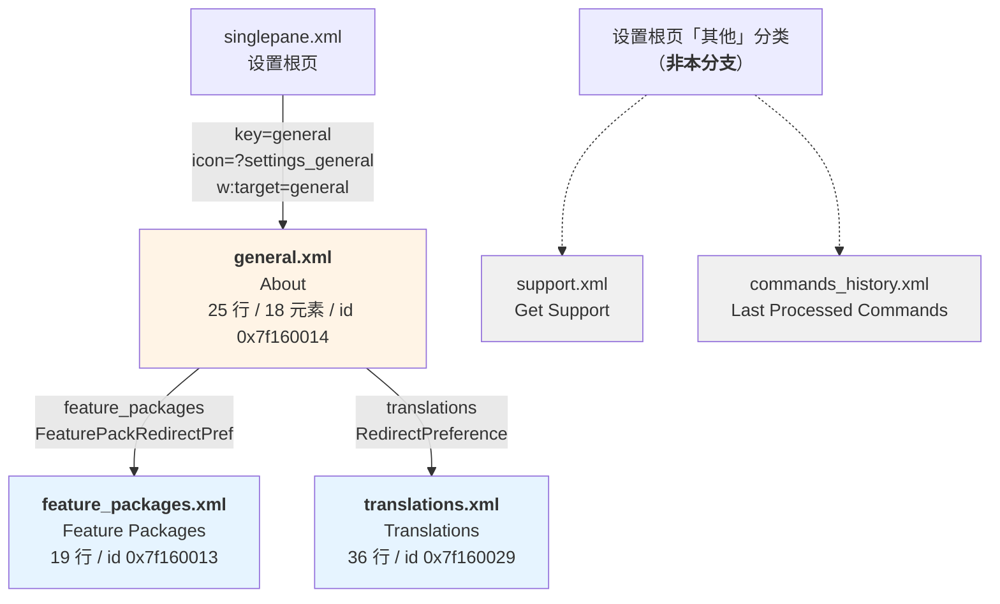

# Poweramp「设置 → 关于」分支总览

> **本文定位**：分支骨架 + 五份专文的导航地图。
> 只写"这一支由什么组成、各部分写在哪儿、彼此如何咬合"；**不重述**任何一条偏好的细节。

## 0. 一句话结论

「关于」分支是全 App **最"轻"的一级页面**——`general.xml` 只有 **25 行 / 18 元素**，且**唯一的持久化开关只有 2 个**（`check_updates` / `check_beta_updates`）。它的复杂度不在配置项，而在**三类运行期拼装**：版本串动态组装（`about_version`）、空分类动态填充（`addons`）、以及整页运行期生成的子页（`translations`）。**这一支是"展示型页面"，不是"配置型页面"**——这也是它没有 `restore_defaults` 的根本原因。

## 1. 文档地图

| 文档 | 覆盖层 | 规模 | 回答什么问题 |
| --- | --- | ---: | --- |
| **本文** | 分支骨架 | — | 这一支有几个页面、谁跳谁、每类内容由谁负责 |
| `poweramp-about-general-page.md` | **根页层** | 1 112 行 | `general.xml` 18 元素逐条、`r91` helper 逐段、7 个自定义控件 |
| `poweramp-about-subpages.md` | **子页层** | 见该文 | `feature_packages` + `translations` 两页全部内容、`p91`/`z61` 分发 |
| `poweramp-about-runtime-deps.md` | **运行期依赖** | 1 400 行 | 许可页、授权状态体系、检查更新、`addons` 填充 |
| `poweramp-about-license-state-machine.md` | **授权状态机** | 见该文 | `y40.H` 从哪来、`q4`(AppLSHelper) 如何落地、`store` 渠道枚举、3 条 scene 总线广播 |
| `poweramp-about-and-support-settings.md` | **首轮枚举**（status: draft） | 2 301 行 |
| `poweramp-faststaticprefs.md` | **底层存储引擎**（跨分支共用） | 583 行 | 偏好值怎么落盘、`FastStaticPrefs` 的只读 mmap 与整块序列化 | build-1025 口径；覆盖 general/support/commands_history/translations 四页概览 |

> ⚠️ **首轮枚举文档的边界容易误读**：它标题写"关于/技术支持/命令历史/翻译"，但这**四页并不属于同一分支**——
> 只有 `general` 与其两个子页属「关于」分支；`support` 与 `commands_history` 是设置根页「其他」分类的**独立入口**。
> 详见 §3。

## 2. 分支骨架

### 2.1 页面拓扑（严格按 `w:target` 实测）



【实证·原文】`res/xml/singlepane.xml:23`、`res/xml/general.xml:5`、`:18`；`res/xml/feature_packages.xml` / `translations.xml` 的 `w:target` 均为**零条**（叶子页）

### 2.2 三个页面的身份

| | `general` | `feature_packages` | `translations` |
| --- | --- | --- | --- |
| XML | `general.xml`（25 行 / 2563 B） | `feature_packages.xml`（19 行 / 2618 B） | `translations.xml`（36 行 / 4913 B） |
| 资源 id | **`0x7f160014`** | **`0x7f160013`** | **`0x7f160029`** |
| 标题实文 | **About** | **Feature Packages** | **Translations** |
| 摘要实文 | Version/changelog, translations info | Explore Poweramp Feature Packages | — |
| helper | `ׅ/r91`（32 207 B / 1458 行） | `ׅ/p91`（2 618 B / **129 行**，最小专用 helper；⚠️ 父类是 `b71` 而非 `n91`） | `ׅ/z61`（118 199 B / 4866 行，**多页复用**） |
| 元素数 | 18 | 19 行内全部元素 | 见专文 |
| 分类数 | 3（`updates` / `other` / `addons`） | 1（`other`） | 见专文 |
| 跳转出 | **2** | **0**（叶） | **0**（叶） |
| 根节点 `skipSearch` | ❌ 无 | ❌ 无 | ✅ **`true`**（整页排除） |
| `restore_defaults` | ❌ | ❌ | ❌ |

【实证·原文】`res/values/public.xml` 逐条；【实证·产物】`smali/ׅ/u61.smali` 分发表

> **helper 体积的三个数量级差异**（`129` → `1458` → `4866` 行）不是巧合，而是三种不同设计：
> - `p91`（129 行）：页面几乎全是静态文本，helper 只做极少量条件处理
> - `r91`（1458 行）：页面要**动态拼装**版本串、隐私 URL、addons 分类
> - `z61`（4866 行）：**不是专用 helper**，是 30+ 个页面共享的巨型分派器，`translations` 只是其中一个 index

### 2.2.1 ⚠️ `p91` 不是直接继承 `n91` —— 它挂在 `b71` 上

这是一个容易看漏的继承链差异：

```
ׅ/n91    .super Object         抽象基类，声明 abstract v()
  └─ ׅ/b71   .super ׅ/n91      24 273 B / 1 460 行   ← ★ 中间抽象层
       └─ ׅ/p91  .super ׅ/b71  2 618 B / 129 行      ← feature_packages 的 helper
```

【实证·产物】`smali/ׅ/p91.smali:1-2`（`.class public final Lׅ/p91;` / `.super Lׅ/b71;`）、
`smali/ׅ/b71.smali:1-2`（`.class public abstract Lׅ/b71;` / `.super Lׅ/n91;`）

**这解释了「为什么 `p91` 只有 129 行」**：`b71` 这个 1460 行的中间抽象层已经承担了基类工作，
`p91` 只需覆写差异部分。对比 `r91`（直接 `extends n91`，1458 行）——它没有中间层可依赖，
所有装配逻辑都写在自己身上。

**分发表里的佐证**（`smali/ׅ/u61.smali`）：

| XML id | 页面 | `const` 行 | `new-instance` 行 | 构造父类 |
| --- | --- | ---: | ---: | --- |
| `0x7f160014` | `general` | 434 | `:443` | **`n91`** |
| `0x7f160013` | `feature_packages` | 512 | `:521` | **`b71`** ★ |
| `0x7f160029` | `translations` | 1599 | `:1608` | **`z61`** |

```asm
; 【实证·产物】smali/ׅ/u61.smali:512-525
 512:     const v10, 0x7f160013
 517:     if-ne v3, v10, :cond_9
 521:     new-instance v0, Lׅ/p91;
 525:     invoke-direct {v0, v1, p0, v3, v4}, Lׅ/b71;-><init>(...)   ; ★ 走 b71 的构造
```

> **对"关于"分支的架构含义**：三个 helper 代表了三种复用策略——
> **中间抽象层复用**（`p91` via `b71`）、**专用实现**（`r91` 直挂 `n91`）、**巨型分派器复用**（`z61`）。
> 同一个设置树里并存三种，说明这套框架没有强制的层次约定，每个页面按自身复杂度自由选择。

### 2.3 入口身份：根页里的那一行

`res/xml/singlepane.xml:23`：

```xml
<com.maxmpz.audioplayer.preference.RedirectPreference
    android:icon="?settings_general"
    android:title="@string/pref_about"
    android:key="general"
    android:summary="@string/pref_summary_about"
    w:target="general"
    w:applyIconTint="false" />
```

| 属性 | 值 | 说明 |
| --- | --- | --- |
| `android:key` | `general` | **与目标 XML 同名** |
| `w:target` | `general` | 即 `getIdentifier("general", "xml", pkg)` |
| `android:icon` | `?settings_general` | **主题属性**，非直接 drawable |
| `w:applyIconTint` | `false` | 图标自带配色 |

**图标三级跳**（与锁屏页同构）：

| 层 | 位置 | 内容 |
| --- | --- | --- |
| 1. 属性声明 | `res/values/attrs.xml:961` | `<attr name="settings_general" format="reference" />` |
| 2. 主题赋值 | `res/values/styles.xml:10645` | `<item name="settings_general">@drawable/settings_general_colored</item>` |
| 3. 彩色包装 | `res/drawable/settings_general_colored.xml` | bitmap + tint |

---

## 3. 分支边界：哪些页面**不属于**「关于」

这是最容易误读的一处，必须钉死。

`docs/architecture/poweramp-about-and-support-settings.md` 把 `general` / `support` / `commands_history` / `translations` 四页合并成一份文档，标题也并列写了"关于/技术支持/命令历史/翻译"。但**从 `w:target` 可达性实测**：

| 页面 | 从 `general` 可达？ | 真实入口 | 属「关于」分支？ |
| --- | :---: | --- | :---: |
| `feature_packages` | ✅ 是 | `general.xml:5` 的 `FeaturePackRedirectPref` | ✅ |
| `translations` | ✅ 是 | `general.xml:18` 的 `RedirectPreference` | ✅ |
| `support` | ❌ 否 | `singlepane.xml` 的「其他」分类 `get_support` | ❌ **非本分支** |
| `commands_history` | ❌ 否 | `headset.xml` 的 `commands_history`（耳机分支） | ❌ **非本分支** |

> **结论**：「关于」分支**严格只有 3 个页面**（`general` + 2 个子页）。
> `support` 与 `commands_history` 虽在首轮枚举文档里并列，但**属于其他分支的入口**。
> 本文档与三份专文严格限定在这 3 页内；提及其他页面时一律标注「非本分支」。

**【实证·产物】验证方法**：从 `general.xml` 出发做 `w:target` 传递闭包，只得到 2 条出边，闭包共 3 页（`general` / `feature_packages` / `translations`）。

---

## 4. 18 个元素按"性质"重分类

「关于」页的 18 个元素，按**是否承载状态**可分为四类——这是理解本页设计的关键视角。

### 4.1 四类元素

| 类别 | 数量 | 元素 | 性质 |
| --- | ---: | --- | --- |
| **① 持久化配置**（写 `"global"`） | **2** | `check_updates`、`check_beta_updates` | 唯一两个真正"用户可调"的项 |
| **② 运行期展示**（值由代码算） | **4** | `about_version`、`LicenseStatusPref`、`UberLevelPref`、`addons` 分类 | 只读展示，值来自授权/版本/插件 |
| **③ 导航/动作**（不承载状态） | **9** | `feature_packages`、`translations`、`visit_site_about`、`oss`、`privacy`、`check_update`、`buy_uber_badges` 等 | 跳转/弹框/触发 |
| **④ 静态装饰** | **3** | `PowerampLogoPreference`、`addons` 填充项、Uber 说明块 | 纯视觉 |

> **这张表解释了 §0 的结论**：18 个元素里只有 **2 个**承载状态。
> 一个"设置页"如果 89% 的元素都不存值，它本质上是**关于/信息页**而非配置页——
> 这也是它**不需要 `restore_defaults`** 的直接原因（没有可恢复的东西）。

### 4.2 与"配置型"页面的对照

| 页面 | 元素数 | 持久化项 | 占比 | 有 `restore_defaults`？ |
| --- | ---: | ---: | ---: | :---: |
| **`general`（关于）** | **18** | **2** | **11%** | ❌ |
| `lockscreen`（锁屏） | 15 | 7 | 47% | ✅ |
| `headset`（耳机） | 21 | 8 | 38% | ✅ |
| `misc`（其他） | 31 | 多 | 高 | ✅ |

> **本分支独有的形态**：`restore_defaults` 在「关于」分支的三个页面**全部缺席**。
> 这不是遗漏——是 §4.1 那张表的必然结果。

---

## 4.5 `about_version` 的版本串组装（Lead 独立核实）

这是「关于」页**唯一的运行期拼装逻辑**，也是本分支最值得单独记的一段。共 **约 220 行**（`r91.smali:204-437`）。

### 4.5.1 组装顺序（按 StringBuilder 的 append 时序）

| # | 片段 | 来源 | 证据 |
| ---: | --- | --- | --- |
| ① | **`build-1035-bundle-play`** | **硬编码字符串字面量** | `r91.smali:228` `const-string v2, "build-1035-bundle-play"` |
| ② | **`.`（点号，`0xa`）** | `const/16 v2, 0xa` | `r91.smali:237`、`:272` |
| ③ | **native 锁串** | `Sync.native_lock(-1)` | `r91.smali:277`（`const/4 v5, -0x1`）、`:280`（`invoke-static`） |
| ④ | **`.`（点号）** | 再次 append `0xa` | `r91.smali:322` |
| ⑤ | **`"64"` 或 `"32"`** | `xn0.B()` 判定 | `r91.smali:327`（`invoke-static xn0.B()`）、`:339`（`"64"`）、`:354`（`"32"`） |
| ⑥ | 空格（`0x20`） | `const/16 v4, 0x20` | `r91.smali:364`、`:368` |
| ⑦ | **`@string/bit`**（`0x7f0800b8`） | 资源字符串 | `r91.smali:377`（`const v5, 0x7f0800b8`）、`:382`（`getString`）、`:390`（append） |

**最终形态**【推断，因 native 串未解出】：
```
build-1035-bundle-play
<native_lock(-1) 返回的串>
64 bit
```

### 4.5.2 三个值得注意的实现细节

**① 版本名是硬编码的，不是从 `BuildConfig` 读的**
`const-string v2, "build-1035-bundle-play"` 是**编译期字面量**，与 `apktool.yml` 里的
`versionName: build-1035-bundle-play` 一致，但代码路径上看是**构建脚本替换**（不是运行时读包信息）。
对照：`r91.I()`（`:7-162`）确实读了 `PackageInfo.versionName`（`:129`），但那是**另一个用途**（插件/skin 的版本展示）。

**② 用 `synchronized(Sync.class)` + try/catch 保护 native 调用**
```asm
244: :try_start_0
245:     const-class v4, Lcom/maxmpz/audioplayer/Sync;
249:     monitor-enter v4              ; ★ 同步块
255:     const-string v5, "vd"
259:     invoke-static {v5}, Sync;->B(String)V      ; 设置 log tag
264:     const/4 v5, 0x0
267:     invoke-static {v3, v5}, Sync;->В(ILjava/lang/String;)I
277:     const/4 v5, -0x1
280:     invoke-static {v5}, Sync;->native_lock(I)Ljava/lang/String;   ; ★ native 调用
293:     invoke-static {v3}, Sync;->native_close(I)V
298:     monitor-exit v4
```
**为什么需要同步**：`native_lock(-1)` 是 JNI 调用，返回一个**许可/授权锁串**；
`Sync` 是全局同步对象，说明 native 层有共享状态。`catch_0` 分支（`:319`）吞掉异常后
只 `Log.e("SettingsHelperGeneral", ...)`（`:401-409`），**版本串退化为缺一段但不崩溃**。

**③ `"32"/"64"` 的判定来自 `xn0.B()`**
`r91.smali:327` 调 `Lׅ/xn0;->B()Z` —— `xn0` 就是那个有 17 组同形异码字段的平台标志类。
`B()` 返回 true 则 `"64"`，否则 `"32"`。这是**ABI 位数**的判定。

### 4.5.3 点击行为

`r91.smali:428-437`：给 `about_version` 绑 `x11(2)` 点击监听器。
`x11` 的 idx **2** 对应什么动作，请见 `poweramp-about-general-page.md` 的逐段解析
（Lead 观察到 idx 2 与 `about_version` 的 changelog 弹框相关，但未完整追踪）。

---

## 4.6 `privacy` 的 intent 运行期绑定（Lead 独立核实）

`general.xml` 里 `privacy` 是**空的** `<PreferenceScreen>`（无 `<intent>` 子节点），
URL 在运行期才绑定。实测（`r91.smali:484-520+`）：

```asm
484:     const-string v1, "privacy"
488:     invoke-virtual {v0, v1}, PreferenceGroup;->findPreference(...)
493:     move-result-object v0
496:     if-eqz v0, :cond_3
500:     sget-object v1, Lׅ/ze1;->А:Landroid/util/TypedValue;
504:     iget-object v2, p0, Lׅ/n91;->у:SettingsActivity;
508:     invoke-virtual {v2}, Context;->getTheme()...
516:     const v4, 0x7f0108f6          ; ★ attr = pref_privacy_policy
```

`0x7f0108f6` = **`pref_privacy_policy` 属性**（`res/values/public.xml`）。
即：**隐私政策 URL 是从主题属性里取的**，不同 skin/主题可以给不同的 URL。
这是本页**唯一一个用主题属性驱动内容的条目**。

> 另外注意 `r91.smali:462-478`：它还会**移除** `visit_site_about`：
> ```asm
> 462:     const-string v1, "visit_site_about"
> 466:     invoke-virtual {v0, v1}, ...findPreference(...)
> 474:     if-eqz v1, :cond_1
> 478:     invoke-virtual {v0, v1}, ...removePreference(v1)Z   ; ★ 无条件删除
> ```
> **`visit_site_about`（Visit Website）在所有构建里都会被删掉**——
> 尽管 XML 里声明了它并带 `w:skipSearch="play,huawei"`。
> 这是一个"声明了但运行期必然删除"的条目，属**典型的死条目**。

---

## 4.7 ★ 授权状态机（本分支最重要的发现，Lead 已核实）

`general` 页的 `LicenseStatusPref` 与 `feature_packages` 页的多个付费项，都依赖同一个**授权状态整数** `y40.H`。
本轮把它彻底解开了 —— **`0xe5` / `0x110` / `0x111` 不是版本号，是授权档位的分界值**。

### 4.7.1 决定性证据：`uu0.K()` 把 `H` 翻译成人类可读串

【实证·产物】`smali/ׅ/uu0.smali:9420-9517`：

```asm
9420:     const/16 v8, 0xe5              ; ★ 档位分界 229
9428:     sget-object v7, Lׅ/y40;->H:Lׅ/z20;
9432:     iget v9, v7, Lׅ/a30;->А:I       ; H 的当前值
9436:     if-lt v9, v8, :cond_3          ; H < 0xe5 → 跳 trial
9444:     const-string v10, "full"       ; ★ H >= 0xe5 ⇒ "full"
9457:     const/16 v10, 0x110            ; ★ 272
9461:     if-ne v7, v10, :cond_1
9465:     const-string v7, " verified"   ; H == 0x110 ⇒ "full verified"
9478:     const/16 v10, 0x111            ; ★ 273
9482:     if-ne v7, v10, :cond_2
9486:     const-string v7, " verified cached"   ; H == 0x111 ⇒ "full verified cached"
9509:     const-string v7, "trial"       ; ★ H < 0xe5 ⇒ "trial"
9517:     const-string v7, "null"        ; 取不到 H ⇒ "null"
```

### 4.7.2 完整状态表

| `y40.H` 取值 | 状态串 | 含义 |
| --- | --- | --- |
| 取不到（`null` context） | `"null"` | 未初始化 |
| **`< 0xe5`（229）** | **`"trial"`** | 试用/未授权 |
| **`>= 0xe5`** | **`"full"`** | 已购买 |
| **`== 0x110`（272）** | **`"full verified"`** | 已购买 **且已在线验证** |
| **`== 0x111`（273）** | **`"full verified cached"`** | 已验证**并缓存**（离线复用） |

**默认值是哨兵 `0x80000000`**（`smali/ׅ/ac.smali:303` `const/high16 v3, -0x80000000`），
即「从未写入过」——注意 `0x80000000` 作为有符号 int 是**负数**，`< 0xe5` 成立 ⇒ 落入 `"trial"`。**逻辑自洽**。

### 4.7.3 为什么这个发现重要

| 层 | 原先状态 | 现在 |
| --- | --- | --- |
| `LicenseStatusPref` 的自删条件 | 「与 `0xe5`/`0x110` 比较，语义未定」 | **明确**：`H >= 0x110` → 直接删（已验证的付费用户不需要看到状态行） |
| `addons` / 付费项显隐 | 「位掩码含义未解」 | 位掩码在 **`ׅ/wr;->w0`**（`wr.smali:1749`，槽位 `0x4c`=76），`h0` 无此字段 |
| `@string/edition_pak_name` | 未查 | **`com.maxmpz.audioplayer`**（`strings.xml:391`） |

### 4.7.4 已知边界：native 层不可解

授权校验的**核心在 `lib*.so`**，Java 侧只有：
- `synchronized(Sync.class)` 同步块（`r91.smali:244-298`）
- `Sync.native_lock(-1)` / `(-2)` / `(-3)` 三个 JNI 调用

**本 build 的解码产物不含 `lib/` 目录** ⇒ 无法继续下钻。这是**产物边界**，不是分析疏漏。
`about_version` 版本串里那一段 native 锁串的**具体内容**因此不可知（§4.5 表格第 ③ 项）。

---

## 5. 五份专文的分工边界

为避免三份文档互相重复，边界如下：

| 内容 | 归属 | 不在谁的范围 |
| --- | --- | --- |
| `general.xml` 18 元素逐条、全部 `@string` 实文 | `about-general-page` | 子页专文 |
| `r91` helper 全部方法、`v()` 9 段装配 | `about-general-page` | 子页专文 |
| 7 个自定义控件（`PowerampLogoPreference` / `LicenseStatusPref` / `UberLevelPref` / `ProgressPreference` / `MultilineSwitchPreference` 等） | `about-general-page` | — |
| `general` 的 5 处 `skipSearch` 判定 | `about-general-page` | — |
| `feature_packages.xml` 全部元素、`p91` 解析 | `about-subpages` | 根页专文 |
| `translations.xml` 全部元素、`z61` index 对照表 | `about-subpages` | 根页专文 |
| `w:removeAsNeeded` / `w:buttonOnly` 自删机制 | `about-subpages` | — |
| `SettingsLicenseActivity` 完整实现 | `about-runtime-deps` | 根页专文 |
| 授权状态体系（`B->H` / `h0->w0` 位掩码 / `0xe5`/`0x110`） | `about-runtime-deps` | — |
| 检查更新（`check_updates` 消费方 / `check_update` 触发链） | `about-runtime-deps` | — |
| `addons` 分类填充来源 | `about-runtime-deps` | — |

---

## 6. `skipSearch` 在本分支的 6 种形态

这是「关于」分支一个**值得单独记**的细节：同一个 `w:skipSearch` 属性在本分支出现了三种不同写法。

| 页面 | 元素 | 值 | 含义 |
| --- | --- | ---: | --- |
| `general` | `LicenseStatusPref` | `"true"` | 无条件排除 |
| `general` | `check_updates` | `"true"` | 无条件排除 |
| `general` | `check_beta_updates` | `"true"` | 无条件排除 |
| `general` | `visit_site_about` | **`"play,huawei"`** | **条件式**：仅在 play/huawei 渠道排除 |
| `general` | `privacy` | `"true"` | 无条件排除 |
| `feature_packages` | `fp1` | `"true"` | 无条件排除 |
| `translations` | **根节点** | `"true"` | **整份 XML 不进索引** |

【实证·原文】逐文件属性扫描

> **两种层级必须区分**：
> - **条目级**（`u9.х()` 判定，条目跳过不落库）
> - **文档级**（`PrefSearchIndexer` 判定，整份 XML 跳过）
>
> `translations` 用的是**文档级**，其余都是**条目级**。
> ⚠️ **判根节点时不能简单正则可搜**：`general.xml` 里有内层 `<PreferenceScreen>`（`visit_site_about`/`privacy`），
> 简单匹配会误判根节点带 `skipSearch`。必须只取**第一个** `<PreferenceScreen ...>` 标签。

---

## 7. 对 SpMusic 的结论

SpMusic 是 **Tauri + React 桌面音乐播放器**。「关于」分支的可移植性比锁屏分支高得多——因为它几乎没有平台耦合。

### 7.1 可直接借鉴（3 条）

1. **「关于」页做成信息页而非配置页** —— 本页 18 元素只有 2 个持久化。桌面端「关于」也应该只放：版本号、更新检查、官网/文档/许可链接、第三方开源声明。**配置项一律移出**。
2. **版本串动态组装** —— `about_version` 不是硬编码字符串，而是运行期拼装（版本名 + versionCode + ABI + SKU + 构建类型）。桌面端可用同样手法展示 `app version + Tauri version + OS + arch`。
3. **开源许可页用独立 Activity + 整包跳转** —— Poweramp 用显式 `ComponentName`（`targetPackage` 来自字符串资源）拉起 `SettingsLicenseActivity`，而不是内嵌 WebView。好处是**许可文本可独立更新、可独立打包**。

### 7.2 不建议照抄（2 条）

| 做法 | 问题 |
| --- | --- |
| `check_updates` / `check_beta_updates` **两个独立开关** | 桌面端用一个 `channel: stable/beta` 枚举更清晰；两个布尔会产生 4 种组合，其中 1 种（关正式版但开 beta）语义可疑 |
| `w:skipSearch` 的**三种写法混用**（`true` / `play,huawei` / `play`） | 条件式排除把"渠道"概念编码进了 UI 属性。桌面端若无多渠道，应直接删除这个维度，不要保留条件语法 |

---

## 8. 证据索引

| 主题 | 路径 : 行 |
| --- | --- |
| 根页 `general` 入口 | `res/xml/singlepane.xml:23` |
| `general.xml` 全文 | `res/xml/general.xml:1-25` |
| `feature_packages.xml` 全文 | `res/xml/feature_packages.xml:1-19` |
| `translations.xml` 全文 | `res/xml/translations.xml:1-36` |
| 三个页面的资源 id | `res/values/public.xml`（`general`=`0x7f160014`、`feature_packages`=`0x7f160013`、`translations`=`0x7f160029`） |
| 图标属性三级跳 | `attrs.xml:961` → `styles.xml:10645` → `drawable/settings_general_colored.xml` |
| 分发表 | `smali/ׅ/u61.smali:434`（`const 0x7f160014`）→ `:443` `new r91`；`:512`（`const 0x7f160013`）→ `:521` `new p91`；`:1599`（`const 0x7f160029`）→ `:1608` `new z61` |
| 页面标题/摘要 | `strings.xml:1007`（About）、`:1456`（summary）、`:442`（Feature Packages）、`:2035`（FP summary）、`:1682`（Translations） |
| `restore_defaults` 缺席 | 三页 XML 全文均无 `key="restore_defaults"` |
| **根页专文** | `docs/architecture/poweramp-about-general-page.md` |
| **子页专文** | `docs/architecture/poweramp-about-subpages.md` |
| **运行期依赖专文** | `docs/architecture/poweramp-about-runtime-deps.md` |
| 首轮枚举（对照用） | `docs/architecture/poweramp-about-and-support-settings.md` |
| 设置树总索引 | `docs/architecture/poweramp-settings-root-structure.md` |

---

## 9. 收尾清单（本分支的完整性自检）

| 检查项 | 状态 |
| --- | :---: |
| `general.xml` 18 元素逐条实证 + 全部 `@string` 英文实文 | ✅ `general-page` §2 |
| `r91` helper 5 方法全表、`v()` 逐段装配 | ✅ `general-page` §4 |
| `about_version` 版本串组装（7 段） | ✅ 本文 §4.5 + `general-page` §4.3 |
| `privacy` 运行期 URL（主题属性 `pref_privacy_policy`） | ✅ 本文 §4.6 |
| 7 个自定义控件实现 | ✅ `general-page` §5 |
| `w:skipSearch` 5 处逐一判定（含 `"huawei"` 死值） | ✅ `general-page` §6 |
| `feature_packages` 19 行完整解析 + `p91` | ✅ `subpages` §3 |
| `translations` 36 行 / 32 元素 + `z61` 分发 | ✅ `subpages` §4 |
| `z61` 的 21 条 index 对照表 | ✅ `subpages` §5 |
| `w:removeAsNeeded` / `w:buttonOnly` 自删与渲染 | ✅ `subpages` §3 |
| `move_fp1_to_about` 四段闭环 | ✅ `subpages` §3 |
| 许可页 `SettingsLicenseActivity` + `oss.txt` | ✅ `runtime-deps` §2 |
| 授权状态机（`H` 的 4 档 + 写入端） | ✅ 本文 §4.7 + `license-state-machine` |
| `check_updates` / `check_beta_updates` 死代码定性 | ✅ `runtime-deps` §4 |
| `addons` 四路填充（unlock/TrackProvider/TRACK_CHANGED/VisPresets） | ✅ `runtime-deps` §5 |
| 偏好存储引擎（`FastStaticPrefs`） | ✅ `faststaticprefs`（跨分支共用） |
| 跨分支边界（`support`/`commands_history` 不属本分支） | ✅ 本文 §3 |
| 桌面端可移植性结论 | ✅ 本文 §7 |

> **统计口径**：本分支共 **5 份文档 / 5 559 行**（不含跨分支共用的 `faststaticprefs.md`）。
> 行数以 `splitlines()` 为准（跨 LF/CRLF 一致），脚本：`.rea-analysis/tools/about_final_audit.py`。

## 10. 未解问题汇总（本分支全部）

| 来源 | 未解项 |
| --- | --- |
| `general-page` §10 | 8 条（`Sync.native_lock` 串内容、`y40` 各字段字面偏好名、`wr.w0` 的 `&1` 位语义等） |
| `subpages` §8 | 7 条（`b9.Н` 语义、`BaseApplication.Н(Z)` 效果、`0xf0d0148` 等魔数、`FeaturePackPref.E` 无写入点等） |
| `runtime-deps` §7 | 11 条（`H` 完整取值表、`0x111` cached 语义、`Р` 双 Play 映射、`wr->w0` 写入者等） |
| `license-state-machine` §8 | 5 条（`y40` 剩余 8 字段、`pending_end_ts` 单位、`res` 完整空间、`Bundle` 填入方、native 三档） |
| `faststaticprefs` §9 | 4 条（`ls.К` 版本迁移、`MAGIC` 常量含义、`dd` 序列化、98 字段偏移表） |

> **共同瓶颈**：**解码产物不含 `lib/*.so`**（`lib/` 目录不存在，已实测确认）。
> 授权校验、`native_lock` 三档、`native_process` 的内部实现均不可见——
> 这是**产物边界**，不是分析疏漏。Java/Kotlin 侧已做到静态可证的极限。
