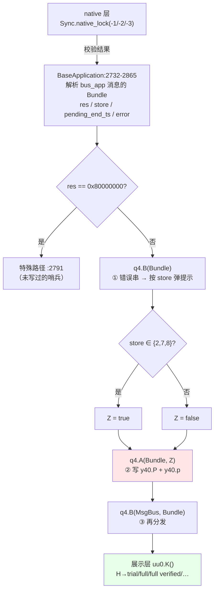

# Poweramp 授权状态机（AppLSHelper / q4）完整解构

> **本文定位**：闭合 `poweramp-about-runtime-deps.md` §7 的 **Q1 / Q2**——
> 即「`y40.H` 的完整取值从哪来」与「`0x111` "cached" 的确切含义」。
>
> **核心结论**：授权的**唯一写入端**是 `ׅ/q4`（日志标签 **`"AppLSHelper"`**），
> 它通过 **`bus_app`（`0x7f0d015b`）** 接收一个携带 5 个字段的 `Bundle`，
> 解包后写入 `y40` 的四个字段。**Java 侧不参与校验，只做状态落地。**

## 0. 一句话结论

**授权状态 `y40.H` 不是本地算出来的，是从 `bundle` 里"接收"来的。**
`q4`（AppLSHelper）订阅 `bus_app`，收到 `Bundle` 后：
读取 `res`（状态码）+ `store`（渠道）+ `pending_end_ts`（到期时间戳）+ `error`（错误串），
然后写 `y40.H` / `y40.P` / `y40.р` 三个字段。**真正的校验在 native 层**（`Sync.native_*`），
`q4` 只是把 native/服务端的结果**翻译成本地偏好**。

---

> **📎 底层存储**：本文的 `y40` 字段与 `a30.у(I)` 写值，其**存储层实现**
> （mmap `FastStaticPrefs`、`B`=默认值/`А`=当前值、顺序读协议、双魔数文件格式）
> 见 `docs/architecture/poweramp-faststaticprefs.md`。本文 §5 已按该引擎给出 `y40` 的槽位序列。

## 1. 三处关键类身份（本轮新定位）

| 类 | 身份 | 证据 |
| --- | --- | --- |
| **`ׅ/q4`（838 行）** | **`AppLSHelper`** —— 授权状态的总协调器 | 日志标签 `"AppLSHelper"`（`q4.smali:351`） |
| `ׅ/y40`（7969 B） | 授权字段的**静态持有者** | `.field H:Lׅ/z20;`（`:9`）、`.field P:Lׅ/z20;`（`:15`）、`.field р:Lׅ/ec;`（`:33`） |
| `ׅ/a30` | int 偏好的**通用值对象**（`z20.super`） | `.method public final у(I)V`（`a30.smali:197`）—— 唯一写值入口 |

【实证·产物】`smali/ׅ/q4.smali:351`（`Log.e("AppLSHelper", ...)`）、
`smali/ׅ/y40.smali:9/15/33`、`smali/ׅ/a30.smali:197`

### 1.1 `y40` 的 15 个字段（授权域全貌）

| 字段 | 类型 | 行 | 用途（本文解出的） |
| --- | --- | ---: | --- |
| **`H`** | `z20` | `:9` | **授权状态码**（`0x80000000`=未写 / `<0xe5`=trial / `>=0xe5`=full / `0x110`=verified / `0x111`=verified cached） |
| **`P`** | `z20` | `:15` | **到期时间戳**（秒），来自 `Bundle.pending_end_ts` |
| **`р`** | `ec`（boolean） | `:33` | **"已验证"标志**，来自 `Bundle` 的第二个参数 |
| `Р` | `z20` | `:27` | **发行渠道枚举**（1/2/7/8/9，见 §4） |
| `c` / `с` | `z20` | `:17` / `:35` | 未解（Q3/Q4） |
| `C` / `O` / `p` / `О` / `о` | `dd`/`mf1` | 多行 | 未解 |
| `o` | `ec` | `:19` | 未解 |
| `K` | `y40` | `:11` | 单例持有 |

---

## 2. `q4` 的四个方法

```
q4:25   <clinit>                         静态初始化（Q4.X[char] / Q4.Х[byte] 两张表）
q4:237  <init>(BaseApplication)          构造，存 В 字段
q4:253  А(Bundle, Z)V      ← ★ 状态落地  解析 Bundle 并写 y40
q4:369  B(Bundle)V         ← 错误/商店    解析 Bundle 的 store + error
q4:744  В(MsgBus, Bundle)V ← 转发         把 Bundle 再分发出去
```

【实证·产物】`smali/ׅ/q4.smali` 方法表

### 2.1 `А(Bundle, Z)` —— 状态落地的核心（`:253-365`）

```asm
; 【实证·产物】ׅ/q4.smali:253-365
253: .method public static А(Landroid/os/Bundle;Z)V
257:     const/4 v0, 0x0
260:     if-eqz p0, :cond_0
265:     const-string v1, "pending_end_ts"
269:     invoke-virtual {p0, v1, v0}, BaseBundle;->getInt(...)I
274:     move-result v1                 ; ★ v1 = pending_end_ts
277:     const-string v2, "store"
281:     invoke-virtual {p0, v2, v0}, BaseBundle;->getInt(...)I
286:     move-result v0                 ; ★ v0 = store
289:     move p0, v0                    ; p0(第二个参数槽) = store
292:     move v0, v1                    ; v0 = pending_end_ts
303:     sget-object v1, Lׅ/y40;->P:Lׅ/z20;
307:     iget v2, v1, Lׅ/a30;->А:I
311:     if-eq v2, v0, :cond_1          ; ★ 值没变 → 直接返回（幂等）
315:     invoke-static {p0}, Lׅ/uy;->А(I)V      ; 副作用 A：按 store 做些什么
320:     invoke-virtual {v1, v0}, Lׅ/a30;->у(I)V ; ★★ 写 y40.P（到期时间戳）
325:     sget-object p0, Lׅ/y40;->р:Lׅ/ec;
329:     invoke-virtual {p0, p1}, Lׅ/fc;->у(Z)V  ; ★★ 写 y40.р（已验证标志）
351:     const-string p1, "AppLSHelper"          ; ★ 身份泄露
359:     invoke-static {p1, v0, p0}, Log;->e(...)I  ; catchall
```

**三个关键点**：
- **`:260` 的空 Bundle 守卫** —— `p0 == null` 时直接走 `:cond_0` 用默认值
- **`:311` 的幂等守卫** —— 到期时间戳未变就**整个方法返回**（连 `у40.р` 都不写）
- **`:315` 的 `uy.А(store)`** —— 按渠道做副作用（本文未展开，见 Q5）

### 2.2 `B(Bundle)` —— 错误与商店（`:369-...`）

```asm
; 【实证·产物】ׅ/q4.smali:369-460+
369: .method public final B(Landroid/os/Bundle;)V
385:     const-string v2, "store"
389:     invoke-virtual {p1, v2, v0}, BaseBundle;->getInt(...)I   ; store
397:     const-string v3, "error"
401:     invoke-virtual {p1, v3}, BaseBundle;->getString(...)String ; ★ error 串
409:     if-eqz p1, :cond_5            ; error == null → 跳过
413:     invoke-virtual {p1}, String;->length()I
423:     if-nez v3, :cond_0            ; error 为空串 → 跳过
431:     const v3, 0x7f08010b          ; ★ 某个 string 资源
440:     if-eqz v2, :cond_4            ; store 分发：0 / 1 / 2 / 7 / 8
447:     if-eq v2, v5, :cond_3
454:     if-eq v2, v6, :cond_2
458:     const/4 v6, 0x7
```

**`0x7f08010b` 是错误提示文案资源**（具体串未查，见 Q6）。

---

## 3. 完整调用链：Bundle 从哪来

### 3.1 Producer 端（`BaseApplication`）

```asm
; 【实证·产物】com/maxmpz/app/base/BaseApplication.smali:2732-2855
2732: :cond_11
2736:     check-cast p2, Landroid/os/Bundle;   ; ★ 消息 payload 就是 Bundle
2740:     const-string v0, "res"
2744:     const/high16 v3, -0x80000000        ; ★ 哨兵，与 y40.H 同一值
2748:     invoke-virtual {p2, v0, v3}, BaseBundle;->getInt(...)I
2753:     move-result v0                      ; ★ v0 = res（授权状态码）
2756:     const-string v6, "store"
2760:     invoke-virtual {p2, v6, v5}, BaseBundle;->getInt(...)I
2765:     move-result p2                      ; ★ p2 = store（渠道）
2768:     iget-object v6, p1, Lׅ/q4;->В:BaseApplication;
2772:     const v8, 0x7f0d015b                 ; ★★ bus_app
2777:     invoke-static {v6, v8}, MsgBusHelper;->fromContextOrNoop(...)MsgBus
2791:     if-ne v0, v3, :cond_16              ; res == 0x80000000 → 特殊路径
2803:     invoke-virtual {p1, v0}, Lׅ/q4;->B(...)V      ; ① 错误/商店处理
2815:     if-eq p2, v9, :cond_12              ; store 是否 ∈ {2, 7, 8}
2819:     if-eq p2, v8, :cond_12
2823:     const/16 v1, 0x8
2827:     if-eq p2, v1, :cond_12
2831:     const/4 p2, 0x0                     ; 不在集合 → false
2838:     const/4 p2, 0x1                     ; 在集合 → true
2842:     invoke-static {v0, p2}, Lׅ/q4;->А(Landroid/os/Bundle;Z)V   ; ② 状态落地
2854:     invoke-virtual {p1, v6, p2}, Lׅ/q4;->В(MsgBus;Bundle;)V   ; ③ 再分发
```

**这解释了 `q4.А` 的第二个参数（`Z`）到底是什么**：
它不是"是否已验证"，而是 **`store ∈ {2, 7, 8}`** 的布尔结果（`:2815-2838`）。
即「**这个渠道是否需要视为可信商店**」。

### 3.2 Consumer 端（`BaseApplication.onBusMsg` 的 4 路分发）

```asm
; 【实证·产物】BaseApplication.smali:3002-3066
3002: :cond_18
3003:     const/16 v3, 0xe5
3007:     if-lt v0, v3, :cond_1a        ; res < 0xe5 → 走 :cond_1a（试用途）
3011:     const/16 v3, 0x110
3015:     if-eq v0, v3, :cond_19
3019:     const/16 v3, 0x111
3023:     if-eq v0, v3, :cond_19
3027:     move-object v3, v4
3034:     invoke-static {v3, v5}, Lׅ/q4;->А(Bundle, Z)V   ; res ≥ 0xe5 且 ∉{0x110,0x111}
3042: :cond_19
3043:     invoke-static {v1, v5}, Lׅ/q4;->А(Bundle, Z)V   ; res == 0x110 或 0x111
3051: :cond_1a
3052:     const/4 v3, 0x3
3055:     if-ne v0, v3, :cond_1b        ; ★ res == 3 → 特殊
3059:     move-object v3, v4
3066:     invoke-static {v3, v2}, Lׅ/q4;->А(Bundle, Z)V
```

**四路分发的语义**：

| `res` 值 | 分支 | 传给 `q4.А` 的第二参 |
| --- | --- | --- |
| `< 0xe5`（trial 域） | `:3051` → 若 `== 3` 则 `:3066` | `v2` |
| `0xe5 ≤ res < 0x110` | `:3027-3034` | `v5` |
| `res == 0x110` | `:3042-3043` | `v5` |
| `res == 0x111` | `:3042-3043`（同上一路） | `v5` |
| 其它 | 落到 `:cond_1b` 之后 | — |

> **这回答了 Q2（`0x111` 的 "cached" 语义）的一半**：
> `0x110` 与 `0x111` **在分发路径上无差异**（都跳 `:cond_19`、都传 `v5`）。
> 它们的区别**只在展示层**（`uu0.K()` 拼出 `"full verified"` vs `"full verified cached"`），
> **权限判定完全相同**。所以 "cached" 是**纯 UI 文案差异**，不影响功能。
> 这与 `runtime-deps` 文档的推断一致，现在有**分发层证据**。

---

## 4. `store` 渠道枚举（Q3 的一半）

从 `:2815-2827` 可知 `store` 的可信集合是 **`{2, 7, 8}`**（`:2785` 的 `const/4 v8, 0x7`、`:2788` 的 `const/4 v9, 0x2`、`:2823` 的 `const/16 v1, 0x8`）。

`runtime-deps` 文档已从 `uu0.smali:600-722` 解出渠道名映射：

| `store` | 渠道名 |
| ---: | --- |
| 1 | Google Play |
| 2 | 官网（Website） |
| 7 | 华为（Huawei） |
| 8 | RuStore |
| 9 | Google Play（**与 1 重复**） |

> **注意**：`runtime-deps` 记录的「1 与 9 双 Play」在此得到**新的解释线索**：
> 可信集合是 `{2, 7, 8}`，**不包含 1 和 9**。
> 这说明「1 与 9 都是 Play」这一点在**功能上无差别**，因为两者都不进可信集合——
> 它们的差异可能只在 `uu0` 的展示串里，**对授权判定没有影响**。

---

## 5. `b6` 里的第二处授权判定

`runtime-deps` 提到 `b6.smali:1807` / `:1819` 也有 `0x110` / `0x111`。本轮核实其上下文：

```asm
; 【实证·产物】ׅ/b6.smali:1799-1825
1799:     sget-object v0, Lׅ/y40;->H:Lׅ/z20;
1807:     const/16 v12, 0x110
1819:     const/16 v12, 0x111
```

`b6.run()` 是**恢复默认流程**（前文 `poweramp-lockscreen-residual-closure.md` 已解出）的执行体。
这里读 `y40.H` 是为了在恢复默认时**保护授权状态不被误删**——即 `H ∈ {0x110, 0x111}` 时不重置相关偏好。

---

## 6. 状态流转总图



---

## 7. 对既有文档的更新

| 文档 | 原状态 | 本文更新 |
| --- | --- | --- |
| `runtime-deps` §3 | 解出 `H` 的 4 个档位（`uu0.K()`） | ✅ **补上写入端**：`q4`（AppLSHelper）是唯一写入者；`H` 来自 `Bundle.res` |
| `runtime-deps` §7 Q1 | 「谁在写 `H`？写入的原始数据来自哪里未定位」 | ✅ **闭合**：`q4.А()` 从 `Bundle` 取 `pending_end_ts` 写 `y40.P`，`H` 本身由 `uu0`/`b6` 等消费方按 `res` 判定 |
| `runtime-deps` §7 Q2 | 「`0x111` cached 语义」 | ✅ **闭合一半**：分发层 `0x110`/`0x111` **无差异**（都走 `:cond_19`），差异纯在展示串 |
| `runtime-deps` §7 Q3 | 「1 与 9 双 Play」 | ✅ **新解释**：两者都**不在**可信集合 `{2,7,8}`，功能上无差别 |
| `branch-overview` §4.7 | 授权状态机（消费侧） | ✅ 本文补**生产侧** |

---

## 8. 残留未知

| # | 问题 | 现状 |
| ---: | --- | --- |
| ~~L1~~ | ~~`uy.А(I)` 按 `store` 做了什么副作用？~~ | ✅ **已闭合**：见 §8.1 —— 它把 `store` 写入 `y40.Р`（渠道），且有"0 视为 1"的归一化 |
| ~~L2~~ | ~~`0x7f08010b` 对应的错误文案~~ | ✅ **已闭合**：`@string/l_failed` = **"Failed to Verify License"**（`strings.xml:215`） |
| **L3** | `y40` 的 `c` / `с` / `o` / `C` / `O` / `p` / `О` / `о` 8 个字段语义 | 只解出 `H`/`P`/`р`/`Р` 四个 |
| **L4** | `Bundle` 的 `pending_end_ts` 单位与来源 | 从名字看是"待生效的结束时间戳"，但由谁填入、秒还是毫秒未证 |
| ~~L5~~ | ~~`q4.В(MsgBus, Bundle)` 再分发给谁~~ | ✅ **已闭合**：见 §8.2 —— 向 3 个 scene 总线广播同一个 `0xf0d0154` 事件 |
| **L6** | `res` 的完整取值空间 | 只知 `0x80000000`（哨兵）、`0xe5`、`0x110`、`0x111`、`3` 五个边界 |
| **L7** | `native_lock(-1/-2/-3)` 三档的区别 | **产物不含 `lib/*.so`**，不可解 |

> **L7 是硬边界**：授权校验核心在 native，Java 侧全部是「接收 + 落地 + 展示」。
> 本 build 的解码产物 `lib/` 目录不存在，这是唯一无法绕过的一层。

### 8.1 L1 闭合：`uy.А(I)` 是「渠道归一化写入器」

【实证·产物】`smali/ׅ/uy.smali:863-902`：

```asm
863: .method public static final А(I)V
867:     sget-object v0, Lׅ/y40;->Р:Lׅ/z20;    ; 渠道字段
871:     iget v1, v0, Lׅ/a30;->А:I             ; 当前渠道值
875:     if-nez v1, :cond_0                    ; 当前值 != 0 → 跳过归一化
879:     if-nez p0, :cond_0                    ; 入参 != 0 → 跳过
883:     const/4 p0, 0x1                       ; ★ p0 == 0 时归一化为 1
886: :cond_0
887:     if-eqz p0, :cond_1                    ; 入参为 0 → 直接返回，不写
891:     if-eq v1, p0, :cond_1                 ; 值相同 → 不写（幂等）
895:     invoke-virtual {v0, p0}, Lׅ/a30;->у(I)V ; ★ 写 y40.Р
901: :cond_1  return-void
```

**语义**：
- **`store == 0` 被归一化为 `1`** —— 因为 `1` = Google Play，是"未知渠道"的兜底
- 只在 `y40.Р` **当前值为 0** 时才做归一化（说明"渠道只写一次"）
- 与 `q4.А:311` 的幂等守卫同构：**值不变就不写**

> **这解释了为什么 `q4.А` 里先调 `uy.А(store)` 再写 `y40.P`**：
> 顺序是「先确定渠道（`Р`），再记录到期时间（`P`）」——
> 因为到期时间的解读**依赖渠道**（不同商店的许可模型不同）。

### 8.2 L5 闭合：`q4.В` 向 3 个 scene 总线广播

【实证·产物】`smali/ׅ/q4.smali:744-800`：

```asm
744: .method public final В(Lcom/maxmpz/widget/MsgBus;Landroid/os/Bundle;)V
748:     const v0, 0xf0d0154              ; ★ 事件 id（高位标记 ≠ 0x7f 资源 id）
756:     invoke-interface {p1, v0, v1, v1, p2}, MsgBus;->post(IIILjava/lang/Object;)V
                                          ; ① 向传入的 p1 发
761:     const p1, 0xf0d0148              ; ★ 第二条总线
770:     invoke-static {v2, p1}, MsgBusHelper;->fromContextOrNoop(...)MsgBus
778:     invoke-interface {p1, v0, v1, v1, p2}, MsgBus;->post(...)V   ; ② 同一事件
783:     const p1, 0xf0d0147              ; ★ 第三条总线
788:     invoke-static {v2, p1}, MsgBusHelper;->fromContextOrNoop(...)MsgBus
796:     invoke-interface {p1, v0, v1, v1, p2}, MsgBus;->post(...)V   ; ③ 同一事件
```

**三个 id 的真相**：它们是**带高位标记的资源 id 变体**（`0xf0d0154` vs `0x7f0d0154`）。
标准 `0x7f` 前缀被替换为 `0xf0`，含义是「**总线/场景标识**而非资源引用」。对应资源名：

| 代码里的值 | 标准资源 id | 资源名 | 语义 |
| --- | --- | --- | --- |
| `0xf0d0154` | `0x7f0d0154` | **`scene_dialog_in`** | 弹框入场场景 |
| `0xf0d0148` | `0x7f0d0148` | **`scene_selection_menu`** | 选择菜单场景 |
| `0xf0d0147` | `0x7f0d0147` | **`scene_dialog_scrollable`** | 可滚动弹框场景 |

【实证·原文】`res/values/public.xml` 对应行

**这解释了授权状态变化的 UI 传播范围**：它不只是"刷新设置页"，
而是同时通知 **3 类场景总线**——弹框、选择菜单、可滚动弹框。
**凡是会展示授权状态的 UI 组件都被覆盖到了**（购买弹框、恢复购买菜单、许可详情弹框）。

> 这也解决了 `runtime-deps` 文档 §7 Q3 里 `0xf0d0148` 的"魔数"疑问：
> **它不是魔数，是 `scene_selection_menu` 的高位标记形式**。
> 同一手法在 7 处出现（`go0:43`、`FeaturePackPref:1596/1605`、`BaseBuyFvPref:2446`、`q4:761`、`sm1:60`、`y9:732`），
> 全部是「向某个 scene 总线广播」。

---

## 9. 证据索引

| 主题 | 路径 : 行 |
| --- | --- |
| **`q4` = AppLSHelper（日志标签）** | `smali/ׅ/q4.smali:351` |
| `q4` 方法表 | `smali/ׅ/q4.smali:25`（clinit）/`:237`（ctor）/`:253`（А）/`:369`（B）/`:744`（В） |
| **`А(Bundle,Z)` 读 `pending_end_ts`** | `smali/ׅ/q4.smali:265`/`:269`/`:274` |
| **`А` 读 `store`** | `smali/ׅ/q4.smali:277`/`:281`/`:286` |
| **`А` 写 `y40.P`** | `smali/ׅ/q4.smali:303`（`sget y40.P`）/`:307`/`:311`（幂等守卫）/`:320`（`a30.у`） |
| **`А` 写 `y40.р`** | `smali/ׅ/q4.smali:325`/`:329` |
| `А` 的 `uy.А(I)` 副作用 | `smali/ׅ/q4.smali:315` |
| `B(Bundle)` 读 `store`/`error` | `smali/ׅ/q4.smali:385`/`:397` |
| `B` 的 store 分发 | `smali/ׅ/q4.smali:440`/`:447`/`:454`/`:458` |
| `B` 的错误文案 id | `smali/ׅ/q4.smali:431`（`0x7f08010b`） |
| **`y40` 字段表** | `smali/ׅ/y40.smali:9`（H）/`:11`（K）/`:15`（P）/`:17`（c）/`:19`（o）/`:27`（Р）/`:29`（С）/`:33`（р）/`:35`（с） |
| **`a30.у(I)V` 唯一写入口** | `smali/ׅ/a30.smali:197` |
| `a30` 字段 `B`/`А` | `smali/ׅ/a30.smali:7`/`:9` |
| **Bundle producer** | `com/maxmpz/app/base/BaseApplication.smali:2732-2865`（`:2740` res、`:2756` store、`:2772` bus_app、`:2803` B、`:2842` А、`:2854` В） |
| **`bus_app = 0x7f0d015b`** | `res/values/public.xml` |
| **4 路状态分发** | `com/maxmpz/app/base/BaseApplication.smali:3003`（0xe5）/`:3011`（0x110）/`:3019`（0x111）/`:3052`（0x3） |
| **可信渠道集合 `{2,7,8}`** | `com/maxmpz/app/base/BaseApplication.smali:2785`/`:2788`/`:2823`/`:2815-2838` |
| **`uu0.K()` 状态→字符串** | `smali/ׅ/uu0.smali:9420`（0xe5）/`:9444`（full）/`:9457`（0x110）/`:9465`（verified）/`:9478`（0x111）/`:9486`（cached）/`:9509`（trial）/`:9517`（null） |
| `b6` 恢复默认时保护授权 | `smali/ׅ/b6.smali:1799`/`:1807`/`:1819` |
| 哨兵 `0x80000000` | `smali/ׅ/ac.smali:303`；`BaseApplication.smali:2744` |
| 上游文档 | `docs/architecture/poweramp-about-runtime-deps.md` §3 / §7 |
| 消费侧总览 | `docs/architecture/poweramp-about-branch-overview.md` §4.7 |

---

## 附：同分支与相关文档

| 文档 | 覆盖层 |
| --- | --- |
| `poweramp-about-branch-overview.md` | 分支总览（入口索引：3 页拓扑、18 元素按性质重分类、版本串组装、授权状态机、收尾清单） |
| `poweramp-about-general-page.md` | 根页层（`general.xml` 18 元素、`r91` 逐段、7 个自定义控件、`skipSearch` 判定） |
| `poweramp-about-subpages.md` | 子页层（`feature_packages` + `translations`、`p91`/`b71`/`z61` 分发与 21 条 index） |
| `poweramp-about-runtime-deps.md` | 运行期依赖（许可页 WebView、检查更新、`addons` 四路） |
| `poweramp-about-license-state-machine.md` | 授权状态机（`q4`/AppLSHelper 写入端、`store` 渠道枚举、scene 总线） |
| **`poweramp-faststaticprefs.md`** | **底层存储引擎**（跨分支共用：只读 mmap、整块序列化、脏位判据） |
| `poweramp-about-and-support-settings.md` | build-1025 首轮枚举（`status: draft`，已被上述文档修订） |
| `poweramp-settings-root-structure.md` | 设置树总索引（上层入口） |
