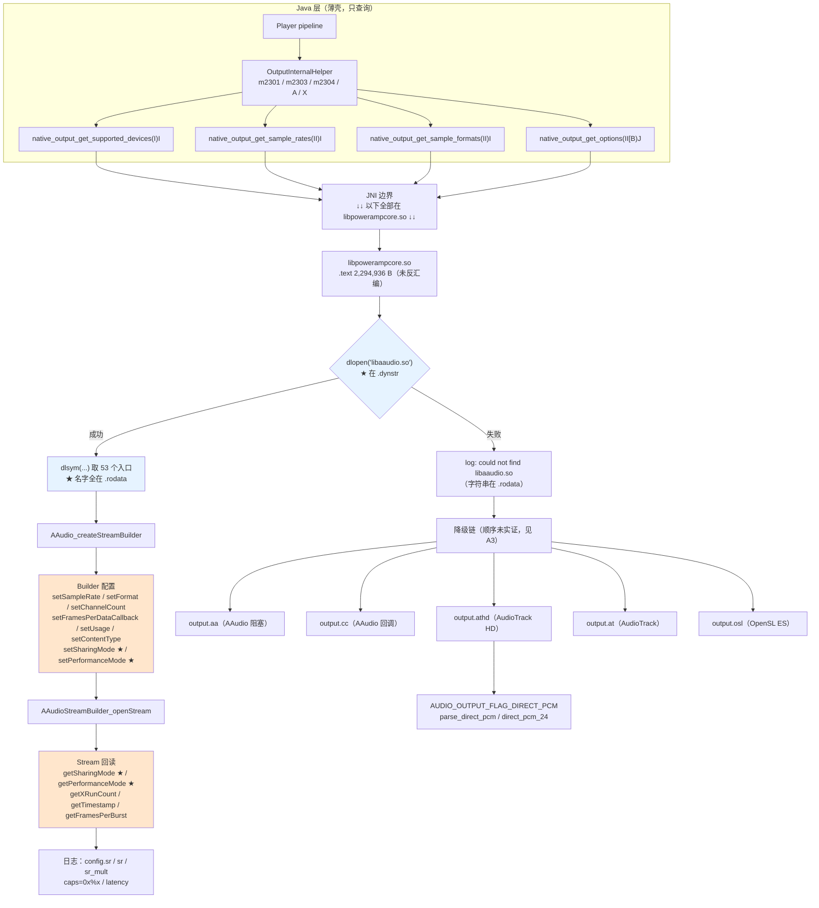

# Poweramp 音频输出链路与独占输出（Native 层实证）

## 0. 文档定位声明（必读）

**本文记录的是外部实现 Poweramp 的原生音频输出链路，不是 SpMusic 的现状描述，也不是照抄规格。**

### 0.1 与既有四份文档的边界

| 文档 | 证据类型 | 本文关系 |
| --- | --- | --- |
| `poweramp-queue-runtime-reference.md` | Java 反编译 | **边界外** |
| `poweramp-search-and-queue-impact.md` | Java 反编译 | **边界外** |
| `poweramp-audio-settings-structure.md` | **XML 原文** | **交叉引用**（§9）。本文不重述设置页 UI 结构 |
| **本文** | **原生库字符串/符号扫描** | — |
| `real-audio-playback.md` | SpMusic 自身契约 | **边界外，未改动** |

### 0.2 证据分级：**本文必须引入第三类标记**

前三份文档的标记体系：
- 【实证·产物】= 反编译的 Java 方法体（队列 / 搜索）
- 【实证·原文】= apktool 解码的 XML 属性（设置页）

**本文的证据是原生库的字节串与 ELF 符号表**，与前两者性质不同。故引入：

| 标记 | 含义 | 能证明什么 |
| --- | --- | --- |
| **【实证·符号】** | 在 `libpowerampcore.so` 的字节/ELF 节中确证存在的字符串、符号名、常量名 | **能力与常量存在**：代码引用了这个 API、定义了这些常量 |
| **【实证·产物】** | 引用 `findings-audio-output.md` 中已落盘的反编译结论（仅 §1 的 Java 薄壳类） | 同前几份文档 |
| **【推断】** | 本文作者的推理 | 可能出错 |

### 0.3 【实证·符号】的局限（**本文最重要的诚实性要求**）

> **字符串存在 ≠ 行为确定。**

具体说，我能证明：
- `AAudioStreamBuilder_setSharingMode` 这个**名字**出现在 `.rodata` 的偏移 385317
- `dlopen` / `dlsym` 是**真实导入符号**（在 `.dynstr` 中）
- `PA_OUTPUT_CAP_NO_AUDIO_FOCUS` 等 20 个常量名存在于 rodata

我**不能**证明：
- **什么条件下**请求独占（A1）
- 请求失败后**是否自动重试为共享**（A6）
- `PA_OUTPUT_CAP_NO_AUDIO_FOCUS` 被设置后，是否真的**不调用** `requestAudioFocus`（A4）
- 五个后端的选择**优先级与降级触发条件**（A3）

**为什么这个区分在本文格外关键**：符号扫描天然比反编译「看起来更确定」——反编译给出代码会有控制流、有 if/else，读者立刻知道「这里还有未知」；而符号列表是**扁平的命名清单**，容易让人误以为「列全了就是搞清楚了」。**实际上符号扫描的证据强度弱于反编译**：它只到「有这个名字」这一层，行为需要 Ghidra 反汇编。

### 0.4 本轮对源材料的核对结果

我对 `findings-audio-output.md` 与 `libpowerampcore.so` 逐项复核（§12 给出全部证据）。**发现 1 处错误、5 处遗漏、1 处表述不当**：

| # | 源材料 | 核对结果 |
| --- | --- | --- |
| 1 | `:239` 「OEM 变体（**16 个**）」 | **实际 20 个** `FLAG_VARIANT_*`（§7.3 列出全部）。源文件的清单本身也列了 20 个名字，标题的「16」是错的 |
| 2 | `:114` 「已解析的 AAudio 符号（**部分**）」，列 27 个 | 实为 **53 个**唯一符号（§5）。**源文件未单列 `setPerformanceMode`/`getPerformanceMode`**——这是低延迟的关键第二对 |
| 3 | `:71` 「AAudio 引用 60 处，OpenSLES 1 处仅为 `slCreateEngine` 字样」 | 源文件 `:73` 已自我纠正，但 `:2.1` 的纠正**只说「23 条」未列全**。实际唯一 OpenSL 相关 token **14 个**（含 5 个 `.c` 源文件名，说明是独立编译单元） |
| 4 | `:19` 「通过 `dlopen("libaaudio.so")` 动态加载」 | **属实但表述可强化**：`dlopen`/`dlsym`/`dlclose`/`dlerror` **四个都在 `.dynstr`**（真实导入），而 53 个 AAudio 符号**全在 `.rodata`**。这**证明**是 dlsym 运行时解析，而非链接期绑定 |
| 5 | `:156` 「AAudio 的 `setSharingMode(EXCLUSIVE)` 只是请求」 | **这是正确的重要推断，但源材料未指出：`AAUDIO_SHARING_MODE_EXCLUSIVE` 这个枚举名在二进制中根本不存在**（§6.2）。即「独占」是通过整数常量传入的，枚举名只在头文件里 |
| 6 | §0「一句话结论」称「设置 `AAudioStreamBuilder_setSharingMode` 实现独占」 | **表述过强**。符号存在只证明「引用了这个 API」，不证明「传入了 EXCLUSIVE 值」。见 §6.2 与 A1 |
| 7 | `:349` 「这与我们的 `audio/device/polling.rs` 思路一致」 | **需核实**——该文件属 SpMusic 实现细节，本文不替它下结论（见 §9.0 注） |

**未发现错误的项**（确认准确）：Java 薄壳 4 个 native 方法、5 个后端标识、libaaudio.so 加载串、20 个 `PA_OUTPUT_CAP_*`（**精确 20 个，与源文件一致**）、60 个 `FLAG_*`（**精确 60 个**）、8 档采样率、1 个 `handle_mtk_hifi_set_func`、5 个厂商 policy 路径、3 条日志模板、三层采样率解释。

## 1. 目标标识与采集方法

| | |
| --- | --- |
| 包名 / 版本 | `com.maxmpz.audioplayer` build-1025-uni（versionCode `1025009`） |
| APK SHA-256 | `4467fdac3e89b98485866e454bc3b7dc2d73d788d7a1aa9c73ea1028d36b82e0` |
| 原生库 | `.rea-analysis/natives/libpowerampcore.so` — **3,592,656 B（3.43 MB）** |
| 其他原生库 | `libffmpeg_neon.so`（1,966,760 B）、`libyayicn.so`（539,472 B） |
| 文件格式 | **ELF64 aarch64，已 strip**（无 `.symtab`），27 个节 |
| 关键节大小 | `.dynsym` 12,600 B / `.dynstr` 7,372 B / `.rodata` 372,426 B / `.text` 2,294,936 B |
| Java 面引擎 | JADX 0.7.1 headless via REA |
| Native 面方法 | 原始字节串扫描 + ELF 节解析（本文复核时自行重跑） |
| 采集日期 | 2026-10-27 |

### 1.1 证据强度分层（本文复核时新增）

复核时我解析了 ELF 节头，把「字符串」与「符号」区分开——**这个区分直接决定证据强度**：

| 位置 | 内容 | 证据强度 |
| --- | --- | --- |
| `.dynstr`（导入字符串表） | `dlopen` / `dlsym` / `dlclose` / `dlerror` | **高**：真实导入符号，链接期绑定 |
| `.rodata`（只读数据） | 全部 53 个 `AAudio*` 名字、全部 `PA_OUTPUT_CAP_*`、`FLAG_*`、`output.*`、policy 路径 | **中**：作为 `dlsym` 的字符串参数或常量名存在 |
| `.text`（代码） | **未做反汇编** | 未知 |

**推论（【推断】，但有强支撑）**：`dlopen`/`dlsym` 在 `.dynstr` → 真实导入；`AAudio*` 全在 `.rodata` → 它们是 **`dlsym` 的第二个参数（符号名字符串）**。这与 `aaudio_loader.c` 的存在一致：即 Poweramp 自己实现了一个 AAudio 加载器，绕开链接期依赖（因为 `libaaudio.so` 在 API 26 以下不存在）。

> 这一层「dlopen/dlsym 在 .dynstr、AAudio 名在 .rodata」的区分，是源材料没有做而我复核出的**证据强度差异**。

## 2. Java 层：能力查询薄壳

`com.maxmpz.audioplayer.plugin.OutputInternalHelper`（11 方法 / 0 字段）【实证·产物】`findings-audio-output.md:27-40`。

| 方法 | 签名 | 性质 |
| --- | --- | --- |
| `native_output_get_supported_devices` | `(I)I` | **native**（`body_status = not_available`） |
| `native_output_get_sample_rates` | `(II)I` | **native** |
| `native_output_get_sample_formats` | `(II)I` | **native** |
| `native_output_get_options` | `(II[B)J` | **native** |
| `m2301` | `(I)I` | Java 包装 |
| `m2303` / `m2304` | `(II)I` | Java 包装 |
| `A` | `(II[B)J` | Java 包装 |
| `X` | `(II)Z` | Java 包装 |
| `B` | `(Context,I,Z)String` | 设备名解析 |
| `m2302` | `(StateBus,Z,String,StringBuilder)Z` | 状态总线查询 |

典型包装【实证·产物】`findings-audio-output.md:42-52`：

```java
public static int m2301(int i) {
    try {
        return native_output_get_supported_devices(i);
    } catch (Throwable th) {
        Log.e("OutputInternalHelper", "", th);
        return -1;
    }
}
```

**关键结构事实**：4 个 native 方法**全部是 `get_*`（查询），没有 `set_*`（设置）**。

⇒ 【实证·产物】Java 层不做输出决策，只问原生「这个设备支持什么」。真正的打开/配置/独占全在 native。

> ⚠️ 但注意：`native_output_get_options(II[B)J` 返回 `long`，且有两个 `int` 参数 —— **返回的 `long` 极可能是位掩码**（对应 §7 的 `caps=0x%x` 日志字段）。这是【推断】，因为 options 的组装逻辑在 native。

## 3. 数据流图



## 4. 五个输出后端

【实证·符号】全部 5 个 `output.*` 标识均在 `.rodata` 中确证。

| # | 后端标识 | 推测实现 | 关键证据 | 证据级别 |
| --- | --- | --- | --- | --- |
| 1 | `output.aa` | **AAudio**（阻塞写模式） | 与 `aaoutput.c`、`libaaudio.so`、全部 53 个 AAudio 符号同区；日志模板含 `num_bufs` | 【实证·符号】标识；【推断】语义 |
| 2 | `output.cc` | **AAudio 回调模式** | 日志模板含 `num_blocks`（非 `num_bufs`）+ `limited_desired_frames`；有 `aaudio_data_callback_proc` | 【实证·符号】；【推断】语义 |
| 3 | `output.athd` | **AudioTrack HD** | 名含 `hd`；与 `oslhdoutput.c`、`stream3_osl_player_callback` 同区 | 【实证·符号】；【推断】语义 |
| 4 | `output.at` | **AudioTrack** | 日志模板含 `g_at_min_buf_frames_48k`、`sr_mult`、`reported_native_sample_rate` | 【实证·符号】；【推断】语义 |
| 5 | `output.osl` | **OpenSL ES** | 14 个 OpenSL token（§4.1） | 【实证·符号】；【推断】语义 |

### 4.1 OpenSL ES：完整第三后端，不是遗留

【实证·符号】在 `.rodata` 中确证的 14 个 OpenSL 相关 token：

| Token | 类别 | 说明 |
| --- | --- | --- |
| `slCreateEngine` | 引擎入口 | OpenSL ES 唯一的全局入口函数 |
| `SL_IID_ENGINE` | IID | 引擎接口 |
| `SL_IID_BUFFERQUEUE` | IID | 缓冲队列（流式播放核心） |
| `SL_IID_PLAY` | IID | 播放控制 |
| `SL_IID_VOLUME` | IID | 音量 |
| `SL_IID_ANDROIDEFFECT` | IID | Android 音效 |
| **`SL_IID_ANDROIDCONFIGURATION`** | IID | **Android 配置（stream type / 采样率 / 声道）** |
| `SL_ENABLE_ARRAY_120_WORKAROUND` | 宏/常量 | 芯片兼容 workaround |
| `osloutput_init` | 函数名 | 初始化入口 |
| `osl_player_callback` | 函数名 | 数据回调 |
| `osloutput.c` | **源文件名** | 独立编译单元 |
| `oslhdoutput.c` | **源文件名** | HD 变体编译单元 |
| `osl_stream3.c` | **源文件名** | stream3 变体编译单元 |
| `osl` | 前缀 | 命名空间 |

**为什么这证明「不是遗留」**（【推断】，但依据充分）：

1. **三个独立 `.c` 源文件名**（`osloutput.c` / `oslhdoutput.c` / `osl_stream3.c`）—— 说明这是三个**分别编译**的实现文件，不是一段被弃用的死代码。
2. **`SL_IID_ANDROIDCONFIGURATION` 存在** —— 这是 OpenSL ES 设置 stream type 与采样率的接口，是 Android 4.x–7.x 时代实现 Hi-Res / 直通的主要手段。若只是遗留，这个 IID 不会保留。
3. **`SL_ENABLE_ARRAY_120_WORKAROUND`** —— 针对特定芯片的兼容宏，属主动维护痕迹。

> ⚠️ 但这**不证明它当前仍会被选中**（A7）。「代码完整」与「运行时活跃」是两件事。

## 5. AAudio 53 符号分组表

【实证·符号】**53 个唯一符号，我已逐个在 `.rodata` 中验证存在（53/53）**。

### 5.1 Builder 配置（19 个唯一 setter）

| 符号 | 用途（【推断】，基于 AAudio 公开 API 语义） |
| --- | --- |
| `AAudioStreamBuilder_setDirection` | 输入/输出方向 |
| `AAudioStreamBuilder_setSampleRate` | **期望采样率** |
| `AAudioStreamBuilder_setChannelCount` | 声道数 |
| `AAudioStreamBuilder_setFormat` | **期望采样格式** |
| `AAudioStreamBuilder_setBufferCapacityInFrames` | 缓冲容量（帧） |
| `AAudioStreamBuilder_setFramesPerDataCallback` | 回调粒度 |
| `AAudioStreamBuilder_setDataCallback` | 数据回调函数 |
| `AAudioStreamBuilder_setErrorCallback` | 错误回调函数 |
| **`AAudioStreamBuilder_setSharingMode`** | **★ 共享/独占请求** |
| **`AAudioStreamBuilder_setPerformanceMode`** | **★ 性能模式请求（低延迟/省电）** |
| `AAudioStreamBuilder_setUsage` | 用途（media/notification…） |
| `AAudioStreamBuilder_setContentType` | 内容类型（music/movie…） |
| `AAudioStreamBuilder_setInputPreset` | 输入预设（录音侧） |
| `AAudioStreamBuilder_setDeviceId` | 指定设备 |
| `AAudioStreamBuilder_setSessionId` | 音频会话 id |
| `AAudioStreamBuilder_setPackageName` | 包名（归因） |
| `AAudioStreamBuilder_setAttributionTag` | 归因标签（API 31+） |
| `AAudioStreamBuilder_setSpatializationBehavior` | 空间化行为（API 31+） |
| `AAudioStreamBuilder_setSamplesPerFrame` | 每帧样本数 |

**合计 19 个唯一 `Builder_set*` 符号。** 加上 `AAudio_createStreamBuilder` / `AAudioStreamBuilder_openStream` / `AAudioStreamBuilder_delete`（§5.3），构成完整的 builder 面。

### 5.2 Stream 读取 / 回读 + 转换（22 个 = 20 个 `get*` + 2 个 `convert*`）

| 符号 | 用途（【推断】） | 对应请求项 |
| --- | --- | --- |
| **`AAudioStream_getSharingMode`** | **★ 回读实际共享模式** | ↔ `setSharingMode` |
| **`AAudioStream_getPerformanceMode`** | **★ 回读实际性能模式** | ↔ `setPerformanceMode` |
| `AAudioStream_getFormat` | 回读实际格式 | ↔ `setFormat` |
| `AAudioStream_getSampleRate` | 回读实际采样率 | ↔ `setSampleRate` |
| `AAudioStream_getChannelCount` | 回读实际声道数 | ↔ `setChannelCount` |
| `AAudioStream_getSamplesPerFrame` | 回读每帧样本 | ↔ `setSamplesPerFrame` |
| `AAudioStream_getBufferCapacityInFrames` | 回读缓冲容量 | ↔ `setBufferCapacityInFrames` |
| `AAudioStream_getBufferSizeInFrames` | 回读当前缓冲大小 | — |
| `AAudioStream_getFramesPerBurst` | **设备固有 burst 大小** | —（需查询，不可设） |
| `AAudioStream_getXRunCount` | **欠载/过载计数** | —（运行期监测） |
| `AAudioStream_getState` | 当前状态 | — |
| `AAudioStream_getTimestamp` | **时钟戳（音视频同步）** | — |
| `AAudioStream_getDirection` | 方向 | ↔ `setDirection` |
| `AAudioStream_getContentType` | 内容类型 | ↔ `setContentType` |
| `AAudioStream_getUsage` | 用途 | ↔ `setUsage` |
| `AAudioStream_getDeviceId` | 实际设备 id | ↔ `setDeviceId` |
| `AAudioStream_getSessionId` | 会话 id | ↔ `setSessionId` |
| `AAudioStream_getInputPreset` | 输入预设 | ↔ `setInputPreset` |
| `AAudioStream_getFramesRead` | 已读帧数（输入侧） | — |
| `AAudioStream_getFramesWritten` | 已写帧数（输出侧） | — |
| `AAudio_convertResultToText` | 错误码转文本（诊断） | — |
| `AAudio_convertStreamStateToText` | 状态转文本（诊断） | — |

### 5.3 生命周期 / IO（12 个）

| 符号 | 用途 |
| --- | --- |
| `AAudio_createStreamBuilder` | 创建 builder |
| `AAudioStreamBuilder_openStream` | **打开流（请求 → 生效的分界点）** |
| `AAudioStreamBuilder_delete` | 释放 builder |
| `AAudioStream_requestStart` | 启动 |
| `AAudioStream_requestPause` | 暂停 |
| `AAudioStream_requestStop` | 停止 |
| `AAudioStream_requestFlush` | 清空缓冲 |
| `AAudioStream_waitForStateChange` | 等待状态迁移 |
| `AAudioStream_close` | 关闭 |
| `AAudioStream_write` | **阻塞写（`output.aa` 模式）** |
| `AAudioStream_read` | 阻塞读（录音侧） |
| `AAudioStream_setBufferSizeInFrames` | 运行期调整缓冲 |

### 5.4 分组计数校验（本轮实测）

【实证·符号】正则统计结果与分组加总**精确吻合**：

| 分组 | 计数 | 统计方式 |
| --- | --- | --- |
| Builder setter | **19** | `AAudioStreamBuilder_set[A-Za-z]+` |
| Stream getter | **20** | `AAudioStream_get[A-Za-z]+` |
| 转换函数 | **2** | `AAudio_convert*`（两者已含在上表 22 中） |
| 生命周期 / IO | **12** | `createStreamBuilder`/`openStream`/`delete`/`request*`×4/`waitForStateChange`/`close`/`write`/`read`/`setBufferSizeInFrames` |
| **合计** | **53** | `AAudio[A-Za-z_]+` 去重 = **53** ✓ |

> 19 + 20 + 2 + 12 = **53**，与二进制中 `AAudio*` 唯一符号总数完全一致。这是一次**自校验**：说明源材料的 53 个清单没有遗漏、也没有混入非 AAudio 前缀项。

### 5.5 核心发现：两对 request/readback 的**结构对称性**

| 对 | 请求（Builder 阶段） | 回读（Stream 阶段） |
| --- | --- | --- |
| **第 1 对** | `AAudioStreamBuilder_setSharingMode` | `AAudioStream_getSharingMode` |
| **第 2 对** | `AAudioStreamBuilder_setPerformanceMode` | `AAudioStream_getPerformanceMode` |

**这是本文认为最有价值的结构观察**（源材料只发现了第 1 对）：

同一份代码里出现**两对**「设置期望值 + 回读实际值」，说明这不是针对某个 API 的个别补偿，而是**对 AAudio「请求不保证生效」这一特性的系统性应对**。

AAudio 的语义确实如此：`setSharingMode(EXCLUSIVE)` 是**建议**，系统可因资源、策略、驱动原因降级为共享；`setPerformanceMode(LOW_LATENCY)` 同样是**建议**，系统可忽略。因此任何严肃的 AAudio 使用者都必须回读。

> **推广观察**：`getFormat`/`getSampleRate`/`getChannelCount`/`getBufferCapacityInFrames` 也都是回读——即 **Poweramp 对 builder 阶段设置的几乎所有关键参数都做了回读**。这两对只是其中最语义化的两个。完整回读对列表见 §5.2 的「对应请求项」列。

这个模式对 SpMusic 的直接含义见 §10 A1。

## 6. 独占输出专章

### 6.1 判据：符号层面能证明什么、不能证明什么

| 命题 | 能否证明 | 依据 |
| --- | --- | --- |
| Poweramp 引用了 `setSharingMode` API | ✅ **能** | `.rodata` 偏移 385317 存在该字符串 |
| Poweramp 引用了 `getSharingMode` API | ✅ **能** | `.rodata` 偏移 327663 |
| Poweramp 会回读实际共享模式 | ✅ **能**（引用即会在某处调用） | 同上 |
| Poweramp **请求了** `EXCLUSIVE` | ❌ **不能** | `AAUDIO_SHARING_MODE_EXCLUSIVE` 枚举名**不在二进制中**（§6.2）——它在运行时以整数传入 |
| 请求独占的**条件** | ❌ **不能**（A1） | 需 Ghidra 反汇编 `output.aa` 的打开路径 |
| 请求失败后是否降级/重试 | ❌ **不能**（A6） | 同上 |

### 6.2 关键发现：枚举名不在二进制中

【实证·符号】**我搜索了全部 `AAUDIO_[A-Z0-9_]+` 模式，二进制中一个都没有**：

| 枚举名 | 是否存在于 `.rodata` |
| --- | --- |
| `AAUDIO_SHARING_MODE_EXCLUSIVE` | **否** |
| `AAUDIO_SHARING_MODE_SHARED` | **否** |
| `AAUDIO_PERFORMANCE_MODE_LOW_LATENCY` | **否** |
| `AAUDIO_PERFORMANCE_MODE_NONE` | **否** |
| `AAUDIO_PERFORMANCE_MODE_POWER_SAVING` | **否** |

这说明：**Poweramp 不通过枚举名调用 AAudio，而是直接传整数**。这在 C 里是正常做法（枚举在编译期变成整数常量），但它对逆向的含义是：

⇒ **我无法从字符串证据推断它传了哪个值。** 「是否请求独占」这个最核心的问题，**字符串扫描在原理上就到不了**。

> 这是本文对源材料 §0 一句话结论（「设置 `setSharingMode` 实现独占」）的**降级修正**：符号证明「调了这个 API」，不证明「传的是 EXCLUSIVE」。

### 6.3 为什么用 AAudio 而不是 AudioTrack

| 维度 | AudioTrack | AAudio |
| --- | --- | --- |
| 独占模式 | **无公开 API**（只能靠 `AUDIO_OUTPUT_FLAG_DIRECT` 间接） | **有显式 `setSharingMode`** |
| 低延迟模式 | `AudioTrack.PERFORMANCE_MODE_LOW_LATENCY`（API 26+） | `setPerformanceMode(LOW_LATENCY)` |
| 动态加载 | 否（系统类 / NDK 链接） | 是（`dlopen("libaaudio.so")`） |
| 最低版本 | API 3+ | API 26+ |
| 缓冲控制 | `setBufferSizeInFrames` | `AAudioStream_setBufferSizeInFrames` |

【推断】Poweramp 同时保留两条路径的原因：
1. `output.aa`/`output.cc` 覆盖 API 26+（可真独占 + 低延迟）
2. `output.athd`/`output.at` 覆盖低版本与 AAudio 不可用场景，靠 `AUDIO_OUTPUT_FLAG_DIRECT_PCM` 逼近直通
3. `output.osl` 覆盖更早的 Android 4.x–7.x（靠 `SL_IID_ANDROIDCONFIGURATION`）

### 6.4 降级链：存在，但顺序未实证

【实证·符号】确证存在的降级手段：

| 手段 | 符号/串 | 位置 |
| --- | --- | --- |
| AAudio 不可用 | `libaaudio.so`、`%s() could not find libaaudio.so`、`aaudio_loader.c` | `.rodata` |
| AudioTrack 直通 PCM | `AUDIO_OUTPUT_FLAG_DIRECT_PCM`、`parse_direct_pcm`、`direct_pcm`、`direct_pcm_24` | `.rodata` |
| OpenSL ES 配置 | `SL_IID_ANDROIDCONFIGURATION` | `.rodata` |

**能证明**：框架有能力在 AAudio 失败时走 AudioTrack/OpenSL。
**不能证明**：**具体的降级顺序、触发条件、是否重试**（A3、A6）。

> 源材料 §8 的链路图把降级顺序画成 `output.aa → output.cc → output.athd → output.at → output.osl`。**这个顺序是【推断】，不是实证**——字符串扫描无法确定优先级。本文在图中标注了这一点。

## 7. `PA_OUTPUT_CAP_*`（20 个）与 `FLAG_*`（60 个）

### 7.1 `PA_OUTPUT_CAP_*` —— 精确 20 个（复核确认）

【实证·符号】正则 `PA_OUTPUT_CAP_[A-Z0-9_]+` 去重后**恰好 20 个**，与源材料一致：

| # | 常量 | 含义（【推断】，由名称） | 与独占相关 |
| --- | --- | --- | --- |
| 1 | `PA_OUTPUT_CAP_RAW` | 原始位流输出（不经混音器） | **是** |
| 2 | `PA_OUTPUT_CAP_NO_DUCK` | 不因通知/来电降低音量 | **是** |
| 3 | `PA_OUTPUT_CAP_NO_AUDIO_FOCUS` | 不申请音频焦点 | **是** |
| 4 | `PA_OUTPUT_CAP_NO_EQU` | 系统均衡器不介入 | **是** |
| 5 | `PA_OUTPUT_CAP_NO_HEADROOM_GAIN` | 无 headroom 衰减 | **是** |
| 6 | `PA_OUTPUT_CAP_NO_MUSIC_STREAM_VOL` | 不使用系统音乐流音量 | **是** |
| 7 | `PA_OUTPUT_CAP_CUSTOM_MASTER_VOLUME` | 自管主音量 | 相关 |
| 8 | `PA_OUTPUT_CAP_FORCED_UNITY_GAIN` | 强制单位增益（绕过系统音量） | **是** |
| 9 | `PA_OUTPUT_CAP_ALWAYS_UNITY_GAIN` | 始终单位增益 | 相关 |
| 10 | `PA_OUTPUT_CAP_NEEDS_VOL_UI` | 需要自绘音量 UI | 相关 |
| 11 | `PA_OUTPUT_CAP_NEEDS_VOLUME_PROVIDER` | 需要外部音量提供者 | 相关 |
| 12 | `PA_OUTPUT_CAP_DELAYED_FORMAT` | 格式延迟确定 | — |
| 13 | `PA_OUTPUT_CAP_FLT_EXTENDED_DYN_RANGE` | 浮点扩展动态范围 | — |
| 14 | `PA_OUTPUT_CAP_TRACK_PLAYBACK` | 轨道播放模式 | — |
| 15 | `PA_OUTPUT_CAP_USE_STREAM3` | 使用 stream3 | — |
| 16 | `PA_OUTPUT_CAP_OEM_VARIANT` | OEM 定制变体 | — |
| 17 | `PA_OUTPUT_CAP_SEEK_FAST_VOLUME` | seek 时快速音量 | — |
| 18 | `PA_OUTPUT_CAP_TRACK_CHANGE_FAST_VOLUME` | 切歌时快速音量 | — |
| 19 | `PA_OUTPUT_CAP_PAUSE_FAST_VOLUME` | 暂停时快速音量 | — |
| 20 | `PA_OUTPUT_CAP_PTS_UI` | PTS 显示 | — |

> **注意**：源材料 `findings-audio-output.md:209` 说「`NO_AUDIO_FOCUS` + `FORCED_UNITY_GAIN` + `NO_DUCK` 三者组合 = 独占播放的完整语义」。这是【推断】。**从符号层面只能说这三个常量存在**，不能说它们被组合使用，更不能说组合后的行为（A4）。

### 7.2 `FLAG_*` —— 精确 60 个（完整枚举，本轮实测）

【实证·符号】正则 `FLAG_[A-Z0-9_]+` 去重后**恰好 60 个**。以下是**完整清单**（按字母序，附分类列）：

| # | 常量 | 分类 |
| --- | --- | --- |
| 1 | `FLAG_ALLOW_DVC_EFFECT` | DVC |
| 2 | `FLAG_ALLOW_PCM_32` | PCM 位深 |
| 3 | `FLAG_ASK_AF_FORMAT` | 焦点交互 |
| 4 | `FLAG_ASK_AF_SAMPLE_RATE` | 焦点交互 |
| 5 | `FLAG_AUDIO_PLATFORM_INITED` | 生命周期 |
| 6 | `FLAG_BT_DVC_EFFECT` | DVC |
| 7 | `FLAG_BUILT` | 生命周期 |
| 8 | `FLAG_CMD_MSG_USED_NOW` | 运行态 |
| 9 | `FLAG_DIRECT` | **直通** |
| 10 | `FLAG_DIRECT_PCM` | **直通** |
| 11 | `FLAG_FILLED` | 缓冲态 |
| 12 | `FLAG_FORCE_PCM_8_24` | PCM 位深 |
| 13 | `FLAG_GET_SAMPLES_BLOCK_CONSUMED` | 运行态 |
| 14 | `FLAG_NEEDS_DEEP_BUFFER` | 缓冲需求 |
| 15 | `FLAG_NEEDS_DIRECT_PCM` | **直通需求** |
| 16 | `FLAG_NEEDS_EXTRA_SLEEPS` | 时序调优 |
| 17 | `FLAG_NEEDS_OFFLOAD_OUTPUT_FLAG` | offload 需求 |
| 18 | `FLAG_NON_BLOCKING` | IO 模式 |
| 19 | `FLAG_NON_BLOCKING_WRITE` | IO 模式 |
| 20 | `FLAG_OUT_PARAMS_UNDETECTABLE` | 探测能力 |
| 21 | `FLAG_PENDING_EOF` | 运行态 |
| 22 | `FLAG_SR_176K` | 采样率 |
| 23 | `FLAG_SR_192K` | 采样率 |
| 24 | `FLAG_SR_352K` | 采样率 |
| 25 | `FLAG_SR_384K` | 采样率 |
| 26 | `FLAG_SR_44K` | 采样率 |
| 27 | `FLAG_SR_48K` | 采样率 |
| 28 | `FLAG_SR_88K` | 采样率 |
| 29 | `FLAG_SR_96K` | 采样率 |
| 30 | `FLAG_STOP_FOR_PAUSE` | 播放控制 |
| 31 | `FLAG_SUPPORTS_FLT_DYN_RANGE` | 能力 |
| 32 | `FLAG_SUPPORTS_LDAC` | 能力（蓝牙） |
| 33 | `FLAG_SUPPORTS_PCM_24` | 能力 |
| 34 | `FLAG_SUPPORTS_PCM_24_OFFLOAD` | 能力 |
| 35 | `FLAG_SUPPORTS_PCM_32` | 能力 |
| 36 | `FLAG_SUPPORTS_PCM_8_24` | 能力 |
| 37 | `FLAG_SUPPORTS_SPEAKER` | 能力（设备） |
| 38 | `FLAG_SUPPORTS_UNITY_GAIN_STREAM` | 能力 |
| 39 | `FLAG_SUPPORTS_USB` | 能力（设备） |
| 40 | `FLAG_USE_AT_CALLBACK` | AudioTrack 回调 |
| 41 | `FLAG_VARIANT_DIRECT_HD` | OEM 变体 |
| 42 | `FLAG_VARIANT_DIRECT_HD_MIUI_STREAM` | OEM 变体 |
| 43 | `FLAG_VARIANT_DIRECT_HD_MIUI_STREAM_1` | OEM 变体 |
| 44 | `FLAG_VARIANT_DIRECT_HD_MIUI_STREAM_11` | OEM 变体 |
| 45 | `FLAG_VARIANT_DIRECT_HD_MIUI_STREAM_12` | OEM 变体 |
| 46 | `FLAG_VARIANT_DIRECT_HD_NS` | OEM 变体 |
| 47 | `FLAG_VARIANT_DIRECT_HD_STREAM_11` | OEM 变体 |
| 48 | `FLAG_VARIANT_DIRECT_PCM8_24` | OEM 变体 |
| 49 | `FLAG_VARIANT_DYNAMIC` | OEM 变体 |
| 50 | `FLAG_VARIANT_IBASSO` | OEM 变体 |
| 51 | `FLAG_VARIANT_LENOVO_HIFI` | OEM 变体 |
| 52 | `FLAG_VARIANT_MEIZU_HIFI` | OEM 变体 |
| 53 | `FLAG_VARIANT_MIXED_HIRES` | OEM 变体 |
| 54 | `FLAG_VARIANT_MTK_HIFI` | OEM 变体 |
| 55 | `FLAG_VARIANT_PCM_OFFLOAD` | OEM 变体 |
| 56 | `FLAG_VARIANT_SAMSUNG` | OEM 变体 |
| 57 | `FLAG_VARIANT_SAMSUNG_UHQA` | OEM 变体 |
| 58 | `FLAG_VARIANT_SONY_96` | OEM 变体 |
| 59 | `FLAG_VARIANT_UHQA_MSM_BIT` | OEM 变体 |
| 60 | `FLAG_VARIANT_USB_ONLY` | OEM 变体 |

**分类小结**：

| 类别 | 数量 | 备注 |
| --- | --- | --- |
| OEM 变体（`FLAG_VARIANT_*`） | **20** | 见 §7.3 |
| 采样率（`FLAG_SR_*`） | **8** | 44.1k → 384k |
| 能力（`FLAG_SUPPORTS_*`） | **9** | |
| PCM / 位深 / 直通 | **7** | `ALLOW_PCM_32`、`FORCE_PCM_8_24`、`DIRECT`、`DIRECT_PCM`、`NEEDS_DIRECT_PCM`、`NEEDS_OFFLOAD_OUTPUT_FLAG`、`NEEDS_DEEP_BUFFER` |
| DVC | 2 | `ALLOW_DVC_EFFECT`、`BT_DVC_EFFECT` |
| 运行态 / 生命周期 / 时序 | 9 | `BUILT`、`FILLED`、`PENDING_EOF`、`AUDIO_PLATFORM_INITED`、`CMD_MSG_USED_NOW`、`GET_SAMPLES_BLOCK_CONSUMED`、`NEEDS_EXTRA_SLEEPS`、`STOP_FOR_PAUSE`、`OUT_PARAMS_UNDETECTABLE` |
| IO 模式 | 2 | `NON_BLOCKING`、`NON_BLOCKING_WRITE` |
| 焦点交互 | 2 | `ASK_AF_FORMAT`、`ASK_AF_SAMPLE_RATE` |
| AudioTrack 回调 | 1 | `USE_AT_CALLBACK` |

> **本轮新增发现**（源材料未列出）：`FLAG_ASK_AF_FORMAT` / `FLAG_ASK_AF_SAMPLE_RATE` —— 这两个 **`ASK_AF_*`** 标志值得注意（【推断】）：`AF` 在此处很可能指 **Audio Format** 或 **Audio Focus**，语义未确认。若指 Audio Focus，则说明 Poweramp 在请求焦点时会询问格式/采样率（Android 的 `AudioFocusRequest` 确实可携带这些信息）。这与 §9.0 的 `PA_OUTPUT_CAP_NO_AUDIO_FOCUS` 形成互补——**A4 未解项的技术基础可能就在这里**。
>
> 另：`FLAG_NON_BLOCKING` / `FLAG_NON_BLOCKING_WRITE` 的存在说明 native 层同时支持阻塞与非阻塞写，这与 `output.aa`（阻塞 `Stream_write`）和 `output.cc`（回调）两种模式的分野一致。

### 7.3 OEM 变体：**实际 20 个**（源材料标题错写 16）

【实证·符号】正则 `FLAG_VARIANT_[A-Z0-9_]+` 去重后**20 个**（全部列出）：

| # | 常量 | 厂商/语义（【推断】） |
| --- | --- | --- |
| 1 | `FLAG_VARIANT_SAMSUNG` | Samsung 通用 |
| 2 | `FLAG_VARIANT_SAMSUNG_UHQA` | Samsung UHQA（Ultra High Quality Audio） |
| 3 | `FLAG_VARIANT_SONY_96` | Sony 96 kHz 特例 |
| 4 | `FLAG_VARIANT_MEIZU_HIFI` | 魅族 HiFi |
| 5 | `FLAG_VARIANT_MTK_HIFI` | 联发科 HiFi |
| 6 | `FLAG_VARIANT_LENOVO_HIFI` | 联想 HiFi |
| 7 | `FLAG_VARIANT_IBASSO` | iBasso（USB DAC 厂） |
| 8 | `FLAG_VARIANT_UHQA_MSM_BIT` | UHQA + 高通 MSM 位深 |
| 9 | `FLAG_VARIANT_DIRECT_HD` | 直通 HD |
| 10 | `FLAG_VARIANT_DIRECT_HD_NS` | Direct HD（NS 变体，「可变式？」，未解） |
| 11 | `FLAG_VARIANT_DIRECT_HD_MIUI_STREAM` | Direct HD + MIUI stream |
| 12 | `FLAG_VARIANT_DIRECT_HD_MIUI_STREAM_1` | 同上，变体 1 |
| 13 | `FLAG_VARIANT_DIRECT_HD_MIUI_STREAM_11` | 同上，变体 11 |
| 14 | `FLAG_VARIANT_DIRECT_HD_MIUI_STREAM_12` | 同上，变体 12 |
| 15 | `FLAG_VARIANT_DIRECT_HD_STREAM_11` | Direct HD + stream 11 |
| 16 | `FLAG_VARIANT_DIRECT_PCM8_24` | Direct PCM 8.24 |
| 17 | `FLAG_VARIANT_DYNAMIC` | 动态选择 |
| 18 | `FLAG_VARIANT_MIXED_HIRES` | 混合 Hi-Res |
| 19 | `FLAG_VARIANT_PCM_OFFLOAD` | PCM offload |
| 20 | `FLAG_VARIANT_USB_ONLY` | 仅 USB |

> **MIUI 有 4 个变体**（`_MIUI_STREAM` / `_1` / `_11` / `_12`），说明小米/红米机型存在多种不同的直通行为，需要分别适配。这是 OEM 碎片化最直观的证据。

## 8. 三层采样率与整型重采样

### 8.1 三条日志模板（实测确认存在）

| 后端 | 模板（【实证·符号】逐串确认） |
| --- | --- |
| `output.aa` | `frames_per_block=%d block ms=%f num_bufs=%d at_min_buf_frames=%d config.sr=%d sr=%d config.fmt=%d fmt=%d caps=0x%x latency=%f` |
| `output.at` | **完整模板**：`frames_per_block=%d block ms=%f g_at_min_buf_frames_48k=%d sr_mult=%d at_min_buf_frames=%d sr=%d reported_native_sample_rate=%d caps=0x%x latency=%f` |
| `output.cc` | `frames_per_block=%d num_blocks=%d limited_desired_frames=%f block ms=%f` |

> 源材料 `:283` 对 `output.at` 的引用是截断的（`at_min_buf_...`），`:297-298` 才给出完整版。本文合并采用完整版。

### 8.2 三层采样率

| 字段 | 含义 | 出现的后端 |
| --- | --- | --- |
| `config.sr` | **配置采样率（期望值）** | `output.aa`（`output.at` 亦有 `config.sr`/`config.fmt` 成对，据源材料 `:358`） |
| `sr` | **实际请求/生效采样率** | 全部 |
| `reported_native_sample_rate` | **设备上报的原生值** | **仅 `output.at`** |
| `sr_mult` | **整数倍重采样倍率** | **仅 `output.at`** |

⇒ 【推断】`output.at`（AudioTrack）需要 `reported_native_sample_rate` + `sr_mult` 两个额外字段，是因为 AudioTrack 路径下系统会先报告设备原生采样率，再由 Poweramp 计算并应用整数倍重采样。而 AAudio 路径下这两个信息由 `AAudioStream_getSampleRate` 直接回读，故不需要单独字段。

### 8.3 「整数倍」这个设计选择的含义

`sr_mult` 是**整数倍**而非任意比率，这是重要的音质取舍（【推断】）：

- 若源 44.1k、设备 48k：非整数倍（48/44.1 ≈ 1.088）→ **需要插值重采样，有音质损失**
- 若源 96k、设备 48k：整数倍 2 → **可做简单抽取，或让设备自行处理**
- 若源 44.1k、设备 88.2k：整数倍 2 → **简单插值**

⇒ 记 `sr_mult` 为整数，说明 Poweramp 只在**能整除**的情形下自行重采样，否则交给系统/设备。这是保守且正确的做法。

## 9. OEM 适配：系统属性与厂商配置文件

### 9.0 与设置页文档的交叉引用（**先读这一节，注意证据性质**）

设置页（`poweramp-audio-settings-structure.md` §5）的**四个开关**与本文 Native 层的**四个 CAP 常量**在命名上对应：

| XML key（设置页） | Native 常量（本文） | 名称对应 |
| --- | --- | --- |
| `no_af` | `PA_OUTPUT_CAP_NO_AUDIO_FOCUS` | ✅ 语义一致 |
| `no_duck` | `PA_OUTPUT_CAP_NO_DUCK` | ✅ 语义一致 |
| `no_equ` | `PA_OUTPUT_CAP_NO_EQU` | ✅ 语义一致 |
| `no_headroom` | `PA_OUTPUT_CAP_NO_HEADROOM_GAIN` | ✅ 语义一致 |

> ## ⚠️ **这是命名对应，不是实现对应的实证**
>
> **XML 有开关（【实证·原文】）、Native 有常量（【实证·符号】），但「开关如何传到常量」的链路我们没有看到。**
>
> 缺失的中间环节：
> 1. XML 的 `no_af` 等 key 存储在某处（设置页文档 P2：键名未知，由代码管理）
> 2. 某段 Java 代码读取该值
> 3. 某段代码把它映射为 `PA_OUTPUT_CAP_NO_AUDIO_FOCUS` 位
> 4. 该位通过 `native_output_get_options` 或类似通道传给 native
> 5. native 依据该位决定行为
>
> **这 5 步一步都没有实证。** 本文只能说「两侧存在语义同名的项」，**不能**说「勾了 `no_af` 就会设置这个 CAP」。

同理，设置页的 `sample_rate_static` ↔ 本文的 `config.sr`/`sr` 也是**命名 + 语义推断**，不是执行链路实证：

| 侧 | 载体 | 证据 |
| --- | --- | --- |
| 设置页 | `sample_rate`（可编辑）/ `sample_rate_static`（只读） | 【实证·原文】XML key |
| Native | `config.sr`（期望）/ `sr`（实际） | 【实证·符号】日志模板字段 |
| **中间链路** | ？？？ | **未实证** |

> 两侧都有「期望/实际」这一对概念，且语义高度吻合，但**「只读行显示的值来自 `sr` 字段」这件事没有被证实**。可能是，也可能通过别的通道。这属于跨层因果，需读 Java 与 JNI 代码。

### 9.1 厂商系统属性（【实证·符号】全部确认）

| 属性 | 用途（【推断】） |
| --- | --- |
| `persist.audio.uhqa` | Samsung UHQA 开关 |
| `secmm.player.uhqamode` | Samsung 安全媒体 UHQA 模式 |
| `ro.lenovo.hifi_support` | Lenovo HiFi 能力标志 |
| `ro.hardware` | 硬件平台探测（通用） |
| `audio.offload.pcm.24bit.enable` | offload 24-bit 使能 |
| `!audio.offload.pcm.24bit.enable` | **取反判定**（`!` 前缀） |
| `audio.offload.buffer.size.kb` | offload 缓冲大小 |
| `handle_mtk_hifi_set_func` | **MTK 平台专用函数名** |

> `!audio.offload.pcm.24bit.enable` 这个带 `!` 的串值得注意（【推断】）：这很可能是 Poweramp 用于组合查询逻辑的**内部标记**（如 `getprop` 后取反），而非真实属性名。这是命名约定层面的证据，不是系统属性存在的证据。

### 9.2 厂商 audio policy 配置文件（【实证·符号】5 个全确认）

| 路径 | 含义 |
| --- | --- |
| `/vendor/etc/audio_output_policy.conf` | 厂商输出策略（新版 Android） |
| `/vendor/etc/audio_io_policy.conf` | 厂商 IO 策略 |
| `/vendor/etc/audio_policy.conf` | 厂商音频策略（旧版） |
| `/system/etc/audio_policy.conf` | 系统音频策略（更旧） |
| `/system/etc/audio_hifi.conf` | HiFi 配置文件 |

⇒ 【推断】Poweramp **直接解析厂商的 audio policy 配置文件**，以判断设备支持哪些输出路径（哪些 flag 可用、哪些采样率被允许）。这是**绕过 Android 公开 API 限制、探测 OEM 深度能力**的手段。`audio_hifi.conf` 与 §7.3 的 OEM 变体呼应。

> 这也是 Poweramp 支持 20 个 OEM 变体的技术基础：它不依赖「标准 API 报告的能力」，而直接读厂商配置文件。代价是**每个厂商的 conf 格式可能不同**，需要逐个适配——这解释了为何 MIUI 要 4 个变体。

## 10. 对 SpMusic 的可借鉴 / 不建议照抄（提案，非现状）

> 本章全部为**提案**，不代表已批准范围。SpMusic 的音频契约见 `docs/architecture/real-audio-playback.md`（本文未改动该文件）。
>
> ⚠️ 源材料 `findings-audio-output.md:349` 称「这与我们的 `audio/device/polling.rs` 思路一致」。**本文不采信这个对 SpMusic 内部实现的断言**——它超出本文证据范围，且我未核实该文件。SpMusic 侧的具体对照应由 SpMusic 的架构文档给出。

### 10.1 可借鉴

| # | 做法 | 理由 | 成本 |
| --- | --- | --- | --- |
| **A1** | **对「请求可能不生效」的参数一律回读实际值** | 这是本文最强的借鉴点。Poweramp 对 `setSharingMode`/`setPerformanceMode`/`setFormat`/`setSampleRate`/`setChannelCount`/`setBufferCapacityInFrames` **全部**做了对应 `get*` 回读（§5.2）。这不是针对单个 API 的补丁，而是**系统性应对**。SpMusic 若走 AAudio/其他音频后端，同样面临「请求降级」问题，应建立同样的回读纪律 | **低**（多调一个 get 并记录） |
| A2 | **期望值 / 实际值双记录进日志** | `config.sr=%d sr=%d` + `config.fmt=%d fmt=%d` 在同一行打印期望与实测。诊断「为什么音质不对」时一眼看出偏差 | **极低** |
| A3 | **整数倍重采样而非任意比率** | `sr_mult` 为整数说明只在能整除时自行重采样（§8.3），避免非整数插值的音质损失。SpMusic 若做重采样应遵守同样原则 | **中** |
| A4 | **能力探测先于打开** | 4 个 `native_output_get_*` 全是「查」不是「设」（§2）。先枚举设备支持什么，再决定用哪个后端/模式 | **中** |
| A5 | **动态加载可选依赖** | `dlopen("libaaudio.so")` + 显式失败串（§3）。让低版本系统上的启动不被硬依赖阻断。SpMusic 若依赖平台特定库，应同样用运行时探测 | **中** |
| A6 | **按设备/厂商分层的变体表** | 20 个 `FLAG_VARIANT_*` 是「一个通用实现 + 按设备适配」的显式建模。比在代码里散落 `if (isSamsung)` 更可维护 | **高**（需要设备数据库） |
| A7 | **可观测性优先于静默降级** | 三条后端各有独立日志模板 + `getXRunCount`（欠载计数）+ `convertResultToText`（错误码转文本）。失败时能说清「哪一步降级了」 | **低** |

### 10.2 不建议照抄

| # | 反模式 | 理由 |
| --- | --- | --- |
| **N1** | **20 个 OEM 变体 + 5 个 policy 路径 + 5 个系统属性** | **这是 Poweramp 在 10 年 Android 碎片化中积累的补丁层，不是可复制的设计。** SpMusic 是桌面应用（Tauri），**输出设备模型远比 Android 简单**——桌面系统通常只有 WASAPI/CoreAudio/ALSA/PulseAudio 几条标准路径，且采样率协商机制统一。照搬这套 OEM 适配层会引入巨大的维护负担（每个变体都要跟厂商 ROM 更新）。**这是「历史成本」而非「架构优点」** |
| N2 | **直接解析厂商配置文件** | 同上。桌面端无对应物。且解析 `/vendor/etc/*.conf` 是**私有格式依赖**——厂商改格式就失效。这是脆弱的 |
| N3 | **五个后端并存** | 桌面端 2–3 条标准路径足够（如 CoreAudio / WASAPI / ALSA）。五个后端的测试矩阵是 5×N 组合，维护成本高 |
| N4 | **依赖反射式 `native_output_get_options` 返回 `long` 位掩码** | `(II[B)J` 的 `long` 返回值语义**未文档化**（本文未解）。位掩码接口一旦位数不够或有歧义，排查困难。**应优先用具名结构体或显式枚举** |
| N5 | **用整数而非枚举名传 AAudio 参数** | 这是 C 的常规做法，但对可维护性不友好（§6.2：二进制里连 `AAUDIO_SHARING_MODE_EXCLUSIVE` 都没有）。SpMusic 若写 Rust，应用 `#[repr(i32)]` 枚举保留语义 |

### 10.3 若只做一件事

**建议优先落地 A1（回读实际值）+ A2（期望/实际双记录）。** 因为：

1. **成本最低**：多调一个 `get*` 并写一行日志；
2. **收益最直接**：直接回答「我设了 96k，为什么实际是 48k」——这是设置页文档里也已识别的最常见困惑；
3. **它不依赖本文任何未解项**：回读本身是确定性的，不需要知道「何时请求独占」；
4. **它是 A7（可观测性）的最小可用版本**，无需先建完整日志页。

## 11. 待验证清单 A1–A9

### 11.1 状态总览

| # | 问题 | 状态 | 为什么字符串扫描到不了 |
| --- | --- | --- | --- |
| **A1** | `AAUDIO_SHARING_MODE_EXCLUSIVE` 的**调用点控制流**（什么条件下请求独占） | ⚠️ **开放（最高优先）** | 枚举名不在二进制（§6.2），且控制流在 `.text` 中，未反汇编 |
| **A2** | `parse_direct_pcm` 的判定逻辑（何时走 `DIRECT_PCM` 降级） | ⚠️ 开放 | 函数体未反汇编 |
| **A3** | 五个后端的**选择优先级与降级触发条件** | ⚠️ 开放 | 决策逻辑在代码中 |
| **A4** | `PA_OUTPUT_CAP_NO_AUDIO_FOCUS` 的实际实现（是否真不调 `requestAudioFocus`） | ⚠️ 开放 | **常量存在 ≠ 行为**。需查 Java 侧（`requestAudioFocus` 调用点）+ native 侧位判断 |
| **A5** | 20 个 OEM 变体的**探测与匹配顺序** | ⚠️ 开放 | 匹配逻辑在代码中 |
| **A6** | `output.aa` 独占失败是否**自动重试为共享** | ⚠️ **开放（最高优先）** | 降级策略在错误处理路径中 |
| **A7** | OpenSL ES 路径**当前是否仍会被选中** | ⚠️ 开放 | 「代码完整」（§4.1）与「运行时活跃」是两件事 |
| **A8** | （本文新增）`getPerformanceMode` 回读的**实际用途** | ⚠️ 开放 | 回读存在（【实证·符号】），但回读后做什么（打日志？切后端？）未知 |
| **A9** | （本文新增）`native_output_get_options` 返回 `long` 的**位定义** | ⚠️ 开放 | `(II[B)J` 签名已知，但 `long` 的位↔CAP 映射未实证（§2 注） |

### 11.2 关闭这些项需要什么

| 项 | 需要的工具/方法 |
| --- | --- |
| A1、A2、A3、A6、A8 | **Ghidra 反汇编 `.text`**，定位 `output.aa` 的 open 路径 |
| A4 | Java 侧搜 `requestAudioFocus` 调用点 + native 侧 CAP 位判断 |
| A5 | 反汇编变体匹配逻辑 + 对比 `ro.hardware` 等属性读取点 |
| A7 | 运行时验证（打点/断点）或反汇编后端选择器 |
| A9 | 反汇编 `native_output_get_options` + 对照 Java 侧解包代码 |

> **本文立场：以上全部保持开放。** 不因「符号齐全」推断行为确定——这正是 §0.3 反复强调的。

## 12. 证据索引

### 12.1 本文复核时实测的记录

| 项 | 复核结果 | 方法 |
| --- | --- | --- |
| 原生库大小 | **3,592,656 B（3.43 MB）** | `Get-ChildItem` |
| ELF 类型 | ELF64 aarch64，**已 strip**（无 `.symtab`），27 节 | 解析 ELF header（`e_shoff=3590928`, `e_shentsize=64`, `e_shnum=27`） |
| `.dynsym` / `.dynstr`（含 `dlopen`/`dlsym`/`dlclose`/`dlerror`） | 全部存在 | 节解析 + 字符串过滤 |
| `.dynstr` 中含 `AAudio` 的条目 | **0 个** | 关键否定证据（§0.4/§1.1 推论基础） |
| AAudio 符号 53 个 | **53/53 全部存在**，全在 `.rodata` | 逐个 `Contains` + 偏移校验 |
| 关键符号偏移 | `setSharingMode`=385317、`getSharingMode`=327663、`setPerformanceMode`=340783、`getPerformanceMode`=363345、`PA_OUTPUT_CAP_NO_AUDIO_FOCUS`=367264、`FLAG_VARIANT_SAMSUNG_UHQA`=340376、`libaaudio.so`=301309/331453 | 字节扫描 + 节归属 |
| `AAUDIO_*` 枚举名 | **0 个**（全部不存在） | 正则 `AAUDIO_[A-Z0-9_]+` |
| `PA_OUTPUT_CAP_*` | **精确 20 个** | 正则去重 |
| `FLAG_*` | **精确 60 个** | 正则去重 |
| `FLAG_VARIANT_*` | **精确 20 个**（源材料标题写 16，错） | 正则去重 |
| OpenSL 相关 token | **14 个**（含 3 个 `.c` 文件名） | 正则去重 |
| 3 条日志模板字段 | `sr_mult=%d`、`reported_native_sample_rate=%d`、`num_blocks=%d`、`limited_desired_frames=%f` 等全部存在 | `Contains` |
| 5 个 policy 路径 | 全部存在 | `Contains` |
| 7 个 OEM 属性/函数名 | 全部存在 | `Contains` |

### 12.2 源材料引用（【实证·产物】部分）

| 主题 | 位置 |
| --- | --- |
| `OutputInternalHelper` 类摘要（11 方法 / 0 字段） | `findings-audio-output.md:27-40` |
| `m2301` 包装实现 | `findings-audio-output.md:42-52` |
| 4 个 native 方法（`body_status: not_available`） | `findings-audio-output.md:31-34` |
| Evidence ID：`OutputInternalHelper` 类摘要 | `ev_5185172ed564ede9d3f9472a10947ca1e2e7ef02338a543611ebc08186889a8c` |
| Evidence ID：`m2301` 方法体 | `ev_2190a37b1b8180d416766b5eeb6852cac459489979c4d7b8685ee9c11f103eee` |
| Evidence ID：`native_output_get_options`（native_method 确认） | `ev_3b0c1dbfddcb6ec0bda93c063fdc431ad55240cd10808a270de5575f1748fcce` |
| Evidence ID：`Output` 类搜索 | `ev_8750babdf7577e5d2c8ae464426fdfa0ba619d8ad7e121644a4532fdfcd1abc5` |

### 12.3 与其它文档的交叉引用

| 主题 | 位置 |
| --- | --- |
| 设置页四开关（`no_af`/`no_duck`/`no_equ`/`no_headroom`） | `docs/architecture/poweramp-audio-settings-structure.md` §5 |
| 设置页期望/实际配对（`sample_rate` / `sample_rate_static`） | 同上 §8.4 |
| 设置页 DVC 与 Hi-Res 互斥文案 | 同上 §6.2（`strings.xml:1050`、`:1098`、`:1385`） |
| 设置页空壳日志页（`audio_platform_log.xml`） | 同上 §6.6 |
| SpMusic 自身音频契约 | `docs/architecture/real-audio-playback.md`（**本文未改动**） |
