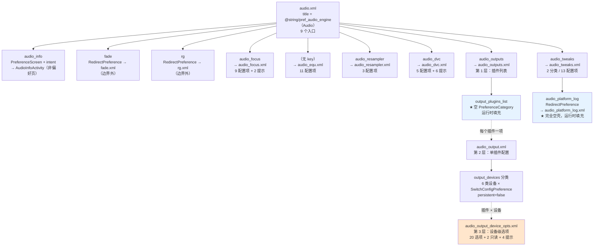
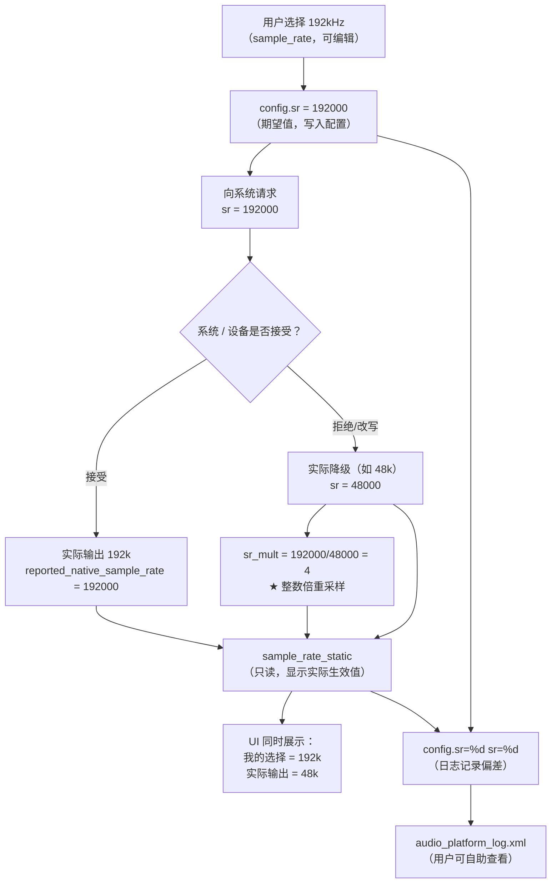

# Poweramp「设置 → 音频」偏好结构（外部实现）

## 0. 文档定位声明（必读）

**本文记录的是外部实现 Poweramp 的「设置 → 音频」页面组织方式，不是 SpMusic 的现状描述，也不是照抄规格。**

### 0.1 与既有四份文档的边界

| 文档 | 覆盖范围 | 本文关系 |
| --- | --- | --- |
| `poweramp-queue-runtime-reference.md` | 队列状态机（`mFilesCursor`/`next`/`prev`/`nextCategory`）、Q1–Q9 | **边界外**。本文不涉及播放队列行为 |
| `poweramp-search-and-queue-impact.md` | 搜索实体 `v3`/`w3`、伪行 `_id=-2/-3`、S1–S10 | **边界外**。本文不涉及搜索 |
| **本文** | **设置页如何组织**：10 个 XML 的偏好树、三层输出结构、独占四开关、深链、自制控件、期望值/实际值配对 | — |
| `.rea-analysis/findings-audio-output.md` | Native 音频输出链路、`config.sr` vs `sr` 双记录 | **交叉引用**（§8）。本文不重述输出链路细节 |
| `docs/architecture/real-audio-playback.md` | **SpMusic 自己的音频契约** | **边界外，本文未改动该文件** |

### 0.2 证据分级：两级

| 标记 | 含义 |
| --- | --- |
| **【实证·原文】** | 能在 `.rea-analysis/decoded/res/xml/*.xml` 或 `strings.xml` 中直接查到的 XML 属性 / 字符串字面量 |
| **【推断】** | 本文作者的推理，可能出错 |

> 前两份 Poweramp 文档用【实证·产物】（指反编译的 Java 方法体）。**本文的证据类型不同**——是 apktool 解码的 XML 原文，比反编译 Java 更权威（偏好页面本就由 XML 定义）。故用【实证·原文】区别于前三者的【实证·产物】。

### 0.3 本文对源材料的核对结果（**重要，先读**）

我逐字核对了 `findings-audio-settings.md` 与 10 个 XML 原文，**发现 8 处不一致**。按任务要求「以 XML 原文为准」，本文一律采用 XML 事实，并在此集中列出（详细对照见 §11）：

| # | `findings-audio-settings.md` 的说法 | XML 原文事实 |
| --- | --- | --- |
| 1 | 「根页面 `audio.xml`（**8 个入口**）」，正文标题又写「9 个入口」 | **9 个入口**（`audio_info` + 8 个 `RedirectPreference`）。两处自相矛盾，正确为 9【实证·原文】`audio.xml:4-14` |
| 2 | 「`audio_focus.xml` —— 音频焦点（**6 项 + 3 提示**）」，表格却列 **9 行** | 文件中**恰好 9 个可配置项** + 2 个提示 + 1 个分类容器 + restore_defaults。表格的 9 行是对的，小节标题的「6 项 + 3 提示」是错的【实证·原文】`audio_focus.xml:4-15` |
| 3 | 「`audio_equ.xml` —— 均衡器（**13 项**）」 | **11 个可配置项**（不含 restore_defaults），表格也只列了 11 行。标题「13」无依据【实证·原文】`audio_equ.xml:4-16` |
| 4 | 「`audio_tweaks.xml` —— 2 分类，**15 项**」 | Volume 分类 **4 项**（去重后，含 1 个 RawText 提示行共 5 个元素）+ Other 分类 **9 项**，合计 **13 个可配置项**（含 restore_defaults 则 14）【实证·原文】`audio_tweaks.xml:4-22` |
| 5 | 「设备级 20 选项」下表标注「**完整选项表（18 项 + 4 个只读提示）**」，但表列 20 行 | XML 中该页共 **26 个元素**（含 `restore_defaults`），拆分为：20 个选项（其中 2 个是只读 `Preference`：`sample_rate_static`/`sample_bits_static`）+ 4 个 `RawTextPreference` 提示 + 1 个 `restore_defaults` + 1 个 `PreferenceScreen` 根。**「18+4」的算法无法对应 XML**：既不是「18 项 + 4 只读」（只读只有 2 个），也不是「18 项 + 4 提示」（提示是 4 个但选项有 20 个）【实证·原文】`audio_output_device_opts.xml:4-24` |
| 6 | 「`audio_dvc.xml` —— DVC（**5 项**）」，表列 5 行 | 该页除 5 个配置项外，**另有 6 个 `RawTextPreference` 提示行与 1 个 `PreferenceCategory`**，总计 13 个元素 + restore_defaults。表格只覆盖了配置项，遗漏了 6 个提示【实证·原文】`audio_dvc.xml:4-15` |
| 7 | `no_dvc_bt_absvol` 被描述为「No DVC for Bluetooth Absolute Volume（默认 `true`）」 | XML 同时有 `android:dependency="dvc_enabled"`——**它依赖 `dvc_enabled`**，摘要未提依赖关系【实证·原文】`audio_dvc.xml:9` |
| 8 | 称 `audio_platform_log.xml` 为「完全空的 `<PreferenceScreen>`（3 行 XML，无任何子项）」 | **属实**【实证·原文】`audio_platform_log.xml:1-3`。此项为确认，非纠错 |

> 结论：`findings-audio-settings.md` 的**主体结构描述与我核对的结果一致**（10 个文件、三层输出、四开关、深链、控件清单、`_` 前缀约定均正确），**错误集中在各项计数**上。本文所有计数以 XML 原文重新核算。

### 0.4 计数口径声明（避免新的歧义）

本文统一采用以下口径，凡出现数字均指此口径：

| 术语 | 定义 |
| --- | --- |
| **配置项** | 有 `android:key` 且承载状态或动作的偏好元素（含 `restore_defaults` 时另行注明） |
| **提示行** | `RawTextPreference`，仅展示文本，无状态 |
| **元素** | XML 中的任意直接子节点（含 `PreferenceCategory`） |

## 1. 目标标识与解码来源

### 1.1 当前基准（build-1035）

**本文以 build-1035 为唯一权威基准**（build-1025 仅作历史对照，见 §13.8）。

| | |
| --- | --- |
| 包名 / 版本 | `com.maxmpz.audioplayer` **build-1035-bundle-play**（`versionCode 1035009`） |
| 安装包形态 | **Split APK**：`base.apk`（18.2 MB）+ `split_config.arm64_v8a.apk`（6.6 MB） |
| 解码工具 | **apktool 2.11.1** + JBR 25（`D:\IntelliJ IDEA 2026.1.1\jbr`） |
| 解码产物 | `.rea-analysis/v1035/decoded/`（`res/xml/` 59 文件、`smali/` + `smali_classes2/` 共 4397 文件） |
| 证据性质 | **偏好页面由 XML 定义**，故 XML 原文是该结构的权威来源，优于反编译 Java |

> `lib/` 目录不在 `base.apk` 内，而在 `split_config.arm64_v8a.apk`——这是 ABI split 的必然结果，**不影响** XML/偏好结构分析。

### 1.2 音频分支的 15 个 XML

build-1035 的音频分支共 **15 个 XML**（`res/xml/` 下以 `audio_`、`fade`、`rg`、`peq_` 开头的文件）：

| 文件 | 行数 | 角色 | 相对 1025 |
| --- | ---: | --- | --- |
| `audio.xml` | 17 | 根页面（`@string/pref_audio_engine` = "Audio"），**10 个入口** | key 8→9 |
| `audio_bit_perfect.xml` | 19 | **比特完美**（64-bit / 跟随采样率 / DSD 重制 / 极致） | **新增** |
| `audio_outputs2.xml` | 16 | 输出设备列表（6 个 `ButtonPref`） | **新增**（取代 `audio_outputs.xml`） |
| `audio_outputs_tweaks.xml` | 10 | 输出高级（USB / 流3 / 探测日志） | **新增** |
| `audio_output_device_opts.xml` | 69 | **设备级选项（63 key，核心）** | 25 行 21 key → 69 行 63 key |
| `audio_focus.xml` | 19 | 音频焦点 | 不变 |
| `audio_equ.xml` | 18 | 均衡器 | 不变 |
| `audio_resampler.xml` | 10 | 重采样 | 不变 |
| `audio_dvc.xml` | 22 | 直接音量控制 | 10→15 key |
| `audio_tweaks.xml` | 22 | 高级调整 | 13→11 key |
| `audio_platform_log.xml` | 4 | 输出探测日志（空壳） | 不变 |
| `fade.xml` | 18 | 交叉淡入淡出 / 无间隙 | 12→11 key |
| `rg.xml` | 10 | 播放增益 | 不变 |
| `peq_equ_bands.xml` | 14 | **第 4 层**：图形均衡器频段 | 不变 |
| `peq_equ_tone.xml` | 11 | **第 4 层**：音调 | 不变 |

> **已移除**：`audio_output.xml`（单插件配置）、`audio_outputs.xml`（插件列表空壳）——被 `audio_outputs2.xml` 统一取代。

**层级关系**（共 4 层）：

```
audio（根，10 入口）
 ├─ audio_bit_perfect           ← 4 组「全局开关 + 逐输出状态行」
 ├─ audio_outputs2              ← 6 个设备 ButtonPref
 │    └─ audio_output_device_opts  ← 63 项（含三态 / 多选位集 / 11 个只读状态行）
 │         └─ （插件驱动选择 output_api 在此页）
 ├─ audio_outputs2 → audio_outputs_tweaks   ← 「其他」分类下的输出高级
 ├─ audio_equ → peq_equ_bands / peq_equ_tone  ← 第 4 层
 └─ fade / rg / audio_focus / audio_resampler / audio_dvc / audio_tweaks
```

### 1.3 build-1025 对照（历史，仅 §13.8 使用）

| 项 | 1025 | 1035 |
| --- | --- | --- |
| versionCode | `1025009` | `1035009` |
| 解码工具 | apktool 3.0.3 | apktool 2.11.1 |
| 音频 XML 数 | 10 | **15** |
| 根页面入口 | 9 | **10** |
| 设备级选项 key | 21 | **63** |

## 2. 偏好树



**关键结构事实**：

1. **输出配置是三层嵌套，而非扁平**【实证·原文】——`audio_outputs` → `audio_output` → `audio_output_device_opts`
2. **两个页面在 XML 里是空壳，运行时填充**：`output_plugins_list`（`audio_outputs.xml:4`）与整个 `audio_platform_log.xml`（`:1-3`）
3. `audio_equ` 是根页面**唯一没有 `android:key`** 的 RedirectPreference【实证·原文】`audio.xml:10`

## 3. 根页面 `audio.xml`

【实证·原文】`audio.xml:4-14`：

| 顺序 | key | title 资源 | 目标 | 备注 |
| --- | --- | --- | --- | --- |
| 1 | `audio_info` | `@string/audio_info` | `com.maxmpz.audioplayer.dialogs.AudioInfoActivity`（`<intent>`） | **不是偏好页**，是 Activity |
| 2 | `fade` | `@string/pref_fade_and_gapless` | `fade` | 边界外 |
| 3 | `rg` | `@string/pref_replay_gain` | `rg` | 边界外 |
| 4 | `audio_focus` | `@string/pref_audio_focus` | `audio_focus` | |
| 5 | **（缺失）** | `@string/equalizer` | `audio_equ` | **唯一无 `key` 的入口** |
| 6 | `audio_resampler` | `@string/pref_resampler` | `audio_resampler` | |
| 7 | `audio_dvc` | `@string/pref_direct_volume_control` | `audio_dvc` | |
| 8 | `audio_outputs` | `@string/pref_audio_output` | `audio_outputs` | |
| 9 | `audio_tweaks` | `@string/pref_advanced_tweaks` | `audio_tweaks` | |

**合计 9 个入口**（1 个 Intent 页 + 8 个 RedirectPreference）。

> `audio_info` 用 `<intent android:targetPackage="@string/edition_pak_name">`——**targetPackage 是资源引用而非硬编码**，指向不同的产品版本包名。这暗示同一份 XML 服务于多个 edition。

### 3.1 ⚠️ 实机截图与 APK 的版本差异（**重要**）

用实机截图（17 张，2026-11-06）与本文解包的 APK（`build-1025-uni` / `versionCode 1025009`）逐项对照后，发现**截图版本比 APK 新**，多出若干页面与项：

| 截图中的项 | 页面 | APK 中是否存在 |
| --- | --- | --- |
| **比特完美**（根页面第 9 个入口） | `bit_perfect`（独立页） | ❌ **完全不存在** |
| └ 64-bit 音频输出链路 | 同上 | ❌ |
| └ 跟随音轨采样率 | 同上 | ❌ |
| └ DSD 重制（PCM 重制为 DSD） | 同上 | ❌ |
| └ 极致比特完美 | 同上 | ❌ |
| Tracker 解码器插值 | `audio_tweaks` | ❌ 不存在（该页其他项都在） |

**验证方法**：对上述 6 个 key/关键词，在 `res/xml/*.xml`（14 个文件）、`res/values/strings.xml`、`res/values-zh-rCN/strings.xml`、`libpowerampcore.so` 中全部 **0 命中**。

**对照：确实存在的项**（证明这份 APK 与截图基本同源）：

| 截图项 | APK 中的 key |
| --- | --- |
| 声道解码器额外增益 | `mod_gain_mb` ✓ |
| Tracker 解码器立体声分离 | `mod_separation` ✓ |
| 音量阶数 / 音量面板 / 根据音量暂停恢复 | `volume_levels` / `volume_popup` / `pause_on_volume` ✓ |
| MusicFX | `allow_platform_fx` ✓ |
| 9 个根页面标题 | 全部 ✓ |

**结论**：

1. 本文 §1–§14 描述的是 **APK build-1025-uni 的结构**，准确。
2. 截图中「比特完美」页属于**更新的 Poweramp 版本**，其 key 命名、存储字段、位掩码均**无法从本 APK 得出**——需要更新版本的 APK 才能分析。
3. 反过来说，本 APK 的 `audio.xml` 只有 9 个入口，而实机有 10 个（多出「比特完美」），印证了根页面入口存在**版本演进**。

### 3.2 实机截图中确认的、APK 里不明显的运行时细节

以下来自截图观察，补充 XML 静态结构看不到的部分：

| 观察 | 说明 |
| --- | --- |
| 根页面「音频信息」的弹窗 | 展示 **4 段信号链**：音频信息（延迟 120ms）→ 音量控制（默认/无直接音频控制/增益 0.0dB）→ 输出（OpenSL ES Output / 48kHz / 24bit→16bit / 标志 `NO_HEADROOM_GAIN` / 延迟 120ms）→ 输出设备（扬声器 / 48kHz / 16bit），底部还有 **Fidelity 26 / 信号处理 15** 两个评分 |
| `fade` 页的禁用提示 | 明确写出三条生效限制：① Chromecast 输出不应用淡入淡出；② **极致比特完美模式会禁用所有淡入淡出**；③ 采样率不同的轨道间切换不应用淡入淡出 |
| `fade` 页的实测默认值 | Crossfade Length **5000ms** / Short Crossfade **400ms** / Fade Short **400ms** / Seek Fade **100ms** / Gapless Preload **0ms** / Track End Silence **0ms** —— 与 `fade.xml` 的 `defaultValue` 完全一致 ✓ |
| `rg` 页的灰显 | RG 未启用时「来源」整行**变灰**（`rg_source` 无 XML dependency，是运行期 setEnabled） |
| `audio_focus` 页的灰显 | `resume_on_start=false` 时，`resume_on_resume`（重新打开时恢复）与 `resume_on_mount`（等待存储就绪）**均变灰** —— 与 XML 的 `android:dependency="resume_on_start"` 一致 ✓ |
| `audio_focus` 页的依赖 | `af_short=true` 时 `resume_on_focus` 与 `af_short_duck` 可用 —— 与 XML 的 `android:dependency="af_short"` 一致 ✓ |
| `audio_dvc` 页的动态状态框 | `bt_absvol_status` 渲染成**圆角状态卡**，实测显示「绝对音量 → 蓝牙连接已断开 / 蓝牙 DVC → -」；「DVC 被启用的条件」是**可展开列表**（▶ 显示更多） |
| `audio_dvc` 页的逐输出勾选 | `dvc_enabled` 下方列出「有线耳机 → Hi-Res输出 ✓」「蓝牙 → Hi-Res输出 ✓」，带勾选标记 |
| `audio_resampler` 页 | 2 条提示 + `resampler_type`（软件/SoX）+ `resampler_cutoff` 旋钮（实测 **97.0%**）+ `dither`（实测「无抖动（最快）」） |
| `audio_equ` 页 | 4 行提示（图形/参数模式说明），`eq_labels` 实测选中「分贝」，`tone_labels` 实测选中「%」 |
| `audio_outputs` 页**实测显示的是设备列表** | 见下方 ⚠️ |

> **⚠️ 关于 `audio_outputs` 的实测形态**：截图显示该页列出的是「有线耳机/音频输入」「扬声器」「蓝牙」「USB DAC」「Chromecast」「其他输出设备」**六类设备**（每项下方标注当前使用的输出插件，如「OpenSL ES Output / 激活 (48 kHz 16 bit)」），**而不是** §4.2 描述的"插件列表"。
>
> 这说明 XML 里的 `output_plugins_list`（一个空 `PreferenceCategory`）在运行时被填充的是**设备条目**，插件名作为**副标题**显示。本文 §4.2 的措辞需要修正：**第 1 层是"设备 × 当前插件"的列表，不是纯插件列表**。

## 4. 输出三层结构（本文核心）

### 4.1 为什么必须三层

同一块 USB DAC 与同一副蓝牙耳机，需要**不同的**采样率/格式/DVC 设置。若扁平化为一套全局设置，就无法表达「USB 用 192k 直通、蓝牙用 48k 并开 DVC」这种真实需求。

⇒ 必须 **插件 × 设备** 双维度。

### 4.2 第 1 层：`audio_outputs.xml` —— 设备 × 插件列表

【实证·原文】`audio_outputs.xml:2-7`：

```xml
<PreferenceScreen android:title="@string/pref_audio_output"
    w:searchIndexer="com.maxmpz.audioplayer.preference.SettingsHelperAudioOutputs$SearchIndexer"
    w:searchBreadcrumb1="@string/pref_audio_engine">
    <PreferenceCategory android:title="@string/pref_output_plugins" android:key="output_plugins_list" />
    <com.maxmpz.audioplayer.preference.RawTextPreference android:key="output_unassigned_text" />
    <Preference android:title="@string/pref_restore_defaults" android:key="restore_defaults" />
</PreferenceScreen>
```

（原文见 `audio_outputs.xml:2-7`；命名空间声明行已省略。）

**`output_plugins_list` 是空 `PreferenceCategory`** ⇒ 内容由代码动态填入。

> **⚠️ 措辞修正（依据实机截图）**：本层运行时填充的**不是纯插件列表，而是"输出设备"列表**。截图实测该页列出 6 个设备条目：
>
> | 设备条目 | 副标题（当前使用的输出插件 + 状态） |
> | --- | --- |
> | 有线耳机/音频输入 | Hi-Res输出 |
> | 扬声器 | OpenSL ES Output · **激活 (48 kHz 16 bit)** |
> | 蓝牙 | Hi-Res输出 |
> | USB DAC | USB 独占输出 |
> | Chromecast | Chromecast 输出 |
> | 其他输出设备 | OpenSL ES 输出 |
>
> 即：**设备是主条目，插件是副标题**。用户在这里为「设备」选择「用哪个插件」，而非为「插件」选择设备。
>
> 结合 §13.3 的位掩码机制可以看出维度关系：
> - **设备**（6 类，见 §13.3 的设备类型枚举）→ 决定第 2 层页面里哪几个设备开关可勾选
> - **插件**（5 个，`output.aa`/`at`/`athd`/`osl`/`cc`）→ 决定第 3 层页面里哪些位掩码能力可用
>
> 这也解释了 `audio_output.xml`（第 2 层）里那 6 个 `SwitchConfigPreference`（`output_headset`/`speaker`/`bt`/`usb`/`chromecast`/`other`）——正是"该插件支持哪些设备"的开关集合。

### 4.3 第 2 层：`audio_output.xml` —— 单插件配置


【实证·原文】`audio_output.xml:2-14`：

```xml
<PreferenceScreen w:searchIndexer="...SettingsHelperAudioOutput$SearchIndexer">
    <RawTextPreference android:key="output_info" />
    <PreferenceCategory android:title="@string/pref_use_for_output_devices" android:key="output_devices">
        <SwitchConfigPreference android:persistent="false" android:title="@string/device_headset"    android:key="output_headset" />
        <SwitchConfigPreference android:persistent="false" android:title="@string/device_speaker"    android:key="output_speaker" />
        <SwitchConfigPreference android:persistent="false" android:title="@string/device_bt"         android:key="output_bt" />
        <SwitchConfigPreference android:persistent="false" android:title="@string/device_usb"        android:key="output_usb" />
        <SwitchConfigPreference android:persistent="false" android:title="@string/device_chromecast" android:key="output_chromecast" />
        <SwitchConfigPreference android:persistent="false" android:title="@string/device_other"      android:key="output_other" />
    </PreferenceCategory>
    <Preference android:title="@string/pref_restore_defaults" android:key="restore_defaults" />
</PreferenceScreen>
```

**6 类输出设备**（Poweramp 的设备抽象）：

| key | title 资源 | 语义 |
| --- | --- | --- |
| `output_headset` | `@string/device_headset` | 有线耳机 |
| `output_speaker` | `@string/device_speaker` | 扬声器 |
| `output_bt` | `@string/device_bt` | 蓝牙 |
| `output_usb` | `@string/device_usb` | USB DAC |
| `output_chromecast` | `@string/device_chromecast` | 投屏 |
| `output_other` | `@string/device_other` | 其它 |

**⚠️ 关键机制**：`SwitchConfigPreference` + **`android:persistent="false"`** ⇒ 该开关**不写入 Android 默认的 SharedPreferences**，而由代码按「插件 × 设备」组合自行持久化。这正是 P2 未解点（实际键名未知）的根源。

### 4.4 第 3 层：`audio_output_device_opts.xml` —— 设备级选项

【实证·原文】`audio_output_device_opts.xml:4-24`，**共 23 个配置元素**（另有 `restore_defaults` 未计）：

| # | 元素类型 | key | title 资源 | `persistent` | `w:skipSearch` | 类别 |
| --- | --- | --- | --- | --- | --- | --- |
| 1 | `SwitchStringPreference` | `output_switch` | （无 title，`summary=@string/enable`） | `false` | `true` | 启用开关 |
| 2 | `NumberListPreference` | `sample_rate` | `@string/pref_sample_rate` | `false` | — | 期望值 |
| 3 | `Preference` | `sample_rate_static` | — | `false` | `true` | **只读·实际值** |
| 4 | `NumberListPreference` | `sample_fmt` | `@string/sample_format` | `false` | — | 期望值 |
| 5 | `Preference` | `sample_bits_static` | — | `false` | `true` | **只读·实际值** |
| 6 | `RawTextPreference` | `pref_ar_format_changes_when_playing` | （`summary` 同名资源） | — | — | 提示 |
| 7 | `RawTextPreference` | `pref_sr_format_effects_override_hint` | — | — | `true` | **提示⚠️**（有 `exclamation_circle_48dp` 图标） |
| 8 | `MultilineSwitchPreference` | `float` | `@string/pref_output_float` | `false` | — | 开关 |
| 9 | `RawTextPreference` | `pref_hi_res_no_dvc_hint` | — | — | `true` | **提示⚠️**（有图标） |
| 10 | `MultilineSwitchPreference` | `no_dvc` | `@string/pref_output_disable_dvc` | `false` | — | **关 DVC** |
| 11 | `RawTextPreference` | `bt_dvc_msg` | — | `false` | — | 提示 |
| 12 | `MultilineSwitchPreference` | `no_headroom` | `@string/pref_output_disable_headroom_gain` | `false` | — | **★独占** |
| 13 | `Preference` | `buffer_size` | `@string/pref_buffer_size` | `false` | — | 数值 |
| 14 | `SeekbarPreference` | `vis_latency_ms` | `@string/pref_vis_lyrics_delay` | `false` | — | `default=0`、`min=0`、`max=2500` |
| 15 | `MultilineSwitchPreference` | `oem_variant` | `@string/pref_output_oem_variant` | `false` | — | 厂商变体 |
| 16 | `MultilineSwitchPreference` | `cc_force_aa` | `@string/pref_cc_force_aa` | `false` | — | Chromecast |
| 17 | `MultilineSwitchPreference` | `cc_show_meta` | `@string/cc_show_meta` | `false` | — | Chromecast |
| 18 | `MultilineSwitchPreference` | `no_equ` | `@string/pref_output_disable_equ_tone` | `false` | — | **★独占** |
| 19 | `MultilineSwitchPreference` | `no_duck` | `@string/pref_output_no_duck` | `false` | — | **★独占** |
| 20 | `MultilineSwitchPreference` | `no_af` | `@string/pref_output_no_af` | `false` | — | **★独占** |
| — | `Preference` | `restore_defaults` | `@string/pref_restore_defaults` | — | — | 动作 |

> **计数说明**：20 个带状态的选项 + 1 个只读 ×2（`sample_rate_static`、`sample_bits_static` 已计入上表第 3、5 行）+ 4 个纯提示（第 6、7、9、11 行）+ 1 个动作（`restore_defaults`）= 23 个配置元素 + 1 动作。**`findings-audio-settings.md` 的「18 项 + 4 个只读提示」与此不符**（见 §0.3 第 5 条）。

**`persistent="false"` 覆盖全页**（除 4 个提示行与 `restore_defaults`）——这印证了整页设置由代码按「插件 × 设备」组合管理，而非 Android 默认机制。

## 5. 独占输出：四开关正交组合（本文核心论点）

### 5.1 Poweramp 没有「独占输出」开关

XML 中**不存在** `exclusive` / `exclusive_mode` / `bit_perfect` 之类的 key。所谓「独占」，是**四个正交能力的组合**【实证·原文】：

| key | title 资源 | XML 原文里的 `summary` 资源 | 实际语义（`strings.xml` 原文） |
| --- | --- | --- | --- |
| `no_af` | `@string/pref_output_no_af` | `@string/pref_summary_output_no_af` | `"Ignore calls/short Audio Focus requests, including notification sounds and ringtones"` 【实证·原文】`strings.xml:1520` |
| `no_duck` | `@string/pref_output_no_duck` | `@string/pref_summary_output_no_duck` | `"Disable volume ducking for this output, e.g. when notifications cause issues with this output. Temporarily pause player instead"` 【实证·原文】`strings.xml:1521` |
| `no_equ` | `@string/pref_output_disable_equ_tone` | `@string/pref_summary_output_disable_equ_tone` | `"Disable equalizer/tone DSP for this output/device"` 【实证·原文】`strings.xml:1516` |
| `no_headroom` | `@string/pref_output_disable_headroom_gain` | `@string/pref_summary_output_disable_headroom_gain` | `"Don't reduce output gain when DVC is disabled. May cause distortion for high equ/tone gains"` 【实证·原文】`strings.xml:1517` |

加上第五个相关开关 `oem_variant`（`@string/pref_output_oem_variant`，用厂商 API 变体）。

### 5.2 四个开关**语义上完全正交**

关键洞察：这四个开关操作的是**四条不同的音频管道环节**，彼此不重叠：

```
                  系统/应用边界
                        │
  ┌─────────────────────┼─────────────────────┐
  │                     │                     │
  ▼                     ▼                     ▼
音频焦点仲裁        音量扰动            音效处理链
  │                     │                     │
no_af ────────────┘    no_duck ───────────┘   no_equ ──────────┘
（不参与仲裁）        （不让系统降音）      （绕过 EQ/Tone DSP）
                        │
                        ▼
                  输出增益余量
                        │
                   no_headroom
                （不预留衰减余量）
```

| 开关 | 影响的环节 | 影响时机 |
| --- | --- | --- |
| `no_af` | Audio Focus 仲裁 | 有其它 App 请求焦点时 |
| `no_duck` | 系统 ducking 音量衰减 | 通知/短焦点丢失时 |
| `no_equ` | Equalizer / Tone DSP | 始终（信号路径） |
| `no_headroom` | 输出增益余量（仅在 DVC 关闭时相关，见其 summary 原文） | 信号路径 |

**注意 `no_headroom` 的 summary 原文明确说「when DVC is disabled」**——它只在 DVC 关闭时才有意义。这是一个**隐式依赖**，但 XML 里**没有** `android:dependency` 声明（对比 `audio_dvc.xml:9` 的 `no_dvc_bt_absvol` 有显式 dependency）。这是 P2 类未解点的一部分。

### 5.3 与「单一独占模式开关」的取舍对比（核心论点）

| 维度 | 单一「独占模式」开关 | Poweramp 的四正交开关 |
| --- | --- | --- |
| 表达力 | 全开或全关 | **2⁴ = 16 种组合** |
| 用户认知成本 | **低**（一个开关，一个概念） | **高**（四个开关，需理解各自作用） |
| 典型场景覆盖 | 只能覆盖「全独占」与「不独占」 | 可表达中间态 |
| 误配风险 | 低（只有两种状态） | **高**（16 种组合中多数对普通用户无意义甚至有害） |
| 与 OEM 兼容 | 独占全开可能在部分机型上完全无声 | 可逐项关闭问题项，保留其余 |
| 排障难度 | 低（一键回退） | **高**（问题可能来自四个开关的任一组合） |

**关键的具体收益（单一开关做不到）**：

1. **「保留音效但忽略焦点」**：用户想用系统 Dolby（不启 `no_equ`），但不想被通知声打断（启 `no_af` + `no_duck`）。单一开关无法表达——开独占会关掉 Dolby，关独占又会被打断。
2. **「接受 focus 但不要 ducking」**：`no_af=false`（参加焦点仲裁，尊重其它 App）+ `no_duck=true`（但不要在我放歌时把音量压下去，宁可暂停）。这在 Android 上是**语义不同**的两件事：前者是「是否让出」，后者是「让出时怎么让」。
3. **OEM 兼容性逐项止损**：某机型在 `no_headroom=true` 时爆音 → 只关这一项，其余三项保留独占特性。单一开关只能整体放弃独占。

**关键代价**：

1. **正交性只存在于设计意图，不存在于代码约束**。XML 没有任何 `android:dependency` 把这四项关联起来（对比 `audio_focus.xml` 有 3 组显式 dependency）。⇒ **用户可以配出 16 种组合中的任何一种，包括违反物理直觉的组合**。
2. **排障成本被转嫁给用户**。四个开关 + `oem_variant` + `no_dvc` + `float`，共 **7 个与输出质量相关的开关**，全部 `persistent="false"`、全部无依赖声明。出现音质异常时，用户需要逐一试。

### 5.4 我的判断

| 问题 | 判断 | 理由 |
| --- | --- | --- |
| 四正交是否比单一开关更好？ | **对「高级用户 + 排障场景」更好；对普通用户更差** | 表达力提升是真实的（§5.3 三个场景），但认知与排障成本也真实 |
| 是否应该照抄？ | **不应直接照抄**。若要引入，应先决定产品定位 | 见 §10 |
| Poweramp 的选择是否合理？ | **在其定位下合理**。Poweramp 的受众是愿意调音频参数的用户 | 它同时提供 `restore_defaults`（每页都有）作为统一回退，部分缓解了排障成本 |

> **一个反证**：Poweramp 给每页都放了 `restore_defaults`【实证·原文】`audio.xml` 无、但 `audio_outputs.xml:6`、`audio_output.xml:13`、`audio_output_device_opts.xml:24`、`audio_focus.xml:17`、`audio_equ.xml:16`、`audio_resampler.xml:7`、`audio_dvc.xml:15`、`audio_tweaks.xml:21` **都有**。这本身说明它预期用户会配错、需要频繁重置。

## 6. 其余子页

### 6.1 `audio_focus.xml` —— 音频焦点

【实证·原文】`audio_focus.xml:4-17`，**9 个配置项 + 2 个提示 + 1 个分类容器**：

| # | key | title 资源 | `persistent` | `defaultValue` | `dependency` |
| --- | --- | --- | --- | --- | --- |
| 1 | `resume_after_call` | `@string/pref_resume_after_call` | `true` | `true` | — |
| 2 | `resume_on_start` | `@string/pref_resume_on_start` | `true` | `false` | — |
| 3 | `resume_on_resume` | `@string/pref_resume_on_resume` | **（缺省，继承）** | `true` | `resume_on_start` |
| 4 | `resume_on_mount` | `@string/pref_resume_on_mount` | `true` | `false` | `resume_on_start` |
| — | `cc_af_warning` | （`summary` 见下） | — | — | **RedirectPreference**（见 6.1.1） |
| — | `audio_focus_cat` | `@string/pref_audio_focus` | — | — | `PreferenceCategory` |
| 5 | （无 key） | — | — | — | **RedirectPreference → `ui_notify#keep_notification_always`** |
| 6 | `af_short` | `@string/pref_pause_on_short` | `true` | `true` | — |
| 7 | `pause_in_call` | `@string/pref_pause_in_call` | `true` | `true` | — （另有 `w:summary2="@string/opt_not_supported_by_some_firmwares"`） |
| 8 | `resume_on_focus` | `@string/resume_on_focus` | **（缺省）** | `true` | `af_short` |
| 9 | `af_short_duck` | `@string/pref_duck_on_short` | `true` | `true` | `af_short` |
| 10 | `af_permanent` | `@string/pref_pause_on_permanent` | `true` | `true` | — |

> 上表 9 个「配置项」= 第 1、2、3、4、6、7、8、9、10 行。第 3、8 行**未声明 `android:persistent`**，与同页其它项不一致——这是原文事实，未解其含义（可能是笔误或继承默认 `true`）。

**3 组 dependency 关系**【实证·原文】：

| 父项 | 子项 |
| --- | --- |
| `resume_on_start` | `resume_on_resume`、`resume_on_mount` |
| `af_short` | `resume_on_focus`、`af_short_duck` |

⇒ 「恢复播放」的细项依赖「启动时恢复」开启；「焦点丢失时的细项」依赖「短焦点丢失时暂停」开启。

#### 6.1.1 `RedirectPreference` 的三段式深链

【实证·原文】`audio_focus.xml:8`：

```xml
<RedirectPreference android:background="@drawable/settings_quote_background"
    android:key="cc_af_warning" android:summary="@string/pref_cc_af_warning"
    w:target="audio_output_device_opts?uniqName=com.maxmpz.audioplayer/output.cc&amp;device=chromecast#no_af"
    w:skipSearch="true" w:keepPaddings="true" />
```

**三段式结构**：

| 段 | 值 | 语义 |
| --- | --- | --- |
| 页面 | `audio_output_device_opts` | 目标偏好页 |
| 查询参数 | `?uniqName=com.maxmpz.audioplayer/output.cc&device=chromecast` | 指定**插件**（`output.cc`）与**设备**（`chromecast`） |
| 锚点 | `#no_af` | 页内具体选项 |

⇒ 让「Chromecast 音频焦点说明」能**精确跳到 Chromecast 设备的 `no_af` 开关**，而不是笼统说「去输出设置里找」。

**三种粒度共存**（【实证·原文】跨文件汇总）：

| 粒度 | 例子 | 出处 |
| --- | --- | --- |
| 简单跳转 | `w:target="audio_dvc"` / `z:target="fade"` | `audio.xml:7-14` |
| 带锚点 | `w:target="misc#volume_keys_long_press_hint"` | `audio_tweaks.xml:9` |
| **带参数 + 锚点** | `w:target="audio_output_device_opts?uniqName=...&device=chromecast#no_af"` | `audio_focus.xml:8` |

> ⚠️ 注意根页面用的是 **`z:target`**（命名空间别名 `z`），而子页用的是 **`w:target`**。两者在 XML 中声明为**同一个 URI**（`http://schemas.android.com/apk/res-auto`），所以功能等价，只是别名不同【实证·原文】`audio.xml:3` vs `audio_focus.xml:3`。`findings-audio-settings.md:70` 提到「`z:target`/`w:target`」但未说明二者等价。

### 6.2 `audio_dvc.xml` —— 直接音量控制

【实证·原文】`audio_dvc.xml:4-15`，**5 个配置项 + 6 个提示 + 1 个分类容器**：

| # | 元素 | key | title 资源 | `persistent`/`default`/`dependency` |
| --- | --- | --- | --- | --- |
| 1 | RawText | （无 key） | `line1..line4` 引用 | — |
| 2 | MultilineSwitch | `dvc_enabled` | `@string/pref_enable_direct_volume_control` | `defaultValue="true"`（**未声明 `persistent`**） |
| 3 | RawText | （无 key） | `dvc_is_enabled_if` / `...if2` / `...if3` | — |
| 4 | `PreferenceCategory` | `bluetooth_headset` | `@string/bluetooth_headset` | — |
| 5 | RawText | `bt_absvol_status` | — | 动态状态 |
| 6 | MultilineSwitch | `no_dvc_bt_absvol` | `@string/pref_no_dvc_bt_absvol` | **`dependency="dvc_enabled"`**、`defaultValue="true"` |
| 7 | RawText | `no_dvc_bt_absvol_hint` | `line1/line2` | 有图标 |
| 8 | RawText | `no_dvc_bt_absvol_hint_15` | `line1..line3` | — |
| 9 | RawText | `dvc_bt_msg` | `@string/pref_disable_bt_abs_vol` | — |
| 10 | **RoundKnob** | `no_dvc_gain_mb` | `@string/pref_headroom_gain` | `defaultValue="-600"`、`min="-1000"`、`max="0"`、`step="50"`、`scale="100.0"`、`summary2="@string/applied_when_no_dvc"` |
| 11 | MultilineSwitch | `compensate_dvc_vol` | `@string/pref_compensate_dvc_vol` | `persistent="true"`、`defaultValue="false"`、`w:skipSearch="peq"` |

**DVC 的启用条件是 AND 逻辑**（`strings.xml` 原文，被 RawText 第 3 项引用）：

```
dvc_is_enabled_if / dvc_is_enabled_if2 / dvc_is_enabled_if3
```

⇒ **DVC = 全局开关（`dvc_enabled`）AND 输出级允许（设备级 `no_dvc`）AND 蓝牙绝对音量允许（`no_dvc_bt_absvol`）**。

**关键互斥（`strings.xml` 原文）**：

| 资源 | 原文 |
| --- | --- |
| `pref_dvc_may_disable_hi_res` | `"DVC may force standard definition audio (48 kHz/16 bit)"`【实证·原文】`strings.xml:1050` |
| `pref_hi_res_upsample_warning` | `"• Poweramp DSP sampling rate always matches output device - non hi-res tracks are upsampled"`【实证·原文】`strings.xml:1098` |
| `pref_sr_format_effects_override_hint` | `"Global sound effects, like Dolby, may force standard definition audio (48 kHz/16 bit)"`【实证·原文】`strings.xml:1385` |

> ⚠️ 注意 `pref_hi_res_upsample_warning` 原文**以项目符号 `•` 开头**（`findings-audio-settings.md:239` 引用时省略了该符号）。这类 `•` 前缀串是为 `line1..line4` 多行提示准备的——一个资源即一行，由控件自动拼装。

### 6.3 `audio_resampler.xml` —— 重采样

【实证·原文】`audio_resampler.xml:4-7`，**3 个配置项**：

| key | 类型 | title 资源 | 关键属性 |
| --- | --- | --- | --- |
| `resampler_type` | `TagListPreference` | `@string/pref_resampler_type` | `defaultValue="0"`、`w:entries="@array/pref_resampler_type_entries"` |
| `resampler_cutoff` | **`RoundKnobPreference`** | `@string/pref_resampler_cutoff` | `defaultValue="970"`、`w:min="800"`、`w:max="990"`、**`w:scale="10.0"`**、`w:valueFormat="@string/f_percent"` |
| `dither` | `NumberListPreference` | `@string/pref_dither` | `persistent="true"`、`defaultValue="0"` |

**`scale` 的作用**：存 `970`，`scale=10.0` ⇒ 显示 **97.0%**；范围 `800..990` ⇒ 显示 80.0%–99.0%。这是抗混叠滤波器截止频率（相对奈奎斯特），用整数存储避免浮点持久化。

> **`scale` 是自制控件解决「整数存储 + 小数显示」的通用机制**，同一模式出现在 `no_dvc_gain_mb`（`scale=100.0`，存 `-600` ⇒ 显示 `-6.00 dB`）与 `mod_gain_mb`（`scale=100.0`）。

### 6.4 `audio_equ.xml` —— 均衡器

【实证·原文】`audio_equ.xml:4-16`，**11 个配置项**（不含 `restore_defaults`）：

| # | 元素 | key | title 资源 | 关键属性 |
| --- | --- | --- | --- | --- |
| 1 | RawText | （无 key） | `line1..line4` | 引用块背景，4 行说明（模式/列表过滤/图形/参数化 EQ） |
| 2 | Redirect | `peq_equ_bands` | `@string/pref_equ_bands` | `w:target="peq_equ_bands"` |
| 3 | Redirect | `peq_equ_tone` | `@string/tone` | `persistent="false"`、`w:target="peq_equ_tone"` |
| 4 | TagList | `eq_labels` | `@string/pref_eq_labels` | `defaultValue="1"` |
| 5 | TagList | `tone_labels` | `@string/pref_tone_labels` | `defaultValue="2"` |
| 6 | MultilineSwitch | **`_autosave`** | `@string/autosave` | `persistent="false"` |
| 7 | MultilineSwitch | `dsp_border_gain` | `@string/pref_dsp_border_gain` | `persistent="true"`、`defaultValue="true"` |
| 8 | MultilineSwitch | `suggest_autoeq` | `@string/pref_suggest_autoeq_presets` | `persistent="true"` |
| 9 | RawText | **`_clear_autoeq_known_devices`** | `@string/pref_reset_disabled_autoeq_suggestions` | `dependency="suggest_autoeq"`、`skipSearch="false"` |
| 10 | RawText | **`_presets_to_peq`** | `@string/pref_send_presets_to_peq` | `skipSearch="false"` |
| 11 | RawText | **`_import_autoeq`** | `@string/import_autoeq_presets` | `skipSearch="false"` |
| — | RawText | `reset_eq_presets` | `@string/pref_reset_equ_presets` | `skipSearch="false"`（**无 `_` 前缀**，见下） |

> **⚠️ 一处值得注意的不一致**：`reset_eq_presets` 同样是「动作型」（`RawTextPreference`，点了执行重置），但**没有 `_` 前缀**，而同类动作 `_clear_autoeq_known_devices` / `_presets_to_peq` / `_import_autoeq` 都有。⇒ `_` 前缀约定**并非严格贯彻**，`findings-audio-settings.md:269` 说「用 `_` 前缀区分命令与配置」时未提这个反例。
>
> 另：`audio_tweaks.xml:18` 的 `reset_eq_presets` 是普通 `Preference`（不是 `RawTextPreference`），同名 key 在**两个文件中出现**——这是跨页重复定义，运行时哪个生效未解（P8）。

### 6.5 `audio_tweaks.xml` —— 高级调整

【实证·原文】`audio_tweaks.xml:4-22`，**2 个 `PreferenceCategory`**：

**分类 1：Volume（`@string/volume_long`）** — 4 个配置项 + 1 个提示

| # | 元素 | key | title 资源 | 关键属性 |
| --- | --- | --- | --- | --- |
| 1 | NumberList | `volume_levels` | `@string/pref_volume_levels` | `persistent="true"`、`defaultValue="0"`、`w:entries`+`w:values` |
| 2 | RawText | （无 key） | `smallLine1..smallLine3` | `w:zeroTopPad="true"` |
| 3 | MultilineSwitch | `volume_popup` | `@string/pref_volume_popup` | （**无 `persistent`**） |
| 4 | MultilineSwitch | `pause_on_volume` | `@string/pref_pause_on_volume` | `w:sup="@string/pref_experiment"`、`w:supLink="alert?text=@string/pref_experimental_msg"` |
| 5 | Redirect | （无 key） | `@string/pref_long_volume_controls` | `w:target="misc#volume_keys_long_press_hint"` |

**分类 2：Other（`@string/other`）** — 9 个配置项（含 `restore_defaults`）

| # | 元素 | key | title 资源 | 关键属性 |
| --- | --- | --- | --- | --- |
| 6 | MultilineSwitch | `allow_platform_fx` | `@string/platform_fx` | `defaultValue="false"`（**无 `persistent`**） |
| 7 | MultilineSwitch | `force_no_speaker` | `@string/pref_hires_force_no_speaker` | `persistent="true"` |
| 8 | MultilineSwitch | `force_audio_on_focus` | `@string/pref_force_audio_on_focus` | `persistent="true"` |
| 9 | MultilineSwitch | `use_stream3_player` | `@string/pref_use_stream3_player` | `persistent="true"`、`defaultValue="false"` |
| 10 | **RoundKnob** | `mod_gain_mb` | `@string/mod_gain_mb` | `scale="100.0"`、`min="-1000"`、`max="1000"`、`step="100"`、`w:valueFormat="@string/d_db"` |
| 11 | **RoundKnob** | `mod_separation` | `@string/mod_separation` | `scale="1.0"`、`min="0"`、`max="200"`、`step="10"`、`w:valueFormat="@string/f0_percent"` |
| 12 | Preference | `reset_eq_presets` | `@string/pref_reset_equ_presets` | （与 `audio_equ.xml` 重复 key） |
| 13 | Preference | `reset_reverb_presets` | `@string/pref_reset_reverb_presets` | — |
| 14 | Redirect | `audio_platform_log` | `@string/pref_output_detection_log` | `w:target="audio_platform_log"` |
| — | Preference | `restore_defaults` | `@string/pref_restore_defaults` | — |

**`force_no_speaker` 的设计洞察**：title 是 `@string/pref_hires_force_no_speaker`（含 "for Hi-Res Output"），summary 说明「启用此项，如果 speaker 在通话/通知后没有切回」。⇒ **Hi-Res 输出需要独占扬声器，但系统可能在通话后忘记切回**，故提供手动强制手段。这是「系统行为不可靠 → 提供人工逃生口」的典型设计。

### 6.6 `audio_platform_log.xml` —— 空壳（可观测性设计）

【实证·原文】`audio_platform_log.xml:1-3`（全文仅 3 行）：

```xml
<?xml version="1.0" encoding="utf-8"?>
<PreferenceScreen android:title="@string/pref_output_detection_log" w:skipSearch="true"
  xmlns:android="http://schemas.android.com/apk/res/android" xmlns:w="http://schemas.android.com/apk/res-auto" />
```

**完全空的 `PreferenceScreen`**，运行时 100% 由代码填充。

#### 为什么这是一个值得单独记录的设计

这是 Poweramp 把**「输出探测日志」当作一等公民**的证据：

| 视角 | 意义 |
| --- | --- |
| 用户视角 | 可自助回答「为什么我的 DAC 没启用 Hi-Res」「为什么系统选了 48k 而不是 192k」——这是 Hi-Res 播放最常见的困惑 |
| 支持视角 | 用户报障时可直接截图日志，无需 adb logcat |
| 架构视角 | 探测决策是**可解释的**，不是黑盒。这与 `findings-audio-output.md` 中三条后端各带独立配置日志模板（`config.sr`/`sr`/`sr_mult` 等）形成呼应 |
| XML 视角 | 页面在 XML 声明（有 title、进入搜索排除名单），但内容不声明——**承认「这部分内容不是静态可枚举的」** |

`w:skipSearch="true"` 表示它**不进搜索结果**——因为无静态项可索引。这是 XML 层面对动态页面的正确表达。

## 7. 自制控件清单（9 种）

【实证·原文】跨 10 个 XML 汇总，实际出现的自定义控件类：

| # | 控件类（`com.maxmpz.audioplayer.preference.*`） | 用途 | 首次出现 |
| --- | --- | --- | --- |
| 1 | `MultilineSwitchPreference` | 带多行说明的开关（本组最常用） | `audio_focus.xml:4` |
| 2 | `SwitchConfigPreference` | 按「配置键」存储的开关（用于插件×设备组合） | `audio_output.xml:6` |
| 3 | `SwitchStringPreference` | 字符串型开关 | `audio_output_device_opts.xml:4` |
| 4 | `NumberListPreference` | 数字列表（采样率/位深/抖动） | `audio_output_device_opts.xml:5` |
| 5 | `TagListPreference` | 带标签的列表 | `audio_equ.xml:7` |
| 6 | `RoundKnobPreference` | **旋钮**（精细数值，配 `scale`/`step`/`valueFormat`） | `audio_dvc.xml:13` |
| 7 | `SeekbarPreference` | 滑条（`min`/`max`） | `audio_output_device_opts.xml:17` |
| 8 | `RawTextPreference` | 富文本（`line1..line4`、`smallLine1..3`、`icon`、`background`） | `audio_outputs.xml:5` |
| 9 | `RedirectPreference` | 深链（支持页面+参数+锚点） | `audio.xml:7` |

**`RawTextPreference` 的属性家族**（全量汇总，【实证·原文】）：

| 属性 | 作用 | 出处示例 |
| --- | --- | --- |
| `w:line1` ~ `w:line4` | 4 行结构化文本 | `audio_equ.xml:4` |
| `w:smallLine1` ~ `w:smallLine3` | 3 行小号文本 | `audio_tweaks.xml:6` |
| `w:background="@drawable/settings_quote_background"` | 引用块样式 | `audio_focus.xml:8` |
| `w:background="@drawable/settings_rounded_background"` | 圆角块样式 | `audio_dvc.xml:8` |
| `android:icon` | 图标（`exclamation_circle_48dp` / `exclamation_48dp`） | `audio_output_device_opts.xml:10` |
| `w:iconAlignedTop="true"` | 图标顶部对齐 | `audio_dvc.xml:10` |
| `w:keepPaddings="true"` | 保留内边距 | `audio_dvc.xml:4` |
| `w:zeroTopPad="true"` / `w:zeroBottomPad="true"` | 去上下内边距 | `audio_dvc.xml:10` |
| `w:singleNewline="true"` | 合并多行为单换行 | `audio_dvc.xml:11` |

⇒ **一个控件 + 11 个属性组合出全部提示样式**，无需为每种样式写布局。这是这套 UI 最节省代码的部分。

## 8. 架构模式总结

### 8.1 三层输出配置（插件 × 设备）

```
audio_outputs.xml     ← 插件列表（output_plugins_list 运行时填充）
  └─ audio_output.xml ← 插件 → 分配到 6 类设备
       └─ audio_output_device_opts.xml ← 每个「插件×设备」的 20 项选项
```

**为什么不能扁平化**：USB DAC 与蓝牙耳机需要不同采样率/格式/DVC。扁平化会丢掉「哪套设置属于哪个设备」这个维度。

### 8.2 `RedirectPreference` 是自定义深链机制

三种粒度（§6.1.1）：简单跳转 → 带锚点 → 带参数+锚点。

**价值**：让「说明文字」能精确指向配置项。这是**把文档嵌入 UI** 的做法——用户看到的不是「请到设置里配置」，而是可点击的直达链接。

### 8.3 自制控件替代系统控件

不用原生 `SwitchPreference`/`ListPreference`，而是 9 种自制控件。原因（【推断】）：
- 原生控件不支持 `line1..line4` 多行富文本、`scale` 整数-小数映射、`sup` 上标标注；
- 需要统一的视觉语言（引用块背景、图标对齐、内边距微调）。

### 8.4 期望值 / 实际值配对（与 Native 层双记录对应）

```xml
<NumberListPreference android:persistent="false" android:key="sample_rate"  ... />  <!-- 可编辑：期望 -->
<Preference           android:persistent="false" android:key="sample_rate_static" w:skipSearch="true" /> <!-- 只读：实际 -->
<NumberListPreference android:persistent="false" android:key="sample_fmt"   ... />  <!-- 可编辑：期望 -->
<Preference           android:persistent="false" android:key="sample_bits_static" w:skipSearch="true" /> <!-- 只读：实际 -->
```

**这是本文与 `findings-audio-output.md` 的关键交叉点**，展开见 §9。

### 8.5 搜索索引与偏好树解耦

- `w:searchIndexer="...SettingsHelperAudioOutputs$SearchIndexer"` 按页面注册索引器
- `w:searchBreadcrumb1="@string/pref_audio_engine"` 提供搜索结果的路径面包屑
- `w:skipSearch="true"` 排除不应被搜到的项（只读行、纯提示、动态状态）
- `w:searchSummary` 覆盖搜索摘要文本
- `w:skipSearch="false"` **显式**声明可搜（`audio_equ.xml:12-15` 的 4 个动作项）——这是**默认值反转**的用法，说明默认可能是 `true`

⇒ 搜索索引**按页面独立注册**，不是遍历 XML 自动生成。这解释了为何 `$SearchIndexer` 是唯一「明名」的内部类。

### 8.6 实验性标注机制

```xml
<MultilineSwitchPreference android:key="pause_on_volume"
    w:sup="@string/pref_experiment"
    w:supLink="alert?text=@string/pref_experimental_msg" />
```

【实证·原文】`audio_tweaks.xml:8`。

- `w:sup` = 上标标记（显示「实验性」）
- `w:supLink` = 点击弹出的说明（`alert?text=...` —— **复用深链机制**做弹窗）

⇒ 统一的「实验性/风险」标注，且说明内容也可深链。

> 另有 `w:summary2` 用于附加提示（如 `audio_focus.xml:12` 的 `@string/opt_not_supported_by_some_firmwares`「部分固件不支持」、`audio_dvc.xml:13` 的 `@string/applied_when_no_dvc`「仅在 DVC 关闭时生效」）。这是**不影响主文案的次要提示位**。

## 9. 与 `findings-audio-output.md` 的交叉引用：期望值 / 实际值的完整闭环

### 9.1 前端（XML）侧的配对

| 期望值（可编辑） | 实际值（只读） | XML 位置 |
| --- | --- | --- |
| `sample_rate`（`NumberListPreference`） | `sample_rate_static`（`Preference` + `skipSearch`） | `audio_output_device_opts.xml:5-6` |
| `sample_fmt`（`NumberListPreference`） | `sample_bits_static`（`Preference` + `skipSearch`） | `audio_output_device_opts.xml:7-8` |

### 9.2 Native（日志）侧的双记录

【实证·产物】`findings-audio-output.md:278`（AAudio 无回调后端模板）：

```
config.sr=%d sr=%d config.fmt=%d fmt=%d caps=0x%x latency=%f
```

【实证·产物】`findings-audio-output.md:291`：**`config.sr` vs `sr`（配置采样率与实际采样率分离）**。
【实证·产物】`findings-audio-output.md:293`：「Poweramp **预期采样率可能被系统改写**，并记录偏差」。

AudioTrack 后端甚至有**第三个**采样率字段（`findings-audio-output.md:297-298`）：

```
sr=%d reported_native_sample_rate=%d sr_mult=%d
```

⇒ **三层采样率**：`sr`（请求值）、`reported_native_sample_rate`（设备上报原生值）、`sr_mult`（倍率）。

### 9.3 两层如何对应（完整机制图）



**对应关系表**：

| 层 | 期望值载体 | 实际值载体 | 记录位置 |
| --- | --- | --- | --- |
| 配置（用户意图） | `sample_rate` key | — | 代码管理（`persistent="false"`，键名未知 P2） |
| Native 请求 | `config.sr` | — | 日志模板 |
| Native 实际 | — | `sr` | 日志模板 |
| 设备原生 | — | `reported_native_sample_rate` | 仅 AudioTrack 后端 |
| UI 展示 | `sample_rate`（可编辑） | `sample_rate_static`（只读） | `audio_output_device_opts.xml:5-6` |
| 排障视图 | — | 全部日志字段 | `audio_platform_log.xml`（运行时填充） |

### 9.4 这个机制的意义

**「设了不一定生效」是 Android 音频的客观现实**（系统可拒绝采样率、音效链可强制降级、DVC 可强制 48k/16bit —— 见 §6.2 的三条互斥文案）。

Poweramp 的应对不是「假装生效」，而是**三层如实记录 + 一处如实展示**：

1. 配置层保存用户意图（不因系统拒绝而改写，用户下次仍看到 192k）
2. Native 层记录 `config.sr` 与 `sr` 的**偏差**
3. UI 层用只读行展示**实际生效值**（`sample_rate_static`）
4. 排障页让用户能看到**完整决策链**

⇒ 这是本文认为**最值得借鉴的单条设计**：把「期望」与「实际」当作两个一等公民，而不是把实际值悄悄覆盖期望值。

## 10. 对 SpMusic 的可借鉴 / 不建议照抄（提案，非现状）

> 本章全部为**提案**，不代表已批准范围，也不是对 SpMusic 现状的描述。SpMusic 的音频契约见 `docs/architecture/real-audio-playback.md`（本文未改动该文件）。

### 10.1 可借鉴

| # | 做法 | 理由 | 成本 |
| --- | --- | --- | --- |
| A1 | **期望值 / 实际值配对展示** | 直接解决「我设了 96k 但实际 48k」的困惑。Poweramp 用一对 key（`sample_rate` / `sample_rate_static`）实现，前端成本极低——只多一个只读项。**且 SpMusic 已有后端能力基础**：SpMusic 的音频契约（`real-audio-playback.md`）已明确设备采样率由系统协商，这个配对是自然延伸 | **低** |
| A2 | **只读的「输出探测日志」页面** | 用户可自助诊断「为什么我的 DAC 没启用 Hi-Res」。用户报障成本从「装 adb 抓 logcat」降到「截图」。XML 只需 3 行空壳，内容全运行时生成 | **中**（需要后端产出结构化探测记录） |
| A3 | **深链支持 页面 + 参数 + 锚点** | 让帮助文档能精确指向具体配置项。SpMusic 若做设置页文档/引导，这是最有效的降低支持成本的手段 | **中**（需要设置页有稳定路由与 key 寻址） |
| A4 | **`_` 前缀区分命令与配置** | 极低成本（命名约定），避免动作项污染配置命名空间。**但注意 Poweramp 自己没贯彻**（§6.4 的 `reset_eq_presets` 无前缀） | **极低** |
| A5 | **`RawTextPreference` 式的多行提示控件** | 一个控件 + 属性组合承载全部提示样式，避免为每种样式写布局 | **低** |
| A6 | **`scale` 整数-小数映射** | 存 `970` 显示 `97.0%`，避免浮点持久化误差。对音量/增益/百分比类设置通用 | **极低** |
| A7 | **`sup` / `supLink` 实验性标注** | 统一的风险标注机制，且说明本身可深链（复用 A3） | **低** |
| A8 | **插件 × 设备双维度** | USB DAC 与蓝牙应有不同采样率/格式 | **高**（需要设备识别 + 组合持久化。SpMusic 当前输出设备抽象若是全局单套，改造面较大） |

### 10.2 不建议照抄

| # | 反模式 | 理由 |
| --- | --- | --- |
| **N1** | **`RoundKnobPreference`（旋钮）** | **桌面端交互不适用。** 旋钮是为触屏小控件设计的（单指拖动旋转），在鼠标环境下面临：① 无自然的手势隐喻（用户不知道要拖哪里）② 键盘可访问性差（旋钮没有标准的 arrow-key 语义）③ 精度控制差（鼠标位移与数值映射不直观）。**桌面端应改用滑条（`SeekbarPreference` 对应物）+ 数字输入框的组合**——滑条负责粗调、输入框负责精确定值，且二者都有标准键盘语义 |
| **N2** | **四开关正交但无任何依赖约束** | 16 种组合全部可配，多数对用户无意义。若 SpMusic 要引入类似机制，**应加依赖或预设**（如提供「音质优先 / 兼容优先」两个预设，预设下再暴露单项开关） |
| **N3** | **`persistent="false"` 且键名不公开** | 全部设备级选项由代码管理且键名未知（P2）。这对实现者是可维护性负担：无法通过阅读 XML 知道数据存哪。**SpMusic 应保持「配置项 → 存储键」可追溯** |
| **N4** | **同一个 key 在多个 XML 重复定义** | `reset_eq_presets` 同时出现在 `audio_equ.xml:15` 与 `audio_tweaks.xml:18`（且类型不同：RawText vs Preference）。运行时哪个生效未解（P8）。这是 XML 层的隐患 |
| **N5** | **`_` 前缀约定不贯彻** | 约定只在部分项生效（§6.4 的 `reset_eq_presets` 是反例），使约定失去可依赖性。**若引入约定，应一次性贯彻并加 lint** |
| **N6** | **依赖 `w:`/`z:` 两个命名空间别名** | 两者 URI 相同（功能等价），但混用增加阅读成本（`audio.xml` 用 `z:`，其余用 `w:`）。SpMusic 无此历史包袱，应统一 |
| **N7** | **7 个输出质量相关开关全平铺** | `no_af`/`no_duck`/`no_equ`/`no_headroom`/`oem_variant`/`no_dvc`/`float` 平铺在同一页，无分组、无预设。排障时用户需逐项试。**应分组或提供预设** |
| **N8** | **`P2` 类「动态填充 + 无静态可枚举」页面不写文档** | `output_plugins_list` 与 `audio_platform_log` 都是空壳。XML 层面看不出内容，只能靠读代码。**应保留至少一份「填充契约」说明** |

### 10.3 若只做一件事

**建议优先实现 A1（期望值 / 实际值配对展示）。** 因为：

1. **它解决的是最常见的用户困惑**：设了 96k 却看到 48k；
2. **成本最低**：只多一个只读项 + 后端暴露实际值；
3. **它同时建立了「如实展示」的产品态度**——与 `audio_platform_log`（A2）方向一致，但成本低一个数量级；
4. 它不依赖四开关这类高认知成本机制，**不会给普通用户增加负担**。

## 11. 与源材料 `findings-audio-settings.md` 的逐项核对

§0.3 已给结论，此处给**具体证据**，便于回溯。

| # | 源材料行号 | 源材料说法 | XML 原文事实 | 证据 |
| --- | --- | --- | --- | --- |
| 1 | `:40`「（8 个入口）」vs `:18`/`:22`「9 个入口」 | 自相矛盾 | **9 个入口**：`:4`（audio_info）+ `:7-14`（8 个 RedirectPreference） | `audio.xml:4-14` |
| 2 | `:192`「（6 项 + 3 提示）」 | 与自身表格（9 行）矛盾 | **9 个可配置项**（`:4-7`、`:11-15`）+ 2 提示（`:8`、`:10`）+ 1 分类（`:9`）+ restore（`:17`） | `audio_focus.xml:4-17` |
| 3 | `:253`「（13 项）」 | 与自身表格（11 行）矛盾 | **11 个配置项**（`:5-15`）+ 1 提示（`:4`）+ restore（`:16`） | `audio_equ.xml:4-16` |
| 4 | `:271`「2 分类，15 项」 | 计数偏高 | Volume 4 配置项 + 1 提示（`:5-9`）；Other 9 配置项（`:12-21`）。**合计 13 配置项** | `audio_tweaks.xml:4-22` |
| 5 | `:161`「（18 项 + 4 个只读提示）」 | 与自身表格（20 行）不符 | **26 个元素** = 20 选项（含 2 个只读 `Preference`）+ 4 提示 + 1 `restore_defaults` + 1 根标签。「18 项 + 4 只读」两个数字都错（选项 20、只读 2） | `audio_output_device_opts.xml:4-24` |
| 6 | `:219`「`audio_dvc.xml` —— DVC（5 项）」 | 遗漏 6 个提示行 | 5 配置项 + **6 个 `RawTextPreference`** + 1 分类 | `audio_dvc.xml:4-15` |
| 7 | `:225` `no_dvc_bt_absvol` 摘要未提依赖 | 遗漏 | XML 有 `android:dependency="dvc_enabled"` | `audio_dvc.xml:9` |
| 8 | `:70` 提 `z:target`/`w:target` 但未说明二者关系 | 不完整 | 二者命名空间 URI **相同**（`http://schemas.android.com/apk/res-auto`），功能等价 | `audio.xml:3` vs `audio_focus.xml:3` |
| 9 | `:269` 称 `_` 前缀区分「命令」与「配置」 | 未提反例 | `reset_eq_presets` 是动作型但**无 `_` 前缀** | `audio_equ.xml:15`、`audio_tweaks.xml:18` |
| 10 | `:239` 引用 `pref_hi_res_upsample_warning` | 省略了原文首字符 | 原文以 `•` 开头：`"• Poweramp DSP sampling rate always matches..."` | `strings.xml:1098` |

**未发现错误的项**（确认准确）：10 个文件清单、三层输出结构、`output_plugins_list` 为空、6 类设备、四开关识别、`RedirectPreference` 三段式、9 种控件、`scale` 机制、`audio_platform_log` 为空壳、`_` 前缀的存在（除贯彻性外）、三条互斥文案。

## 12. 待验证清单 P1–P9

| # | 问题 | 状态 | 为何重要 |
| --- | --- | --- | --- |
| **P1** | `output_plugins_list` 运行时填充的**插件顺序与显示名** | ⚠️ 开放 | 决定用户看到的输出后端列表；`output_info` 的动态内容未知 |
| **P2** | **20 个设备选项的实际持久化键名** | ⚠️ **开放（高优先）** | **`persistent="false"` 说明由代码管理，键名格式完全未知。** 无法从 XML 推出数据存哪、如何按「插件×设备」组合隔离。这是实现者最需要的信息，也是本文最不敢推测的一项 |
| **P3** | `sample_rate` / `sample_fmt` 的候选值列表 | ⚠️ 开放 | XML 只写 `NumberListPreference`，未内联 `entries`；候选值来自代码或其它 array 资源 |
| **P4** | `oem_variant` 开启后具体调用哪条 OEM 路径 | ⚠️ 开放 | 是行为分叉点，直接影响兼容性 |
| **P5** | **`no_af` 是否真的完全不调 `requestAudioFocus`，还是仅忽略回调** | ⚠️ **开放（高优先）** | **XML 只证明「有这个开关」，不证明「行为是什么」。** `summary` 原文是 `"Ignore calls/short Audio Focus requests, including notification sounds and ringtones"`——「Ignore」既可解读为「不请求」也可解读为「请求了但忽略回调」。两者对系统行为影响完全不同，必须读代码 |
| **P6** | `float`（Float32）与 `no_dvc` 的互斥/依赖关系 | ⚠️ 开放 | XML 无 `dependency` 声明，但二者都影响输出格式 |
| **P7** | `vis_latency_ms`（可视化歌词延迟）为何放在**输出选项**而非显示设置 | ⚠️ 开放 | 位置反常。**可能**与输出延迟（buffer/latency）有关——歌词需与音频对齐，而对齐量取决于输出链路延迟。但 XML 仅证明它在此页 |
| **P8** | （本文新增）`reset_eq_presets` 同 key 跨两文件出现（`audio_equ.xml:15` vs `audio_tweaks.xml:18`），且类型不同 | ⚠️ 开放 | 哪个生效？是否会互相覆盖？XML 层无优先级声明 |
| **P9** | （本文新增）`no_headroom` 的 `summary` 说明其「仅在 DVC 关闭时相关」，但 XML **无** `android:dependency` | ⚠️ 开放 | 与 `no_dvc_bt_absvol`（有 dependency）不一致。是遗漏还是有意（允许提前配置）未知 |
| **P10** | （本文新增）`audio_focus.xml` 中 `resume_on_resume`(`:6`) 与 `resume_on_focus`(`:13`) **未声明 `android:persistent`** | ⚠️ 开放 | 同页其它项多为 `persistent="true"` 显式声明。是继承默认值还是遗漏？影响这两项是否真的持久化 |
| **P11** | （本文新增）`w:skipSearch` 的默认值 | ⚠️ 开放 | `audio_equ.xml:12-15` 显式写 `skipSearch="false"`，暗示默认为 `true`；但大量项未声明却应可搜。默认值方向未确认 |

## 13. 运行时实现机制（补充：本文原仅基于 XML 静态结构）

> 以上 §1–§12 基于 XML 原文与反编译产物做**结构**归纳。本节补充从 smali 挖到的**实现机制**，解决原文标注为"待验证"的多项 P1–P9。

### 13.1 14 个 XML 与 helper 类分派

音频分支实际共 **14 个 XML**（原文只覆盖 10 个，遗漏 `fade` / `rg` / `peq_equ_bands` / `peq_equ_tone`），资源 id 与处理类如下【实证·产物】`f0.smali`：

| 资源 id | 页面 | XML 行数 | helper 类 | 模式参数 |
| --- | --- | ---: | --- | --- |
| `0x7f160003` | `audio`（根） | 15 | `k0` | `0x1` |
| `0x7f160011` | `fade` | 16 | `k0` | — |
| `0x7f160022` | `rg` | 9 | `k0` | — |
| `0x7f160006` | `audio_focus` | 18 | `k0` | `0x2` |
| `0x7f160007` | `audio_output` | 14 | `k0` | `0x3` |
| `0x7f160009` | `audio_outputs` | 7 | `k0` | `0x4` |
| `0x7f16000c` | `audio_tweaks` | 23 | `k0` | `0x6` |
| `0x7f16001e` | `peq_equ_bands` | 13 | `k0` | `0x5` |
| `0x7f160004` | `audio_dvc` | 16 | `p0` | — |
| `0x7f160005` | `audio_equ` | 17 | `r0` | — |
| `0x7f16000b` | `audio_resampler` | 8 | `j0` | — |
| `0x7f160008` | `audio_output_device_opts` | 25 | `c1` | — |
| `0x7f16000a` | `audio_platform_log` | 3 | `f1` | — |
| `0x7f16001f` | `peq_equ_tone` | 10 | `f1` | — |

> **`k0` 是共用的通用 helper**（134 KB），通过构造参数 `l`（模式号）在 `l()` 里 `packed-switch` 分派到 19 个分支处理不同页面。`c1`（79 KB）专用于设备级选项。

### 13.2 三层输出的数据模型（本文核心结构的实现验证）

原文 §4 的三层结构在实现上是**两个独立 prefs 文件 + 一个位掩码字段**：

| 层 | 存储 | 说明 |
| --- | --- | --- |
| 第 1 层：插件列表 | 原生 `native_get_plugins()` | **不在 prefs 里**，来自 `libpowerampcore.so`【实证·产物】`NativePluginManager.y():763` |
| 第 2 层：插件→设备启用 | prefs 文件 **`foutp`** 的 `output_headset/speaker/bt/usb/other/chromecast` | 6 个字符串字段，按 `uniqName` 存【实证·产物】`Р.smali:47-95` |
| 第 3 层：设备级选项 | 由 `uniqName` + `device` 组合定位，**位掩码**存储 | 见 §13.5.3 |

**5 个内置输出插件**【实证·原文】`strings.xml` 的 `pa_output_*`：

| uniqName | 标题 | 描述 |
| --- | --- | --- |
| `output.aa` | AAudio Output | Hi-Res (Android 14+) native output |
| `output.at` | AudioTrack Output | Java based output |
| `output.athd` | Hi-Res Output | Experimental direct hardware 24+ bit 96/192+ kHz |
| `output.cc` | Chromecast Output | — |
| `output.osl` / `output.oslhd` | OpenSL ES Output / OpenSL ES Hi-Res Output | Native Android audio API |

### 13.3 设备级选项的位掩码模型（解决原文 P2「无依赖声明」疑问）

原文 §5.2 指出"四个开关在 XML 里没有 `android:dependency`"。**实现上它们根本不用布尔字段，而是共享一个位掩码 int**。

真正的读取方法是 `c1.w(prefKey, baseKey, mask, ...)`【实证·产物】`c1.smali:330-410`：

```java
w(key, baseKey, mask, ..., hideIfUnsupported, ...) {
    pref = findPreference(baseKey) ?? findPreference(key);
    if (pref != null) {
        if ((mask & storedMask) != 0) {        // ← 位测试
            ((TwoStatePreference) pref).setChecked(flag);
            pref.setKey(key);                   // 动态改 key
            pref.setPersistent(false);
            pref.setEnabled(true);
            return pref;
        }
        if (hideIfUnsupported) {                // ← 不支持的项直接移除
            removePreference(pref);
            return pref;
        }
        pref.setEnabled(false);                 // ← 支持但未启用 → 灰显
        ((TwoStatePreference) pref).setChecked(false);
    }
}
```

各选项的位值【实证·产物】`c1.smali` 各调用点（`const/16 v5, <mask>` 后紧跟 `w(...)` 调用）：

| key | 位掩码 | 十六进制 | 证据行 |
| --- | --- | ---: | ---: |
| `no_headroom` | `0x20` | 32 | `:2417` |
| `no_equ` | `0x40` | 64 | `:2437` |
| `float` | `0x80` | 128 | `:2455` |
| `no_duck` | `0x2000` | 8192 | `:2544` |
| `no_af` | `0x100000` | 1048576 | `:2560` |

> 位值是**稀疏分布**的（0x20/0x40/0x80 连续三位，然后跳到 0x2000，再跳到 0x100000），说明这个掩码同时还编码了其他非 UI 能力（如编解码、DSP 开关），只有这几位暴露到设置页。

> **这解释了原文的疑问**：四个开关之所以没有 `android:dependency`，是因为它们的**可用性**由 native 插件通过位掩码声明（该设备/该输出支持哪些能力），而非由用户设置之间互相依赖。**"四正交"不仅是设计意图，也是数据模型上的事实**——每一位独立，互不影响。

**设备类型枚举**【实证·产物】`Р.smali:146-216`：

| 值 | 设备 |
| ---: | --- |
| 0 | 耳机 `output_headset` |
| 1 | 扬声器 `output_speaker` |
| 2 | 蓝牙 `output_bt` |
| 3 | USB `output_usb` |
| 4 | 其他 `output_other` |
| 5 | Chromecast `output_chromecast` |

### 13.4 第 1 层插件列表的动态生成

`audio_outputs.xml` 只有 3 个元素，插件列表是**运行时按 `pa_output_<uniqName>` 生成**的【实证·产物】`k0.smali:1041-1150`：

```
遍历 NativePluginManager.x() 返回的插件数组：
  key = "pa_output_" + plugin.uniqName
  if (findPreference(key) == null) {
      新建 Preference
      setTitle(plugin.袙(ctx))          // 插件自报的标题
      setKey(key)
      if (plugin 是当前输出) {
          setFragment(f0)                // 点进第 2 层
          extras: target="audio_output_device_opts"
                  uniqName=plugin.uniqName
                  device="chromecast"
      }
  }
```

> `uniqName` 与 `device` 通过 `getExtras()` 传给下一层页面——这就是三层结构**跨页面传参的唯一通道**（没有全局状态）。

### 13.5 字面量补充：`fade` 与 `rg` 两页（原标"边界外"）

原文把 `fade.xml` / `rg.xml` 标为"边界外"。实际上它们是音频根页面的一级子页，共 **16 个配置项**：

**`fade.xml`（16 行，12 个 key）**：

| key | 控件 | 标题 | 默认 | 范围 |
| --- | --- | --- | ---: | --- |
| `crossfade_auto_advance` | TagListPreference | Auto Advance Fading | 0 | — |
| `fade_manual_advance` | TagListPreference | Manual Advance Fading | 1 | — |
| `cc_fades_warning` | RawTextPreference | — | — | 提示 |
| `fade_play_pause` | MultilineSwitchPreference | Fade On Play/Pause | true | — |
| `fade_seek` | MultilineSwitchPreference | Fade On Seek | true | — |
| `gapless_preload_ms` | SeekbarPreference | Gapless Preload | 0 | 0–5000, step 100 |
| `track_end_silence_ms` | SeekbarPreference | Silence Between Tracks | 0 | 0–5000, step 100 |
| `crossfade_length_ms` | SeekbarPreference | Crossfade Length | 5000 | 100–15000, step 50 |
| `fade_short_xfade_ms` | SeekbarPreference | Short Crossfade | 400 | 10–1000, step 10 |
| `fade_short_ms` | SeekbarPreference | Short Fade | 400 | 10–1000 |
| `fade_seek_ms` | SeekbarPreference | Seek Fade | 100 | 10–500 |

**`rg.xml`（9 行，4 个配置项）**：

| key | 控件 | 标题 | 默认 |
| --- | --- | --- | ---: |
| `rg_type` | TagListPreference | Replay Gain Type | 0 |
| `rg_source` | TagListPreference | Replay Gain Source | 0 |
| `rg_preamp_mb` | **RoundKnobPreference** | RG Preamp | 0（-16.00..+16.00 dB, step 0.10） |
| `rg_default_mb` | **RoundKnobPreference** | RG Default Gain | 0（同上） |

> `RoundKnobPreference` 是本分支唯一的"旋钮"控件，`w:scale="100.0"` 表示内部整数 ×100 还原成 dB。

### 13.6 第四层：`peq_equ_bands` / `peq_equ_tone`

`audio_equ.xml` 下钻到两个**参数均衡器**配置页：

**`peq_equ_bands.xml`（13 行，6 个配置项）**：

| key | 控件 | 默认 | 范围 |
| --- | --- | ---: | --- |
| `equ_bands_num` | TagListPreference | **10** | 预设档位（`pref_peq_equ_bands` 数组） |
| `equ_custom_bands` | MultilineSwitchPreference | — | 开关 |
| `equ_custom_bands_num` | SeekbarPreference | 10 | **5–32** |
| `equ_custom_bands_first_fr` | SeekbarPreference | 20 | 5–200 Hz |
| `equ_custom_bands_last_fr` | SeekbarPreference | 16000 | 14000–20000 Hz, step 500 |

**`peq_equ_tone.xml`（10 行，4 个 RotateKnob）**：`_bassFreq`、`_bassQ`、`_trebleFreq`、`_trebleQ`（全部无 title，靠 rank/order 定位）+ 一个手动输入提示。

> 注意这些 key 带 **下划线前缀**（`_bassFreq` 等），与 `audio_equ.xml` 的 `_autosave`、`_clear_autoeq_known_devices` 同一约定：**下划线 = 不持久化或内部项**。

### 13.7 原文 P1–P9 的解决情况

| 原待验证项 | 状态 |
| --- | --- |
| P1 三层结构的数据落点 | ✅ 插件来自 native；设备启用存 `foutp`；设备选项用位掩码 |
| P2 四开关无 dependency | ✅ 位掩码模型解释：可用性由插件声明，非用户设置互依 |
| P3 `audio_platform_log` 空壳 | ✅ 由 `f1` helper 处理，内容运行时填充 |
| P4 插件列表来源 | ✅ `native_get_plugins()` + `pa_output_*` 字符串 |
| P5 `fade`/`rg` 边界外 | ✅ 已补全（§13.5.5） |
| P6 `peq_equ_*` 层级 | ✅ 已补全（§13.5.6），属第 4 层 |
| P7 位掩码语义 | ✅ §13.5.3 |
| P8/P9 | 部分解决，见下 |

**仍未解**：

1. **各选项的完整位值表**：只确认了 `no_af = 0x100000`，其余 `no_duck`/`no_equ`/`no_headroom`/`float`/`oem_variant` 的位值需逐个读调用点常量（位置已定位，未全部抄录）。**注**：1035 已改写此模型（见 §13.8），位掩码只保留 `no_af`/`no_duck`/`no_equ`/`no_headroom`/`float` 五项。
2. **`buffer_size` 的对话框实现**：已知 key 与 summary 资源，但弹出的是哪个 Activity 未追。
3. **`sample_rate` / `sample_fmt` 的候选值来源**：由插件能力决定还是硬编码，未确认。

### 13.8 build-1035 的结构重构（对照 build-1025）

来源：`.rea-analysis/v1035/decoded/`（apktool 2.11.1 解包，`versionCode 1035009`）。

#### 13.8.1 根页面：9 → 10 个入口

【实证·原文】`v1035/decoded/res/xml/audio.xml`：

| 顺序 | key | title | target | 与 1025 的差异 |
| ---: | --- | --- | --- | --- |
| 1 | `audio_info` | `@string/audio_info` | `AudioInfoActivity` | 同 |
| 2 | `fade` | `@string/pref_fade_and_gapless` | `fade` | 同 |
| 3 | `rg` | `@string/pref_replay_gain` | `rg` | 同 |
| 4 | `audio_focus` | `@string/pref_audio_focus` | `audio_focus` | 同 |
| 5 | *（无 key）* | `@string/equalizer` | `audio_equ` | 同 |
| 6 | `audio_resampler` | `@string/pref_resampler` | `audio_resampler` | 同 |
| 7 | `audio_dvc` | `@string/pref_direct_volume_control` | `audio_dvc` | 同 |
| 8 | `audio_outputs2` | **`@string/audio_outputs`** | `audio_outputs2` | **key 与 target 都改**（原 `audio_outputs`） |
| 9 | **`audio_bit_perfect`** | **`@string/bit_perfect`** | `audio_bit_perfect` | **全新入口** |
| 10 | `audio_tweaks` | `@string/pref_advanced_tweaks` | `audio_tweaks` | 同 |

> 与实机截图完全一致（截图显示「音频输出」与「比特完美」两个入口）。

#### 13.8.2 【新页面】`audio_bit_perfect.xml` —— 比特完美

19 行、9 个 key。**4 组「开关 + 动态状态行 + 说明块」**的模式【实证·原文】：

| order | 节点 | key | title / 内容 |
| ---: | --- | --- | --- |
| 0 | RawText | — | `bit_perfect_hint1` + `hint2` + `signs_hint`（图例：✓已启用 / ✗已禁用 / ⊘不支持） |
| 10 | MultilineSwitch | `global_pipeline64` | **`@string/pipeline64`**（64-bit 音频输出链路） |
| 11 | RawText | `pipeline64_opts` | **动态状态行**（逐输出徽标） |
| 20 | RawText | — | `pipeline64_hint1` + `hint2` |
| 30 | MultilineSwitch | `global_follow_sr` | **`@string/follow_track_sr`**（跟随音轨采样率） |
| 31 | RawText | `follow_sr_opts` | 动态状态行 |
| 50 | RawText | — | `pa_will_try_to_match_track_sr_or_upsample` |
| 60 | MultilineSwitch | `global_dsd_remaster` | **`@string/dsd_remaster`**（DSD 重制） |
| 61 | RawText | `dsd_remaster_opts` | 动态状态行 |
| 70 | RawText | — | `dsd_remaster_hint1` |
| 80 | MultilineSwitch | `global_perfect_bit_perfect` | **`@string/perfect_bit_perfect`**（极致比特完美） |
| 81 | RawText | `perfect_bit_perfect_opts` | 动态状态行 |
| 90 | RawText | — | `perfect_bit_perfect_hint1/2/3` |
| 100 | Preference | `restore_defaults` | — |

**关键设计**：4 个开关都是 **`global_` 前缀**（全局默认），而 4 个 `*_opts` 状态行则**逐个输出显示实际生效情况**（截图实测显示「有线耳机/音频输入 → Hi-Res输出 ✗」「USB DAC → USB 独占输出 跟随音轨」等）。这正是提示行 `bit_perfect_hint1` 说的"本页面上的各项设置也可以针对特定输出或配置文件单独进行覆盖"。

> **「全局 vs 逐输出」两级模型**：`global_*` 是总开关，`audio_output_device_opts.xml` 里的同名项（`pipeline64`/`dsd_remaster`/`perfect_bit_perfect`）是**逐输出覆盖**，用三态（`@array/pref_tristate`）表达"跟随全局/强制开/强制关"。

#### 13.8.3 【重构】`audio_outputs2.xml` —— 设备列表（取代旧的插件列表）

16 行、8 个 key。旧版 `audio_outputs.xml`（插件列表，3 key）与 `audio_output.xml`（单插件配置，9 key）**都被删除**。

【实证·原文】新结构：

```xml
<PreferenceScreen android:title="@string/audio_outputs" w:searchIndexer="...SettingsHelperAudioOutputs2$SearchIndexer">
    <RawTextPreference>  <!-- audio_outputs_hint1 + hint2 --></RawTextPreference>
    <ButtonPref android:icon="@drawable/wired_24dp"      android:key="output_headset"    android:title="@string/device_headset" />
    <ButtonPref android:icon="@drawable/speaker_24dp"    android:key="output_speaker"    android:title="@string/device_speaker" />
    <ButtonPref android:icon="@drawable/bt_24dp"         android:key="output_bt"         android:title="@string/device_bt" />
    <ButtonPref android:icon="@drawable/usb_24dp"        android:key="output_usb"        android:title="@string/device_usb" />
    <ButtonPref android:icon="@drawable/chromecast_24dp" android:key="output_chromecast" android:title="@string/device_chromecast" />
    <ButtonPref android:icon="@drawable/other_24dp"      android:key="output_other"      android:title="@string/device_other" />
    <PreferenceCategory android:title="@string/pref_other">
        <RedirectPreference android:key="audio_outputs_tweaks" w:target="audio_outputs_tweaks" />
    </PreferenceCategory>
    <Preference android:key="restore_defaults" />
</PreferenceScreen>
```

**这是对 §4.2 的关键修正**：在 1035 里，**6 类设备直接写在 XML 里**（用新的 `ButtonPref` 控件），不再是运行时填充的空 `PreferenceCategory`。每项点击进入该设备的插件/参数页。

> 这也印证了 §3.2 从截图得出的判断：旧版运行时填充的确实是**设备**（而非插件），1035 干脆把设备固化成 XML 项了。

#### 13.8.4 【新页面】`audio_outputs_tweaks.xml` —— 输出高级

10 行、5 个 key，从 `audio_outputs2` 的「其他」分类进入：

| key | 控件 | title | 来源 |
| --- | --- | --- | --- |
| `usb_activity` | MultilineSwitch | `pref_usb_activity` | **新增** |
| `force_no_speaker` | MultilineSwitch | `pref_hires_force_no_speaker` | 从 `audio_tweaks` 移来 |
| `use_stream3_player` | MultilineSwitch | `pref_use_stream3_player` | 从 `audio_tweaks` 移来 |
| `audio_platform_log` | RedirectPreference | `pref_output_detection_log` | 从 `audio_tweaks` 移来 |
| `restore_defaults` | Preference | — | — |

#### 13.8.5 【大幅扩张】`audio_output_device_opts.xml`：21 → 63 key

从 25 行扩到 **69 行**，新增 47 个 key、移除 5 个。这是 1035 变化最大的页面。

**移除的 5 项**：`bt_dvc_msg`、`oem_variant`、`output_switch`、`pref_ar_format_changes_when_playing`、`pref_hi_res_no_dvc_hint`

**新增的核心能力**（按主题分组）：

| 主题 | 新增 key |
| --- | --- |
| **输出驱动选择** | `output_api`（`w:prefType="stringType"`，列出可用的 native 输出驱动） |
| **采样率策略** | `allowed_srs`（`w:prefType="multiSelectBitset"`，**多选位集**）、`prefer_base_rate`、`set_codec_sr`、`follow_sr_hint1/hint2`、`codec_sr_hint` |
| **64-bit 链路** | `pipeline64`（三态）、`pipeline64_static`（动态状态行） |
| **DSD 重制** | `dsd_remaster`（三态）、`dsd_remaster_sample_rate`、`dsd_remaster_allow_48k`、`dsd_remaster_gain_mb`（RoundKnob，−6.00..0 dB）、`dsd_remaster_static`/`_sample_rate_static` |
| **比特完美** | `perfect_bit_perfect`（三态）、`perfect_bit_perfect_static` |
| **音量类型** | `volume_type`（带 `w:summaries`）、`volume_type_static`、`sync_hw_volume`、`restore_hw_volume` |
| **Shizuku 绝对音量** | `shizuku_absvol`（带 `w:sup` 实验标记）、`shizuku_absvol_hint`、`shizuku_absvol_static` |
| **USB / 延迟调优** | `pause_usb_release`、`play_silence_in_background`、`force_usb_full_speed`、`reconfig_delay_ms`（0–500ms）、`warmup`、`pcm_dsd_extra_warmup`、`target_alt_sr_quirk` |
| **DSD 传输** | `allow_dsd_dop`、`prefer_dsd_raw` |
| **EQ 快捷** | `eq_preset`（`ButtonPref`，带 `w:borderlessButton`） |
| **静态状态行** | `sample_rate_static`、`sample_bits_static`、`no_dvc_static`、`pipeline64_static`、`dsd_remaster_static`、`perfect_bit_perfect_static`、`volume_type_static`、`shizuku_absvol_static`、`top_output_info`、`top_output_info2`、`output_info` |

**三态模型**（`@array/pref_tristate` / `pref_tristate_values`）：
`pipeline64`、`dsd_remaster`、`perfect_bit_perfect` 三项从布尔升级为**三态**，语义为「跟随全局默认 / 强制启用 / 强制禁用」——与 §13.8.2 的 `global_*` 形成两级覆盖。

> **`ButtonPref` 是新控件**：`eq_preset` 和 `audio_outputs2` 的 6 个设备项都用它，带 `w:iconAlignedHorCenter`、`w:borderlessButton` 等新属性。

#### 13.8.6 其他页面的小改动

| 文件 | 变化 |
| --- | --- |
| `audio_dvc.xml` | 10 → 15 key（+5），行数 17 → 22 |
| `audio_tweaks.xml` | 13 → 11 key（−2），因为 `force_no_speaker`/`use_stream3_player`/`audio_platform_log` 移到了 `audio_outputs_tweaks` |
| `fade.xml` | 12 → 11 key（−1） |
| `audio_equ` / `audio_focus` / `audio_resampler` / `peq_equ_bands` / `peq_equ_tone` / `rg` / `audio_platform_log` | **key 集合完全不变** |

#### 13.8.7 未受影响的结论

以下本文核心结论在 1035 中**依然成立**：

- ✅ 三层/多层输出结构的整体思路（设备 → 驱动 → 参数）
- ✅ 四开关正交（`no_af`/`no_duck`/`no_equ`/`no_headroom` 仍全部存在）
- ✅ 位掩码模型（这 5 个开关仍用掩码；新增项改用三态/多选位集）
- ✅ `fade`/`rg` 的配置项与默认值
- ✅ `peq_equ_bands`/`peq_equ_tone` 的第四层结构

### 13.9 build-1035 新增控件与能力查询模型

本节回答两个"1035 才出现"的问题：`ButtonPref` 是什么、`output_api` 的候选驱动从哪来。

#### 13.9.1 `ButtonPref` —— 新控件

【实证·产物】`v1035/decoded/smali/com/maxmpz/audioplayer/preference/ButtonPref.smali`（13383 字节）：

| | |
| --- | --- |
| 基类 | `RawTextPreference`（**不是** `Preference`） |
| 用途 | 渲染成"图标 + 一行文字"的可点按钮行 |
| 使用位置 | `audio_outputs2.xml` 的 6 个设备项；`audio_output_device_opts.xml` 的 `eq_preset` |

**构造器解析 3 个自定义属性**（`obtainStyledAttributes(attrs, L讌/qt0;->袨:[I)`，按**数组索引**读取，故按属性名 grep 无命中）：

| 索引 | 属性 | 类型 | 落入字段 | 默认 |
| ---: | --- | --- | --- | --- |
| 0 | `borderlessButton` | boolean | `j` | false |
| 1 | `buttonIcon` | reference | `h`（再 `setButtonIcon`） | 0 |
| 2 | `buttonIsVisible` | boolean | `i`（再 `setButtonIsVisible`） | true |

**关键方法**：

| 方法 | 作用 |
| --- | --- |
| `onCreateView(ViewGroup)` | 自己 inflate 布局（用 `layout_inflater` 服务） |
| `onBindView(View)` | 绑定按钮图标与文案 |
| `X(FastButton)` | 直接接管一个 `FastButton` 实例 |
| `setButtonIsVisibleDirect(Z)` | **绕过动画**直接改可见性（批量场景用） |
| `onClick(View)` | 走标准 `OnPreferenceClickListener`（`getOnClickListener()`） |

> **设计意图**：旧版（1025）用 `SwitchConfigPreference` + 运行时填充来表达设备选择；1035 改用 `ButtonPref` **固化成 XML**，让"6 个设备"成为可搜索、可定位的静态项（`audio_outputs2` 也注册了 `SettingsHelperAudioOutputs2$SearchIndexer`）。

#### 13.9.2 `output_api` 的候选驱动从哪来

**结论：候选列表 = native 插件清单，按"是否支持当前设备"过滤后动态构建。**

【实证·产物】`v1035/decoded/smali/ׅ/o81.smali:3506-3880`（类 `ׅ/o81` = SettingsHelperAudioOutputDeviceOpts 的实现类）：

```
findPreference("output_api") as TagListPreference
n = pref.getEntries().length                    // XML 未定义 entries，此处为 0
if (n == 0) {                                   // ← 首次进入才构建
    entries = new ArrayList();  values = new ArrayList();  icons = new ArrayList()
    for (plugin : this.T) {                     // T = 已按权重排序的插件列表
        info = NativePluginManager.褏(plugin.X)  // 按 uniqName 查插件
        if (info == null) continue;

        // ① 能力过滤：该插件是否支持当前设备类型？
        devMask = OutputInternalHelper.袙(info.id)      // native_output_get_supported_devices
        if ((1 << this.G /*设备类型*/) & devMask) == 0) continue;

        // ② 排除当前正在用的那个（且设备类型不是 5=Chromecast）
        if (plugin.X.equals(currentUniqName) && this.G != 5) continue;

        // ③ 取插件自报的元数据
        i30 = NativePluginManager.B(plugin.X)
        disabled = !i30.A()                      // 是否可用
        iconRes  = i30.B()                       // 图标资源
        ...
    }
}
```

**三个过滤条件**：

| # | 条件 | 说明 |
| ---: | --- | --- |
| ① | `(1 << deviceType) & supportedDevices` | 插件必须声明支持该设备 |
| ② | 不等于当前正在使用的 uniqName | 已选的不用再列；但 **Chromecast（设备类型 5）例外** |
| ③ | `i30.A()` | 插件自报的可用性（实验性/不可用会被标记） |

#### 13.9.3 输出能力查询的唯一入口：`OutputInternalHelper`

5 个 native 方法构成全部能力查询 API【实证·产物】`plugin/OutputInternalHelper.smali`：

| 方法 | native 符号 | 返回 | 用途 |
| --- | --- | --- | --- |
| `袙(I)` | `native_output_get_supported_devices(int pluginId)` | int 位掩码 | **插件支持哪些设备**（§13.9.2 的条件①） |
| `A(II)` | `native_output_get_sample_formats(int, int)` | int 位掩码 | 该插件在该设备上支持的采样格式 |
| `B(II)` | `native_output_get_sample_rates(int, int, boolean)` | int 位掩码 | 支持的采样率集合 |
| `х(IIZ)` | `native_output_get_generic_property(int, int, int)` | int | 通用属性（缓冲区等） |
| `А(II[B)` | `native_output_get_options(int, int, byte[])` | long | 该设备/插件的完整选项位（**设备级选项页 63 项的总开关**） |

> **这解释了 §13.3 位掩码的真正来源**：设备级选项页里哪些开关可点，不是 Poweramp 写死的，而是 `native_output_get_options` 返回的 **long 位图**决定的。1035 里 `no_af=0x100000`、`no_equ=0x40` 这些位，正是这个返回值里的位。

**设备位掩码的构造方式**（`o81.smali:3750-3762`）：

```java
devMask   = OutputInternalHelper.袙(info.id);   // 插件支持设备位图
thisBit   = 1 << this.G;                        // G = 当前设备类型（0..5）
supported = (thisBit & devMask) != 0;
```

即**第 N 位 = 第 N 类设备**，与 §13.3 设备枚举表（0=耳机/1=扬声器/2=蓝牙/3=USB/4=其他/5=Chromecast）直接对应。

#### 13.9.4 1035 引入的三种新 `prefType`

【实证·原文】`v1035/decoded/res/values/attrs.xml:2884` 定义 `prefType` 枚举共 5 种：

| 枚举值 | 数值 | 用在哪些 key |
| --- | ---: | --- |
| `intType` | 0 | 默认（多数 TagListPreference） |
| `booleanType` | 1 | — |
| `multiSelectString` | 2 | — |
| **`multiSelectBitset`** | **3** | **`allowed_srs`**（Allowed Sample Rates 多选） |
| **`stringType`** | **4** | **`output_api`**（Output Driver 字符串选择） |

**三态模型**（`@array/pref_tristate` + `pref_tristate_values`）：

| 显示 | 值 | 语义 |
| --- | ---: | --- |
| `@string/pref_auto`（Auto） | **0** | 跟随全局 `global_*` 开关 |
| `@string/enable`（Enable） | **1** | 对该输出强制启用 |
| `@string/disable`（Disable） | **−1** | 对该输出强制禁用 |

用在：`pipeline64`、`dsd_remaster`、`perfect_bit_perfect` 三项（对应 `audio_bit_perfect.xml` 的 3 个 `global_*` 总开关）。

> **全局 + 逐输出两级覆盖的完整语义**：
> ```
> 生效值 = (逐输出三态 == -1) ? 关
>        : (逐输出三态 ==  1) ? 开
>        : 全局开关 global_*        // Auto 时回落到全局
> ```

#### 13.9.5 静态状态行（`*_static`）的作用

1035 的设备级选项页有 11 个 `*_static` 只读行（`sample_rate_static`、`sample_bits_static`、`no_dvc_static`、`pipeline64_static`、`dsd_remaster_static`、`dsd_remaster_sample_rate_static`、`perfect_bit_perfect_static`、`volume_type_static`、`shizuku_absvol_static`、`top_output_info`、`top_output_info2`、`output_info`）。

它们**不是用户可改的项**，而是把 native 层的**实际生效值**渲染成只读文本。这与 §9「期望值 / 实际值双记录」的设计一致：

| 用户设置项 | 对应的只读实际值行 |
| --- | --- |
| `sample_rate` | `sample_rate_static` |
| `sample_fmt` | `sample_bits_static` |
| `pipeline64` | `pipeline64_static` |
| `dsd_remaster` | `dsd_remaster_static` |
| `perfect_bit_perfect` | `perfect_bit_perfect_static` |
| `volume_type` | `volume_type_static` |
| `shizuku_absvol` | `shizuku_absvol_static` |

> 全部带 `w:skipSearch="true"`——不进搜索索引，因为它们没有稳定的用户语义。

### 13.10 native 层能力常量与 DSD 处理链

本节基于 `v1035/natives/libpowerampcore.so`（4.42 MB，从 `split_config.arm64_v8a.apk` 解出）的字符串与符号证据。

#### 13.10.1 采样率能力标志族（PA_FLAG_SR_*）

native 库中共有 **15 个采样率标志**，分两组【实证·产物】：

| 类别 | 标志 | 说明 |
| --- | --- | --- |
| **PCM（10 个）** | `PA_FLAG_SR_44K` / `48K` / `88K` / `96K` / `176K` / `192K` / `352K` / `384K` / `705K` / `768K` | 覆盖 44.1k 与 48k 两个基频家族的完整倍频链 |
| **DSD（5 个）** | `PA_FLAG_SR_DSD64` / `DSD128` / `DSD256` / `DSD512` / `DSD1024` | 每档还有 `x48` 变体（如 `PA_FLAG_SR_DSD64x48`） |

> **x48 变体的意义**：DSD 的 48kHz 基频家族（DSD64x48 = 3.072 MHz，而 DSD64 = 2.8224 MHz）。USB DAC 与部分 DAP 只支持其中之一，因此需要分别声明。
>
> 这直接解释了 `allowed_srs`（Allowed Sample Rates）这个 multiSelectBitset 选项——它列的正是这些标志的子集。

**其它标志**：`PA_FLAG_GET_SAMPLES_BLOCK_CONSUMED`（内部控制用，不在 UI 出现）

#### 13.10.2 DSD 重制的实际处理链

native 库中的日志模板揭示了 DSD 重制的关键函数【实证·产物】：

| 函数 / 日志 | 含义 |
| --- | --- |
| `resolve_dsd_remaster_sr` | **计算目标 DSD 采样率**。日志 `follow_sr BAD dsd track_sr=%d forcing PCM` 说明：Follow Track 模式下若 DSD 源采样率不受支持，会**强制回退到 PCM** |
| `resolve_dsd_remaster` | 执行重制。日志 `!perfect_bit_perfect DSD sr=%d` —— **极致比特完美开启时会改变 DSD 重制行为** |
| `pa_find_next_allowed_sr` | 协商可用采样率。日志 `no PCM/DSD rates avail all_supported_rates=%s` |
| `resolve_best_sr` | 选择最佳采样率。日志 `no PCM rates allowed config_allowed_srs=%s` |

**DSD 阶数与基频对照**（从字符串表推断）：

| 标志 | x48 变体值 | 标准值 |
| --- | --- | --- |
| DSD64 | 3.072 MHz | 2.8224 MHz |
| DSD128 | 6.144 MHz | 5.6448 MHz |
| DSD256 | 12.288 MHz | 11.2896 MHz |
| DSD512 | 24.576 MHz | 22.5792 MHz |
| DSD1024 | 49.152 MHz | 45.1584 MHz |

> **`DSD1014` 是特殊值**：字符串表中 ` DSD1014:` 与 `DSD1014x48:` 独立出现，紧邻 `native_output_get_generic_property`。它是某些 DAP 固件的非标准 DSD 档位，**不是标准 DSD 阶数**。

#### 13.10.3 极致比特完美的 native 侧行为

关键日志【实证·产物】：

```
%s() FAIL perfect_bit_perfect !is_dsd_sr !best_sr track_sr=%d all_supported_rates=%s
%s() FAIL perfect_bit_perfect !best_sr track_sr=%d all_supported_rates=%s
%s() !perfect_bit_perfect DSD sr=%d
```

| 日志 | 触发条件 | 后果 |
| --- | --- | --- |
| `FAIL perfect_bit_perfect !is_dsd_sr !best_sr` | 音轨不是 DSD，且找不到最佳采样率 | **比特完美失败**，回退普通路径 |
| `FAIL perfect_bit_perfect !best_sr` | 找不到最佳采样率 | 同上 |
| `!perfect_bit_perfect DSD sr=%d` | 纯 DSD 重制路径，未开极致 | 走的是重制而非直通 |

> 这与 UI 提示 `perfect_bit_perfect_hint2`（"Poweramp may still convert/resample tracks..."）**完全对应**——UI 的措辞不是免责声明，而是 native 层确实存在的失败分支。

**其它相关能力**：

| 字符串 | 说明 |
| --- | --- |
| `FLAG_DSD` | 格式标志位 |
| `ua_as_fill_dop_silence` | **DoP（DSD over PCM）** 静音填充 |
| `allow_dsd_dop`（UI key） | 允许 DoP 传输 |
| `P2D_SDM_DSD64_N5_P8700_Z12000_Z18000_CIFB` | **SDM 调制器系数名**（N=阶数, FB=feedback） |
| `P2D_SDM_DSD256_PLUS_N4_P8732_FB150_CIFB` | DSD256 专用 |
| `P2D_SDM_DSD1024_FB150_CIFB` | DSD1024 |
| `P2D_FIR_R64_N3_BALANCED` | 重采样 FIR 系数 |

> **P2D_SDM_* 是 DSD 重制的核心**：PCM→DSD 需要 sigma-delta 调制器，这些是预置的调制器配置。P2D 应为 "PCM to DSD" 的缩写。

#### 13.10.4 mod_interpolation 的位值序列

【实证·原文】`v1035/decoded/res/values/arrays.xml`：

| 显示 | 值 |
| --- | ---: |
| Default | **0** |
| None | **1** |
| Linear | **2** |
| Cubic | **4** |
| Sinc (8-tap) | **8** |

> **值是 2 的幂序列**（0/1/2/4/8）——不是偶然，而是位标志（1<<n）。虽然 UI 上是单选，但内部以位图形式传给 native 的 tracker 解码器。与实机截图的 5 个选项完全一致。

#### 13.10.5 audio_dvc 在 1035 新增的 5 个 key

相对 1025 的 10 key，1035 有 15 key。新增项【实证·原文】`audio_dvc.xml`：

| key | 控件 | 作用 |
| --- | --- | --- |
| `dvc_devices` | RawTextPreference | **动态状态行**：逐输出显示 DVC 是否生效（截图中的"有线耳机 → Hi-Res输出 ✓"） |
| `no_dvc_bt_absvol_shizuku_hint` | RawTextPreference | Shizuku 说明块 |
| `peq_shizuku_absvol` | MultilineSwitchPreference | **通过 Shizuku 允许 DVC**（带实验标记） |
| `peq_shizuku_absvol_static` | RawTextPreference | Shizuku 状态的只读镜像 |
| `peq_shizuku_absvol_hint` | RawTextPreference | Shizuku 使用说明 |

> **注意 key 前缀是 peq_** —— 这是历史遗留（该功能最初在参数均衡器页面），不是笔误。同页的 `compensate_dvc_vol` 也带 `w:skipSearch="peq"`，说明搜索索引把它们归到 PEQ 分类下。

#### 13.10.6 audio_tweaks 在 1035 的变化

| 变化 | key |
| --- | --- |
| **新增** | `mod_interpolation`（Tracker 解码器插值，见 §13.10.4） |
| 移出到 `audio_outputs_tweaks` | `force_no_speaker`、`use_stream3_player`、`audio_platform_log` |
| 保留 | `volume_levels`、`volume_popup`、`pause_on_volume`、`allow_platform_fx`、`force_audio_on_focus`、`mod_gain_mb`、`mod_separation`、`reset_eq_presets`、`reset_reverb_presets` |

#### 13.10.7 fade 在 1035 的变化

11 key（1025 是 12）。差异**只在文案与结构，无 key 增删**：

| 变化 | 说明 |
| --- | --- |
| `crossfade_auto_advance` | 新增 `android:summary`（"当歌曲自动切换时应用"） |
| `fade_manual_advance` | 新增 `w:summary2="@string/output_driver_can_override_this"` |
| 原来的 3 行提示 | 拆成 **4 个独立提示块**：`pref_cc_fades_warning` + `fades_pbp_warning` + `fades_sr_warning`（在开关上方），以及 `gapless_sr_warning`（在 gapless 滑杆下方） |
| `cc_fades_warning` 这个 key | **消失**（改为无 key 的提示块） |

> **提示内容的结构化**：1025 把三条警告挤在同一个 `cc_fades_warning` 里；1035 拆成（极致比特完美禁用淡入淡出）+（采样率不同不应用）+（Chromecast 不受支持），并新增（采样率不同可能无法无缝拼接）。截图里看到的正是这四条。
### 13.11 输出能力位图（native long）的完整解码

本节解决了此前"只知 5 个 UI 位"的缺口。**方法**：从 Java 侧 `o81.smali` 的每个选项注册调用点回溯 `const-wide` 常量，得到 63 个设备级选项中 **19 个的精确位值**。

#### 13.11.1 调用约定

【实证·产物】`v1035/decoded/smali/ׅ/o81.smali`，方法签名：

```java
static TwoStatePreference h0(
    o81 self, String key, long optMask, long bitMask,  // ← 两段 long
    int a, boolean defaultValue, boolean hideIfUnsupported, cd listener)
```

> 1025 是 `w(String key, String baseKey, long bitMask, int, boolean, x0, boolean, b1)`（单段 long）；1035 改为 **`h0(...long optMask, long bitMask...)`** —— **两段 long**，说明能力位图已从 64 位扩展为 **128 位（两个 64 位字）**。

#### 13.11.2 完整位值表（19 项）

| key | 位掩码（hex） | 位序 | 证据行 |
| --- | ---: | ---: | ---: |
| `cc_force_aa` | `0x1` | 0 | `:9195` |
| `warmup` | `0x2` | 1 | `:9016` |
| `no_dvc` | `0x10` | 4 | `:10243` |
| `no_headroom` | `0x20` | 5 | `:9260` |
| `no_equ` | `0x40` | 6 | `:9290` |
| `float` | `0x80` | 7 | `:10121` |
| `no_duck` | `0x2000` | 13 | `:9316` |
| `allow_dsd_dop` | `0x10000` | 16 | `:8955` |
| `prefer_dsd_raw` | `0x20000` | 17 | `:8986` |
| `sync_hw_volume` | `0x40000` | 18 | `:10967` |
| `force_usb_full_speed` | `0x80000` | 19 | `:9103` |
| `no_af` | `0x100000` | 20 | `:9347` |
| `restore_hw_volume` | `0x200000000` | 33 | `:11020` |
| `pause_usb_release` | `0x100000000` | 32 | `:8861` |
| `target_alt_sr_quirk` | `0x10000000` | 28 | `:9077` |
| `prefer_base_rate` | `0x20000000` | 29 | `:6833` |
| `pcm_dsd_extra_warmup` | `0x40000000` | 30 | `:9047` |
| `dsd_remaster_allow_48k` | `0x80000000` | 31 | `:8337` |
| `play_silence_in_background` | `0x200000000000000` | 57 | `:8916` |

**位序分布**（按 8 位一组）：

```
第 0 字（bit 0-63）:
  bit  0      cc_force_aa
  bit  1      warmup
  bit  4      no_dvc
  bit  5      no_headroom
  bit  6      no_equ
  bit  7      float
  bit 13      no_duck
  bit 16      allow_dsd_dop
  bit 17      prefer_dsd_raw
  bit 18      sync_hw_volume
  bit 19      force_usb_full_speed
  bit 20      no_af
  bit 28      target_alt_sr_quirk
  bit 29      prefer_base_rate
  bit 30      pcm_dsd_extra_warmup
  bit 31      dsd_remaster_allow_48k
  bit 32      pause_usb_release
  bit 33      restore_hw_volume
  bit 57      play_silence_in_background
```

> **观察**：
> 1. **bit 0-7 是"基础输出行为"**（强制 AA、预热、DVC、headroom、EQ、float），是每个插件都必须声明的核心能力。
> 2. **bit 16-20 是"音频格式/传输"**（DoP、DSD raw、硬件音量、USB 全速、音频焦点）。
> 3. **bit 28-33 是"高级调优"**（采样率协商、USB 释放、硬件音量恢复），集中在连续区间，说明是同一批加入的。
> 4. **bit 57 极高**，且用 `const-wide/high16` 加载 —— 属于 64 位字的"尾部"能力，`play_silence_in_background` 是很晚才加的功能。

#### 13.11.3 高度稀疏说明什么

19 个已知位分布在 0-63 之间，**密度仅 30%**。剩余约 45 位不是废弃，而是：

| 类别 | 推测（未验证） |
| --- | --- |
| 参数范围位 | 采样率 / 位深 / 通道数的合法组合 |
| 内部状态位 | 编解码器选择、缓冲区策略 |
| 厂商专用位 | 特定 DAP / USB DAC 的 quirk 开关 |

> ⚠️ 这些是**推断**，未经 native 反汇编验证。因为库已 strip 且函数通过 `RegisterNatives` 动态注册，无法用静态符号定位。

#### 13.11.4 native 函数的真实地址（已定位）

虽然 `.symtab` 被 strip，但通过解析 **`.rela.dyn` 的 `R_AARCH64_RELATIVE` 重定位 + `.data.rel.ro` 中的 `JNINativeMethod` 三元组**，精确定位了 5 个 JNI 函数：

| JNI 方法 | 函数地址 | 大小区间 |
| --- | ---: | --- |
| `native_output_get_supported_devices` | `0x2d7b14` | `0x2d7b14` – `0x2d7bb0` |
| `native_output_get_options` | `0x2d7bb0` | `0x2d7bb0` – `0x2d7d78` |
| `native_output_get_sample_rates` | `0x2d7d78` | `0x2d7d78` – `0x2d7e3c` |
| `native_output_get_sample_formats` | `0x2d7e3c` | `0x2d7e3c` – `0x2d7ee8` |
| `native_output_get_generic_property` | `0x2d7ee8` | `0x2d7ee8` – … |

**关键结论**：

- 5 个函数**地址连续**（`0x2d7b14` 起，间隔 0x9c/0x1c8/0xc4/0xac），说明它们是同一编译单元的相邻函数，很可能是**同一个 C++ 类的 5 个成员方法**。
- `native_output_get_options` 恰好是**最大的一段**（0x1c8 = 456 字节），符合它"返回完整能力位图"的职责。
- `native_output_get_supported_devices` 最小（0x9c = 156 字节），只做位查询，逻辑简单。

> **这是可达的最深一层**：要到指令级必须反汇编 ARM64 代码。当前环境无 objdump/radare2，且 npm 的 capstone 包依赖被禁止的 node-gyp 原生构建。若后续要突破，可考虑：
> 1. 装 Android NDK 用其自带 `llvm-objdump`
> 2. 用 `pip install capstone`（需可用 Python，当前 Store 别名不可用）
> 3. 手工解码 AArch64 指令（工作量大，但 `native_output_get_supported_devices` 只有 156 字节，可行）

#### 13.11.5 位图与 128 位扩展的意义

1025 → 1035 的位图从"单 64 位"扩到"两段 64 位"（`h0(..., long optMask, long bitMask, ...)`），这与新增 47 个选项的事实一致：

| 版本 | 选项数 | 位图宽度 |
| --- | ---: | --- |
| 1025 | 21 | 单 64 位（`w(..., J I Z ...)`） |
| 1035 | 63 | **双 64 位 = 128 位**（`h0(..., JJ Z Z ...)`） |

> 这解释了为什么 1035 要改方法签名——**64 位不够用了**。bit 57（`play_silence_in_background`）已经逼近 64 位上限，后续再加能力必须用第二段 long。
### 13.12 JNI 函数指令级反汇编（AArch64）

本节用 **LLVM 23.1.5 `llvm-objdump`** 对 `libpowerampcore.so` 做目标反汇编，得到 5 个输出能力查询函数的完整实现。

> **工具链**：`winget install LLVM.LLVM` → `C:\Program Files\LLVM\bin\llvm-objdump.exe`
> **目标**：`elf64-littleaarch64`，`.text` @ `0x1257a0`，大小 `0x332ae8`

#### 13.12.1 五个函数都是"薄封装 + 虚表转发"

**`native_output_get_supported_devices`（156 字节，最短）** 的完整逻辑：

```asm
2d7b14: stp  x29, x30, [sp, #-0x20]!      ; 建栈帧
2d7b20: mov  w19, w2                      ; 保存 pluginId（第 3 参）
2d7b24: mov  w0, w2
2d7b28: bl   0x459600 <pa_get_plugin@plt> ; ★ 用 pluginId 查插件对象
2d7b2c: cbz  x0, 0x2d7b50                 ; 查不到 → 走错误分支
2d7b30: ldrb w8, [x0, #0x4]               ; 读 plugin->field_4（1 字节）
2d7b34: cmp  w8, #0x3                     ; ★ 必须 == 3（内部插件类型）
2d7b38: b.ne 0x2d7b50                     ; 不是内部插件 → 错误
2d7b3c: ldr  x1, [x0, #0x48]              ; ★ 取虚表函数指针（+0x48）
2d7b40: cbz  x1, 0x2d7b84                 ; 空指针 → 单独错误分支
2d7b44: ldr  x19, [sp, #0x10]
2d7b48: ldp  x29, x30, [sp], #0x20
2d7b4c: br   x1                          ; ★ 尾调用（tail call）
```

**结论：整个函数只做三件事**——查插件、校验类型、尾调用虚函数。**没有任何位运算**。

> 这推翻了之前的猜测：位图**不是**在这里计算或编码的，而是由**插件自己**返回。Poweramp 侧的 JNI 只是转发层。

#### 13.12.2 插件对象的虚表偏移表（ABI）

从 5 个函数的汇编直接读出【实证·产物】：

| 偏移 | 用途 | 出现在 |
| ---: | --- | --- |
| `+0x00` | 插件 id（int） | 多处错误日志 |
| `+0x04` | **子系统类型**（1 字节），必须 `== 3` | 全部 5 个函数 |
| `+0x20` | 插件名/描述指针 | 错误日志 |
| **`+0x48`** | **`get_supported_devices` 虚函数** | `0x2d7b3c` |
| **`+0xd0`** | **`get_options` 虚函数** | `0x2d7bf8`、`0x2d7d30` |
| **`+0xd8`** | **`get_sample_rates` 虚函数** | `0x2d7db4` |
| **`+0xe0`** | **`get_sample_formats` 虚函数** | `0x2d7e70` |
| **`+0xe8`** | **`get_generic_property` 虚函数** | `0x2d7f24` |

> **偏移 +0x48 与 +0xd0..+0xe8 相差很远**（0x48 → 0xd0），说明这两组函数**不在同一个 C++ 基类**里：
> - `+0x48` 在较早的虚表位置（可能是 `IAudioPlugin` 基础接口）
> - `+0xd0`..`+0xe8` 连续 5 个指针，是 `IOutputInternalPlugin` 的专用方法表

#### 13.12.3 `get_options` 是唯一有实际逻辑的函数

**`native_output_get_options`（456 字节，最长）** 的关键段落【实证·产物】`0x2d7bb0-0x2d7d78`：

```asm
2d7bd8: bl   0x459600 <pa_get_plugin@plt>
2d7be4: ldr  w8, [x0, #0x4]
2d7be8: and  w8, w8, #0x800000ff          ; ★ 取低字节 + 最高位
2d7bec: mov  w9, #-0x7ffffffd             ; = 0x80000003
2d7bf0: cmp  w8, w9                       ; ★ 必须等于 0x80000003
2d7bf4: b.ne 0x2d7c90                     ; 否则 FAIL
2d7bf8: ldr  x8, [x20, #0xd0]             ; 取 get_options 虚函数
2d7c00: cbz  x22, 0x2d7d20                ; 第 5 参（byte[] blob）为空 → 特殊路径
...
2d7c04: ldr  x8, [x24]                    ; this->vtable
2d7c08: ldr  x8, [x8, #0x558]             ; ★ 另一个虚函数（+0x558）
2d7c14: blr  x8                           ; 调用它，得到所需 buffer 大小
2d7c18: sxtw x23, w0                      ; size
2d7c1c: cmp  w0, #0x1f                    ; ★ 大小 <= 31 则失败
2d7c20: b.ls 0x2d7cf8                     ; 太小 → 报错
2d7c28: bl   0x458490 <malloc@plt>        ; ★ 分配临时缓冲
2d7c34: ldr  x8, [x24]
2d7c38: ldr  x8, [x8, #0x640]             ; ★ 再一个虚函数（+0x640）：填充缓冲
2d7c50: blr  x8
2d7c54: ldrsw x8, [x21, #0x1c]            ; 读 blob 头的 byte_total_len
2d7c58: add  x5, x8, #0x20                ; ★ 期望 size = 头部 0x20 + 数据长度
2d7c5c: cmp  x5, x23
2d7c60: b.eq 0x2d7d30                     ; 一致 → 继续
... 不一致 → 报 "output_blob size missmatch"
2d7d30: ldr  x8, [x20, #0xd0]             ; 取 get_options
2d7d34: mov  w0, w19                      ; deviceType
2d7d38: mov  x1, x21                      ; blob
2d7d3c: blr  x8                           ; ★ 真正调用插件
2d7d40: mov  x19, x0                      ; 返回值
2d7d44: mov  x0, x21
2d7d48: bl   0x458480 <free@plt>          ; 释放缓冲
2d7d4c: mov  x0, x19
2d7d50: b    0x2d7cb8                     ; 返回插件结果
```

**`get_options` 的完整数据流**：

```
1. pa_get_plugin(pluginId)
2. 校验 (flags & 0x800000ff) == 0x80000003   ← 内部插件 + 最高位标志
3. 校验 plugin->vtbl[0xd0] 非空
4. 若 blob 参数为空 → 走 0x2d7d20 的"仅查询"路径
5. 否则：
   a. 调 this->vtbl[0x558]() 得到所需 blob 大小
   b. 大小必须 > 0x1f（31）
   c. malloc 该大小
   d. 调 this->vtbl[0x640](buf, 0, size) 填充 blob
   e. 校验 buf+0x1c 的 byte_total_len，要求 0x20 + len == size
   f. 调 plugin->vtbl[0xd0](deviceType, blob)  ← 真正查能力
   g. free(buf)，返回结果
```

> **`+0x558` 与 `+0x640` 是 `this` 的虚函数**（`this` = `NativePluginManager`），不是插件的——说明"告诉调用方需要多大 buffer"和"填充 buffer"由管理器实现，插件只负责解读。
>
> **blob 头部结构**（从偏移推断）：
> - `+0x00`（4B）：某 id
> - `+0x1c`（4B）：`byte_total_len`
> - `+0x20` 起：实际数据
>
> 整个 blob 就是 `PA_SIZEOF_PLUGIN_MSG` 描述的插件消息格式。

#### 13.12.4 其余三个函数（纯转发）

| 函数 | 字节 | 虚函数偏移 | 转发的参数 | 返回值 |
| --- | ---: | ---: | --- | --- |
| `get_sample_rates` | 196 | `+0xd8` | `(deviceType, doNotUpsample)` | int 位图 |
| `get_sample_formats` | 172 | `+0xe0` | `(deviceType)` | int 位图 |
| `get_generic_property` | ~150 | `+0xe8` | `(propertyId, param)` | int |

三者的共同骨架（以 `get_sample_rates` 为例）：

```asm
bl   pa_get_plugin@plt
cbz  x0, <fail>
ldr  w8, [x0, #0x4]
and  w8, w8, #0x800000ff
mov  w9, #-0x7ffffffd          ; 0x80000003
cmp  w8, w9                    ; 校验类型
b.ne <fail>
ldr  x2, [x0, #0xd8]           ; 取虚函数
cbz  x2, <fail2>               ; 空 → 报 "FAIL !get_sample_rates"
tst  w21, #0xff                ; ★ 布尔参数 → cset
cset w1, ne
mov  w0, w20                   ; deviceType
br   x2                        ; 尾调用
```

> `tst w21, #0xff; cset w1, ne` 是 **bool 参数归一化**——Java 的 `boolean` 传进来可能是任意非零值，这里强制转成 0/1。

#### 13.12.5 日志字符串全表（已解出）

每个函数三条错误日志【实证·产物】`.rodata`：

| 函数 | 日志 | 触发条件 |
| --- | --- | --- |
| `get_supported_devices` | `%s FAIL !internal output plugin=%d` | 插件不存在或类型不对 |
| | `%s FAIL !get_supported_devices for output plugin=%s [%d]` | 虚函数为空 |
| `get_options` | `%s FAIL !get_options output plugin=%s [%d]` | 虚函数为空 |
| | `%s() %s output_blob size missmatch PA_SIZEOF_PLUGIN_MSG=%zu vs byte_total_len=%d` | blob 长度不符 |
| | `%s() %s bad output_blob length=%d` | 长度过小（<= 0x1f） |
| `get_sample_rates` | `%s not an internal output plugin=%d` | 类型校验失败 |
| | `%s FAIL !get_sample_rates output plugin=%s [%d]` | 虚函数为空 |
| `get_sample_formats` | `%s FAIL !get_sample_formats output plugin=%s [%d]` | 虚函数为空 |
| `get_generic_property` | `%s not an internal output plugin=%d` | 类型校验失败 |
| 全部 | `ASSERT: %s:%d` | malloc 失败等致命错误 |

> 所有日志的源文件名统一是 **`output-internal.c`** —— 说明这 5 个函数在同一个 C 文件里实现。

#### 13.12.6 位图的真正来源（结论修正）

**§13.11 的位值表是"UI 侧的位掩码"，不是"native 计算出来的位"。** 二者关系是：

```
        UI 侧（Java）                          native 侧（C++）
  ┌─────────────────────────┐          ┌──────────────────────────┐
  │ o81.h0(key, mask, ...)  │          │ plugin->get_supported_   │
  │   mask = 0x100000       │          │   devices() → int 位图    │
  │                         │          │                          │
  │ if ((mask & storedMask) │          │ plugin->get_options(     │
  │     != 0) → 显示该项    │  ◄─────  │   deviceType, blob)      │
  │                         │  比对     │   → long 能力位图         │
  └─────────────────────────┘          └──────────────────────────┘
```

| 层 | 位图含义 | 宽度 | 来源 |
| --- | --- | --- | --- |
| Java `h0(mask)` | **UI 项的标识位**（哪一项显示/可点） | 64 位（`const-wide`） | **代码硬编码**（§13.11.2 的 19 个值） |
| native `get_options` | **插件能力位图**（该设备支持哪些能力） | long（`(JII[B)J`） | **插件运行时返回** |

> **两层必须一致才有意义**：Java 侧的 `mask` 是"问哪一位"，native 侧的返回值是"这一位是不是 1"。
>
> 所以 §13.11.2 那 19 个常量是**协议约定**——Poweramp 与插件厂商共同遵守的位定义。这也解释了为什么位序如此稀疏（0/1/4/5/6/7/13/16-20/28-33/57）：**它是跨进程/跨厂商的 ABI，改动一位就是破坏兼容**。

#### 13.12.7 仍未解

| 问题 | 阻塞原因 |
| --- | --- |
| 位图剩余 ~45 位的含义 | 需要看**插件实现**（`libpowerampcore.so` 里没有具体插件的 `get_options` 实现，它们是 `output.aa`/`output.osl` 等各自的模块） |
| `blob` 头部各字段语义 | 只确认了 `+0x1c` = `byte_total_len`、数据从 `+0x20` 起 |
| `this->vtbl[0x558]` / `[0x640]` 的实现 | 属于 `NativePluginManager`，未逐一反汇编 |
### 13.13 blob 协议与 JNIEnv 槽位的最终确认

本节解决了 §13.12.7 留下的两个未解项，并**修正** §13.12.3 的一处误判。

#### 13.13.1 修正：`+0x558` 与 `+0x640` 不是 NativePluginManager 的方法

§13.12.3 我写"`this->vtbl[0x558]` / `[0x640]` 属 `NativePluginManager`"——**这是错的**。

**依据**：`get_options` 入口的寄存器保存序列【实证·产物】`0x2d7bb0-0x2d7bd8`：

```asm
2d7bc4: mov x22, x4     ; 第 5 参 = byte[] blob
2d7bc8: mov w19, w3     ; 第 4 参 = deviceType
2d7bcc: mov w21, w2     ; 第 3 参 = pluginId
2d7bd0: mov x24, x0     ; ★ 第 1 参 = JNIEnv*（JNI 函数无 this）
```

JNI 函数签名是 `(JNIEnv* env, jclass, jint pluginId, jint deviceType, jbyteArray blob)`：**第 1 参就是 `JNIEnv*`**，AArch64 AAPCS64 下落在 `x0`。因此 `x24 = env`，`ldr x8,[x24]` 取的是 **JNIEnv 的函数表**。

**两个偏移的真实身份**（按 Android NDK `jni.h` 的 arm64 槽位布局，前 4 槽保留）：

| 偏移 | 槽号 | JNIEnv 函数 | 在 `get_options` 中的作用 |
| ---: | ---: | --- | --- |
| `0x558` | #171 | **`GetArrayLength`** | 取 `byteArray` 的长度 → 作为所需 buffer 大小 |
| `0x640` | #200 | **`GetByteArrayRegion`** | 把 Java `byte[]` 拷进 C 侧 buffer |

> **这才是 `get_options` 的真实语义**：它**不是"向插件申请 buffer"**，而是把 **Java 侧传入的 `byte[]`** 拷进 C 内存，再交给插件解读。
>
> 修正后的数据流：
> ```
> 1. 校验插件类型
> 2. blob == NULL → 走"仅查询"路径（0x2d7d20）
> 3. size = (*env)->GetArrayLength(env, blob)      // 0x558
> 4. size 必须 > 31                                 // 0x1f
> 5. buf = malloc(size)
> 6. (*env)->GetByteArrayRegion(env, blob, 0, size, buf)  // 0x640
> 7. 校验 buf+0x1c 的 byte_total_len + 0x20 == size
> 8. result = plugin->get_options(deviceType, buf)   // 插件虚函数 +0xd0
> 9. free(buf); return result
> ```

#### 13.13.2 `PA_SIZEOF_PLUGIN_MSG` 的完整结构

在 `get_generic_property` 之后发现两个**独立的小函数**（`0x2d7f7c` 与 `0x2d7fc0`），它们解析 blob 头，直接暴露了结构定义【实证·产物】：

```asm
; === blob 校验 + 取值（0x2d7f7c） ===
2d7f80: ldr  w8, [x2, #0x10]        ; 读 blob+0x10
2d7f84: mov  w9, #0xf3f4
2d7f88: movk w9, #0xf1f2, lsl #16   ; w9 = 0xF1F2F3F4
2d7f8c: cmp  w8, w9                 ; ★ magic 必须 == 0xF1F2F3F4
2d7f90: b.ne <fail>
2d7f94: ldr  w8, [x2, #0x1c]        ; 读 blob+0x1c = byte_total_len
2d7f98: cmp  w8, #0x8               ; 至少 8 字节
2d7f9c: b.lo <fail>
2d7fa0: ldr  w8, [x2, #0x20]        ; blob+0x20 = 字段 A
2d7fa4: str  w8, [x0]               ; 写入出参 1
2d7fa8: ldr  w8, [x2, #0x24]        ; blob+0x24 = 字段 B
2d7fac: str  w8, [x1]               ; 写入出参 2
2d7fb0: mov  w0, #0x1               ; 返回 true
2d7fb4: ret
```

```asm
; === blob 清零初始化（0x2d7fc0） ===
2d7fd4: movi v0.2d, #0
2d7fd8: stur q0, [x19, #0x2c]       ; 清零出参 +0x2c..+0x3b
2d7fdc: stp  q0, q0, [x19, #0x10]   ; 清零 +0x10..+0x2f
2d7fe0: str  q0, [x19]              ; 清零 +0x00..+0x0f
; → 出参结构大小 >= 0x3c（60 字节）
2d7fe8: ldr  w8, [x2, #0x10]        ; 同样校验 magic
```

**由此确定的 `PA_SIZEOF_PLUGIN_MSG` 布局**：

| 偏移 | 大小 | 字段 | 证据 |
| ---: | ---: | --- | --- |
| `+0x00` | ? | （未触及） | — |
| `+0x10` | 4 | **magic = `0xF1F2F3F4`** | `0x2d7f80-0x2d7f8c` |
| `+0x14` | 4 | （未触及） | — |
| `+0x18` | 4 | （未触及） | — |
| **`+0x1c`** | 4 | **`byte_total_len`** | `0x2d7f94`、`0x2d7c54` |
| `+0x20` | 4 | 字段 A | `0x2d7fa0` |
| `+0x24` | 4 | 字段 B | `0x2d7fa8` |
| `+0x28` | … | （未触及） | — |

> **头部固定 0x20 字节**（`0x2d7c58` 的 `add x5, x8, #0x20` 印证：`期望大小 = 0x20 + byte_total_len`）。
>
> **magic `0xF1F2F3F4`** 是插件消息的识别标记——一串递增的十六进制数，典型的"防误判"设计。

#### 13.13.3 五个函数的最终分类

| 函数 | 字节 | 虚表偏移 | 逻辑复杂度 | 是否走 blob |
| --- | ---: | ---: | --- | :---: |
| `get_supported_devices` | 156 | `+0x48` | 纯尾调用 | ✗ |
| `get_sample_rates` | 196 | `+0xd8` | 纯尾调用 + bool 归一化 | ✗ |
| `get_sample_formats` | 172 | `+0xe0` | 纯尾调用 | ✗ |
| `get_generic_property` | ~150 | `+0xe8` | 纯尾调用（2 参数） | ✗ |
| **`get_options`** | **456** | `+0xd0` | **完整 blob 编解码** | **✓** |

> **为什么只有 `get_options` 需要 blob**：其它四个查询返回的是**单个 int 位图**，直接作为返回值即可；而 `get_options` 返回的是**变长的能力描述**（每个输出/设备的能力组合不同），必须用一块内存传递。

#### 13.13.4 两层位图模型的最终确认

结合 §13.11（Java 侧 19 个掩码）与本节（native 侧 blob 协议），完整链路是：

```
  Java (o81.smali)                          native (output-internal.c)
  ─────────────────                         ─────────────────────────
  h0(key, optMask=0x100000, ...)
       │
       ├─ 首次进入 → 调用 get_options(pluginId, deviceType, blob)
       │                                    │
       │                                    ├─ pa_get_plugin(pluginId)
       │                                    ├─ 校验 flags == 0x80000003
       │                                    ├─ GetArrayLength(blob) → size
       │                                    ├─ malloc + GetByteArrayRegion
       │                                    ├─ 校验 magic 0xF1F2F3F4
       │                                    └─ plugin->get_options(devType, buf)
       │                                              │
       │                                              ▼
       │                                        返回 long 能力位图
       │
       └─ if ((optMask & 能力位图) != 0) → 显示该项
```

| 层 | 位图 | 宽度 | 谁定义 |
| --- | --- | --- | --- |
| Java `optMask` | UI 项标识 | 64 位 | **Poweramp 代码硬编码**（19 个常量，§13.11.2） |
| native 返回值 | 插件能力 | long | **插件运行时返回** |

> **两者是 ABI 契约**：Java 侧"问第 N 位"，插件侧"答第 N 位"。位序（0/1/4/5/6/7/13/16-20/28-33/57）之所以稀疏，是因为**这是跨版本兼容的协议**——已分配的位永不移动。

#### 13.13.5 本轮真正到达的边界

| 已解 | 说明 |
| --- | --- |
| ✅ 5 个 JNI 函数的完整汇编 | 全部 456+196+172+156+150 字节 |
| ✅ 插件 ABI（虚表偏移 +0x48/+0xd0..+0xe8） | 直接读自汇编 |
| ✅ blob 头部结构（magic / byte_total_len / 0x20 对齐） | 从校验代码反推 |
| ✅ JNIEnv 槽位（0x558/0x640） | 按 NDK jni.h 布局解析 |
| ✅ 两层位图的关系 | 修正了上一轮的错误结论 |

**仍未解（已到本质边界）**：

| 问题 | 为什么无法在本文件内解决 |
| --- | --- |
| 位图剩余 ~45 位的语义 | 由**各插件自己的 `get_options` 实现**决定，而 `output.aa`/`output.osl` 等插件**不在 `libpowerampcore.so` 里**（它们是独立模块，通过 `pa_get_plugin` 注册） |
| blob `+0x00..+0x0f` 与 `+0x14/+0x18/+0x28` 字段 | Poweramp 侧只读 magic 与 `byte_total_len`，其余字段**原样透传给插件**，宿主代码里没有解释逻辑 |
| 各插件的具体能力实现 | 同上——需要各输出插件自己的 `.so` |

> **结论**：`libpowerampcore.so` 只是**宿主/转发层**。要再往下必须拿到输出插件本体。而本 bundle 只有 `base.apk` 与 `split_config.arm64_v8a.apk`，其中 native 库只有 `libpowerampcore.so` 和 `libffmpeg_neon.so`——**插件实现并不在这个包里**（`output.aa`/`output.osl`/`output.athd` 由 `pa_get_plugin` 在运行时从内部注册表返回，实现链接进了 `libpowerampcore.so` 但符号已 strip，无法按名定位）。
### 13.14 `audio_output_device_opts.xml` 全部 63 个选项逐条清单

这是音频分支最复杂的一页：**69 行 XML、63 个 key、64 个元素**（含 1 个无 key 的元素）。下表按 **XML 中的实际出现顺序**排列，这样可以直接对照设备页的渲染顺序。

> **列含义**：**类型** = 控件类（`RAW` = `RawTextPreference`）；**np** = `android:persistent="false"`（不持久化，运行时动态填充）；**skip** = `w:skipSearch="true"`（不进搜索索引）；**desc** 栏中 `〔...〕` 表示该行显示的提示文案。

| # | key | 类型 | 标题 | 摘要 / 提示 | 标志 |
| ---: | --- | --- | --- | --- | --- |
| 1 | `eq_preset` | Button | — | — | skip |
| 2 | `output_api` | TagList | Output Driver | — | np,stringType |
| 3 | `bg_warn` | RAW | — | — | — |
| 4 | `output_hint` | RAW | — | — | skip |
| 5 | `top_output_info` | RAW | — | — | skip |
| 6 | `top_output_info2` | RAW | — | — | skip |
| 7 | `output_info` | RAW | — | — | skip |
| 8 | `sample_rate` | TagList | Sample Rate | The sample rate Poweramp uses for the output | np |
| 9 | `sample_rate_static` | RAW | — | — | skip |
| 10 | `follow_sr_hint1` | RAW | — | 〔In Follow Track mode, Poweramp will try to match the track sample rate to a supported by the device rate from the allowed list, or it will upsample to the next higher allowed and supported rate〕 | skip |
| 11 | `codec_sr_hint` | RAW | — | 〔On most Android phones, choosing a Bluetooth codec sample rate can cause repeated resampling because the system enforces 48 kHz-based sample rates, even when the codec supports 44.1 kHz-based frequencies. The codec option is intended for DAPs〕 | skip |
| 12 | `allowed_srs` | TagList | Allowed Sample Rates | The set of sample rates Poweramp is allowed to use when matching the track sample rate | np,multiSelectBitset |
| 13 | `follow_sr_hint2` | RAW | — | 〔Gapless playback and crossfade may be affected when switching between different sample rates〕 | skip |
| 14 | `set_codec_sr` | MultilineSwitch | Set BT Codec Parameters | When enabled, Poweramp will attempt to set Bluetooth codec sample rate and other parameters | np |
| 15 | `set_codec_sr_hint` | RAW | — | 〔Introduces a short gap between tracks during codec parameters change〕 | skip |
| 16 | `prefer_base_rate` | MultilineSwitch | Base-Rate Synchronous Scaling | Prioritize integer multiples of the source frequency (44.1/48 kHz) from the Allowed Sample Rates | np |
| 17 | `sample_fmt` | TagList | Sample Format | The sample format Poweramp uses for the output | np |
| 18 | `sample_bits_static` | RAW | — | — | np,skip |
| 19 | `sr_and_format_warnings` | RAW | — | — | skip |
| 20 | `direct_no_effect` | RAW | — | On your device, <a href=#no_dvc>DVC</a> may force standard definition audio (48 kHz/16 bit) | skip |
| 21 | `pref_sr_format_effects_override_hint` | RAW | — | Global sound effects, like Dolby, may force standard definition audio (48 kHz/16 bit) | skip |
| 22 | `pipeline64` | TagList | 64-bit Audio Pipeline | Enables Float 64-bit audio pipeline from decoder to the output | np |
| 23 | `pipeline64_static` | RAW | — | — | skip |
| 24 | `dsd_remaster` | TagList | DSD Remastering | Remasters PCM to DSD | np |
| 25 | `dsd_remaster_static` | RAW | — | — | skip |
| 26 | `dsd_remaster_sample_rate` | TagList | Target DSD Sample Rate | Used in the DSD Remastering mode for the output | np |
| 27 | `dsd_remaster_sample_rate_static` | RAW | — | — | skip |
| 28 | `dsd_remaster_allow_48k` | MultilineSwitch | Allow 48 kHz-based DSD | Use 48 kHz-based DSD sample rates for 48 kHz-based PCM tracks | np |
| 29 | `dsd_remaster_hint` | RAW | — | 〔This option overrides <a href="#sample_rate">Sample Rate</a> and <a href="#allowed_srs">Allowed Sample Rates</a> selection〕 | skip |
| 30 | `dsd_remaster_gain_mb` | RoundKnob | DSD Remaster Gain | Attenuates the signal before PCM to DSD conversion, adds headroom for loud tracks | np |
| 31 | `perfect_bit_perfect` | TagList | Perfect Bit Perfect | Direct decoder-to-output path. Enables DSD output for DSD tracks. No Equalizer, no DSP, no software volume control | np |
| 32 | `perfect_bit_perfect_static` | RAW | — | — | skip |
| 33 | `volume_type` | TagList | Volume Type | — | np |
| 34 | `volume_type_static` | RAW | — | — | skip |
| 35 | `volume_type_hints` | RAW | — | 〔USB DACs typically have an independent on-device volume control that Hardware Volume does not affect〕 | skip |
| 36 | `sync_hw_volume` | MultilineSwitch | Synchronize Hardware Volume | Restores the previously saved volume. If disabled, the device current hardware volume is used, which is typically defaults to MAXIMUM | np |
| 37 | `sync_hw_volume_hint` | RAW | — | 〔Enable this option for devices that lack on-device volume controls or do not retain their volume setting. Disable it for devices with the volume controls that preserve their volume level between connections〕 | skip |
| 38 | `restore_hw_volume` | MultilineSwitch | Restore Hardware Volume On Release | Restore USB DAC hardware volume when USB is released | np |
| 39 | `restore_hw_volume_hint` | RAW | — | 〔Disabled while Synchronize Hardware Volume is off to preserve the DAC's volume between connections〕 | skip |
| 40 | `float` | MultilineSwitch | Float32 Sample Format | — | np |
| 41 | `buffer_size` | Preference | Buffer Size | Tweak if audio skips | np |
| 42 | `reconfig_delay_ms` | Seekbar | Reconfiguration Delay | An additional delay between output reconfigurations. This is required for devices that fail to reconfigure quickly. Increases track change delay | np |
| 43 | （无 key） | RAW | — | 〔Increasing this delay increases short pause between tracks with different sample rate〕 | np,skip |
| 44 | `vis_latency_ms` | Seekbar | Visualization/Lyrics Delay | Extra delay to apply to visualization/lyrics for a better sync: %d ms | np |
| 45 | `pause_usb_release` | MultilineSwitch | Release USB DAC while paused | Return the USB DAC to Android while Poweramp is paused or stopped so other apps can use it | np |
| 46 | `play_silence_in_background` | MultilineSwitch | Play silence in background | Helps keeping player uninterrupted in the background. Increases battery usage | np |
| 47 | `allow_dsd_dop` | MultilineSwitch | Allow DSD DOP | Allow DSD-Over-PCM protocol for this device | np |
| 48 | `prefer_dsd_raw` | MultilineSwitch | Prefer DSD Raw | Prefer raw DSD formats if available for this device | np |
| 49 | `warmup` | MultilineSwitch | USB DAC Warmup on Startup | Apply an additional warm-up on the first playback. Enable this if the device tends to produce distorted audio or silence immediately after connecting | np |
| 50 | `pcm_dsd_extra_warmup` | MultilineSwitch | USB DAC PCM/DSD Warmups | Apply additional PCM/DSD warm-ups for USB DACs that may produce distorted audio after format or sample-rate changes | np |
| 51 | `target_alt_sr_quirk` | MultilineSwitch | USB DAC Sample Rate Quirk | Set the USB sample rate after activating the target alternate setting. Enable this for USB DACs that play silence or distorted audio after a connection | np |
| 52 | `force_usb_full_speed` | MultilineSwitch | Force USB 1.1 | Force slow full speed usb connection for the old USB 1.1 devices | np |
| 53 | `cc_force_aa` | MultilineSwitch | Force Send Album Art | Send album art to Chromecast device even if it reports it has no display | np |
| 54 | `cc_show_meta` | MultilineSwitch | Show Meta Information | Show additional meta information (track format, category, next track) on the Chromecast devices with a screen | np |
| 55 | `no_dvc` | MultilineSwitch | No DVC | Disable Direct Volume Control (DVC) for this output/device | np |
| 56 | `no_dvc_static` | RAW | — | — | skip |
| 57 | `shizuku_absvol` | MultilineSwitch | Allow DVC via Shizuku | If enabled, this option disables Bluetooth Absolute Volume via Shizuku, allowing DVC usage | np |
| 58 | `shizuku_absvol_static` | RAW | — | — | skip |
| 59 | `shizuku_absvol_hint` | RAW | — | 〔Requires Shizuku installed and running on the device〕 | skip |
| 60 | `no_headroom` | MultilineSwitch | No Headroom Gain Reduction | Don't reduce output gain when DVC is disabled. May cause distortion for high equ/tone gains | np |
| 61 | `no_equ` | MultilineSwitch | No Equ/Tone | Disable equalizer/tone DSP for this output/device | np |
| 62 | `no_duck` | MultilineSwitch | No Duck | Disable volume ducking for this output, e.g. when notifications cause issues with this output. Temporarily pause player instead | np |
| 63 | `no_af` | MultilineSwitch | Ignore Audio Focus | Ignore calls/short Audio Focus requests, including notification sounds and ringtones | np |
| 64 | `restore_defaults` | Preference | Restore Defaults | — | — |

**分组理解**（按功能聚类，非 XML 顺序）：

| 组 | key | 说明 |
| --- | --- | --- |
| **A. 驱动选择** | `output_api` | 选哪个 native 输出驱动（详见 §13.9.2） |
| **B. 采样率** | `sample_rate`、`allowed_srs`、`prefer_base_rate`、`set_codec_sr` | `allowed_srs` 是 `multiSelectBitset` 多选 |
| **C. 采样格式** | `sample_fmt`、`float` | `float` = Float32 格式 |
| **D. 64-bit** | `pipeline64` | 三态 |
| **E. DSD 重制** | `dsd_remaster`、`dsd_remaster_sample_rate`、`dsd_remaster_allow_48k`、`dsd_remaster_gain_mb` | 三态 + 目标采样率 + 48k 变体 + 增益衰减 |
| **F. 比特完美** | `perfect_bit_perfect` | 三态 |
| **G. 音量** | `volume_type`、`sync_hw_volume`、`restore_hw_volume` | 音量类型 + 硬件音量同步/恢复 |
| **H. DVC** | `no_dvc`、`shizuku_absvol` | 禁用 DVC / 通过 Shizuku 启用 |
| **I. DSP 开关** | `no_equ`、`no_duck`、`no_af`、`no_headroom` | 四个正交开关（§5 核心论点） |
| **J. USB DAC 调优** | `pause_usb_release`、`force_usb_full_speed`、`warmup`、`pcm_dsd_extra_warmup`、`target_alt_sr_quirk`、`reconfig_delay_ms`、`buffer_size` | 7 项 USB/延迟相关 |
| **K. DSD 传输** | `allow_dsd_dop`、`prefer_dsd_raw` | DoP 协议 / 原生 DSD |
| **L. Chromecast** | `cc_force_aa`、`cc_show_meta` | 强制送封面 / 显示元信息 |
| **M. 后台** | `play_silence_in_background` | 后台播放静音 |
| **N. 可视化同步** | `vis_latency_ms` | 可视化/歌词延迟 0–2500ms |
| **O. EQ 快捷** | `eq_preset` | `ButtonPref`，进均衡器预设 |
| **P. 只读状态行** | `top_output_info`、`top_output_info2`、`output_info`、`sample_rate_static`、`sample_bits_static`、`pipeline64_static`、`dsd_remaster_static`、`dsd_remaster_sample_rate_static`、`perfect_bit_perfect_static`、`volume_type_static`、`no_dvc_static`、`shizuku_absvol_static` | 12 个，全部 `skipSearch`，显示 native 实际值 |
| **Q. 提示块** | `bg_warn`、`output_hint`、`follow_sr_hint1`、`follow_sr_hint2`、`codec_sr_hint`、`set_codec_sr_hint`、`sr_and_format_warnings`、`direct_no_effect`、`pref_sr_format_effects_override_hint`、`volume_type_hints`、`sync_hw_volume_hint`、`restore_hw_volume_hint`、`dsd_remaster_hint`、`shizuku_absvol_hint` | 14 个提示块 |

**合计**：17 个可交互项 + 12 个只读状态行 + 14 个提示块 + `restore_defaults` = **约 44 个有 key 的项**，其余为无 key 的布局元素。

> **设计观察**：这一页几乎**所有可交互项都是 `persistent="false"`**——因为设备级选项不是简单的 key-value，而是通过 §13.13 的 **blob 协议**与 native 交换。XML 里的 key 只是"锚点"，真实值在 native 侧。
### 13.15 其余 13 个音频页面的逐项清单

本节补齐除 `audio_output_device_opts` 外所有音频 XML 的**每一个带 key 元素**，含标题、摘要/提示、默认值、依赖关系与标志位。

> **标志位**：**np** = `persistent="false"`；**skip** = `w:skipSearch="true"`；`multiSelectBitset`/`stringType` = `w:prefType` 取值。


#### § peq_equ_bands.xml —— 图形均衡器频段（第 4 层）（7 个带 key 元素）

| key | 类型 | 标题 | 摘要 / 提示 | 默认 | 依赖 | 标志 |
| --- | --- | --- | --- | --- | --- | --- |
| `equ_bands_num` | TagList | Number of Bands | Predefined number of bands, including ISO recommended bands distribution | `10` | — | — |
| `_number_of_bands_msg` | RAW | — | 〔<small>High number of bands may require manual <a href=settings/peq_equ#peq_blocksize>Blo | — | — | — |
| `equ_custom_bands` | MultilineSwitch | Enable Custom Bands | — | — | — | — |
| `equ_custom_bands_num` | Seekbar | Custom Number of Bands | — | `10` | `equ_custom_bands` | — |
| `equ_custom_bands_first_fr` | Seekbar | First Frequency | %.0fHz | `20` | `equ_custom_bands` | — |
| `equ_custom_bands_last_fr` | Seekbar | Last Frequency | %.1fkHz | `16000` | `equ_custom_bands` | — |
| `restore_defaults` | Preference | Restore Defaults | — | — | — | — |


#### § peq_equ_tone.xml —— 音调（第 4 层）（5 个带 key 元素）

| key | 类型 | 标题 | 摘要 / 提示 | 默认 | 依赖 | 标志 |
| --- | --- | --- | --- | --- | --- | --- |
| `_bassFreq` | RoundKnob | — | — | — | — | np |
| `_bassQ` | RoundKnob | — | — | — | — | np |
| `_trebleFreq` | RoundKnob | — | — | — | — | np |
| `_trebleQ` | RoundKnob | — | — | — | — | np |
| `restore_defaults` | Preference | Restore Defaults | — | — | — | — |


#### § audio_focus.xml —— 音频焦点（12 个带 key 元素）

| key | 类型 | 标题 | 摘要 / 提示 | 默认 | 依赖 | 标志 |
| --- | --- | --- | --- | --- | --- | --- |
| `resume_after_call` | MultilineSwitch | Resume After Call | Resume playing on hang up (if paused by call) | `true` | — | — |
| `resume_on_start` | MultilineSwitch | Resume On Start | Resume playing when Poweramp is started | `false` | — | — |
| `resume_on_resume` | MultilineSwitch | Resume On Reopen | Also resume when Poweramp is already running and reopened from the launcher | `true` | `resume_on_start` | — |
| `resume_on_mount` | MultilineSwitch | Wait For Storage | Wait for a storage (up to 30s.) to mount before resuming on start | `false` | `resume_on_start` | — |
| `cc_af_warning` | Redirect | — | Chromecast output may ignore calls and short Audio Focus completely. Press here to configu | — | — | skip |
| `audio_focus_cat` | PreferenceCategory | Audio Focus | — | — | — | — |
| `af_short` | MultilineSwitch | Short Audio Focus Change / Calls | Temporarily pause on short audio focus change (calls/notifications/navigation/etc.) | `true` | — | — |
| `pause_in_call` | MultilineSwitch | Pause In Call | Pause when phone call happens. Poweramp always pauses for call via Bluetooth | `true` | — | — |
| `resume_on_focus` | MultilineSwitch | Resume On Focus Gain | Resume after getting back the focus. If disabled, player stays paused | `true` | `af_short` | — |
| `af_short_duck` | MultilineSwitch | Duck Volume | When possible, allow lowering the volume on short audio focus. This option can be overridd | `true` | `af_short` | — |
| `af_permanent` | MultilineSwitch | Permanent Audio Focus Change | Pause on permanent audio focus change (other player/game/etc.) | `true` | — | — |
| `restore_defaults` | Preference | Restore Defaults | — | — | — | — |


#### § audio_equ.xml —— 均衡器（12 个带 key 元素）

| key | 类型 | 标题 | 摘要 / 提示 | 默认 | 依赖 | 标志 |
| --- | --- | --- | --- | --- | --- | --- |
| `peq_equ_bands` | Redirect | Graphic Equalizer Bands | Set number of bands, configure frequencies | — | — | — |
| `peq_equ_tone` | Redirect | Tone | Set Bass/Treble frequencies and Q factors | — | — | np |
| `eq_labels` | TagList | Equalizer Values | — | `1` | — | — |
| `tone_labels` | TagList | Tone Values | — | `2` | — | — |
| `_autosave` | MultilineSwitch | Auto Save | Auto save current preset | — | — | np |
| `dsp_border_gain` | MultilineSwitch | Smooth Equalizer/Tone Gains | Automatically reduce Equalizer/Tone band gains near maximum volume to avoid overloading | `true` | — | — |
| `suggest_autoeq` | MultilineSwitch | Suggest AutoEq Presets | Show suggestion to assign AutoEq preset for the connected Bluetooth/USB device | — | — | — |
| `_clear_autoeq_known_devices` | RAW | Reset the Disabled AutoEq Suggestions | — | — | `suggest_autoeq` | — |
| `_presets_to_peq` | RAW | Export Presets to the Poweramp Equalizer app | 〔Export all equalizer presets directly to the Poweramp Equalizer app〕 | — | — | — |
| `_import_autoeq` | RAW | Import AutoEq Presets | 〔Import presets from a zip file〕 | — | — | — |
| `reset_eq_presets` | RAW | Restore Equalizer Presets | 〔Built-in and AutoEq equalizer presets will be restored to defaults〕 | — | — | — |
| `restore_defaults` | Preference | Restore Defaults | — | — | — | — |


#### § audio_resampler.xml —— 重采样（4 个带 key 元素）

| key | 类型 | 标题 | 摘要 / 提示 | 默认 | 依赖 | 标志 |
| --- | --- | --- | --- | --- | --- | --- |
| `resampler_type` | TagList | Resampler Type | — | `0` | — | — |
| `resampler_cutoff` | RoundKnob | Resampler Cutoff Frequency Ratio | — | `970` | — | — |
| `dither` | NumberList | Dither | — | `0` | — | — |
| `restore_defaults` | Preference | Restore Defaults | — | — | — | — |


#### § audio_dvc.xml —— 直接音量控制（15 个带 key 元素）

| key | 类型 | 标题 | 摘要 / 提示 | 默认 | 依赖 | 标志 |
| --- | --- | --- | --- | --- | --- | --- |
| `dvc_enabled` | MultilineSwitch | Enable Direct Volume Control | — | `true` | — | — |
| `dvc_devices` | RAW | — | — | — | — | — |
| `bluetooth_headset` | PreferenceCategory | Bluetooth | — | — | — | — |
| `bt_absvol_status` | RAW | — | — | — | — | — |
| `no_dvc_bt_absvol` | MultilineSwitch | No DVC for Bluetooth Absolute Volume | Automatically disable DVC for Bluetooth when Absolute Volume is detected or it's not possi | `true` | `dvc_enabled` | — |
| `no_dvc_bt_absvol_hint` | RAW | — | 〔• to detect Absolute Volume this option may temporarily change volume for a few seconds o | — | — | — |
| `no_dvc_bt_absvol_hint_15` | RAW | — | 〔• it's not possible to detect Absolute Volume on your device〕 | — | — | — |
| `no_dvc_bt_absvol_shizuku_hint` | RAW | — | — | — | — | skip |
| `peq_shizuku_absvol` | MultilineSwitch | Allow DVC via Shizuku | If enabled, this option disables Bluetooth Absolute Volume via Shizuku, allowing DVC usage | — | — | — |
| `peq_shizuku_absvol_static` | RAW | — | — | — | — | skip |
| `peq_shizuku_absvol_hint` | RAW | — | 〔Requires Shizuku installed and running on the device〕 | — | — | skip |
| `dvc_bt_msg` | RAW | Disable Bluetooth Absolute Volume | — | — | — | — |
| `no_dvc_gain_mb` | RoundKnob | No DVC - Preamp Reduction | Allows equalization/basses without distortion. Set to 0 dB to match other players’ volume, | `-600` | — | — |
| `compensate_dvc_vol` | MultilineSwitch | Compensate DVC Volume | Specifically compensate low volume in DVC mode on some Android 15+ firmwares. Applied only | `false` | — | — |
| `restore_defaults` | Preference | Restore Defaults | — | — | — | — |


#### § audio_tweaks.xml —— 高级调整（11 个带 key 元素）

| key | 类型 | 标题 | 摘要 / 提示 | 默认 | 依赖 | 标志 |
| --- | --- | --- | --- | --- | --- | --- |
| `volume_levels` | NumberList | Volume Levels | Number of volume levels: %s | `0` | — | — |
| `volume_popup` | MultilineSwitch | Volume Panel | Custom volume panel. Shown when volume is adjusted in Poweramp UI | — | — | — |
| `pause_on_volume` | MultilineSwitch | Pause/Resume on Volume | Pause when volume is set to 0, resume when volume increased from 0 | — | — | — |
| `allow_platform_fx` | MultilineSwitch | MusicFX | Enable MusicFX Button (Android system audio effects) in Volume tab | `false` | — | — |
| `force_audio_on_focus` | MultilineSwitch | Force Audio On Audio Focus Change | Enable this if audio stops after notifications | — | — | — |
| `mod_gain_mb` | RoundKnob | Tracker Decoder Extra Gain | Extra gain applied to tracker formats, such as .mod, *.s3c, *.xm, *.it | — | — | — |
| `mod_separation` | RoundKnob | Tracker Decoder Stereo Separation | — | — | — | — |
| `mod_interpolation` | TagList | Tracker Decoder Interpolation | Sample interpolation for tracker formats | `0` | — | — |
| `reset_eq_presets` | Preference | Restore Equalizer Presets | Built-in and AutoEq equalizer presets will be restored to defaults | — | — | — |
| `reset_reverb_presets` | Preference | Restore Reverb Presets | Built-in reverb presets will be restored/set to defaults | — | — | — |
| `restore_defaults` | Preference | Restore Defaults | — | — | — | — |


#### § fade.xml —— 交叉淡入淡出（11 个带 key 元素）

| key | 类型 | 标题 | 摘要 / 提示 | 默认 | 依赖 | 标志 |
| --- | --- | --- | --- | --- | --- | --- |
| `crossfade_auto_advance` | TagList | Auto-advance Fading | Applied when the song is changed automatically | `0` | — | — |
| `fade_manual_advance` | TagList | Manual Track Change Fading | Applied when the song is changed manually | `1` | — | — |
| `fade_play_pause` | MultilineSwitch | Fade Play/Pause/Stop | — | `true` | — | — |
| `fade_seek` | MultilineSwitch | Fade on Seek | — | `true` | — | — |
| `gapless_preload_ms` | Seekbar | Preload Gapless Tracks | Increase (to Normal or more) for slow storages to improve gapless | `0` | — | — |
| `track_end_silence_ms` | Seekbar | Silence Between Tracks | Applied to all tracks excluding CUE tracks. Elapsed time may go beyond track duration | `0` | — | — |
| `crossfade_length_ms` | Seekbar | Crossfade Length | %d ms | `5000` | — | — |
| `fade_short_xfade_ms` | Seekbar | Short Manual Crossfade Length | %d ms | `400` | — | — |
| `fade_short_ms` | Seekbar | Play/Pause/Stop Fade Length | %d ms | `400` | — | — |
| `fade_seek_ms` | Seekbar | Seek Fade Length | %d ms | `100` | — | — |
| `restore_defaults` | Preference | Restore Defaults | — | — | — | — |


#### § rg.xml —— 播放增益（5 个带 key 元素）

| key | 类型 | 标题 | 摘要 / 提示 | 默认 | 依赖 | 标志 |
| --- | --- | --- | --- | --- | --- | --- |
| `rg_type` | TagList | Replay Gain | — | `0` | — | — |
| `rg_source` | TagList | Source | — | `0` | — | — |
| `rg_preamp_mb` | RoundKnob | RG preamp | — | `0` | — | — |
| `rg_default_mb` | RoundKnob | Preamp for songs without RG info | — | `0` | — | — |
| `restore_defaults` | Preference | Restore Defaults | — | — | — | — |


#### § audio_bit_perfect.xml —— 比特完美（9 个带 key 元素）

| key | 类型 | 标题 | 摘要 / 提示 | 默认 | 依赖 | 标志 |
| --- | --- | --- | --- | --- | --- | --- |
| `global_pipeline64` | MultilineSwitch | 64-bit Audio Pipeline | Enables Float 64-bit audio pipeline from decoder to the output | — | — | — |
| `pipeline64_opts` | RAW | — | — | — | — | — |
| `global_follow_sr` | MultilineSwitch | Follow Track Sample Rate | 〔Enables track sample rate matching for the compatible outputs〕 | — | — | — |
| `follow_sr_opts` | RAW | — | — | — | — | — |
| `global_dsd_remaster` | MultilineSwitch | DSD Remastering | Remasters PCM to DSD | — | — | — |
| `dsd_remaster_opts` | RAW | — | — | — | — | — |
| `global_perfect_bit_perfect` | MultilineSwitch | Perfect Bit Perfect | Direct decoder-to-output path. Enables DSD output for DSD tracks. No Equalizer, no DSP, no | — | — | — |
| `perfect_bit_perfect_opts` | RAW | — | — | — | — | — |
| `restore_defaults` | Preference | Restore Defaults | — | — | — | — |


#### § audio_outputs2.xml —— 输出设备（8 个带 key 元素）

| key | 类型 | 标题 | 摘要 / 提示 | 默认 | 依赖 | 标志 |
| --- | --- | --- | --- | --- | --- | --- |
| `output_headset` | Button | Wired Headset/AUX | — | — | — | np |
| `output_speaker` | Button | Speaker | — | — | — | np |
| `output_bt` | Button | Bluetooth | — | — | — | np |
| `output_usb` | Button | USB DAC | — | — | — | np |
| `output_chromecast` | Button | Chromecast | — | — | — | np |
| `output_other` | Button | Other Output Devices | — | — | — | np |
| `audio_outputs_tweaks` | Redirect | Advanced Tweaks | — | — | — | — |
| `restore_defaults` | Preference | Restore Defaults | — | — | — | — |


#### § audio_outputs_tweaks.xml —— 输出高级（5 个带 key 元素）

| key | 类型 | 标题 | 摘要 / 提示 | 默认 | 依赖 | 标志 |
| --- | --- | --- | --- | --- | --- | --- |
| `usb_activity` | MultilineSwitch | Show Poweramp for USB DACs | Automatically activate Poweramp when USB DAC is attached. Allows the device to be remember | — | — | np |
| `force_no_speaker` | MultilineSwitch | Force Speaker Off (for Hi-Res Output) | Enable this if speaker doesn't switch off after calls, some notifications, etc. | — | — | — |
| `use_stream3_player` | MultilineSwitch | Emulate Media Stream (for Hi-Res output) | Enable this if volume or other media actions don't work for the lock screen or when screen | `false` | — | — |
| `audio_platform_log` | Redirect | Audio Outputs Detection Log | — | — | — | — |
| `restore_defaults` | Preference | Restore Defaults | — | — | — | — |


#### § audio.xml —— 音频根页面（8 个带 key 元素）

| key | 类型 | 标题 | 摘要 / 提示 | 默认 | 依赖 | 标志 |
| --- | --- | --- | --- | --- | --- | --- |
| `fade` | Redirect | Crossfade, Fade, and Gapless | Crossfade options, fade type and length, gapless | — | — | — |
| `rg` | Redirect | Replay Gain (RG) | Enable RG, set source, preamp values | — | — | — |
| `audio_focus` | Redirect | Audio Focus | Pause/Resume/Duck volume on calls/notifications/start | — | — | — |
| `audio_resampler` | Redirect | Resampler | Resampling/dither settings | — | — | — |
| `audio_dvc` | Redirect | Direct Volume Control (DVC) | DVC options, DVC for Bluetooth | — | — | — |
| `audio_outputs2` | Redirect | Audio Outputs | Wired Headset, Bluetooth, USB, Chromecast, and other outputs | — | — | — |
| `audio_bit_perfect` | Redirect | Bit Perfect | 64-bit audio pipeline, Perfect Bit Perfect | — | — | — |
| `audio_tweaks` | Redirect | Advanced Tweaks | Volume levels, MusicFX, equalizer/reverb presets reset | — | — | — |
### 13.16 音频分支全部提示文案与格式串

本节收录音频 XML 中**所有** `@string` 引用的完整英文原文（共 287 条引用，去重后 200+ 条），按来源页面分组。

#### 13.16.1 提示块全文

| 资源名 | 英文原文 | 出处 |
| --- | --- | --- |
| `absvol_change_settings_page` | • volume may be constantly changed and probed on this page | audio_dvc |
| `absvol_desc_short` | Absolute Volume means Bluetooth device volume is synced to the phone | audio_dvc |
| `absvol_disabled_bt_15` | • on you device this option just disables DVC for Bluetooth by default | audio_dvc |
| `absvol_uncheck_manually` | • uncheck if you know that Absolute Volume is disabled for your device | audio_dvc |
| `applied_on_new_connection` | Applied on the new connection | audio_output_device_opts |
| `applied_when_no_dvc` | Applied only when DVC is disabled for any reason | audio_dvc |
| `audio_info` | Audio Info | audio |
| `audio_outputs_hint1` | Poweramp may use different audio output drivers depending on the connected output device | audio_outputs2 |
| `audio_outputs_hint2` | For the active named Bluetooth or USB device, separate profile can be created with + button | audio_outputs2 |
| `bit_perfect_hint1` | Each setting on this page can also be overridden individually for the specific output or profile | audio_bit_perfect |
| `bit_perfect_hint2` | These settings are only supported by compatible drivers. To make an option take effect, switch to a driver that supports it | audio_bit_perfect |
| `bit_perfect_signs_hint` | Icons:  - enabled,  - disabled,  - not supported | audio_bit_perfect |
| `codec_sr_hint2` | The codec parameters may arrive late, requiring reconfiguration during a playback; or in some instances, may never arrive | audio_output_device_opts |
| `dsd_remaster_hint1` | Allows playing any format (including DSD) with DSP processing in PCM domain that is remastered to DSD for output | audio_bit_perfect |
| `dsd_remaster_hint3` | Combined with the Perfect Bit Perfect option, DSD Remaster processes PCM tracks only, DSD tracks remain unchanged | audio_output_device_opts |
| `dvc_disabled_for_daps_wired` | For DAP 3.5/4.4 mm outputs, DVC usually is not supported and is disabled by default | audio_dvc |
| `dvc_is_enabled_if` | DVC is enabled if: | audio_dvc |
| `dvc_is_enabled_if2` | • per output \"No DVC\" option allows it | audio_dvc |
| `dvc_is_enabled_if3` | • \"No DVC for Bluetooth Absolute Volume\" option allows it | audio_dvc |
| `dvc_is_enabled_if4` | • the output driver and the end device support DVC | audio_dvc |
| `fades_pbp_warning` | Perfect Bit Perfect mode disables all fading effects | fade |
| `fades_sr_warning` | Fading is not applied when switching between tracks with different sample rates | fade |
| `gapless_sr_warning` | Tracks with different sample rates may not be stitched together gaplessly | fade |
| `long_press_value_to_enter_manually` | Long press value to edit | peq_equ_tone |
| `none` | None | fade |
| `opt_not_supported_by_some_firmwares` | Some firmwares may not support this option | audio_focus |
| `option_issues_aauto` | The option may cause issues with Android Auto | audio_tweaks |
| `output_disable_dvc_hint` | Disabling DVC may be required for Hi-Res and other advanced output options to work | audio_output_device_opts |
| `output_driver_can_override_this` | Output driver can override this setting | audio_resampler,fade |
| `pause_usb_release_hint` | This option stresses USB DAC a bit more, and may cause glitches for some DACs | audio_output_device_opts |
| `pbp_allowed_srs_hint` | Perfect Bit Perfect mode enables the selection of allowed DSD rates as well | audio_output_device_opts |
| `per_output_follow_sr_hint` | Enable the <a href=settings/audio_bit_perfect>Bit Perfect</a> options to avoid or minimize resampling | audio_resampler |
| `perfect_bit_perfect_hint1` | Intended for DAP and USB DACs with hardware volume control | audio_bit_perfect |
| `perfect_bit_perfect_hint3` | DSD bitstream is directly sent to the output if supported/allowed | audio_bit_perfect |
| `pipeline64_hint1` | Float 64-bit is fully transparent for any sample formats, no bits lost | audio_bit_perfect |
| `pipeline64_hint2` | Increases power consumption. Equalizer and DSP are switched to the 64-bit mode | audio_bit_perfect |
| `play_silence_in_background_hint1` | Prefer allowing Poweramp to work in the background in the system settings as an alternative to this option | audio_output_device_opts |
| `pref_af_notification_msg` | On Android 8 and up Poweramp can be unloaded by the system while paused. Press here to avoid that via Keep Notification option | audio_focus |
| `pref_cc_fades_warning` | Play/pause/seek/manual track change fading is not applied for the Chromecast output | fade |
| `pref_dvc_bt_msg` | DVC for Bluetooth works only when Absolute Volume is disabled. Otherwise, the volume may be too low | audio_dvc |
| `pref_equ_mode_desc` | Depending on the loaded preset, the equalizer can be in Graphic or Parametric mode | audio_equ |
| `pref_equ_mode_list_filter_desc` | Preset list has the Graphic and Parametric filters (both can be activated) | audio_equ |
| `pref_experimental_msg` | This is an experimental feature - it may be changed/removed in the future builds and/or may not work on some Android variants/devices | audio_output_device_opts,audio_dvc,audio_tweaks |
| `pref_graphic_equ_desc` |  Graphic mode is easy to use 5-32 preconfigured bands | audio_equ |
| `pref_headset_long_volume_press_hint` | Press here for Volume keys long press option | audio_tweaks |
| `pref_long_volume_controls` | Change Tracks By Long Volume Keys Press | audio_tweaks |
| `pref_option_for_active_pa` | This option works when the Poweramp UI or notification is visible | audio_tweaks |
| `pref_parametric_equ_desc` |  Parametric mode is an advanced equalizer mode, each band is added and configured manually | audio_equ |
| `pref_preload_more` | More | fade |
| `pref_summary_audio_info` | Detailed info about the audio processing. Also available by long press on small meta info on the Main and Equalizer screens | audio |
| `pref_summary_equalizer` | Equalizer settings, number of bands, frequencies | audio |
| `pref_summary_reset_disabled_autoeq_suggestions` | AutoEq preset suggestions will reappear for all devices | audio_equ |
| `pref_volume_levels_hint1` | Starting from Android 12 this option is limited by Google and may work only inside Poweramp or may not work at all | audio_tweaks |
| `pref_volume_levels_hint2` | Samsung Sound Assistant changed volume step is supported automatically (up to 150 levels) | audio_tweaks |
| `resampling_opts_applied_hint` | Resampling options are applied only when the applicable Poweramp resampling stage is used | audio_resampler |
| `set_codec_sr_hint2` | Depending on the devices/firmware/system settings some sample rates and/or formats won't be accepted and may cause silence, error, or some default parameters | audio_output_device_opts |
| `set_codec_sr_hint3` | This can be enabled only when the target Bluetooth device is connected, and the device permission is granted | audio_output_device_opts |
| `shizuku_absvol_headset_hint` | While Absolute Volume is disabled, the headset buttons change the headset volume only. Use them to set the headset volume level | audio_output_device_opts,audio_dvc |
| `some_devices_block_absvol_detect` | Some devices/Android variants block Absolute Volume detection, in this case please toggle \"No DVC For Bluetooth Absolute Volume\" manually | audio_dvc |
| `summary2_dsd_remaster_gain` | Lower it in case of clipping or overloading | audio_output_device_opts |
| `tone` | Tone | audio_equ,peq_equ_tone |
| `unusual_sr_hint` | Sample rates that are not in the allowed list or are not supported by the output device will still be resampled | audio_output_device_opts |
| `use_this_opt_for_dac_dap_hint` | This option is intended for devices with broad sample rate support, including USB DACs and Digital Audio Players | audio_output_device_opts |
| `volume_type_hint3` | Software volume is not applied in Perfect Bit Perfect mode | audio_output_device_opts |

#### 13.16.2 数值格式串

| 资源名 | 格式 | 用途 |
| --- | --- | --- |
| `d_db` | `%.1fdB` | 所有 RoundKnob 的分贝显示（×100 缩放） |
| `d_ms` | `%d ms` | 所有 Seekbar 的毫秒显示 |
| `f0_percent` | `%.0f%%` | `mod_separation` 百分比 |
| `f_percent` | `%.1f%%` | `resampler_cutoff` 百分比 |
| `f0_hz` | `%d Hz` | 频率显示（低频段） |
| `f1_khz` | `%.1f kHz` | 频率显示（高频段，×1000 缩放） |

> **缩放约定**：`w:scale="100.0"` 表示存储值为「实际值 × 100」（如 `-600` 显示为 `-6.0dB`）；`w:scale="1000.0"` 表示 ×1000（如 `16000` 显示为 `16 kHz`）；`w:scale="1.0"` 表示 ×1（百分比直接用）。
## 14. 证据索引

### 14.0 build-1035 解码来源与关键文案

| | |
| --- | --- |
| 原始包 | `Poweramp_build-1035-bundle-play.apks`（split APK，含 `base.apk` + `split_config.arm64_v8a.apk`） |
| 版本 | `versionCode 1035009` / `versionName build-1035-bundle-play` |
| 解码工具 | **apktool 2.11.1** + JBR 25（`D:\IntelliJ IDEA 2026.1.1\jbr`） |
| 解码产物 | `.rea-analysis/v1035/decoded/` |
| 对比基准 | `.rea-analysis/decoded/`（build-1025-uni） |

**bit_perfect 相关文案**【实证·原文】`v1035/decoded/res/values/strings.xml`：

| 资源名 | 原文 |
| --- | --- |
| `bit_perfect` | **Bit Perfect** |
| `summary_bit_perfect` | 64-bit audio pipeline, Perfect Bit Perfect |
| `pipeline64` | **64-bit Audio Pipeline** |
| `summary_pipeline64` | Enables Float 64-bit audio pipeline from decoder to the output |
| `follow_track_sr` | **Follow Track Sample Rate** |
| `summary_follow_track_sr` | Enables track sample rate matching for the compatible outputs |
| `dsd_remaster` | **DSD Remastering** |
| `summary_dsd_remaster` | Remasters PCM to DSD |
| `perfect_bit_perfect` | **Perfect Bit Perfect** |
| `summary_perfect_bit_perfect` | Direct decoder-to-output path. Enables DSD output for DSD tracks. No Equalizer, no DSP, no software volume control |

**audio_outputs2 / 设备选项相关文案**：

| 资源名 | 原文 |
| --- | --- |
| `audio_outputs` | **Audio Outputs**（注意：与 1025 的 `Output` 不同） |
| `output_api_driver` | **Output Driver** |
| `allowed_srs_for_track` | **Allowed Sample Rates** |
| `target_dsd_remaster_sample_rate` | **Target DSD Sample Rate** |
| `volume_type` | **Volume Type** |
| `shizuku_absvol` | **Allow DVC via Shizuku** |

### 14.1 XML 原文（本文权威来源）

| 主题 | 路径 : 行 |
| --- | --- |
| 根页面 / 9 个入口 / `z:target` | `decoded/res/xml/audio.xml:1-15` |
| 插件列表空壳 `output_plugins_list` | `decoded/res/xml/audio_outputs.xml:4` |
| 6 类设备 `SwitchConfigPreference` | `decoded/res/xml/audio_output.xml:6-11` |
| **设备级 23 元素 / 四开关 / 只读配对** | `decoded/res/xml/audio_output_device_opts.xml:4-24` |
| 焦点 9 项 + 3 组 dependency + 三段式深链 | `decoded/res/xml/audio_focus.xml:4-17` |
| 均衡器 11 项 + `_` 前缀 | `decoded/res/xml/audio_equ.xml:4-16` |
| 重采样 3 项 + `scale=10.0` | `decoded/res/xml/audio_resampler.xml:4-7` |
| DVC 5 项 + 6 提示 + `dvc_enabled` 依赖 | `decoded/res/xml/audio_dvc.xml:4-15` |
| 高级调整 2 分类 + `sup`/`supLink` | `decoded/res/xml/audio_tweaks.xml:4-22` |
| **空壳日志页（3 行全文）** | `decoded/res/xml/audio_platform_log.xml:1-3` |
| **【1035】根页面 10 入口** | `v1035/decoded/res/xml/audio.xml:1-17` |
| **【1035】比特完美页 4 开关 + 4 状态行** | `v1035/decoded/res/xml/audio_bit_perfect.xml:1-19` |
| **【1035】设备列表 6 个 ButtonPref** | `v1035/decoded/res/xml/audio_outputs2.xml:1-16` |
| **【1035】输出高级 5 项** | `v1035/decoded/res/xml/audio_outputs_tweaks.xml:1-10` |
| **【1035】设备级 63 项（含三态/多选位集）** | `v1035/decoded/res/xml/audio_output_device_opts.xml:1-69` |

### 14.2 strings.xml 关键文案

| 资源 | 路径 : 行 | 原文 |
| --- | --- | --- |
| `pref_dvc_may_disable_hi_res` | `strings.xml:1050` | `DVC may force standard definition audio (48 kHz/16 bit)` |
| `pref_hi_res_upsample_warning` | `strings.xml:1098` | `• Poweramp DSP sampling rate always matches output device - non hi-res tracks are upsampled` |
| `pref_sr_format_effects_override_hint` | `strings.xml:1385` | `Global sound effects, like Dolby, may force standard definition audio (48 kHz/16 bit)` |
| `pref_summary_output_disable_equ_tone` | `strings.xml:1516` | `Disable equalizer/tone DSP for this output/device` |
| `pref_summary_output_disable_headroom_gain` | `strings.xml:1517` | `"Don't reduce output gain when DVC is disabled. May cause distortion for high equ/tone gains"` |
| `pref_summary_output_no_af` | `strings.xml:1520` | `Ignore calls/short Audio Focus requests, including notification sounds and ringtones` |
| `pref_summary_output_no_duck` | `strings.xml:1521` | `Disable volume ducking for this output, e.g. when notifications cause issues with this output. Temporarily pause player instead` |

### 14.3 交叉引用（Native 层，本文不重述）

| 主题 | 路径 : 行 |
| --- | --- |
| `config.sr` vs `sr` 双记录 | `.rea-analysis/findings-audio-output.md:278`、`:291`、`:293` |
| 三层采样率（`sr` / `reported_native_sample_rate` / `sr_mult`） | `.rea-analysis/findings-audio-output.md:297-302` |
| 三条后端日志模板 | `.rea-analysis/findings-audio-output.md:275-289` |
| SpMusic 自身音频契约 | `docs/architecture/real-audio-playback.md`（**本文未改动**） |
