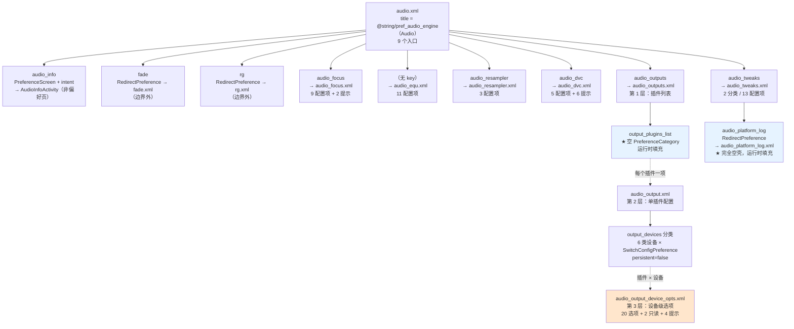
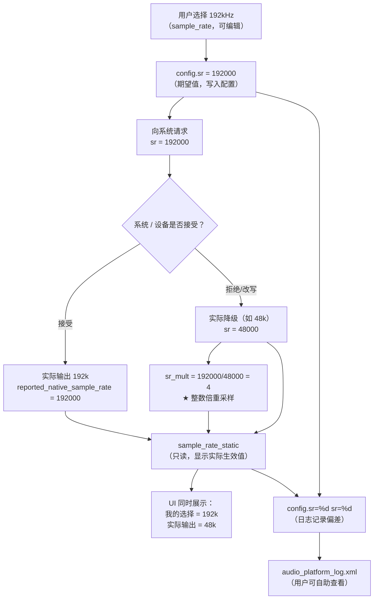

# Poweramp「设置 → 音频」偏好结构（外部实现）

## 0. 文档定位声明（必读）

**本文记录的是外部实现 Poweramp 的「设置 → 音频」页面组织方式，不是 SpMusic 的现状描述，也不是照抄规格。**

### 0.1 与既有四份文档的边界

| 文档 | 覆盖范围 | 本文关系 |
| --- | --- | --- |
| `poweramp-queue-runtime-reference.md` | 队列状态机（`mFilesCursor`/`next`/`prev`/`nextCategory`）、Q1–Q9 | **边界外**。本文不涉及播放队列行为 |
| `poweramp-search-and-queue-impact.md` | 搜索实体 `v3`/`w3`、伪行 `_id=-2/-3`、S1–S10 | **边界外**。本文不涉及搜索 |
| **本文** | **设置页如何组织**：10 个 XML 的偏好树、三层输出结构、独占四开关、深链、自制控件、期望值/实际值配对 | — |
| `.rea-analysis/findings-audio-output.md` | Native 音频输出链路、`config.sr` vs `sr` 双记录 | **交叉引用**（§8）。本文不重述输出链路细节 |
| `docs/architecture/real-audio-playback.md` | **SpMusic 自己的音频契约** | **边界外，本文未改动该文件** |

### 0.2 证据分级：两级

| 标记 | 含义 |
| --- | --- |
| **【实证·原文】** | 能在 `.rea-analysis/decoded/res/xml/*.xml` 或 `strings.xml` 中直接查到的 XML 属性 / 字符串字面量 |
| **【推断】** | 本文作者的推理，可能出错 |

> 前两份 Poweramp 文档用【实证·产物】（指反编译的 Java 方法体）。**本文的证据类型不同**——是 apktool 解码的 XML 原文，比反编译 Java 更权威（偏好页面本就由 XML 定义）。故用【实证·原文】区别于前三者的【实证·产物】。

### 0.3 本文对源材料的核对结果（**重要，先读**）

我逐字核对了 `findings-audio-settings.md` 与 10 个 XML 原文，**发现 8 处不一致**。按任务要求「以 XML 原文为准」，本文一律采用 XML 事实，并在此集中列出（详细对照见 §11）：

| # | `findings-audio-settings.md` 的说法 | XML 原文事实 |
| --- | --- | --- |
| 1 | 「根页面 `audio.xml`（**8 个入口**）」，正文标题又写「9 个入口」 | **9 个入口**（`audio_info` + 8 个 `RedirectPreference`）。两处自相矛盾，正确为 9【实证·原文】`audio.xml:4-14` |
| 2 | 「`audio_focus.xml` —— 音频焦点（**6 项 + 3 提示**）」，表格却列 **9 行** | 文件中**恰好 9 个可配置项** + 2 个提示 + 1 个分类容器 + restore_defaults。表格的 9 行是对的，小节标题的「6 项 + 3 提示」是错的【实证·原文】`audio_focus.xml:4-15` |
| 3 | 「`audio_equ.xml` —— 均衡器（**13 项**）」 | **11 个可配置项**（不含 restore_defaults），表格也只列了 11 行。标题「13」无依据【实证·原文】`audio_equ.xml:4-16` |
| 4 | 「`audio_tweaks.xml` —— 2 分类，**15 项**」 | Volume 分类 **4 项**（去重后，含 1 个 RawText 提示行共 5 个元素）+ Other 分类 **9 项**，合计 **13 个可配置项**（含 restore_defaults 则 14）【实证·原文】`audio_tweaks.xml:4-22` |
| 5 | 「设备级 20 选项」下表标注「**完整选项表（18 项 + 4 个只读提示）**」，但表列 20 行 | XML 中该页共 **26 个元素**（含 `restore_defaults`），拆分为：20 个选项（其中 2 个是只读 `Preference`：`sample_rate_static`/`sample_bits_static`）+ 4 个 `RawTextPreference` 提示 + 1 个 `restore_defaults` + 1 个 `PreferenceScreen` 根。**「18+4」的算法无法对应 XML**：既不是「18 项 + 4 只读」（只读只有 2 个），也不是「18 项 + 4 提示」（提示是 4 个但选项有 20 个）【实证·原文】`audio_output_device_opts.xml:4-24` |
| 6 | 「`audio_dvc.xml` —— DVC（**5 项**）」，表列 5 行 | 该页除 5 个配置项外，**另有 6 个 `RawTextPreference` 提示行与 1 个 `PreferenceCategory`**，总计 13 个元素 + restore_defaults。表格只覆盖了配置项，遗漏了 6 个提示【实证·原文】`audio_dvc.xml:4-15` |
| 7 | `no_dvc_bt_absvol` 被描述为「No DVC for Bluetooth Absolute Volume（默认 `true`）」 | XML 同时有 `android:dependency="dvc_enabled"`——**它依赖 `dvc_enabled`**，摘要未提依赖关系【实证·原文】`audio_dvc.xml:9` |
| 8 | 称 `audio_platform_log.xml` 为「完全空的 `<PreferenceScreen>`（3 行 XML，无任何子项）」 | **属实**【实证·原文】`audio_platform_log.xml:1-3`。此项为确认，非纠错 |

> 结论：`findings-audio-settings.md` 的**主体结构描述与我核对的结果一致**（10 个文件、三层输出、四开关、深链、控件清单、`_` 前缀约定均正确），**错误集中在各项计数**上。本文所有计数以 XML 原文重新核算。

### 0.4 计数口径声明（避免新的歧义）

本文统一采用以下口径，凡出现数字均指此口径：

| 术语 | 定义 |
| --- | --- |
| **配置项** | 有 `android:key` 且承载状态或动作的偏好元素（含 `restore_defaults` 时另行注明） |
| **提示行** | `RawTextPreference`，仅展示文本，无状态 |
| **元素** | XML 中的任意直接子节点（含 `PreferenceCategory`） |

## 1. 目标标识与解码来源

| | |
| --- | --- |
| 包名 / 版本 | `com.maxmpz.audioplayer` build-1025-uni（versionCode `1025009`） |
| APK SHA-256 | `4467fdac3e89b98485866e454bc3b7dc2d73d788d7a1aa9c73ea1028d36b82e0` |
| 解码工具 | **apktool 3.0.3** + 内置 JDK（`vendor/jdk`） |
| 解码产物 | `.rea-analysis/decoded/res/xml/`（10 个 `audio*.xml`）、`.rea-analysis/decoded/res/values/strings.xml`（2056 条） |
| 证据性质 | **偏好页面由 XML 定义**，故 XML 原文是该结构的权威来源，优于反编译 Java |

### 1.1 十个 XML 文件与行数（原文核对）

| 文件 | 行数 | 角色 |
| --- | --- | --- |
| `audio.xml` | 15 | 根页面（`title = @string/pref_audio_engine` = "Audio"） |
| `audio_outputs.xml` | 7 | 输出插件列表（第 1 层） |
| `audio_output.xml` | 14 | 单插件配置（第 2 层） |
| `audio_output_device_opts.xml` | 25 | **设备级选项（第 3 层，核心）** |
| `audio_focus.xml` | 18 | 音频焦点 |
| `audio_equ.xml` | 17 | 均衡器 |
| `audio_resampler.xml` | 8 | 重采样 |
| `audio_dvc.xml` | 16 | 直接音量控制 |
| `audio_tweaks.xml` | 23 | 高级调整 |
| `audio_platform_log.xml` | 3 | 输出探测日志（空壳） |

> 行数均含 XML 声明行与根标签行（【实证·原文】实际读取）。

## 2. 偏好树



**关键结构事实**：

1. **输出配置是三层嵌套，而非扁平**【实证·原文】——`audio_outputs` → `audio_output` → `audio_output_device_opts`
2. **两个页面在 XML 里是空壳，运行时填充**：`output_plugins_list`（`audio_outputs.xml:4`）与整个 `audio_platform_log.xml`（`:1-3`）
3. `audio_equ` 是根页面**唯一没有 `android:key`** 的 RedirectPreference【实证·原文】`audio.xml:10`

## 3. 根页面 `audio.xml`

【实证·原文】`audio.xml:4-14`：

| 顺序 | key | title 资源 | 目标 | 备注 |
| --- | --- | --- | --- | --- |
| 1 | `audio_info` | `@string/audio_info` | `com.maxmpz.audioplayer.dialogs.AudioInfoActivity`（`<intent>`） | **不是偏好页**，是 Activity |
| 2 | `fade` | `@string/pref_fade_and_gapless` | `fade` | 边界外 |
| 3 | `rg` | `@string/pref_replay_gain` | `rg` | 边界外 |
| 4 | `audio_focus` | `@string/pref_audio_focus` | `audio_focus` | |
| 5 | **（缺失）** | `@string/equalizer` | `audio_equ` | **唯一无 `key` 的入口** |
| 6 | `audio_resampler` | `@string/pref_resampler` | `audio_resampler` | |
| 7 | `audio_dvc` | `@string/pref_direct_volume_control` | `audio_dvc` | |
| 8 | `audio_outputs` | `@string/pref_audio_output` | `audio_outputs` | |
| 9 | `audio_tweaks` | `@string/pref_advanced_tweaks` | `audio_tweaks` | |

**合计 9 个入口**（1 个 Intent 页 + 8 个 RedirectPreference）。

> `audio_info` 用 `<intent android:targetPackage="@string/edition_pak_name">`——**targetPackage 是资源引用而非硬编码**，指向不同的产品版本包名。这暗示同一份 XML 服务于多个 edition。

## 4. 输出三层结构（本文核心）

### 4.1 为什么必须三层

同一块 USB DAC 与同一副蓝牙耳机，需要**不同的**采样率/格式/DVC 设置。若扁平化为一套全局设置，就无法表达「USB 用 192k 直通、蓝牙用 48k 并开 DVC」这种真实需求。

⇒ 必须 **插件 × 设备** 双维度。

### 4.2 第 1 层：`audio_outputs.xml` —— 插件列表

【实证·原文】`audio_outputs.xml:2-7`：

```xml
<PreferenceScreen android:title="@string/pref_audio_output"
    w:searchIndexer="com.maxmpz.audioplayer.preference.SettingsHelperAudioOutputs$SearchIndexer"
    w:searchBreadcrumb1="@string/pref_audio_engine">
    <PreferenceCategory android:title="@string/pref_output_plugins" android:key="output_plugins_list" />
    <com.maxmpz.audioplayer.preference.RawTextPreference android:key="output_unassigned_text" />
    <Preference android:title="@string/pref_restore_defaults" android:key="restore_defaults" />
</PreferenceScreen>
```

（原文见 `audio_outputs.xml:2-7`；命名空间声明行已省略。）

**`output_plugins_list` 是空 `PreferenceCategory`** ⇒ 插件由代码动态填入。这解释了为何有多个输出后端（`output.aa` / `output.at` / `output.athd` / `output.osl` / `output.cc`）——它们都是**可启用/禁用的插件**，不是硬编码分支。

### 4.3 第 2 层：`audio_output.xml` —— 单插件配置

【实证·原文】`audio_output.xml:2-14`：

```xml
<PreferenceScreen w:searchIndexer="...SettingsHelperAudioOutput$SearchIndexer">
    <RawTextPreference android:key="output_info" />
    <PreferenceCategory android:title="@string/pref_use_for_output_devices" android:key="output_devices">
        <SwitchConfigPreference android:persistent="false" android:title="@string/device_headset"    android:key="output_headset" />
        <SwitchConfigPreference android:persistent="false" android:title="@string/device_speaker"    android:key="output_speaker" />
        <SwitchConfigPreference android:persistent="false" android:title="@string/device_bt"         android:key="output_bt" />
        <SwitchConfigPreference android:persistent="false" android:title="@string/device_usb"        android:key="output_usb" />
        <SwitchConfigPreference android:persistent="false" android:title="@string/device_chromecast" android:key="output_chromecast" />
        <SwitchConfigPreference android:persistent="false" android:title="@string/device_other"      android:key="output_other" />
    </PreferenceCategory>
    <Preference android:title="@string/pref_restore_defaults" android:key="restore_defaults" />
</PreferenceScreen>
```

**6 类输出设备**（Poweramp 的设备抽象）：

| key | title 资源 | 语义 |
| --- | --- | --- |
| `output_headset` | `@string/device_headset` | 有线耳机 |
| `output_speaker` | `@string/device_speaker` | 扬声器 |
| `output_bt` | `@string/device_bt` | 蓝牙 |
| `output_usb` | `@string/device_usb` | USB DAC |
| `output_chromecast` | `@string/device_chromecast` | 投屏 |
| `output_other` | `@string/device_other` | 其它 |

**⚠️ 关键机制**：`SwitchConfigPreference` + **`android:persistent="false"`** ⇒ 该开关**不写入 Android 默认的 SharedPreferences**，而由代码按「插件 × 设备」组合自行持久化。这正是 P2 未解点（实际键名未知）的根源。

### 4.4 第 3 层：`audio_output_device_opts.xml` —— 设备级选项

【实证·原文】`audio_output_device_opts.xml:4-24`，**共 23 个配置元素**（另有 `restore_defaults` 未计）：

| # | 元素类型 | key | title 资源 | `persistent` | `w:skipSearch` | 类别 |
| --- | --- | --- | --- | --- | --- | --- |
| 1 | `SwitchStringPreference` | `output_switch` | （无 title，`summary=@string/enable`） | `false` | `true` | 启用开关 |
| 2 | `NumberListPreference` | `sample_rate` | `@string/pref_sample_rate` | `false` | — | 期望值 |
| 3 | `Preference` | `sample_rate_static` | — | `false` | `true` | **只读·实际值** |
| 4 | `NumberListPreference` | `sample_fmt` | `@string/sample_format` | `false` | — | 期望值 |
| 5 | `Preference` | `sample_bits_static` | — | `false` | `true` | **只读·实际值** |
| 6 | `RawTextPreference` | `pref_ar_format_changes_when_playing` | （`summary` 同名资源） | — | — | 提示 |
| 7 | `RawTextPreference` | `pref_sr_format_effects_override_hint` | — | — | `true` | **提示⚠️**（有 `exclamation_circle_48dp` 图标） |
| 8 | `MultilineSwitchPreference` | `float` | `@string/pref_output_float` | `false` | — | 开关 |
| 9 | `RawTextPreference` | `pref_hi_res_no_dvc_hint` | — | — | `true` | **提示⚠️**（有图标） |
| 10 | `MultilineSwitchPreference` | `no_dvc` | `@string/pref_output_disable_dvc` | `false` | — | **关 DVC** |
| 11 | `RawTextPreference` | `bt_dvc_msg` | — | `false` | — | 提示 |
| 12 | `MultilineSwitchPreference` | `no_headroom` | `@string/pref_output_disable_headroom_gain` | `false` | — | **★独占** |
| 13 | `Preference` | `buffer_size` | `@string/pref_buffer_size` | `false` | — | 数值 |
| 14 | `SeekbarPreference` | `vis_latency_ms` | `@string/pref_vis_lyrics_delay` | `false` | — | `default=0`、`min=0`、`max=2500` |
| 15 | `MultilineSwitchPreference` | `oem_variant` | `@string/pref_output_oem_variant` | `false` | — | 厂商变体 |
| 16 | `MultilineSwitchPreference` | `cc_force_aa` | `@string/pref_cc_force_aa` | `false` | — | Chromecast |
| 17 | `MultilineSwitchPreference` | `cc_show_meta` | `@string/cc_show_meta` | `false` | — | Chromecast |
| 18 | `MultilineSwitchPreference` | `no_equ` | `@string/pref_output_disable_equ_tone` | `false` | — | **★独占** |
| 19 | `MultilineSwitchPreference` | `no_duck` | `@string/pref_output_no_duck` | `false` | — | **★独占** |
| 20 | `MultilineSwitchPreference` | `no_af` | `@string/pref_output_no_af` | `false` | — | **★独占** |
| — | `Preference` | `restore_defaults` | `@string/pref_restore_defaults` | — | — | 动作 |

> **计数说明**：20 个带状态的选项 + 1 个只读 ×2（`sample_rate_static`、`sample_bits_static` 已计入上表第 3、5 行）+ 4 个纯提示（第 6、7、9、11 行）+ 1 个动作（`restore_defaults`）= 23 个配置元素 + 1 动作。**`findings-audio-settings.md` 的「18 项 + 4 个只读提示」与此不符**（见 §0.3 第 5 条）。

**`persistent="false"` 覆盖全页**（除 4 个提示行与 `restore_defaults`）——这印证了整页设置由代码按「插件 × 设备」组合管理，而非 Android 默认机制。

## 5. 独占输出：四开关正交组合（本文核心论点）

### 5.1 Poweramp 没有「独占输出」开关

XML 中**不存在** `exclusive` / `exclusive_mode` / `bit_perfect` 之类的 key。所谓「独占」，是**四个正交能力的组合**【实证·原文】：

| key | title 资源 | XML 原文里的 `summary` 资源 | 实际语义（`strings.xml` 原文） |
| --- | --- | --- | --- |
| `no_af` | `@string/pref_output_no_af` | `@string/pref_summary_output_no_af` | `"Ignore calls/short Audio Focus requests, including notification sounds and ringtones"` 【实证·原文】`strings.xml:1520` |
| `no_duck` | `@string/pref_output_no_duck` | `@string/pref_summary_output_no_duck` | `"Disable volume ducking for this output, e.g. when notifications cause issues with this output. Temporarily pause player instead"` 【实证·原文】`strings.xml:1521` |
| `no_equ` | `@string/pref_output_disable_equ_tone` | `@string/pref_summary_output_disable_equ_tone` | `"Disable equalizer/tone DSP for this output/device"` 【实证·原文】`strings.xml:1516` |
| `no_headroom` | `@string/pref_output_disable_headroom_gain` | `@string/pref_summary_output_disable_headroom_gain` | `"Don't reduce output gain when DVC is disabled. May cause distortion for high equ/tone gains"` 【实证·原文】`strings.xml:1517` |

加上第五个相关开关 `oem_variant`（`@string/pref_output_oem_variant`，用厂商 API 变体）。

### 5.2 四个开关**语义上完全正交**

关键洞察：这四个开关操作的是**四条不同的音频管道环节**，彼此不重叠：

```
                  系统/应用边界
                        │
  ┌─────────────────────┼─────────────────────┐
  │                     │                     │
  ▼                     ▼                     ▼
音频焦点仲裁        音量扰动            音效处理链
  │                     │                     │
no_af ────────────┘    no_duck ───────────┘   no_equ ──────────┘
（不参与仲裁）        （不让系统降音）      （绕过 EQ/Tone DSP）
                        │
                        ▼
                  输出增益余量
                        │
                   no_headroom
                （不预留衰减余量）
```

| 开关 | 影响的环节 | 影响时机 |
| --- | --- | --- |
| `no_af` | Audio Focus 仲裁 | 有其它 App 请求焦点时 |
| `no_duck` | 系统 ducking 音量衰减 | 通知/短焦点丢失时 |
| `no_equ` | Equalizer / Tone DSP | 始终（信号路径） |
| `no_headroom` | 输出增益余量（仅在 DVC 关闭时相关，见其 summary 原文） | 信号路径 |

**注意 `no_headroom` 的 summary 原文明确说「when DVC is disabled」**——它只在 DVC 关闭时才有意义。这是一个**隐式依赖**，但 XML 里**没有** `android:dependency` 声明（对比 `audio_dvc.xml:9` 的 `no_dvc_bt_absvol` 有显式 dependency）。这是 P2 类未解点的一部分。

### 5.3 与「单一独占模式开关」的取舍对比（核心论点）

| 维度 | 单一「独占模式」开关 | Poweramp 的四正交开关 |
| --- | --- | --- |
| 表达力 | 全开或全关 | **2⁴ = 16 种组合** |
| 用户认知成本 | **低**（一个开关，一个概念） | **高**（四个开关，需理解各自作用） |
| 典型场景覆盖 | 只能覆盖「全独占」与「不独占」 | 可表达中间态 |
| 误配风险 | 低（只有两种状态） | **高**（16 种组合中多数对普通用户无意义甚至有害） |
| 与 OEM 兼容 | 独占全开可能在部分机型上完全无声 | 可逐项关闭问题项，保留其余 |
| 排障难度 | 低（一键回退） | **高**（问题可能来自四个开关的任一组合） |

**关键的具体收益（单一开关做不到）**：

1. **「保留音效但忽略焦点」**：用户想用系统 Dolby（不启 `no_equ`），但不想被通知声打断（启 `no_af` + `no_duck`）。单一开关无法表达——开独占会关掉 Dolby，关独占又会被打断。
2. **「接受 focus 但不要 ducking」**：`no_af=false`（参加焦点仲裁，尊重其它 App）+ `no_duck=true`（但不要在我放歌时把音量压下去，宁可暂停）。这在 Android 上是**语义不同**的两件事：前者是「是否让出」，后者是「让出时怎么让」。
3. **OEM 兼容性逐项止损**：某机型在 `no_headroom=true` 时爆音 → 只关这一项，其余三项保留独占特性。单一开关只能整体放弃独占。

**关键代价**：

1. **正交性只存在于设计意图，不存在于代码约束**。XML 没有任何 `android:dependency` 把这四项关联起来（对比 `audio_focus.xml` 有 3 组显式 dependency）。⇒ **用户可以配出 16 种组合中的任何一种，包括违反物理直觉的组合**。
2. **排障成本被转嫁给用户**。四个开关 + `oem_variant` + `no_dvc` + `float`，共 **7 个与输出质量相关的开关**，全部 `persistent="false"`、全部无依赖声明。出现音质异常时，用户需要逐一试。

### 5.4 我的判断

| 问题 | 判断 | 理由 |
| --- | --- | --- |
| 四正交是否比单一开关更好？ | **对「高级用户 + 排障场景」更好；对普通用户更差** | 表达力提升是真实的（§5.3 三个场景），但认知与排障成本也真实 |
| 是否应该照抄？ | **不应直接照抄**。若要引入，应先决定产品定位 | 见 §10 |
| Poweramp 的选择是否合理？ | **在其定位下合理**。Poweramp 的受众是愿意调音频参数的用户 | 它同时提供 `restore_defaults`（每页都有）作为统一回退，部分缓解了排障成本 |

> **一个反证**：Poweramp 给每页都放了 `restore_defaults`【实证·原文】`audio.xml` 无、但 `audio_outputs.xml:6`、`audio_output.xml:13`、`audio_output_device_opts.xml:24`、`audio_focus.xml:17`、`audio_equ.xml:16`、`audio_resampler.xml:7`、`audio_dvc.xml:15`、`audio_tweaks.xml:21` **都有**。这本身说明它预期用户会配错、需要频繁重置。

## 6. 其余子页

### 6.1 `audio_focus.xml` —— 音频焦点

【实证·原文】`audio_focus.xml:4-17`，**9 个配置项 + 2 个提示 + 1 个分类容器**：

| # | key | title 资源 | `persistent` | `defaultValue` | `dependency` |
| --- | --- | --- | --- | --- | --- |
| 1 | `resume_after_call` | `@string/pref_resume_after_call` | `true` | `true` | — |
| 2 | `resume_on_start` | `@string/pref_resume_on_start` | `true` | `false` | — |
| 3 | `resume_on_resume` | `@string/pref_resume_on_resume` | **（缺省，继承）** | `true` | `resume_on_start` |
| 4 | `resume_on_mount` | `@string/pref_resume_on_mount` | `true` | `false` | `resume_on_start` |
| — | `cc_af_warning` | （`summary` 见下） | — | — | **RedirectPreference**（见 6.1.1） |
| — | `audio_focus_cat` | `@string/pref_audio_focus` | — | — | `PreferenceCategory` |
| 5 | （无 key） | — | — | — | **RedirectPreference → `ui_notify#keep_notification_always`** |
| 6 | `af_short` | `@string/pref_pause_on_short` | `true` | `true` | — |
| 7 | `pause_in_call` | `@string/pref_pause_in_call` | `true` | `true` | — （另有 `w:summary2="@string/opt_not_supported_by_some_firmwares"`） |
| 8 | `resume_on_focus` | `@string/resume_on_focus` | **（缺省）** | `true` | `af_short` |
| 9 | `af_short_duck` | `@string/pref_duck_on_short` | `true` | `true` | `af_short` |
| 10 | `af_permanent` | `@string/pref_pause_on_permanent` | `true` | `true` | — |

> 上表 9 个「配置项」= 第 1、2、3、4、6、7、8、9、10 行。第 3、8 行**未声明 `android:persistent`**，与同页其它项不一致——这是原文事实，未解其含义（可能是笔误或继承默认 `true`）。

**3 组 dependency 关系**【实证·原文】：

| 父项 | 子项 |
| --- | --- |
| `resume_on_start` | `resume_on_resume`、`resume_on_mount` |
| `af_short` | `resume_on_focus`、`af_short_duck` |

⇒ 「恢复播放」的细项依赖「启动时恢复」开启；「焦点丢失时的细项」依赖「短焦点丢失时暂停」开启。

#### 6.1.1 `RedirectPreference` 的三段式深链

【实证·原文】`audio_focus.xml:8`：

```xml
<RedirectPreference android:background="@drawable/settings_quote_background"
    android:key="cc_af_warning" android:summary="@string/pref_cc_af_warning"
    w:target="audio_output_device_opts?uniqName=com.maxmpz.audioplayer/output.cc&amp;device=chromecast#no_af"
    w:skipSearch="true" w:keepPaddings="true" />
```

**三段式结构**：

| 段 | 值 | 语义 |
| --- | --- | --- |
| 页面 | `audio_output_device_opts` | 目标偏好页 |
| 查询参数 | `?uniqName=com.maxmpz.audioplayer/output.cc&device=chromecast` | 指定**插件**（`output.cc`）与**设备**（`chromecast`） |
| 锚点 | `#no_af` | 页内具体选项 |

⇒ 让「Chromecast 音频焦点说明」能**精确跳到 Chromecast 设备的 `no_af` 开关**，而不是笼统说「去输出设置里找」。

**三种粒度共存**（【实证·原文】跨文件汇总）：

| 粒度 | 例子 | 出处 |
| --- | --- | --- |
| 简单跳转 | `w:target="audio_dvc"` / `z:target="fade"` | `audio.xml:7-14` |
| 带锚点 | `w:target="misc#volume_keys_long_press_hint"` | `audio_tweaks.xml:9` |
| **带参数 + 锚点** | `w:target="audio_output_device_opts?uniqName=...&device=chromecast#no_af"` | `audio_focus.xml:8` |

> ⚠️ 注意根页面用的是 **`z:target`**（命名空间别名 `z`），而子页用的是 **`w:target`**。两者在 XML 中声明为**同一个 URI**（`http://schemas.android.com/apk/res-auto`），所以功能等价，只是别名不同【实证·原文】`audio.xml:3` vs `audio_focus.xml:3`。`findings-audio-settings.md:70` 提到「`z:target`/`w:target`」但未说明二者等价。

### 6.2 `audio_dvc.xml` —— 直接音量控制

【实证·原文】`audio_dvc.xml:4-15`，**5 个配置项 + 6 个提示 + 1 个分类容器**：

| # | 元素 | key | title 资源 | `persistent`/`default`/`dependency` |
| --- | --- | --- | --- | --- |
| 1 | RawText | （无 key） | `line1..line4` 引用 | — |
| 2 | MultilineSwitch | `dvc_enabled` | `@string/pref_enable_direct_volume_control` | `defaultValue="true"`（**未声明 `persistent`**） |
| 3 | RawText | （无 key） | `dvc_is_enabled_if` / `...if2` / `...if3` | — |
| 4 | `PreferenceCategory` | `bluetooth_headset` | `@string/bluetooth_headset` | — |
| 5 | RawText | `bt_absvol_status` | — | 动态状态 |
| 6 | MultilineSwitch | `no_dvc_bt_absvol` | `@string/pref_no_dvc_bt_absvol` | **`dependency="dvc_enabled"`**、`defaultValue="true"` |
| 7 | RawText | `no_dvc_bt_absvol_hint` | `line1/line2` | 有图标 |
| 8 | RawText | `no_dvc_bt_absvol_hint_15` | `line1..line3` | — |
| 9 | RawText | `dvc_bt_msg` | `@string/pref_disable_bt_abs_vol` | — |
| 10 | **RoundKnob** | `no_dvc_gain_mb` | `@string/pref_headroom_gain` | `defaultValue="-600"`、`min="-1000"`、`max="0"`、`step="50"`、`scale="100.0"`、`summary2="@string/applied_when_no_dvc"` |
| 11 | MultilineSwitch | `compensate_dvc_vol` | `@string/pref_compensate_dvc_vol` | `persistent="true"`、`defaultValue="false"`、`w:skipSearch="peq"` |

**DVC 的启用条件是 AND 逻辑**（`strings.xml` 原文，被 RawText 第 3 项引用）：

```
dvc_is_enabled_if / dvc_is_enabled_if2 / dvc_is_enabled_if3
```

⇒ **DVC = 全局开关（`dvc_enabled`）AND 输出级允许（设备级 `no_dvc`）AND 蓝牙绝对音量允许（`no_dvc_bt_absvol`）**。

**关键互斥（`strings.xml` 原文）**：

| 资源 | 原文 |
| --- | --- |
| `pref_dvc_may_disable_hi_res` | `"DVC may force standard definition audio (48 kHz/16 bit)"`【实证·原文】`strings.xml:1050` |
| `pref_hi_res_upsample_warning` | `"• Poweramp DSP sampling rate always matches output device - non hi-res tracks are upsampled"`【实证·原文】`strings.xml:1098` |
| `pref_sr_format_effects_override_hint` | `"Global sound effects, like Dolby, may force standard definition audio (48 kHz/16 bit)"`【实证·原文】`strings.xml:1385` |

> ⚠️ 注意 `pref_hi_res_upsample_warning` 原文**以项目符号 `•` 开头**（`findings-audio-settings.md:239` 引用时省略了该符号）。这类 `•` 前缀串是为 `line1..line4` 多行提示准备的——一个资源即一行，由控件自动拼装。

### 6.3 `audio_resampler.xml` —— 重采样

【实证·原文】`audio_resampler.xml:4-7`，**3 个配置项**：

| key | 类型 | title 资源 | 关键属性 |
| --- | --- | --- | --- |
| `resampler_type` | `TagListPreference` | `@string/pref_resampler_type` | `defaultValue="0"`、`w:entries="@array/pref_resampler_type_entries"` |
| `resampler_cutoff` | **`RoundKnobPreference`** | `@string/pref_resampler_cutoff` | `defaultValue="970"`、`w:min="800"`、`w:max="990"`、**`w:scale="10.0"`**、`w:valueFormat="@string/f_percent"` |
| `dither` | `NumberListPreference` | `@string/pref_dither` | `persistent="true"`、`defaultValue="0"` |

**`scale` 的作用**：存 `970`，`scale=10.0` ⇒ 显示 **97.0%**；范围 `800..990` ⇒ 显示 80.0%–99.0%。这是抗混叠滤波器截止频率（相对奈奎斯特），用整数存储避免浮点持久化。

> **`scale` 是自制控件解决「整数存储 + 小数显示」的通用机制**，同一模式出现在 `no_dvc_gain_mb`（`scale=100.0`，存 `-600` ⇒ 显示 `-6.00 dB`）与 `mod_gain_mb`（`scale=100.0`）。

### 6.4 `audio_equ.xml` —— 均衡器

【实证·原文】`audio_equ.xml:4-16`，**11 个配置项**（不含 `restore_defaults`）：

| # | 元素 | key | title 资源 | 关键属性 |
| --- | --- | --- | --- | --- |
| 1 | RawText | （无 key） | `line1..line4` | 引用块背景，4 行说明（模式/列表过滤/图形/参数化 EQ） |
| 2 | Redirect | `peq_equ_bands` | `@string/pref_equ_bands` | `w:target="peq_equ_bands"` |
| 3 | Redirect | `peq_equ_tone` | `@string/tone` | `persistent="false"`、`w:target="peq_equ_tone"` |
| 4 | TagList | `eq_labels` | `@string/pref_eq_labels` | `defaultValue="1"` |
| 5 | TagList | `tone_labels` | `@string/pref_tone_labels` | `defaultValue="2"` |
| 6 | MultilineSwitch | **`_autosave`** | `@string/autosave` | `persistent="false"` |
| 7 | MultilineSwitch | `dsp_border_gain` | `@string/pref_dsp_border_gain` | `persistent="true"`、`defaultValue="true"` |
| 8 | MultilineSwitch | `suggest_autoeq` | `@string/pref_suggest_autoeq_presets` | `persistent="true"` |
| 9 | RawText | **`_clear_autoeq_known_devices`** | `@string/pref_reset_disabled_autoeq_suggestions` | `dependency="suggest_autoeq"`、`skipSearch="false"` |
| 10 | RawText | **`_presets_to_peq`** | `@string/pref_send_presets_to_peq` | `skipSearch="false"` |
| 11 | RawText | **`_import_autoeq`** | `@string/import_autoeq_presets` | `skipSearch="false"` |
| — | RawText | `reset_eq_presets` | `@string/pref_reset_equ_presets` | `skipSearch="false"`（**无 `_` 前缀**，见下） |

> **⚠️ 一处值得注意的不一致**：`reset_eq_presets` 同样是「动作型」（`RawTextPreference`，点了执行重置），但**没有 `_` 前缀**，而同类动作 `_clear_autoeq_known_devices` / `_presets_to_peq` / `_import_autoeq` 都有。⇒ `_` 前缀约定**并非严格贯彻**，`findings-audio-settings.md:269` 说「用 `_` 前缀区分命令与配置」时未提这个反例。
>
> 另：`audio_tweaks.xml:18` 的 `reset_eq_presets` 是普通 `Preference`（不是 `RawTextPreference`），同名 key 在**两个文件中出现**——这是跨页重复定义，运行时哪个生效未解（P8）。

### 6.5 `audio_tweaks.xml` —— 高级调整

【实证·原文】`audio_tweaks.xml:4-22`，**2 个 `PreferenceCategory`**：

**分类 1：Volume（`@string/volume_long`）** — 4 个配置项 + 1 个提示

| # | 元素 | key | title 资源 | 关键属性 |
| --- | --- | --- | --- | --- |
| 1 | NumberList | `volume_levels` | `@string/pref_volume_levels` | `persistent="true"`、`defaultValue="0"`、`w:entries`+`w:values` |
| 2 | RawText | （无 key） | `smallLine1..smallLine3` | `w:zeroTopPad="true"` |
| 3 | MultilineSwitch | `volume_popup` | `@string/pref_volume_popup` | （**无 `persistent`**） |
| 4 | MultilineSwitch | `pause_on_volume` | `@string/pref_pause_on_volume` | `w:sup="@string/pref_experiment"`、`w:supLink="alert?text=@string/pref_experimental_msg"` |
| 5 | Redirect | （无 key） | `@string/pref_long_volume_controls` | `w:target="misc#volume_keys_long_press_hint"` |

**分类 2：Other（`@string/other`）** — 9 个配置项（含 `restore_defaults`）

| # | 元素 | key | title 资源 | 关键属性 |
| --- | --- | --- | --- | --- |
| 6 | MultilineSwitch | `allow_platform_fx` | `@string/platform_fx` | `defaultValue="false"`（**无 `persistent`**） |
| 7 | MultilineSwitch | `force_no_speaker` | `@string/pref_hires_force_no_speaker` | `persistent="true"` |
| 8 | MultilineSwitch | `force_audio_on_focus` | `@string/pref_force_audio_on_focus` | `persistent="true"` |
| 9 | MultilineSwitch | `use_stream3_player` | `@string/pref_use_stream3_player` | `persistent="true"`、`defaultValue="false"` |
| 10 | **RoundKnob** | `mod_gain_mb` | `@string/mod_gain_mb` | `scale="100.0"`、`min="-1000"`、`max="1000"`、`step="100"`、`w:valueFormat="@string/d_db"` |
| 11 | **RoundKnob** | `mod_separation` | `@string/mod_separation` | `scale="1.0"`、`min="0"`、`max="200"`、`step="10"`、`w:valueFormat="@string/f0_percent"` |
| 12 | Preference | `reset_eq_presets` | `@string/pref_reset_equ_presets` | （与 `audio_equ.xml` 重复 key） |
| 13 | Preference | `reset_reverb_presets` | `@string/pref_reset_reverb_presets` | — |
| 14 | Redirect | `audio_platform_log` | `@string/pref_output_detection_log` | `w:target="audio_platform_log"` |
| — | Preference | `restore_defaults` | `@string/pref_restore_defaults` | — |

**`force_no_speaker` 的设计洞察**：title 是 `@string/pref_hires_force_no_speaker`（含 "for Hi-Res Output"），summary 说明「启用此项，如果 speaker 在通话/通知后没有切回」。⇒ **Hi-Res 输出需要独占扬声器，但系统可能在通话后忘记切回**，故提供手动强制手段。这是「系统行为不可靠 → 提供人工逃生口」的典型设计。

### 6.6 `audio_platform_log.xml` —— 空壳（可观测性设计）

【实证·原文】`audio_platform_log.xml:1-3`（全文仅 3 行）：

```xml
<?xml version="1.0" encoding="utf-8"?>
<PreferenceScreen android:title="@string/pref_output_detection_log" w:skipSearch="true"
  xmlns:android="http://schemas.android.com/apk/res/android" xmlns:w="http://schemas.android.com/apk/res-auto" />
```

**完全空的 `PreferenceScreen`**，运行时 100% 由代码填充。

#### 为什么这是一个值得单独记录的设计

这是 Poweramp 把**「输出探测日志」当作一等公民**的证据：

| 视角 | 意义 |
| --- | --- |
| 用户视角 | 可自助回答「为什么我的 DAC 没启用 Hi-Res」「为什么系统选了 48k 而不是 192k」——这是 Hi-Res 播放最常见的困惑 |
| 支持视角 | 用户报障时可直接截图日志，无需 adb logcat |
| 架构视角 | 探测决策是**可解释的**，不是黑盒。这与 `findings-audio-output.md` 中三条后端各带独立配置日志模板（`config.sr`/`sr`/`sr_mult` 等）形成呼应 |
| XML 视角 | 页面在 XML 声明（有 title、进入搜索排除名单），但内容不声明——**承认「这部分内容不是静态可枚举的」** |

`w:skipSearch="true"` 表示它**不进搜索结果**——因为无静态项可索引。这是 XML 层面对动态页面的正确表达。

## 7. 自制控件清单（9 种）

【实证·原文】跨 10 个 XML 汇总，实际出现的自定义控件类：

| # | 控件类（`com.maxmpz.audioplayer.preference.*`） | 用途 | 首次出现 |
| --- | --- | --- | --- |
| 1 | `MultilineSwitchPreference` | 带多行说明的开关（本组最常用） | `audio_focus.xml:4` |
| 2 | `SwitchConfigPreference` | 按「配置键」存储的开关（用于插件×设备组合） | `audio_output.xml:6` |
| 3 | `SwitchStringPreference` | 字符串型开关 | `audio_output_device_opts.xml:4` |
| 4 | `NumberListPreference` | 数字列表（采样率/位深/抖动） | `audio_output_device_opts.xml:5` |
| 5 | `TagListPreference` | 带标签的列表 | `audio_equ.xml:7` |
| 6 | `RoundKnobPreference` | **旋钮**（精细数值，配 `scale`/`step`/`valueFormat`） | `audio_dvc.xml:13` |
| 7 | `SeekbarPreference` | 滑条（`min`/`max`） | `audio_output_device_opts.xml:17` |
| 8 | `RawTextPreference` | 富文本（`line1..line4`、`smallLine1..3`、`icon`、`background`） | `audio_outputs.xml:5` |
| 9 | `RedirectPreference` | 深链（支持页面+参数+锚点） | `audio.xml:7` |

**`RawTextPreference` 的属性家族**（全量汇总，【实证·原文】）：

| 属性 | 作用 | 出处示例 |
| --- | --- | --- |
| `w:line1` ~ `w:line4` | 4 行结构化文本 | `audio_equ.xml:4` |
| `w:smallLine1` ~ `w:smallLine3` | 3 行小号文本 | `audio_tweaks.xml:6` |
| `w:background="@drawable/settings_quote_background"` | 引用块样式 | `audio_focus.xml:8` |
| `w:background="@drawable/settings_rounded_background"` | 圆角块样式 | `audio_dvc.xml:8` |
| `android:icon` | 图标（`exclamation_circle_48dp` / `exclamation_48dp`） | `audio_output_device_opts.xml:10` |
| `w:iconAlignedTop="true"` | 图标顶部对齐 | `audio_dvc.xml:10` |
| `w:keepPaddings="true"` | 保留内边距 | `audio_dvc.xml:4` |
| `w:zeroTopPad="true"` / `w:zeroBottomPad="true"` | 去上下内边距 | `audio_dvc.xml:10` |
| `w:singleNewline="true"` | 合并多行为单换行 | `audio_dvc.xml:11` |

⇒ **一个控件 + 11 个属性组合出全部提示样式**，无需为每种样式写布局。这是这套 UI 最节省代码的部分。

## 8. 架构模式总结

### 8.1 三层输出配置（插件 × 设备）

```
audio_outputs.xml     ← 插件列表（output_plugins_list 运行时填充）
  └─ audio_output.xml ← 插件 → 分配到 6 类设备
       └─ audio_output_device_opts.xml ← 每个「插件×设备」的 20 项选项
```

**为什么不能扁平化**：USB DAC 与蓝牙耳机需要不同采样率/格式/DVC。扁平化会丢掉「哪套设置属于哪个设备」这个维度。

### 8.2 `RedirectPreference` 是自定义深链机制

三种粒度（§6.1.1）：简单跳转 → 带锚点 → 带参数+锚点。

**价值**：让「说明文字」能精确指向配置项。这是**把文档嵌入 UI** 的做法——用户看到的不是「请到设置里配置」，而是可点击的直达链接。

### 8.3 自制控件替代系统控件

不用原生 `SwitchPreference`/`ListPreference`，而是 9 种自制控件。原因（【推断】）：
- 原生控件不支持 `line1..line4` 多行富文本、`scale` 整数-小数映射、`sup` 上标标注；
- 需要统一的视觉语言（引用块背景、图标对齐、内边距微调）。

### 8.4 期望值 / 实际值配对（与 Native 层双记录对应）

```xml
<NumberListPreference android:persistent="false" android:key="sample_rate"  ... />  <!-- 可编辑：期望 -->
<Preference           android:persistent="false" android:key="sample_rate_static" w:skipSearch="true" /> <!-- 只读：实际 -->
<NumberListPreference android:persistent="false" android:key="sample_fmt"   ... />  <!-- 可编辑：期望 -->
<Preference           android:persistent="false" android:key="sample_bits_static" w:skipSearch="true" /> <!-- 只读：实际 -->
```

**这是本文与 `findings-audio-output.md` 的关键交叉点**，展开见 §9。

### 8.5 搜索索引与偏好树解耦

- `w:searchIndexer="...SettingsHelperAudioOutputs$SearchIndexer"` 按页面注册索引器
- `w:searchBreadcrumb1="@string/pref_audio_engine"` 提供搜索结果的路径面包屑
- `w:skipSearch="true"` 排除不应被搜到的项（只读行、纯提示、动态状态）
- `w:searchSummary` 覆盖搜索摘要文本
- `w:skipSearch="false"` **显式**声明可搜（`audio_equ.xml:12-15` 的 4 个动作项）——这是**默认值反转**的用法，说明默认可能是 `true`

⇒ 搜索索引**按页面独立注册**，不是遍历 XML 自动生成。这解释了为何 `$SearchIndexer` 是唯一「明名」的内部类。

### 8.6 实验性标注机制

```xml
<MultilineSwitchPreference android:key="pause_on_volume"
    w:sup="@string/pref_experiment"
    w:supLink="alert?text=@string/pref_experimental_msg" />
```

【实证·原文】`audio_tweaks.xml:8`。

- `w:sup` = 上标标记（显示「实验性」）
- `w:supLink` = 点击弹出的说明（`alert?text=...` —— **复用深链机制**做弹窗）

⇒ 统一的「实验性/风险」标注，且说明内容也可深链。

> 另有 `w:summary2` 用于附加提示（如 `audio_focus.xml:12` 的 `@string/opt_not_supported_by_some_firmwares`「部分固件不支持」、`audio_dvc.xml:13` 的 `@string/applied_when_no_dvc`「仅在 DVC 关闭时生效」）。这是**不影响主文案的次要提示位**。

## 9. 与 `findings-audio-output.md` 的交叉引用：期望值 / 实际值的完整闭环

### 9.1 前端（XML）侧的配对

| 期望值（可编辑） | 实际值（只读） | XML 位置 |
| --- | --- | --- |
| `sample_rate`（`NumberListPreference`） | `sample_rate_static`（`Preference` + `skipSearch`） | `audio_output_device_opts.xml:5-6` |
| `sample_fmt`（`NumberListPreference`） | `sample_bits_static`（`Preference` + `skipSearch`） | `audio_output_device_opts.xml:7-8` |

### 9.2 Native（日志）侧的双记录

【实证·产物】`findings-audio-output.md:278`（AAudio 无回调后端模板）：

```
config.sr=%d sr=%d config.fmt=%d fmt=%d caps=0x%x latency=%f
```

【实证·产物】`findings-audio-output.md:291`：**`config.sr` vs `sr`（配置采样率与实际采样率分离）**。
【实证·产物】`findings-audio-output.md:293`：「Poweramp **预期采样率可能被系统改写**，并记录偏差」。

AudioTrack 后端甚至有**第三个**采样率字段（`findings-audio-output.md:297-298`）：

```
sr=%d reported_native_sample_rate=%d sr_mult=%d
```

⇒ **三层采样率**：`sr`（请求值）、`reported_native_sample_rate`（设备上报原生值）、`sr_mult`（倍率）。

### 9.3 两层如何对应（完整机制图）



**对应关系表**：

| 层 | 期望值载体 | 实际值载体 | 记录位置 |
| --- | --- | --- | --- |
| 配置（用户意图） | `sample_rate` key | — | 代码管理（`persistent="false"`，键名未知 P2） |
| Native 请求 | `config.sr` | — | 日志模板 |
| Native 实际 | — | `sr` | 日志模板 |
| 设备原生 | — | `reported_native_sample_rate` | 仅 AudioTrack 后端 |
| UI 展示 | `sample_rate`（可编辑） | `sample_rate_static`（只读） | `audio_output_device_opts.xml:5-6` |
| 排障视图 | — | 全部日志字段 | `audio_platform_log.xml`（运行时填充） |

### 9.4 这个机制的意义

**「设了不一定生效」是 Android 音频的客观现实**（系统可拒绝采样率、音效链可强制降级、DVC 可强制 48k/16bit —— 见 §6.2 的三条互斥文案）。

Poweramp 的应对不是「假装生效」，而是**三层如实记录 + 一处如实展示**：

1. 配置层保存用户意图（不因系统拒绝而改写，用户下次仍看到 192k）
2. Native 层记录 `config.sr` 与 `sr` 的**偏差**
3. UI 层用只读行展示**实际生效值**（`sample_rate_static`）
4. 排障页让用户能看到**完整决策链**

⇒ 这是本文认为**最值得借鉴的单条设计**：把「期望」与「实际」当作两个一等公民，而不是把实际值悄悄覆盖期望值。

## 10. 对 SpMusic 的可借鉴 / 不建议照抄（提案，非现状）

> 本章全部为**提案**，不代表已批准范围，也不是对 SpMusic 现状的描述。SpMusic 的音频契约见 `docs/architecture/real-audio-playback.md`（本文未改动该文件）。

### 10.1 可借鉴

| # | 做法 | 理由 | 成本 |
| --- | --- | --- | --- |
| A1 | **期望值 / 实际值配对展示** | 直接解决「我设了 96k 但实际 48k」的困惑。Poweramp 用一对 key（`sample_rate` / `sample_rate_static`）实现，前端成本极低——只多一个只读项。**且 SpMusic 已有后端能力基础**：SpMusic 的音频契约（`real-audio-playback.md`）已明确设备采样率由系统协商，这个配对是自然延伸 | **低** |
| A2 | **只读的「输出探测日志」页面** | 用户可自助诊断「为什么我的 DAC 没启用 Hi-Res」。用户报障成本从「装 adb 抓 logcat」降到「截图」。XML 只需 3 行空壳，内容全运行时生成 | **中**（需要后端产出结构化探测记录） |
| A3 | **深链支持 页面 + 参数 + 锚点** | 让帮助文档能精确指向具体配置项。SpMusic 若做设置页文档/引导，这是最有效的降低支持成本的手段 | **中**（需要设置页有稳定路由与 key 寻址） |
| A4 | **`_` 前缀区分命令与配置** | 极低成本（命名约定），避免动作项污染配置命名空间。**但注意 Poweramp 自己没贯彻**（§6.4 的 `reset_eq_presets` 无前缀） | **极低** |
| A5 | **`RawTextPreference` 式的多行提示控件** | 一个控件 + 属性组合承载全部提示样式，避免为每种样式写布局 | **低** |
| A6 | **`scale` 整数-小数映射** | 存 `970` 显示 `97.0%`，避免浮点持久化误差。对音量/增益/百分比类设置通用 | **极低** |
| A7 | **`sup` / `supLink` 实验性标注** | 统一的风险标注机制，且说明本身可深链（复用 A3） | **低** |
| A8 | **插件 × 设备双维度** | USB DAC 与蓝牙应有不同采样率/格式 | **高**（需要设备识别 + 组合持久化。SpMusic 当前输出设备抽象若是全局单套，改造面较大） |

### 10.2 不建议照抄

| # | 反模式 | 理由 |
| --- | --- | --- |
| **N1** | **`RoundKnobPreference`（旋钮）** | **桌面端交互不适用。** 旋钮是为触屏小控件设计的（单指拖动旋转），在鼠标环境下面临：① 无自然的手势隐喻（用户不知道要拖哪里）② 键盘可访问性差（旋钮没有标准的 arrow-key 语义）③ 精度控制差（鼠标位移与数值映射不直观）。**桌面端应改用滑条（`SeekbarPreference` 对应物）+ 数字输入框的组合**——滑条负责粗调、输入框负责精确定值，且二者都有标准键盘语义 |
| **N2** | **四开关正交但无任何依赖约束** | 16 种组合全部可配，多数对用户无意义。若 SpMusic 要引入类似机制，**应加依赖或预设**（如提供「音质优先 / 兼容优先」两个预设，预设下再暴露单项开关） |
| **N3** | **`persistent="false"` 且键名不公开** | 全部设备级选项由代码管理且键名未知（P2）。这对实现者是可维护性负担：无法通过阅读 XML 知道数据存哪。**SpMusic 应保持「配置项 → 存储键」可追溯** |
| **N4** | **同一个 key 在多个 XML 重复定义** | `reset_eq_presets` 同时出现在 `audio_equ.xml:15` 与 `audio_tweaks.xml:18`（且类型不同：RawText vs Preference）。运行时哪个生效未解（P8）。这是 XML 层的隐患 |
| **N5** | **`_` 前缀约定不贯彻** | 约定只在部分项生效（§6.4 的 `reset_eq_presets` 是反例），使约定失去可依赖性。**若引入约定，应一次性贯彻并加 lint** |
| **N6** | **依赖 `w:`/`z:` 两个命名空间别名** | 两者 URI 相同（功能等价），但混用增加阅读成本（`audio.xml` 用 `z:`，其余用 `w:`）。SpMusic 无此历史包袱，应统一 |
| **N7** | **7 个输出质量相关开关全平铺** | `no_af`/`no_duck`/`no_equ`/`no_headroom`/`oem_variant`/`no_dvc`/`float` 平铺在同一页，无分组、无预设。排障时用户需逐项试。**应分组或提供预设** |
| **N8** | **`P2` 类「动态填充 + 无静态可枚举」页面不写文档** | `output_plugins_list` 与 `audio_platform_log` 都是空壳。XML 层面看不出内容，只能靠读代码。**应保留至少一份「填充契约」说明** |

### 10.3 若只做一件事

**建议优先实现 A1（期望值 / 实际值配对展示）。** 因为：

1. **它解决的是最常见的用户困惑**：设了 96k 却看到 48k；
2. **成本最低**：只多一个只读项 + 后端暴露实际值；
3. **它同时建立了「如实展示」的产品态度**——与 `audio_platform_log`（A2）方向一致，但成本低一个数量级；
4. 它不依赖四开关这类高认知成本机制，**不会给普通用户增加负担**。

## 11. 与源材料 `findings-audio-settings.md` 的逐项核对

§0.3 已给结论，此处给**具体证据**，便于回溯。

| # | 源材料行号 | 源材料说法 | XML 原文事实 | 证据 |
| --- | --- | --- | --- | --- |
| 1 | `:40`「（8 个入口）」vs `:18`/`:22`「9 个入口」 | 自相矛盾 | **9 个入口**：`:4`（audio_info）+ `:7-14`（8 个 RedirectPreference） | `audio.xml:4-14` |
| 2 | `:192`「（6 项 + 3 提示）」 | 与自身表格（9 行）矛盾 | **9 个可配置项**（`:4-7`、`:11-15`）+ 2 提示（`:8`、`:10`）+ 1 分类（`:9`）+ restore（`:17`） | `audio_focus.xml:4-17` |
| 3 | `:253`「（13 项）」 | 与自身表格（11 行）矛盾 | **11 个配置项**（`:5-15`）+ 1 提示（`:4`）+ restore（`:16`） | `audio_equ.xml:4-16` |
| 4 | `:271`「2 分类，15 项」 | 计数偏高 | Volume 4 配置项 + 1 提示（`:5-9`）；Other 9 配置项（`:12-21`）。**合计 13 配置项** | `audio_tweaks.xml:4-22` |
| 5 | `:161`「（18 项 + 4 个只读提示）」 | 与自身表格（20 行）不符 | **26 个元素** = 20 选项（含 2 个只读 `Preference`）+ 4 提示 + 1 `restore_defaults` + 1 根标签。「18 项 + 4 只读」两个数字都错（选项 20、只读 2） | `audio_output_device_opts.xml:4-24` |
| 6 | `:219`「`audio_dvc.xml` —— DVC（5 项）」 | 遗漏 6 个提示行 | 5 配置项 + **6 个 `RawTextPreference`** + 1 分类 | `audio_dvc.xml:4-15` |
| 7 | `:225` `no_dvc_bt_absvol` 摘要未提依赖 | 遗漏 | XML 有 `android:dependency="dvc_enabled"` | `audio_dvc.xml:9` |
| 8 | `:70` 提 `z:target`/`w:target` 但未说明二者关系 | 不完整 | 二者命名空间 URI **相同**（`http://schemas.android.com/apk/res-auto`），功能等价 | `audio.xml:3` vs `audio_focus.xml:3` |
| 9 | `:269` 称 `_` 前缀区分「命令」与「配置」 | 未提反例 | `reset_eq_presets` 是动作型但**无 `_` 前缀** | `audio_equ.xml:15`、`audio_tweaks.xml:18` |
| 10 | `:239` 引用 `pref_hi_res_upsample_warning` | 省略了原文首字符 | 原文以 `•` 开头：`"• Poweramp DSP sampling rate always matches..."` | `strings.xml:1098` |

**未发现错误的项**（确认准确）：10 个文件清单、三层输出结构、`output_plugins_list` 为空、6 类设备、四开关识别、`RedirectPreference` 三段式、9 种控件、`scale` 机制、`audio_platform_log` 为空壳、`_` 前缀的存在（除贯彻性外）、三条互斥文案。

## 12. 待验证清单 P1–P9

| # | 问题 | 状态 | 为何重要 |
| --- | --- | --- | --- |
| **P1** | `output_plugins_list` 运行时填充的**插件顺序与显示名** | ⚠️ 开放 | 决定用户看到的输出后端列表；`output_info` 的动态内容未知 |
| **P2** | **20 个设备选项的实际持久化键名** | ⚠️ **开放（高优先）** | **`persistent="false"` 说明由代码管理，键名格式完全未知。** 无法从 XML 推出数据存哪、如何按「插件×设备」组合隔离。这是实现者最需要的信息，也是本文最不敢推测的一项 |
| **P3** | `sample_rate` / `sample_fmt` 的候选值列表 | ⚠️ 开放 | XML 只写 `NumberListPreference`，未内联 `entries`；候选值来自代码或其它 array 资源 |
| **P4** | `oem_variant` 开启后具体调用哪条 OEM 路径 | ⚠️ 开放 | 是行为分叉点，直接影响兼容性 |
| **P5** | **`no_af` 是否真的完全不调 `requestAudioFocus`，还是仅忽略回调** | ⚠️ **开放（高优先）** | **XML 只证明「有这个开关」，不证明「行为是什么」。** `summary` 原文是 `"Ignore calls/short Audio Focus requests, including notification sounds and ringtones"`——「Ignore」既可解读为「不请求」也可解读为「请求了但忽略回调」。两者对系统行为影响完全不同，必须读代码 |
| **P6** | `float`（Float32）与 `no_dvc` 的互斥/依赖关系 | ⚠️ 开放 | XML 无 `dependency` 声明，但二者都影响输出格式 |
| **P7** | `vis_latency_ms`（可视化歌词延迟）为何放在**输出选项**而非显示设置 | ⚠️ 开放 | 位置反常。**可能**与输出延迟（buffer/latency）有关——歌词需与音频对齐，而对齐量取决于输出链路延迟。但 XML 仅证明它在此页 |
| **P8** | （本文新增）`reset_eq_presets` 同 key 跨两文件出现（`audio_equ.xml:15` vs `audio_tweaks.xml:18`），且类型不同 | ⚠️ 开放 | 哪个生效？是否会互相覆盖？XML 层无优先级声明 |
| **P9** | （本文新增）`no_headroom` 的 `summary` 说明其「仅在 DVC 关闭时相关」，但 XML **无** `android:dependency` | ⚠️ 开放 | 与 `no_dvc_bt_absvol`（有 dependency）不一致。是遗漏还是有意（允许提前配置）未知 |
| **P10** | （本文新增）`audio_focus.xml` 中 `resume_on_resume`(`:6`) 与 `resume_on_focus`(`:13`) **未声明 `android:persistent`** | ⚠️ 开放 | 同页其它项多为 `persistent="true"` 显式声明。是继承默认值还是遗漏？影响这两项是否真的持久化 |
| **P11** | （本文新增）`w:skipSearch` 的默认值 | ⚠️ 开放 | `audio_equ.xml:12-15` 显式写 `skipSearch="false"`，暗示默认为 `true`；但大量项未声明却应可搜。默认值方向未确认 |

## 13. 证据索引

### 13.1 XML 原文（本文权威来源）

| 主题 | 路径 : 行 |
| --- | --- |
| 根页面 / 9 个入口 / `z:target` | `decoded/res/xml/audio.xml:1-15` |
| 插件列表空壳 `output_plugins_list` | `decoded/res/xml/audio_outputs.xml:4` |
| 6 类设备 `SwitchConfigPreference` | `decoded/res/xml/audio_output.xml:6-11` |
| **设备级 23 元素 / 四开关 / 只读配对** | `decoded/res/xml/audio_output_device_opts.xml:4-24` |
| 焦点 9 项 + 3 组 dependency + 三段式深链 | `decoded/res/xml/audio_focus.xml:4-17` |
| 均衡器 11 项 + `_` 前缀 | `decoded/res/xml/audio_equ.xml:4-16` |
| 重采样 3 项 + `scale=10.0` | `decoded/res/xml/audio_resampler.xml:4-7` |
| DVC 5 项 + 6 提示 + `dvc_enabled` 依赖 | `decoded/res/xml/audio_dvc.xml:4-15` |
| 高级调整 2 分类 + `sup`/`supLink` | `decoded/res/xml/audio_tweaks.xml:4-22` |
| **空壳日志页（3 行全文）** | `decoded/res/xml/audio_platform_log.xml:1-3` |

### 13.2 strings.xml 关键文案

| 资源 | 路径 : 行 | 原文 |
| --- | --- | --- |
| `pref_dvc_may_disable_hi_res` | `strings.xml:1050` | `DVC may force standard definition audio (48 kHz/16 bit)` |
| `pref_hi_res_upsample_warning` | `strings.xml:1098` | `• Poweramp DSP sampling rate always matches output device - non hi-res tracks are upsampled` |
| `pref_sr_format_effects_override_hint` | `strings.xml:1385` | `Global sound effects, like Dolby, may force standard definition audio (48 kHz/16 bit)` |
| `pref_summary_output_disable_equ_tone` | `strings.xml:1516` | `Disable equalizer/tone DSP for this output/device` |
| `pref_summary_output_disable_headroom_gain` | `strings.xml:1517` | `"Don't reduce output gain when DVC is disabled. May cause distortion for high equ/tone gains"` |
| `pref_summary_output_no_af` | `strings.xml:1520` | `Ignore calls/short Audio Focus requests, including notification sounds and ringtones` |
| `pref_summary_output_no_duck` | `strings.xml:1521` | `Disable volume ducking for this output, e.g. when notifications cause issues with this output. Temporarily pause player instead` |

### 13.3 交叉引用（Native 层，本文不重述）

| 主题 | 路径 : 行 |
| --- | --- |
| `config.sr` vs `sr` 双记录 | `.rea-analysis/findings-audio-output.md:278`、`:291`、`:293` |
| 三层采样率（`sr` / `reported_native_sample_rate` / `sr_mult`） | `.rea-analysis/findings-audio-output.md:297-302` |
| 三条后端日志模板 | `.rea-analysis/findings-audio-output.md:275-289` |
| SpMusic 自身音频契约 | `docs/architecture/real-audio-playback.md`（**本文未改动**） |
