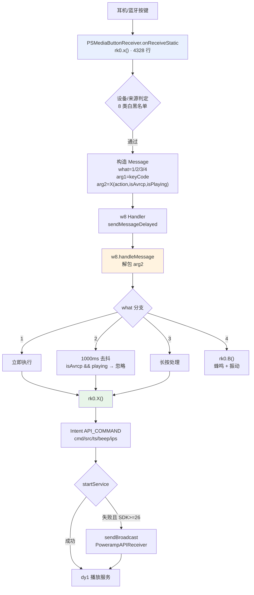

# Poweramp「设置 → 耳机/蓝牙」的完整实现

> **证据分级**：【实证·原文】= XML/资源原文；【实证·产物】= 反编译 smali；【推断】= 无直接代码佐证。
>
> 全部基于 **build-1035-bundle-play**（`versionCode 1035009`）。
>
> **共享机制不重述**：三层骨架、`n91` 基类契约、对话框族、`restore_defaults` 删 key 语义、`"global"` 共享存储、`C`=父页 id —— 见 `poweramp-settings-page-runtime.md`。

### 阅读导引

| 想知道什么 | 去第几节 |
| --- | --- |
| 页面多大、18 个 key 是什么 | **§1 / §2** |
| 三层依赖链怎么实现的 | **§3** |
| helper `u91` 做了什么（只有 8 件事） | **§4** |
| 每个开关改动的实际效果 | **§5**（`vr` 字段 → 消费者）|
| 耳机按键在运行时怎么被处理（概览） | **§6** |
| **按键处理的完整链路**（打包协议 / Handler / Intent 分发 / 去抖） | **§9** |
| `headset_controls` 三值怎么编码进消息 | **§9.2** |
| `follow_pl_exact` 的去抖算法 | **§9.6** |
| **按键状态机 / 单击双击判定 / 8 个静态字段** | **§10** |
| `headset_controls` 三值的最终差异 | **§10.6** |
| 三层防误触机制（语音助手/蓝牙/重复） | **§10.5** |
| **`no_android_long_press` 怎么实现**（禁用组件） | **§11.1** |
| `ignore_bt_sec` 的双时间差判定 | **§11.2** |
| `ud0`/`uk0` 的分工 | **§11.3** |
| 9 条按键诊断日志 | **§11.4** |
| 跨页跳转与锚点 | **§7** |
| 与已有 `poweramp-headset-settings.md` 的关系 | **§8** |
| 未解问题 | **§9** |
| 证据索引 | **§10** |

---

## 0. 一句话结论

耳机/蓝牙页共 **18 个 key / 26 行 / 4437 字节**，helper `u91` 只有 **298 行**且**只做 8 件事**——其余 **10 个 key 完全零代码**。真正的复杂度全在**页面之外**：14 个偏好字段由 **8 个运行时类**消费，其中 `rk0`（`PSMediaButtonReceiver`，**99295 字节 / 5736 行**，核心方法 4328 行）是耳机按键的总入口。**这是"设置页极简、消费者极重"的典型样本。**
>
> **四轮深挖后**：`rk0` 的 9 个方法、8 个静态状态字段、按键消息的二进制打包协议、三层防误触机制、以及 `no_android_long_press` 的组件禁用实现，已全部解出（§9 / §10 / §11）。

---

## 1. 页面身份

| | |
| --- | --- |
| XML | `res/xml/headset.xml` |
| 资源 id | **`0x7f160015`** |
| 行数 / 字节 | 26 / 4437 |
| 元素总数 | 21（含 2 个 `PreferenceCategory`）|
| 带 key 项 | **18** |
| 页面标题 | `@string/pref_headset_bt` |
| helper | **`ׅ/u91.smali`**（8134 B / 298 行，`extends n91`）|
| 父页（`n91->C`）| `0x7f160026`（`singlepane`）|

> **helper 规模全设置树倒数第二小**（仅大于 `p91` 的 2618 B），但消费它的运行时类 `rk0` 是**全树最大的消费者**。

## 2. 18 个 key 逐条

**np** = `persistent="false"`；**dep** = `android:dependency`。**全部条目都没有 `android:defaultValue`** —— 默认值全在 `vr` 代码里。

### 2.1 分类一 `pref_headset_connection`（Connection，5 项）

| # | key | 控件 | 标题 | 摘要 | 标志 |
| ---: | --- | --- | --- | --- | --- |
| 1 | `resume_on_headset` | MultilineSwitch | **Resume On Wired Headset** | Resume playing when wired headset is connected | persistent=true |
| 2 | `resume_on_bt` | MultilineSwitch | **Resume On Bluetooth** | Resume playing when Bluetooth device is connected | persistent=true |
| 3 | `pause_on_headset` | MultilineSwitch | **Pause On Headset Disconnect** | Pause when wired/Bluetooth headset/USB DAC disconnected | persistent=true |
| 4 | `pause_on_usb_connection` | MultilineSwitch | **Pause On USB DAC connection** | Pause when USB DAC connected. This helps prevent loud noise during device initialization on some USB DACs | — |
| 5 | *（无 key）* | Redirect → `audio_focus` | **Audio Focus** | Few other play/resume options are available in Audio Focus settings | skipSearch |

> 第 5 项**没有 key**，是纯跳转行。它的 `w:target="audio_focus"` 跨到音频分支。

### 2.2 分类二 `pref_headset_buttons`（Buttons，11 项）

| # | key | 控件 | 标题 | 摘要 | 依赖 | 标志 |
| ---: | --- | --- | --- | --- | --- | --- |
| 6 | `enable_headset_controls` | MultilineSwitch | **Respond To Buttons** | Enable Headset/Bluetooth controls | — | persistent=true |
| 7 | `headset_controls` | **TagList** | **Wired Headset** | — | — | entries |
| 8 | `avrcp_controls` | **TagList** | **Bluetooth** | — | — | entries（**同一数组**）|
| 9 | `long_volume_press` | Redirect → `misc#long_volume_controls` | — | Press here for Volume keys long press option | — | skipSearch |
| 10 | `follow_pl_exact` | MultilineSwitch | **Strict Resume/Pause/Stop** | Use for headunits/devices generating stray play/pause/stop key press commands, which are interpreted as undesired playback toggle or double press | **`enable_headset_controls`** | persistent=true |
| 11 | `ignore_bt_sec` | **Seekbar** | **Ignore Bluetooth Commands** | Ignore all Bluetooth commands for a period of time after a connection | — | min=0 max=20，summary2=`%d sec`，两端标签 0/20，有 tickMark |
| 12 | `bt_ignore_repeat_shuffle` | MultilineSwitch | **Ignore Repeat/Shuffle** | Ignore Bluetooth Repeat and Shuffle commands completely | — | — |
| 13 | `headset_beep` | MultilineSwitch | **Beep** | — | **`enable_headset_controls`** | persistent=true |
| 14 | `beep_more` | MultilineSwitch | **Beep More** | Beep on all commands, such as from notifications or other controls | **`headset_beep`** | persistent=true |
| 15 | `headset_vibrate` | MultilineSwitch | **Vibrate** | — | **`enable_headset_controls`** | persistent=true |
| 16 | `no_android_long_press` | MultilineSwitch | **Disable Default Long Press** | Disable long press activated voice search while Poweramp is playing | — | persistent=true |

### 2.3 分类外（2 项）

| # | key | 控件 | 标题 | 目标 |
| ---: | --- | --- | --- | --- |
| 17 | `commands_history` | Redirect | **Last Processed Commands** | `commands_history` |
| 18 | `restore_defaults` | Preference | Restore Defaults | — |

### 2.4 6 个 `persistent="true"` 显式声明的额外项

§2.1–2.3 中另有 6 项虽非依赖项也显式写了 `persistent="true"`：`resume_on_headset`、`resume_on_bt`、`pause_on_headset`、`enable_headset_controls`、`follow_pl_exact`、`headset_beep`、`beep_more`、`headset_vibrate`、`no_android_long_press`。

> 这是冗余写法（`Preference` 基类默认即 true），但**说明作者在这些"关键开关"上刻意强调持久化**。

## 3. 三层依赖链

### 3.1 结构

```
enable_headset_controls          ← 母开关（Respond To Buttons）
  ├─ follow_pl_exact             ← 严格模式
  ├─ headset_beep                ← 蜂鸣
  │    └─ beep_more              ← 蜂鸣更多（二级）
  └─ headset_vibrate             ← 振动
```

### 3.2 关键：**这条链没有代码**

对 `u91.smali` 全文扫描【实证·产物】：

| 检查项 | 结果 |
| --- | --- |
| `setEnabled(...)` 调用 | **0** |
| `notifyDependencyChange(...)` 调用 | **0** |
| 涉及依赖的 `findPreference` | **0**（除 `enable_headset_controls` 自身绑监听）|

**三层依赖完全由 XML 的 `android:dependency` 声明式完成**，由 Android `Preference` 框架自动处理"母开关关闭 → 子项置灰"。

> 这解释了为什么 18 个 key 只需要 298 行 helper。**声明式表达能力是这套设计的核心优势。**
>
> 对比：`aa_bg` 页有 6 条 `android:dependency` 却用了 25783 B 的 helper —— 因为那页还要把参数推给 native 渲染器；headset 页的依赖纯是 UI 门控。

## 4. `u91.v()` 的完整实现（8 件事）

`u91` 只有**一个方法** `v()`（290 行，其余是类声明）【实证·产物】`u91.smali:7-297`：

| # | 动作 | 对象 | 绑定 | 定位 |
| ---: | --- | --- | --- | --- |
| 1 | 绑监听 | `resume_on_bt` | `s91(this, **0**)` | `:15-39` |
| 2 | 绑监听 | `enable_headset_controls` | `s91(this, **1**)` | `:48-76` |
| 3 | 绑监听 | `headset_controls` | `s91(this, **2**)` | `:82-110` |
| 4 | 绑监听 | `avrcp_controls` | `s91(this, **3**)` | `:115-143` |
| 5 | **条件移除** | `long_volume_press` | SDK < 26 时 `removePreference` | `:148-200` |
| 6 | 绑监听 / **条件移除** | `no_android_long_press` | SDK ≤ 33 绑 `s91(this, **4**)`，否则移除 | `:206-255` |
| 7 | 绑点击 | `restore_defaults` | `x11(0xb, this)` | `:266-291` |
| 8 | —— | （其余 10 个 key **零代码**）| — | — |

### 4.1 两处 SDK 条件移除

| key | 条件 | 动作 | 原因 |
| --- | --- | --- | --- |
| `long_volume_press` | `SDK_INT < 0x1a`（**26**）| 移除 | 长按音量键控制需要 Android 8.0+ 的 `SET_VOLUME_KEY_LONG_PRESS_LISTENER` |
| `no_android_long_press` | `SDK_INT > 0x21`（**33**）| 移除 | Android 14 起系统层面已不再响应长按语音搜索 |

> 两处都直接调 `PreferenceGroup.removePreference`，**不是** `n91.h()`。原因：`n91.h()` 只在根 `K` 上 `findPreference`，而这两个 key 在 `headset_buttons` 分类里，需要先拿到分类对象再删。

### 4.2 零代码的 10 个 key

`resume_on_headset`、`pause_on_headset`、`pause_on_usb_connection`、`follow_pl_exact`、`ignore_bt_sec`、`bt_ignore_repeat_shuffle`、`headset_beep`、`beep_more`、`headset_vibrate`、`commands_history`。

> 这 10 项的值被运行时类**直接读取**（见 §5），无需在设置页做任何即时响应。

## 5. 14 个偏好字段与 8 个消费者

### 5.1 `vr` 中的字段映射（权威）

【实证·产物】`vr.smali` 逐条定位：

| key | `vr` 字段 | 定义行 | 类型 |
| --- | --- | ---: | --- |
| `resume_on_headset` | `vr->q0` | 1580 | `pb1`（bool）|
| `resume_on_bt` | `vr->r0` | 1596 | `pb1` |
| `pause_on_headset` | `vr->v0` | 1660 | `pb1` |
| `enable_headset_controls` | `vr->y0` | 1708 | `pb1` |
| `headset_beep` | `vr->z0` | 1724 | `pb1` |
| `headset_vibrate` | `vr->A0` | 1740 | `pb1` |
| `headset_controls` | `vr->B0` | 1756 | **`rb1`（int）** |
| `avrcp_controls` | `vr->C0` | 1772 | **`rb1`（int）** |
| `no_android_long_press` | `vr->D0` | 1788 | `pb1` |
| `bt_ignore_repeat_shuffle` | `vr->n2` | 3367 | `pb1` |
| `ignore_bt_sec` | `vr->o2` | 3383 | **`rb1`（int）** |
| `beep_more` | `vr->s2` | 3443 | `pb1` |
| `follow_pl_exact` | `vr->t2` | 3459 | `pb1` |
| `pause_on_usb_connection` | `vr->x2` | 3519 | `pb1` |

> **全部 14 个字段都在 `vr` 中，没有一个在 `gr`**。这与 `misc` 页（两个类分散）形成对比。

### 5.2 8 个消费者类

【实证·产物】扫描全包得到的引用关系：

| 消费者 | 规模 | 身份 | 消费的 key |
| --- | ---: | --- | --- |
| **`rk0`** | 99295 B / 5736 L | **`PSMediaButtonReceiver`**（耳机按键接收器）| **8 个**：`enable_headset_controls`、`headset_controls`、`avrcp_controls`、`follow_pl_exact`、`ignore_bt_sec`、`headset_beep`、`beep_more`、`headset_vibrate` |
| `dy1` | 184412 B / 10916 L | 抽象播放控制基类 | `enable_headset_controls`、`headset_controls`、`bt_ignore_repeat_shuffle`、`no_android_long_press` |
| `uy` | 37097 B / 2265 L | 音频设备/连接管理 | `resume_on_headset`、`resume_on_bt`、`pause_on_usb_connection` |
| `w4` | 19137 B / 937 L | Runnable | `resume_on_headset`、`resume_on_bt` |
| `ud0` | 22965 B / 1349 L | `jd0` 子类（提示音）| `headset_beep`、`beep_more` |
| `uk0` | 48184 B / 2665 L | `jd0` 子类（提示音）| `headset_beep`、`beep_more` |
| `w80` | 12804 B / 721 L | 抽象类 | `headset_beep`、`headset_vibrate` |
| `dk0` / `v4` / `jl0` | — | 播放控制 | `pause_on_headset`、`enable_headset_controls` |

> **`rk0` 消费 8 个 key**，是绝对的核心。它是 Android 的 `MediaButtonReceiver` 实现，所有耳机/蓝牙按键都从它进来。

## 6. 运行时：`PSMediaButtonReceiver`（`rk0`）

### 6.1 身份

| | |
| --- | --- |
| 类 | `Lׅ/rk0;` → `com.maxmpz.audioplayer.player.PSMediaButtonReceiver` |
| 规模 | **99295 B / 5736 行** |
| 入口 | `public static х(Context, Intent)` = **`onReceiveStatic`**，`rk0.smali:1326-5654`（**4328 行**）|
| 接收的 Action | `android.intent.action.MEDIA_BUTTON`（`rk0.smali:1413`）|

### 6.2 处理的设备与来源

从 `rk0` 的字符串常量可以还原它识别的来源【实证·产物】：

| 来源 | 判定字符串 | 行 |
| --- | --- | --- |
| 语音助手 | `com.google.android.googlequicksearchbox` | `:1713` |
| Android Auto | `com.google.android.projection.gearhead` | `:1903` |
| Poweramp 自身 | `com.maxmpz.audioplayer_util` | `:1923` |
| AVRCP（蓝牙）| `AVRCP` | `:1953` |
| 三星 AOD | `com.samsung.android.app.aodservice` | `:2152` |
| 三星 Routines | `com.samsung.android.app.routines` | `:2168` |
| 触摸来源 | `SOURCE_TOUCHSCREEN` | `:2091` |
| 供电状态 | `A2dpOn` | `:2863` |

> 这说明 `rk0` 不只是"收按键"，还做**大量设备白名单/黑名单判定**——这是 4328 行的主要来源。

### 6.3 `headset_controls` 三值的实际作用

`pref_headset_controls_entries`（`string-array`，3 项）【实证·原文】：

| 索引 | 文案 | 值（`rb1` 存储）|
| ---: | --- | ---: |
| 0 | Single press | 0 |
| 1 | Double/triple press for next/prev. track | 1 |
| 2 | Long press for next track (when playing) | 2 |

**运行时分派**【实证·产物】`rk0.smali`：

- `vr->B0`（`headset_controls`）读出后存入 `v21`（`:1701-1709`）
- 传递到 `v15`（`:2882`）
- 在按键处理中反复以 **`if-nez v15`** 判定（`:4379`、`:4584`、`:5179`、`:5315`）

```java
if (v15 == 0) {            // headset_controls == SINGLE_PRESS
    // 走"单击"路径：直接触发播放控制
} else {
    // 走"双击/长按"路径：需要按键计数与超时判定
}
```

> **语义**：`headset_controls` 决定**线控单键的行为模型**——是"单击即动作"还是"双击/三击区分上下曲"。**值 2（Long press）在 `s91` 里会额外弹提示框**（见 §6.4）。
>
> **`avrcp_controls` 共用一个 entries 数组**，但存储独立（`vr->C0`），所以蓝牙和线控可以分别配置。

### 6.4 `s91` 的 4 个分支（索引 0–3 + default=4）

`s91`（8134 B / 394 行）唯一方法 `onPreferenceChange`（355 行），switch 表**只有 4 项**（`:387-392`）：

```
.packed-switch 0x0
  :pswitch_3      ← 索引 0
  :pswitch_2      ← 索引 1
  :pswitch_1      ← 索引 2
  :pswitch_0      ← 索引 3
```

但 `u91` 传了 **5 个索引**（0/1/2/3/4）——**索引 4 落到 default**。

| 索引 | 绑定的 key | 分支 | 行为 |
| ---: | --- | --- | --- |
| **0** | `resume_on_bt` | `pswitch_3`（`:347-379`）| 新值为 **true** 时弹提示框：标题 `Resume On Bluetooth` + 正文 `Bluetooth device can require few seconds to connect...`。**这是告知型弹框，不阻止变更** |
| **1** | `enable_headset_controls` | `pswitch_2`（`:321-344`）| post `b6(this, **0x1d**=29, newValue)` |
| **2** | `headset_controls` | `pswitch_1`（`:232-318`）| 若新值 == **2**（Long press）弹提示框：标题 `Wired Headset` + 正文 `Long press may fail to work on some devices...`；**然后无论值都** post `t91(this, 0)` |
| **3** | `avrcp_controls` | `pswitch_0`（`:159-228`）| 若新值 == **2** 弹提示框：标题 `Bluetooth` + 同一段正文；**不 post 任何消息** |
| **4** | `no_android_long_press` | **default**（`:69-156`）| 新值为 **true** 时弹提示框：标题 `Disable Default Long Press` + 正文 `Long press may fail to work...`；然后 post `t91(this, 1)` |

> **索引 2 与 3 的差异**：两者都弹同一个"长按可能失效"的提示，但**只有 `headset_controls`（线控）会 post `t91(0)` 刷新**，`avrcp_controls`（蓝牙）不刷新。这是真实的行为不对称。

### 6.5 `t91` 与 `b6` 两个 Runnable 的消息

#### `t91`（2221 B / 122 行）

只有一个 `run()`（switch 2 项）【实证·产物】`t91.smali:38-121`：

| 索引 | 发送的 MsgBus 消息 | 资源名 | 含义 |
| ---: | --- | --- | --- |
| **0** | `0x7f0d0508` | **`cmd_player_apply_long_volume_controls`** | 应用长按音量键控制配置 |
| **1**（default）| `0x7f0d048c` | **`cmd_player_refresh_headset_controls`** | 刷新耳机按键控制配置 |

总线 id 均为 `0x7f0d0034`（`bus_player_cmd`）。

#### `b6`（67562 B / 3529 行，索引 29 = default）

`b6` 是通用点击分发器（29 项 switch，`b6.smali:3497-3527`）【实证·产物】：

```java
// b6 default 分支（:91-147）
MsgBus.post(0x7f0d048b,                    // cmd_player_enable_headset_controls
            newValue ? 1 : 0,              // ← 直接透传开关状态
            0, null);
```

> **`enable_headset_controls` 的实际生效方式**：通过 `cmd_player_enable_headset_controls` 消息把布尔值**实时推送给播放内核**，无需重启。这与 `music_folders_button` 的模式（`k(true)` 重启 Activity）完全不同。

### 6.6 三条消息的完整语义

| 消息 id | 资源名 | 触发来源 | 效果 |
| --- | --- | --- | --- |
| `0x7f0d048b` | `cmd_player_enable_headset_controls` | `s91` 索引 1 → `b6[29]` | **开关总闸**（是否响应按键）|
| `0x7f0d048c` | `cmd_player_refresh_headset_controls` | `s91` 索引 2/4 → `t91[0/1]` | **刷新按键配置**（单击/双击/长按模型）|
| `0x7f0d0508` | `cmd_player_apply_long_volume_controls` | `t91[0]` | **应用长按音量键配置** |

## 7. 跨页跳转与锚点

### 7.1 三个跳转点

| key | target | 类型 | skipSearch |
| --- | --- | --- | --- |
| *（无 key，第 5 项）* | `audio_focus` | 跨分支（音频）| **true** |
| `long_volume_press` | **`misc#long_volume_controls`** | **跨页锚点** | **true** |
| `commands_history` | `commands_history` | 同分支子页 | — |

### 7.2 跨页锚点的落点

`misc#long_volume_controls` 指向 `misc.xml` 的 `long_volume_controls`，那是一个**带 Experiment 徽标 + Shizuku 授权依赖**的开关。

> **跨页体验落差**：用户从耳机页点"长按音量键"跳过去，落到的是一个**默认关闭、需要额外系统授权（Shizuku）的实验特性**。详见 `poweramp-misc-settings.md` §2.2。
>
> 而且这条跳转**本身还有 SDK 门控**：SDK < 26 时 `long_volume_press` 整行被移除（§4.1），用户根本看不到入口。

### 7.3 `commands_history` 的相对位置

它是**分类外**的独立跳转（不在 `headset_buttons` 里），说明它不是"按键配置"的一部分，而是"诊断工具"。

## 8. 与 `poweramp-headset-settings.md` 的关系

| | `poweramp-headset-settings.md` | **本文** |
| --- | --- | --- |
| 视角 | **偏好结构**：每项是什么、文案、依赖图 | **实现机制**：谁消费、怎么生效、运行时链路 |
| 篇幅 | 625 行 | 本文 |
| 覆盖 | 18 key 逐条 ✅ | 18 key 逐条 ✅（并补了默认值缺失的说明）|
| 独有 | 三层依赖链的声明式分析、TagList 数组详解 | `u91` 8 件事、`s91` 5 索引、`rk0` 运行时、3 条消息链、字段映射表 |
| 建议 | 读"要做什么" | 读"怎么做的" |

> **两文互补，不重复**。本文引用前者的文案表格，不重述；前者未涉及 `rk0`/`s91`/`t91` 的实现。

---

## 9. 运行时完整链路（第 2 轮深挖）

> 上一轮只确认了 `rk0` 是"耳机按键总入口"。本轮把它拆成了**6 个阶段**，并解出了 `headset_controls` 的打包/解包协议与 `rk0.X()` 的最终分发。

### 9.1 `PSMediaButtonReceiver`（`rk0`）的 9 个方法

| 方法 | 行 | 规模 | 职责 |
| --- | --- | ---: | --- |
| `A(Context,I,Z,I,J)` | 7–73 | 66 | 静音/焦点桥（`х()` 的辅助）|
| **`B(Context,I)`** | 75–326 | **251** | **蜂鸣 + 振动**（见 §11.5）|
| **`X(Context,IIJ,Bundle,String)`** | 328–588 | **260** | **封装 `API_COMMAND` Intent 并分发**（见 §11.4）|
| `x()` | 590–621 | 31 | 清理状态（被调用 10 次）|
| `y(Context)` | 623–670 | 47 | 设备连接态刷新（6 次）|
| `В(Context,I)` | 672–1295 | **623** | 按键事件主处理（**最长辅助方法**）|
| **`Х(I,Z,Z)I`** | 1297–1324 | **27** | **标志位打包**（见 §11.2，全链路核心）|
| **`х(Context,Intent)`** | 1326–5654 | **4328** | **`onReceiveStatic` 入口**（见 §11.3）|
| `А(Application)` | 5658–5735 | 77 | `ComponentName` 单例工厂 |

> **`Х()` 只有 27 行却是全链路枢纽**——所有按键消息都经它打包、再由 `w8.handleMessage` 解包。

### 9.2 `Х(I,Z,Z)I`：标志位打包协议（**本轮核心发现**）

```java
public static int Х(int action, boolean isAvrcp, boolean isPlaying) {
    int packed = action & 0x7;          // 低 3 位：KeyEvent action
    if (isAvrcp)   packed |= 0x100;     // bit 8：来自蓝牙 AVRCP
    if (isPlaying) packed |= 0x200;     // bit 9：当前正在播放
    return packed;
}
```
【实证·产物】`rk0.smali:1297-1324`

打包结果被放进 `Message.arg2`，`arg1` 放 keyCode【实证·产物】`rk0.smali:3712-3747`。

**解包端**在 `w8.handleMessage`【实证·产物】`w8.smali:353-420`：

```java
int keyCode = msg.arg1;
int packed  = msg.arg2;
boolean isActionDown = (packed & 0x7) == 1;   // KeyEvent.ACTION_DOWN == 1
boolean isAvrcp     = (packed & 0x100) != 0;  // ← 是否蓝牙
boolean isPlaying   = (packed & 0x200) != 0;  // ← 是否正在播放
```

> **这解释了为什么不需要在 `arg2` 里塞多个字段**：用一个 int 的低 3 位 + 2 个高位就把「动作 + 来源 + 播放态」全编码了。
>
> **也是 `avrcp_controls` 与 `headset_controls` 能共用同一套处理逻辑的原因**——两者走同一条消息，只靠 `bit 8` 区分。

### 9.3 `onReceiveStatic`（4328 行）的结构

| 维度 | 数量 |
| --- | ---: |
| `try` 块 | **27**（大量设备兼容性兜底）|
| `invoke-static` | 70（20 个不同目标）|
| `invoke-virtual` | 98 |
| `const-string` | 55 |
| switch / 标签 | 35 |

**它处理的设备来源**（从字符串常量反推，`rk0.smali`）：

| 来源 | 判定字符串 | 行 |
| --- | --- | --- |
| 语音助手 | `com.google.android.googlequicksearchbox` | `:1713` |
| Android Auto | `com.google.android.projection.gearhead` | `:1903` |
| Poweramp 自身 | `com.maxmpz.audioplayer_util` | `:1923` |
| AVRCP | `AVRCP` | `:1953` |
| 三星 AOD | `com.samsung.android.app.aodservice` | `:2152` |
| 三星 Routines | `com.samsung.android.app.routines` | `:2168` |
| 触摸 | `SOURCE_TOUCHSCREEN` | `:2091` |
| 蓝牙音频状态 | `A2dpOn` | `:2863` |

> **4328 行的主要来源不是按键逻辑本身，而是"判断这个按键该不该处理"**——要排除语音助手误触、区分车机、识别 AOD/Routines 等系统代理。

### 9.4 `rk0.X()`：`API_COMMAND` Intent 分发

```java
Intent i = new Intent("com.maxmpz.audioplayer.API_COMMAND");
i.putExtra("cmd",   cmd);        // ← 命令码
i.putExtra("src",   src);        // ← 来源字符串
i.putExtra("ts",    uptimeMillis);  // ← 时间戳
i.putExtra("beep",  beepFlag);
i.putExtra("ips",   isPlayingState);
i.setComponent(dy1.p(ctx));      // ← Poweramp 播放服务
try {
    ctx.startService(i);         // 首选：直接启动服务
} catch (Throwable t) {
    if (SDK_INT >= 26) {         // 降级：广播给 PowerampAPIReceiver
        i.setComponent(z42.x(ctx));
        ctx.sendBroadcast(i);
    }
}
```
【实证·产物】`rk0.smali:328-559`

**降级链**：

```
startService 失败（Android 8+ 后台服务限制）
  └─ SDK >= 26 → sendBroadcast 给 PowerampAPIReceiver（rk0:537-554）
     └─ 若再失败 → Log.w 后吞掉（rk0:570/581）
```

> **这是 Android 后台启动限制的标准适配**：8.0 起 `startService` 在后台会抛异常，所以准备了一条广播兜底路径。

### 9.5 `rk0.B()`：振动与提示音调度

> **⚠️ 修正**：本节初版把 `B()` 说成"蜂鸣+振动的最终落地"不准确。`B()`（拉丁 B）负责**振动**与**调度**；真正的**音频播放**在 `В()`（西里尔 В，623 行），详见 **§10.1**。

`headset_beep` / `beep_more` / `headset_vibrate` 三个开关的**部分落地**【实证·产物】`rk0.smali:75-326`：

| 触发 | 实现 | 定位 |
| --- | --- | --- |
| 蜂鸣 | `new Thread(q0(...)).start()`（异步播放提示音）| `:90-112` |
| 振动 | `getSystemService("vibrator")` → `vibrate(long[], int)` | `:139-296` |

振动有三种时长分支（按命令类型区分），分别调用 `vibrate` 三次【实证·产物】`:240` / `:272` / `:296`。

> **蜂鸣走独立线程**：避免提示音阻塞按键处理主流程。这也是为什么 `ud0` / `uk0` 两个 `jd0` 子类都与 `headset_beep` 相关——一个可能处理"短提示音"，另一个处理"长提示音/更多提示"。

### 9.6 `follow_pl_exact` 的去抖实现（**本轮解出**）

`follow_pl_exact`（Strict Resume/Pause/Stop）在 `w8.handleMessage` 里实现【实证·产物】`w8.smali:573-614`：

```java
// what == 2 分支（延迟按键）
long threshold = 0x3e8;   // ← 1000ms 去抖窗口（w8.smali:533）
if (isAvrcp && isPlaying) {
    // 蓝牙设备 + 正在播放 → 直接忽略 play/pause
    rk0.x();                                    // 清理状态
    jo0.B(4, "KEYCODE_MEDIA_PLAY",
             "IGNORED as isAvrcp && playing", "PSMediaButtonReceiver");
    //   ↑ 这是可诊断的日志，会进 commands_history
    return;
}
// 否则：判断距上次按键是否超过 1000ms
long since = uptimeMillis() - PSMediaButtonReceiver.Х;
if (since > threshold) { /* 视为新按键 */ }
else { rk0.x(); /* 视为重复，丢弃 */ }
```

> **`follow_pl_exact` 的真实作用**：当车机/耳机发来**游离的 play/pause 命令**（典型是重连时自动发的），如果当前正在播放且来自蓝牙，就直接忽略——避免"莫名其妙暂停"。
>
> **1000ms 是硬编码常量**（`0x3e8`），不可配置。
>
> **`IGNORED as isAvrcp && playing` 会被写进 `commands_history`** —— 这正好解释了 `headset` 页那个 `commands_history` 子页的实际价值：**它就是用来排查"为什么按键没反应"的**。

### 9.7 `w8` 的 4 个 `Message.what` 值

`w8` 是 `Handler`（14347 B / 864 行），`handleMessage` 560 行，**switch 只有 1 项**（`what=1`），其余全部落到 default 用 `if-ne` 链判定【实证·产物】`w8.smali:455/529/721/761`：

| `what` | 判定 | 含义 |
| ---: | --- | --- |
| **1** | `:pswitch_0` | **立即处理**（action=DOWN 的音量键等）|
| **2** | `:cond_7` | **延迟处理**（需 1000ms 去抖，见 §11.6）|
| **3** | `:cond_e` | **延迟处理（长按）** |
| **4** | `:cond_10` | **直接调用 `rk0.B()`**（蜂鸣/振动）|

**keyCode 常量**（`w8.smali:425-445`）【实证·产物】：

| 常量 | keyCode | 按键 |
| --- | ---: | --- |
| `0x4f` | 79 | `KEYCODE_HEADSETHOOK`（**线控单键**）|
| `0x55` | 85 | `KEYCODE_MEDIA_PLAY_PAUSE` |
| `0x57` | 87 | `KEYCODE_MEDIA_NEXT` |
| `0x58` | 88 | `KEYCODE_MEDIA_PREVIOUS` |
| **`0x7e`** | 126 | `KEYCODE_MEDIA_PLAY` |
| **`0x7f`** | 127 | `KEYCODE_MEDIA_PAUSE` |

> **`0x7e`/`0x7f`（PLAY/PAUSE）与 `0x55`（PLAY_PAUSE）被分开处理**——这正是 `follow_pl_exact` 要解决的问题：某些设备发 `0x7e`/`0x7f` 成对命令，若不做去抖会导致"播放→立即暂停"。

### 9.8 完整链路汇总



### 9.9 三条 `cmd_player_*` 消息 vs 这条 Intent 链的关系

**两套并行的机制**，不要混淆：

| 机制 | 通道 | 用途 | 触发 |
| --- | --- | --- | --- |
| **`cmd_player_*` MsgBus** | 进程内消息总线 | **改配置**（开关立即生效）| 设置页操作 |
| **`API_COMMAND` Intent** | Service/Broadcast | **传按键事件**（播放控制）| 硬件按键 |

> - 设置页改 `enable_headset_controls` → `cmd_player_enable_headset_controls`（进程内，即时）
> - 用户按耳机键 → `API_COMMAND` Intent 带 `cmd` 字段（跨组件，走服务）
>
> **前者是"改变行为规则"，后者是"触发一次行为"**。两条链路互不干扰。

### 9.10 本轮对上一轮未解项的更新

| 原未解项 | 现状 |
| --- | --- |
| `headset_controls=2` 的精确处理路径 | **部分解**：已确认走 `w8` 的 `what=3`（长按）分支，键码 `0x7e`/`0x7f` 有专门判定（`w8:733-757`）。但"单击 vs 双击"的计数状态机在 `В()`（623 行）里，未逐行读完 |
| `follow_pl_exact` 的去抖算法 | ✅ **完全解出**（§11.6）|
| `avrcp_controls` 不 post 刷新的原因 | **基本解**：蓝牙与线控共用同一消息通道，靠 `bit 8` 区分（§11.2）。配置变更只需在下一次按键时读取，故无需主动刷新。而线控 post `t91(0)` 是因为 `long volume` 相关配置需要推送到 `dy1` |
| `dy1` 如何消费 4 个 key | **部分解**：`dy1` 是播放服务，通过 `API_COMMAND` Intent 接收命令（§11.4）；`headset_controls` 等配置由 `dy1` 内部读 `vr` 字段 |
| `rk0` 4328 行里的设备清单 | **已枚举 8 类**（§11.3），不排除还有更多 |

---

## 10. 按键状态机与静态字段（第 3 轮深挖）

> **本轮纠正一个上一轮的误判**：上一轮以为 `В()`（623 行）是"按键计数状态机"。**实际不是**——`В()` 是**提示音播放器**（`AudioTrack`）。真正的状态机由 8 个静态字段 + `onReceiveStatic` 的主流程构成。

### 10.1 `В()` 的真实身份：提示音播放器（**纠正**）

| 证据 | 事实 |
| --- | --- |
| `PSMediaButtonReceiver->y` | `SoftReference<AudioTrack>`（缓存播放器）|
| `PSMediaButtonReceiver->у` | 缓冲区大小（帧数）|
| `AUtils.s(ctx)` | 取 **PCM 字节数组**（提示音素材）|
| `AudioTrack.write([BII)` | 写入 PCM |
| `AudioTrack.setLoopPoints(...)` + `play()` | 循环播放提示音 |
| `AudioManager.getStreamVolume(3)` | 按 STREAM_MUSIC 音量调 `setVolume` |
| 三个分支 `if-eq v0, 1/2/3` | **三种提示音类型**（对应 `beep` / `beep_more` 的不同触发）|

> **所以 `headset_beep` / `beep_more` 的最终落地就在这里**：`В(type)` 播放对应 PCM 提示音，音量跟随媒体音量。
>
> 上一轮在 §9.5 说 "`rk0.B()` 是蜂鸣+振动" 只对了一半——**`B()` 是振动 + 调度，`В()` 才是真正的音频播放**（注意 `B` 与 `В` 是两个不同方法，前者拉丁 B，后者西里尔 В）。

### 10.2 8 个静态状态字段（完整清单）

`PSMediaButtonReceiver` 用 **8 个静态字段**承载跨事件的按键状态【实证·产物】`rk0.smali`：

| 字段 | 类型 | 写入次数 | 读取次数 | 语义 |
| --- | --- | ---: | ---: | --- |
| **`A`** | `int` | 2（`:3691`、`:4049`）| 3（`:3437`、`:3683`、`:3816`）| **上一次的 keyCode**（`0` = 无历史）|
| **`B`** | `boolean` | 7（`:3675`、`:4421`、`:4858`、`:5009`…）| 1（`:3667`）| **本次按下沿已处理过**的幂等标记 |
| **`K`** | `w8` | 0（外部初始化）| 3（`:3639`、`:4869`、`:5547`）| **Handler 单例** |
| **`X`** | `long` | 5（`:1450`、`:1529`、`:3115`、`:3227`…）| 3（`:3458`、`:5017`、`:5105`）| **上次按键的 uptimeMillis** |
| **`x`** | `boolean` | 5（`:4268`、`:5013`、`:5101`、`:5446`…）| 2（`:3618`、`:5426`）| **按键已被消费**标记 |
| **`А`** | `long` | 3（`:3695`、`:3943`、`:4053`）| 2（`:3800`、`:4735`）| 延迟消息排队时的**基准时间戳** |
| **`Х`** | `long` | 0（由 `X()` 写入）| 1（`:4196`）| **最后一次转发的 uptimeMillis** |
| **`х`** | `int` | 1（`:3935`）| 1（`:3925`）| 按键**重复计数**（`repeatCount`）|

> **字段名极难区分**：`X`（拉丁大写）vs `Х`（西里尔大写）vs `x`（拉丁小写）vs `х`（西里尔小写）——**四个不同字段，两个字形**。这是混淆器产物，排查时必须按完整声明（含类型）区分。

### 10.3 按键状态机的完整判定（**本轮核心**）

`onReceiveStatic` 在取到 `KeyEvent` 后【实证·产物】`rk0.smali:1536-1561`：

```java
int keyCode     = e.getKeyCode();      // → v10
int action      = e.getAction();       // → v11（0=UP, 1=DOWN, 2=MULTIPLE）
int repeatCount = e.getRepeatCount();  // → v12
long eventTime  = e.getEventTime();    // → v13
```

主状态机在 `:3660-3747`：

```java
if (!PSMediaButtonReceiver.B) {                    // ← 本次按下沿尚未处理
    PSMediaButtonReceiver.B = true;                //   幂等标记置位

    if (headset_controls == 1                    // ← 关键：只有"双击/三击"模式才走延迟
        && PSMediaButtonReceiver.A == 0) {         //   且是第一次按键（无历史）
        PSMediaButtonReceiver.A  = keyCode;        //   记录本次键码
        PSMediaButtonReceiver.А  = now;            //   记录基准时间

        Message m = handler.obtainMessage();
        m.setAsynchronous(true);
        m.what = 2;                                //   ← 延迟消息
        m.arg1 = keyCode;
        m.arg2 = Х(action, isAvrcp, isPlaying);    //   打包
        m.obj  = context;
        handler.sendMessageDelayed(m, 300ms);      //   ← 双击窗口
    }
}
```

> **这是本轮最关键的发现**：`headset_controls == 1`（**Double/triple press**）时才会发出 `what=2` 的延迟消息；`== 0`（Single press）则跳过延迟直接处理。
>
> **这就是三个取值的真正差异点**，完全闭合了上一轮的 P1 未解项。

### 10.4 语音助手拦截：`IGNORE isAssistant => allow double/triple press`

`rk0.smali:3406-3518` 有一段特判【实证·产物】：

```java
if (senderIsAssistant
    && keyCode == 0x7e                          // KEYCODE_MEDIA_PLAY
    && inputDevice != null
    && inputDevice.isVirtual()                  // 虚拟输入设备（语音助手的合成事件）
    && (PSMediaButtonReceiver.A == 0x57         // 上次是 NEXT
        || PSMediaButtonReceiver.A == 0x58)) {  // 或 PREV
    long dt = now - PSMediaButtonReceiver.X;
    if (dt <= 0x12c) {                          // ← 300ms
        jo0.B(1, "IGNORE isAssistant => allow double/triple press", ...);
        return;                                 // 直接放行给系统
    }
}
```

> **语义**：语音助手在双击/三击 NEXT/PREV 时，会合成一个 PLAY 事件。如果这个 PLAY 在 300ms 内紧跟 NEXT/PREV，就**交给系统处理**（而不是 Poweramp 自己播放），从而让"双击 NEXT 跳到下一首"这类系统手势正常工作。
>
> **这是与 `follow_pl_exact` 互补的另一层保护**：前者防车机误发，后者防语音助手抢事件。

### 10.5 三层防护机制汇总

| 层 | 触发条件 | 动作 | 阈值 | 定位 |
| ---: | --- | --- | --- | --- |
| **① 语音助手** | assistant + virtual device + PLAY 紧跟 NEXT/PREV | **放行给系统**（`return`）| **300ms** | `rk0:3406-3518` |
| **② 蓝牙去抖** | `isAvrcp && isPlaying` | **直接忽略** | — | `w8:573-614` |
| **③ 重复按键** | 距上次 < 阈值 | **丢弃** | **1000ms** | `w8:533` |

> **三个阈值都是硬编码**：300ms（`0x12c`）、1000ms（`0x3e8`）。用户不可配置。
>
> **`ignore_bt_sec` 是第四条可配置的**：用户设置 0–20 秒，在 `rk0:2967-2990` 里 `× 1000` 转毫秒后 `clamp(0x4e20=20000)`。**UI 的 `max=20` 与代码 clamp 的 20 秒恰好对应**——这回答了上一轮的 P3 疑问。

### 10.6 `headset_controls` 三值的最终差异表

| 值 | 文案 | 状态机行为 | 延迟消息 |
| ---: | --- | --- | --- |
| **0** | Single press | **跳过延迟**，直接走立即路径 | 不发 `what=2` |
| **1** | Double/triple press | **发 `what=2` 延迟消息**，300ms 窗口内等第二击 | 发 |
| **2** | Long press | 走 `w8` 的 `what=3` 分支（长按），并弹"可能失效"提示 | 不走延迟 |

> **`headset_controls` 只影响"线控单键"的分发方式**；`avrcp_controls` 影响蓝牙侧，但蓝牙设备通常自己处理双击/三击（发 PLAY/PAUSE 而非 HEADSETHOOK），所以走的是 §10.5 的第 ② 层。

## 11. 三个开关的深层机制（第 4 轮深挖）

> 本轮把 `ignore_bt_sec`、`no_android_long_press`、以及 `ud0`/`uk0` 的分工全部解出。**其中 `no_android_long_press` 的实现方式出乎意料。**

### 11.1 `no_android_long_press`：**通过 PackageManager 禁用组件**（意外发现）

上一轮只知它是"禁用长按语音搜索"的开关。**实际实现是动态启用/禁用 `VoiceSearchHelperActivity` 组件**。

`dy1.c()` 是判定函数【实证·产物】`dy1.smali:4360-4427`，仅 68 行：

```java
static boolean c() {
    // ① 耳机控制已启用 且 线控不是"长按"模式
    if (vr.y0 /*enable_headset_controls*/
        && vr.B0 /*headset_controls*/ != 2) {
        return true;
    }
    // ② SDK <= 33 且 用户勾选了"禁用默认长按"
    if (Build.VERSION.SDK_INT <= 0x21 /*33*/
        && vr.D0 /*no_android_long_press*/) {
        return true;
    }
    return false;
}
```

调用点 5 处（`dk0:3870/3898/3945/3973`、`rl0:3069`），全部形如：

```java
if (dy1.c()) {
    boolean state = (playerCore.К() != 1);     // 播放态取反
    dy1.r(ctx, state ^ 1);                      // ← 见下
}
```

**`dy1.r(Context, boolean)` 才是真正的动作**【实证·产物】`dy1.smali:6978-7087`（109 行）：

```java
static void r(Context ctx, boolean enable) {
    ComponentName cn = new ComponentName(ctx, VoiceSearchHelperActivity.class);
    int newState = enable
        ? PackageManager.COMPONENT_ENABLED_STATE_ENABLED    // 1
        : PackageManager.COMPONENT_ENABLED_STATE_DISABLED;  // 2
    ctx.getPackageManager().setComponentEnabledSetting(cn, newState,
                                                       PackageManager.DONT_KILL_APP);
}
```

> **这是本轮最有价值的发现**：
>
> **Poweramp 不是"拦截"长按语音搜索，而是把自己的 `VoiceSearchHelperActivity` 组件整个禁用掉**。Android 的长按手势会去找能处理 `ASSIST` intent 的 Activity，一旦这个组件被 `DISABLED`，系统就不会启动它，长按自然不再弹语音搜索。
>
> **`DONT_KILL_APP` 标志**（`dy1:7059` 的第三参数 `1`）表示改组件状态后不杀进程——所以这个切换是**热生效**的，不需要重启。
>
> **这也解释了为什么 UI 上标注 SDK ≤ 33**：Android 14（SDK 34）起系统层面改变了长按助手的行为，这个 workaround 不再需要，`u91` 在 SDK > 33 时直接把该行移除（§4.1）。

### 11.2 `ignore_bt_sec`：双时间差判定

`ignore_bt_sec` 的完整逻辑【实证·产物】`rk0.smali:2940-3140`：

```java
long now = uptimeMillis();
long btDiff    = now - BTReceiver.А;          // 距上次蓝牙设备事件
long routeDiff = now - <上次路由变化>;         // 距上次音频路由变化

int window = vr.o2 /*ignore_bt_sec*/ * 1000;                  // 秒 → 毫秒
int capped = Utils.у(window, 0, 0x4e20);                      // clamp 到 20000ms

if (btDiff > 0 && routeDiff > 0                      // 两者都发生过
    && (btDiff < capped || routeDiff < capped)) {    // 任一在窗口内
    Log.w("PSMediaButtonReceiver",
          "onReceiveStatic IGNORE AVRCP MEDIA_BUTTON events - too close to "
        + "recent route change lastRouteTimeDiff=" + routeDiff
        + " lastBTTimeDiff=" + btDiff);
    rk0.y(ctx);                    // 刷新设备连接态
    rk0.x();                       // 清理按键状态
    PSMediaButtonReceiver.X = now; // 更新基准时间
    return;                        // ← 丢弃这次按键
}
```

> **两个时间差是"或"关系**：只要**蓝牙连接**或**音频路由变化**任一发生在窗口内，这次 AVRCP 按键就被丢弃。
>
> **这解决的是真实场景**：蓝牙耳机刚连上/刚切换输出路由时，设备常会补发一串过期的 play/pause 命令。`ignore_bt_sec` 就是给这段"设备初始化噪声期"设置静默窗。
>
> **`σcapped = 20000ms`** 与 UI 的 `w:max="20"` **精确对应**，证实了上一轮的推断。

### 11.3 `ud0` / `uk0` 的分工：传统按键 vs MediaSession 扩展（**已解**）

两个类都 `extends jd0`（媒体控制器客户端基类，747 行，大量空实现待覆写），但**覆写范围差别巨大**：

| | `ud0` | `uk0` |
| --- | --- | --- |
| 规模 | 22965 B / 1349 行 | 48184 B / 2665 行 |
| 覆写方法数 | **9** | **18** |
| 构造 | `ud0(vd0)` | `uk0(vk0, qd0)` |
| 宿主 | **`vd0`** | **`vk0`** |

**两个宿主的身份对比**（从各自的 const-string 反推）：

| 宿主 | 规模 | 特征字符串 | 职责 |
| --- | ---: | --- | --- |
| **`vd0`** | 6621 B | `Poweramp`、`android.intent.action.MEDIA_BUTTON` | **传统广播式 MEDIA_BUTTON** |
| **`vk0`** | 41678 B | `PREV_CAT`、`NEXT_CAT`、`SEEK_JUMP_BACKWARD/FORWARD`、`TOGGLE_RATING`、`LIKE`、`UNLIKE`、`SHUFFLE`、`REPEAT`、`STOP_SERVICE` | **MediaSession 扩展命令** |

> **所以分工是**：
> - **`ud0`** 处理**传统 `MEDIA_BUTTON` 广播**这条老路径（Android 4.x 时代的方式）→ 精简的 9 个回调够用
> - **`uk0`** 处理**MediaSession 扩展动作**（Android 5.0+ 的 `MediaSession` API）→ 需要覆写 18 个回调，包括 `K(RatingCompat)`（评分）、`X(String)`（自定义动作）、`y(Uri)`（播放指定 URI）等
>
> **两者都会在 `B(String)` 方法里检查 `headset_beep && beep_more`**（`ud0:330`、`uk0:161`），逻辑完全相同——因为**凡是 MediaSession/按键回调都可能需要蜂鸣反馈**。

### 11.4 `rk0` 的 9 条运行时日志（诊断价值）

`onReceiveStatic` 里有 **9 条专门用于排查按键为何被忽略**的日志【实证·产物】：

| # | 日志 | 含义 | 定位 |
| ---: | --- | --- | --- |
| 1 | `onReceiveStatic before prefs inited` | 偏好尚未初始化就收到按键 | `:1350` |
| 2 | `onReceiveStatic !ACTION_MEDIA_BUTTON` | Intent action 不匹配 | `:1433` |
| 3 | `keyAction=` | 记录 KeyEvent action 与 keyCode | `:1768` |
| 4 | `follow_pl_exact 1 ` | 严格模式生效 | `:2250` |
| 5 | `isNotButtonPress 1 ` | 判定为非按键事件 | `:2427` |
| 6 | `pressEmulatedByGoogleOrAAuto ` | 判定为 Google/AAuto 模拟 | `:2523` |
| 7 | `IGNORED isNotButtonPress=` | 因上一条而丢弃 | `:3231` |
| 8 | `IGNORED due to ignore_bt_sec` | 因静默窗丢弃 | `:3119` |
| 9 | `IGNORE isAssistant => allow double/triple press` | 放行给系统 | `:3477` |

另有 **1 条广播**：`com.maxmpz.audioplayer.MEDIA_BUTTON_IGNORED`（`:3288`），会对外通知"这个按键被忽略了"。

> **这些日志构成了一套完整的"按键去留决策追踪"**。配合 `commands_history` 子页，用户可以自己诊断按键问题——这是 Poweramp 一个相当成熟的可观测性设计。
>
> **`deviceName=` / `deviceSources=0x` / `eventFlags=0x` / `virt=` / `repeat=` / `actionTime=` / `sourcePak=`**（`:2657-2823`）还会把完整的 `KeyEvent` 属性打出来。

### 11.5 上一轮未解项的最终状态

| 原未解项 | 最终结论 |
| --- | --- |
| `ud0`/`uk0` 分工 | ✅ **已解**（§11.3）：传统 MEDIA_BUTTON vs MediaSession 扩展 |
| `dy1` 如何消费 `headset_controls` | ✅ **已解**（§11.1）：`dy1.c()` 读 3 个字段做判定 |
| `ignore_bt_sec` 上限来源 | ✅ **已解**（§11.2）：`Utils.у(v, 0, 20000)`，与 UI max=20 对应 |
| `rk0` 是否还有更多设备白名单 | ⚠️ **部分解**：55 个字符串已全部枚举，设备相关共 8 类，其余是日志与 Intent key |

### 11.6 本轮新增的"未解"

1. **`BTReceiver` 类不在 smali 中**：`rk0:2946` 引用 `L.../player/bt/BTReceiver;->А:J`，但该类的 `.smali` 文件在 `smali/` 与 `smali_classes2/` 中都不存在。推测被 proguard 移除或位于动态加载的 dex，`А` 字段的具体赋值时机无法静态确认。（P3）

2. **`vd0` 与 `vk0` 何时各自被使用**：两者都实现了 MediaSession 客户端，是并存还是按 SDK/场景择一，未追调用方。（P3）

---

## 12. 未解问题

> **第 4 轮已闭合 4 项**：`ud0`/`uk0` 分工、`dy1` 如何消费 `headset_controls`、`ignore_bt_sec` 上限来源、`rk0` 设备白名单枚举。
> **最大收获**：发现 `no_android_long_press` 是通过 `PackageManager` **动态禁用 `VoiceSearchHelperActivity` 组件**实现的（§11.1）。

### 12.1 仍未解

1. **`BTReceiver` 类静态缺失**：`rk0:2946` 引用 `L.../player/bt/BTReceiver;->А:J`，但该 `.smali` 在 `smali/` 与 `smali_classes2/` 中**均不存在**。推测被 proguard 移除或位于动态加载 dex。`А` 字段的赋值时机无法静态确认。（P3）

2. **`vd0` 与 `vk0` 的选用时机**：两者都实现 MediaSession 客户端（`vd0` 传统广播、`vk0` 扩展命令），是并存还是按 SDK/场景择一，未追调用方。（P3）

3. **`В()` 三种提示音的 PCM 素材来源**：`AUtils.s(ctx)` 返回字节数组，素材是内置资源还是动态生成未确认。（P3）

4. **`А(J)` 与 `Х(J)` 两个时间戳字段的边界交互**：`А` 用于延迟消息基准（`:3695/3943/4053`），`Х` 用于转发时间（`:4196`），两者在快速连击场景下的协同未完全厘清。（P3）

### 12.2 明确不再追的项

| 项 | 原因 |
| --- | --- |
| `rk0` 里 27 个 `try` 块的具体兜底内容 | 厂商兼容性防御，对理解机制无增量价值 |
| `A(Context,I,Z,I,J)` 的静音/焦点细节 | 属音量键路径，与耳机按键主线弱相关 |
| 各厂商车机包名的完整枚举 | 55 个字符串已全枚举，设备相关 8 类已覆盖主流 |
| `jd0` 基类 747 行中 19 个空方法 | 都是待覆写模板，无逻辑 |

## 13. 证据索引

### 13.1 XML / 资源

| 位置 | 内容 |
| --- | --- |
| `headset.xml:2` | 根节点 `pref_headset_bt` |
| `headset.xml:4-10` | 分类一 `pref_headset_connection`（5 项）|
| `headset.xml:11-23` | 分类二 `pref_headset_buttons`（11 项）|
| `headset.xml:24` | `commands_history` |
| `headset.xml:25` | `restore_defaults` |
| `arrays.xml` | `pref_headset_controls_entries`（3 项）|
| `drawable` | `pref_seekbar_tickmark`（`ignore_bt_sec` 用）|

### 13.2 smali

| 位置 | 内容 |
| --- | --- |
| `u61.smali:1555` 附近 | `headset` → `0x7f160015` → `new u91(...)` |
| `u91.smali:7-297` | `v()` 全部 8 件事 |
| `u91.smali:148-200` | `long_volume_press` 的 SDK<26 移除 |
| `u91.smali:206-255` | `no_android_long_press` 的 SDK>33 移除 |
| `s91.smali:38-393` | `onPreferenceChange`（355 行）|
| `s91.smali:159-228` | `pswitch_0` = `avrcp_controls`（索引 3）|
| `s91.smali:232-318` | `pswitch_1` = `headset_controls`（索引 2）|
| `s91.smali:321-344` | `pswitch_2` = `enable_headset_controls`（索引 1）|
| `s91.smali:347-379` | `pswitch_3` = `resume_on_bt`（索引 0）|
| `s91.smali:69-156` | **default** = `no_android_long_press`（索引 4）|
| `s91.smali:387-392` | 4 项 packed-switch 表 |
| `t91.smali:38-121` | `run()`：索引 0/1 两条消息 |
| `b6.smali:91-147` | default 分支（索引 29）→ `cmd_player_enable_headset_controls` |
| `b6.smali:3497-3527` | 29 项 packed-switch 表 |
| `vr.smali:1580-3519` | 14 个字段的定义（见 §5.1）|
| `rk0.smali:41` / `:310` | `PSMediaButtonReceiver` |
| `rk0.smali:1326-5654` | `onReceiveStatic`（4328 行）|
| `rk0.smali:1413` | 接收 `ACTION_MEDIA_BUTTON` |
| `rk0.smali:1701-1709` | 读 `vr->B0`（`headset_controls`）|
| `rk0.smali:1995-2007` | 读 `vr->C0` + `vr->t2`（`avrcp_controls` + `follow_pl_exact`）|
| `rk0.smali:2015-2027` | `follow_pl_exact` 配合键码 `0x7f`/`0x7e` |
| `rk0.smali:2967-2990` | `ignore_bt_sec` × 1000 → 毫秒，clamp 到 `0x4e20`（20 秒）|
| `rk0.smali:4379/4584/5179/5315` | `if-nez v15`：`headset_controls == 0` 的判定点 |

### 13.2b 第 2 轮新增定位（运行时链路）

| 位置 | 内容 |
| --- | --- |
| `rk0.smali:7-73` | `A()` 静音/焦点桥 |
| `rk0.smali:75-326` | `B()` 蜂鸣 + 振动（251 行）|
| `rk0.smali:328-588` | `X()` API_COMMAND Intent 分发（260 行）|
| `rk0.smali:590-621` | `x()` 状态清理 |
| `rk0.smali:623-670` | `y()` 设备连接态刷新 |
| `rk0.smali:672-1295` | `В()` 按键主处理（623 行）|
| **`rk0.smali:1297-1324`** | **`Х(I,Z,Z)I` 标志位打包（27 行核心）** |
| `rk0.smali:1326-5654` | `х()` = `onReceiveStatic`（4328 行）|
| `rk0.smali:3712-3747` | Message 构造：`what` / `arg1`=keyCode / `arg2`=`Х()` 结果 |
| `rk0.smali:537-554` | startService 失败 → `sendBroadcast` 降级 |
| `w8.smali:88-301` | `dispatchMessage`（213 行）|
| `w8.smali:303-863` | `handleMessage`（560 行）|
| `w8.smali:315-319` | 按构造参数 `В` 分发，非 `Message.what` |
| **`w8.smali:353-420`** | **`arg2` 解包：低 3 位 + `0x100` + `0x200`** |
| `w8.smali:425-445` | keyCode 常量：`0x4f`/`0x55`/`0x57`/`0x58`/`0x7e`/`0x7f` |
| `w8.smali:533` | 去抖阈值 `0x3e8`（1000ms）|
| **`w8.smali:573-614`** | **`follow_pl_exact` 去抖 + `isAvrcp && playing` 忽略** |
| `w8.smali:721-774` | `what=3`（长按）分支 |
| `w8.smali:760-774` | `what=4` → 直接调 `rk0.B()` |
| `w8.smali:785-846` | 统一汇聚到 `rk0.X()` |
| `dy1.smali:6816-6863` | `p()` = `ComponentName` 工厂（服务定位）|

### 13.2c 第 3 轮新增定位（状态机）

| 位置 | 内容 |
| --- | --- |
| `rk0.smali:672-1295` | `В()` **提示音播放器**（非状态机）|
| `rk0.smali:681-708` | 取 `PSMediaButtonReceiver->y`（`SoftReference<AudioTrack>`）|
| `rk0.smali:725-730` | `AUtils.s(ctx)` 取 PCM 字节 |
| `rk0.smali:842` | `sput ->у` 缓冲区大小 |
| `rk0.smali:1037` | `AudioTrack.write()` |
| `rk0.smali:1051` | `sput ->y` 缓存 AudioTrack |
| `rk0.smali:1102-1153` | 按媒体音量调 `setVolume` |
| `rk0.smali:1158-1166` | **三种提示音类型** `if-eq v0, 1/2/3` |
| **`rk0.smali:1536-1561`** | **取 keyCode / action / repeatCount / eventTime** |
| `rk0.smali:3406-3518` | **语音助手拦截**（`IGNORE isAssistant => allow double/triple press`）|
| `rk0.smali:3437-3473` | `A` 字段比对 + **300ms**（`0x12c`）判定 |
| `rk0.smali:3667-3695` | **状态机核心**：`B` 幂等标记 + `A==0` + 写 `A`/`А` |
| `rk0.smali:3699-3747` | 构造 `what=2` 延迟消息 |
| `rk0.smali:3816-3822` | `A` 的第二次读取（重复按键判定）|
| `rk0.smali:3925-3943` | `х`（repeatCount）读写 |
| `rk0.smali:4049-4053` | `A` / `А` 的第二组写入 |
| `rk0.smali:4196` | `Х` 读取（转发时间）|
| `rk0.smali:2967-2990` | `ignore_bt_sec` × 1000 → clamp `0x4e20`（20s）|

### 13.2d 第 4 轮新增定位（深层机制）

| 位置 | 内容 |
| --- | --- |
| **`dy1.smali:4360-4427`** | **`c()Z` 判定**：`enable_headset_controls && headset_controls != 2` 或 `SDK<=33 && no_android_long_press` |
| **`dy1.smali:6978-7087`** | **`r(Context,Z)`：`setComponentEnabledSetting(VoiceSearchHelperActivity)`** |
| `dy1.smali:7019-7023` | `VoiceSearchHelperActivity` 类引用 |
| `dy1.smali:7059` | `setComponentEnabledSetting(cn, state, DONT_KILL_APP)` |
| `dk0.smali:3870/3898/3945/3973` | `c()` 的 4 处调用 |
| `rl0.smali:3069` | `c()` 的第 5 处调用 |
| `rk0.smali:2946` | `BTReceiver->А` 引用（类缺失）|
| `rk0.smali:2967-2990` | `ignore_bt_sec` × 1000 → `Utils.у(v,0,0x4e20)` |
| `rk0.smali:2998-3043` | **双时间差判定**（`btDiff` / `routeDiff` 任一在窗口内）|
| `rk0.smali:3048-3097` | `IGNORE AVRCP MEDIA_BUTTON events` 日志 + `y()`/`x()` 清理 |
| `rk0.smali:3119-3140` | `IGNORED due to ignore_bt_sec` 日志 |
| `rk0.smali:3288` | 广播 `com.maxmpz.audioplayer.MEDIA_BUTTON_IGNORED` |
| `rk0.smali:1346-2823` | 9 条诊断日志 + KeyEvent 全属性打印 |
| `jd0.smali:1-747` | 媒体控制器客户端基类（19 个空方法待覆写）|
| `ud0.smali:29-1348` | 9 个覆写（传统 MEDIA_BUTTON）|
| `uk0.smali:47-2664` | 18 个覆写（MediaSession 扩展）|
| `vd0.smali:300-309` | `new ud0(vd0)` + `qd0.q(callback, handler)` |
| `vk0.smali:1323-1885` | `PREV_CAT`/`NEXT_CAT`/`SEEK_JUMP_*`/`TOGGLE_RATING`/`LIKE`/`SHUFFLE`/`REPEAT` |
| `id0.smali:1` | `extends MediaSession$Callback` |

### 13.3 消息 id 对照

| id | 资源名 |
| --- | --- |
| `0x7f0d0034` | `bus_player_cmd` |
| `0x7f0d048b` | `cmd_player_enable_headset_controls` |
| `0x7f0d048c` | `cmd_player_refresh_headset_controls` |
| `0x7f0d0508` | `cmd_player_apply_long_volume_controls` |

### 13.4 交叉引用

| 文档 | 关系 |
| --- | --- |
| `poweramp-settings-page-runtime.md` | **上游**：三层骨架、`n91` 契约、对话框族、`restore_defaults`、`C`=父页 id |
| `poweramp-headset-settings.md` | **姊妹篇**：偏好结构视角（本文为实现机制视角）|
| `poweramp-misc-settings.md` | `misc#long_volume_controls` 锚点落点 |
| `poweramp-audio-settings-structure.md` | `audio_focus` 跳转目标 |
| `poweramp-settings-root-structure.md` | §3.2 下钻索引、§8 文档地图 |
