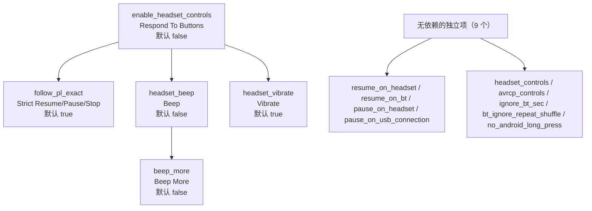
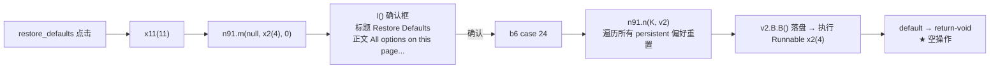

# Poweramp「设置 → 耳机/蓝牙」偏好结构

> **证据分级**：【实证·原文】= XML/资源原文；【实证·产物】= 反编译 smali 产物；【推断】= 无直接代码佐证。所有结论基于 **build-1035-bundle-play**（`versionCode 1035009`）。

> **配套文档**：本文只描述**偏好结构**（每项是什么、文案、依赖图）。若需了解运行时实现（`u91`/`s91`/`rk0` 的按键处理、三条 `cmd_player_*` 消息链），见 `poweramp-headset-full-implementation.md`。

## 0. 一句话结论

本页 **26 行 XML / 21 个元素 / 18 个 `android:key`**，挂着一条**三层依赖链**和 3 处跳转；而专属 helper `ׅ/u91` 只有 **6849 字节 / 297 行**。原因是 **14 个状态键里有 9 个一行代码都不需要**——依赖、默认值、门控、跳转全部声明式完成，helper 只补了 4 类"框架做不到的事"（弹框、发 MsgBus、按 SDK 删条目、绑恢复默认）。

> **本页的架构价值**：它是"**复杂交互不需要代码**"的最强证据页。每 key 代码密度 381 B（lockscreen 1130 B、`aa_bg` 2344 B）。

---

## 1. 页面身份

| | |
| --- | --- |
| XML 文件 | `res/xml/headset.xml` |
| 资源 id | **`0x7f160015`**【实证·原文】`public.xml:11068` |
| 行数 / 字节 | **26** / **4437** |
| 元素总数 | **21**（根 1 + 分类 2 + 分类一内 5 + 分类二内 11 + 页尾 2） |
| `android:key` | **18**（14 状态 + 1 分类锚点 + 1 动作 + 2 跳转） |
| 无 key 条目 | **1**（`audio_focus` 跳转项） |
| 提示块 | **0 个**（说明文字全在 `android:summary`） |
| 页面标题 / 摘要 | `@string/pref_headset_bt` = **Headset/Bluetooth** / **无摘要** |
| 设置页 helper | **`ׅ/u91.smali`**（6849 B / **297 行**），只实现 `v()` |
| 状态字段注册表 | **`ׅ/vr.smali`**（4044 行）的 `<clinit>` |
| 分发表登记 | `u61.smali:1357-1375`【实证·产物】 |
| 搜索索引 | 根节点无 `skipSearch` → 整份 XML 进 FTS；单条目级排除 2 个 |

**18 个 key 的语义四分**：

| 类型 | 数量 | key |
| --- | ---: | --- |
| 状态键（写 `"global"`） | **14** | `resume_on_headset`、`resume_on_bt`、`pause_on_headset`、`pause_on_usb_connection`、`enable_headset_controls`、`headset_controls`、`avrcp_controls`、`follow_pl_exact`、`ignore_bt_sec`、`bt_ignore_repeat_shuffle`、`headset_beep`、`beep_more`、`headset_vibrate`、`no_android_long_press` |
| 分类锚点键 | 1 | `headset_buttons`（唯一用途是给 helper 当删除锚点，§5.2） |
| 动作键 | 1 | `restore_defaults` |
| 跳转键 | 2 | `long_volume_press`、`commands_history` |

> key 存在性有三档用途：① 持久化状态 ② 被 helper `findPreference` 定位 ③ 被深链指向。**`audio_focus` 三者都不需要 → 无 key，代价是它无法成为锚点**（`settings/headset#audio_focus` 会落空）。

---

## 2. 21 个元素逐条（按 XML 实际顺序）

`默认` 来自 `vr.smali` —— 本页 XML **一个 `android:defaultValue` 都没写**（§4.4）。

### 2.1 分类一 `@string/pref_headset_connection` = 「Connection」（5 项）

| # | key | 控件类型 | 标题（英文实文） | 摘要（英文实文） | 默认 | dep |
| ---: | --- | --- | --- | --- | --- | --- |
| 1 | `resume_on_headset` | MultilineSwitch | **Resume On Wired Headset** | Resume playing when wired headset is connected | false | — |
| 2 | `resume_on_bt` | MultilineSwitch | **Resume On Bluetooth** | Resume playing when Bluetooth device is connected | false | — |
| 3 | `pause_on_headset` | MultilineSwitch | **Pause On Headset Disconnect** | Pause when wired/Bluetooth headset/USB DAC disconnected | **true** | — |
| 4 | `pause_on_usb_connection` | MultilineSwitch | **Pause On USB DAC connection** | Pause when USB DAC connected. This helps prevent loud noise during device initialization on some USB DACs | **true** | — |
| 5 | *（无 key）* | Redirect | **Audio Focus** | Few other play/resume options are available in Audio Focus settings | — | — |

### 2.2 分类二 `@string/pref_headset_buttons` = 「Buttons」（分类带 key `headset_buttons`，11 项）

| # | key | 控件类型 | 标题（英文实文） | 摘要（英文实文） | 默认 | dep |
| ---: | --- | --- | --- | --- | --- | --- |
| 6 | `enable_headset_controls` | MultilineSwitch | **Respond To Buttons** | Enable Headset/Bluetooth controls | false | — |
| 7 | `headset_controls` | **TagList** | **Wired Headset** | —（条目自身渲染） | **1** | — |
| 8 | `avrcp_controls` | **TagList** | **Bluetooth** | —（同上） | **1** | — |
| 9 | `long_volume_press` | Redirect | **无标题**（只有摘要） | Press here for Volume keys long press option | — | — |
| 10 | `follow_pl_exact` | MultilineSwitch | **Strict Resume/Pause/Stop** | Use for headunits/devices generating stray play/pause/stop key press commands, which are interpreted as undesired playback toggle or double press | **true** | `enable_headset_controls` |
| 11 | `ignore_bt_sec` | **Seekbar** | **Ignore Bluetooth Commands** | Ignore all Bluetooth commands for a period of time after a connection | **1** | — |
| 12 | `bt_ignore_repeat_shuffle` | MultilineSwitch | **Ignore Repeat/Shuffle** | Ignore Bluetooth Repeat and Shuffle commands completely | false | — |
| 13 | `headset_beep` | MultilineSwitch | **Beep** | —（无摘要） | false | `enable_headset_controls` |
| 14 | `beep_more` | MultilineSwitch | **Beep More** | Beep on all commands, such as from notifications or other controls | false | **`headset_beep`** |
| 15 | `headset_vibrate` | MultilineSwitch | **Vibrate** | —（无摘要） | **true** | `enable_headset_controls` |
| 16 | `no_android_long_press` | MultilineSwitch | **Disable Default Long Press** | Disable long press activated voice search while Poweramp is playing | false | — |

### 2.3 页尾

| # | key | 控件类型 | 标题 | 备注 |
| ---: | --- | --- | --- | --- |
| 17 | `commands_history` | Redirect | **Last Processed Commands** | `w:target="commands_history"`；**无** `skipSearch` → 参与搜索 |
| 18 | `restore_defaults` | Preference | **Restore Defaults** | `x11(11)` 绑定（§5.5） |

### 2.4 三个属性细节

**(1) 两个 `TagListPreference` 共用数组、不共用值**

| key | 标题 | `w:entries` | `vr` 字段 | 默认 |
| --- | --- | --- | --- | --- |
| `headset_controls` | Wired Headset | `@array/pref_headset_controls_entries` | **`B0`** | 1 |
| `avrcp_controls` | Bluetooth | **同一个数组** | **`C0`** | 1 |

共用的是"**可选项集合**"（3 项），不是"选中值"——`vr.smali:1756-1784` 两个独立字段。用户在"有线"选长按不影响"蓝牙"。

**(2) `android:persistent` 不是必需的**：写了 `="true"` 的 8 个全是 `MultilineSwitch`（#1/2/3/6/10/13/14/15），属**冗余但无害的显式声明**——该类默认 `persistent=true`。所以 #4/#12/#16 没写也照样持久化。

**(3) 唯一的 Seekbar `ignore_bt_sec`**

| 属性 | 值 | 效果 |
| --- | --- | --- |
| `w:min` / `w:max` | `0` / `20` | 0–20 秒，**21 个刻度** |
| `w:leftLabel` / `w:rightLabel` | `"0"` / `"20"` | 端点**写裸数字**（对比 `aa_bg` 用 "Less…More" 描述标签） |
| `w:tickMark` | `@drawable/pref_seekbar_tickmark` | 21 个 6dip 圆点 |
| `w:summary2` | `@string/d_sec` | 滑到 5 → `5 sec` |

> 端点标签用裸数字说明**范围本身就是语义**（秒数），不需要描述性标签。

**XML 属性使用矩阵**：

| 属性 | 次数 | 分布 |
| --- | ---: | --- |
| `android:key` / `android:title` | 18 / 16 | 除 `long_volume_press`（只摘要）外都有标题 |
| `android:summary` | 12 | #1-6、#9-12、#14、#16 |
| **`android:defaultValue`** | **0** | **一个都没有** |
| `android:persistent="true"` | 8 | 全部 MultilineSwitch |
| `android:dependency` | **4** | #10/#13/#15 → `enable_headset_controls`；#14 → `headset_beep` |
| `w:target` / `w:skipSearch` | 3 / 2 | #5、#9、#17 / #5、#9 |
| `w:entries` | 2 | #7、#8 |
| `w:min`/`w:max`/`w:leftLabel`/`w:rightLabel`/`w:tickMark`/`w:summary2` | 各 1 | 仅 #11 |

---

## 3. 依赖关系图



| 层级 | key | 依赖父 | 变灰条件 |
| --- | --- | --- | --- |
| **L0** | `enable_headset_controls` | — | 永不变灰 |
| **L1** | `follow_pl_exact` / `headset_beep` / `headset_vibrate` | L0 | L0 关闭 |
| **L2** | `beep_more` | **`headset_beep`（L1）** | L1 关闭（**与 L0 无直接声明关系**） |

> **L2 的变灰是"链式传递"而非"直接声明"**：`beep_more` 只写 `dependency="headset_beep"`；L0 关闭时 `headset_beep` 先变灰且值仍为 `false`，框架的 `shouldDisableDependents()` 会**递归**把 `beep_more` 置灰。**5 个条目的门控只用了 4 条声明的边**——这就是"三层链"的全部成本。

**两种模式**：

| 模式 | 本页 | 语义 |
| --- | --- | --- |
| **母开关 + 子项变灰** | `enable_headset_controls` → 4 项 | 母关时子项**保留用户值**，只是不可操作；母重开后值不变 |
| **独立子开关**（母开时可单独关） | **本页全部子项都是** | 4 个 dependent 均可各自开关 |

> **本页子项全是"能力开关"而非"范围开关"**：Vibrate/Beep/Strict Resume 是"要不要做这件事"，不是"对哪些设备做"。对比 `aa_bg.xml` 的子开关是**范围限定**（列表/歌词背景）——`dependency` 机制相同，产品语义不同。

**依赖不参与 helper**：`u91.smali` 全文**没有** `setEnabled` / `shouldDisableDependents` / `notifyDependencyChange`【实证·产物】`:1-297`。全部门控由框架在 inflate 时解析 `mDependencyKey` 后完成，**helper 一行代码都没写**。

---

## 4. 资源完整解析

### 4.1 `@array/pref_headset_controls_entries` 逐项展开

【实证·原文】`arrays.xml:563-567`

| 索引 | 引用 | 实际英文文案 | 文案行 |
| ---: | --- | --- | ---: |
| 0 | `@string/pref_controls_single` | **Single press** | 1069 |
| 1 | `@string/pref_controls_double_triple` | **Double/triple press for next/prev. track** | 1067 |
| 2 | `@string/pref_controls_long` | **Long press for next track (when playing)** | 1068 |

> 数组**只有 3 项**，且**没有**配对的 `w:values`/`w:summaries`/`w:icons`（对比 `ui_mediaactions.xml` 的四件套齐全）。所以 UI 上是**三选一的选择列表**，不是带图标的动作选择器。

**默认值 `1` 的两种读法**（诚实并列）：

| 读法 | 含义 | 支持 | 反对 |
| --- | --- | --- | --- |
| **【采纳】单选索引** | `1` = 第 2 项 "Double/triple press" | `s91` 在**值 == 2** 时弹"长按可能失效"警告（§5.3），而索引 2 正是 "Long press"——**警告文案与索引 2 语义精确重合** | 未在构造路径确证该实例的 select 类型字段 `a` |
| 备选：位掩码 | `1` = 只启用 `entries[0]` | `TagListPreference.onTagChecked` 里确有 `shl/or/and-int`【实证·产物】`:3285,3306,3316` | 位掩码下"值==2"对应 `entries[1]`（Double/triple），与警告文案**不匹配** |

> 采信单选索引的理由：**行为证据（弹框触发条件与文案语义吻合）优先于实现证据（类里存在位操作）**。

### 4.2 全部 `@string` 落成英文文案

| key / 用途 | 标题实文 | 摘要实文 | 标题行 | 摘要行 |
| --- | --- | --- | ---: | ---: |
| 页面 | **Headset/Bluetooth**（`pref_headset_bt`） | —（无） | 1146 | — |
| 分类一 / 二 | **Connection** / **Buttons** | — | 1148 / 1147 | — |
| 1 | Resume On Wired Headset | Resume playing when wired headset is connected | 1374 | 1605 |
| 2 | Resume On Bluetooth | Resume playing when Bluetooth device is connected | 1373 | 1604 |
| 3 | Pause On Headset Disconnect | Pause when wired/Bluetooth headset/USB DAC disconnected | 1280 | 1571 |
| 4 | Pause On USB DAC connection | Pause when USB DAC connected. This helps prevent loud noise during device initialization on some USB DACs | 907 | 2048 |
| 5 | Audio Focus | Few other play/resume options are available in Audio Focus settings | 1035 | 1465 |
| 6 | Respond To Buttons | Enable Headset/Bluetooth controls | 1107 | 1489 |
| 7 | Wired Headset | — | 2174 | — |
| 8 | Bluetooth | — | 159 | — |
| 9 | —（无标题） | Press here for Volume keys long press option | — | 1149 |
| 10 | Strict Resume/Pause/Stop | Use for headunits/devices generating stray play/pause/stop key press commands, which are interpreted as undesired playback toggle or double press | 462 | 2036 |
| 11 | Ignore Bluetooth Commands | Ignore all Bluetooth commands for a period of time after a connection | 604 | 2040 |
| 12 | Ignore Repeat/Shuffle | Ignore Bluetooth Repeat and Shuffle commands completely | 606 | 2041 |
| 13 | Beep | — | 1145 | — |
| 14 | Beep More | Beep on all commands, such as from notifications or other controls | 148 | 2026 |
| 15 | Vibrate | — | 1150 | — |
| 16 | Disable Default Long Press | Disable long press activated voice search while Poweramp is playing | 1240 | 1553 |
| 17 | Last Processed Commands | — | 1177 | — |
| 18 | Restore Defaults | — | 1366 | — |

**运行期文案（不在 XML，由 smali 引用）**：

| 常量 | 资源名 | 英文实文 | 行 | 用在哪 |
| --- | --- | --- | ---: | --- |
| `0x7f080547` | `pref_long_press_warning` | **Long press may fail to work on some devices.**<br>（空行）<br>**On first long press (while playing), Android may ask for default action - please select Poweramp** | 1191-1193 | 四个提示框**共用正文** |
| `0x7f080948` / `0x7f0800c0` | `wired_headset` / `bluetooth_headset` | Wired Headset / Bluetooth | 2174 / 159 | `s91(2)` / `s91(3)` 弹框标题 |
| `0x7f0805fe` / `0x7f08076f` | `pref_resume_on_bt` / `pref_warning_resumt_on_bt` | Resume On Bluetooth / Bluetooth device can require few seconds to connect. Poweramp resumes playing once a Bluetooth device is fully connected | 1373 / 1730 | `s91(0)` 弹框标题/正文 |
| `0x7f080576` | `pref_no_android_long_press` | Disable Default Long Press | 1240 | `s91(4)` 弹框标题 |
| `0x7f080001` | `OK` | OK | 4 | 所有提示框唯一按钮 |
| `0x7f080184` | `d_sec` | **`%d sec`** | 313 | #11 的 `w:summary2` |
| `0x7f0805f5` / `0x7f0805f6` | `pref_restore_defaults` / `_msg` | Restore Defaults / All options on this page will be restored to the default values | 1366 / 1367 | 恢复默认确认框 |

> **`pref_long_press_warning` 被 4 处复用**（`s91` 索引 2/3/4），文案跨三行含一个空行，说明它是**长按功能的通用免责声明**而非针对某开关。

### 4.3 `@drawable/pref_seekbar_tickmark`

【实证·原文】`res/drawable-sw2dp/pref_seekbar_tickmark.xml:1-18`（id `0x7f0204ba`）：`<selector>` 两分支，`state_selected=true` 用 `?android:colorControlActivated`，否则 `?android:colorControlNormal`；都是 6dip×6dip、`corners=6dip` 的方形。

| 观察 | 含义 |
| --- | --- |
| 只在 **`drawable-sw2dp`**（`sw` = smallest width，`2dp` 等价所有设备） | 全 App 通用，不按屏幕分档 |
| 用 **`?android:`** 主题属性取色 | **自动跟随 Poweramp 皮肤/主题**，无需深色版 |

> 本页**没有** `@drawable/settings_quote_background` 的提示块——那个引用只出现在有 `RawTextPreference` 的页面（`aa_bg`、`misc`、`lockscreen`）。

### 4.4 默认值：XML 0 处 vs `vr` 14 处（与锁屏页相反）

`vr.smali` 的 `<clinit>` 用 `ms.с(String, boolean)`【实证·产物】`ms.smali:2687` 与 `ms.b(int, String)`（`:1699`）注册：

| # | key | `vr` 字段 | 方法 | 默认 | const-string 行 | sput 行 |
| ---: | --- | --- | --- | --- | ---: | ---: |
| 1 | `resume_on_headset` | **`q0`** | `с` | false | 1580 | 1592 |
| 2 | `resume_on_bt` | **`r0`** | `с` | false | 1596 | 1608 |
| 3 | `pause_on_headset` | **`v0`** | `с` | **true** | 1660 | 1672 |
| 4 | `pause_on_usb_connection` | **`x2`** | `с` | **true** | 3519 | 3531 |
| 6 | `enable_headset_controls` | **`y0`** | `с` | false | 1708 | 1720 |
| 7 | `headset_controls` | **`B0`** | `b` | **1** | 1756 | 1768 |
| 8 | `avrcp_controls` | **`C0`** | `b` | **1** | 1772 | 1784 |
| 10 | `follow_pl_exact` | **`t2`** | `с` | **true** | 3459 | 3471 |
| 11 | `ignore_bt_sec` | **`o2`** | `b` | **1** | 3383 | 3395 |
| 12 | `bt_ignore_repeat_shuffle` | **`n2`** | `с` | false | 3367 | 3379 |
| 13 | `headset_beep` | **`z0`** | `с` | false | 1724 | 1736 |
| 14 | `beep_more` | **`s2`** | `с` | false | 3443 | 3455 |
| 15 | `headset_vibrate` | **`A0`** | `с` | **true** | 1740 | 1752 |
| 16 | `no_android_long_press` | **`D0`** | `с` | false | 1788 | 1800 |

> **14 个状态键与 `vr` 字段一一对应、零缺失**——反过来证明 §1 的"14 个状态键"口径正确。

**四个 `true` 默认值的产品含义**：

| key | 【推断】理由 |
| --- | --- |
| `pause_on_headset` | 拔耳机就暂停——防外放，最保守 |
| `pause_on_usb_connection` | 文案明说 "prevents loud noise during device initialization"——**默认值被写进了理由** |
| `headset_vibrate` | **触觉反馈默认开、声音反馈（Beep）默认关**——避免打扰 |
| `follow_pl_exact` | "修 bug 用的严格模式"，默认开说明线上乱发命令的设备很多 |

> **`vr` 与 `wr` 是两张并行偏好表**：`vr`（4044 行）管耳机/锁屏，`wr` 管背景/清晰度；两者都 `extends ׅ/ms`【实证·产物】`vr.smali:2` / `wr.smali:2`。**静态分析找默认值最容易搞错这点**：`aa_*` 在 `wr`，`headset_*` 在 `vr`。

---

## 5. helper `ׅ/u91` 的逐条运行时动作

`u91` 继承 `ׅ/n91`【实证·产物】`:1-3`，只实现**唯一抽象方法 `v()`**（`:7-296`），无字段、无构造器覆写。

### 5.1 全貌：7 个动作 290 行

| 序 | 行号 | 动作 | 对象 | 监听器 |
| ---: | --- | --- | --- | --- |
| ① | `:15-39` | `findPreference` + `setOnPreferenceChangeListener` | `resume_on_bt` | `s91(0)` |
| ② | `:48-76` | 同上，**带 `if-eqz` 空检查** | `enable_headset_controls` | `s91(1)` |
| ③ | `:82-110` | 同上 | `headset_controls` | `s91(2)` |
| ④ | `:115-143` | 同上 | `avrcp_controls` | `s91(3)` |
| ⑤ | `:148-200` | 取分类 → 取条目 → **SDK<26 `removePreference`** | `long_volume_press` | — |
| ⑥ | `:206-255` | **SDK≤33 绑 `s91(4)`；否则删除** | `no_android_long_press` | `s91(4)` / 删 |
| ⑦ | `:262-291` | `setOnPreferenceClickListener` | `restore_defaults` | `x11(11)` |

> **7 个动作只覆盖 18 个 key 中的 6 个 + 1 个分类锚点**，其余 12 个完全不经 helper。

### 5.2 两处 SDK 门控删除（唯一的"动态删除"）

```asm
; ⑤ long_volume_press —— SDK < 26 从分类里移除（u91.smali:148-205）
164: check-cast v0, Landroid/preference/PreferenceGroup;   ; ★ 转成分类
168: const-string v1, "long_volume_press"
188: const/16 v3, 0x1a                                   ; 26
192: if-ge v2, v3, :cond_1                               ; SDK < 26 ?
196: if-eqz v1, :cond_1                                  ; 且条目存在
200: invoke-virtual {v0, v1}, PreferenceGroup;->removePreference

; ⑥ no_android_long_press —— SDK > 33 移除（u91.smali:206-255）
226: const/16 v3, 0x21                                   ; 33
230: if-gt v2, v3, :cond_2                               ; SDK <= 33 → 绑定 s91(4)
255: invoke-virtual {v0, v1}, PreferenceGroup;->removePreference   ; SDK > 33 → 删
```

| 条目 | 保留条件 | 【推断】理由 |
| --- | --- | --- |
| `long_volume_press` | **SDK ≥ 26** | Android 8.0 起才支持音量键长按拦截 |
| `no_android_long_press` | **SDK ≤ 33** | 关掉"长按唤起语音搜索"；Android 14（34）起该默认行为改变，此项失去意义 |

> **区间互补**（`≥26` 与 `≤33` 交叠于 26–33）：SDK 26–33 两项都在，<26 只有 `no_android_long_press`，>33 只有 `long_volume_press`。
>
> **技术要点**：这两处**直接调 `removePreference` 而非 `n91.h(key)`**——要删的是**分类里的子项**，而 `n91.h()` 只在根 `K` 上 `findPreference`（运行时文档 §5.1）。这是本页 helper 必须自己写这几行的原因。

### 5.3 `s91` 监听器：4 个 case + default

`s91` 是 `synthetic final` 类，构造参数 `(u91, int index)`【实证·产物】`:10-34`，`packed-switch`（`:386-392`）：`0→pswitch_3`、`1→pswitch_2`、`2→pswitch_1`、`3→pswitch_0`。

| idx | key | 触发条件 | 动作 | 行 |
| ---: | --- | --- | --- | --- |
| 0 | `resume_on_bt` | 新值 **true** | `n91.F(0x7f0805fe, 0x7f08076f)` 弹"蓝牙连接需要几秒"提示（只有 OK） | `:347-380` |
| 1 | `enable_headset_controls` | 任意 | `handler.post(new b6(this, 0x1d))` | `:321-344` |
| 2 | `headset_controls` | 新值 **== 2** | 弹框（标题 `wired_headset`，正文 `pref_long_press_warning`）+ `handler.post(new t91(this, 0))` | `:232-318` |
| 3 | `avrcp_controls` | 新值 **== 2** | 弹框（标题 `bluetooth_headset`，正文同上）；**不 post 任何命令** | `:159-229` |
| 4 | `no_android_long_press` | 新值 **true** | 弹框（标题 `pref_no_android_long_press`，正文同上）+ `handler.post(new t91(this, 1))` | `:74-156` |

> **`s91` 每个分支末尾都是 `return v5`（`v5=1`）** → 变更一律放行，弹框只是**告知**而非**拦截**。这与锁屏页 `la1.I()` 返回 `false` 回滚开关**语义完全相反**（锁屏文档 §6.1）。

**一个真实的非对称：有线发命令，蓝牙不发**

| idx | 结果 | 【推断】原因 |
| ---: | --- | --- |
| **2（Wired）** | 弹框 **+** `t91(0)` → `cmd_player_apply_long_volume_controls` | 选长按后**还要申请音量键拦截** |
| **3（Bluetooth）** | **只弹框** | 蓝牙长按由 AVRCP 设备侧产生，不需 Poweramp 申请拦截 |

> 这个非对称在 XML 里**完全看不出来**（两项几乎一样，只是 key/title 不同），只有读 `s91` 才能发现。**这是声明式覆盖不到的地方，也是 helper 存在的第二个理由。**

### 5.4 两个 Runnable 与 MsgBus 落地

**`t91`（64 行）的 `packed-switch` 只有 2 路**【实证·产物】`:38-121`：

| 构造参数 | 消息 id | 资源名 |
| ---: | --- | --- |
| `t91(0)` | **`0x7f0d0508`** | `cmd_player_apply_long_volume_controls` |
| 其他（default） | **`0x7f0d048c`** | `cmd_player_refresh_headset_controls` |

两者都经 `MsgBusHelper.fromContextOrThrow(activity, 0x7f0d0034 /* bus_player_cmd */)` 取总线 → `post(msg, 0, 0, null)`。**payload 全空，纯信号。**

**`b6` 的 case 29 越界落到 default**：`b6` 第二个构造器 `(n91,int,Runnable)` 会**强制把 case 改写成 `0x18`(24)**【实证·产物】`:33-48`；但 `s91` 传的是 `0x1d`(29)，而 `b6.run()` 的 `packed-switch` 只有 0–28（`:3497-3527`）→ **29 越界落 default**。default 分支（`:96-147`）恰是**本页专用逻辑**：

```asm
100: check-cast v0, Lׅ/u91;                      ; ★ 全 App 唯一强转 u91 的 b6 分支
112: const v3, 0x7f0d0034                        ; bus_player_cmd
125: check-cast v2, Ljava/lang/Boolean;         ; 开关新值
137: const v3, 0x7f0d048b                        ; ★ cmd_player_enable_headset_controls
142: MsgBus.post(v3, <新值 1/0>, 0, null)        ; ★ 布尔值作为 payload 第一个 int
```

> 用**越界的 case 号占用 default 分支**是混淆器常见产物；架构上等价于"给 `u91` 开了一个私有 case"。

### 5.5 `restore_defaults` 链路



| 环节 | 证据 |
| --- | --- |
| `x11(11)` | `u91.smali:278-286`（`const/16 v2, 0xb`）→ `x11.smali:528` 的 `:pswitch_d` |
| 确认框 | `n91.smali:2190-2230`（固定标题 `0x7f0805f5`、`setDismissOnPositive(false)`）|
| 重置+落盘 | `b6.smali:355-425`（`n(K,v2)` → `v2.B.В()` → 跑 Runnable）|
| **空操作** | `x2.smali:50-55`：`packed-switch` 只有 0–3，值 4 落 default → `return-void` |

> **本页恢复默认走"纯通用路径"**：页级 Runnable `x2(4)` 是**空实现**。含义是 headset 页**不需要任何"恢复后修正"**——14 个状态键被 `n91.n()` 自动重置，无跨字段耦合。
>
> **这与锁屏页相反**：锁屏的 `p71(6)` 会**强制重写 `ls_aa_blur` 并补发媒体会话刷新**（锁屏文档 §6.7）。**"恢复默认后要不要补丁"是两页 helper 规模差异的主要来源之一。**

---

## 6. 规模论证：为什么 18 个 key 只要 297 行

### 6.1 逐 key 覆盖率

| helper 触及 | key | 数量 |
| :---: | --- | ---: |
| ✅ | `resume_on_bt`（`s91(0)` 弹框）、`enable_headset_controls`（`s91(1)` MsgBus）、`headset_controls`（`s91(2)` 弹框+`t91(0)`）、`avrcp_controls`（`s91(3)` 只弹框）、`long_volume_press`（SDK 删除）、`no_android_long_press`（`s91(4)`/删除）、`restore_defaults`（`x11(11)`） | **7** |
| ❌ | `resume_on_headset`、`pause_on_headset`、`pause_on_usb_connection`、`follow_pl_exact`、`ignore_bt_sec`、`bt_ignore_repeat_shuffle`、`headset_beep`、`beep_more`、`headset_vibrate`、`audio_focus`、`commands_history` | **11** |

**14 个状态键里 9 个（64%）一行代码都不需要**：纯状态开关/滑杆 9 个（#1、3、4、10、11、12、13、14、15）+ 纯跳转 2 个（#5、17）。

### 6.2 三个结论

**(1) XML 是"产品模型"，helper 是"平台补丁"**：所有产品语义（开关、分组、依赖、默认值、滑杆范围）都在 XML + `vr` 里；helper 里**没有任何产品判断**，只有 3 类平台适配：

| helper 里做的事 | 为什么框架做不到 |
| --- | --- |
| 弹提示框（4 处） | `Preference` 框架无"改变时弹框"的声明式属性 |
| 发 MsgBus（3 处） | 框架不知道播放服务需要被通知 |
| 按 SDK 删条目（2 处） | 框架无通用条件可见性（根文档 §4.4 的 `w:removeAsNeeded` 只覆盖自定义控件） |

**(2) 成本结构**

| 部分 | 行数 | 占比 |
| --- | ---: | ---: |
| `v()` 的 7 个装配 | ~280 | ~94% |
| 类声明/空行 | ~17 | ~6% |
| **监听器实现** | **0**（在 `s91`，8527 B） | 0% |
| **Runnable 实现** | **0**（在 `t91` 2342 B / `x2` / `b6`） | 0% |

> **helper 本体几乎不写逻辑**：`s91` 承载 4 个 case 的全部业务分支，`t91` 承载消息投递。`u91 + s91 + t91 + x2 ≈ 26 KB`，其中真正属于"耳机页"的只有 u91 的 290 行 + s91 的 5 个分支。

**(3) 横向对比**

| 页面 | key 数 | helper | 字节 | 每 key 字节 |
| --- | ---: | --- | ---: | ---: |
| **headset** | 18 | `u91` | **6849** | **381** |
| lockscreen | 12 | `la1` | 13557 | 1130 |
| `aa_bg` | 11 | `y61` | 25783 | 2344 |

> **headset 是"每 key 代码密度"最低的页面之一**。锁屏高出 3 倍的原因：**权限闸门 + 动态 summary + 屏幕尺寸门控 + 恢复默认补丁**四件 headset 都没有的事。

---

## 7. 跨页跳转与锚点

### 7.1 三个跳转项

| # | key | `w:target` | 落点 | 落点 helper | 类型 |
| ---: | --- | --- | --- | --- | --- |
| 5 | *（无 key）* | `audio_focus` | `audio_focus.xml`（`0x7f160007`） | `z61`（通用页索引） | **跨分支**（耳机→音频） |
| 9 | `long_volume_press` | `misc#long_volume_controls` | `misc.xml` 锚点 | `sa1` | **跨页锚点** |
| 17 | `commands_history` | `commands_history` | `commands_history.xml`（`0x7f160011`） | `o91` | **子页** |

> 跳转**机制**（`w:target` 三态、`settings/<page>#<key>` 深链、`#` 切分、350ms 滚动）见运行时文档 §7 与根文档 §4.1/§4.2，不重述。

### 7.2 `misc#long_volume_controls`：本页最值得记录的跨页落差

落点分类的三个条目【实证·原文】`misc.xml:32-36`：

```xml
<PreferenceCategory android:title="@string/pref_volume_keys_long_press"
                    android:key="volume_keys_long_press_cat">
    <RawTextPreference android:key="volume_keys_long_press_hint" ... />
    <ProgressPreference android:key="_long_volume_shizuku_grant" ... />   <!-- ★ Shizuku 授权 -->
    <MultilineSwitchPreference android:key="long_volume_controls"
        android:defaultValue="false"
        w:sup="@string/pref_experiment"                                   <!-- ★ Experiment 徽标 -->
        w:supLink="alert?text=@string/pref_experimental_msg" />
</PreferenceCategory>
```

**落点条目的标记**：`android:defaultValue="false"` + `w:sup=@string/pref_experiment`（**Experiment 徽标**）+ `w:supLink`（可点，弹实验性功能说明）。**同分类的前置授权项**：`_long_volume_shizuku_grant` 是 **`ProgressPreference`**，走 **Shizuku** 授权（key 前缀 `_` 是隐藏项惯例）。

> ### ⚠️ 跨页体验落差（本页最值得记录的产品问题）
>
> 用户在**本页**看到的是：
> - 标题：**无**（`long_volume_press` 只有摘要，没有 `android:title`）
> - 摘要：**Press here for Volume keys long press option**
>
> 点击后落到 **misc 页**，却发现三层落差：
> 1. 那是**实验特性**（Experiment 徽标 + 实验免责链接）
> 2. 它**需要第三方授权**（Shizuku）才真正生效
> 3. 它**可能整条不存在**——`u91` 在 SDK<26 时已把本页入口删掉（§5.2），只有"能看到入口"的设备才有进入资格
>
> **摘要承诺"按下即可设置" → 实际是"跳到另一页 → 需授权 → 还是实验功能"**。
>
> **根因**：声明式跳转（`w:target` 只是一个字符串）**无法表达目标页的前置条件**——跳转协议里没有"目标是否可用"的探测。这是 SpMusic 要引以为戒的模式（§8.3）。

### 7.3 `audio_focus` 无 key 的后果

| 现象 | 后果 |
| --- | --- |
| 无 `android:key` | 不能被 `findPreference` 定位 |
| 无 `android:key` | **不能作深链锚点**：`settings/headset#audio_focus` 落空（`n91.w()` 的 `findPreference` 返回 null） |
| `w:skipSearch="true"` | 不进搜索索引，搜 "Audio Focus" 只命中目标页自己的条目 |

> **规律**：key 存在性有三档用途——① 持久化 ② 被 helper 定位（含删除）③ 被深链指向。`audio_focus` 三者都不需要 → 无 key；`long_volume_press` 只需 ②。

### 7.4 本页被外部指向

| 来源 | 锚点 | 证据 |
| --- | --- | --- |
| changelog 富链接 | `settings/headset#follow_pl_exact` | `strings.xml:258` |
| changelog 富链接 | `settings/headset#ignore_bt_sec`、`#bt_ignore_repeat_shuffle` | `strings.xml:253` |
| changelog 富链接 | `settings/headset#beep_more`、`#resume_on_bt` | `strings.xml:257` |
| 根页面 | `settings/headset` | `singlepane.xml`（根文档 §2.3） |

> **本页是被 changelog 反向引用最密集的页面之一（5 个锚点）**。这解释了为什么这三个看起来"很冷门"的开关必须有稳定 key——它们要能接住富链接。

---

## 8. 对 SpMusic 的可借鉴 / 不建议照抄

SpMusic 是 **Tauri + React 的桌面本地音乐播放器**（无 Android 运行时）。

### 8.1 根本不可移植（本页一半以上条目）

| 本页能力 | 桌面端现实 |
| --- | --- |
| 耳机插拔检测（#1/#3） | **无对应能力**。桌面无"3.5mm 插入"事件；只能做"音频输出设备变更"（`cpal` 设备枚举），语义不同 |
| 蓝牙连断（#2） | **部分可做**：可监听默认输出设备切换，但"蓝牙连接"≠"成为默认设备" |
| AVRCP 按键（#8） | **不可移植**。桌面无 AVRCP 客户端；可用**媒体键**近似，但无"双击/三击"概念 |
| 单键阻抗线控（#7） | **不可移植**。Android 耳机口硬件特性 |
| 震动（#15） | **不可移植**（无振动器） |
| USB DAC 防爆音（#4） | **可做但机制不同**：桌面是"切输出设备前短暂暂停"，不需专门开关 |
| Audio Focus（#5） | **不可移植**；桌面等价物是**系统媒体会话/独占模式** |
| 音量键长按拦截（#9 → Shizuku） | **不可移植**。桌面无法拦截系统音量键，也不需要 Shizuku |

> **诚实结论**：18 个 key 里桌面端真正有用的**不超过 2 个**（"输出设备切换时是否暂停/恢复"），且都要重新定义语义。**照抄条目清单没有意义。**

### 8.2 值得借鉴的 3 个设计

**(1) 「母开关 + 子项变灰」的依赖声明**：Android 用 `android:dependency="parentKey"` 一行表达"父关则我灰"。SpMusic 可迁移为 schema 字段 `dependsOn`，React 侧统一计算 `disabled`。**关键语义：变灰 ≠ 清零**——Android 保留用户选择的值，父项重开后值不变，这条必须显式写进契约。

**(2) 「状态键 / 动作键 / 跳转键」三分**：本页 18 个 key 精确分成 14 + 1 + 2 + 1 类。

| 类型 | SpMusic 对应 |
| --- | --- |
| 状态键（14） | 写配置文件的真实设置项 |
| 动作键（`restore_defaults`） | 一次性命令，**不落盘** |
| 跳转键（`commands_history` 等） | 路由，**不落盘** |

> 直接可用的教训：**动作项与跳转项必须显式标记为非持久化**。本页靠 `RedirectPreference extends RawTextPreference` 在构造函数里 `setPersistent(false)` 实现【实证·产物】`RawTextPreference.smali:177`；SpMusic 的 schema 应有 `persist: false` 列。

**(3) 「能力探测 → 删除条目」而非「置灰」**：`u91` 对 #9/#16 用 **`removePreference`**（彻底消失），不是 `setEnabled(false)`。

| 方式 | 用户感受 | 适用 |
| --- | --- | --- |
| **删除** | 页面更短、无噪声 | 该能力在本机**永不可能**可用 |
| **置灰** | 可见但不可点、有教育意义 | 需用户升级/授权后可用 |

> SpMusic 可直接套用：**"此平台不支持"→ 删除；"当前条件不满足"→ 置灰。** 二者混用会让设置页充满死条目。

### 8.3 不建议照抄的 4 点

| 做法 | 问题 |
| --- | --- |
| **巨型 `synthetic` 监听器 + int 索引分发**（`s91` 用 `packed-switch` 分 5 路） | 混淆产物，可读性极差、无法类型检查。应每个 handler 一个具名函数 |
| **用"越界 case"占用 default 分支**（`b6` case 29 → default） | 把业务逻辑藏在"错误路径"里，任何 switch 重构都会静默改变行为 |
| **分类 `key` 当删除锚点**（`headset_buttons` 唯一用途是被 `findPreference` 找到以删子项） | 分类 key 本应是搜索/锚点用途，这里被挪用。SpMusic 删条目应按条目 id 直接操作 |
| **跳转项摘要不写前置条件**（§7.2 的落差） | 目标项若有前置（需插件/需授权/实验性），源页摘要应提前告知 |

---

## 9. 未解问题

| # | 问题 | 现状 |
| ---: | --- | --- |
| Q1 | `headset_controls`/`avrcp_controls` 的值是**单选索引**还是**位掩码**？ | §4.1 采信单选（行为证据：`s91` 值==2 与 "Long press" 吻合），未在构造路径确证 select 类型字段 `a` |
| Q2 | `ignore_bt_sec` 默认 `1` 的消费方 | `vr->o2` + `w:summary2="@string/d_sec"` 表明单位秒、默认 1 秒；读取方（播放服务）未追 |
| Q3 | `follow_pl_exact`/`beep_more`/`headset_vibrate` 的实际消费代码 | helper 完全不碰，消费侧在播放服务/JNI，未分析 |
| Q4 | `b6` 用 case 29 落 default 是否有意 | default 只强转 `u91`，等效"私有 case"；打包器为何不生成 29 号分支未证 |
| Q5 | 两个 SDK 阈值（26/33）的产品依据 | 均为**推断**（Shizuku 需 Android 8+；长按语音在 14 起改变），无注释佐证 |
| Q6 | `commands_history` 页面本体 | `0x7f160011` → `o91`（22210 B），未分析 |
| Q7 | `audio_focus` 无 key 是否有意 | 可能导致深链锚点缺失，是否为已知限制不明 |

> **静态分析拿不到的东西**：① 真机上的条目可见性——SDK 门控（§5.2）让不同设备看到不同条目集合；② 提示框的实际触发频率——取决于设备是否真的"长按失效"；③ MsgBus 接收方副作用——`cmd_player_enable_headset_controls` 等接收方未反编译；④ 三个线控选项的硬件支持面——阻抗检测并非所有设备可用；⑤ 本页是否出现在"设置搜索快捷方式"（`num_settings_tags`）——未查。

---

## 10. 证据索引

| 主题 | 路径 : 行 |
| --- | --- |
| **页面结构 / 21 元素** | `v1035/decoded/res/xml/headset.xml:1-26` |
| 唯一 Seekbar 全属性 | `res/xml/headset.xml:17` |
| 资源 id `0x7f160015` | `res/values/public.xml:11068` |
| 分发表登记 | `ׅ/u61.smali:1357-1375` |
| **全部标题/摘要文案** | `res/values/strings.xml`（§4.2 逐条标行号） |
| `pref_long_press_warning`（三行） | `strings.xml:1191-1193` |
| `d_sec` = `%d sec` | `strings.xml:313` |
| **`@array/pref_headset_controls_entries`** | `res/values/arrays.xml:563-567`（三项文案 `strings.xml:1067-1069`） |
| `pref_seekbar_tickmark` | `res/drawable-sw2dp/pref_seekbar_tickmark.xml:1-18`（id `0x7f0204ba`） |
| **helper `v()` 全文** | `ׅ/u91.smali:7-296` |
| ├ 四个绑定（`resume_on_bt`/`enable_headset_controls`/`headset_controls`/`avrcp_controls`） | `ׅ/u91.smali:15-39` / `:48-76` / `:82-110` / `:115-143` |
| ├ **`long_volume_press` SDK<26 删除** | `ׅ/u91.smali:148-200`（阈值 `:188`、删除 `:200`） |
| ├ **`no_android_long_press` SDK>33 删除** | `ׅ/u91.smali:206-255`（阈值 `:230`、删除 `:255`） |
| └ `restore_defaults` 绑定 | `ׅ/u91.smali:262-291` |
| **监听器分发表** | `ׅ/s91.smali:386-392` |
| ├ idx 0 提示框 / idx 1 `b6(29)` | `ׅ/s91.smali:347-380` / `:321-344` |
| ├ idx 2 有线弹框+`t91(0)` / idx 3 蓝牙只弹框 | `ׅ/s91.smali:232-318` / `:159-229` |
| └ idx 4 `t91(1)` | `ׅ/s91.smali:74-156` |
| **`t91` MsgBus 投递** | `ׅ/t91.smali:38-121`（`0x7f0d0508` / `0x7f0d048c`） |
| **`b6` case 29 → default → enable_headset_controls** | `ׅ/b6.smali:96-147` + 表 `:3497-3527` |
| `b6` case 24 → 恢复默认重载 | `ׅ/b6.smali:355-425` |
| `x11` idx 11 → `x2(4)`；`x2(4)` 空操作 | `ׅ/x11.smali:528-547`；`ׅ/x2.smali:39-55`（表 `:276-282`）|
| **`vr` 14 个状态字段** | `ׅ/vr.smali:1580,1596,1660,1708,1724,1740,1756,1772,1788,3367,3383,3443,3459,3519` |
| `ms.с` / `ms.b` | `ׅ/ms.smali:2687` / `:1699` |
| `n91.m()` / `l()` / `F(II)` | `ׅ/n91.smali:2190-2230` / `:2068-2188` / `:1078-1132` |
| `RawTextPreference` 强制非持久 | `com/maxmpz/audioplayer/preference/RawTextPreference.smali:177` |
| `TagListPreference` 位操作（备选读法） | `com/maxmpz/audioplayer/preference/TagListPreference.smali:3285,3306,3316` |
| **跨页锚点落点** | `res/xml/misc.xml:32-36`（`sa1.smali:274,286,759,793`） |
| changelog 反向引用 5 个锚点 | `strings.xml:253,257,258` |
| 分发表 / `n91` 契约 / `restore_defaults` 通用链 | `poweramp-settings-page-runtime.md` §3.3 / §4 / §5.5 |
| `w:target` 三态与深链协议 | `poweramp-settings-root-structure.md` §4.1 / §4.2 |
| 母开关对照样本 | `poweramp-background-settings.md` §2.2 / §4.1 |
