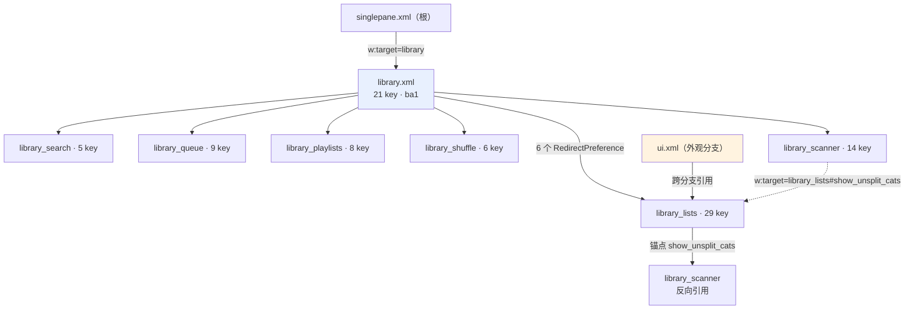

# Poweramp「设置 → 媒体库」及 6 个子页的完整实现

> **证据分级**：【实证·原文】= XML/资源原文；【实证·产物】= 反编译 smali；【推断】= 无直接代码佐证。
>
> 全部基于 **build-1035-bundle-play**（`versionCode 1035009`）。
>
> **共享机制不重述**：三层骨架、`n91` 基类契约、瞬时/动画移除、对话框族、`restore_defaults` 删 key 语义、`"global"` 共享存储、`C`=父页 id —— 均见 `poweramp-settings-page-runtime.md`。**本文只写媒体库子树专有的内容。**

### 阅读导引

| 想知道什么 | 去第几节 |
| --- | --- |
| 7 个页面各自多大、用哪个 helper | **§1** |
| 根页 21 个 key 的语义与实现 | **§2**（含 `reset_stats` §2.8、`skip_video` §2.9、消息总线 §2.10）|
| 6 个子页逐项实现 | **§3–§8**（对应 `lists`/`queue`/`scanner`/`search`/`shuffle`/`playlists`）|
| 跨页规律（代码量分布、监听器复用） | **§9** |
| 仿写建议 / 陷阱 | **§10** |
| 还没搞清的问题 | **§11** |
| 某个 smali 论断的出处 | **§12** 证据索引 |
| **某个文案资源叫什么、原文是什么** | **§13 资源全表**（175 string + 19 array + 3 drawable）|
| **某个控件的类型/默认值/依赖/标志** | **§14 属性矩阵**（106 元素逐条）|

---

## 0. 一句话结论

媒体库是设置树里**唯一带 6 个子页的分支**，共 **7 个 XML / 92 个 key / 140 行 / 25 533 字节**。它的实现方式高度不统一：根页 `library` 与 `library_playlists` 各有**专用 helper**（`ba1` 880 行的 `v()`、`ga1` 105 行），其余 **5 个子页共用通用 helper `z61` 的连续 5 个 switch 分支**（索引 8–12，共 1109 行）。**真正的复杂度不在"选项多"，而在扫描权限/SAF 的四态联动与 5 套监听器工厂的索引分发。**

> **第 2 轮（reset_stats 溯源）**：证明 `played_at` 与 `played_fully_at` 是**派生关系**（播放完成时 `played_fully_at = played_at`），因此 `reset_stats` 不清 `played_at` **不是缺陷**；并确认 `cat_stats` 只是**分类汇总缓存**、`reset_stats` 不重建它。详见 §2.8。
>
> **第 3 轮（skip_video / 总线 / 枚举）**：`skip_video` 绑定的是 **`z91` 而非 `x91`**（旧记有误），完整语义为"擦除 tag → 重扫"，且文案**确有 `<b>WARNING!</b>`**（旧判断作废）；`msg_app_data_changed` 有 **5 个订阅方**；`cat_stats.type` 的 5 个值由 `k() & 0xfffffff` 导出；`w:featurePack` 与购买**毫无关系**，是**取消字体内边距**的位标志。详见 §2.9 / §2.10 / §3.5 / §7.4。

---

## 1. 子树全景

### 1.1 页面与 helper 对照（权威）

| 页面 | XML | 资源 id | 行 | 字节 | 元素 | key | helper | helper 规模 | 分支代码量 |
| --- | --- | --- | ---: | ---: | ---: | ---: | --- | ---: | ---: |
| 媒体库（根） | `library.xml` | `0x7f160016` | 29 | 5365 | 25 | **21** | **`ba1`** | 41148 B / 2044 行 | `v()` 880 行 |
| 列表界面 | `library_lists.xml` | `0x7f160017` | 38 | 7026 | 32 | **29** | `z61` idx **8** | 118199 B / 4867 行 | **624 行** |
| 队列 | `library_queue.xml` | `0x7f160019` | 15 | 2700 | 12 | 9 | `z61` idx **9** | 同上 | 126 行 |
| 扫描器 | `library_scanner.xml` | `0x7f16001a` | 23 | 5010 | 18 | 14 | `z61` idx **10** | 同上 | 160 行 |
| 搜索 | `library_search.xml` | `0x7f16001b` | 9 | 1043 | 6 | 5 | `z61` idx **11** | 同上 | 165 行 |
| 随机 | `library_shuffle.xml` | `0x7f16001c` | 11 | 1999 | 8 | 6 | `z61` idx **12** | 同上 | **34 行** |
| 播放列表 | `library_playlists.xml` | `0x7f160018` | 15 | 2390 | 12 | 8 | **`ga1`** | 6684 B / 335 行 | `v()` 105 行 |

> 合计 **7 页 / 140 行 / 25 533 字节 / 113 个 XML 元素 / 92 个 key / 0 个重复 key**【实证·原文】逐文件统计。

### 1.2 结构示意



> **两处交叉**：`library_lists` 同时被 `ui` 与 `library` 引用（唯一被两个一级分支同时下钻的页面）；`library_scanner` 反向链回 `library_lists` 的锚点。

### 1.3 5 个子页在 `z61` 中的精确位置

`z61` 用构造第 5 参作页索引，`v()` 开头 `iget z61->j` + `packed-switch`【实证·产物】`z61.smali:4753-4775`（20 路）。媒体库占用**连续 5 个索引**：

| 页面 | 索引 | switch 标签 | 代码行范围 | 行数 |
| --- | ---: | --- | --- | ---: |
| `library_lists` | **8** | `:pswitch_b` | `3051–3674` | 624 |
| `library_queue` | **9** | `:pswitch_a` | `2925–3050` | 126 |
| `library_scanner` | **10** | `:pswitch_9` | `2765–2924` | 160 |
| `library_search` | **11** | `:pswitch_8` | `2600–2764` | 165 |
| `library_shuffle` | **12** | `:pswitch_7` | `2566–2599` | 34 |

> **索引来源**【实证·产物】`u61.smali`：`library_lists` `line1412` `v5=0x8`、`library_queue` `line1472` `v5=0x9`、`library_scanner` `line1555` `v5=0xa`、`library_search` `line1442` `v5=0xb`、`library_shuffle` `line1525` `v5=0xc`。
>
> **注意 switch 是倒序排列**（索引 0 → `pswitch_13`，索引 12 → `pswitch_7`），所以"索引小 = 标签名大"。这个倒序在读代码时极易看错。

---

## 2. 根页 `library`（`ba1`）

### 2.1 23 个元素逐条（21 key + 2 无 key）

**np** = `persistent="false"`；**dep** = `android:dependency`。

> 本表与 `poweramp-library-settings.md` §2 的逐条清单**内容一致**；此处的差异是增加了「分类」列与全部 XML 属性标志，便于对照 §14 的属性矩阵。

| # | 分类 | 控件 | key | 标题 | 摘要 | 默认 | 依赖 | 标志 |
| ---: | --- | --- | --- | --- | --- | --- | --- | --- |
| 1 | — | ProgressPreference | `rescan_folders` | Rescan | — | — | — | **np** |
| 2 | — | RawTextPreference | — | — | — | — | — | skipSearch=true, keepPaddings, bg=quote, 提示:Poweramp retains track info (e.g., ratings, playlists) from removed storage even… |
| 3 | — | ProgressPreference | `erase_and_rescan` | Full Rescan | Clear tag info database and rescan Library/Folders. Use when stor | — | — | **np** |
| 4 | — | RawTextPreference | `music_folders_button` | Music Folders | — | — | — | iconAlignedTop |
| 5 | — | RawTextPreference | `some_saf_folders_unavailable` | — | — | — | — | skipSearch=true, keepPaddings, bg=quote, 提示:Android may not allow certain folders to be added, such as Download or a storage… |
| 6 | — | MultilineSwitchPreference | `file_access_legacy` | File Access Legacy Mode | Direct file access mode. Requires extra permission | false | — | summary2 |
| 7 | — | RawTextPreference | `_legacy_access_warning` | — | — | — | — | skipSearch=true, iconAlignedTop, icon |
| 8 | — | NumberListPreference | `scan_min_track_duration` | Ignore Short Tracks (Notifications, etc.) | Less than (seconds): %s | 6 | — | entries, values |
| 9 | — | MultilineSwitchPreference | `skip_video` | Ignore Video Tracks | Tracks with video stream will be ignored | — | — | — |
| 10 | — | Preference | `auto_find_button` | Auto-Find Music Folders | Use this option to find music folders automatically | — | — | — |
| 11 | Advanced | MultilineSwitchPreference | `restore_pos` | Store/Restore Per Track Progress | Useful for podcasts, long sets | true | — | — |
| 12 | Advanced | MultilineSwitchPreference | `long_skip_rewind` | -10/+10s Rewind Pro Buttons | Change &lt;&lt;&lt; >>> (category change) pro buttons to -10/+10s | true | — | summary2, allowLinks |
| 13 | Advanced | SeekbarPreference | `restore_pos_min_dur` | Track Duration For Per Track Progress and -10/+10s Butt | At least: %d min. | 45 | — | min=0, max=60 |
| 14 | Advanced | SeekbarPreference | `played_dur` | Count As Played | Count track as played after playing at least:  %d%% | 50 | — | min=0, max=100 |
| 15 | Advanced | RawTextPreference | — | — | Individual playlists and folders can be set to keep each track pr | — | — | keepPaddings, bg=quote |
| 16 | Advanced | RedirectPreference | `library_lists` | Lists | List click action, lists/categories options | — | — | →`library_lists` |
| 17 | Advanced | RedirectPreference | `library_search` | Search | Search results playback options | — | — | →`library_search` |
| 18 | Advanced | RedirectPreference | `library_queue` | Queue | Queue options | — | — | →`library_queue` |
| 19 | Advanced | RedirectPreference | `library_playlists` | Playlists | User created playlists import/export and options | — | — | →`library_playlists` |
| 20 | Advanced | RedirectPreference | `library_shuffle` | Shuffle | Shuffle options | — | — | →`library_shuffle` |
| 21 | Advanced | RedirectPreference | `library_scanner` | Scanner | Poweramp folders and library scanner options | — | — | →`library_scanner` |
| 22 | — | Preference | `reset_stats` | Reset stats | Reset tracks played times, last played, and related stats | — | — | — |
| 23 | — | Preference | `restore_defaults` | Restore Defaults | — | — | — | — |

> **21 个 key 的精确构成**：分类外 10 项（含 `rescan_folders`…`auto_find_button`）+ 分类 `pref_advanced` 内 11 项（`restore_pos`…`restore_defaults`）= 21。
> 另有 **2 个无 key 的 `RawTextPreference` 提示块**（第 2、15 行），故元素总数 23 + 1 个分类头 = 24，但分类头无 key 也不计入元素。


> 表列 23 行，其中 2 行是无 key 提示块、1 行是分类头，故 **21 个 key** 吻合。

### 2.2 `ba1` 的 8 个方法与职责

| 方法 | 行 | 行数 | 职责 |
| --- | --- | ---: | --- |
| `<init>` | 15–43 | 28 | 构造，硬编码 `C = 0x7f160026`（`singlepane`）|
| `I`（static） | 45–75 | 30 | 权限回调桥 |
| `J()` | 79–154 | 75 | **切换 legacy 模式的收尾链** |
| `L()` | 156–327 | 171 | 重建 `_legacy_access_warning` 四态行 |
| `M(Z)` | 329–480 | 151 | 文件访问模式切换入口（含确认框） |
| `c(I,[S,[I)Z` | 482–650 | 168 | `onRequestPermissionsResult` 覆写 |
| `onBusMsg` | 652–1161 | **509** | **总线订阅：扫描状态 → UI 更新**（本页最长方法之一）|
| `v()` | 1163–2043 | **880** | 装配 21 个 key |

> **`onBusMsg` 509 行远超普通页**——它是"扫描状态机驱动 UI"的消费者（详见 §2.4）。

#### 2.2.1 根页的 13 个协作类（`ba1` 之外）

`ba1` 自己只有 2044 行，但它驱动的扫描/权限/状态机分散在 13 个协作类里。下表为本轮补齐的完整清单：

| 类 | 规模 | 类型 | 在根页中的角色 | 关键定位 |
| --- | ---: | --- | --- | --- |
| **`y91`** | 8335 B / 400 L | `OnPreferenceClickListener` | **扫描按钮与文件夹按钮的点击分发**（3 个索引）| `y91.smali:38-399`；`rescan` 分支 `:135-288`；进度刷新 `:339-386`；`music_folders` 走 default `:348` |
| **`v91`** | 12560 B / 666 L | `Runnable` | **扫描状态机 → UI 更新**（`onBusMsg` 的协作方）| `v91.smali:401-657`；扫描中标题切换 `:590-651` |
| **`mb1`** | 5436 B / 272 L | `OnPreferenceClickListener` | **`erase_and_rescan` / `auto_find_button` 点击** | `mb1.smali:135-261`；确认框 `:227-237` |
| **`s61`** | 4284 B / 216 L | `Runnable` | 扫描进度轮询 | `s61.smali:70-113` |
| **`e91`** | 2276 B / 121 L | `DialogInterface$OnClickListener` | `n91.l()` 延迟动作框的确认回调 | `e91.smali:62-119` |
| **`z91`** | 11553 B / 567 L | `OnPreferenceChangeListener` | `skip_video` / `scan_min_track_duration` / `file_access_legacy`（见 §2.9）| `z91.smali:307/338-385/347` |
| **`yy`** | 33787 B / 1835 L | 服务类 | **`yy.K(...)` 扫描启动统一入口** | `yy.smali:923-1113` |
| **`b6`** | 67562 B / 3529 L | `Runnable` | 通用点击分发器（29 分支，含耳机页分支）| `b6.smali:3497-3527` |
| **`t4`** | 277298 B / 14973 L | `Handler` | 全局消息/任务调度 | `t4.smali:7263-7284` |
| **`qt0`** | 86232 B / 5576 L | 抽象常量类 | **styleable 数组定义**（`qt0->q0` 等）| `qt0.smali:1590-1623` |
| **`xn0`** | 25077 B / 1661 L | 抽象常量类 | 设备/版本能力判定（`xn0.О` 等）| `xn0.smali:63-121` |
| **`gr`** | 53840 B / 2943 L | `ms` 子类 | **偏好字段定义**（含 `gr->K` 存储层句柄）| `gr.smali:2058-2070` |
| **`n4`** | 79 B / 4 L | 接口 | 零方法标记接口 | `n4.smali:1` |
| `l11` | 871 B / 65 L | 抽象类 | 回调基类 | `l11.smali:11-63` |
| `dj` | 285563 B / 15535 L | 数据操作核心 | `reset_stats` 的落地（见 §2.8）| `dj.smali:1004-1027 / 1032-1044 / 1049-1061` |

> **`z91` 行号说明**：`z91.smali:338-385` 是 `pswitch_0`（`scan_min_track_duration`），`z91.smali:388` 起是 `pswitch_1`（`skip_video`），`z91.smali:307` 是 `scan_min_track_duration` 前的一个小分支。这些区间在 §2.9.1 的索引表里已对应。
>
> **`ba1` 内部的分段定位**：类声明 `ba1.smali:1-3`；构造 `:15-43`；`I()` 权限桥 `:45-75`；`J()` 模式切换收尾 `:79-154`；`L()` 四态行 `:156-327`；`M(Z)` 模式入口 `:329-480`；`c()` 权限回调 `:482-650`；`onBusMsg` `:652-1161`；`v()` `:1163-2043`。子区间：`music_folders_button` 查找 `:176-188` / `:461`；`_legacy_access_warning` 重建 `:1375-1379` / `:1760-1852`；`file_access_legacy` 处理 `:1855-1970`；SDK 三态判定 `:1875-1957`。

### 2.3 两个扫描按钮：同一 Intent、两个 boolean

`rescan_folders` 与 `erase_and_rescan` 不是两个独立功能，而是**同一个 `yy.K()` 调用的两组参数**【实证·产物】`ba1.smali:337/364`：

| key | 调用 | 差异 |
| --- | --- | --- |
| `rescan_folders` | `yy.K(ctx, "pref rescan_folders", ...)` | 增量扫描 |
| `erase_and_rescan` | `yy.K(ctx, "pref erase_and_rescan", ...)` | **擦除式全量重扫** |

> **`cause` 字符串格式不一致**：一个用空格 `"pref rescan_folders"`，一个用下划线 `"pref erase_and_rescan"`。这是命名疏漏，但也正好可用于区分两条日志来源。

UI 复用：`state_app_scanning` 为 0/1/2 时，**只有 `rescan_folders` 那一行**在 `Rescan` / `Scanning folders...` / `Scanning library...` 之间切标题，充当实时状态行；`erase_and_rescan` 全程没有自己的"进行中"标题，只是被一起 `setEnabled(false)`。

### 2.4 扫描状态机 → UI（`onBusMsg` 509 行）

这是根页最复杂的部分。`ba1.onBusMsg` 订阅的总线消息驱动如下更新：

| 触发 | 对 UI 的作用 |
| --- | --- |
| 扫描状态变化 | `rescan_folders` 标题切换 + 进度填入 |
| 扫描进行中 | 禁用 `erase_and_rescan` / `skip_video` 等业务项 |
| 扫描结束 | 恢复可用 + 刷新 `scan_min_track_duration` 显示 |
| 存储卷变化 | 重建 `_legacy_access_warning` / `some_saf_folders_unavailable` 两个动态行 |

> 509 行说明它**同时承担了状态机消费、动态行重建、以及页面级刷新**三件事——这是 `ba1` 远大于同类 helper 的主因。

### 2.5 文件访问模式：`_legacy_access_warning` 的四态

`ba1.L()`（171 行）重建这个动态行，按 **SDK 版本 + 权限 + legacy 开关** 三因子分四态【实证·产物】`ba1.smali:1384-1758`：

| 态 | 条件 | 表现 |
| --- | --- | --- |
| ① | SDK < 29 | **整行移除**（legacy 概念不存在）|
| ② | SDK 29–32 且无存储权限 | 显示**可点击**行，点击请求权限 |
| ③ | SDK 29–32 且已有权限 | **移除** |
| ④ | SDK ≥ 33 | 显示提示：`legacy=off` 给两条 / `legacy=on` 给三条 |

**与 `some_saf_folders_unavailable` 的互斥关系**：

| 条件 | `_legacy_access_warning` | `some_saf_folders_unavailable` |
| --- | --- | --- |
| SDK 29–32 + `legacy=on` | 态④变体 | **移除**（legacy 已绕过 SAF 限制，再提示自相矛盾）|
| SDK ≥ 33 | 态④ | **始终显示**（Play 版 legacy 已被移除）|

### 2.6 切换 legacy 模式的收尾链（`J()`，本页最值得借鉴的一段）

```
写偏好（file_access_legacy）
  └─① gr->K.c(false)      ← 重载存储层
     └─② n91.j(true)      ← 重建设置 UI
        └─③ dismiss WeakReference 里的对话框
```

> **第 ① 步是关键**：不重载存储层的话，legacy 开关虽然写入了，但库仍持有旧的 SAF URI，后续所有读写都会失败。这个顺序不能颠倒。

### 2.7 `music_folders_button` 的真实陷阱

它是 `RawTextPreference` 且**没写 `persistent="false"`**——但那是**无害冗余**（该控件从不调 `persistXxx`）。

真正的陷阱是：`RawTextPreference.onBindView` 会把 title + icon + summary 排成一行，**视觉上与 `RedirectPreference` 几乎相同，但不会自动跳转**。所以必须手写监听器补行为（走 `y91` 的 default 分支，是本页唯一的无 case 分发）。

外观由**进程级静态标志** `y21->К` 决定（全 App 只被 `ba1.smali:193` 读一次，写入点均在 SAF 解析失败分支）→【推断】= "上次 SAF 存储访问解析失败"。

### 2.8 `reset_stats`：**完整语义已解**（含两处对旧文档的纠正）

#### 2.8.1 执行链（步步可查）

```
点击 reset_stats
  └─ MsgBus post cmd_data_reset_track_stats
     └─ dj.H(1, 1, null)                    ← 第 3 参 p3 = null
        └─ ContentValues 装 3 个键（去表名前缀后）
           ├─ played_times
           ├─ total_played_times
           └─ played_fully_at
           └─ 走 :cond_1 分支（p3==null）
              └─ 仅当 p1==1 && p2==1 时：
                 RestProvider.update(uri, values, **null, null**)   ← 无 WHERE = 全表
                 └─ 若 affected > 0 → post msg_app_data_changed
```

**关键证据**【实证·产物】：

| 环节 | 定位 | 事实 |
| --- | --- | --- |
| 三个字段的写入 | `dj.smali:1004-1061` | `folder_files.played_times` / `.total_played_times` / `.played_fully_at`，值均为 `0` |
| 列名去前缀 | `dj.smali:1008` → `y1.С()` | `y1.С("folder_files.played_times")` 去掉 `0x2e`（`.`）前的部分 → `"played_times"` |
| **无 WHERE 的 UPDATE** | `dj.smali:1203` | `update(uri, values, null, null)` |
| 触发条件 | `dj.smali:1189-1196` | `if (p1 != 1) skip; if (p2 != 1) skip;` |
| 目标表 | `dj.smali:963-992` | `hy0.getFiles().A0()` → `content://<authority>` + `"files"`（`nx0.g()` 返回 `"files"`）|
| 通知 | `dj.smali:1223` | post `0x7f0d0049`（`msg_app_data_changed`），payload = `null` |

> **`p3` 的另一条分支**（`dj.smali:1084-1185`）：若 `p3` 非空，则先 `p()→IdAndPath`，取 `_id`，拼 `_id=?` 做**单条**更新。`reset_stats` 传的是 `null`，所以走全表分支。**同一方法被"重置全部"和"重置单曲"两处复用。**

#### 2.8.2 纠正①：`played_at` 不清 **不是缺陷，而是派生字段**

旧文档记为"摘要承诺 last played 但 `played_at` 不清 → 文案与行为矛盾"。**实测推翻**：

播放结束时（`gl0.smali:157`、`zl0.smali:9713`）执行的是：

```sql
UPDATE folder_files
   SET played_times = played_times + 1,
       total_played_times = total_played_times + 1,
       last_pos = ?,
       played_fully_at = played_at        -- ★ 完全等于 played_at
 WHERE _id = ?
```

并且 `oa0.smali:6218` 有一条批量迁移：

```sql
UPDATE <table> SET played_fully_at = played_at
```

**结论**：`played_fully_at` 是 `played_at` 的**完整播放快照**——两者在"播放完成"这一刻恒等。因此：

| 字段 | 语义 | 被 `reset_stats` 清 | 影响 |
| --- | --- | --- | --- |
| `played_times` | 播放次数 | ✅ 清 | **Most Played 归零** |
| `total_played_times` | 累计播放次数（历史） | ✅ 清 | 统计归零 |
| `played_fully_at` | **最后一次完整播放的时间** | ✅ 清 | **Recently Played 变空** |
| `played_at` | 最后一次播放的时间（含未完整） | ❌ **不清** | 仅用于 Shuffle 排序基准 |

> **所以摘要 "Reset tracks played times, last played, and related stats" 中的 "last played" 指的正是 `played_fully_at`，文案与行为一致**。旧文档的"矛盾"判断作废。

#### 2.8.3 纠正②：`cat_stats` **不会被重建，会变陈旧**

`cat_stats` 全库只有 **8 处引用**，且分布如下【实证·产物】：

| 类 | 用途 |
| --- | --- |
| `oa0` | **仅建表**（`P0()` 里 `DROP TABLE IF EXISTS` + `CREATE TABLE`，仅在数据库迁移时执行）|
| `by0` / `dx0` / `iw0` / `vw0` / `r11` | **`LEFT JOIN cat_stats`** 取分类汇总（`num_files` / `duration`）|
| `hy0` / `mw0` | 未展开 |

`cat_stats` 的建表结构（`oa0:4783-4877`）：

```sql
CREATE TABLE cat_stats (
  _id INTEGER PRIMARY KEY,
  type INTEGER NOT NULL,
  ref_id INTEGER NOT NULL,
  ref_id2 INTEGER NOT NULL,
  num_files INTEGER NOT NULL DEFAULT 0,
  duration INTEGER NOT NULL DEFAULT 0,
  dur_meta STRING
);
CREATE UNIQUE INDEX cat_stats_unique ON cat_stats (type, ref_id, ref_id2);
```

> **`cat_stats` 是"分类页的曲目数/总时长汇总缓存"**，不是 Most Played / Recently Played 的数据源。
>
> **`reset_stats` 完全不动 `cat_stats`**：`dj.H()` 只 `UPDATE` 了 `files` 视图的三个字段，没有任何 `DELETE FROM cat_stats` 或重建调用；唯一的 `cat_stats` 写操作在 `oa0.P0()`，而 `P0()` 只被 `oa0` 内部（数据库版本迁移）调用【实证·产物】`oa0.smali:9696`。
>
> **后果**：`reset_stats` 后，**专辑/艺术家/流派等分类页显示的 `num_files` / `duration` 汇总不会变**（它们本来也不依赖播放统计），但若某些分类页把 `cat_stats` 当播放统计用，就会显示**陈旧值**。这一点标注为【推断】，因为 `cat_stats.type` 的具体枚举值未解。

#### 2.8.4 与前文结论的对照

| 问题 | 旧结论 | **新结论（本轮实证）** |
| --- | --- | --- |
| 清了哪些字段 | 3 个 | ✅ 不变：`played_times` / `total_played_times` / `played_fully_at` |
| `played_at` 不清 | 疑似缺陷 | **不是缺陷**——`played_fully_at` 是其快照，清快照即等效 |
| Most Played 是否清零 | 不确定 | **会清零，且是双条件**（`played_times>0` **AND** `played_fully_at>?`）|
| Recently Played 是否清空 | 不确定 | **会清空**（`u01.smali:274` 按 `played_fully_at` 过滤 + 倒序）|
| rating 是否清 | 不清 | ✅ 不变 |
| `cat_stats` 是否重建 | 不确定 | **不重建**（仅迁移时建表）|

> **判定仍为不可逆**：`played_times` 与 `played_fully_at` 一旦置 0，无法从其他字段恢复（`played_at` 不含"完整播放"语义，且计数已丢失）。

#### 2.8.5 五个派生列表的查询对照（**完整闭环**）

每个列表由独立的 `ox0` 子类实现，类名通过 `g()` 返回列表名【实证·产物】：

| 列表 | 实现类 | `g()` 返回 | 排序/过滤 SQL | 受 `reset_stats` 影响 |
| --- | --- | --- | --- | --- |
| **Most Played** | `j01` | `most_played` | `played_times > 0 AND played_fully_at > ?`<br/>`ORDER BY played_times DESC` | ✅ **双重满足：两个字段都被清零 → 列表空** |
| **Recently Played** | `u01` | `recently_played` | `played_fully_at > ?`<br/>`ORDER BY played_fully_at DESC` | ✅ 清空 |
| **Recently Added** | `t01` | `recently_added` | `ORDER BY file_created_at DESC` | ❌ 不受影响 |
| **Top Rated** | `n11` | `top_rated` | `rating > 1 ORDER BY rating DESC` | ❌ 不受影响（rating 不清）|
| **Low Rated** | `d01` | `low_rated` | `rating = 1` | ❌ 不受影响 |

**Most Played 的完整查询**【实证·产物】`j01.smali:249-364`：

```sql
(SELECT * FROM folder_files
   WHERE folder_files.cue_folder_id IS NULL
     AND folder_files.played_times > 0
     AND folder_files.played_fully_at > ?      -- ★ 不是 played_at
   ORDER BY folder_files.played_times DESC
   LIMIT ?)
AS folder_files
LEFT JOIN folders ON folders._id = folder_id
LEFT JOIN artists ...
LEFT JOIN albums  ...
LEFT JOIN album_artists ...
```

> **关键点**：Most Played **同时**要求 `played_times > 0` **和** `played_fully_at > ?`。`reset_stats` 把两者都置 0，所以 **Most Played 必然变空**——这个结论比我上一轮的"按 played_times 排序"更精确：**即使次数很大，只要 `played_fully_at` 被清，也不会出现在 Most Played 里**。
>
> 换句话说：**Most Played 统计的是"完整播放过的曲目"的播放次数**，半途中断的不计入。

**Recently Played 的完整查询**【实证·产物】`u01.smali:198-349`：

```sql
(SELECT * FROM folder_files
   WHERE folder_files.cue_folder_id IS NULL
     AND ...
     WHERE folder_files.played_fully_at > ?
   ORDER BY folder_files.played_fully_at DESC
   LIMIT ?)
AS folder_files
LEFT JOIN folders       ON folders._id      = folder_id
LEFT JOIN artists       ON artists._id      = folder_files.artist_id
LEFT JOIN albums        ON albums._id       = folder_files.album_id
LEFT JOIN album_artists ON album_artists._id = folder_files.album_artist_id
```

> `played_fully_at > ?` 过滤 + `DESC` 排序——`played_fully_at = 0` 的曲目直接被排除。这印证了 `reset_stats` 后 Recently Played 必然为空。
>
> 也说明 Recently Played 的门槛是**完整播放**，而非"播过"。

> **两个列表的 JOIN 结构完全相同**（`folders` / `artists` / `albums` / `album_artists` 四表 LEFT JOIN），只有内层 `WHERE` 与 `ORDER BY` 不同——说明它们共用同一套"曲目行 → 完整展示字段"的投影模板。

### 2.9 `skip_video` —— **第二个破坏性操作，语义已完全解出**

> **本轮更正**：上一轮记为"`skip_video` 绑 `x91`、索引映射存在矛盾无法判定"。**实测是绑定 `z91`，无矛盾**。

#### 2.9.1 `z91` 只有 2 个 case，`ba1` 复用它处理 3 个 key

`ׅ/z91.smali`（11553 B / 567 行）唯一方法 `onPreferenceChange` **528 行**，switch 表只有 **2 项**【实证·产物】`z91.smali:561-565`：

```
.packed-switch 0x0
  :pswitch_1      ← index 0
  :pswitch_0      ← index 1
```

`ba1.v()` 用 3 个索引实例化它【实证·产物】：

| 绑定 key | 索引寄存器 | 值 | 落入分支 | 语义 |
| --- | --- | ---: | --- | --- |
| `skip_video` | `v2`（`ba1:1187`）| **0** | `pswitch_1` | 关闭视频过滤 → 弹出擦除警告 |
| `scan_min_track_duration` | `v3`（`ba1:1230`）| **1** | `pswitch_0` | 触发 `ScanDispatcherService`（cause=`"pref scan_min_track_duration"`）|
| `file_access_legacy` | `v1`（`ba1:1400`）| **2** | **default** | 存储权限 + legacy 模式确认框 |

> **索引 2 落到 default** —— 这是"用越界索引复用 default 分支"的又一处例子（与 `ha1` 索引 3 同理）。
>
> **所以 `z91` 名义 2 分支，实际承载 3 种语义。**

#### 2.9.2 `skip_video` 的完整文案拼装（`pswitch_1`，`z91:388-555`）

```
标题 = getString(pref_skip_video)                    -- "Ignore Video Tracks"
正文 = StringBuilder:
    pref_full_rescan_required                        -- "Full Rescan is required"
  + "<br><br>"
  + pref_tag_info_will_be_erased                     -- "All tag info will be erased ... WARNING! ..."
  + "<br><br>"
  + pref_tag_erase_rating_msg                        -- "Rating for the removed tracks will be also deleted"
  → dn0.p(ctx, text, 0x3f, ...) 把 HTML 转 Spanned
正按钮 = getString(scanning)                         -- "Scanning..."
负按钮 = getString(OK)                               -- "OK"
回调   = new x91(ba1, 0, newValue)
→ n91.D(标题, 正文, 正, 负, callback)
```

> **⚠️ 上一轮"没有不可逆字样"的判断被推翻**：`pref_tag_info_will_be_erased` 的文案里**明确含 `<b>WARNING!</b>`**：
>
> > "All tag info will be erased from Poweramp database and Library/Folders will be rescanned
> > **WARNING!** Track entries from ejected/unmounted storages/SD cards will be removed from..."
>
> 所以这个对话框**是有警告的**，只是警告位于长文案中段，容易被忽略。

#### 2.9.3 确认后的两条分支（`x91` index 0 = `pswitch_d`，`x91:2625-2717`）

> **本轮更正**：上一轮记录"`x91` index 0 期待 `ManageAppWarnPref`，与 `ba1` 上下文不符"。**实测 `check-cast` 目标是 `Lׅ/ba1;`**（`x91.smali:2630`），完全匹配。所谓"矛盾"是我的索引读错所致。

```java
// x91 pswitch_d
ba1 h = (ba1) this.y;              // ← check-cast Lׅ/ba1;（x91:2630）
boolean on = ((Boolean) this.у).booleanValue();

if (on) {                          // 开启"忽略视频"
    new aa1(h, 0).start();         //   ← 后台线程
} else {                           // 关闭"忽略视频"
    yy.K(ctx, "pref skip_video disabled", ScanDispatcherService.y, ...);  // 全量重扫
}
```

**`aa1` 线程做的事**【实证·产物】`aa1.smali:141-344`：

| 分支 | SQL | 含义 |
| --- | --- | --- |
| 开启视频过滤（`on=true`）| `UPDATE folder_files SET tag_status=0 WHERE file_type IN(13,3)` | 把**视频类文件**标记为"标签待重读" |
| 关闭时另有 | `UPDATE folder_files SET tag_status=0 WHERE album_artist_id=1000`（`join_albums` 分支）| 同上，针对"未知专辑艺术家" |
| 收尾 | `ScanDispatcherService.B(ctx, "pref skip_video enabled", ...)` | 触发重扫 |

> **`tag_status = 0` 的语义**：扫描器之后会重新处理这些条目（`fl.smali:269` 的 `tag_status = 0 OR file_type IS NULL` 即"待解析"判定）。
>
> **`file_type 13 / 3` 是什么**：属于内部枚举，本 build 未找到符号表（`file_type` 无对应 string-array，只在 `zs.smali` 有 `TYPE_MP4`）。据 `skip_video` 语义推断为**视频类**，标【推断】。

#### 2.9.4 两个破坏性操作的对比

| | `reset_stats` | `skip_video`（关闭时）|
| --- | --- | --- |
| 二次确认 | 有 | 有 |
| 明确 WARNING | 无 | **有**（`<b>WARNING!</b>`）|
| 影响范围 | 3 个统计字段 | **擦除全部 tag 信息 + 删除已卸载存储的条目** |
| 可逆性 | 不可逆 | 不可逆（tag 需重新扫描，评分丢失）|
| 正按钮文案 | "Reset" | **"Scanning..."**（不是 "OK"）|

> **`skip_video` 比 `reset_stats` 破坏性更大**——它会删除已弹出 SD 卡的曲目条目。但它的按钮文案是 `scanning` 而非 `OK`，用户可能误以为"点了就开始扫描"而没意识到是"擦除后重扫"。

### 2.10 消息总线：`msg_app_data_changed` 的完整订阅图

`0x7f0d0049` = `msg_app_data_changed`，全库 **17 个类**引用，其中**真正在 `onBusMsg` 里订阅的有 5 个**：

| 类 | 规模 | 身份 | 收到消息后的动作 |
| --- | ---: | --- | --- |
| `i9`（抽象）| 4046 B | **列表基类** | 调 `T1(p3, payload)` → 见下 |
| `j4` | 42188 B | 媒体库核心 | 内部处理（253 行 onBusMsg）|
| `o81` | **211755 B** | **音频输出页 helper** | 仅当 payload 是 `hx0` 时调 `f0()` |
| `vm0` | 7135 B | **播放列表页 helper** | 内部处理（303 行 onBusMsg）|
| `ym0` | **279312 B** | **主播放界面** | 内部处理（6216 行 onBusMsg）|

**`i9.T1(ILjava/lang/Object;)` 的三级分发**【实证·产物】`i9.smali:131-209`：

```java
T1(int code, Object payload) {
    if (payload instanceof gx0) {
        if (U1((gx0) payload)) {     // ← 抽象方法，子类判定「这条数据是否影响我」
            V1();                     // ← final：刷新
        }
    }
}
```

`V1()`（38 行）：若 `this.I == 1` 且列表容器是 `t8` 类型，调 `t8.С()` 刷新。

**`U1(gx0)` 是抽象方法**，由 `i9` 的两个子类实现【实证·产物】：

| 子类 | 作用 |
| --- | --- |
| `hi` | 实现 `U1` |
| `n9` | 实现 `U1` |

> **这就是"重置后哪些页面刷新"的答案**：`i9` 的任一子类列表，只要 `U1()` 判定 payload 指向的数据属于自己，就会 `V1()` 刷新。**按 payload（`gx0` = 某个数据源标识）精确匹配，而不是全局广播刷新。**
>
> `dj.H()` 重置后 post 的是 `payload = null`，因此 `payload instanceof gx0` 为 **false** → **不会触发 `i9` 系列的刷新**。【推断】这意味着 `reset_stats` 后列表**不会自动刷新**，需要用户手动重进。

---

### 2.11 `y21->К`：SAF 解析失败标志（本轮实证）

`ba1:193` 是全 App **唯一读取** `y21->К` 的地方：

```java
if (y21.К) {                                  // sget-boolean v1, y21->К
    music_folders_button.setIcon(0x7f020231); // 给「Music Folders」行加警告图标
    setSummary(... getString(0x7f0806fc) ...); // 追加告警文案
}
```

**写入点 2 处**【实证·产物】`y21.smali`：

| 写入 | 所在方法 | 上下文 |
| --- | --- | --- |
| `y21:1472` | `P(Context, String, String, CancellationSignal)` | SAF 文档 URI 构建失败后的 catch 分支 |
| `y21:5001` | `К(Context, String) → Uri` | `DocumentsContract.buildDocumentUriUsingTree` 结果为 null 时 |

> **语义确认**：`y21->К = true` 表示「上次 SAF 存储访问解析失败」。效果是给 `music_folders_button` 加一个**警告图标 + 追加摘要**，提示用户去检查文件夹权限。
>
> 这解答了 §2.7 里"外观由进程级静态标志决定"的疑问——它不是随机状态，而是**SAF 失败的粘性标记**（进程级，重启设置页仍保留）。

### 2.12 `scan_providers`：系统 Provider 扫描开关（本轮实证）

`vr` 里 5 个 `scan_*` 字段的精确对照【实证·产物】`vr.smali`：

| key | 字段 | 默认 | 定义行 |
| --- | --- | :---: | --- |
| `auto_scan` | `vr->O0` | `true` | `:1965-1977` |
| `scan_no_wait` | `vr->P0` | `false` | `:1981-2009`（含 `:2009` 的 `Q0` 之前）|
| `initial_scan` | `vr->Q0` | `true` | `:2005-2009` |
| `scan_post_usb_mount` | `vr->R0` | `true` | `:2013-2025` |
| `scan_post_system` | `vr->S0` | `true` | `:2029-2041` |
| **`scan_providers`** | **`vr->T0`** | **`false`** | `:2045-2072`（定义被 `ArrayList` 代码隔开，需按 `sput` 定位）|

**唯一消费点**【实证·产物】`t4.smali:14568-14596`：

```java
// 位掩码组合：v3 是扫描标志集合
if ((v3 & 0x10) != 0) {          // 前提：某个扫描源标志
    if (vr.T0.А) {               // scan_providers 开启
        v26 = 1;                 //   ← 启用 provider 扫描
    }
}
```

> **`scan_providers` 的含义**：默认关闭，开启后扫描时会额外通过 **Android ContentProvider（MediaStore 等）** 发现音乐，而不只是走文件系统。对应 UI 摘要 `pref_summary_scan_providers`。
>
> **注意 `t4` 的 `& 0x10`**：这是扫描**触发源**的位掩码，与 `scan_post_usb_mount`/`scan_post_system` 等并列。

### 2.13 导入线程的实际工作（`ga1` 的 `x91` idx 1）

`x91` index 1 → `pswitch_c`（`x91.smali:2563-2624`）只是**外壳**：

```java
Thread.sleep(...);                          // :2580
dn0.K(ctx, hy0, boolean);                   // :2596  ← 真正的导入
handler.post(new m(this, ..., 0x??));       // :2617  → 刷新 UI
```

**真正的导入在 `dn0.K`（961 行）**【实证·产物】`dn0.smali:1064-2025`：

| 步骤 | 动作 | 定位 |
| --- | --- | --- |
| ① | 取 `__RestProvider` 的 `getWritableDatabase()` | `:1088-1104` |
| ② | 预编译 `INSERT INTO playlist_entries (playlist_id, folder_file_id, sort, folder_path, file_name) VALUES (?,?,?,?,?)` | `:1136-1140` |
| ③ | 预编译三个"查播放列表 id"语句（精确匹配 / `LIKE ESCAPE` / 模糊）| `:1148/1160/1176` |
| ④ | `beginTransactionNonExclusive()` | `:1172` |
| ⑤ | `ContentResolver.query(MediaStore.Audio.Playlists.EXTERNAL_CONTENT_URI, ["_id","name"])` | `:1185-1211` |
| ⑥ | 遍历每个系统播放列表 → `MediaStore.Audio.Playlists.Members.getContentUri("external", id)` 查曲目 | `:1425-1477` |
| ⑦ | 逐条 `_data`（文件路径）→ `dn0.К()` 转成内部 URI → 插入 `playlist_entries` | `:1509-1718` |
| ⑧ | `setTransactionSuccessful()` + `endTransaction()` | `:1874-1883` |
| ⑨ | `hy0.getPlaylists().c1(db)` 刷新播放列表索引 | `:1940-1948` |

> **关键结论**：**导入 = 把 Android 系统 MediaStore 里的播放列表抓进 Poweramp 自己的 `playlist_entries` 表**，全程在一个事务里完成。这解释了为什么需要 `READ_EXTERNAL_STORAGE` 权限、为什么要等扫描结束（互斥）。

---

## 3. `library_lists` —— 29 个 key，本子树最复杂页（`z61` idx 8）

### 3.1 三个分类、29 个 key

**分类一 `pref_look_and_feel`（Look and Feel，14 项）**

| # | key | 控件 | 标题 | 默认 | 依赖 |
| ---: | --- | --- | --- | --- | --- |
| 1 | `library_list_opts` | `Preference` | Top Library List Options | — | — |
| 2 | `static_navbar` | `MultilineSwitch` | Static Navbar | `false` | — |
| 3 | `navbar_seekbar` | `MultilineSwitch` | Navbar Seekbar | `false` | — |
| 4 | `headers_meta` | `MultilineSwitch` | Headers Meta | **`true`** | — |
| 5 | `az_scroll` | `MultilineSwitch` | A-Z Scroll | **`true`** | — |
| 6 | `localized_az` | `MultilineSwitch` | Localized A-Z | `false` | **`az_scroll`** |
| 7 | `list_header_buttons` | `TagList` | List Header Buttons | — | — |
| 8 | `list_bottom_toolbar` | `TagList` | List Bottom Toolbar | — | — |
| 9 | `track_num_type` | `TagList` | Track Numbers | `0` | — |
| 10 | `track_disc_meta` | `MultilineSwitch` | Track/Disc Meta | `false` | **`track_num_type`** |
| 11 | `title_filename` | `MultilineSwitch` | Title from Filename | `false` | — |
| 12 | `list_action_resets` | `MultilineSwitch` | List Action Resets | `false` | — |
| 13 | `list_item_action` | `TagList` | Playlist Item Action | `1` | — |
| 14 | `enable_deletion` | `MultilineSwitch` | Enable Deletion | **`true`** | — |

**分类二 `albums`（Albums，6 项）**

| # | key | 控件 | 标题 | 默认 | 依赖 / 标志 |
| ---: | --- | --- | --- | --- | --- |
| 15 | `join_albums` | `MultilineSwitch` | Join Albums | **`true`** | — |
| 16 | `use_albumartist` | `MultilineSwitch` | Use Album Artist | `false` | — |
| 17 | `use_albumartist_albums` | `MultilineSwitch` | （专辑用 AlbumArtist） | `false` | — |
| 18 | `use_albumartist_albumartists` | `MultilineSwitch` | （AlbumArtist 用 AlbumArtist） | **`true`** | — |
| 19 | `hide_unknown_album` | `MultilineSwitch` | Hide Unknown Album | **`true`** | — |
| 20 | `hide_unknown_artist` | `MultilineSwitch` | Hide Unknown Artist | `false` | **`hide_unknown_album`** / **`w:featurePack="1"`** |

**分类三 `pref_advanced`（Advanced，7 项）**

| # | key | 控件 | 标题 | 默认 |
| ---: | --- | --- | --- | --- |
| 21 | `show_unsplit_cats` | `MultilineSwitch` | Show Unsplit Categories | `false` |
| 22 | `hier_no_advance` | `MultilineSwitch` | （层级不自动前进） | `false` |
| 23 | `root_hier_immediate` | `MultilineSwitch` | （根层级立即） | `false` |
| 24 | `hier_files_zoom` | `MultilineSwitch` | （层级文件缩放） | `false` |
| 25 | `no_sort_field` | `MultilineSwitch` | （无排序字段） | `false` |
| 26 | `show_cue_source` | `MultilineSwitch` | Show CUE Source | `false` |
| 27 | `stream_name_in_title` | `MultilineSwitch` | （流名入标题） | — |

**分类外（1 项）**

| # | key | 控件 | 标题 |
| ---: | --- | --- | --- |
| 28 | `restore_defaults` | `Preference` | Restore Defaults |

> **29 个 key 的精确构成**：分类一 14 + 分类二 6 + 分类三 7 + **分类一自身带 key（`pref_look_and_feel`）1** + 分类外 `restore_defaults` 1 = **29**。
>
> 三个分类中**只有第一个 `pref_look_and_feel` 带 `android:key`**，另两个（`albums`、`pref_advanced`）只有 title。这个不一致在运行期有意义：`localized_az` 被移除时需要用 `findPreference("pref_look_and_feel")` 定位到所在分类（见 §3.2）。

### 3.2 唯一的语言条件分支：`localized_az`

`z61` 在 idx 8 分支里对 `localized_az` 做了**全 App 仅见的一次 Locale 判断**【实证·产物】`z61.smali:3231-3314`：

```
if (locale != null && "ru".equalsIgnoreCase(locale.getLanguage())) {
    localized_az.setOnPreferenceChangeListener(handler9);   // 正常可用
} else {
    pref_look_and_feel.removePreference(localized_az);      // 从分类里移除
}
```

> **设计意图【推断】**：Localized A-Z 只对非拉丁字母语言（如俄语西里尔）有意义，其余语种下隐藏。但用 `equalsIgnoreCase("ru")` **写死单一语种**，而不是"判断是否拉丁字母"，导致中文/日文/韩文用户也看不到这项——这是**实现上的机会主义**，不是通用方案。

### 3.3 6 套监听器的索引分发（本页核心机制）

`z61` idx 8 分支绑定 4 类监听器，**全部靠"类 + int 索引"复用**：

| 监听器 | 类型 | switch 规模 | 本页用到 | 语义（`da1` 为例）|
| --- | --- | ---: | --- | --- |
| **`da1`** | `OnPreferenceChangeListener` | **5** | 5 次 | 统一的"变更后动作"分发 |
| `ca1` | `OnPreferenceClickListener` | 1 | 2 次（idx 0/1）| 跳 `ListOptsActivity` |
| `x11` | `OnPreferenceClickListener` | **25** | 1 次（`0x17`）| 全局点击分发 |
| `y81`/`y91` | 其他 | — | — | — |

**`da1` 的 5 个索引语义**（`da1.smali:250-257`，注意**倒序映射**）【实证·产物】：

| 索引 | switch 标签 | 绑定到 | 动作 |
| ---: | --- | --- | --- |
| 0 | `:pswitch_4` | `join_albums` | MsgBus post `msg_app_data_changed`（无 payload）|
| 1 | `:pswitch_3` | `hide_unknown_album`/`_artist`/`use_albumartist*` | MsgBus post `(0x10, 0, "settings")` |
| 2 | `:pswitch_2` | `show_cue_source` | `ScanDispatcherService.B(ctx,"pref show_cue_source",...,0x10)` |
| 3 | `:pswitch_1` | `no_sort_field`/`hier_files_zoom`/`show_cue_source` | 仅在**新值为 false** 时 post `ea1(1)` Runnable |
| 4 | `:pswitch_0` | （default 之外）| MsgBus post + `s(false)` 提交 |

> **索引 2 与 3 都绑到了 `show_cue_source`**——同一个控件挂了两个不同 `da1` 实例，前者立即触发扫描，后者在新值 false 时补一次异步动作。这是**同一控件多重监听**的样本。

### 3.4 `library_list_opts` 与 `library_search` 的 `list_opts` 差异

两处都跳 `ListOptsActivity`，但**传入的 Uri 来源不同**【实证·产物】`ca1.smali` / `ka1.smali`：

| 页面 | 监听器 | Uri 来源 |
| --- | --- | --- |
| `library_lists` 的 `library_list_opts` | `ca1` idx 0 | `n91->Р`（`hy0`）的 **`->y` 字段**（当前活动列表 Uri）|
| `library_search` 的 `list_opts` | `ka1` idx 0 | `hy0.getSearch().A0()`（**搜索会话**的 Uri）|

> 同一个 Activity、同样的 `ReqCode=1`，靠**传参不同**区分"改当前列表选项"还是"改搜索列表选项"。这是 Poweramp 用同一 UI 复用两处入口的典型手法。

### 3.5 `hide_unknown_artist` 带 `w:featurePack="1"` —— **含义已解，与购买无关**

```
android:key="hide_unknown_artist"
w:featurePack="1"
android:dependency="hide_unknown_album"
```

#### 3.5.1 `w:featurePack` 的完整机制（本轮实证）

| 环节 | 事实 | 定位 |
| --- | --- | --- |
| 属性定义 | `<attr name="featurePack" format="integer" />` | `res/values/attrs.xml` |
| styleable 索引 | **`0x12`（18）** | `RawTextPreference.smali:249-256` |
| 读入字段 | `RawTextPreference->a:I`（int，默认 0）| `RawTextPreference.smali:252-256` |
| 唯一消费点 | `onBindView` 内 `iget a` 后 `and-int/lit8 v6, v0, 0x1` | `RawTextPreference.smali:1707/1721` |
| 唯一动作 | `textView.setIncludeFontPadding(bit0 == 0)` | `RawTextPreference.smali:1740` |

#### 3.5.2 真实语义：**取消字体内边距**，不是授权门控

```java
int flag = this.a;                    // featurePack
if (textView != null) {
    int bit0 = flag & 0x1;
    textView.setIncludeFontPadding(bit0 == 0 ? true : false);
}
```

> **⚠️ 上一轮的判断是错的**。旧文写"含义是需购买 Feature Pack #1 才可用，由 `FeaturePackPref` 系判断并置灰" —— **实测完全不成立**：
>
> - **`featurePack` 在全 smali（含 `smali` + `smali_classes2`）中零字符串引用**，"FeaturePackPref" 类与本属性**毫无关系**（那是购买流程用的另一个类）。
> - 它只经由 styleable 索引 `0x12` 读取一次，唯一作用是 **bit 0 = 1 时关闭 TextView 的字体内边距**（`setIncludeFontPadding(false)`），即**让列表行更紧凑**。

#### 3.5.3 全树 10 处使用，值全为 1

| 文件 | 行 | key | 用途推测 |
| --- | --- | --- | --- |
| `library_lists.xml` | 26 | `hide_unknown_artist` | 紧凑行高 |
| `ui.xml` | 18 | `anim_speed` | 同 |
| `ui_player.xml` | 10/13/14/15/22/25/26 | `edit_player_screen_buttons` / `sub_aa_buttons_no_gap` / `sub_aa_buttons_no_lp_edit` / （无名）/ `menu_button_long_press` / `line2_click` / `line2_long_click` | 播放界面按钮密集排布 |
| `vis.xml` | 14 | `vis_fs_hide_bars` | 全屏紧凑 |

> **10 处全部 `= 1`，没有任何其他值**——进一步佐证它是**单一视觉开关**而非多 pack 编号。
>
> 使用场景高度集中在"需要紧凑排布的界面元素"上，与"取消字体内边距"的语义完全吻合。

> **为什么 `hide_unknown_artist` 要紧凑**：它紧跟在 `hide_unknown_album` 下方，两者是"隐藏未知专辑/艺术家"的配对项（有 `android:dependency`），排在一起去掉内边距可以让视觉上更成组。

---

## 4. `library_queue` —— 9 个 key（`z61` idx 9，126 行）

### 4.1 逐条

| # | key | 控件 | 标题 | 默认 | 说明 |
| ---: | --- | --- | --- | --- | --- |
| 1 | *（无 key）* | `RawText` | — | — | `pref_queue_hint` 提示 |
| 2 | `queue_start` | `TagList` | **Start Playing Queue** | **`2`** | entries + values |
| 3 | `queue_end` | `TagList` | **On Queue End** | **`1`** | 仅 entries |
| 4 | `queue_insert_pos` | `TagList` | **Queue Insert Position** | — | entries + values |
| 5 | `play_next_insert_pos` | `TagList` | **Play Next Insert Position** | — | entries + values |
| 6 | *（无 key）* | `RawText` | — | — | `pref_insert_pos_hint` |
| 7 | `q_next_forces_after_song` | `MultilineSwitch` | **Play Next: Start Queue** | **`true`** | — |
| 8 | `queue_clear_on_add` | `MultilineSwitch` | **Always Clear On Add** | `false` | — |
| 9 | `queue_never_clear_on_add` | `MultilineSwitch` | **Never Clear On Add** | `false` | **动态 enabled** |
| 10 | `queue_no_shuffle` | `MultilineSwitch` | （队列不随机） | `false` | — |
| 11 | `restore_defaults` | `Preference` | — | — | — |

### 4.2 唯一的互斥联动：`queue_clear_on_add` ⇄ `queue_never_clear_on_add`

`z61` idx 9 分支里有一段**取反后设 enabled** 的逻辑【实证·产物】`z61.smali:2977-3017`：

```
Boolean on = ((TwoStatePreference) queue_clear_on_add).isChecked();
queue_never_clear_on_add.setEnabled( on XOR true );   // = !on
```

> **这是"两个互斥开关"的轻量实现**：`Always Clear On Add` 打开时，`Never Clear On Add` 变灰（因为语义直接冲突）。没有用 `android:dependency`（那只能表达"依赖某开关为 true/非 true"，且不支持取反语义之外的组合）。
>
> **注意**：这里只做**视觉禁用**，不清除其已存值。用户先开 `never_clear` 再开 `clear_on_add`，`never_clear` 的值仍保留在偏好里。

### 4.3 只有 `queue_no_shuffle` 用了"默认监听器"

idx 9 分支里 `queue_no_shuffle` 绑的是 **`v6`**（预建的标准监听器），而 `queue_clear_on_add` 绑的是 `new tc(v5, this)`。

> 说明**队列不随机这一项需要触发队列重建**，走的是标准提交流程；而 `clear_on_add` 只需要更新另一个控件的 enabled，用轻量 `tc` 即可。

---

## 5. `library_scanner` —— 14 个 key（`z61` idx 10，160 行）

### 5.1 逐条

**分类一 `pref_folders_library_scanner`（6 项，全部依赖 `auto_scan`）**

| # | key | 标题 | 默认 | 依赖 |
| ---: | --- | --- | --- | --- |
| 1 | `auto_scan` | **Auto-Scan** | **`true`** | — |
| 2 | `scan_no_wait` | （不等待） | `false` | `auto_scan` |
| 3 | `initial_scan` | （初次扫描） | **`true`** | `auto_scan` |
| 4 | `scan_providers` | （扫描 Provider） | `false` | `auto_scan` |
| 5 | `scan_post_usb_mount` | （USB 挂载后扫描） | **`true`** | `auto_scan` |
| 6 | `scan_post_system` | （系统事件后扫描） | **`true`** | `auto_scan` |

**分类二 `pref_other`（8 项）**

| # | key | 控件 | 标题 | 默认 / 参数 |
| ---: | --- | --- | --- | --- |
| 7 | *（无 key）* | `Redirect` | （见 show_unsplit_cats） | `w:target="library_lists#show_unsplit_cats"` **跨页锚点** |
| 8 | `artists_split_chars` | **`TagsPreference`** | 艺术家分隔符 | `w:allowWhitespace` / `tagsLimit=25` |
| 9 | `artists_split_ignore` | **`TagsPreference`** | 艺术家分隔例外 | **`defaultValue="AC/DC \| +/-"`** |
| 10 | `composers_split_chars` | **`TagsPreference`** | 作曲家分隔符 | `w:allowWhitespace` |
| 11 | `genres_split_chars` | **`TagsPreference`** | 流派分隔符 | `w:allowWhitespace` |
| 12 | `tag_encoding` | `ListPreference` | **Tag Encoding** | **`"_default_"`** |
| 13 | `m3u_utf8` | `MultilineSwitch` | （M3U UTF-8） | **`true`** |
| 14 | `process_cues` | `MultilineSwitch` | **Process CUE** | **`true`** |
| 15 | `restore_defaults` | `Preference` | — | — |

### 5.2 4 个 `TagsPreference`：全子树唯一的标签编辑控件

媒体库子树里只有 `library_scanner` 用了 `TagsPreference`（4 处），属性集高度统一：

| 属性 | 值 | 作用 |
| --- | --- | --- |
| `w:allowWhitespace` | `true`（3 处有，`artists_split_ignore` 无）| 允许把空格当分隔符 |
| `w:tagsLimit` | `25` | 每项最多 25 个标签 |
| `w:listTagsLimit` | `10` | 列表视图显示前 10 个 |
| `w:summaryWhenEmpty` | `@string/none` | 空时显示 "None" |
| `w:separatorChars` | **`" \| "`**（仅 `artists_split_ignore`）| **自定义分隔符**（其余用默认）|
| `android:defaultValue` | **`"AC/DC \| +/-"`** | 预置两个不拆分的组合名 |
| `android:positiveButtonText` | `@string/save` | — |
| `android:negativeButtonText` | `@string/cancel` | — |

> **`artists_split_ignore` 是最特殊的一个**：它有 `w:separatorChars=" | "` 而其余三个没有；默认值 `"AC/DC | +/-"` 直接演示了这个分隔符的用法——`AC/DC` 和 `+/-` 里的斜杠**不该被当成艺术家分隔符**。

### 5.3 `tag_encoding` 的特殊默认值

```
android:defaultValue="_default_"
w:summary2="%s"
```

> 用 `"_default_"` 这个**哨兵字符串**而不是空串或 null，表示"跟随系统默认编码"。`ListPreference` 的 entries 提供算法选项，`summary2="%s"` 回显当前值。

### 5.4 三个改动需重扫的开关

`z61` idx 10 分支把 `process_cues` / `tag_encoding` / `m3u_utf8` 三项绑到 `ha1`（3 个索引），因为它们**都会改变标签解析结果**，需要触发重扫。

**`ha1` 的 3 个索引语义**【实证·产物】`ha1.smali`：

| 索引 | 绑到 | 行为 |
| ---: | --- | --- |
| 0 | `m3u_utf8` | **弹确认框**："Tag info will be erased" + "Rating for the removed tracks will also be deleted" → 确认后走 `pref_erase_and_rescan` |
| 1 | `tag_encoding` | **仅当新值为 true** 时 post 异步 Runnable |
| 2 | `process_cues` | **关闭时弹警告**（`pref_process_cues_disable_msg`），确认后调 `ScanDispatcherService`；开启时直接 `yy.K()` |

> **`m3u_utf8` 与 `process_cues` 都是"改了就要重扫"的破坏性操作**，但两者的警示强度不同：
>
> | key | 何时弹 | 文案强度 |
> | --- | --- | --- |
> | `m3u_utf8` | **任意变更** | **强**：`All tag info will be erased` + `<b>WARNING!</b>` + `Rating ... also deleted` |
> | `process_cues` | **仅关闭时** | 中：`Library will be rescanned. CUE tracks will <b>disappear</b> from all categories` |
>
> 【实证·原文】`pref_process_cues_disable_msg` 的 `<b>disappear</b>` 确实加了粗，所以**两者都有警示**——旧文"后者无提示"是错的。
>
> 真正的不对称在于**触发时机**：`process_cues` 只在**关闭**时弹（开启时不弹是因为开启只会新增虚拟文件夹，无破坏性）。

### 5.5 `S(String)` —— 4 个 TagsPreference 的统一绑定

`z61.S(String)`（39 行）只做一件事【实证·产物】`z61.smali:588-627`：

```java
void S(String key) {
    Preference p = K.findPreference(key);
    if (p != null) p.setOnPreferenceChangeListener(new ha1(this, 3));   // ← 索引 3
}
```

idx 10 分支用 `S()` 绑 4 个 `TagsPreference`：`artists_split_chars`、`artists_split_ignore`、`composers_split_chars`、`genres_split_chars`。

> **索引 3 落到 `ha1` 的 default 分支**（`ha1` 只有 0–2）：default 的逻辑是**"新值 ≠ 旧值 时才 post `m(0x11)` 异步应用"**（`ha1.smali:78-149`）。
>
> 这是**用越界索引复用 default 分支**的手法——`ha1` 名义上是"3 分支"监听器，实际有 4 种语义（第 4 种 = default）。

---

## 6. `library_search` —— 5 个 key（`z61` idx 11，165 行）

### 6.1 逐条

| # | key | 控件 | 标题 | 说明 |
| ---: | --- | --- | --- | --- |
| 1 | `msg` | `RawText` | — | **动态生成富文本**写入 summary |
| 2 | `list_opts` | `Preference` | Search Categories | → `ListOptsActivity`（搜索会话 Uri）|
| 3 | `search_play_tracks` | `MultilineSwitch` | （搜索即播放） | — |
| 4 | `search_track_titles_only` | `MultilineSwitch` | **Search Track Titles Only** | — |
| 5 | `restore_defaults` | `Preference` | — | — |

### 6.2 `msg` 动态行的构造（本页唯一复杂点）

`z61` idx 11 分支用一段显式渲染流程把文案变成**带主题色的富文本**写进 `msg` 的 summary【实证·产物】`z61.smali:2631-2731`：

```
① obtainStyledAttributes([0x1010036])   ← android:textColorPrimary
   └─ getColor(0, 0xFF000000)           ← 兜底纯黑
② getString(0x7f08061a)                 ← pref_search_playback_msg
③ new sv0(context, color)               ← 自定义 Span 工厂
④ dn0.p(context, text, 0, sv0, null)    ← 生成 SpannableStringBuilder
⑤ msg.setSummary(builder)
```

> `0x1010036` 是 **Android 系统属性 `textColorPrimary`**，说明这段文案要跟着主题色走（皮肤可改）。`sv0` 是一个把特定标记渲染成强调色的自绘 Span 类。

### 6.3 与 `library_lists` 的 `list_opts` 对比

见 §3.4——同样是跳 `ListOptsActivity`，但 Uri 来自**搜索会话**（`hy0.getSearch().A0()`）而非当前列表。

---

## 7. `library_shuffle` —— 6 个 key（`z61` idx 12，仅 34 行）

### 7.1 逐条

| # | key | 控件 | 标题 | 默认 | 参数 |
| ---: | --- | --- | --- | --- | --- |
| 1 | `shuffle_random_factor` | **`Seekbar`** | **Shuffle Randomization** | — | `max=12 min=0 step=2` + **`w:floatScale="12.0"`** |
| 2 | *（无 key）* | `RawText` | — | — | **3 行提示** + `w:singleNewline` |
| 3 | `no_reshuffle` | `MultilineSwitch` | **No Reshuffle** | — | — |
| 4 | `no_reshuffle_for_large_lists` | `MultilineSwitch` | （大列表不重排） | — | — |
| 5 | `category_shuffle` | `TagList` | **Category Items Shuffle** | — | entries+values+**summaries** + `w:summary2` |
| 6 | `hier_flat_shf` | `MultilineSwitch` | **Shuffle All Songs In Folder Hierarchy** | **`true`** | — |
| 7 | `restore_defaults` | `Preference` | — | — | — |

### 7.2 `w:floatScale` —— 与 `w:scale` 不同的第二套缩放

`shuffle_random_factor` 用 **`w:floatScale="12.0"`**，而不是 `misc` 页见过的 `w:scale`。

按 `poweramp-misc-settings.md` §4 的实证，两者对应**不同字段**【实证·产物】`SeekbarPreference.smali`：

| 属性 | 索引 | 字段 | 行为 |
| --- | --- | --- | --- |
| `w:scale` | 2 | `K:F` | 整数量化（除以 scale 后 round）|
| **`w:floatScale`** | **12** | **`p:F`** | **float 存储**（不量化）|

> **本页是媒体库子树唯一用 `w:floatScale` 的场合**。取值语义：滑杆原始值 0–12，除以 12.0 得到 **0.0～1.0 的随机因子**（float）。
>
> **与 `misc` 页的 `stream_timeout_ms` 对比**：那个用 `w:scale=1000.0` 且同时声明 `w:entries`，结果 `scale` 被**静默覆盖成哨兵 `-1.0f`**（死属性）。本页**没有 `w:entries`**，所以 `floatScale` 真正生效。

### 7.3 只有 34 行代码的原因

`z61` idx 12 分支**只做一件事**：给 `restore_defaults` 绑 `x11(0xe)`，然后 `return-void`【实证·产物】`z61.smali:2566-2597`。

> **6 个 key 里 5 个完全零代码**：`shuffle_random_factor` 的 `w:floatScale` 由 `SeekbarPreference` 自己处理；4 个开关是标准 `MultilineSwitchPreference`。这是"声明式表达力"的极端样本——**最少的代码量对应 6 个功能项**。

### 7.4 `category_shuffle` 的 `4|3|2` —— **模式枚举，不是位掩码**（本轮实证）

`category_shuffle` 在 `vr` 里注册为 **默认值 4 的 int 偏好**【实证·产物】`vr.smali:3034-3049`：

```
const-string v4, "category_shuffle"
const/4 v5, 0x4                        -- 默认值 4
invoke-virtual {v0, v5, v4}, Lׅ/ms;->b(ILjava/lang/String;)Lׅ/rb1;
sput-object v4, Lׅ/vr;->W1:Lׅ/rb1;
```

全库只有**两个消费点**：

| 消费点 | 行为 |
| --- | --- |
| `c3.smali:520-532` | `U(I)I` 直接返回 `vr.W1` 的当前值（透传）|
| `j9.smali:1019-1059` | `U(I)I` **有条件改写** |

`j9` 的改写逻辑【实证·产物】`j9.smali:1019-1059`：

```java
int U(int mode) {
    if (this.H.В instanceof w9) {            // ← 当前数据源是「文件夹层级视图」
        int v = vr.W1.А;                     // category_shuffle 的值
        if (v == 2) return 4;                //   ← 只混淆分类 → 改成 4
    }
    return mode;
}
```

**结论**：

| 值 | 语义 | 备注 |
| ---: | --- | --- |
| `4` | **Shuffle songs and cats**（默认）| 二者都混淆 |
| `3` | **Shuffle cats** | 只混淆分类顺序 |
| `2` | **Shuffle songs** | 只混淆曲目；**在文件夹层级视图下被强制升为 4** |
| `0`/`1` | 未使用 | entries 只有 3 项 |

> **不是位掩码**：`4|3|2` 是三个独立枚举值（二进制 `100`/`011`/`010`），若按位解释 `3 = 2|1` 会产生歧义。实测代码用 `== 2` 做**相等比较**而非位运算。
>
> **为什么文件夹层级下要升到 4**：层级视图里"只混淆曲目、不混淆分类"会造成**同一文件夹内曲目乱序但文件夹顺序固定**，用户体验割裂（看似随机但分类骨架不变），所以强制提升为"全部混淆"。

---

## 8. `library_playlists` —— 8 个 key（`ga1`，105 行）

### 8.1 逐条

| # | key | 控件 | 标题 | 默认 | 标志 |
| ---: | --- | --- | --- | --- | --- |
| 1 | *（无 key）* | `RawText` | — | — | 两行导入说明 |
| 2 | `playlists_import` | `Preference` | **Import System Library Playlists** | — | **np** |
| 3 | `playlists_export` | `Preference` | **Export Poweramp Playlists** | — | **np** |
| 4 | `pl_import_ratings` | `MultilineSwitch` | **Import Ratings** | **`true`** | — |
| 5 | *（无 key）* | `RawText` | — | — | `pref_summary_pl_import_ratings2` |
| 6 | `playlist_insert_pos` | `TagList` | **Playlist Insert Position** | — | entries+values |
| 7 | *（无 key）* | `RawText` | — | — | `pref_insert_pos_hint` |
| 8 | `pl_del_entry_w_track` | `MultilineSwitch` | **Remove Playlist Entries On Track Deletion** | **`true`** | — |
| 9 | `pl_auto_resolve` | `MultilineSwitch` | **Resolve Playlist Entries** | **`true`** | — |
| 10 | `pl_no_dups` | `MultilineSwitch` | **"Don't Add Duplicates"** | `false` | — |
| 11 | `restore_defaults` | `Preference` | — | — | — |

### 8.2 `ga1` 三方法结构

| 方法 | 行 | 行数 | 职责 |
| --- | --- | ---: | --- |
| `I(ga1, DialogInterface)` | 11–87 | 76 | **导入/导出的对话框回调**（权限 + 线程）|
| `J()` | 91–228 | 137 | 导入导出实际执行体 |
| `v()` | 230–334 | 104 | 只绑 3 个 key |

### 8.3 `v()` 只绑 3 个 key（其余 5 个零代码）

```
playlists_import  → fa1(this, 1)
playlists_export  → fa1(this, 2)
restore_defaults  → fa1(this, 0)
```

> **5 个开关（`pl_import_ratings` / `pl_del_entry_w_track` / `pl_auto_resolve` / `pl_no_dups` / `playlist_insert_pos`）完全没有代码**——纯 XML 声明。这就是 8 个 key 只需 105 行 `v()` 的原因。

### 8.4 导入链：权限 → 进度框 → 线程

`fa1` idx 1（导入）【实证·产物】`fa1.smali`：

```
点击 playlists_import
  └─ new PseudoAlertDialog.Builder
     ├─ setTitle(0x7f0805bc = "Import System Library Playlists")
     ├─ setMessage(0x7f0805be = pref_playlists_import_msg)
     ├─ setDismissOnPositive(false)                    ← 先不关
     ├─ setOnActivityRequestPermissionResultListener(X(0xa))   ← 权限回调
     ├─ setPositiveButton(0x7f08052d = "Import", za(0xc))
     └─ setNegativeButton(0x7f0800f9 = "Cancel", null)
```

确认后进入 `ga1.J()`：

```
① WeakReference<PseudoAlertDialog> 取出对话框
② SDK ≥ 23 且无 READ_EXTERNAL_STORAGE → 走权限请求（return）
③ ScanDispatcherService.К == 0（未在扫描）
   ├─ 是 → dialog.toProgress("working") + new Thread(x91(this,1,dialog)).start()
   └─ 否 → dialog.toToast(0x7f0800fa = "cant_continue_due_to_scan")
```

> **两个关键细节**：
> 1. **扫描互斥**：如果当前正在扫描库，导入直接被拒绝并提示 `cant_continue_due_to_scan`——因为导入会改库，必须等扫描结束。
> 2. **WeakReference 持对话框**：避免长任务期间强引用 Activity 导致泄漏。

### 8.5 导出链：直接启动 Activity

`fa1` idx 2（导出）走 **default 分支**（switch 只有 `0x0`→`pswitch_1` 一项）：

```
new Intent(activity, PlaylistsExportActivity::class)
  └─ addParentActivityIntentInfo(activity, intent)   ← 记录父 Activity 以便返回
     └─ activity.startActivity(intent)
```

> **导出是独立 Activity**（`PlaylistsExportActivity`），不是对话框——因为它需要选目录、显示导出进度、可能要多次交互。导入用对话框（一步完成），导出用 Activity（多步）——**这个不对称选择是有理由的**。

### 8.6 恢复默认走 `n91.m()`

`fa1` idx 0 → `n91.m(null, null, 0)`：延迟动作确认框（见运行时文档 §5.3）。

---

## 9. 跨页共性总结

### 9.1 92 个 key 的"代码需求量"分布

| 页面 | key | helper 代码（页相关部分）| **每 key 平均代码** |
| --- | ---: | ---: | ---: |
| `library_shuffle` | 6 | **34 行** | **5.7 行** |
| `library_playlists` | 8 | 105 行（`v()`）| 13 行 |
| `library_queue` | 9 | 126 行 | 14 行 |
| `library_search` | 5 | 165 行 | 33 行 |
| `library_scanner` | 14 | 160 行 | 11 行 |
| `library_lists` | 29 | 624 行 | 21.5 行 |
| `library`（根） | 21 | 880 行（`v()`）+ 509 行（`onBusMsg`）| **66 行** |

> **根页的每 key 代码量是 `library_shuffle` 的 11.6 倍**——因为根页承担了**扫描状态机、权限、SAF 检测**这些"非选项"职责。**选项数越多 ≠ 代码越多**；代码量由"是否需要与系统/后台状态交互"决定。

### 9.2 五套共享监听器复用表

| 监听器 | 类型 | switch 数 | 媒体库内部用途 |
| --- | --- | ---: | --- |
| `da1` | Change | 5 | `library_lists` 的统一变更分发（5 次）|
| `ha1` | Change | 3（+default）| `library_scanner` 三项重扫触发 + 4 个 TagsPreference（走 default）|
| `ca1` | Click | 1 | `library_lists` → `ListOptsActivity`（当前列表 Uri）|
| `ka1` | Click | 1 | `library_search` → `ListOptsActivity`（搜索会话 Uri）|
| `fa1` | Click | 2（+default）| `library_playlists` 三动作 |
| `x11` | Click | **25** | 各页 `restore_defaults`（含 `0xe`/`0xd`/`0xc`/`0x17`）|
| `tc` | Change | 10 | `library_queue` 的 `clear_on_add` |

> **`x11` 是全 App 最大点击分发器（25 分支）**，`restore_defaults` 只是其中 4 个索引。`poweramp-settings-page-runtime.md` §5.5 记录的"`z61` 里 15 处 `findPreference("restore_defaults")`"就是这个模式的重复体。

### 9.3 同一条目在不同页的两套语义

| 条目 | 页面 A | 页面 B | 差异 |
| --- | --- | --- | --- |
| `list_opts` / `library_list_opts` | `library_lists`（`ca1`）| `library_search`（`ka1`）| Uri 来源：当前列表 vs 搜索会话 |
| `restore_defaults` | 全 7 页都有 | — | 不同 `x11` 索引 |
| `pref_insert_pos_hint` | `library_queue` | `library_playlists` | 同一文案资源，两处复用 |

### 9.4 `w:searchBreadcrumb1` —— 6 个子页全部携带

6 个子页的根节点都有：

```xml
w:searchBreadcrumb1="@string/pref_library"
```

> 这是搜索索引用的**面包屑**：搜索命中子页条目时，结果显示"Library ▸ Lists ▸ A-Z Scroll"这样的路径。**根页 `library.xml` 自身没有**（它就是面包屑的源头）。
>
> 该属性在此前的页面专文中未被记录，是媒体库子树的独有特征。

### 9.5 全部数组资源展开（**本轮补齐**）

媒体库子树共引用 **12 个数组**，全部展开如下【实证·原文】`res/values/arrays.xml`：

#### 9.5.1 `TagListPreference` 的 entries + values 配对

| key | entries（显示文案）| values（存储值）|
| --- | --- | --- |
| `list_item_action`（默认 **`1`**）| Play and go to main UI / Play and stay in list / Enqueue and stay | `1 \| 2 \| 3` |
| `queue_start`（默认 **`2`**）| Immediately / After current song / After current list | `1 \| 2 \| 3` |
| `queue_insert_pos` | Normal / Shuffled | `0 \| 2` |
| `play_next_insert_pos` | Normal / Shuffled | `0 \| 2` |
| `playlist_insert_pos` | Insert at top / Insert at bottom / Shuffled | `1 \| 0 \| 2` |
| `category_shuffle` | Shuffle songs and cats / Shuffle cats / Shuffle songs | `4 \| 3 \| 2` |

> **三处值得注意**：
> 1. **`defaultValue` 存的是 `values` 数组里的值，不是 `entries` 的索引**。`list_item_action` 默认 `1` → 在 values `[1,2,3]` 中是第 0 项 → 显示 **"Play and go to main UI"**。
> 2. **`queue_start` 默认 `2`** → values `[1,2,3]` 中第 1 项 → 显示 **"After current song"**（不是"Immediately"）。默认行为是"排在当前歌曲之后"，比较保守。
> 3. **`playlist_insert_pos` 的 values 是 `1|0|2`，非单调**——"Insert at top"存 1、"at bottom"存 0。**若代码用存储值做数值比较会出错，必须按索引映射**。这是 `TagList` 必须成对声明 `entries`+`values` 的根本原因。

#### 9.5.2 只有 entries、没有 values 的项

| key | entries |
| --- | --- |
| `queue_end`（默认 `1`）| Stay / Exit |
| `track_num_type`（默认 `0`）| Disabled / Separate relevant / In meta relevant / In title everywhere |
| `list_header_buttons` | Disabled / Enabled |
| `list_bottom_toolbar` | Disabled / Semi-transparent / Enabled |
| `category_shuffle` 的 `summaries` | 3 条说明文案（与 entries 一一对应）|

> **`queue_end` 有两项但默认值 `1` = "Exit"**——队列播完默认退出播放，而非停留。

#### 9.5.3 `list_bottom_toolbar` 是三态

`Disabled / Semi-transparent / Enabled` 三档，不是简单开关。这是媒体库里**唯一的三态 UI 控件**（其余 TagList 都是二态或三态选项，但它控制的是视觉可见性）。

---

## 10. 对 SpMusic 的可借鉴 / 不建议照抄

### 10.1 可借鉴

| # | 做法 | 理由 |
| ---: | --- | --- |
| 1 | **`restore_defaults` 删 key 而非写回** | 默认值只定义一份，无漂移（见运行时文档 §5.5.1）|
| 2 | **`J()` 的"写偏好 → 重载存储层 → 重建 UI → 关框"顺序** | 缺第 2 步就会"开关生效但库仍是旧句柄" |
| 3 | **扫描互斥**（扫描中拒绝导入，提示 `cant_continue_due_to_scan`）| 避免并发改库 |
| 4 | **用 `w:searchBreadcrumb1` 给深页加路径** | 搜索体验直接受益 |
| 5 | **`library_shuffle` 的极简实现** | 6 个 key / 34 行，全靠声明式属性 |
| 6 | **`queue_clear_on_add` ⇄ `never_clear` 的取反禁用** | 两个互斥开关的轻量表达 |

### 10.2 不建议照抄

| # | 问题 | Poweramp 做法 | SpMusic 应该 |
| ---: | --- | --- | --- |
| 1 | **`reset_stats` 不留可恢复痕迹**（**注：旧版"文案不符"判断已推翻**）| 清 `played_times` / `played_fully_at` 后无法恢复，`played_at` 虽保留但含未完整播放语义，不能反推 | 若要做"重置"，考虑保留一份快照或提供撤销窗口；至少别把 `played_at` 当恢复源 |
| 2 | **`localized_az` 写死 `"ru"`** | 只对俄语显示 | 按"是否拉丁字母"判断，或做成可配置 |
| 3 | **破坏性操作的按钮文案有误导**（**注：旧版"提示不对称"判断已推翻**）| `skip_video` 关闭时的对话框正按钮是 **"Scanning..."** 而非 "OK"，用户易误以为是"开始扫描"而非"擦除后重扫" | 破坏性操作的正按钮应明确写 "Erase & Rescan" |
| 4 | **`music_folders_button` 用 RawText 伪装按钮** | 能渲染成按钮行但不自动跳转 | 用真按钮或显式可点击组件 |
| 5 | **`never_clear` 只禁用不清值** | 视觉禁用，值仍保留 | 互斥项应同时清值，或明确文档化 |
| 6 | **`ha1` / `z91` 都用越界索引复用 default** | `ha1` 名义 3 分支实际 4 语义；`z91` 名义 2 分支实际 3 语义 | 显式给每个语义一个具名索引 |
| 7 | **`cause` 字符串格式不一致** | `"pref rescan_folders"` vs `"pref erase_and_rescan"` | 统一命名约定 |
| 8 | **`reset_stats` 后列表不自动刷新**（【推断】）| post 的 payload 为 `null`，`i9.T1()` 的 `instanceof gx0` 判定为 false，故不触发刷新 | 重置后应显式通知列表页 |

---

## 11. 未解问题

### 11.1 本轮已闭环（不再列为未解）

| 原问题 | 结论 | 证据 |
| --- | --- | --- |
| `reset_stats` 清了哪些字段 | `played_times` / `total_played_times` / `played_fully_at` | `dj.smali:1004-1061` |
| `played_at` 不清是否缺陷 | **不是**——`played_fully_at` 是其完整播放快照 | `gl0.smali:157`、`zl0.smali:9713`、`oa0.smali:6218` |
| `cat_stats` 由谁重建 | **只有数据库迁移重建**，`reset_stats` 不动它 | `oa0.smali:4775-4877`、`oa0.smali:9696` |
| Most Played 是否清零 | **会清零，双条件**（`played_times>0` AND `played_fully_at>?`）| `j01.smali:280-302` |
| Recently Played 是否清空 | **会清空**（`played_fully_at > ?` 过滤）| `u01.smali:198-349` |
| `list_item_action` 默认值 1 的含义 | **"Play and go to main UI"** | `arrays.xml` entries `[Play and go to main UI, Play and stay in list, Enqueue and stay]` + values `[1,2,3]` |
| 5 个列表页的身份与排序 | Most/Recently Played、Recently Added、Top/Low Rated 全部定位 | `j01/u01/t01/n11/d01` 的 `g()` 与 SQL |
| `skip_video` 的确认回调做什么 | **擦除 tag + 重扫**；且文案**确实有 `<b>WARNING!</b>`**（旧判断"无警告"作废）| `z91.smali:388-555`、`x91.smali:2625-2717`、`aa1.smali:141-344` |
| `x91` index 0 的 `check-cast` 矛盾 | **不存在矛盾**——`check-cast Lׅ/ba1;`，与调用方匹配（旧判断是我的索引读错）| `x91.smali:2630` |
| `msg_app_data_changed` 的消费者 | **5 个 `onBusMsg` 订阅方**：`i9`(列表基类)/`j4`/`o81`/`vm0`/`ym0` | 各文件 `onBusMsg` 方法体 |
| `cat_stats.type` 的枚举 | **由 `k() & 0xfffffff` 得出 5 个值**：`0xd2`流派 / `0xdc`艺术家 / `0xe6`作曲家 / `0x100`专辑艺术家 / `0x154`年份 | `mw0.smali:333-354`、5 个分类类的 `k()` |
| `category_shuffle` 的 `4\|3\|2` | **不是位掩码，是模式枚举**；值 `2`（只混淆分类）在文件夹层级视图下被强制改成 `4` | `j9.smali:1019-1059` |
| `w:featurePack="1"` 的消费点 | **与购买无关**——styleable 索引 `0x12` → 字段 `a`，仅 `bit0` 控制 `setIncludeFontPadding(false)`（紧凑行高）| `RawTextPreference.smali:1707/1721/1740` |
| `y21->К` 的语义 | **SAF 解析失败标志**——为 true 时给 `music_folders_button` 加警告图标 + 附加摘要 | `ba1.smali:193-237`；写入点 `y21.smali:1472/5001` |
| `scan_providers` 指什么 | **是否走 ContentProvider 扫描**（默认 false），由 `t4` 的 `& 0x10` 触发源位掩码控制 | `vr.smali:2045-2072`、`t4.smali:14568-14596` |
| `ga1.J()` 导入线程做什么 | **把 MediaStore 系统播放列表抓进 `playlist_entries`**，全过程在单事务内 | `dn0.smali:1064-2025`（961 行）|
| `scan_*` 六个字段的对照 | `auto_scan`=O0 / `scan_no_wait`=P0 / `initial_scan`=Q0 / `scan_post_usb_mount`=R0 / `scan_post_system`=S0 / **`scan_providers`=T0** | `vr.smali:1965-2072` |

### 11.2 仍未解

1. **`payload = null` 时 `i9` 系列是否真的不刷新**：`dj.H()` post 时 payload 为 `null`，按 `T1()` 的 `instanceof gx0` 判断应跳过。但 `j4`/`vm0`/`ym0` 三个订阅方各自有 200+ 行的 `onBusMsg`，可能含 `payload == null` 的兜底刷新路径，未逐一读完。（P1，【推断】为主）

2. **`sv0` Span 工厂的实现**：`library_search` 的 `msg` 渲染依赖它，未展开分析。（P2）

3. **`da1` 索引 2 与 3 同时绑 `show_cue_source` 的意图**：一个立即扫描、一个仅在 false 时异步，设计动机不明。（P2）

4. **`files_recently_played` 视图的建视图语句未定位**：`oa0:1274` 只找到 `DROP VIEW IF EXISTS files_recently_played`，`CREATE VIEW` 的完整 SQL 未在 smali 中匹配到（可能由 `y1.e()` 运行时拼接）。但 `u01` 的查询已足够证明数据源。（P2）

5. **`file_type` 的 13 / 3 具体是什么类型**：`skip_video` 用它判定视频，但本 build 无符号表（`file_type` 无对应 string-array，只有 `zs.smali` 的 `TYPE_MP4`）。标【推断】= 视频类。（P2）

6. **`i9` 的两个子类 `hi` / `n9` 的 `U1()` 具体判定逻辑**：只知道它是"payload 是否属于我"的判断，实现未读。（P2）

7. **`scan_providers` 具体扫描哪些 Provider**：已确认它控制"是否走 ContentProvider 扫描"（§2.12），但具体 Provider 清单（MediaStore？DocumentsProvider？）未枚举。（P2）

8. **`b6` 越界 case 29 占 default 的打包器行为**：`headset` 页遗留问题，与本子树无直接关系。（P3）
---

## 12. 证据索引

### 12.1 XML 定位

| 文件 | 关键行 | 内容 |
| --- | --- | --- |
| `library.xml` | 2 | 根节点 `pref_library` |
| `library.xml` | 4, 6 | `rescan_folders` / `erase_and_rescan`（两个 ProgressPreference）|
| `library.xml` | 7 | `music_folders_button`（伪装按钮）|
| `library.xml` | 8, 10 | `some_saf_folders_unavailable` / `_legacy_access_warning`（两个动态行）|
| `library.xml` | 9 | `file_access_legacy` |
| `library.xml` | 11 | `scan_min_track_duration`（`NumberList`，默认 6）|
| `library.xml` | 14 | 分类 `pref_advanced`（无 key）|
| `library.xml` | 20-25 | 6 个 RedirectPreference |
| `library.xml` | 27 | `reset_stats` |
| `library_lists.xml` | 4, 20, 28 | 三个分类：`pref_look_and_feel`(带key) / `albums` / `pref_advanced` |
| `library_lists.xml` | 10 | `localized_az`（dep `az_scroll`）|
| `library_lists.xml` | 26 | `hide_unknown_artist`（**`w:featurePack="1"`**）|
| `library_lists.xml` | 37 | `restore_defaults` |
| `library_queue.xml` | 5, 6, 7 | 3 个 TagList |
| `library_queue.xml` | 11, 12 | `clear_on_add` / `never_clear_on_add` |
| `library_scanner.xml` | 4 | 分类 `pref_folders_library_scanner` |
| `library_scanner.xml` | 5 | `auto_scan`（6 项依赖它）|
| `library_scanner.xml` | 13 | **`w:target="library_lists#show_unsplit_cats"`**（跨页锚点）|
| `library_scanner.xml` | 14-17 | 4 个 `TagsPreference` |
| `library_scanner.xml` | 18 | `tag_encoding`（`"_default_"`）|
| `library_search.xml` | 4 | `msg`（动态富文本行）|
| `library_shuffle.xml` | 4 | **`w:floatScale="12.0"`** |
| `library_playlists.xml` | 5, 6 | `playlists_import` / `playlists_export` |

### 12.2 smali 定位

| 位置 | 内容 |
| --- | --- |
| `u61.smali:1412/1442/1472/1525/1555` | 5 个子页的 `z61` 索引传参 |
| `z61.smali:11-22` | `j` 页索引字段 |
| `z61.smali:4753-4775` | 20 路 packed-switch |
| `z61.smali:2566-2597` | `library_shuffle`（34 行）|
| `z61.smali:2631-2731` | `library_search` 的 `msg` 富文本构造 |
| `z61.smali:2765-2924` | `library_scanner` 分支 |
| `z61.smali:2925-3048` | `library_queue` 分支（含 `clear_on_add` 取反逻辑 `:2977-3017`）|
| `z61.smali:3051-3674` | `library_lists` 分支（624 行）|
| `z61.smali:3231-3314` | `localized_az` 的 `"ru"` 判断 |
| `z61.smali:588-627` | `S(String)` 统一绑定 |
| `ba1.smali:15-43` | 构造（`C=0x7f160026`）|
| `ba1.smali:79-154` | `J()` 模式切换收尾链 |
| `ba1.smali:156-327` | `L()` 四态动态行 |
| `ba1.smali:482-650` | `c()` 权限回调 |
| `ba1.smali:652-1161` | `onBusMsg`（509 行，扫描状态机）|
| `ba1.smali:1163-2043` | `v()`（880 行）|
| `ga1.smali:11-87` | `I()` 导入对话框回调 |
| `ga1.smali:91-228` | `J()` 导入执行（权限 + 扫描互斥 + 线程）|
| `ga1.smali:230-334` | `v()` 只绑 3 key |
| `da1.smali:250-257` | 5 路 packed-switch（**倒序映射**）|
| `ha1.smali:73-149` | default 分支（索引 3 的语义）|
| `ha1.smali:340-420` | `process_cues` 关闭警告 |
| `ca1.smali` / `ka1.smali` | `ListOptsActivity` 两套 Uri 来源 |
| `fa1.smali` | 播放列表三动作 |

**本轮（reset_stats 溯源）新增定位**：

| 位置 | 内容 |
| --- | --- |
| `dj.smali:955-1231` | `H(IILjava/lang/Object;)V` 方法全貌（276 行）|
| `dj.smali:1004-1061` | 三个 ContentValues 键的写入（值全为 0）|
| `dj.smali:1008` | `y1.С()` 去列名表前缀（`.` = `0x2e`）|
| `dj.smali:1084-1185` | `p3 != null` 分支：单条 `_id=?` 更新 |
| `dj.smali:1189-1196` | `p3 == null` 分支的 `p1==1 && p2==1` 守卫 |
| `dj.smali:1203` | **`update(uri, values, null, null)`** —— 无 WHERE |
| `dj.smali:1223` | post `msg_app_data_changed`(`0x7f0d0049`) |
| `dj.smali:963-992` | Uri 来源：`hy0.getFiles().A0()` |
| `nx0.smali:562-571` | `g()` 返回 `"files"` → Uri 挂载到 `files` 视图 |
| `v9.smali` `A0()` | Uri 缓存与拼接（`base + appendEncodedPath(g())`）|
| `hy0.smali:145` | `content://<authority>` 的构造 |
| `y1.smali:3615-3661` | `С(String)` 去前缀实现（46 行）|
| `gl0.smali:148` | `UPDATE folder_files SET played_at=?` |
| `gl0.smali:157` | **`played_fully_at = played_at`（播放完成时赋值）** |
| `zl0.smali:9713` | 同上，另一处完整播放写入点 |
| `oa0.smali:6218` | 批量迁移 `UPDATE <t> SET played_fully_at=played_at` |
| `oa0.smali:4775-4877` | `P0()`：`DROP + CREATE cat_stats` + 唯一索引 |
| `oa0.smali:9696` | **`P0()` 的唯一调用点**（数据库迁移）|
| `oa0.smali:1274` | `DROP VIEW IF EXISTS files_recently_played` |
| `oa0.smali:1199/1224/1249` | `files_top_rated` / `files_recently_added` / `_fs` 视图清理 |
| `u01.smali:198-349` | **Recently Played 完整查询**（`played_fully_at > ?` + `DESC`）|
| `u01.smali:543` / `:577` | `recently_played` / `played_files` 常量 |
| `j01.smali:249-364` | **Most Played 完整查询**（`played_times>0 AND played_fully_at>?` + `ORDER BY played_times DESC`）|
| `j01.smali:569` | `most_played` 常量 |
| `u01.smali:539-548` | `g()` 返回 `"recently_played"`（列表身份）|
| `t01.smali:318` | Recently Added：`ORDER BY file_created_at DESC` |
| `n11.smali:191` | Top Rated：`rating > 1 ORDER BY rating DESC` |
| `d01.smali:154` | Low Rated：`rating = 1` |
| `by0/dx0/iw0/vw0/r11` | 5 处 `LEFT JOIN cat_stats`（分类汇总消费方）|
| `wq.smali:2452` | 导出 SQL 含 `folder_files.played_times` / `played_fully_at` |

**本轮（skip_video / 消息总线 / type 枚举）新增定位**：

| 位置 | 内容 |
| --- | --- |
| `ba1.smali:1269-1290` | `skip_video` 绑 `z91(this, 0)`（**不是 `x91`**）|
| `ba1.smali:1187 / 1230 / 1400` | 三个索引常量 `v2=0` / `v3=1` / `v1=2` |
| `z91.smali:561-565` | **只 2 项**的 packed-switch（index 0/1）|
| `z91.smali:388-555` | `skip_video` 警告框文案拼装 |
| `z91.smali:66-338` | **default 分支**（index 2 = `file_access_legacy`，权限 + legacy 确认）|
| `z91.smali:338-388` | `pswitch_0`（index 1 = `scan_min_track_duration`）|
| `x91.smali:2625-2717` | `pswitch_d`：**`check-cast Lׅ/ba1;`** + 开启/关闭双分支 |
| `x91.smali:2630` | 矛盾消解点：强转目标是 `ba1` 而非 `ManageAppWarnPref` |
| `aa1.smali:141-344` | 视频过滤线程：`UPDATE ... SET tag_status=0 WHERE file_type IN(13,3)` |
| `aa1.smali:161` | `join_albums` 分支：`WHERE album_artist_id=1000` |
| `aa1.smali:334` | cause 字符串 `"pref skip_video enabled"` |
| `fl.smali:269-333` | `tag_status = 0` 的"待解析"判定 |
| `i9.smali:211-235` | `onBusMsg` 订阅 `msg_app_data_changed` → `T1()` |
| `i9.smali:131-166` | `T1()`：`instanceof gx0` + `U1()` + `V1()` |
| `i9.smali:168` | `public abstract U1(Lׅ/gx0;)Z`（子类判定）|
| `i9.smali:171-209` | `V1()`：刷新（38 行）|
| `j4.smali:2023` | 订阅方：媒体库核心（253 行 onBusMsg）|
| `o81.smali:11113-11140` | 订阅方：音频输出页（payload 须为 `hx0`）|
| `vm0.smali:68` | 订阅方：播放列表页（303 行 onBusMsg）|
| `ym0.smali:7591` | 订阅方：主播放界面（6216 行 onBusMsg）|
| `mw0.smali:333-354` | `b1()`：`k() & 0xfffffff` → `cat_stats.type` |
| `mw0.smali:356-466` | `c1()`：`INSERT OR IGNORE INTO cat_stats` |
| `hy0.smali:4883-5056` | `DELETE FROM cat_stats` + **5 次** `c1()` 调用 |
| `by0/vw0/dx0/iw0/r11` 的 `k()` | type 来源：`0x100000d2/dc/e6/100/154` |
| `vr.smali:3034-3049` | `category_shuffle` 注册（**默认值 4**）|
| `c3.smali:520-532` | `U(I)I` 透传 `category_shuffle` |
| `j9.smali:1019-1059` | `U(I)I` 条件改写：`w9` 视图下 `2 → 4` |
| `RawTextPreference.smali:249-256` | `w:featurePack` → styleable 索引 **`0x12`** → 字段 `a` |
| `RawTextPreference.smali:1707/1721/1740` | 唯一消费：`bit0` → `setIncludeFontPadding` |

### 12.3 交叉引用

| 文档 | 关系 |
| --- | --- |
| `poweramp-settings-page-runtime.md` | **上游**：三层骨架、`n91` 契约、移除机制、对话框族、`restore_defaults` 语义、`C`=父页 id |
| `poweramp-library-settings.md` | **前序**：根页 21 key 的逐条分析（本文在其基础上补充子页与实现细节）|
| `poweramp-misc-settings.md` §4 | `w:scale` / `w:floatScale` 的字段级对照 |
| `poweramp-look-and-feel-settings.md` §9 | `library_lists` 从外观分支视角的分析 |
| `poweramp-settings-root-structure.md` §3.2 | 下钻索引 |

---

## 13. 资源全表（175 个 `@string` + 19 个 `@array` + 3 个 `@drawable`）

> 本节列出媒体库 7 个页面 XML 中引用的**全部资源名与实际文案**，供实现时逐条对照。
> 资源名与文案一一对应，可直接搜索资源名定位。

### 13.1 标题类 `pref_*`（不含 summary）

| 资源名 | 文案 |
| --- | --- |
| `pref_advanced` | Advanced |
| `pref_artists_split_chars` | Symbols to Split Multiple Artists |
| `pref_artists_split_exceptions` | Unsplit Artists |
| `pref_auto_find` | Auto-Find Music Folders |
| `pref_auto_scan` | Auto-scan |
| `pref_az_scroll` | A-Z Scroll |
| `pref_category_shuffle` | Category Items Shuffle |
| `pref_composers_split_chars` | Symbols to Split Multiple Composers |
| `pref_duration_below_s` | Less than (seconds): %s |
| `pref_enable_deletion` | Delete Action |
| `pref_erase_and_rescan` | Full Rescan |
| `pref_file_access_legacy_mode` | File Access Legacy Mode |
| `pref_folders_library_scanner` | Scanner |
| `pref_genres_split_chars` | Symbols to Split Multiple Genres |
| `pref_genres_split_chars_msg` | One or multiple symbols like ; // $ |
| `pref_headers_meta` | Headers With Meta |
| `pref_hide_unknown_album` | Hide Unknown Album |
| `pref_hier_files_zoom` | Hierarchy Files Zoom Level |
| `pref_hier_flat_shf` | Shuffle All Songs In Folder Hierarchy |
| `pref_hier_no_advance` | No \"Play All Categories\" For Hier Folders |
| `pref_how_to_import_file_playlists_text` | Poweramp automatically recognizes file based playlists (.m3u, .m3u8, .pls, .wpl) from the selected Music Folders |
| `pref_how_to_import_file_playlists_text2` | Poweramp also imports playlist if opened via file manager |
| `pref_ignore_short_tracks` | Ignore Short Tracks (Notifications, etc.) |
| `pref_ignore_tracks_with_duration` | Ignore tracks with duration less than (seconds) |
| `pref_initial_scan` | Initial Scan |
| `pref_insert_pos_hint` | Insert position can also be changed by long pressing the button in the selection menu |
| `pref_join_albums` | Join Albums |
| `pref_library` | Library |
| `pref_list_action_resets` | Click Restarts Track |
| `pref_list_bottom_toolbar` | Bottom Buttons |
| `pref_list_header_buttons` | Header Buttons |
| `pref_lists` | Lists |
| `pref_localized_az` | Localized A-Z Scroll |
| `pref_long_skip_rewind` | -10/+10s Rewind Pro Buttons |
| `pref_long_summary_skip_rewind` | Change &lt;&lt;&lt; >>> (category change) pro buttons to -10/+10s rewinding buttons for long tracks. Also applies to Long category |
| `pref_long_summary_skip_rewind_note` | Requires &lt;a href=settings/ui_theme#more_buttons>Pro Buttons&lt;/a> skin option enabled |
| `pref_look_and_feel` | Look and Feel |
| `pref_m3u_utf8` | Always Use UTF-8 for .m3u |
| `pref_navbar_seekbar` | Seekbar in Navbar |
| `pref_no_reshuffle` | No Reshuffle |
| `pref_other` | Other |
| `pref_pa_keeps_tracks_no_storages` | Poweramp retains track info (e.g., ratings, playlists) from removed storage even after a Rescan. Use Full Rescan to clear it |
| `pref_per_cat_restore_pos_hint` | Individual playlists and folders can be set to keep each track progress via their header menu ➔ List Options |
| `pref_pl_auto_resolve` | Resolve Playlist Entries |
| `pref_pl_del_entry_w_track` | Remove Playlist Entries On Track Deletion |
| `pref_pl_import_ratings` | Import Ratings |
| `pref_pl_no_dups` | "Don't Add Duplicates" |
| `pref_play_next_insert_pos` | Play Next Insert Position |
| `pref_played_dur` | Count As Played |
| `pref_playlist_insert_pos` | Playlist Insert Position |
| `pref_playlist_item_action` | List Item Action |
| `pref_playlists_export` | Export Poweramp Playlists |
| `pref_playlists_import` | Import System Library Playlists |
| `pref_process_cues` | Parse CUE Files |
| `pref_q_next_forces_after_song` | Play Next: Start Queue |
| `pref_queue_clear_on_add` | Always Clear On Add |
| `pref_queue_end` | On Queue End |
| `pref_queue_hint` | Poweramp Queue is a separate dynamic playlist |
| `pref_queue_insert_pos` | Queue Insert Position |
| `pref_queue_never_clear_on_add` | Never Clear On Add |
| `pref_queue_no_shuffle` | Ignore Shuffle |
| `pref_queue_start` | Start Playing Queue |
| `pref_rescan_folders` | Rescan |
| `pref_restore_defaults` | Restore Defaults |
| `pref_restore_pos` | Store/Restore Per Track Progress |
| `pref_restore_pos_min_dur` | Track Duration For Per Track Progress and -10/+10s Buttons |
| `pref_root_hier_immediate` | Folders Hierarchy Immediate Root |
| `pref_scan_no_wait` | Rescan Immediately |
| `pref_scan_post_system` | System Media Scanner/MTP |
| `pref_scan_post_usb_mount` | USB Disconnection/SD Card Mount |
| `pref_scan_providers` | Scan Providers |
| `pref_search` | Search |
| `pref_search_categories` | Search Categories |
| `pref_search_play_tracks` | Play Tracks Only |
| `pref_search_track_titles_only` | Search Track Titles Only |
| `pref_see_show_unsplit_cats` | Press here to show/hide unsplit combined categories |
| `pref_select_folders` | Music Folders |
| `pref_show_cue_source` | Show CUE Disc Image Files |
| `pref_show_unsplit_cats` | Show Unsplit Combined Categories |
| `pref_shuffle_randomization` | Shuffle Randomization |
| `pref_skip_video` | Ignore Video Tracks |
| `pref_sort_no_sort_field` | "Don't Ignore Articles For Sort" |
| `pref_static_navbar` | Static Navbar |
| `pref_tag_endcoding` | Tag Encoding |
| `pref_title_filename` | Filename As Title |
| `pref_top_library_list_opts` | Library List Options |
| `pref_track_disc_meta` | Show Disc |
| `pref_track_nums` | Show Track Number |
| `pref_use_albumartist` | Album Artist Label for Tracks |
| `pref_use_albumartist_albumartists` | Album Artist Label for Album Artist Tracks |
| `pref_use_albumartist_albums` | Album Artist Label for Albums |

### 13.2 摘要类 `pref_summary_*`

| 资源名 | 文案 |
| --- | --- |
| `pref_summary_auto_find` | Use this option to find music folders automatically |
| `pref_summary_auto_scan` | Enable automatic SD card/storages scan. If disabled, only manual Rescan is available |
| `pref_summary_az_scroll` | Use alphabetical A-Z scroll in lists |
| `pref_summary_enable_deletion` | Enable the Delete menu action that deletes song files (after confirmation) |
| `pref_summary_erase_and_rescan` | Clear tag info database and rescan Library/Folders. Use when storage/SD card changed, on major ROM updates, or when folders are moved on storage |
| `pref_summary_file_access_legacy_mode` | Direct file access mode. Requires extra permission |
| `pref_summary_folders_library_scanner` | Poweramp folders and library scanner options |
| `pref_summary_headers_meta` | Show number of songs and some other meta information in headers |
| `pref_summary_hide_unknown_album` | No Unknown Album shown in track labels |
| `pref_summary_hier_files_zoom` | Apply Folder Files zoom level for Folders Hierarchy category when a folder contains files only |
| `pref_summary_hier_flat_shf` | Shuffle Songs mode shuffles all songs from the whole folder hierarchy. If enabled, header Shuffle button uses this mode as well |
| `pref_summary_hier_no_advance` | "Don't apply Play All Categories mode when Folders Hierarchy playback started with the list header play button" |
| `pref_summary_initial_scan` | Quick scan when Poweramp is started for first time |
| `pref_summary_join_albums` | If disabled, separate albums are shown for tracks without album artist tag |
| `pref_summary_list_action_resets` | If disabled, continue playing the same track, but still change category and re-shuffle if needed |
| `pref_summary_list_bottom_toolbar` | Action buttons are displayed on the bottom of lists when header is scrolled away or header buttons are disabled |
| `pref_summary_list_header_buttons` | Action buttons shown in the list header |
| `pref_summary_lists` | List click action, lists/categories options |
| `pref_summary_localized_az` | A-Z scroll includes alphabet for the selected UI language |
| `pref_summary_m3u_utf8` | If disabled, Tag Encoding setting is used for .m3u playlists. UTF-8 is always used for .m3u8 playlists |
| `pref_summary_navbar_seekbar` | Show track seekbar in Navbar. Increases Navbar size |
| `pref_summary_no_reshuffle` | "Don't apply a new shuffle when any track is selected from the current playing list" |
| `pref_summary_pl_auto_resolve` | "Automatically match unresolved playlist entries on Folders/Library auto scan. If disabled, non-playable items may appear in playlists after a storage change, folders renaming/moving, etc.   Playlist entries always can be corrected manually by the Rescan menu … |
| `pref_summary_pl_del_entry_w_track` | Playlist entries are automatically removed for the deleted tracks. If disabled, non-playable items stay in the playlist and can be resolved to matching tracks later |
| `pref_summary_pl_import_ratings` | Update track ratings from imported playlists (when new playlist is imported) or from playlists opened in file managers |
| `pref_summary_pl_import_ratings2` | Poweramp always saves track ratings to the exported m3u8 playlists |
| `pref_summary_pl_no_dups` | "Duplicates won't be added to playlist" |
| `pref_summary_played_dur` | Count track as played after playing at least:  %d%% |
| `pref_summary_playlists` | User created playlists import/export and options |
| `pref_summary_process_cues` | Virtual folders are created for CUE files with multiple tracks |
| `pref_summary_q_next_forces_after_song` | Play Next forces option: After the current Song |
| `pref_summary_queue` | Queue options |
| `pref_summary_queue_clear_on_add` | If enabled, Queue is always cleared on track(s) addition. If disabled, Queue is cleared only after all songs have been played |
| `pref_summary_queue_never_clear_on_add` | If enabled, Queue is never cleared on track(s) addition. Search results playback still clears Queue |
| `pref_summary_queue_no_shuffle` | Queue is always played in-order. Also affects Search results Shuffle |
| `pref_summary_restore_pos` | Useful for podcasts, long sets |
| `pref_summary_restore_pos_min_dur_d` | At least: %d min. |
| `pref_summary_root_hier_immediate` | If only one root music folder exists, show its contents immediately in top Folders Hierarchy category. This option will go deeper until folder with tracks or multiple subfolders |
| `pref_summary_scan_no_wait` | Rescan immediately when something changed on the storage. Tracks appear faster, but this may introduce more rescans when you upload multiple files to the device |
| `pref_summary_scan_post_usb_mount` | Scan on USB disconnection and/or SD card mount |
| `pref_summary_scan_providers` | Automatically scan 3rd party track provider plugins on startup |
| `pref_summary_search` | Search results playback options |
| `pref_summary_search_play_tracks` | If some tracks are found, play only the tracks and ignore other found categories. If there are no tracks, found categories will be played |
| `pref_summary_search_track_titles_only` | If disabled, track album and artist are also used for the search |
| `pref_summary_show_cue_source` | Big undivided CUE disc image files will be visible in lists |
| `pref_summary_show_unsplit_cats` | Unsplit combined Artists, Album Artists, Composers are visible in the appropriate categories |
| `pref_summary_shuffle` | Shuffle options |
| `pref_summary_skip_video` | Tracks with video stream will be ignored |
| `pref_summary_sort_no_sort_field` | "Don't ignore articles (\"the\", \"a\", \"an\") in the beginning of albums, artists, and composers" |
| `pref_summary_static_navbar` | "Don't move Navbar away in lists" |
| `pref_summary_tag_endcoding` | Encoding for non-Unicode tags and playlists |
| `pref_summary_title_filename` | Always use track filename instead of tag. Applies to all categories as well |
| `pref_summary_top_library_list_opts` | Select top visible Library categories. Also available from Library header menu |
| `pref_summary_track_disc_meta` | Disc tag is shown in the track meta |
| `pref_summary_use_albumartist` | Show Album Artist tag (if exists) instead of just Artist tag for tracks |
| `pref_summary_use_albumartist_albumartists` | Show Album Artist tag (if exists) instead of just Artist tag for Album Artists tracks. Also changes sorting by Artist |
| `pref_summary_use_albumartist_albums` | Show Album Artist tag (if exists) instead of just Artist tag for Albums. Also changes sorting by Artist |

### 13.3 其他（提示/按钮/通用）

| 资源名 | 文案 |
| --- | --- |
| `add` | Add |
| `albums` | Albums |
| `cancel` | Cancel |
| `file_access_all_storages_hint` | "This mode makes all storages directly accessible for a selection in the Music Folders dialog.   This option is not supported on Android 13+ for the Play app edition" |
| `full_random` | Full Random |
| `full_random_hint` | Full Random does complete randomization |
| `hide_unknown_artist` | Hide Unknown Artist |
| `less_random` | Less Random |
| `less_random_hint` | Less Random prefers least played tracks or other shuffled items |
| `next_shuffle_session_hint` | The option applies to the next shuffle session |
| `no_reshuffle_for_large_lists` | No Reshuffle For Large Lists |
| `no_reshuffle_for_large_lists_msg` | "Don't reset shuffle order when a new track is manually selected from a very large list" |
| `none` | None |
| `not_applied_in_folders_hier` | Not applied in Folders Hierarchy |
| `pa_doesnt_scan_in_bg` | Poweramp scans files only during active use or playback, not in the background, to save battery |
| `pa_very_large_scans` | For very large libraries, Poweramp scans in chunks during playback as resources allow |
| `playlists` | Playlists |
| `queue` | Queue |
| `reset_all_tracks_stats_msg` | Reset tracks played times, last played, and related stats |
| `reset_stats` | Reset stats |
| `save` | Save |
| `scan_summary_post_system` | Scan once Android System/MTP Media Scanner finishes |
| `shuffle_noun` | Shuffle |
| `some_saf_folders_unavailable` | Android may not allow certain folders to be added, such as Download or a storage root. In this case please add their subfolders instead. This restriction is imposed by Google |
| `stream_name_in_title` | Stream Name In Title |
| `summary_hide_unknown_artist` | No Unknown Artist shown in track labels when possible. This may hide the 2nd track label completely |
| `summary_stream_name_in_title` | Use \"Stream - Track Title\" pattern for stream titles, instead of just \"Track Title\". Applied to the next played stream |

### 13.4 19 个数组资源全展开

> 标注为 `entries`/`values` 的成对数组，`values` 是**存储值**（非索引），`defaultValue` 存的是 values 中的值。

#### TagList / ListPreference 成对组

| 资源名 | 类型 | 项数 | 内容 |
| --- | --- | ---: | --- |
| `pref_playlist_item_action_entries` | string-array | 3 | Play and go to Main UI \| Play and stay in the list \| Enqueue and stay in the list |
| `pref_playlist_item_action_values` | integer-array | 3 | 1 \| 2 \| 3 |
| `pref_queue_start_entries` | string-array | 3 | Immediately \| After the current song \| After the current category/folder/album/... |
| `pref_queue_start_values` | integer-array | 3 | 1 \| 2 \| 3 |
| `pref_queue_insert_pos_entries` | string-array | 2 | Normal \| Shuffled |
| `enqueue_modes_args1` | integer-array | 2 | 0 \| 2 |
| `playlist_insert_modes` | string-array | 3 | Insert at start \| Add to end \| Shuffled |
| `playlist_insert_args1` | integer-array | 3 | 1 \| 0 \| 2 |
| `pref_category_shuffle_entries` | string-array | 3 | Shuffle Songs/Categories \| Shuffle Categories \| Shuffle Songs |
| `pref_category_shuffle_values` | integer-array | 3 | 4 \| 3 \| 2 |
| `pref_category_shuffle_summaries` | string-array | 3 | List header Shuffle button shuffles sub-categories and songs within those categories \| List header Shuffle button shuffles sub-categories only, songs are in order \| List header Shuffle button shuffles All (category) Songs instead of sub-Albums. Applied to Artists, Album Artists, Genres, Years, Composers |

#### 单选组（仅 entries）

| 资源名 | 类型 | 项数 | 内容 |
| --- | --- | ---: | --- |
| `pref_queue_advance_entries` | string-array | 2 | Stay in Queue / repeat Queue \| Return to previous category |
| `pref_list_header_buttons` | string-array | 2 | Disabled \| Enabled |
| `pref_list_bottom_toolbar` | string-array | 3 | Disabled \| Semi-transparent \| Enabled |
| `pref_track_num_type_entries` | string-array | 4 | Disabled \| Separate number - relevant categories \| In the meta - relevant categories \| In the title - everywhere |

#### NumberListPreference

| 资源名 | 类型 | 项数 | 内容 |
| --- | --- | ---: | --- |
| `pref_scan_min_track_duration_entries` | string-array | 8 | "Don't ignore - include all" \| 2 \| 6 \| 10 \| 15 \| 30 \| 45 \| 60 |
| `pref_scan_min_track_duration_values` | integer-array | 8 | 0 \| 2 \| 6 \| 10 \| 15 \| 30 \| 45 \| 60 |

#### ListPreference（标签编码，18 项）

| 资源名 | 类型 | 项数 | 内容 |
| --- | --- | ---: | --- |
| `pref_tag_encoding_entries` | string-array | 18 | Default \| Chinese Traditional (Big5) \| Chinese Simplified (GB2312) \| Chinese Simplified (GBK) \| Eastern European (ISO-8859-2) \| Eastern European (Win-1250) \| Greek (ISO-8859-7) \| Greek (Windows-1253) \| Hebrew (ISO-8859-8) \| Hebrew (Win-1255) \| Japanese (Shift_JIS) \| Japanese (ISO-2022-JP) \| Japanese (EUC-JP) \| Korean (EUC-KR) \| Russian (Win-1251) \| Thai (Win-874) \| Western (Win-1252) \| Western (ISO-8859-1) |
| `pref_tag_encoding_values` | string-array | 18 | _default_ \| Big5 \| GB2312 \| GBK \| ISO-8859-2 \| Windows-1250 \| ISO-8859-7 \| Windows-1253 \| ISO-8859-8 \| Windows-1255 \| SJIS \| ISO-2022-JP \| EUC-JP \| EUC-KR \| Windows-1251 \| TIS-620 \| Windows-1252 \| ISO-8859-1 |

### 13.5 3 个 `@drawable` 与主题属性

| 资源 | 用在哪 | 作用 |
| --- | --- | --- |
| `@drawable/settings_quote_background` | 全子树 8 处 `RawTextPreference` | 提示块的**引用底色**（让说明文字与可交互项视觉分离）|
| `@drawable/exclamation_circle_warn_48dp` | `_legacy_access_warning` | 感叹号图标（权限/兼容性警告）|
| `@drawable/pref_seekbar_tickmark` | `shuffle_random_factor` | 滑杆刻度标记 |
| `?settings_pak` | — | 仅 `general` 页使用，媒体库子树**未引用** |

> **`settings_quote_background` 的复用模式**：所有"说明性文字块"统一用它做背景，形成视觉上的"引文区"。这是 Poweramp 设置页的**跨页统一设计语言**（`misc`/`lockscreen`/`library` 等页都在用）。
> **媒体库子树没有任何自定义图标**（除警告图标外）——全部靠默认样式，符合"功能型页面"的定位。

---

## 14. 每页完整属性矩阵（106 个元素逐条）

> 逐元素列出控件类型、key、默认值、依赖、persistent 与全部自定义标志。这是**实现时的权威对照表**。
> 注意 `library_scanner` 的 `RedirectPreference` **无 key**——它就是指向 `library_lists#show_unsplit_cats` 的跨页锚点行。
> `(默认true)` = XML 未声明 `android:persistent`，Preference 基类默认为 true。

### 14.1 媒体库（根）`library`

| # | 控件 | key | 默认 | 依赖 | persistent | 其他标志 |
| ---: | --- | --- | --- | --- | --- | --- |
| 1 | ProgressPreference | `rescan_folders` | — | — | false | — |
| 2 | RawTextPreference | — | — | — | (默认true) | skipSearch=true, bg |
| 3 | ProgressPreference | `erase_and_rescan` | — | — | false | — |
| 4 | RawTextPreference | `music_folders_button` | — | — | (默认true) | — |
| 5 | RawTextPreference | `some_saf_folders_unavailable` | — | — | (默认true) | skipSearch=true, bg |
| 6 | MultilineSwitchPreference | `file_access_legacy` | false | — | (默认true) | summary2 |
| 7 | RawTextPreference | `_legacy_access_warning` | — | — | (默认true) | skipSearch=true |
| 8 | NumberListPreference | `scan_min_track_duration` | 6 | — | true | entries, values |
| 9 | MultilineSwitchPreference | `skip_video` | — | — | (默认true) | — |
| 10 | Preference | `auto_find_button` | — | — | (默认true) | — |
| 11 | PreferenceCategory | — | — | — | (默认true) | — |
| 12 | MultilineSwitchPreference | `restore_pos` | true | — | (默认true) | — |
| 13 | MultilineSwitchPreference | `long_skip_rewind` | true | — | (默认true) | summary2 |
| 14 | SeekbarPreference | `restore_pos_min_dur` | 45 | — | (默认true) | min=0, max=60 |
| 15 | SeekbarPreference | `played_dur` | 50 | — | (默认true) | min=0, max=100 |
| 16 | RawTextPreference | — | — | — | (默认true) | bg |
| 17 | RedirectPreference | `library_lists` | — | — | (默认true) | →`library_lists` |
| 18 | RedirectPreference | `library_search` | — | — | (默认true) | →`library_search` |
| 19 | RedirectPreference | `library_queue` | — | — | (默认true) | →`library_queue` |
| 20 | RedirectPreference | `library_playlists` | — | — | (默认true) | →`library_playlists` |
| 21 | RedirectPreference | `library_shuffle` | — | — | (默认true) | →`library_shuffle` |
| 22 | RedirectPreference | `library_scanner` | — | — | (默认true) | →`library_scanner` |
| 23 | Preference | `reset_stats` | — | — | (默认true) | — |
| 24 | Preference | `restore_defaults` | — | — | (默认true) | — |

### 14.2 列表界面 `library_lists`

| # | 控件 | key | 默认 | 依赖 | persistent | 其他标志 |
| ---: | --- | --- | --- | --- | --- | --- |
| 1 | PreferenceCategory | `pref_look_and_feel` | — | — | (默认true) | — |
| 2 | Preference | `library_list_opts` | — | — | (默认true) | — |
| 3 | MultilineSwitchPreference | `static_navbar` | false | — | (默认true) | — |
| 4 | MultilineSwitchPreference | `navbar_seekbar` | false | — | (默认true) | — |
| 5 | MultilineSwitchPreference | `headers_meta` | true | — | (默认true) | — |
| 6 | MultilineSwitchPreference | `az_scroll` | true | — | (默认true) | — |
| 7 | MultilineSwitchPreference | `localized_az` | false | az_scroll | (默认true) | — |
| 8 | TagListPreference | `list_header_buttons` | — | — | (默认true) | entries |
| 9 | TagListPreference | `list_bottom_toolbar` | — | — | (默认true) | entries |
| 10 | TagListPreference | `track_num_type` | 0 | — | (默认true) | entries |
| 11 | MultilineSwitchPreference | `track_disc_meta` | false | track_num_type | (默认true) | — |
| 12 | MultilineSwitchPreference | `title_filename` | false | — | (默认true) | — |
| 13 | MultilineSwitchPreference | `list_action_resets` | false | — | (默认true) | — |
| 14 | TagListPreference | `list_item_action` | 1 | — | (默认true) | entries, values |
| 15 | MultilineSwitchPreference | `enable_deletion` | true | — | (默认true) | — |
| 16 | PreferenceCategory | — | — | — | (默认true) | — |
| 17 | MultilineSwitchPreference | `join_albums` | true | — | (默认true) | — |
| 18 | MultilineSwitchPreference | `use_albumartist` | false | — | (默认true) | — |
| 19 | MultilineSwitchPreference | `use_albumartist_albums` | false | — | (默认true) | — |
| 20 | MultilineSwitchPreference | `use_albumartist_albumartists` | true | — | (默认true) | — |
| 21 | MultilineSwitchPreference | `hide_unknown_album` | true | — | (默认true) | — |
| 22 | MultilineSwitchPreference | `hide_unknown_artist` | false | hide_unknown_album | (默认true) | featurePack=1 |
| 23 | PreferenceCategory | — | — | — | (默认true) | — |
| 24 | MultilineSwitchPreference | `show_unsplit_cats` | false | — | (默认true) | — |
| 25 | MultilineSwitchPreference | `hier_no_advance` | false | — | (默认true) | — |
| 26 | MultilineSwitchPreference | `root_hier_immediate` | false | — | (默认true) | — |
| 27 | MultilineSwitchPreference | `hier_files_zoom` | false | — | (默认true) | — |
| 28 | MultilineSwitchPreference | `no_sort_field` | false | — | (默认true) | — |
| 29 | MultilineSwitchPreference | `show_cue_source` | false | — | (默认true) | — |
| 30 | MultilineSwitchPreference | `stream_name_in_title` | — | — | (默认true) | — |
| 31 | Preference | `restore_defaults` | — | — | (默认true) | — |

### 14.3 搜索 `library_search`

| # | 控件 | key | 默认 | 依赖 | persistent | 其他标志 |
| ---: | --- | --- | --- | --- | --- | --- |
| 1 | RawTextPreference | `msg` | — | — | (默认true) | bg |
| 2 | Preference | `list_opts` | — | — | (默认true) | — |
| 3 | MultilineSwitchPreference | `search_play_tracks` | — | — | (默认true) | — |
| 4 | MultilineSwitchPreference | `search_track_titles_only` | — | — | (默认true) | — |
| 5 | Preference | `restore_defaults` | — | — | (默认true) | — |

### 14.4 队列 `library_queue`

| # | 控件 | key | 默认 | 依赖 | persistent | 其他标志 |
| ---: | --- | --- | --- | --- | --- | --- |
| 1 | RawTextPreference | — | — | — | (默认true) | bg |
| 2 | TagListPreference | `queue_start` | 2 | — | (默认true) | entries, values |
| 3 | TagListPreference | `queue_end` | 1 | — | true | entries |
| 4 | TagListPreference | `queue_insert_pos` | — | — | (默认true) | entries, values |
| 5 | TagListPreference | `play_next_insert_pos` | — | — | (默认true) | entries, values |
| 6 | RawTextPreference | — | — | — | (默认true) | bg |
| 7 | MultilineSwitchPreference | `q_next_forces_after_song` | true | — | true | — |
| 8 | MultilineSwitchPreference | `queue_clear_on_add` | false | — | true | — |
| 9 | MultilineSwitchPreference | `queue_never_clear_on_add` | false | — | true | — |
| 10 | MultilineSwitchPreference | `queue_no_shuffle` | false | — | true | — |
| 11 | Preference | `restore_defaults` | — | — | (默认true) | — |

### 14.5 播放列表 `library_playlists`

| # | 控件 | key | 默认 | 依赖 | persistent | 其他标志 |
| ---: | --- | --- | --- | --- | --- | --- |
| 1 | RawTextPreference | — | — | — | (默认true) | bg |
| 2 | Preference | `playlists_import` | — | — | false | — |
| 3 | Preference | `playlists_export` | — | — | false | — |
| 4 | MultilineSwitchPreference | `pl_import_ratings` | true | — | (默认true) | — |
| 5 | RawTextPreference | — | — | — | (默认true) | bg |
| 6 | TagListPreference | `playlist_insert_pos` | — | — | (默认true) | entries, values |
| 7 | RawTextPreference | — | — | — | (默认true) | bg |
| 8 | MultilineSwitchPreference | `pl_del_entry_w_track` | true | — | (默认true) | — |
| 9 | MultilineSwitchPreference | `pl_auto_resolve` | true | — | (默认true) | — |
| 10 | MultilineSwitchPreference | `pl_no_dups` | false | — | true | — |
| 11 | Preference | `restore_defaults` | — | — | (默认true) | — |

### 14.6 随机 `library_shuffle`

| # | 控件 | key | 默认 | 依赖 | persistent | 其他标志 |
| ---: | --- | --- | --- | --- | --- | --- |
| 1 | SeekbarPreference | `shuffle_random_factor` | — | — | (默认true) | min=0, max=12, step=2, floatScale=12.0 |
| 2 | RawTextPreference | — | — | — | (默认true) | bg |
| 3 | MultilineSwitchPreference | `no_reshuffle` | — | — | true | — |
| 4 | MultilineSwitchPreference | `no_reshuffle_for_large_lists` | — | — | true | — |
| 5 | TagListPreference | `category_shuffle` | — | — | (默认true) | entries, values, summaries, summary2 |
| 6 | MultilineSwitchPreference | `hier_flat_shf` | true | — | true | — |
| 7 | Preference | `restore_defaults` | — | — | (默认true) | — |

### 14.7 扫描器 `library_scanner`

| # | 控件 | key | 默认 | 依赖 | persistent | 其他标志 |
| ---: | --- | --- | --- | --- | --- | --- |
| 1 | PreferenceCategory | — | — | — | (默认true) | — |
| 2 | MultilineSwitchPreference | `auto_scan` | true | — | true | — |
| 3 | MultilineSwitchPreference | `scan_no_wait` | false | auto_scan | true | — |
| 4 | MultilineSwitchPreference | `initial_scan` | true | auto_scan | true | — |
| 5 | MultilineSwitchPreference | `scan_providers` | false | auto_scan | true | — |
| 6 | MultilineSwitchPreference | `scan_post_usb_mount` | true | auto_scan | true | — |
| 7 | MultilineSwitchPreference | `scan_post_system` | true | auto_scan | true | — |
| 8 | PreferenceCategory | — | — | — | (默认true) | — |
| 9 | RedirectPreference | — | — | — | (默认true) | skipSearch=true, →`library_lists#show_unsplit_cats` |
| 10 | TagsPreference | `artists_split_chars` | — | — | (默认true) | — |
| 11 | TagsPreference | `artists_split_ignore` | AC/DC | +/- | — | (默认true) | — |
| 12 | TagsPreference | `composers_split_chars` | — | — | (默认true) | — |
| 13 | TagsPreference | `genres_split_chars` | — | — | (默认true) | — |
| 14 | ListPreference | `tag_encoding` | _default_ | — | true | summary2 |
| 15 | MultilineSwitchPreference | `m3u_utf8` | true | — | true | — |
| 16 | MultilineSwitchPreference | `process_cues` | true | — | true | — |
| 17 | Preference | `restore_defaults` | — | — | (默认true) | — |
