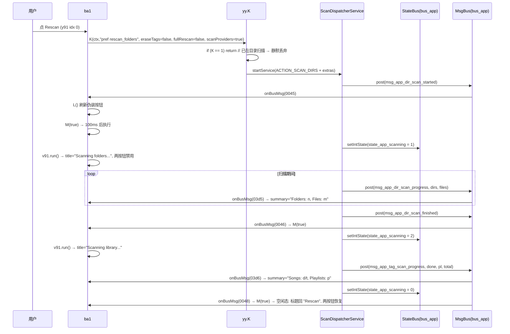
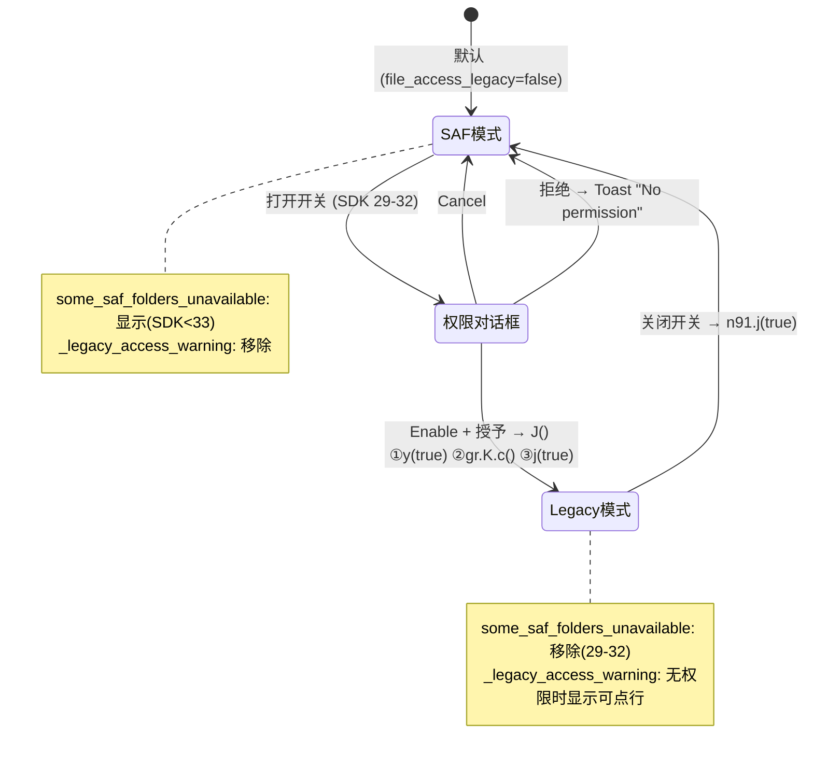

# Poweramp「设置 → 媒体库」偏好结构

> **证据分级**：【实证·原文】= XML/资源原文；【实证·产物】= 反编译 smali 产物；【推断】= 无直接代码佐证。
>
> 所有结论基于 **build-1035-bundle-play**（`versionCode 1035009`）。
>
> **本文不重述共享机制**：加载链、`u61` 分发表、`n91` 基类契约、`v()`/`w()` 生命周期、`h()`/`i()` 移除、对话框族、`restore_defaults` 框架契约，全部见 `poweramp-settings-page-runtime.md`（下称"运行时文档"）。本文只写**本页独有**的部分。

---

## 0. 一句话结论

「媒体库」页面 **29 行 XML / 25 元素 / 21 个带 key 项**，但它不是"配置页"，而是**扫描子系统的控制台**：顶部 7 个元素（2 个 `ProgressPreference` + 1 个伪装按钮 + 4 行提示）是同一条扫描生命周期 UI，中部 4 项控制扫描入库策略，下部 6 个下钻把列表/搜索/队列/播放列表/随机/扫描器拆到独立页。

**最重要的架构事实**：`rescan_folders`（增量）与 `erase_and_rescan`（擦除全量）**不是两个平行按钮，而是同一状态机的两个入口 + 两个显示槽位**——标题、可用性由同一段代码（`ba1.M()` → `v91.run()`）按 `ScanDispatcherService` 的扫描阶段统一驱动，增量槽位还兼作实时进度摘要行。

**最反直觉的实现**：`music_folders_button` 是**没有 `persistent="false"` 的 `RawTextPreference`**，靠一个点击监听器 + 运行期 `setIcon`/`setSummary` 伪装成按钮；外观由全局静态标志 `y21->К` 决定，**它自己的 key 不承载任何持久化状态**。

---

## 1. 页面身份

| | |
| --- | --- |
| XML 文件 | `res/xml/library.xml`【实证·原文】 |
| 资源 id | **`0x7f160016`**【实证·原文】`public.xml:11069` |
| 行数 / 字节 | **29** / **5394** |
| 元素总数 | **25**（1 个 `PreferenceScreen` 根 + 1 个 `PreferenceCategory` + 23 个偏好项） |
| 带 key 项 / 无 key 子项 | **21** / **2**（均为 `RawTextPreference` 提示块） |
| 页面标题 | `@string/pref_library` = **Library**（`strings.xml:1180`，id `0x7f08053b`） |
| 页面摘要 | 根页传 `@string/pref_summary_folders_library` = **Rescan, music folders, list, queue options**（`strings.xml:1498`） |
| 设置页 helper | **`ׅ/ba1.smali`（43191 字节 / 2043 行）**，`.super Lׅ/n91;`【实证·产物】`ba1.smali:1-3` |
| 辅助 lambda | `y91`(8734B/399L)、`z91`(12119B/566L)、`mb1`(5707B/271L)、`v91`(13225B/665L)、`w91`(4545B/209L)、`s61` |

### 1.1 构造函数的硬编码常量（**修正运行时文档 Q4**）

```asm
; ba1.<init>(SettingsActivity, u61, int y)                ba1.smali:15-43
const v0, 0x7f160026                       ; ← singlepane！
invoke-direct {p0, p1, p2, p3, v0}, Lׅ/n91;-><init>(Activity, m91, II)V
```

`n91.<init>` 把 `p3 → this.y`、`p4 → this.C`【实证·产物】`n91.smali:249,253`。

| 字段 | 取值 | 含义 |
| --- | --- | --- |
| `y` | `u61` 传入（`0x7f160016`） | 本页 xml id；`ba1.onBusMsg` 用 `const v5, 0x7f160016` 与它比【实证·产物】`ba1.smali:686,764` |
| `C` | **`0x7f160026` = `singlepane`** | 构造期硬编码为根页 id |

> **这回答了运行时文档 §10 Q4 的一半**：`C` 在本页恒等于 `singlepane` 的资源 id，而运行时文档记录 `褉()` 用 `getResourceEntryName(C)` 取名字。但 **`ba1` 的 2043 行里零处 `iget ...->C:I`**——基类消费点未定位 → §13 Q1。

---

## 2. 25 个元素逐条

### 2.1 21 个带 key 项（XML 实际顺序）

**np** = `persistent="false"`；**ss** = `w:skipSearch="true"`。

| # | 行 | key | 类型 | 标题 | 摘要 / 提示 | default | 标志 |
| ---: | ---: | --- | --- | --- | --- | --- | --- |
| 1 | 4 | `rescan_folders` | **ProgressPreference** | **Rescan** | —（运行期写实时统计） | — | **np** |
| 2 | 6 | `erase_and_rescan` | **ProgressPreference** | **Full Rescan** | Clear tag info database and rescan Library/Folders. Use when storage/SD card changed, on major ROM updates, or when folders are moved on storage | — | **np** |
| 3 | 7 | `music_folders_button` | **RawTextPreference** | **Music Folders** | —（运行期写） | — | `iconAlignedTop`；**无 np** |
| 4 | 8 | `some_saf_folders_unavailable` | **RawTextPreference** | — | `w:line1`：Android may not allow certain folders to be added, such as Download or a storage root. In this case please add their subfolders instead. This restriction is imposed by Google | — | **ss**、`keepPaddings`、`background=settings_quote_background` |
| 5 | 9 | `file_access_legacy` | MultilineSwitch | **File Access Legacy Mode** | Direct file access mode. Requires extra permission | **`false`** | `summary2=file_access_all_storages_hint` |
| 6 | 10 | `_legacy_access_warning` | **RawTextPreference** | — | —（运行期写，四态） | — | **ss**、`iconAlignedTop`、`icon=exclamation_circle_warn_48dp` |
| 7 | 11 | `scan_min_track_duration` | **NumberListPreference** | Ignore Short Tracks (Notifications, etc.) | `Less than (seconds): %s` | **`6`** | `persistent="true"`、`dialogTitle`、`w:entries`+`w:values` |
| 8 | 12 | `skip_video` | MultilineSwitch | Ignore Video Tracks | Tracks with video stream will be ignored | — | — |
| 9 | 13 | `auto_find_button` | `<Preference>` | Auto-Find Music Folders | Use this option to find music folders automatically | — | — |
| 10 | 15 | `restore_pos` | MultilineSwitch | Store/Restore Per Track Progress | Useful for podcasts, long sets | **`true`** | — |
| 11 | 16 | `long_skip_rewind` | MultilineSwitch | -10/+10s Rewind Pro Buttons | Change `<<< >>>`（分类切换）pro buttons to -10/+10s rewinding buttons for long tracks. Also applies to Long category | **`true`** | `summary2`、**`w:allowLinks="true"`** |
| 12 | 17 | `restore_pos_min_dur` | Seekbar | Track Duration For Per Track Progress and -10/+10s Buttons | At least: %d min. | **`45`** | `w:min=0` `w:max=60` |
| 13 | 18 | `played_dur` | Seekbar | Count As Played | Count track as played after playing at least: %d%% | **`50`** | `w:min=0` `w:max=100` |
| 14 | 20 | `library_lists` | Redirect | **Lists** | List click action, lists/categories options | — | `target=library_lists` |
| 15 | 21 | `library_search` | Redirect | **Search** | Search results playback options | — | `target=library_search` |
| 16 | 22 | `library_queue` | Redirect | **Queue** | Queue options | — | `target=library_queue` |
| 17 | 23 | `library_playlists` | Redirect | **Playlists** | User created playlists import/export and options | — | `target=library_playlists` |
| 18 | 24 | `library_shuffle` | Redirect | **Shuffle** | Shuffle options | — | `target=library_shuffle` |
| 19 | 25 | `library_scanner` | Redirect | **Scanner** | Poweramp folders and library scanner options | — | `target=library_scanner` |
| 20 | 27 | `reset_stats` | `<Preference>` | **Reset stats**（小写 s） | Reset tracks played times, last played, and related stats | — | 无 np、无 summary2 |
| 21 | 28 | `restore_defaults` | `<Preference>` | Restore Defaults | — | — | 无 np |

> **只有 3 项显式写了 `persistent`**：两个 `"false"` + `scan_min_track_duration` 的 `"true"`（冗余）。对比 `poweramp-album-art-settings.md` §2.4 的 7 处，**本页写法更短**。

### 2.2 2 个无 key 子项 + 2 个结构性元素

| # | 行 | 类型 | 内容 | 位置语义 |
| ---: | ---: | --- | --- | --- |
| A | 2 | `PreferenceScreen` | 根节点，`title=pref_library` | 页面根 |
| B | 5 | RawText | **`w:line1`**=Poweramp retains track info (e.g., ratings, playlists) from removed storage even after a Rescan. **Use Full Rescan to clear it**<br>**`w:line2`**=Poweramp scans files only during active use or playback, not in the background, to save battery<br>**`w:line3`**=For very large libraries, Poweramp scans in chunks during playback as resources allow | 紧跟两个 ProgressPreference |
| C | 14 | `PreferenceCategory` | `title=pref_advanced` = **Advanced**，无 key | 分"基础 / 高级"两段 |
| D | 19 | RawText | `android:summary`=Individual playlists and folders can be set to keep each track progress via their header menu ➔ **List Options** | 夹在两 Seekbar 与 6 下钻之间 |

> ⚠️ **对派发简报的更正**：简报说"3 个 RawTextPreference 提示块 + 1 个无 key 的 RawText"。实际清点：**无 key 的子项只有 2 个**（行 5、行 19）；`some_saf_folders_unavailable`（行 8）与 `_legacy_access_warning`（行 10）**都有 key**，是"命中 key 的动态行"。加上根节点 A 与分类头 C，**无 key 元素共 4 个**——简报的"4"应是算了根/分类。

### 2.3 全页唯一的 `line3` 三段提示块

行 5 是**本页唯一使用 `w:line3` 的元素**，三句文案构成**对"扫描不可用感"的三重辩解**：

| 属性 | 资源 | 辩解什么 |
| --- | --- | --- |
| `w:line1` | `pref_pa_keeps_tracks_no_storages` | 你删了存储但数据还在 → **用 Full Rescan 清**（为下面那个按钮做场景说明） |
| `w:line2` | `pa_doesnt_scan_in_bg` | 我们不后台扫（省电）→ 解释"为什么点了没动" |
| `w:line3` | `pa_very_large_scans` | 大库分批扫 → 解释"为什么慢" |

> `poweramp-album-art-settings.md` §2.2.2 记录 `w:summary2` 用于"有代价"的项；本页把同一种劝解意图**下沉到独立提示块**，因为按钮的 summary 槽位已被运行期占用（§3.4）。

### 2.4 属性使用矩阵

| 属性 | 次数 | 用于 |
| --- | ---: | --- |
| `android:key` | 21 | — |
| `android:title` | 20 | 除 2 个无 title 动态行 + 无 key 提示块 |
| `android:summary` | 14 | §2.1 |
| `android:defaultValue` | **6** | `file_access_legacy=false`、`scan_min_track_duration=6`、`restore_pos=true`、`long_skip_rewind=true`、`restore_pos_min_dur=45`、`played_dur=50` |
| `android:persistent` | 3 | 2×false + 1×true |
| `w:skipSearch` | **3** | 两个动态行 + 行 5 提示块 |
| `w:summary2` | 2 | `file_access_legacy`、`long_skip_rewind` |
| `w:keepPaddings` | 3 | 三个带背景的提示行 |
| `w:iconAlignedTop` | 2 | `music_folders_button`、`_legacy_access_warning` |
| `w:allowLinks` | 1 | 仅 `long_skip_rewind` |
| `android:background` | 3 | 全部 `settings_quote_background`(`0x7f020576`) |
| `android:icon` | 1 | 仅 `_legacy_access_warning` = `exclamation_circle_warn_48dp`(`0x7f0202ff`) |
| `w:min`/`w:max` | 2×2 | 两 Seekbar |
| `w:entries`/`w:values` | 1×2 | 仅 `scan_min_track_duration` |
| `w:target` | 6 | 6 个 Redirect |

> **`w:leftLabel`/`w:rightLabel`/`w:tickMark` 全页 0 次**——对比 `aa_bg.xml` 有 3 个带端点标签的滑杆。本页两个 Seekbar 都是纯数值（分钟/百分比），无"方向感"。

---

## 3. 顶部"扫描区"

### 3.1 `v()` 的 13 步装配（`ba1.smali:1163-2043`，881 行 = 全类 43%）

| 序 | 行 | 动作 |
| ---: | ---: | --- |
| ① | 1171-1195 | `rescan_folders` → `setOnPreferenceClickListener(new y91(this, 0))` |
| ② | 1200 | **`M(false)`** —— 立即按当前状态刷新进度 UI（不等消息） |
| ③ | 1205 | **`L()`** —— 刷新伪装按钮的权限外观 |
| ④ | 1214-1264 | `auto_find_button` → 若 `xn0->О` 则 **`removePreference`**，否则绑 `y91(this, 1)` |
| ⑤ | 1269-1290 | `skip_video` → `z91(this, 0)` |
| ⑥ | 1303-1324 | `erase_and_rescan` → **`new mb1(this, activity, 0)`** |
| ⑦ | 1333-1354 | `scan_min_track_duration` → `z91(this, 1)` |
| ⑧ | 1363-1379 | `long_skip_rewind` → **`n91->h`**（`c91` 预建实例） |
| ⑨ | 1384-1758 | `_legacy_access_warning` 四态处理（§5.2） |
| ⑩ | 1760-1852 | `some_saf_folders_unavailable` 条件移除（§5.3） |
| ⑪ | 1855-1970 | `file_access_legacy` 三态（§5.4） |
| ⑫ | 1971-2008 | `reset_stats` → `y91(this, 3)` |
| ⑬ | 2009-2037 | `restore_defaults` → `y91(this, 4)` |

> **`v()` 里完全没有**：6 个 `RedirectPreference`、无 key 提示块、根节点/分类头——它们**不需要代码**（Redirect 的跳转在构造期完成，见根文档 §4.1）。

### 3.2 `y91`：5 分支点击路由器

`y91` 只有 2 个字段（`B`=ba1、`В`=index）与 1 个方法【实证·产物】`y91.smali:38-399`。`packed-switch 0x0` 展开 5 路：

| index | 绑定目标 | 分支 | 动作 | 定位 |
| ---: | --- | --- | --- | ---: |
| 0 | `rescan_folders` | `pswitch_4` | `yy.K(ctx,"pref rescan_folders",…)` → 启动扫描 | `:339-386` |
| 1 | `auto_find_button` | `pswitch_3` | `startActivity(AutoFindDialogActivity)` | `:304-336` |
| 2 | `_legacy_access_warning` | `pswitch_2` | `ba1.I()` → `requestPermissions(WRITE_EXTERNAL_STORAGE, 0x2711)` | `:291-301` |
| 3 | `reset_stats` | `pswitch_1` | 弹"Reset stats?"确认框 | `:135-288` |
| 4 | `restore_defaults` | `pswitch_0` | `n91.m(null, x2(4), 0)` → 走 `l()` | `:110-132` |
| **5** | **`music_folders_button`** | **default**（无 case） | `startActivity(MusicFoldersActivity)` | `:59-108` |

> **index 5 走 default 分支**（`packed-switch` 只有 0–4，见 `:391-398`）。"打开音乐文件夹选择器"是**兜底行为**——任何未匹配索引都会打开它。这是本页唯一的无 case 分发。

### 3.3 `music_folders_button`：伪装成按钮的 `RawTextPreference`

#### XML 的三处疑点

| 疑点 | 说明 |
| --- | --- |
| **类型是 `RawTextPreference`** | 它的设计用途是"只读多行文本块"（本页另 3 个提示行都是它） |
| **没有 `persistent="false"`** | 本页两个动作型 `ProgressPreference` 都显式写了 |
| **没有 `android:summary`** | 唯一可交互项里唯一无摘要的 |

#### 为什么没写 `persistent="false"` 也不出错

`RawTextPreference` 从不调用 `persistXxx`，`persistent` 标志只在有 `setValue` 路径时才有意义。

> **这是"无害的冗余"**：`persistent=true` 对一个永不写入的 key 是死配置。**真正的陷阱不在 `persistent`，而在它会被 `findPreference` 找到并当普通行渲染**——`RawTextPreference.onBindView` 把 title+icon+summary 摆成一行，视觉上与 `RedirectPreference` 几乎一样，**但不会自动跳转**。所以作者必须手工补 `setOnPreferenceClickListener`。这就是"伪装成按钮"的完整含义：**外观免费，行为要手写**。

#### 运行期外观：`L()` 的双态切换（`ba1.smali:156-327`）

```java
void L() {
    Preference p = K.findPreference("music_folders_button");
    p.setOnPreferenceClickListener(new y91(this, 5));      // ← 每次都重绑
    if (y21.К) {                                            // ← 全局静态标志
        p.setIcon(0x7f020231);                              // exclamation_warn_48dp
        p.setSummary(getString(0x7f0806fc)                  // "Select folders for Folders/Library"
                   + "\n\n" + getString(0x7f080439)         // "Some permissions are missing!"
                   + "\n"   + getString(0x7f080412));       // "...won't be able to play tracks..."
    } else { p.setIcon(0); p.setSummary(0x7f0806fc); }
}
```

| 状态 | `y21->К` | 图标 | 摘要 |
| --- | :---: | --- | --- |
| 正常 | `false` | 无（`setIcon(0)`） | Select folders for Folders/Library |
| **权限/SAF 异常** | `true` | `exclamation_warn_48dp`(`0x7f020231`) | 三行，中间是 **Some permissions are missing!** |

> **`y21->К` 是什么**：`y21` 是 SAF 工具类【实证·产物】（26 个方法，方法体里全是 `"tree/"`、`docUri`、`DocumentsContract.buildDocumentUriUsingTree`、`openFDSAF`）。`y21->К` 只在本类写 2 次（`y21.smali:1472,5001`）+ `MusicFoldersLayout.smali:2516`；**全 App 只被 `ba1.smali:193` 读一次**，写入点均在 SAF 解析失败分支 → 【推断】**= "上次 SAF 存储访问解析失败"**。
>
> 它**只影响外观不影响点击**：无论真假，点击都打开 `MusicFoldersActivity`。

#### 调用链

```
用户点 "Music Folders"
  └─ y91.onPreferenceClick (index 5 → default)            y91.smali:59-108
     └─ new Intent().setClassName(pkg, "com.maxmpz.audioplayer.dialogs.MusicFoldersActivity")
        └─ SettingsActivity.startActivity(intent)
```

> **不是 `w:target` 深链**：它绕过 `RawTextPreference.setTarget` 那套（根文档 §4.1），直接启动独立 Activity。所以它**不参与 target 深链协议**，`settings/library#music_folders_button` 只会滚动定位，不会跳转。

### 3.4 `auto_find_button` 的整项移除

```asm
; ba1.smali:1226-1246
sget-boolean v1, Lׅ/xn0;->О:Z
if-eqz v1, :cond_0 → removePreference(v0)     ; 整项消失
:cond_0  new y91(this, 1) → setOnPreferenceClickListener
```

`xn0->О`【实证·产物】`xn0.smali:63-121`：`SDK_INT >= 29` → **true**；`SDK == 28` 且 `ac.Х() > 0` → **true**；其余 false。

> **语义**：Android 10+ 分区存储后"自动找音乐目录"不可靠，**整项拿掉**。移除方式是 `removePreference`（瞬时），不是运行时文档 §5.2 的 256ms 动画——因为它是 `Preference` 而非 `RawTextPreference`。

---

## 4. 两个 `ProgressPreference`：本页核心运行时

### 4.1 `ProgressPreference` 是什么

`.super Lׅ/.../RawTextPreference;`，1 个字段 `h:Z`【实证·产物】`ProgressPreference.smali:1-7`。

| 方法 | 行 | 行为 |
| --- | ---: | --- |
| `<init>(Ctx, Attrs, Z)` | 32-49 | `setWidgetLayoutResource(0x7f0400de)`（进度圈布局）；`r20.К(this, true)` |
| `setProgress(Z)` | 175-198 | 值变化时 `iput h` + `notifyChanged()` |
| `onBindView(View)` | 116-173 | 找 `0x7f0d026f`(`progress`) 的 `ProgressBar`；`h==true → VISIBLE(0)`，否则 `GONE(8)` |

> **`setProgress(true)` 的唯一效果是让 `ProgressBar` 可见 + 触发重绑**。标题、可用性、摘要全部由调用方负责——这就是 `ba1` 里那一大段 `setProgress/setTitle/setEnabled` 必须写在一起的原因。

### 4.2 两个入口的 Intent 参数差异（**核心**）

两者最终都调 `yy.K(Context, String cause, Z×8)`，第 2–9 参依次映射到 Intent extra【实证·产物】`yy.smali:923-1113`：`cause` / `onlyIfEmpty` / `fastScan` / **`eraseTags`** / **`fullRescan`** / `resolvePlaylists` / `importSystemPlaylists` / `reparsePlaylists` / `scanProviders`。

| 按钮 | cause | eraseTags | fullRescan | scanProviders | 其余 | 定位 |
| --- | --- | :---: | :---: | :---: | :---: | --- |
| **Rescan** | `"pref rescan_folders"`（**空格**） | **false** | **false** | **true** | 全 false | `y91.smali:339-386` |
| **Full Rescan** | `"pref erase_and_rescan"`（下划线） | **true** | **true** | **true** | 全 false | `s61.smali:70-113` |

> **差异只有 2 个 flag**：`eraseTags` 与 `fullRescan`。这就是"增量 vs 擦除全量"的全部实现差别——**不是两条代码路径，是同一 Intent 的两个 boolean**。
>
> `scanProviders` 两者都是 `true`：SAF/媒体库 provider 每次都要重扫（Poweramp 无法感知 provider 侧变化）。
>
> **一个容易踩的坑**：两个 `cause` 字符串格式**不一致**（空格 vs 下划线）。按 cause 做统计/过滤时不能假设统一分隔符。

### 4.3 服务入口守卫

```asm
; yy.smali:927-934
sget v0, Lcom/maxmpz/audioplayer/scanner/ScanDispatcherService;->К:I
if-eq v0, 0x1, :cond_7        ; ← 已在目录扫描 → 直接 return
```

> **守卫条件只有 `К != 1`**：目录扫描进行中时**静默忽略**新请求（不排队、不提示、不 toast）；标签扫描阶段（`К == 2`）**不阻塞**新请求。这也解释了 §4.4 为何能显示两种不同的"进行中"标题——`К` 的两个取值是两个不同阶段。

### 4.4 进度回显：`M()` → `v91.run()`

#### `M(boolean delayed)`（`ba1.smali:329-480`）

```java
void M(boolean delayed) {
    ProgressPreference rescan = (ProgressPreference) K.findPreference("rescan_folders");
    this.k = rescan;                                    // ← 缓存到字段 k
    ProgressPreference erase = (ProgressPreference) K.findPreference("erase_and_rescan");
    if (rescan == null) return;
    X.removeCallbacksAndMessages(this.j);               // ← 清旧任务（j 是 token）
    int state = StateBus(0x7f0d015b).getIntState(0x7f0d004c);   // state_app_scanning
    Runnable r = new v91(this, state, rescan, erase, 0);
    if (delayed) X.postAtTime(r, this.j, SystemClock.uptimeMillis() + 100);
    else         r.run();
}
```

| 常量 | 名字 |
| --- | --- |
| `0x7f0d015b` | `bus_app` |
| `0x7f0d004c` | `state_app_scanning` |
| `j` 字段 | **仅用作 `removeCallbacksAndMessages` 的 token**，自身无状态 |

> **`this.j` 是本页独有设计**：把"扫描状态刷新任务"全挂在同一 token 上，每次 `M()` 先清旧任务。连续多条 start/finish 消息**只会留下最后一次**，避免 UI 抖动。全页仅此一处使用该 token。

#### `v91.run()` 的 `pswitch_1`（index 0）三态

【实证·产物】`v91.smali:401-657`。前置 `if (n91->С) return;`（`С` = 已销毁）。

| `state_app_scanning` | 阶段 | `rescan` 标题 | 进度圈 | `rescan` 可用 | `erase` 可用 |
| :---: | --- | --- | :---: | :---: | :---: |
| `0` | 空闲 | **Rescan**（`0x7f0805ee`） | 隐藏 | ✅ | ✅ |
| `1` | 目录扫描 | **Scanning folders...**（`0x7f0807f0`） | 显示 | ❌ | ❌ |
| `2` | 标签扫描 | **Scanning library...**（`0x7f0807f1`） | 显示 | ❌ | ❌ |

> **`erase_and_rescan` 从头到尾没有得到自己的"进行中"标题**——它只是被 `setEnabled(false)` 一起停用。**"Full Rescan 进行中"这个视觉状态是借用 `rescan` 那一行表达的**。这是两个按钮共用一套状态机的直接证据。

#### 实时统计摘要（`rescan` 行兼作进度行）

`v91.run()` 尾部（`:524-651`）通过 `"__DataAPI"` 系统服务建 `e8` 订阅者，对 `getFolders().A0()` 发聚合查询：`{"count(*)", "sum(folders.num_files)", "(SELECT COUNT(*) FROM playlists)"}`。

**摘要实际由 `ba1.onBusMsg` 的两条进度消息填充**，模板是 `0x7f0803b6` = `key_colon_value_s_s` = **`"%1$s: %2$s"`**，分隔符硬编码 `", "`【实证·产物】`ba1.smali:747,860`：

| 消息 | 名字 | 摘要 | 守卫 |
| --- | --- | --- | --- |
| `0x7f0d03d5` | `msg_app_dir_scan_progress` | `Folders: <arg1>, Files: <arg2>` | `k != null && К == 1`（`:735-916`） |
| `0x7f0d03d6` | `msg_app_tag_scan_progress` | `Songs: <arg1>/<arg3>, Playlists: <arg2>` | `k != null && К == 2`（`:920-1140`） |

| 标签资源 | 文案 |
| --- | --- |
| `0x7f08021a` / `0x7f080211` | **Folders** / **Files** |
| `0x7f08088d` / `0x7f08045c` | **Songs** / **Playlists** |

> **标签扫描摘要带 `n/m` 分子分母**（`:1042-1061` 拼 `arg1 + "/" + v3`），目录扫描只有绝对值——因为标签扫描**可预期总量**（文件数已知），目录扫描不是。

### 4.5 `onBusMsg` 的 6 条消息

`ba1.onBusMsg`【实证·产物】`ba1.smali:652-1161`：

| 消息 id | 名字 | 处理 |
| --- | --- | --- |
| `0x7f0d0045` | `msg_app_dir_scan_started` | ① `L()` ② `if (y==0x7f160016) M(true)` |
| `0x7f0d0046` | `msg_app_dir_scan_finished` | `M(true)` |
| `0x7f0d0047` | `msg_app_tag_scan_started` | `M(true)` |
| `0x7f0d0048` | `msg_app_tag_scan_finished` | `M(true)` |
| `0x7f0d03d5` / `0x7f0d03d6` | 两条 progress | **只写摘要，不调 `M()`** |

> **`y == 0x7f160016` 是冗余判断**（`ba1` 实例只服务 `library` 页，`this.y` 恒为该值），像防御性检查或模板残留。
>
> **进度消息不触发 `M()`**——它们是高频消息，只更新文本不改可用性。状态变更只在 start/finish 四条上发生。这是**有意的节流**。

### 4.6 完整时序



---

## 5. 文件访问模式：SAF vs Legacy

本页有 **4 个元素**共同表达这一主题：`file_access_legacy`（开关）、`_legacy_access_warning`（带感叹号的动态警告）、`some_saf_folders_unavailable`（SAF 限制说明）、`music_folders_button`（受影响的入口）。

### 5.1 两条路径的本质

| | **SAF 路径**（默认） | **Legacy 路径**（`file_access_legacy=true`） |
| --- | --- | --- |
| 访问方式 | `ContentResolver` + `DocumentsContract`（`y21` 类） | 直接 `java.io.File` |
| 授权模型 | 逐目录选一次，拿到持久化 tree URI | 只需 `WRITE_EXTERNAL_STORAGE` 一个运行时权限 |
| 覆盖范围 | **只能选 Android 允许的目录**（`Download`、存储根被拒） | **所有存储目录都可见** |
| 版本约束 | 全版本可用 | **Play 版在 Android 13+ 被 Google 移除** |
| 对应提示 | `some_saf_folders_unavailable` | `_legacy_access_warning` |

| 资源 | 文案 |
| --- | --- |
| `pref_summary_file_access_legacy_mode` | **Direct file access mode. Requires extra permission** |
| `file_access_all_storages_hint`（`summary2`） | This mode makes all storages directly accessible for a selection in the Music Folders dialog. <br><br>**This option is not supported on Android 13+ for the Play app edition** |
| `pref_file_access_legacy_mode_msg` | Legacy mode enables direct access to the files in Android 10+. **The option change will require Music Folders re-selection** |

> `file_access_all_storages_hint` 是 `w:summary2`——**常驻灰字，不是弹框**。与 `poweramp-album-art-settings.md` §2.2.2 的 `summary2` 用法一致（"有代价"的项才给）。

### 5.2 `_legacy_access_warning`：**四态**动态行（本页最复杂的条件逻辑）

`ba1.v()` 第 ⑨ 步【实证·产物】`ba1.smali:1384-1758`。先看用到的全局标志：

| 标志 | 定义 | 含义 |
| --- | --- | --- |
| `l11->В` | `xn0->О \|\| (xn0->H && SDK >= 28)`【实证·产物】`l11.smali:11-63` | **本机有能力用 SAF** |
| `gr->e1` | `pb1`，key = **`"file_access_legacy"`**【实证·产物】`gr.smali:2058-2070` | 当前是否开启 legacy |
| `n4` | `interface`【实证·产物】`n4.smali:1` | 由 `AUtils.a(ctx, n4)` 探测的能力标记 |

**判定树**（照 `:1419-1758` 逐分支）：

```
if (pref == null) → 跳过
if (SDK >= 0x21 = 33) {                                // Android 13+
    summary = hint1 + "\n\n" + hint2 + (e1 ? "\n\n"+hint3 : "")
    保留显示，不可点击
} else if (SDK >= 0x1d = 29) {                          // Android 10..12
    if (SDK > 0x1f = 31 && SDK <= 0x20) { goto 移除 }
    else if (e1 && checkSelfPermission(WRITE_EXTERNAL_STORAGE) != 0) {
        summary = legacy_access_no_perm + "\n\n" + press_here_to_grant_perm
        setOnPreferenceClickListener(new y91(this, 2))
    } else { 移除 }
} else { 移除 }                                         // Android 9 及以下
```

| 态 | 条件 | 显示 | 文案 | 可点 |
| :---: | --- | :---: | --- | :---: |
| 1 | `SDK < 29` | ❌ 移除 | — | — |
| 2 | `29–32` && `legacy=on` && **未授予**权限 | ✅ | `legacy_access_no_perm`<br>`press_here_to_grant_perm` | ✅ → 请求权限 |
| 3 | `29–32` && 其余 | ❌ 移除 | — | — |
| 4 | `SDK ≥ 33` && `legacy=off` | ✅ | hint1<br>hint2 | ❌ |
| 5 | `SDK ≥ 33` && `legacy=on` | ✅ | hint1<br>hint2<br>hint3 | ❌ |

| 资源 id | 名 | 文案 |
| --- | --- | --- |
| `0x7f0802fc` | `legacy_file_access_removed_hint1` | **Google removed File Access Legacy Mode support for Play editions of the app** |
| `0x7f0802fd` | `legacy_file_access_removed_hint2` | **Website (-uni-) edition continues improved support for this feature** |
| `0x7f0802fe` | `legacy_file_access_removed_hint3` | Use Music Folders dialog to re-add folders separately if you previously used File Access Legacy Mode |
| `0x7f0802fa` | `legacy_access_no_perm` | File Access Legacy Mode is enabled, but no permission granted - **Poweramp may skip tracks from the affected folders** |
| `0x7f08077c` | `press_here_to_grant_perm` | **Press here to grant the permission** |

> **态 4/5 只差第三段**：`legacy=off` 不需要迁移指引；`legacy=on` 才追加"去重新加目录"。
>
> **`hint2` 提到 `-uni-` 版**——正好印证本 build 是 `bundle-play` 而非网站版，与 `version_scope` 一致。

#### 移除方式：**直接 `removePreference`，不走动画**

```asm
; ba1.smali:1747-1758
:goto_1
    invoke-virtual {v8, v0}, Landroid/preference/PreferenceGroup;->removePreference(...)Z
```

> ⚠️ **对派发简报的更正**：简报推测带 icon 的 `_legacy_access_warning`"很可能走运行时文档 §5.2 的 256ms 动画"。**实测否定**：全 App 中 `n91.i(RawTextPreference)`（动画移除）**只有 2 个调用点**——`BaseBuyFvPref.smali:852` 与 `ManageAppWarnPref.smali:1020`。**`ba1` 里零处调用 `n91->i(`**。本页所有移除（`_legacy_access_warning`、`some_saf_folders_unavailable`、`file_access_legacy`、`auto_find_button`）**一律走 `removePreference` 瞬时移除**。
>
> 建议修正运行时文档 §5.2 的表述：动画路径只用于**"由 Preference 子类自己覆写 `В()` 主动自删"**的场景；**由 helper 命令式删除的一律瞬时**。

#### 态 2 的点击链

```
用户点 _legacy_access_warning (态 2)
  └─ y91 idx 2 → ba1.I()                              y91.smali:291-301
     └─ requestPermissions(["WRITE_EXTERNAL_STORAGE"], 0x2711 = 10001)
        └─ SettingsActivity.onRequestPermissionsResult
           └─ ba1.c(code, perms, results)              ba1.smali:482-650
              ├─ 授予 → n91.j(true)（提交 "Settings change" 并重建 Activity）
              └─ 拒绝 → PseudoAlertDialog:
                   标题 0x7f080504 = "File Access Legacy Mode"
                   正文 0x7f08089a = storage_perm_denied_grant_manually
                   负按钮 0x7f0800f9 = Cancel（无监听）
                   正按钮 0x7f080174 = "Continue" → w91(this, 0)
                     └─ ACTION_APPLICATION_DETAILS_SETTINGS + "package:<pkg>"
                        addFlags(0x50800000) → startActivity（系统应用详情页）
```

> **`0x2711` = 10001** 是本页唯一 requestCode，`ba1.c()` 里精确匹配。这是 `ba1` 覆盖 `n91.c()` 的唯一目的——**只处理这一个权限请求**，其余 `return v1`(false) 交父类（`:648-649`）。

### 5.3 `some_saf_folders_unavailable` 的显隐（与 §5.2 **互补**）

`ba1.smali:1760-1852`：

| 设备/配置 | 显示 | 理由 |
| --- | :---: | --- |
| `SDK < 29` | ✅ | — |
| `29–32` + `legacy=off` | ✅ | SAF 是唯一路径，限制必须告知 |
| `29–32` + `legacy=on` | ❌ **移除** | **legacy 绕过 SAF 限制**，再提示会自相矛盾 |
| `SDK ≥ 33` | ✅ | Play 版 legacy 已被移除，限制**恒成立** |

> **两条提示构成一对互斥组合**，这是本页条件逻辑最精细的地方。SDK ≥ 33 时两条**同时显示**：一条说"有些目录加不了"，另一条解释"为什么 legacy 救不了你"。

### 5.4 `file_access_legacy` 开关的三态（`ba1.smali:1855-1970`）

| 态 | 条件 | 表现 |
| :---: | --- | --- |
| **A. 可切换** | `29 ≤ SDK ≤ 32`（或 `SDK>32` 且 `AUtils.a(ctx,n4) != null`） | 绑 `z91(this, 2)`；保持 XML 标题/摘要 |
| **B. 置灰** | `SDK ≥ 29` 且不满足 A（Play 版 `SDK ≥ 33`） | `setEnabled(false)` + `setSummary(pref_not_supported)` |
| **C. 移除** | `SDK < 29` | `removePreference` |

> **态 B 把摘要强制改写为 "Not supported"**（`0x7f0803b5`），覆盖了 XML 的 `pref_summary_file_access_legacy_mode`——但 **`w:summary2` 仍然显示**。所以态 B 下用户看到：
>
> **File Access Legacy Mode** / Not supported / *This mode makes all storages directly accessible… This option is not supported on Android 13+ for the Play app edition*
>
> 这是**最好的可能文案组合**：一句"不支持"+ 一句"为什么/从哪个版本开始"。作者显然有意保留 `summary2`。

#### 态 A 的 `z91` index 2 → 权限流

```java
if (newValue == true) {
    String[] perm = { "android.permission.WRITE_EXTERNAL_STORAGE" };
    if (SDK >= 0x17(23) && !n91.X(perm)) {                 // 23+ 且未授予
        对话框: 标题 0x7f080504 = "File Access Legacy Mode"
                正文 0x7f080505 + "\n\n" + 0x7f080682
                setDismissOnPositive(false)
                正按钮 0x7f0801da = "Enable" → d20(this, perm, pref, 3)
                   ├─ 已授权 → pref.setChecked(true); ba1.J()
                   └─ 未授权 → dialog.requestPermissions(perm)
                        └─ 回调 uq → 授予则 setChecked + J()；拒绝则 Toast 0x7f0803bf
                负按钮 0x7f0800f9 = Cancel
        this.l = new WeakReference(dialog);                // ← 存起来供 J() 关闭
    } else { n91.j(true); }
} else   { n91.j(true); }                                  // 关闭 legacy 同样提交+重建
```

### 5.5 `J()` —— 换模式的收尾（**本页最值得抄的一段**）

```asm
; ba1.smali:79-154
.method public final J()V
    sget-object v0, Lׅ/gr;->e1:Lׅ/pb1;           ; file_access_legacy 偏好对象
    invoke-virtual {v0, v1}, Lׅ/fc;->у(Z)V      ; ① 强制写成 true
    sget-object v0, Lׅ/gr;->K:Lׅ/gr;
    invoke-virtual {v0, v2}, Lׅ/ms;->c(Z)V       ; ② 触发"存储重载"
    invoke-virtual {p0, v1}, Lׅ/n91;->j(Z)V      ; ③ 提交偏好并重建 Activity
    ; ④ 关闭可能还开着的权限对话框（通过 WeakReference l）
    if (l != null) { d = l.get(); if (d != null) d.dismiss(); }
```

| 步骤 | 动作 | 为什么必须 |
| --- | --- | --- |
| ① | `gr->e1.у(true)` | 用户可能经"授予权限"路径走到这里，偏好值还没落库 |
| ② | `gr->K.c(false)` | **通知存储子系统重新枚举**——换了访问模式，之前所有 file path 都可能失效 |
| ③ | `n91.j(true)` | 提交 "Settings change" + 重建 Activity |
| ④ | 关闭 `WeakReference` 里的对话框 | 因为 `setDismissOnPositive(false)`，正按钮**不会自动关框**（否则出现"框还开着但页面已重建"的鬼影） |

> **②是关键**：换访问方式后**必须让存储层重新解析所有已有路径**，否则会出现"legacy 开了但库还是旧 SAF URI"的状态。
>
> **④ 的 `WeakReference d` 字段**（`ba1.smali:11`）全类只服务这一个对话框：`z91` 建框后存入（`z91.smali:307`），`J()` 读出 dismiss。用弱引用是因为对话框持有 Activity。

### 5.6 完整状态机



---

## 6. `NumberListPreference scan_min_track_duration`

### 6.1 数组解析

| 文件 | 声明 | 内容 |
| --- | --- | --- |
| `arrays.xml:881` | `pref_scan_min_track_duration_entries` | `@string/pref_dont_ignore`、`2`、`6`、`10`、`15`、`30`、`45`、`60` |
| `arrays.xml:891` | `pref_scan_min_track_duration_values` | `0`、`2`、`6`、`10`、`15`、`30`、`45`、`60` |

| 索引 | entry | value | 语义 |
| ---: | --- | ---: | --- |
| 0 | **Don't ignore** | **`0`** | 关闭该功能，全部入库 |
| 1 | `2` | 2 | 忽略 < 2 秒 |
| **2** | **`6`** | **`6`** | **默认值** |
| 3–6 | `10`/`15`/`30`/`45` | 同 | |
| 7 | `60` | 60 | 只剩长曲 |

### 6.2 默认 6 的含义

`defaultValue="6"` 存的是**值数组里的元素 `6`**（不是索引），即"**扫描时忽略时长 < 6 秒的曲目**"。

| 场景 | 典型时长 | 被过滤 |
| --- | --- | --- |
| 通知音 / 提示音 | 1–3 s | ✅ |
| 按键音 / 录音碎片 | < 1 s | ✅ |
| 极短过场音效 | 3–6 s | ✅ |
| 短 interlude / skit | 15–40 s | ❌ |
| 正常歌曲 | > 60 s | ❌ |

> **默认 6 秒是"只挡明显不是音乐的东西"的保守取值**。标题写明目标 `Ignore Short Tracks (Notifications, etc.)`；第一档特意放了 `2`（通知音大多 2 秒内），但默认选 `6` 覆盖了"提示音 + 短音效"两类。

### 6.3 `getSummary()` 的实际渲染

`NumberListPreference` 是自定义控件，摘要自己算【实证·产物】`NumberListPreference.smali:257-397`：

```java
CharSequence getSummary() {
    if (Н(entries) != null) {
        int i = А(this.P);                     // P = 存储值 → 反查索引
        if (i >= 0 && i < Н.length) {
            if (H(summaries) != null && i < H.length && H[i] != null)
                return String.format(H[i].toString(), Н[i]);   // ← 双数组模式
        }
    }
    return super.getSummary();                  // → PseudoAlertDialogPreference.getSummary()
}
```

**属性数组**（`qt0->d0`，5 个 attr）【实证·产物】`qt0.smali:1590-1623` + `public.xml:752-756`：

| 索引 | attr | 名 | 读取 | 存到 |
| ---: | --- | --- | :---: | --- |
| 0 | `0x7f0102ed` | `entries` | ✅ `getTextArray` | `Н` |
| 1 | `0x7f0102ee` | `values` | ✅ `getResourceId`→`getIntArray` | `Р` |
| 2 | `0x7f0102ef` | `summary` | ❌ **不读** | — |
| 3 | `0x7f0102f0` | `summaries` | ✅ `getResourceId`→`getTextArray` | `H` |
| 4 | `0x7f0102f1` | `disableDependenciesValue` | ✅ `getInt` | `p` |

> **本页没写 `w:summaries`**，所以 `H == null` → 走 `super.getSummary()` = `К.А(В())`，其中 `В()` 返回 `entries[index]`，`К` 是持有 `android:summary` 模板的格式化器 → 最终：

| 存储值 | entry | 渲染结果 |
| ---: | --- | --- |
| `0` | Don't ignore | **`Less than (seconds): Don't ignore`** ← 语义别扭 |
| `2` | `2` | `Less than (seconds): 2` |
| **`6`** | `6` | **`Less than (seconds): 6`** |
| `60` | `60` | `Less than (seconds): 60` |

> ⚠️ **索引 0 是真实缺陷**：`values[0] = 0`（关闭），但 `entries[0]` 是文本 `Don't ignore`，套进 `Less than (seconds): %s` 变成 **"小于（秒）：不要忽略"**。这是**模板与数据不匹配**。
>
> 修法：给 `w:summaries` 配一套专用文案（`NumberListPreference` 支持），但 XML 里没写。

### 6.4 改值触发什么

`z91` index 1 → `:pswitch_0`（`z91.smali:338-385`）：

| 参数 | 值 |
| --- | --- |
| `cause` | `"pref scan_min_track_duration"` |
| `onlyIfEmpty` … `scanProviders` | **全部 `false`**（9 个 flag 全 false） |

> **改阈值会触发一次"什么都不擦"的重扫**——连 `scanProviders` 都是 `false`。
>
> 逻辑上说得通：改了"最小时长"意味着"哪些曲目该入库"的判定变了，需要重扫把之前被过滤的捞回来 / 把现在该过滤的剔掉，**但不用擦 tag 数据库**。
>
> **没有二次确认框**——改一个下拉选项立刻开始扫描。这与 `skip_video`（要弹框）、`erase_and_rescan`（要弹框）形成对比。

### 6.5 对话框形态

`B(Builder)`【实证·产物】`:125-245` 用 `setSingleChoiceItems(entries, А(P), listener)` ——**单选列表**，不是输入框。`А(int value)`（`:810-868`）遍历 `Р[]` 反查索引，**找不到返回 `0`**（`Don't ignore`）——**降级成"不过滤"是最安全的**（宁可多入库，不误删）。

---

## 7. Advanced 分类

### 7.1 三元组

| key | 类型 | 范围 | 默认 | 标题 | 摘要模板 |
| --- | --- | --- | ---: | --- | --- |
| `restore_pos` | 开关 | — | **`true`** | Store/Restore Per Track Progress | Useful for podcasts, long sets |
| `restore_pos_min_dur` | Seekbar | **0–60 分** | **`45`** | Track Duration For Per Track Progress and -10/+10s Buttons | `At least: %d min.` |
| `played_dur` | Seekbar | **0–100 %** | **`50`** | Count As Played | `Count track as played after playing at least:  %d%%` |

> **耦合**：`restore_pos` 是总开关；`restore_pos_min_dur` 是**门限**（只有时长 ≥ 45 分钟的曲目才启用，针对播客/长 DJ set）；`played_dur` 是**独立**的"算作已播放"阈值，只是恰好放这里。
>
> `restore_pos_min_dur` 上限只有 **60 分钟**（摘要 `%d min.`），暗示设计目标是播客（30–120 分钟）而非有声书（10+ 小时）。

### 7.2 `long_skip_rewind`：唯一带 `w:allowLinks` 的项

| 属性 | 资源 | 文案 |
| --- | --- | --- |
| `summary` | `pref_long_summary_skip_rewind` | Change `<<< >>>`（分类切换）pro buttons 为长曲目的 -10/+10s 快退。同样适用于 Long 分类 |
| `w:summary2` | `pref_long_summary_skip_rewind_note` | **Requires `<a href=settings/ui_theme#more_buttons>`Pro Buttons`</a>` skin option enabled** |

> **`w:allowLinks="true"` 是本页唯一**：允许 `summary2` 里的 HTML `<a href>` 被解析成**可点击深链**，目标是 `settings/ui_theme#more_buttons` —— 一条**跨分支深链**（媒体库 → 外观 → 皮肤），正是根文档 §4.2 协议 `settings/<page>#<key>` 的实例。
>
> **与 `w:supLink` 的区别**（`poweramp-album-art-settings.md` §2.2.1 用的是后者）：
>
> | 属性 | 机制 | 用途 |
> | --- | --- | --- |
> | `w:supLink` | 整个徽标是一个深链 | 实验特性说明弹框 |
> | `w:allowLinks` | 摘要**正文内嵌** `<a>` 可点 | 指向"你需要先开另一个设置" |
>
> **`w:allowLinks` 是"依赖提示"的正确做法**——不置灰，而是在摘要里给一条直达链接。
>
> **绑定的监听器是 `n91->h`**（`c91` 预建实例，index 6）【实证·产物】`ba1.smali:1375-1379`，走 `default → handler.post(y81(2))` 延迟刷新（开了之后播放界面按钮要重排）。

### 7.3 提示行 `pref_per_cat_restore_pos_hint`

> Individual playlists and folders can be set to keep each track progress via their header menu ➔ **List Options**

> **用 `android:summary` 而非 `w:line1`**——注意 XML 写法差异：行 5 用 `w:line1/2/3`（结构化多行），行 19 用 `summary`（单行可换行）。`RawTextPreference` 两者都支持。
>
> **位置意义**：紧跟两 Seekbar、在 6 个下钻之前，提前告知"这些不是全局唯一的，单个列表/文件夹还能单独设"——因为下面的 `library_lists` 就管这个。

---

## 8. 6 个下钻

### 8.1 一览

| # | key | 标题 | 摘要 | `w:target` | 存在 | skipSearch |
| ---: | --- | --- | --- | --- | :---: | :---: |
| 14 | `library_lists` | **Lists** | List click action, lists/categories options | `library_lists` | ✅ `0x7f160017` | ❌ |
| 15 | `library_search` | **Search** | Search results playback options | `library_search` | ✅ `0x7f16001b` | ❌ |
| 16 | `library_queue` | **Queue** | Queue options | `library_queue` | ✅ `0x7f160019` | ❌ |
| 17 | `library_playlists` | **Playlists** | User created playlists import/export and options | `library_playlists` | ✅ `0x7f160018` | ❌ |
| 18 | `library_shuffle` | **Shuffle** | Shuffle options | `library_shuffle` | ✅ `0x7f16001c` | ❌ |
| 19 | `library_scanner` | **Scanner** | Poweramp folders and library scanner options | `library_scanner` | ✅ `0x7f16001a` | ❌ |

> **6 个全部参与搜索索引**（无一带 `skipSearch`）——与顶部区（3 个 `skipSearch`）的主要差异。搜索"Lists"能搜到本页这一行。**6 个 key 与 target 完全同名**，没有根文档 §2.3 那种 `folders_library → library` 的错位。

### 8.2 各自的 helper（引用运行时文档 §3.3）

| target | 资源 id | helper | 说明 |
| --- | --- | --- | --- |
| `library_lists` | `0x7f160017` | **`z61`**（118199 B，20 个 case 的合集） | — |
| `library_search` | `0x7f16001b` | `z61` | — |
| `library_queue` | `0x7f160019` | `z61` | — |
| `library_playlists` | `0x7f160018` | **`ga1`** | 6 个里**唯一有专用 helper** 的 |
| `library_shuffle` | `0x7f16001c` | `z61` | — |
| `library_scanner` | `0x7f16001a` | `z61` | — |

> **只有 `library_playlists` 值得单独一个类**——涉及导入/导出、文件解析、系统播放列表同步等重逻辑。其余 5 个都是 `z61` 的一个 `case`。
>
> 对比：本页自己有 **43191 字节的专用 `ba1`**，比 5 个下钻的 helper 加起来都"专属"——**扫描/文件访问是本子系统里最复杂的部分**。

### 8.3 `library_lists` 是"双归属页"

| 父页 | 行 | 写法 | 外观 |
| --- | ---: | --- | --- |
| **`ui.xml`**（外观分支） | 12 | `summary=pref_see_more_ui_prefs_in_lists` + `target=library_lists` + `skipSearch` | **无 title、无 key** 的隐藏入口 |
| **`library.xml`**（媒体库分支） | 20 | `title=pref_lists` + `key=library_lists` + `summary=pref_summary_lists` | 正常带标题的列表项 |

`poweramp-look-and-feel-settings.md` §3 也已记录这点（"**双归属页**"），判据是 `library_lists.xml` 的 `searchBreadcrumb1` 为 `@string/pref_library`（**归属媒体库**）。

> ⚠️ **对派发简报的第二处更正**：简报说"`library` 页本身被 `ui.xml` 和根页同时引用"。实测 `ui.xml:12` 出现的是 **`w:target="library_lists"`**，**没有** `library`；`library` 只被根页 `singlepane.xml` 引用（key `folders_library`）。准确的说法是 **`library_lists` 处于两棵子树的交叉点**。

**这意味着什么**：

| 观察 | 结论 |
| --- | --- |
| `ui.xml` 入口无 title 无 key | "从外观分支顺手引过去"的**弱入口**，用户不进它就看不出"列表设置还有一整套" |
| `ui.xml` 入口带 `skipSearch` | 避免搜索里出现两条指向同一页的结果 |
| 两父页给的 `summary` 不同 | `ui` 用"在外观里看不到的列表设置还有更多"；`library` 用"列表点击行为、列表/分类选项" |
| `searchBreadcrumb1 = pref_library` | 搜索命中后归属显示**媒体库**，不是外观 |

> **对 SpMusic 的启示**：一个设置页可以被多个父页引用，但**必须有一个"归属"**（用于搜索面包屑、恢复默认范围、跨页刷新通知）。Poweramp 用 `searchBreadcrumb1` 显式声明——值得抄。

### 8.4 `library_scanner` 的交叉引用

`artist-library.md:29,60` 引用 `library_scanner.xml`，给出关键事实："`library_scanner.xml` 明确给出不拆分默认例外 `AC/DC | +/-`，本次解析须保留 `AC/DC` 和 `+/-` 整体"。

| 页 | 决定 | 时机 |
| --- | --- | --- |
| **本页** `scan_min_track_duration` / `skip_video` | **哪些文件被收录** | 扫描时（**入口过滤**） |
| `library_scanner` | **已收录文件如何归并成实体**（艺术家拆分符、tag 编码） | 扫描后聚合（**出口聚合**） |

> 一句话：**本页决定"库里有哪些文件"，`library_scanner` 决定"这些文件怎么变成专辑/艺术家"**。详见 `artist-library.md`。


---

## 8B. 6 个子页的逐条清单与实现机制（**本轮补齐**）

> **为什么放在这里**：§8 只给了 6 个下钻的"入口一览"。本节把 6 个子页**各自的全部条目、文案、默认值、依赖、标志**逐条列出，并给出各自的 helper 绑定方式。
> 与 `poweramp-library-full-implementation.md` 的分工：那份是"整棵子树的实现机制全景"，本节是"从根页视角看 6 个下钻的完整内容"。两者互为镜像，信息一致。
>
> **6 个子页的 helper 归属**（来自 `u61` 分发表）：
>
> | 页面 | 资源 id | helper | 该页在 helper 中的分支规模 |
> | --- | --- | --- | --- |
> | `library_lists` | `0x7f160017` | `z61` idx **8** | 624 行（全子树最大）|
> | `library_search` | `0x7f16001b` | `z61` idx **11** | 165 行 |
> | `library_queue` | `0x7f160019` | `z61` idx **9** | 126 行 |
> | `library_playlists` | `0x7f160018` | **`ga1`**（专用）| `v()` 105 行 |
> | `library_shuffle` | `0x7f16001c` | `z61` idx **12** | 34 行（最简）|
> | `library_scanner` | `0x7f16001a` | `z61` idx **10** | 160 行 |
>
> 合计 **71 个 key**（子页）+ 21（根页）= **92**。

### `library_lists` —— 列表界面（0x7f160017，z61 idx 8，29 key）

> **29 个 key 的构成**：分类一 `pref_look_and_feel` **自身带 key**（1）+ 分类一子项 14 + 分类二 `albums` 子项 6（分类本身无 key）+ 分类三 `pref_advanced` 子项 7（无 key）+ 分类外 `restore_defaults` 1 = **29**。
> 三个分类中**只有第一个带 `android:key`**，因为 `localized_az` 被移除时需要用 `findPreference("pref_look_and_feel")` 定位所在分类（详见全实现文档 §3.2）。

| # | 分类 | 控件 | key | 标题 | 摘要 | 默认 | 依赖 | 标志 |
| ---: | --- | --- | --- | --- | --- | --- | --- | --- |
| 1 | Look and Feel | Preference | `library_list_opts` | Library List Options | Select top visible Library categories. Also available from Library hea | — | — | — |
| 2 | Look and Feel | MultilineSwitchPreference | `static_navbar` | Static Navbar | "Don't move Navbar away in lists" | false | — | — |
| 3 | Look and Feel | MultilineSwitchPreference | `navbar_seekbar` | Seekbar in Navbar | Show track seekbar in Navbar. Increases Navbar size | false | — | — |
| 4 | Look and Feel | MultilineSwitchPreference | `headers_meta` | Headers With Meta | Show number of songs and some other meta information in headers | true | — | — |
| 5 | Look and Feel | MultilineSwitchPreference | `az_scroll` | A-Z Scroll | Use alphabetical A-Z scroll in lists | true | — | — |
| 6 | Look and Feel | MultilineSwitchPreference | `localized_az` | Localized A-Z Scroll | A-Z scroll includes alphabet for the selected UI language | false | az_scroll | — |
| 7 | Look and Feel | TagListPreference | `list_header_buttons` | Header Buttons | Action buttons shown in the list header | — | — | entries |
| 8 | Look and Feel | TagListPreference | `list_bottom_toolbar` | Bottom Buttons | Action buttons are displayed on the bottom of lists when header is scr | — | — | entries |
| 9 | Look and Feel | TagListPreference | `track_num_type` | Show Track Number | — | 0 | — | entries |
| 10 | Look and Feel | MultilineSwitchPreference | `track_disc_meta` | Show Disc | Disc tag is shown in the track meta | false | track_num_type | — |
| 11 | Look and Feel | MultilineSwitchPreference | `title_filename` | Filename As Title | Always use track filename instead of tag. Applies to all categories as | false | — | — |
| 12 | Look and Feel | MultilineSwitchPreference | `list_action_resets` | Click Restarts Track | If disabled, continue playing the same track, but still change categor | false | — | — |
| 13 | Look and Feel | TagListPreference | `list_item_action` | List Item Action | — | 1 | — | entries, values |
| 14 | Look and Feel | MultilineSwitchPreference | `enable_deletion` | Delete Action | Enable the Delete menu action that deletes song files (after confirmat | true | — | — |
| 15 | Albums | MultilineSwitchPreference | `join_albums` | Join Albums | If disabled, separate albums are shown for tracks without album artist | true | — | — |
| 16 | Albums | MultilineSwitchPreference | `use_albumartist` | Album Artist Label for Tracks | Show Album Artist tag (if exists) instead of just Artist tag for track | false | — | — |
| 17 | Albums | MultilineSwitchPreference | `use_albumartist_albums` | Album Artist Label for Albums | Show Album Artist tag (if exists) instead of just Artist tag for Album | false | — | — |
| 18 | Albums | MultilineSwitchPreference | `use_albumartist_albumartists` | Album Artist Label for Album Artist Tracks | Show Album Artist tag (if exists) instead of just Artist tag for Album | true | — | — |
| 19 | Albums | MultilineSwitchPreference | `hide_unknown_album` | Hide Unknown Album | No Unknown Album shown in track labels | true | — | — |
| 20 | Albums | MultilineSwitchPreference | `hide_unknown_artist` | Hide Unknown Artist | No Unknown Artist shown in track labels when possible. This may hide t | false | hide_unknown_album | featurePack=1 |
| 21 | Advanced | MultilineSwitchPreference | `show_unsplit_cats` | Show Unsplit Combined Categories | Unsplit combined Artists, Album Artists, Composers are visible in the  | false | — | — |
| 22 | Advanced | MultilineSwitchPreference | `hier_no_advance` | No \"Play All Categories\" For Hier Folders | "Don't apply Play All Categories mode when Folders Hierarchy playback  | false | — | — |
| 23 | Advanced | MultilineSwitchPreference | `root_hier_immediate` | Folders Hierarchy Immediate Root | If only one root music folder exists, show its contents immediately in | false | — | — |
| 24 | Advanced | MultilineSwitchPreference | `hier_files_zoom` | Hierarchy Files Zoom Level | Apply Folder Files zoom level for Folders Hierarchy category when a fo | false | — | — |
| 25 | Advanced | MultilineSwitchPreference | `no_sort_field` | "Don't Ignore Articles For Sort" | "Don't ignore articles (\"the\", \"a\", \"an\") in the beginning of al | false | — | — |
| 26 | Advanced | MultilineSwitchPreference | `show_cue_source` | Show CUE Disc Image Files | Big undivided CUE disc image files will be visible in lists | false | — | — |
| 27 | Advanced | MultilineSwitchPreference | `stream_name_in_title` | Stream Name In Title | Use \"Stream - Track Title\" pattern for stream titles, instead of jus | — | — | — |
| 28 | — | Preference | `restore_defaults` | Restore Defaults | — | — | — | — |

### `library_search` —— 搜索（0x7f16001b，z61 idx 11，5 key）

| # | 分类 | 控件 | key | 标题 | 摘要 | 默认 | 依赖 | 标志 |
| ---: | --- | --- | --- | --- | --- | --- | --- | --- |
| 1 | — | RawTextPreference | `msg` | — | — | — | — | — |
| 2 | — | Preference | `list_opts` | Search Categories | — | — | — | — |
| 3 | — | MultilineSwitchPreference | `search_play_tracks` | Play Tracks Only | If some tracks are found, play only the tracks and ignore other found  | — | — | — |
| 4 | — | MultilineSwitchPreference | `search_track_titles_only` | Search Track Titles Only | If disabled, track album and artist are also used for the search | — | — | — |
| 5 | — | Preference | `restore_defaults` | Restore Defaults | — | — | — | — |

### `library_queue` —— 队列（0x7f160019，z61 idx 9，9 key）

| # | 分类 | 控件 | key | 标题 | 摘要 | 默认 | 依赖 | 标志 |
| ---: | --- | --- | --- | --- | --- | --- | --- | --- |
| 1 | — | RawTextPreference | — | — | — | — | — | 提示:Poweramp Queue is a separate dynamic playlist |
| 2 | — | TagListPreference | `queue_start` | Start Playing Queue | — | 2 | — | entries, values |
| 3 | — | TagListPreference | `queue_end` | On Queue End | — | 1 | — | entries |
| 4 | — | TagListPreference | `queue_insert_pos` | Queue Insert Position | — | — | — | entries, values |
| 5 | — | TagListPreference | `play_next_insert_pos` | Play Next Insert Position | — | — | — | entries, values |
| 6 | — | RawTextPreference | — | — | — | — | — | 提示:Insert position can also be changed by long pressing the button in the… |
| 7 | — | MultilineSwitchPreference | `q_next_forces_after_song` | Play Next: Start Queue | Play Next forces option: After the current Song | true | — | — |
| 8 | — | MultilineSwitchPreference | `queue_clear_on_add` | Always Clear On Add | If enabled, Queue is always cleared on track(s) addition. If disabled, | false | — | — |
| 9 | — | MultilineSwitchPreference | `queue_never_clear_on_add` | Never Clear On Add | If enabled, Queue is never cleared on track(s) addition. Search result | false | — | — |
| 10 | — | MultilineSwitchPreference | `queue_no_shuffle` | Ignore Shuffle | Queue is always played in-order. Also affects Search results Shuffle | false | — | — |
| 11 | — | Preference | `restore_defaults` | Restore Defaults | — | — | — | — |

### `library_playlists` —— 播放列表（0x7f160018，ga1，8 key）

| # | 分类 | 控件 | key | 标题 | 摘要 | 默认 | 依赖 | 标志 |
| ---: | --- | --- | --- | --- | --- | --- | --- | --- |
| 1 | — | RawTextPreference | — | — | — | — | — | 提示:Poweramp automatically recognizes file based playlists (.m3u, .m3u8, .… |
| 2 | — | Preference | `playlists_import` | Import System Library Playlists | — | — | — | **np** |
| 3 | — | Preference | `playlists_export` | Export Poweramp Playlists | — | — | — | **np** |
| 4 | — | MultilineSwitchPreference | `pl_import_ratings` | Import Ratings | Update track ratings from imported playlists (when new playlist is imp | true | — | — |
| 5 | — | RawTextPreference | — | — | — | — | — | 提示:Poweramp always saves track ratings to the exported m3u8 playlists |
| 6 | — | TagListPreference | `playlist_insert_pos` | Playlist Insert Position | — | — | — | entries, values |
| 7 | — | RawTextPreference | — | — | — | — | — | 提示:Insert position can also be changed by long pressing the button in the… |
| 8 | — | MultilineSwitchPreference | `pl_del_entry_w_track` | Remove Playlist Entries On Track Deletion | Playlist entries are automatically removed for the deleted tracks. If  | true | — | — |
| 9 | — | MultilineSwitchPreference | `pl_auto_resolve` | Resolve Playlist Entries | "Automatically match unresolved playlist entries on Folders/Library au | true | — | — |
| 10 | — | MultilineSwitchPreference | `pl_no_dups` | "Don't Add Duplicates" | "Duplicates won't be added to playlist" | false | — | — |
| 11 | — | Preference | `restore_defaults` | Restore Defaults | — | — | — | — |

### `library_shuffle` —— 随机（0x7f16001c，z61 idx 12，6 key）

| # | 分类 | 控件 | key | 标题 | 摘要 | 默认 | 依赖 | 标志 |
| ---: | --- | --- | --- | --- | --- | --- | --- | --- |
| 1 | — | SeekbarPreference | `shuffle_random_factor` | Shuffle Randomization | — | — | — | min=0, max=12, step=2, floatScale=12.0 |
| 2 | — | RawTextPreference | — | — | — | — | — | 提示:Less Random prefers least played tracks or other shuffled items / Full… |
| 3 | — | MultilineSwitchPreference | `no_reshuffle` | No Reshuffle | "Don't apply a new shuffle when any track is selected from the current | — | — | — |
| 4 | — | MultilineSwitchPreference | `no_reshuffle_for_large_lists` | No Reshuffle For Large Lists | "Don't reset shuffle order when a new track is manually selected from  | — | — | — |
| 5 | — | TagListPreference | `category_shuffle` | Category Items Shuffle | — | — | — | entries, values, summaries, summary2 |
| 6 | — | MultilineSwitchPreference | `hier_flat_shf` | Shuffle All Songs In Folder Hierarchy | Shuffle Songs mode shuffles all songs from the whole folder hierarchy. | true | — | — |
| 7 | — | Preference | `restore_defaults` | Restore Defaults | — | — | — | — |

### `library_scanner` —— 扫描器（0x7f16001a，z61 idx 10，14 key）

| # | 分类 | 控件 | key | 标题 | 摘要 | 默认 | 依赖 | 标志 |
| ---: | --- | --- | --- | --- | --- | --- | --- | --- |
| 1 | Scanner | MultilineSwitchPreference | `auto_scan` | Auto-scan | Enable automatic SD card/storages scan. If disabled, only manual Resca | true | — | — |
| 2 | Scanner | MultilineSwitchPreference | `scan_no_wait` | Rescan Immediately | Rescan immediately when something changed on the storage. Tracks appea | false | auto_scan | — |
| 3 | Scanner | MultilineSwitchPreference | `initial_scan` | Initial Scan | Quick scan when Poweramp is started for first time | true | auto_scan | — |
| 4 | Scanner | MultilineSwitchPreference | `scan_providers` | Scan Providers | Automatically scan 3rd party track provider plugins on startup | false | auto_scan | — |
| 5 | Scanner | MultilineSwitchPreference | `scan_post_usb_mount` | USB Disconnection/SD Card Mount | Scan on USB disconnection and/or SD card mount | true | auto_scan | — |
| 6 | Scanner | MultilineSwitchPreference | `scan_post_system` | System Media Scanner/MTP | Scan once Android System/MTP Media Scanner finishes | true | auto_scan | — |
| 7 | Other | RedirectPreference | — | — | Press here to show/hide unsplit combined categories | — | — | →`library_lists#show_unsplit_cats`, skipSearch=true |
| 8 | Other | TagsPreference | `artists_split_chars` | Symbols to Split Multiple Artists | — | — | — | — |
| 9 | Other | TagsPreference | `artists_split_ignore` | Unsplit Artists | — | AC/DC | +/- | — | — |
| 10 | Other | TagsPreference | `composers_split_chars` | Symbols to Split Multiple Composers | — | — | — | — |
| 11 | Other | TagsPreference | `genres_split_chars` | Symbols to Split Multiple Genres | — | — | — | — |
| 12 | Other | ListPreference | `tag_encoding` | Tag Encoding | Encoding for non-Unicode tags and playlists | _default_ | — | summary2 |
| 13 | Other | MultilineSwitchPreference | `m3u_utf8` | Always Use UTF-8 for .m3u | If disabled, Tag Encoding setting is used for .m3u playlists. UTF-8 is | true | — | — |
| 14 | Other | MultilineSwitchPreference | `process_cues` | Parse CUE Files | Virtual folders are created for CUE files with multiple tracks | true | — | — |
| 15 | — | Preference | `restore_defaults` | Restore Defaults | — | — | — | — |


---

## 9. `reset_stats`：不可逆动作的完整链路

### 9.1 二次确认（**有**）

`y91` index 3 → `:pswitch_1`【实证·产物】`y91.smali:135-288`：

| 元素 | 资源 | 文案 |
| --- | --- | --- |
| 标题 | `0x7f0807b0` `reset_stats_q` | **Reset stats?** |
| 正文 1 | `0x7f0807aa` `reset_all_tracks_stats_warn` | Reset all per-track statistics stored in the Poweramp database. **Rating, track files or track tags won't be changed** |
| 正文 2 | `0x7f0807af` `reset_stats_based_cats` | This resets categories based on the stats, such as **Most Played** and **Recently Played** |
| 负按钮 | `0x7f0800f9` cancel | **Cancel**（监听器 = `null`） |
| 正按钮 | `0x7f0807a8` reset | **Reset** → `w91(this, 1)` |
| 特殊 | — | **`setDismissOnPositive(false)`** |

> **`setDismissOnPositive(false)`** = 点 Reset 不关框，等动作完成（与运行时文档 §5.3 的 `l()` 一致）。`w91` 最后 `dialog.toToast("Done")` 把框转成 toast。

### 9.2 确认后：投递数据总线命令

```asm
; w91.smali:52-102（default 分支）
invoke-static {p2, 0x7f0d0037}, MsgBusHelper;->fromContextOrThrow    ; bus_data_cmd
invoke-interface {p2, 0x7f0d0509, 0x1, 0x1, 0x0}, MsgBus;->post(...)  ; cmd_data_reset_track_stats
invoke-virtual {p1, 0x7f0801b2}, PseudoAlertDialog;->toToast(I)        ; "Done"
```

### 9.3 命令落地：`dj.H(int, int, Object)`

消息在 `t4.smali:7263-7284` 分发（`0x7f0d0509` → `dj.H(arg1, arg2, obj)`）。`dj.H()`【实证·产物】`dj.smali:955-1231`：

```java
void H(int arg1, int arg2, Object target) {
    Uri filesUri = REST.getFiles().A0().buildUpon().build();
    ContentValues cv = new ContentValues();
    cv.put("folder_files.played_times",       0);      // ①
    cv.put("folder_files.total_played_times", 0);      // ②
    cv.put("folder_files.played_fully_at",    0);      // ③
    if (target != null) {                              // 单条模式
        id = p(target).X;  if (id == 0 || id == -2) return;
        n = RestProvider.update(filesUri, cv, "_id=?", {id});
        if (n > 0) MsgBus(bus_app).post(msg_app_data_changed, 0,0, getFiles());
    } else if (arg1 == 1 && arg2 == 1) {               // ★ 全部模式
        n = RestProvider.update(filesUri, cv, null, null);   // ← 无 WHERE，全表
        if (n > 0) MsgBus(bus_app).post(msg_app_data_changed, 0,0, null);
    }
}
```

> **`arg1==1 && arg2==1` 就是"全部曲目"的哨兵组合**，此时 `selection`/`selectionArgs` 都是 `null` → **UPDATE 不带 WHERE** → 全表清零。

### 9.4 **实际清了哪些字段（精确清单）**

| 表.字段 | 被清 | 证据 |
| --- | :---: | --- |
| `folder_files.played_times` | ✅ 置 0 | `dj.smali:1004-1027` |
| `folder_files.total_played_times` | ✅ 置 0 | `dj.smali:1032-1044` |
| `folder_files.played_fully_at` | ✅ 置 0 | `dj.smali:1049-1061` |
| `folder_files.played_at` | ❌ **不清** | ContentValues 里**没有这个键** |
| `folder_files.rating` | ❌ 不清 | 同上；正文明确"Rating… won't be changed" |
| `folder_files.last_pos` / `shuffle_order` | ❌ 不清 | 同上 |
| `cat_stats`（全表） | ⚠️ **见下** | — |
| 文件本体 / 内嵌 tag | ❌ 不动 | 只改数据库 |

> ⚠️ **本节最重要的发现，也是对文案的一处矛盾**：用户可见摘要写的是 **"Reset tracks played times, **last played**, and related stats"**（`reset_all_tracks_stats_msg`），但**代码没有清 `played_at`**。
>
> 三种可能【推断】：① `played_at` 是"最后播放时间"的**派生物**（清 `played_fully_at`/`played_times` 就够）；② 存在**第二次更新**（`msg_app_data_changed` 消费方重算）；③ **真实缺陷**。静态分析无法在 `dj.H` 内部找到 `played_at` 清除，也无法证明别处不补 → §13 Q2/Q3。

#### `cat_stats` 的不确定性

`cat_stats` 是全表删除发生在 `hy0.Н(SQLiteDatabase)`【实证·产物】`hy0.smali:4883`（`"DELETE FROM cat_stats"`）。但 `hy0.Н()` 是**"重建分类聚合"**方法（前后有 `folders.a1()`、`z42.y(db,0)`、album artist 重映射、然后逐类 `mw0.c1` 重建），**没有证据表明它由 `cmd_data_reset_track_stats` 触发**。`dj.H()` 只投递 `msg_app_data_changed`（`0x7f0d0049`），其消费者里是否包含 `hy0.Н()` 未确认。

> **但可以确定**：对话框正文 `reset_stats_based_cats` 明确承诺 **"This resets categories based on the stats, such as Most Played and Recently Played"**——**设计意图是重置这些分类**。若只看 `dj.H()`，这个承诺没有被实现。

### 9.5 可逆性判定

| 维度 | 判定 |
| --- | --- |
| 二次确认 | ✅ 有（"Reset stats?" + 两段正文 + Reset/Cancel） |
| 能否撤销 | ❌ **不可撤销**（无备份、无 undo） |
| 影响文件/tag | ❌ 不影响（正文明确 + 代码实证） |
| 影响 Rating | ❌ 不影响（正文明确 + 代码实证） |
| 影响播放列表 | ❌ 不影响 |
| 数据损失 | 播放次数（2 字段）+ 完整播放时间戳；**以及**（推断）基于统计的分类排序 |
| 受 `restore_defaults` 影响 | ❌ 不会——它是动作项，不是持久化偏好 |

| 项 | 二次确认 | 数据损失 | 可恢复 |
| --- | :---: | --- | --- |
| `restore_defaults` | ✅ | 仅本页偏好值 | ✅ 重设即可 |
| `erase_and_rescan` | ✅ | tag 库 + 未挂载存储的条目 | ⚠️ 需重扫 |
| `skip_video`（开启） | ✅ | tag 库 | ⚠️ 需重扫 |
| **`reset_stats`** | ✅ | **播放统计（不可重建）** | ❌ **永不可恢复** |

> **播放统计是"用时间换来的数据"**——文件删了还能重下，播放次数丢了就没了。这是本页最"危险"的一项。

---

## 10. `restore_defaults` 的作用域

框架机制见运行时文档 §5.5（逐页手写绑定）。本页绑定链：

```
y91(idx 4) → n91.m(null, x2(4), 0)                     y91.smali:110-132
  └─ n91.m() → n91.l(0x7f0805f6, new b6(this, this.y, null), x2(4), 0, true)
     └─ l(): 标题 0x7f0805f5 = "Restore Defaults"
             正文 0x7f0805f6 = "All options on this page will be restored to the default values"
             setDismissOnPositive(false)
             正 0x7f080001 = "OK" → e91(...)  ；负 0x7f0800f9 = "Cancel"
```

| 阶段 | 类 | 动作 |
| --- | --- | --- |
| **前置** | `b6`，index `0x18`(24) | ① `n91.n(K, prefs)` 递归清除 `K` 下所有项的持久化 ② `prefs.B.В()` 提交 |
| **后置** | `x2`，index `4` | **空操作**（`run()` 的 switch 只有 0–3，4 落 default → `return-void`） |

`e91.onClick`【实证·产物】`e91.smali:62-119`：`pre.run()` → `handler.postDelayed(new g91(...), delay)`，`delay = 0`。

### 10.1 作用域精确边界

`n91.n(PreferenceGroup, v2)` 递归遍历 `this.K`，**只清本页 `PreferenceScreen`**：

| 边界 | 在范围内 |
| --- | --- |
| 本页**有持久化的 7 项**（`file_access_legacy`、`scan_min_track_duration`、`restore_pos`、`long_skip_rewind`、`restore_pos_min_dur`、`played_dur`、`skip_video`） | ✅ |
| 6 个 `RedirectPreference` / 2 个 `ProgressPreference` / 2 个动态行 / 3 个动作项 / 伪装按钮 | ⚠️ 被遍历但无值可清 |
| **6 个下钻页的所有设置** | ❌ **不在范围内** |
| `library_scanner` 的拆分规则 | ❌ 不在范围内 |

> **边界很干净**：恢复本页 7 个真持久化 key，**不碰 6 个子页**。与运行时文档 §5.5 的结论一致，且这里是**代码级证实**。
>
> ⚠️ **`restore_defaults` 没有 `android:summary`**——用户点它之前不知道会清什么。本页唯一"无提示的危险按钮"（`reset_stats` 至少有 summary + 二次确认）。好在损失可逆。

### 10.2 与 `reset_stats` 的对比

| | `restore_defaults` | `reset_stats` |
| --- | --- | --- |
| 绑定 | `y91(4)` → `n91.m/l()` | `y91(3)` → 自建 `PseudoAlertDialog` |
| 走 `l()` | ✅ | ❌ 自己拼框 |
| 正按钮 | **"OK"** | **"Reset"** |
| 动作 | `n(K, prefs)` + `prefs.B.В()` | MsgBus post `cmd_data_reset_track_stats` |
| 后置 | `x2(4)`（空） | `toToast("Done")` |
| 作用域 | 本页偏好 | **全库 `folder_files`** |
| 可逆 | ✅ | ❌ |

> **差异是有意的**：`restore_defaults` 复用框架 `l()`（需要"逐条清偏好"这个通用动作）；`reset_stats` 自建对话框（要发数据总线命令 + toast 反馈，`l()` 的"延迟执行 + 空后置"模型不合适）。

---

## 11. 与兄弟页的关系

### 11.1 位置

| 关系 | 页面 | 说明 |
| --- | --- | --- |
| **上游** | `singlepane` | key `folders_library`，`target=library`；**唯一入口** |
| **下游** | 6 个 `library_*` | §8 |
| **交叉（出）** | `ui_theme` | `long_skip_rewind` 的 `summary2` 内嵌 `<a href=settings/ui_theme#more_buttons>` |
| **交叉（入）** | `ui` | `ui.xml:12` 无 key 入口 → `library_lists` |

### 11.2 与皮肤系统的硬依赖

`long_skip_rewind` 开启需要**皮肤侧**开启 Pro Buttons。Poweramp 的处理是**不置灰、不禁用，而是在摘要里给一条直达链接**——这是本页最优雅的一处 UX 设计（见 §12）。

### 11.3 与其他文档的交叉

| 文档 | 交叉点 |
| --- | --- |
| `artist-library.md:29,60` | `library_scanner.xml` 的 `AC/DC \| +/-` 不拆分例外（本页下钻之一下的配置） |
| `poweramp-recents-views.md:578` | `library_lists.xml` 的默认值（`use_albumartist=false` 等） |
| `poweramp-look-and-feel-settings.md` §3/§9 | `library_lists` 双归属 + `searchBreadcrumb1` 判据；§9 有 `library_lists` 详析 |
| `poweramp-settings-root-structure.md` §2.3/§3.2 | `folders_library → library` 的错位；18 个下钻索引 |

---

## 12. 对 SpMusic 的可借鉴 / 不建议照抄

> SpMusic 是 **Tauri + React + Rust** 的本地音乐播放器。

### 12.1 值得借鉴

#### ① 扫描状态用"单一状态机 + 两个槽位"

Poweramp：`state_app_scanning`（0/1/2）驱动两个按钮的标题、进度圈、可用性；增量槽位兼作进度行（§4.4）。

| 借鉴点 | SpMusic 落地 |
| --- | --- |
| 状态只有 3 值 | Rust 定义 `enum ScanStage { Idle, Folders, Tags }`，`tauri::Emitter` 推前端 |
| 两按钮共享一状态源 | 前端一个 `useScanState()` hook，两按钮都读它 |
| 增量槽位兼作进度条 | 别让"进度"成为第三行 UI——渲染进已有那一行 |
| 高频进度只更新文本 | 区分 `progress` 事件（高频轻量）与 `stage` 事件（低频重） |

> **反例警告**：若做成两个按钮各自一套 `loading`，用户在 Full Rescan 期间会看到 Rescan 仍可点。Poweramp 这里 `rescan.setEnabled(false) + erase.setEnabled(false)` 是把两者绑在一起，避免并发扫描。

#### ② 两个变体只差两个 boolean，不要写成两条路径

Poweramp：两个按钮都调 `yy.K()`，差别只有 `eraseTags` 与 `fullRescan`（§4.2）。

> `invoke("library_scan", { eraseTags: bool, fullRescan: bool, cause: String })`。加 `cause` 做日志/统计（Poweramp 有，虽格式不统一）。**注意**：别学它 cause 的空格/下划线不一致，SpMusic 应定死 `kebab-case` 枚举。

#### ③ 数据损失项必须"三段式"提示

`erase_and_rescan` 的确认框（`mb1.smali:135-261`）是范本：

| 段 | 内容 | 作用 |
| --- | --- | --- |
| ① 动作陈述 | "All tag info will be erased from Poweramp database and Library/Folders will be rescanned" | 说清做什么 |
| ② **WARNING** 加重 | "**WARNING!** Track entries from ejected/unmounted storages/SD cards will be removed from Library/Folders, **but will stay in Playlists**" | 说清**意外的副作用** |
| ③ 连带说明 | "Rating for the removed tracks will be also deleted" | 说清**额外损失** |

> **②的"but will stay in Playlists"最有价值**——用户直觉认为"删了就全没了"，实际播放列表还留着。这种"**与直觉相反的例外**"必须写进确认框。SpMusic 的破坏性操作都应按这三段写。

#### ④ 依赖提示用"内嵌深链"，不要置灰

| 对比 | 效果 |
| --- | --- |
| **置灰** | 用户不知道为什么不能点 → 去搜/去问 |
| **内嵌链接** | 一眼看到"需要先开 X"，一键跳过去 |

> React 的 `<Link to="/settings/appearance#pro-buttons">Pro Buttons</Link>` 天然支持。**配套**需要"跨页锚点滚动"能力——Poweramp 用 `postDelayed(350ms)` 等布局（运行时文档 §4.5），SpMusic 应用 `useEffect` + `scrollIntoView` 或 router hash 处理，**不要抄死延迟**。

#### ⑤ 换"文件访问模式"后必须重载存储层

`J()`（§5.5）三步：写偏好 → `gr->K.c(false)` 重新初始化存储 → 重建界面。

> **SpMusic 落地**：若未来支持"直接路径 / 系统媒体库"两种访问方式，Rust 侧必须在偏好写入后**清空所有已缓存的 `PathBuf` / MediaStore 映射**，并广播 `storage-access-mode-changed` 事件让前端重取库。
>
> **最容易埋的坑**：偏好改了，扫描出来的路径还是旧格式。

#### ⑥ 复杂页做独立模块，简单的复用兜底

Poweramp（§8.2）：本页 43191 B 专用 `ba1`；6 个下钻里 5 个共用 `z61`；只有涉及导入导出的 `library_playlists` 单独 `ga1`。

> **SpMusic 落地**：简单的设置分组用**数据驱动**（一个 `SettingGroup` 配置数组 + 通用渲染器）；扫描控制、文件访问这类有状态机的单独成 hook/service。
>
> **反例**：给每个子页建 `XxxSettingsPage.tsx` 会让 6 个简单页产生 6 份几乎相同的样板。

### 12.2 不建议照抄

#### ① `music_folders_button` 式的"伪装控件"

| 问题 | 说明 |
| --- | --- |
| 类型撒谎 | 声明"只读文本"，实际可点击 |
| 行为不内建 | 跳转要手写，忘了写就是"看着能点但没反应" |
| 状态靠全局静态 | `y21->К` 是**进程级**的，多页可能读到过期值 |
| 每次 `L()` 重绑监听器 | 冗余 |

> **用真按钮**：`<Button>` 或 `<SettingRow onClick>`。Tauri/React 里没有任何理由伪装控件类型。

#### ② "共享合成 lambda + index switch"调度

`y91` 一个类 5 分支、`x91` 14 分支、`b6` **29 分支**（`b6.smali:3497-3527`）。这是 dex 方法数受限的产物，**可读性极差**：追 `reset_stats` 要 `y91(3) → pswitch_1 → w91(1) → default → dj.H` 四层。

> **直接写具名函数**：`onClick={() => handleResetStats()}`。

#### ③ 把"取消"标成 "OK"

`erase_and_rescan` 确认框（`mb1.smali:227-237`）正按钮是 **"Scanning..."**（`0x7f0807ef`），负按钮是 **"OK"**（`0x7f080001`）。

| 问题 | 说明 |
| --- | --- |
| 负按钮应是 Cancel | 这里用了 OK |
| 正按钮是状态词不是动作词 | 用户看到的是**尚未发生的状态** |

> **结果**：对话框像 [Scanning...] [OK]，**没有一个是"取消"**。虽然负按钮点了确实什么都不做，但文案在骗人。
>
> 对比 `reset_stats` 用了正确的 `[Reset] [Cancel]`。**同一页里两套不一致的按钮语汇**，是照抄会学坏的典型。

#### ④ 全局 `"global"` 单命名空间

运行时文档 §6：所有设置页共用一个 `"global"` 文件，**不同页不能有同名 key**。

> **SpMusic 应按模块分区**（`settings.library.*` 嵌套 JSON，或分文件）。**理由**：单命名空间下"恢复本页默认"只能靠"逐条清已知 key"，无法用"删命名空间"这种原子操作。分区后 `reset_section("library")` 是一行代码。

#### ⑤ `played_at` 不清的统计重置（§9.4）

无论那是文档不一致还是缺陷，**"摘要承诺的字段"与"代码实际清的字段"必须对齐**。

> ```rust
> const STAT_FIELDS: &[&str] = &["played_times", "total_played_times", "played_fully_at", "last_played_at"];
> ```
> 文案从同一份常量生成 → 永不漂移。

#### ⑥ 硬编码魔法延迟

本页有 `+100ms`（`ba1.smali:461`）、`350ms`、`306ms`、`256ms` 动画（运行时文档 §10 Q6 已记录）。

> **用事件而非延迟**：状态变化 → emit → 前端 listener 更新。需"等布局完成再滚动"用 `requestAnimationFrame` / `ResizeObserver`，别写 `setTimeout(350)`。

### 12.3 一张对照表

| 维度 | Poweramp | SpMusic 建议 | 理由 |
| --- | --- | --- | --- |
| 扫描状态 | 全局 int（0/1/2） | `enum ScanStage` + event | 类型安全 |
| 扫描触发 | 一命令 + 2 flag | 同 | 变体少、易扩展 |
| 双按钮 | 共享状态机、互相禁用 | 同 | 防并发 |
| 按钮类型 | `RawTextPreference` 伪装 | 真 `<Button>` | 别撒谎 |
| 破坏性确认 | 三段式 | 同（尤其"与直觉相反的例外"） | 用户安全 |
| 依赖提示 | 内嵌 `<a href>` | `<Link>` + hash | 可发现性 |
| 换访问模式 | 写偏好 + 重载存储 + 重建 UI | 写偏好 + 清缓存 + emit | 防脏路径 |
| 设置存储 | 单一 `"global"` | 按模块分区 | 原子重置 |
| 删除动态行 | `removePreference` | 条件渲染 `{cond && <Row/>}` | 无需命令式 |
| 页面归属 | `searchBreadcrumb1` | 路由 meta | 面包屑/搜索需要 |

---

## 13. 未解问题

### 13.1 已解决（与派发简报的差异汇总）

| 简报推测 | 实测 | 定位 |
| --- | --- | --- |
| "3 个 RawTextPreference 提示块 + 1 个无 key 的 RawText" | **无 key 子项只有 2 个**（行 5、19）；两个动态行**有 key** | §2.2 |
| "`_legacy_access_warning` 很可能走 256ms 动画移除" | ❌ **否定**，走 `removePreference`；`ba1` 零处 `n91->i(` | §5.2 |
| "`library` 页被 `ui.xml` 和根页同时引用" | ❌ **不准确**，`ui.xml:12` 引用的是 `library_lists` | §8.3 |
| "`reset_stats` 可能清 `cat_stats`/`played_at`/rating" | rating **不清**（实证）；`played_at` **不清**（实证，与文案矛盾）；`cat_stats` **无法确认** | §9.4 |
| "`ba1` 43191 字节" / "`0x7f160016`" | ✅ 均确认 | §1 |

### 13.2 仍未解

| # | 问题 | 现有证据 | 卡点 |
| ---: | --- | --- | --- |
| **Q1** | `n91->C`（`ba1` 硬编码为 `0x7f160026`）在基类的消费点与用途 | `ba1` 传值但零处读取 | `n91.褉()` 调用链未追 |
| **Q2** | `reset_stats` 是否真重置 `Most Played`/`Recently Played`？`cat_stats` 由谁重建？ | 文案承诺；`dj.H` 只清 3 字段 + 发 `msg_app_data_changed`；`hy0.Н()` 有 `DELETE FROM cat_stats` 但调用链未明 | `msg_app_data_changed` 消费者未枚举 |
| **Q3** | `reset_stats` 不清 `played_at` 是缺陷还是"派生"？ | 只有 3 个 `cv.put` | 需运行时验证"Recently Played"是否真清空 |
| **Q4** | `skip_video` 开启后的确认回调实际做什么？ | 正文含 `pref_full_rescan_required` + `pref_tag_info_will_be_erased` + `pref_tag_erase_rating_msg`，强烈暗示"擦除式重扫" | `z91` 传 `x91(this,0,newValue)`，但 `x91` index 0 在 `pswitch_d` 里 cast 成 `ManageAppWarnPref`——**与 `ba1` 上下文类型不符**，说明该共享 lambda 的 index 映射我可能读错 |
| **Q5** | `y21->К` 的确切语义 | 3 个写入点（`y21:1472,5001`、`MusicFoldersLayout:2516`），1 个读取点（`ba1:193`），均 SAF 解析失败分支 | 字段名被混淆，无字符串佐证 |
| **Q6** | `n4` 接口代表什么能力？`AUtils.a(ctx,n4)` 何时非 null？ | 接口零方法（1 行） | 实现类未找到 |
| **Q7** | SDK 33/34 上 `file_access_legacy` 三态的真实结果 | `ba1.smali:1875-1957` 有大量冗余 `if-lt/if-le` | 需真机/模拟器实测 |
| **Q8** | `v91` 尾部的聚合查询结果写到哪里？ | `v91.smali:590-651` 建 `k70` 并 `subscriber.х(q)` | 异步回调（`e8` 某分支）未追 |
| **Q9** | `L()` 每次重绑监听器会累积吗？ | `ba1.smali:176-188`；`L()` 被调多次 | Android 语义是**替换**，但需确认 `RawTextPreference` 是否覆写 |
| **Q10** | 空闲时 `rescan` 摘要显示什么？ | `v91.run()` 空闲分支只 `setTitle` + `setProgress(false)`，**不重置摘要** | 上次扫描的残留统计是否被清空未确认 |
| **Q11** | `z91`/`y91` 里 `sget-boolean ScanDispatcherService;->y` 是死读 | `z91.smali:347`、`y91.smali:348` | 可能是"触发 `<clinit>`"的副作用写法，或混淆残留 |

### 13.2B 后续轮次已解决的项（回填）

> 以下 Q 项在后续调查轮次中已闭环，原始提问保留在 §13.2 以便对照。**结论以本节为准。**

| 原问题 | 结论 | 证据 |
| --- | --- | --- |
| **Q1** `n91->C` 的用途 | **父页面 xml id**。`р()` 读出父页名 → `P()` 装进 Bundle 的 `open_path` → `SettingsActivity` 消费，用于"返回上一级"的路径重建 | `n91.smali:3383-3445`（`р()`）、`:1231-1292`（`P()`）|
| **Q2** `reset_stats` 是否影响 Most/Recently Played | **都会清空**。Most Played 是双条件（`played_times>0` **AND** `played_fully_at>?`）；Recently Played 靠 `played_fully_at > ?` 过滤。`cat_stats` **不重建**（只在 DB 迁移时建表）| `j01.smali:280-302`、`u01.smali:198-349`、`oa0.smali:4775-4877` |
| **Q3** `played_at` 不清是缺陷吗 | **不是**。播放完成时执行 `played_fully_at = played_at`，前者是后者的快照；清快照等效于清"最后完整播放时间" | `gl0.smali:157`、`zl0.smali:9713`、`oa0.smali:6218` |
| **Q4** `skip_video` 确认回调做什么 | **擦除 tag + 全量重扫**。开启时线程执行 `UPDATE folder_files SET tag_status=0 WHERE file_type IN(13,3)`；关闭时走全量重扫。**文案确有 `<b>WARNING!</b>`** | `z91.smali:388-555`、`x91.smali:2625-2717`、`aa1.smali:141-344` |
| **Q5** `y21->К` 语义 | **SAF 解析失败标志**。为 true 时给 `music_folders_button` 设置警告图标 `0x7f020231` 并追加摘要 | `ba1.smali:193-237` |

> 另有两项本轮新解：
> - **`scan_providers`** = 是否走 ContentProvider 扫描，字段 `vr->T0`，默认 `false`（§2.12 of full 文档）
> - **`ga1` 导入线程** = 把 MediaStore 系统播放列表抓进 `playlist_entries`，单事务完成（`dn0.smali:1064-2025`）

### 13.3 优先追查

| 优先级 | 问题 | 为什么重要 |
| --- | --- | --- |
| **P0** | **Q2/Q3**：`reset_stats` 到底重置了什么 | 本页唯一**不可逆数据损失**操作，文案与实现不一致，直接影响用户信任 |
| **P1** | **Q4**：`skip_video` 的回调 | 与 `reset_stats` 同级的破坏性操作，但对话框里没有"不可逆"字样 |
| **P2** | **Q7**：SDK 33+ 上 `file_access_legacy` 的真实态 | 决定 §5 三态表在最新 Android 上是否准确 |

---

## 14. 证据索引

### 14.1 XML / 资源原文

| 主题 | 路径 : 行 |
| --- | --- |
| 完整页面结构 | `res/xml/library.xml:1-29` |
| 2 个 ProgressPreference | `library.xml:4,6` |
| 三段提示块（唯一 `line3`） | `library.xml:5` |
| 伪装按钮 | `library.xml:7` |
| `some_saf_folders_unavailable` / `_legacy_access_warning` | `library.xml:8,10` |
| `file_access_legacy` + `summary2` | `library.xml:9` |
| `scan_min_track_duration` 双数组 | `library.xml:11` |
| Advanced 分类 / 两 Seekbar / `allowLinks` | `library.xml:14,17,18,16` |
| 6 个 Redirect | `library.xml:20-25` |
| `reset_stats` / `restore_defaults` | `library.xml:27,28` |
| 资源 id `0x7f160016` | `res/values/public.xml:11069` |
| `ui.xml` 的 `library_lists` 入口 | `res/xml/ui.xml:12` |
| 两数组 | `res/values/arrays.xml:881,891` |
| 5 个 attr id | `res/values/public.xml:752-756` |

### 14.2 文案行号（`strings.xml`）

| 资源 | 行 | 资源 | 行 |
| --- | ---: | --- | ---: |
| `pref_library` | 1180 | `pref_summary_folders_library` | 1498 |
| `pref_rescan_folders` | 1360 | `pref_erase_and_rescan` | 1116 |
| `pref_summary_erase_and_rescan` | 1495 | `pref_select_folders` | 1404 |
| `pref_summary_select_folders` | 1618 | `pref_pa_keeps_tracks_no_storages` | 1277 |
| `pa_doesnt_scan_in_bg` | 872 | `pa_very_large_scans` | 894 |
| `some_saf_folders_unavailable` | 1995 | `pref_file_access_legacy_mode` | 1128 |
| `pref_summary_file_access_legacy_mode` | 1497 | `pref_file_access_legacy_mode_msg` | 1129 |
| `file_access_all_storages_hint` | 446-448 | `legacy_file_access_removed_hint1/2/3` | 666-668 |
| `legacy_access_no_perm` | 664 | `press_here_to_grant_perm` | 1741 |
| `pref_ignore_short_tracks` | 1163 | `pref_duration_below_s` | 1098 |
| `pref_ignore_tracks_with_duration` | 1164 | `pref_skip_video` / `pref_summary_skip_video` | 1432 / 1630 |
| `pref_auto_find` / `pref_summary_auto_find` | 1039 / 1468 | `pref_advanced` | 1012 |
| `pref_restore_pos` / `pref_summary_restore_pos` | 1370 / 1601 | `pref_long_skip_rewind` | 1194 |
| `pref_long_summary_skip_rewind` | 1196 | `pref_long_summary_skip_rewind_note` | 1197 |
| `pref_restore_pos_min_dur` | 1371 | `pref_summary_restore_pos_min_dur_d` | 1602 |
| `pref_played_dur` / `pref_summary_played_dur` | 1297 / 1583 | `pref_per_cat_restore_pos_hint` | 1285 |
| `pref_lists` / `pref_summary_lists` | 1187 / 1528 | `pref_search` / `pref_summary_search` | 1396 / 1615 |
| `queue` / `pref_summary_queue` | 1748 / 1590 | `playlists` / `pref_summary_playlists` | 964 / 1584 |
| `shuffle_noun` / `pref_summary_shuffle` | 1927 / 1627 | `pref_folders_library_scanner` | 1130 |
| `pref_summary_folders_library_scanner` | 1499 | `reset_stats` / `reset_all_tracks_stats_msg` | 1786 / 1782 |
| `reset_stats_q` | 1788 | `reset_all_tracks_stats_warn` | 1783 |
| `reset_stats_based_cats` | 1787 | `pref_restore_defaults` / `_msg` | 1366 / 1367 |
| `pref_full_rescan_required` | 1134 | `pref_tag_info_will_be_erased` | 1669 |
| `pref_tag_erase_rating_msg` | 1668 | `scanning_folders` / `scanning_library` | 1844 / 1845 |
| `key_colon_value_s_s` | 815 | `folders` / `files` / `songs` | 460 / 452 / 1998 |

### 14.3 smali 产物

| 主题 | 路径 : 行 |
| --- | --- |
| `ba1` 类声明 + 3 字段 | `ׅ/ba1.smali:1-11` |
| **构造函数（硬编码 `0x7f160026`）** | `ׅ/ba1.smali:15-43` |
| `I()` 请求权限(0x2711) | `ׅ/ba1.smali:45-75` |
| **`J()` 换模式收尾** | `ׅ/ba1.smali:79-154` |
| **`L()` 伪装按钮双态** | `ׅ/ba1.smali:156-327` |
| **`M(Z)` 进度刷新 + token `j`** | `ׅ/ba1.smali:329-480` |
| `c()` 权限结果回调 | `ׅ/ba1.smali:482-650` |
| **`onBusMsg()` 6 条消息** | `ׅ/ba1.smali:652-1161` |
| 进度摘要（目录 / 标签） | `ׅ/ba1.smali:735-916` / `920-1140` |
| **`v()` 完整装配 ⑬ 步** | `ׅ/ba1.smali:1163-2043` |
| `auto_find_button` 移除 | `ׅ/ba1.smali:1214-1264` |
| `long_skip_rewind` 绑 `n91->h` | `ׅ/ba1.smali:1363-1379` |
| **`_legacy_access_warning` 四态** | `ׅ/ba1.smali:1384-1758` |
| `some_saf_folders_unavailable` 移除 | `ׅ/ba1.smali:1760-1852` |
| **`file_access_legacy` 三态** | `ׅ/ba1.smali:1855-1970` |
| `reset_stats` / `restore_defaults` 绑定 | `ׅ/ba1.smali:1971-2008` / `2009-2037` |
| **`y91` 5 分支路由** | `ׅ/y91.smali:38-399`（idx5 在 `:59-108`，idx3 在 `:135-288`，idx0 在 `:339-386`） |
| **`z91` idx2 legacy 权限流 / idx1 重扫 / idx0 skip_video** | `ׅ/z91.smali:69-335` / `:338-385` / `:388-566` |
| **`mb1` Full Rescan 确认框（三段式）** | `ׅ/mb1.smali:44-271`（调 `n91->D` 在 `:127`） |
| **`s61` idx3（Full Rescan → `yy.K`）** | `ׅ/s61.smali:70-113` |
| **`v91` idx0 进度 UI 三态 + 聚合查询** | `ׅ/v91.smali:401-657`（查询在 `:590-651`） |
| **`w91` default（reset 命令）/ idx0（应用详情）** | `ׅ/w91.smali:52-102` / `:105-202` |
| `e91` 延迟执行 | `ׅ/e91.smali:62-119` |
| `b6` idx24（清偏好+提交）/ 29 分支表 | `ׅ/b6.smali:355-425` / `:3497-3527` |
| `x2` idx4 落 default（空操作） | `ׅ/x2.smali:39-55` |
| **`yy.K()` 签名 + extra 映射 + `К==1` 守卫** | `ׅ/yy.smali:923-1113`（守卫 `:927-934`） |
| **`n91.<init>` 4 参 / `y`+`C` 赋值** | `ׅ/n91.smali:68-499`（`:249,253`） |
| `n91.m()` → `l()` / **`n91.l()`** | `ׅ/n91.smali:2190-2230` / `2068-2188` |
| `n91.D()/E()` / `n91.X()` / `n91.j()` / `n91.h()` | `:950-1076` / `:1295-1349` / `:1962-1988` / `:1689-1716` |
| **`ProgressPreference` 全类** | `preference/ProgressPreference.smali:1-198`（`setProgress` `:175`，`onBindView` `:116`） |
| **`NumberListPreference` 全类** | `preference/NumberListPreference.smali:1-921`（attr `:34-121`，`getSummary` `:257`，`А()` `:810`，`В()` `:870`，`B()` `:125`） |
| `PseudoAlertDialogPreference.getSummary` | `preference/PseudoAlertDialogPreference.smali:155-180` |
| **`dj.H()` 三字段清零（`:1004/1032/1049`）+ 全表分支** | `ׅ/dj.smali:955-1231` |
| `cmd_data_reset_track_stats` 分发 | `ׅ/t4.smali:7263-7284` |
| `DELETE FROM cat_stats` / `hy0.Н()` 重建 | `ׅ/hy0.smali:4883` / `3702-5128` |
| `qt0->d0` 5 个 attr | `ׅ/qt0.smali:1590-1623` |
| `gr->e1`（file_access_legacy） | `ׅ/gr.smali:2058-2070` |
| `y21->К` 写入 / 唯一读取 | `ׅ/y21.smali:1472,5001`、`MusicFoldersLayout:2516` / `ba1:193` |
| `l11->В` / `xn0->О` / `xn0->H` | `ׅ/l11.smali:7-63` / `ׅ/xn0.smali:63-121` / `:1056` |
| `n4` 接口 / `ScanDispatcherService->К` | `ׅ/n4.smali:1` / `scanner/ScanDispatcherService.smali:16` |

### 14.4 引用的其他文档

| 文档 | 引用章节 |
| --- | --- |
| `poweramp-settings-page-runtime.md` | §3.3（分发表）、§4.3-4.5（inflate/`v()`）、§5.1-5.5、§6（存储）、§10（Q4/Q6） |
| `poweramp-settings-root-structure.md` | §2.3、§3.1-3.2、§4.1-4.2、§4.4 |
| `poweramp-look-and-feel-settings.md` | §3（双归属）、§9（`library_lists` 详析）、§11（restore_defaults） |
| `poweramp-album-art-settings.md` | §2.2.1-2.2.2（`supLink`/`summary2`）、§2.4（`persistent` 对比）、§5.2（`xn0` 门控） |
| `artist-library.md` | `:29,60`（`library_scanner.xml`） |
| `poweramp-recents-views.md` | `:578`（`library_lists.xml` 默认值） |

---

## 附：本页在设置页中的定位

| 指标 | 本页 | 对比 |
| --- | --- | --- |
| 元素数 / 带 key 项 | **25 / 21** | 中位 17；`misc` 37/25 |
| helper 规模 | **43191 B** | 第 4 大（`z61` 118199、`v81` 45080、`y61` 25783 之后） |
| 下钻数 | **6** | 最高之一 |
| `ProgressPreference` | **2** | 全 App 唯一一处 |
| `NumberListPreference` | **1** | 少数几处之一 |
| `w:allowLinks` | **1** | 少数几处之一 |
| 动态条件行 | **2** | 多 |
| 不可逆动作 | **1**（`reset_stats`） | 少数几处之一 |

> **本页是"设置页里运行时复杂度最高"的一页**：同时含 2 个进度控件、2 个条件显隐行、1 个伪装按钮、6 个下钻、1 个不可逆动作，且这些部分**互相耦合**（扫描状态影响按钮外观，文件访问模式影响提示显隐，`Long` 按钮依赖皮肤选项）。
>
> 这也解释了为什么它需要 43191 字节的专用 helper——**它不是一个"设置列表"，而是一个"子系统控制面板"**。
