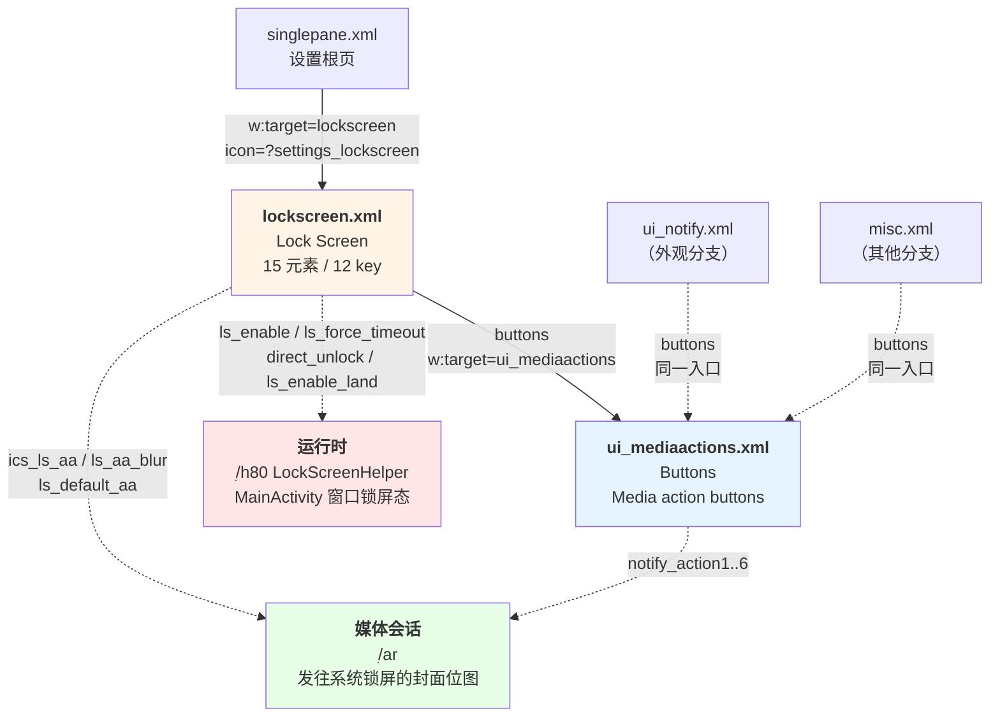

# Poweramp「设置 → 锁屏」分支总览

> **本文定位**：锁屏分支的**入口总览 + 四份专文的导航地图**。
> 只写"这一支由什么组成、各部分写在哪儿、彼此如何咬合"；**不重述**任何一条偏好的细节——
> 细节全部落在四份专文里，本文只给索引与边界。

## 0. 一句话结论

锁屏分支由**两个页面 + 一个运行时**构成：设置页 `lockscreen`（12 key）通过唯一一个 `buttons` 跳转到子页 `ui_mediaactions`（6 个下拉框）；而这两个页面上**一半的开关并不改变设置页本身**，它们驱动的是 `MainActivity` 的**窗口锁屏态**（`ׅ/h80` = `LockScreenHelper`）与**系统媒体会话的封面内容**（`ׅ/ar`）。**设置页是壳，真正的锁屏在 Activity 窗口层。**

## 1. 文档地图

| 文档 | 覆盖层 | 规模 | 回答什么问题 |
| --- | --- | ---: | --- |
| **本文** | 分支骨架 | — | 这一支有几个页面、谁跳谁、每个开关最终流向哪一层 |
| `poweramp-lockscreen-preference-tree.md` | **偏好结构层** | 1 106 行 | `lockscreen.xml` 12 个 key 逐条是什么、`la1` 助手做了哪 7 件事、依赖与默认值 |
| `poweramp-lockscreen-mediaactions-subpage.md` | **子页面层** | 1 158 行 | `ui_mediaactions` 6 个下拉框有什么选项、`TagListPreference` 怎么实现 |
| `poweramp-lockscreen-runtime.md` | **运行时层** | 2 094 行 | `ls_enable` 打开后窗口发生什么、5 秒计时器怎么跑、7 个开关的代码消费者在哪 |
| `poweramp-lockscreen-settings.md` | **首轮枚举**（status: draft） | 634 行 | build-1025 口径的首轮扫描；**部分结论已被上面三份修订**，见 §5 |
| `poweramp-lockscreen-residual-closure.md` | **残留未知闭合** | 444 行 | 把 runtime §13 的 8 条 R1–R8 逐条回头攻：**6 条闭合**（含偏好注册表机制、`WRITE_SETTINGS` 漏检确认、死字段确认） |

### 1.1 阅读顺序建议


**如果只读一篇**：读 `poweramp-lockscreen-runtime.md`。它回答"这个功能"而不是"这些字段"。
**如果要照着实现**：先 `preference-tree`（结构契约）→ 再 `runtime`（行为契约）→ 最后 `mediaactions`（可选增强项）。

---

## 2. 分支骨架：两页 + 一运行时

### 2.1 页面拓扑



【实证·原文】`res/xml/singlepane.xml:21`；`res/xml/lockscreen.xml:9`；`res/xml/ui_notify.xml:7`；`res/xml/misc.xml:10`

### 2.2 两个页面的身份

| | `lockscreen` | `ui_mediaactions` |
| --- | --- | --- |
| XML | `res/xml/lockscreen.xml`（21 行 / 3224 B） | `res/xml/ui_mediaactions.xml` |
| 资源 id | **`0x7f16001d`** | **`0x7f16002d`** |
| 标题实文 | **Lock Screen** | **Buttons** |
| 摘要实文 | **Poweramp lock screen options** | **Media action buttons** |
| helper | `ׅ/la1`（13557 B / 580 行） | `ׅ/y61`（25783 B / 1080 行） |
| 元素 / key | **15 / 12** | 见子页专文 |
| 分类数 | 2 | 2 |
| 跳转出去 | **1 个**（`buttons` → `ui_mediaactions`） | **0 个**（终端页） |
| 恢复默认 | ✅（`x11(15)` → `p71(6)`） | ✅（`x11(21)`） |

【实证·原文】`res/values/public.xml:11076`（lockscreen）、`:11092`（ui_mediaactions）
【实证·产物】`smali/ׅ/u61.smali:852-865`（`0x7f16001d` → `new Lׅ/la1;`）、`:807-825`（`0x7f16002d` → `new Lׅ/y61;`）

> **`restore_defaults` 是两页共有的收尾项**，但走**不同索引**：锁屏页 `x11(0xf)=15`，媒体按钮页 `x11(0x15)=21`。
> 全 App 共 **31 个页面**带 `restore_defaults` 键（`.rea-analysis/tools/probe_lead11_overview.py` 全量统计），
> 所以"恢复默认"是**页面级通用设施**，不是锁屏页专属。

### 2.3 入口身份：根页里的那一行

`res/xml/singlepane.xml:21`：

```xml
<com.maxmpz.audioplayer.preference.RedirectPreference
    android:icon="?settings_lockscreen"
    android:title="@string/pref_lock_screen"
    android:key="lockscreen"
    android:summary="@string/pref_summary_lock_screen"
    w:target="lockscreen"
    w:applyIconTint="false" />
```

| 属性 | 值 | 说明 |
| --- | --- | --- |
| `android:key` | `lockscreen` | **与目标 XML 同名**（区别于 `folders_library` → `library` 那种 key/target 不一致） |
| `w:target` | `lockscreen` | 即 `getIdentifier("lockscreen", "xml", pkg)` |
| `android:icon` | `?settings_lockscreen` | **主题属性**，不是直接 drawable 引用 |
| `w:applyIconTint` | `false` | 图标自带配色，不跟随主题 tint |

**图标是怎么解析的**（三级跳，值得单独记）：

| 层 | 位置 | 内容 |
| --- | --- | --- |
| 1. 属性声明 | `res/values/attrs.xml:959` | `<attr name="settings_lockscreen" format="reference" />` |
| 2. 主题赋值 | `res/values/styles.xml:10643` | `<item name="settings_lockscreen">@drawable/settings_lockscreen_colored</item>` |
| 3. 彩色包装 | `res/drawable/settings_lockscreen_colored.xml:2` | `<bitmap android:src="@drawable/settings_lockscreen" android:tint="#ffca7440" />` |

真正的位图只有一份：`res/drawable-xxxhdpi/settings_lockscreen.png`（3112 B）。
`_colored` 版本是**运行时着色包装**（`tint="#ffca7440"` 暖橙色），据此可解释为什么根页要写 `w:applyIconTint="false"`——**图标已经自己上过色了，再套一层主题 tint 会二次染色**。

【实证·原文】`attrs.xml:959`、`styles.xml:10643`、`drawable/settings_lockscreen_colored.xml:2`、`public.xml:738`/`:2839`/`:2840`

---

## 3. 12 个 key 按"最终流向"重分类

这是本文最重要的视角：**按设置页的视觉分组看，是"两个分类"；按代码的消费层看，是"三股流"。**

### 3.1 视觉分组（XML 原样）

| 分类 | 项数 | 语义 |
| --- | ---: | --- |
| `ics_ls_cat` = **Android Lock Screen** | 5（含 1 提示块） | 走**系统媒体会话**，无母开关 |
| `pref_poweramp_ls` = **Poweramp Lock Screen** | 5 | 走 **Poweramp 自绘窗口**，有母开关 `ls_enable` |
| 页尾 | 1 | `restore_defaults` |

### 3.2 按消费层重分类（本文核心）

| 流向 | key | 数量 | 消费代码 |
| --- | --- | ---: | --- |
| **① 窗口锁屏态**（`MainActivity` 窗口标志 / 朝向 / 计时器） | `ls_enable`、`ls_force_timeout`、`direct_unlock`、`ls_enable_land` | **4** | `ׅ/h80`（`LockScreenHelper`）、`ׅ/g80`（Window.Callback 包装）、`ׅ/t4`（Handler） |
| **② 系统媒体会话封面** | `ics_ls_aa`、`ls_aa_blur`、`ls_default_aa` | **3** | `ׅ/ar`；变更时发 `cmd_player_reregister_media_session`（`0x7f0d0206`） |
| **③ 纯导航/动作** | `buttons`、`ls_app_settings`、`restore_defaults` | **3** | 框架内建（`w:target` / `<intent>` / `x11→p71`） |
| **④ 无 key 提示块** | *（无）* | 1 元素 | 无 |

> **这张表解释了一个常见误读**：`ls_force_timeout` / `direct_unlock` / `ls_enable_land` 在设置页里**长得和普通开关一样**，
> 但它们的 helper `la1` **完全不碰它们** —— 依赖与取值全由框架处理，真正的行为发生在 `ׅ/h80` 的窗口操作里。
> 详见 `poweramp-lockscreen-runtime.md`。

### 3.3 三股流的触发方式差异

| 流 | 用户拨动开关后立即发生什么 |
| --- | --- |
| ① 窗口锁屏态 | **无立即反馈**（`la1` 只做权限校验与写值）；下一次锁屏/播放状态变化时由 `ׅ/h80` 读取新值生效 |
| ② 媒体会话封面 | **立即** 发 `cmd_player_reregister_media_session`（`ׅ/tc` 索引 7），让播放服务重注册媒体会话 |
| ③ 导航/动作 | 立即跳转或弹框 |

> **这个不对称是有道理的**：媒体会话是**一次性注册快照**，参数变了必须重新宣告，否则要等下次播放；
> 而窗口标志是**每次进入锁屏时现读**的，不需要提前通知。

---

## 4. 三个开关 vs 三个层：一张对照表

| 设置项 | 用户以为它控制什么 | 实际控制什么 | 证据 |
| --- | --- | --- | --- |
| `ls_enable`（Show On Lock Screen） | "锁屏上显示 Poweramp" | `MainActivity` 窗口加 `FLAG_SHOW_WHEN_LOCKED`（`0x80000`）/ SDK≥27 用 `setShowWhenLocked(true)` | `ׅ/h80` 的 `А(Z)` |
| `ls_force_timeout`（Shorter Timeout） | "锁屏超时变短" | **临时改写系统 `Settings.System.screen_off_timeout` 为 100 ms，1 秒后还原**；并装 `Window.Callback` 包装器做 5 秒无操作检测 | `ׅ/h80` + `ׅ/g80` + `ׅ/t4`（`pswitch_1f`） |
| `direct_unlock`（Direct Unlock） | "解锁直接进桌面" | SDK≥26 时调 `KeyguardManager.requestDismissKeyguard(activity, null)` —— **主动请求解除系统锁屏** | `ׅ/h80` 的 `А(Z)` |
| `ls_enable_land`（Landscape Layout） | "锁屏允许横屏" | 关时强制 `setRequestedOrientation(1)`（竖屏）；此外小屏设备上**该行被整条删除** | `ׅ/h80` + `ׅ/la1` |

> **`ls_force_timeout` 的真实语义最容易被误解**，而且**它确实是"更短超时"，但手段极端**：
> 它不是自建计时器，而是**直接改 Android 系统的熄屏超时**为 `0x64` = **100 ms**，再用 `sendMessageDelayed(what=2, arg1=原值, 0x3e8)`（**1 秒**）还原。
> 【实证·产物】`ׅ/t4.smali:12683-12846`（`"screen_off_timeout"` 在 `:12692`、`const/16 v6, 0x64` 在 `:12797`、`sendMessageDelayed` `0x3e8` 在 `:12817-12821`）
>
> **这解释了三个此前看起来无关的事实**：
> 1. 为什么它需要 **`WRITE_SETTINGS`**（"Modify system settings"）—— 写 `Settings.System` 必须持有；
> 2. 为什么 `strings.xml:1318` 的 `pref_poweramp_ls_permissions2` 专门提到这个权限；
> 3. 为什么这个逻辑不在 `ׅ/h80` 而在 `ׅ/t4`（Handler）里 —— 它需要**延迟回调自己**去还原。
>
> 而 `ׅ/g80` 的 5 秒（`0x1388`）计时器是**另一条独立机制**：那是"锁屏态下的无操作自动退出"，与 `ls_force_timeout` 无关，两者容易混为一谈。
> 详细逐行证据见 `poweramp-lockscreen-runtime.md` §3.2 / §4.5。

---

## 5. 与首轮文档 `poweramp-lockscreen-settings.md` 的关系

该文档（634 行，`status: draft`）是 **build-1025 口径的首轮枚举**，价值在于最早把 12 个 key 全列了出来。
本轮（build-1035）四份专文对它做了**逐条复核**，结果：

| 结论 | 条数 | 处理 |
| --- | ---: | --- |
| ✅ 经复核确认正确 | **12** | 直接采信，无需重读原文档 |
| ⚠️ 需要纠正 | **10** | 以四份专文为准；原文档相应位置已有标注 |
| 🆕 本轮新发现 | **12** | 原文档没有 |
| ❌ 一条被撤销 | 1 | 曾有"原文档码位写错"的说法，经字节复核**原文档本来就对**，该指控已撤销 |

明细见 `poweramp-lockscreen-preference-tree.md` §6。

**原文档 §9 的 9 个未解问题，本轮已闭合 3 个**：

| 原编号 | 问题 | 状态 |
| --- | --- | --- |
| Q5 | `ls_force_timeout` / `direct_unlock` 的消费代码 | ✅ 已解 → `runtime` 专文 |
| Q6 | 自绘锁屏本体在哪 | ✅ 已解 → `runtime` 专文（**不是独立 Activity/Service**） |
| Q7 | `p71(6)` 第一行是否冗余 | ✅ 已解 → `preference-tree` §5.6/§6.2（**冗余且幂等**） |

> 其余 Q1–Q4、Q8、Q9 属"静态不可判"（真机行为 / 产物外信息），已在各专文标注。

### 5.1 运行时侧 8 条残留未知（R1–R8）的最终状态

`runtime` 专文 §13 留了 8 条，`residual-closure` 专文逐条回头攻关，**6 闭合 / 3 降级**：

| # | 一句话结果 |
| ---: | --- |
| R1 | ✅ **闭合**：`er.В` 是偏好注册表的**脏位**（`er.А()` = `+1`，30 个调用点），不是广播计数器；注册表由 `О(X=2)` → `t2.х(map)` 构建，`v2` 桥接成 `SharedPreferences` |
| R2 | ✅ **闭合且否定**：`w2.В()`（线程池异步重建注册表）与 `MsgBus.post(0x7f0d0206)`（同步重注册媒体会话）**不等价**，是两条独立路径 |
| R3 | ⚠️ **降级**：`yx.х` 恒 0 已确认（`final synthetic` + 空 `<clinit>`）⇒ SDK≥31 上 10 秒节流失效；但"有意/遗漏"静态不可判 |
| R4 | ✅ **闭合**：被清的 3 位是**前台优先级**，锁屏激活时强制降为 1；类名 `PSForegroundHelper` |
| R5 | ⚠️ **降级**：`setRequestedOrientation(1)` 无恢复，倾向"遗漏"，需真机验证 |
| R6 | ⚠️ **降级**：`onCreate`/`onNewIntent` 返回值不是语义矛盾，是两处 API 约束不同 |
| R7 | ✅ **确认缺陷**：全工程 0 处 `Settings.System.canWrite` ⇒ 未授权时 `ls_force_timeout` **静默失效** |
| R8 | ✅ **确认死字段**：`h80.H` 零读取 |

> 明细见 `poweramp-lockscreen-residual-closure.md`。

---

## 6. 跨分支耦合点

锁屏分支**不是孤岛**，有三处硬耦合：

| 耦合 | 内容 | 影响 |
| --- | --- | --- |
| **`buttons` 三页同名** | `lockscreen:9` / `ui_notify:7` / `misc:10`，**逐字节同构**，都指向 `ui_mediaactions` | 同一入口三处出现；但**可见性不一致**：`ui_notify` 在 SDK<33 时把该行删掉（`ׅ/z61`），另两页不删 |
| **`ui_mediaactions` 是终端页** | 只收不改，无 `w:target` 出口 | 从三个入口进来看到的是**同一份内容**，没有分支 |
| **`ui_mediaactions` 属外观分支** | 它被 `ui_notify`（外观分支）也引用 | 锁屏页跳进的是**外观分支的页面**；分类归属上是跨分支的 |

`buttons` 的可见性差异（全 App 45 条 `w:target` 边中唯一一处"同目标不同门控"）：

| 页面 | 行 | helper 是否门控 |
| --- | ---: | --- |
| `lockscreen.xml` | 9 | ❌ `la1` 完全不引用 `buttons` |
| `ui_notify.xml` | 7 | ✅ `ׅ/z61` 在 `nr0.В`（SDK<33）时 `removePreference` |
| `misc.xml` | 10 | ❌ `sa1` 不引用 |

【实证·产物】`smali/ׅ/z61.smali:521`（`"buttons"`）、`:541`（`nr0.В` 判定）、`:553`（`removePreference`）

> **是否有意无法判定**：`la1` / `sa1` 对该 key 零引用，
> 静态分析无法区分"有意不门控"与"忘了加"。列为未解项。

---

## 7. 搜索索引与深链

| 项 | 结论 | 证据 |
| --- | --- | --- |
| `lockscreen.xml` 根节点 `skipSearch` | **无** → 整份进 FTS | 【实证·原文】全文无 `skipSearch` |
| `lockscreen.xml` 条目级排除 | 有（提示块等无 key 项天然不落库） | 见 `preference-tree` 专文 |
| `ui_mediaactions.xml` 根节点 `skipSearch` | **无** → 整份进 FTS | 【实证·原文】全文无 `skipSearch` |
| 深链入口 | `settings/lockscreen`；`settings/lockscreen#buttons` 亦有效 | `preference-tree` / 根结构文档 §4.2 |
| 深链出口 | **无 `#` 锚点出口**（不像耳机页有 `misc#long_volume_controls`） | 本页唯一出口是整页跳转 |

> **`ui_mediaactions` 的深链歧义**：`settings/lockscreen#buttons`、`settings/ui_notify#buttons`、`settings/misc#buttons`
> 三个锚点**都有效但落到同一页面**；搜索索引也会出现 3 条同名结果。
> 这是"一个入口在三处出现"的必然副作用，不是 bug，但实现时若要避免歧义，**门控条件应集中定义**。

---

## 8. 对 SpMusic 的结论（桌面端边界）

SpMusic 是 **Tauri + React 桌面本地音乐播放器**，无 Android、无系统锁屏。本分支的**条目级能力一个都不可移植**。

**可借鉴的只有 3 条设计思想**（详细论证见 `poweramp-lockscreen-preference-tree.md` §8 与 `runtime` 专文）：

1. **「基础设施永开 / 自增强可选」双轨制** —— 系统媒体会话（Windows SMTC / Linux MPRIS）被第三方消费，**不应提供关闭开关**；纯自用的浮窗/桌面歌词才配开关。
2. **权限闸门必须"返回失败并回滚开关"** —— 只弹框不阻止，用户会以为已生效。Poweramp 的 `la1.I()` 是全 App 少见的 `return false` 回滚模式。
3. **自建计时器 ≠ 系统超时** —— `ls_force_timeout` 的教训：若文案写"更短超时"，实现就应真的动系统超时；自建 5 秒计时器却沿用该文案，是**文案与实现脱节**的反例。

> **明确不借鉴**：默认值双源（XML `defaultValue` + `vr.<clinit>` 手工同步 7/7）；用同一 `android:dependency`
> 属性表达"能力从属"与"相关性门控"两种语义。

---

## 9. 证据索引

| 主题 | 路径 : 行 |
| --- | --- |
| 根页锁屏入口（含 icon/target） | `res/xml/singlepane.xml:21` |
| 锁屏页 XML 全文 | `res/xml/lockscreen.xml:1-21` |
| 子页 XML 全文 | `res/xml/ui_mediaactions.xml` |
| 三处 `buttons` | `res/xml/lockscreen.xml:9` / `ui_notify.xml:7` / `misc.xml:10` |
| 页面资源 id | `res/values/public.xml:11076`（lockscreen）、`:11092`（ui_mediaactions） |
| 图标属性三级跳 | `attrs.xml:959` → `styles.xml:10643` → `drawable/settings_lockscreen_colored.xml:2` |
| 图标位图 | `res/drawable-xxxhdpi/settings_lockscreen.png`（3112 B） |
| 分发表 | `smali/ׅ/u61.smali:852-865`（la1）、`:807-825`（y61） |
| 页面钩子 | `smali/ׅ/n91.smali:2763`（`abstract v()`）、`:2770`（调用） |
| `restore_defaults` 索引差异 | `la1`=`x11(15)`、`y61`=`x11(0x15=21)` |
| `buttons` SDK 门控 | `smali/ׅ/z61.smali:521` / `:541` / `:553` |
| 全 App `restore_defaults` 页面数（31） | `.rea-analysis/tools/probe_lead11_overview.py` |
| 全 App `w:target` 边（45 条） | `.rea-analysis/tools/probe_lead1.py` |
| 窗口锁屏总开关 | `smali/ׅ/h80.smali:246-481`（`А(Z)`） |
| 窗口锁屏入口判定 | `smali/ׅ/h80.smali:483-875`（`В(Intent)Z`） |
| 5 秒无操作计时 | `smali/ׅ/g80.smali:62` / `:71` |
| 系统超时改写 | `smali/ׅ/t4.smali:12692`（`screen_off_timeout`）、`:12797`（`0x64`） |
| 媒体会话封面写入 | `smali/ׅ/ar.smali:4587`（`android.media.metadata.ALBUM_ART`） |
| 偏好注册表脏位 | `smali/ׅ/er.smali:129-146`（`А()` = `+1`） |
| **偏好结构层** | `docs/architecture/poweramp-lockscreen-preference-tree.md`（1 106 行） |
| **子页面层** | `docs/architecture/poweramp-lockscreen-mediaactions-subpage.md`（1 158 行） |
| **运行时层** | `docs/architecture/poweramp-lockscreen-runtime.md`（2 094 行） |
| **残留未知闭合层** | `docs/architecture/poweramp-lockscreen-residual-closure.md`（444 行） |
| 首轮枚举（对照用） | `docs/architecture/poweramp-lockscreen-settings.md`（634 行，`status: draft`） |

---

## 10. 收尾清单（本分支的完整性自检）

| 检查项 | 状态 |
| --- | :---: |
| 锁屏根页 `lockscreen.xml` 全部 15 元素 / 12 key 逐条实证 | ✅ `preference-tree` §2 |
| 7 个状态字段与 XML `defaultValue` 双源核对（7/7） | ✅ `preference-tree` §3.4 |
| `la1` helper 逐段解析（`I()` 权限闸门 + `v()` 7 动作） | ✅ `preference-tree` §4 |
| 唯一子页 `ui_mediaactions` 全部元素 + 6 个下拉框选项 | ✅ `mediaactions` §1 / §6 |
| `TagListPreference` 四数组实现 | ✅ `mediaactions` §5 |
| 自绘锁屏本体定位（**结论：不是独立组件**） | ✅ `runtime` §1 |
| 7 个开关的运行时消费者逐个落行 | ✅ `runtime` §9 |
| `ls_force_timeout` 真实实现（改系统超时） | ✅ `runtime` §4.5 |
| 原有 Q5 / Q6 / Q7 三条未解 | ✅ 全部闭合 |
| 运行时 R1 / R2 / R4 / R7 / R8 | ✅ 全部闭合 |
| 运行时 R3 / R5 / R6 | ⚠️ 降级为设计判断（需真机） |
| 跨分支耦合（`buttons` 三页同名 + 可见性不一致） | ✅ 本文 §6 |
| 搜索索引参与情况 | ✅ 本文 §7 |
| 桌面端可移植性结论 | ✅ 本文 §8 + `preference-tree` §8 |

> **统计口径**：本分支共 **6 份文档 / 5 797 行**（含首轮枚举）。
> 行数以 `.rea-analysis/tools/count_docs.py` 的 `splitlines()` 为准（跨 LF/CRLF 一致）。
