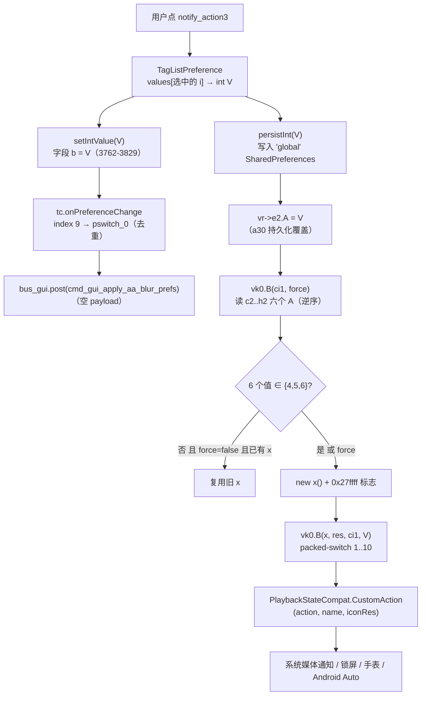

# Poweramp「设置 → 锁屏 → Buttons」子页（`ui_mediaactions`）完整实现

> **证据分级**：【实证·原文】= XML / 资源原文；【实证·产物】= 反编译 smali 产物；【推断】**= 无直接代码佐证。
> 全部结论基于 **build-1035-bundle-play**（`versionCode 1035009`），反编译根 `D:\SpMusic\.rea-analysis\v1035\decoded\`。
> **包名码位提示**：混淆后包目录名与类描述符**完全一致**，均为 `ׅ` = **U+05C5**（希伯来文元音符号）。全树 `U+05C5` 出现 162782 次 / 3778 个文件，`U+8ACC`、`U+8B8C`、`U+8B0C` 出现 **0 次**。本文所有 smali 路径写作 `smali/ׅ/xxx.smali`。

---

## 0. 一句话结论

本页 **16 行 XML / 9 个元素 / 7 个 key**，是锁屏根页**唯一的跨分支出口**（`lockscreen.xml:9` → `ui_mediaactions`）。结构上它极简：**1 个四行提示块 + 2 个分类 + 6 个同构下拉框 + 页尾恢复默认**。真正的复杂度**全部在控件与消费侧**：6 个 `TagListPreference` 共用**同一组四个数组**（11 项菜单），把一次点击变成一个 **0..10 的协议整数**存进 `"global"`；该整数随后被 `vk0` 用 `packed-switch 0x1..0xa` 翻译成 **10 种不同的 `PlaybackStateCompat.CustomAction`**，挂到系统媒体会话上——**本页是全 App 唯一能改变锁屏/通知/手表/Android Auto 上「按哪些键」的入口**。

**六个下拉框 = 媒体会话的 6 个自定义动作槽位**，不是 6 个独立功能。

---

## 1. 页面身份

| | |
| --- | --- |
| XML 文件 / 资源 id | `res/xml/ui_mediaactions.xml` / **`0x7f16002d`**【实证·原文】`public.xml:11092` |
| 行数 / 字节 | **16** / **2796** |
| 根节点 | `<PreferenceScreen android:title="@string/buttons">`（标题 = **Buttons**） |
| 元素总数 | **9**（1 提示块 + 2 分类 + 6 下拉框 + 1 页尾动作 = 但分类本身也计入元素） |
| `android:key` | **7**（6 状态 + 1 动作） |
| 无 key 条目 | **1**（顶部四行提示块） |
| 设置页 helper | **`ׅ/y61.smali`**（1080 行 / 25783 B） |
| helper 基类 | **`ׅ/n91`**（`.super Lׅ/n91;`，`y61.smali:2`）—— abstract，4122 行 / 51 方法 |
| 状态字段注册表 | **`ׅ/vr.smali`** 的 `<clinit>`（`vr.smali:3137-3239`） |
| 消费者 | **`ׅ/vk0.smali`**（媒体会话构建器，2398 行） |
| 搜索索引 | 根节点无 `skipSearch` → 整份 XML 进 FTS |
| 分类标题 | **Notification/Android Auto**（`notify_android_auto`）/ **Android Auto/Other**（`android_auto_other`） |

### 1.1 完整 XML（16 行，逐行）

【实证·原文】`res/xml/ui_mediaactions.xml:1-16`

```xml
 1: <?xml version="1.0" encoding="utf-8"?>
 2: <PreferenceScreen android:title="@string/buttons"
 3:   xmlns:android="..." xmlns:z="..." xmlns:w="...">
 4:     <...RawTextPreference w:line1="@string/media_notify_actions_unified_hint"
          w:smallLine2="...hint2" w:smallLine3="...hint3" w:smallLine4="...hint4" />
 5:     <PreferenceCategory android:title="@string/notify_android_auto">
 6:         <...TagListPreference android:title="@string/pref_notify_action1" android:key="notify_action1"
              w:entries="..." w:values="..." w:summaries="..." w:icons="..." />
 7:         <...TagListPreference android:title="@string/pref_notify_action2" android:key="notify_action2" ... />
 8:     </PreferenceCategory>
 9:     <PreferenceCategory android:title="@string/android_auto_other">
10:         <...TagListPreference android:title="@string/pref_notify_action3" android:key="notify_action3" ... />
11:         <...TagListPreference android:title="@string/pref_notify_action4" android:key="notify_action4" ... />
12:         <...TagListPreference android:title="@string/pref_notify_action5" android:key="notify_action5" ... />
13:         <...TagListPreference android:title="@string/pref_notify_action6" android:key="notify_action6" ... />
14:     </PreferenceCategory>
15:     <Preference android:title="@string/pref_restore_defaults" android:key="restore_defaults" />
16: </PreferenceScreen>
```

### 1.2 全部文案（英文实文）

| 用途 | 资源名 | 英文实文 | 行 |
| --- | --- | --- | ---: |
| 页面标题 | `buttons` | **Buttons** | `strings.xml:174` |
| 分类一 | `notify_android_auto` | **Notification/Android Auto** | `strings.xml:841` |
| 分类二 | `android_auto_other` | **Android Auto/Other** | `strings.xml:76` |
| 条目 1-6 | `pref_notify_action1..6` | **Button 1** … **Button 6** | `strings.xml:1252-1257` |
| 页尾 | `pref_restore_defaults` | **Restore Defaults** | `strings.xml:1366` |

### 1.3 顶部提示块：`w:line1` + `smallLine2/3/4` **四行槽位**

这是本页与锁屏页**最明显的排版差异**：锁屏页的提示块用的是 `android:summary` + `w:keepPaddings`（单段），而本页用的是 **`RawTextPreference` 的四个独立文本槽位**【实证·原文】`ui_mediaactions.xml:4`。

| 槽位 | 资源 | 英文实文 | 行 |
| --- | --- | --- | ---: |
| `w:line1` | `media_notify_actions_unified_hint` | The media buttons are unified for all media controllers, such as Android 13+ media notification, Android Auto, watches, etc. | `strings.xml:742` |
| `w:smallLine2` | `..._hint2` | The playback control buttons (play/pause/prev./next) are fixed and can't be changed | `strings.xml:743` |
| `w:smallLine3` | `..._hint3` | First two buttons are available in the media notification, other actions are usually visible only in other media controllers (Android Auto) | `strings.xml:744` |
| `w:smallLine4` | `..._hint4` | Android Auto shows 2 actions if only 2 actions are set, or 1 action and overflow menu for more than 2 actions | `strings.xml:745` |

**四行是四种不同性质的说明，不是同一句的拆分**：

| 行 | 性质 | 说清了什么 |
| --- | ---: | --- |
| `line1` | **归一性声明** | 六个槽位是**所有媒体控制器共享**的（Android 13+ 通知 / Android Auto / 手表） |
| `smallLine2` | **不可配置边界** | 播放控制键（play/pause/prev/next）**固定，不在这六个槽位里** |
| `smallLine3` | **可见性差异** | 只有前两个（Button 1/2）进媒体通知；Button 3-6 通常只在其他控制器（Android Auto）可见 |
| `smallLine4` | **降级规则** | Android Auto 在 >2 个动作时退化为「1 个动作 + 溢出菜单」 |

> **`smallLine3` 与两个分类的划分完全对应**——分类一（Button 1/2 = 进通知）vs 分类二（Button 3-6 = 只在 AA/其他）。**提示不是营销文案，是精确的规格说明。**

属性定义【实证·原文】`attrs.xml:1557`（`line1`）、`:2118`（`smallLine2`）、`:2120`（`smallLine4`）；`line2`/`line3`/`line4` 在 `:1558-1560`。**注意 `smallLine3` 没有在 attrs.xml 中单独命中**（`:2118`/`:2120` 分别只有 `smallLine2`/`smallLine4`），说明 `smallLine3` 定义在别处或与其它属性同批次，本文不对此下结论。

---

## 2. 三个入口归一（本子页的架构特点）

### 2.1 三处 `buttons` 逐字节同构

`w:target="ui_mediaactions"` 的**全部**来源仅 3 处【实证·原文】：

| 来源页 | 行 | 完整原文 |
| --- | ---: | --- |
| `lockscreen.xml` | 9 | `<...RedirectPreference android:title="@string/buttons" android:key="buttons" android:summary="@string/notify_action_buttons" w:target="ui_mediaactions" />` |
| `ui_notify.xml` | 7 | 同上（逐字节相同） |
| `misc.xml` | 10 | 同上（逐字节相同） |

三者的 key（`buttons`）、标题（`@string/buttons` = **Buttons**）、摘要（`@string/notify_action_buttons` = **Media action buttons**，`strings.xml:840`）、target（`ui_mediaactions`）**四要素完全一致**。

### 2.2 为什么指向同一页

因为「媒体动作按钮」是**一份共享配置，不是三份**。归一性由提示块第一行明文写出：**"The media buttons are unified for all media controllers"**（`strings.xml:742`）。锁屏、通知、其他三个设置入口只是**同一份配置的三个可达路径**——用户在哪个上下文里想起来要改按钮，都能就近进入同一页。

> **架构含义**：这不是「三处重复配置」，而是**一次配置、三处入口**。如果拆成三份独立配置，用户在通知页改了 Button 1，锁屏页的 Button 1 不变——那才是 bug。

### 2.3 同一入口在 `ui_notify` 页**会被删除**

| 页面 | helper | 是否删 `buttons` | 依据 |
| --- | --- | :---: | --- |
| `ui_notify` | `z61` | **是**（`SDK < 33` 时） | 【实证·产物】`z61.smali:521-553` |
| `lockscreen` | `la1` | 否 | helper 全文不引用该 key |
| `misc` | `sa1` | 否 | 同上 |

删除逻辑在 `z61.R()`（`z61.smali:236-586`）内【实证·产物】`z61.smali:521-553`：

```asm
521: const-string v0, "buttons"
529: invoke-virtual {v1, v0}, PreferenceGroup;->findPreference(...)
537: if-eqz v0, :cond_b                    ; 没找到就跳过
541: sget-boolean v1, Lׅ/nr0;->В:Z         ; ★ SDK>=33 标志
545: if-nez v1, :cond_8                    ; В==true（SDK>=33）→ 保留
549: iget-object v1, p0, Lׅ/n91;->K:Landroid/preference/PreferenceScreen;
553: invoke-virtual {v1, v0}, PreferenceGroup;->removePreference(...)   ; ★ 删除
```

`nr0.В` 的判定【实证·产物】`nr0.smali:7`（`.field public static final В:Z`）、`:15-38`（`<clinit>`）：

```asm
15: sget v0, Landroid/os/Build$VERSION;->SDK_INT:I
19: const/16 v1, 0x21                    ; ★ 0x21 = 33
23: if-lt v0, v1, :cond_0                ; SDKINT >= 33 → true
27: const/4 v0, 0x1
34: :cond_0 → const/4 v0, 0x0
38: sput-boolean v0, Lׅ/nr0;->В:Z
```

`R()` 的唯一调用点【实证·产物】`z61.smali:1306`。

**结论**：`SDK >= 33` 时三页都显示入口；`SDK < 33` 时**只有「通知」页的入口消失**，「锁屏」和「其他」页仍在。**【推断】** 动机是 Android 13 起通知媒体控件由系统统一管理，通知页的自定义按钮语义弱化；但锁屏页与 misc 页的入口是「通用媒体按钮」，不受影响。**无法从静态代码区分这是有意设计还是遗漏**（`la1`/`sa1` 完全不引用该 key）。

### 2.4 三处同名 key 不构成覆盖冲突（有证据）

| 环节 | 证据 |
| --- | --- |
| 类是 `RedirectPreference` | 【实证·原文】三处 XML 的控件类型 |
| `RedirectPreference extends RawTextPreference` | 【实证·产物】`RedirectPreference.smali:2`（`.super Lcom/maxmpz/audioplayer/preference/RawTextPreference;`） |
| `RawTextPreference` 构造期**无条件** `setPersistent(false)` | 【实证·产物】`RawTextPreference.smali:174-177`（`const/4 v3, 0x0` → `setPersistent(Z)V`） |
| 三处 XML 均无 `android:persistent` | 走类内默认 |

> **所以 `buttons` 从不写入 `"global"` SharedPreferences**。它在三页的唯一作用是：① 让 `findPreference` 能定位；② 让搜索索引记录；③ 让深链 `settings/<page>#buttons` 命中。**同名不写值 = 无冲突**。

**两个真实差异**（与 `poweramp-lockscreen-settings.md` §7.2 一致，此处补充机制细节）：

| 差异 | 说明 |
| --- | --- |
| **可见性不一致** | `z61.R()` 在 `SDK<33` 时删除 `ui_notify` 的该条目；`la1`/`sa1` 都不删 |
| **深链锚点歧义** | `settings/lockscreen#buttons`、`settings/ui_notify#buttons`、`settings/misc#buttons` 三个锚点都有效但指向**同一页面** |

---

## 3. `y61.smali` 完整解析

`smali/ׅ/y61.smali`，**1080 行 / 25783 B**，`.class public final Lׅ/y61;`（`:1`），`.super Lׅ/n91;`（`:2`）。

### 3.1 结构总览

| 成员 | 行 | 说明 |
| --- | ---: | --- |
| `.field public final synthetic j:I` | 7 | **index**（构造期 `iput`，`v()`/`onBusMsg` 据此 switch） |
| `.field public final k:Ljava/lang/Object;` | 9 | **监听器/标记对象**（三态：`tc(1)` / `tc(9)` / 裸 `Object`） |
| `<init>(SettingsActivity, u61, int, int)` | 13-116 | 存 index → 按 index 选 XML → 建 `k` |
| `onBusMsg(MsgBus,int,int,int,Object)` | 120-336 | 扫描进度回调（仅 index 1 有意义） |
| `v()` | 338-1080 | **装配**：按 index 走三个分支 |

### 3.2 构造函数：`j` 存 index、`k` 存三态对象

【实证·产物】`y61.smali:13-116`（关键 6 行）：

```asm
 13: .method public constructor <init>(L...SettingsActivity;Lׅ/u61;II)V
 17: iput p4, p0, Lׅ/y61;->j:I            ; ★ 第 4 参 = index → j
 21: const v0, 0x7f16002a                ; ★ 备用页名 = ui (0x7f16002a)
 26: packed-switch p4, :pswitch_data_0    ; ★ 按 index 选「页名 id」与「k 字段」
 31: const p4, 0x7f160026                ; ★ 默认分支页名 = singlepane
 36: invoke-direct {p0, p1, p2, p3, p4}, Lׅ/n91;-><init>(...)V
```

**必须先分清 `y61` 传给 `n91` 的两个 id**（`n91.<init>(SettingsActivity, m91, int p3, int p4)`，`n91.smali:68`）：

| `n91` 参数 | 落字段 | 用途 | 证据 |
| --- | --- | --- | --- |
| **`p3`** | **`n91.y`**（`:249`） | **真正被 inflate 的 XML**：`A(p3)` → `addPreferencesFromResource(p3)`（`:423` / `:897`） | 【实证·产物】 |
| **`p4`** | **`n91.C`**（`:253`） | **「页名」id**，只用于取资源条目名做标题：`р()` 取 `getResourceEntryName(C)`（`:3390` / `:3415`），`C==0` 直接返回 null（`:3394`） | 【实证·产物】 |

**`y61` 调用 `n91.<init>` 时：`p3` 永远是外部传入的真实 target id（未被改写）；只有第 5 参（`p4`/页名）在默认分支被改成 `singlepane`。** 所以**每个页面都 inflate 到自己正确的 XML**，只有「页名」可能不同。

三个分支逐条【实证·产物】：

| index | 目标标签 | 传给 `n91` 的 `p3`（=**真实 XML**） | 传给 `n91` 的 `p4`（=**页名**） | `k` 字段内容 |
| ---: | --- | --- | --- | --- |
| `0x1` | `:pswitch_1`（`:86`） | **未改写** = u61 传入的 `0x7f16002c` = **`ui_lyrics`** | `v0` = `0x7f16002a`（`ui`，`:21`/`:87`） | `new Object()`（裸标记，`:92`/`:101`） |
| `0x2` | `:pswitch_0`（`:60`） | **未改写** = u61 传入的 `0x7f16002d` = **`ui_mediaactions`** ★ | `v0` = `0x7f16002a`（`ui`，`:21`/`:61`） | **`tc(9, this)`**（`:70-79`）★ |
| **其他（含 0）** | **默认**（`:31`） | **未改写** = u61 传入的 `0x7f160001` = **`aa_bg`** | **`p4` 被覆盖为 `0x7f160026`（`singlepane`，`:31`）** | **`tc(1, this)`**（`:45-53`） |

> **页名的作用仅是"标题来源"**：`n91.р()`（`:3383-3446`）读 `C` → `getResourceEntryName(C)` → 得到页面资源名（如 `"ui"` / `"singlepane"`），供 `SettingsActivity` 做深链/返回栈识别。`C==0` 时返回 null（`:3394`），表示"无页名"。
>
> **【推断】** `aa_bg` 的页名被硬写成 `singlepane`，可能因为它是从根页直接进入的二级页，或历史遗留。**这不影响 XML inflate**——`aa_bg` 页面结构完全正常（已由 `y61.v()` 的 `pswitch_1` 分支证实它找得到 `aa_blur_enabled` 等 10 个键）。

### 3.3 `onBusMsg`：只服务 index=1（歌词页扫描进度）

【实证·产物】`y61.smali:120-336`。`packed-switch v0`（`:128`，`v0` = `j`，`:124`），表在 `:332-335`：

| index | 目标 | 行为 |
| ---: | --- | --- |
| `0x1` | `:pswitch_0`（`:144`） | **扫描进度刷新**（见下） |
| 其他 | 默认 | `invoke-super` 转发给 `n91.onBusMsg` 后返回（`:133`/`:141`） |

`:pswitch_0` 逻辑（`:144-317`）：

| 步骤 | 行 | 内容 |
| --- | ---: | --- |
| 参数重排 | 145-158 | 把 `p1..p5` 重排以匹配 `n91.onBusMsg` 调用约定 |
| 消息过滤 | 160-192 | 只认 4 个 id：`0x7f0d0045`/`0x46`/`0x47`/`0x48`（`msg_app_dir_scan_started`/`finished`、`msg_app_tag_scan_started`/`finished`，`public.xml:6991-6994`） |
| 取进度条条目 | 218-231 | `findPreference("rescan_lyrics_tags")` → `check-cast ProgressPreference` |
| 清旧回调 | 246-250 | `n91.X`（Handler）`removeCallbacksAndMessages(k)` |
| 读扫描状态 | 259-282 | `StateBusHelper.fromContextMainThOrThrow(ctx, 0x7f0d015b)`（`bus_app`）→ `getIntState(0x7f0d004c)`（`state_app_scanning`） |
| 延迟 100ms 更新 | 285-312 | `new qk(progress, 2, this, pref)` → `postAtTime(runnable, k, uptimeMillis+100)` |
| 转发 | 321 | `invoke-super` 转发 |

> **`onBusMsg` 对本页（ui_mediaactions）完全无作用**：它只处理 `j == 1`（`ui_lyrics`）。这是 `y61` 被复用的副作用——一个 helper 类要同时满足三个页面的事件订阅。

### 3.4 `v()`：`packed-switch` + 三个分支

【实证·产物】`y61.smali:338-1080`。开头【实证·产物】`:338-346`：

```asm
338: .method public final v()V
342: iget v0, p0, Lׅ/y61;->j:I            ; ★ index
346: packed-switch v0, :pswitch_data_0    ; ★ 表在 :1075-1079
```

**表在文件末尾**【实证·产物】`y61.smali:1075-1079`：

| index | 目标标签 | 行 | 归属页面 |
| ---: | --- | ---: | --- |
| `0x0` | **`:pswitch_1`** | **`:811`** | **`aa_bg`（背景页）** |
| `0x1` | `:pswitch_0` | `:522` | `ui_lyrics`（歌词页） |
| **其他** | **默认分支**（`:351` 起） | `:351-519` | **`ui_mediaactions`（本页）** ★ |

> **关键：本页走的是「默认分支」，不在表里。** index=0（`aa_bg`）才是表里那个 0。这与很多设置页「默认即 index 0」的惯例相反，是本 helper 最易读错的地方。

#### 3.4.1 默认分支 = 本页（`:351-519`）：6 个 all-bind + 1 个 restore

装配顺序【实证·产物】`y61.smali:351-519`：

| # | 行 | 动作 |
| ---: | ---: | --- |
| 1 | 351 | `const-string v0, "notify_action1"` |
| 2 | 355-364 | `n91.K`（PreferenceScreen）`.findPreference` → `move-result-object v0` |
| 3 | **367-371** | `iget-object v1, p0, Lׅ/y61;->k` → **`check-cast v1, Lׅ/tc;`** ★ 取一次，复用到底 |
| 4 | **375** | `v0.setOnPreferenceChangeListener(v1)` |
| 5 | 380-480 | `notify_action2..6` **逐一重复**：`const-string` → `findPreference` → **同一个 `v1`** `setOnPreferenceChangeListener` |
| 6 | 485-498 | `findPreference("restore_defaults")` |
| 7 | **501-509** | `new x11(0x15, this)` ★ |
| 8 | **514** | `setOnPreferenceClickListener(v1)` |
| 9 | 519 | `return-void` |

六个 key 逐一对照【实证·产物】：

| key | `const-string` 行 | `findPreference` 行 | `setOnPreferenceChangeListener` 行 |
| --- | ---: | ---: | ---: |
| `notify_action1` | 351 | 359 | 375 |
| `notify_action2` | 380 | 388 | 396 |
| `notify_action3` | 401 | 409 | 417 |
| `notify_action4` | 422 | 430 | 438 |
| `notify_action5` | 443 | 451 | 459 |
| `notify_action6` | 464 | 472 | 480 |

> **`k` 只 `iget` 一次（`:367`）然后复用**：因为 6 个下拉框**必须共用同一个 `tc` 实例**——`tc` 的状态机是「把新值写入当前槽位，并把其它槽位的同值项清成 0」（§8.1），只有共享实例才能跨槽位去重。

**`restore_defaults` 用 `x11(0x15)` = 21**【实证·产物】`y61.smali:505`：

```asm
501: new-instance v1, Lׅ/x11;
505: const/16 v2, 0x15                     ; ★ 21（十进制）
509: invoke-direct {v1, v2, p0}, Lׅ/x11;-><init>(ILjava/lang/Object;)V
514: invoke-virtual {v0, v1}, Preference;->setOnPreferenceClickListener(...)
```

`x11` 的 `onPreferenceClick` 按该 index 走 `packed-switch`（`x11.smali:62`，表在 `:848-875`，0→`pswitch_18` … 24→`pswitch_0`）。**index 21 → `pswitch_3`**（`:276`）【实证·产物】`x11.smali:276-299`：

```asm
276: :pswitch_3
277: check-cast v3, Lׅ/y61;               ; ★ 目标对象是 y61
281: new-instance p1, Lׅ/p71;
285: const/16 v0, 0xa                     ; ★ p71 index = 10
289: invoke-direct {p1, v0, v3}, Lׅ/p71;-><init>(ILjava/lang/Object;)V
294: invoke-virtual {v3, v1, p1, v2}, Lׅ/n91;->m(Runnable;Runnable;I)V
```

即 **恢复默认 = 弹确认框（`n91.m`）→ 确认后跑 `p71(10)`**。

`n91.m(Runnable, Runnable, int)`【实证·产物】`n91.smali:2190-2230`：

```asm
2190: .method public final m(Ljava/lang/Runnable;Ljava/lang/Runnable;I)V
2198: iget v0, p0, Lׅ/n91;->y:I           ; ★ 标题资源
2202: invoke-direct {v2, p0, v0, p1}, Lׅ/b6;-><init>(...)   ; 主按钮 → p1
2210: const v1, 0x7f0805f6                ; ★ pref_restore_defaults_msg
2224: invoke-virtual/range {v0 .. v5}, Lׅ/n91;->l(ILjava/lang/Runnable;Ljava/lang/Runnable;IZ)V
```

`0x7f0805f6` = `pref_restore_defaults_msg` = **"All options on this page will be restored to the default values"**【实证·原文】`public.xml:5532` / `strings.xml:1367`。

`p71(10)` → `pswitch_c`【实证·产物】`p71.smali:748-758`（表 `:1206`，0→`pswitch_16` … 22→`pswitch_0`，故 10→`pswitch_c`）：

```asm
748: :pswitch_c
749: check-cast v6, Lׅ/y61;               ; ★ 确认目标确实是本页 helper
753: invoke-virtual {v6, v4}, Lׅ/n91;->s(Z)V
```

`n91.s(Z)`【实证·产物】`n91.smali:2579-2617`：

```asm
2579: .method public final s(Z)V
2587: const v1, 0x7f0d0034                ; ★ bus_player_cmd
2592: invoke-static {v0, v1}, MsgBusHelper;->fromContextOrThrow(...)
2606: const v3, 0x7f0d00e0                ; ★ cmd_player_recreate_notification
2611: invoke-interface {v0, v3, p1, v1, v2}, MsgBus;->post(IIILjava/lang/Object;)V
```

> **恢复默认的真正副作用是 `cmd_player_recreate_notification`**（`0x7f0d00e0`，`public.xml:7146`）：通知的按钮集合变了，必须重建通知。**这与锁屏页的 `p71(6)` 发 `n91.y()`（刷新系统服务）是不同手法**（锁屏文档 §6.7）。

**`p71(10)` 与 lockscreen `x11(0xf)=15 → p71(6)` 的对照**：

| 页面 | helper | `x11` index | 落到 | `p71` index | `p71` 分支 | 行为 |
| --- | --- | ---: | --- | ---: | --- | --- |
| `ui_mediaactions` | `y61` | **21**（`0x15`） | `pswitch_3`（`x11.smali:276`） | **10** | `pswitch_c`（`p71.smali:748`） | `n91.s()` → 重建通知 |
| `lockscreen` | `la1` | 15（`0xf`） | `pswitch_9`（`x11.smali:446`） | 6 | `pswitch_10` | `vr->n0.у(0)` + `n91.y()` |

两者**互不相干**，索引值不可互换。

#### 3.4.2 `:pswitch_1` = `aa_bg` 页（`:811-1073`）

【实证·产物】`y61.smali:811-1073`。装配 10 个键（全部与**背景模糊/渐变**相关）：

| key | 行 | 监听器 |
| --- | ---: | --- |
| `aa_blur_enabled` | 816 / 820 / 832 | `n91.g`（`c91`） |
| `lyrics_aa_blur_enabled` | 841 / 845 / 853 | 同一个 `n91.g` |
| `list_aa_blur_enabled` | 862 / 866 / 874 | 同一个 `n91.g` |
| `aa_blur` | 883 / 887 / **903** | **`iget k` → `check-cast tc`**（`:895`/`:899`） ★ |
| `aa_blur_scale` | 912 / 916 / 924 | 同上 `tc` |
| `aa_blur_intensity` | 933 / 937 / 945 | 同上 `tc` |
| `aa_blur_saturation` | 954 / 958 / 966 | 同上 `tc` |
| `aa_bg_gradient` | 971 / 979 / 987 | 同上 `tc` |
| `aa_bg_gradient_color` | 992 / 1000 / 1008 | 同上 `tc` |
| `aa_bg_gradient_for_list` | 1013 / 1021 / 1033（`if-eqz` 保护） | 同上 `tc` |
| `restore_defaults` | 1043 / 1047 / 1067 | **`x11(1)`**（`:1059`，`const/4 v2, 0x1`） |

> **这正是 index=0 分支为什么在构造函数里用 `tc(9, this)`**（`y61.smali:70-74`）：`aa_bg` 页需要 `tc` 的 idx 9 分支，本页需要 idx 1 分支。**同一字段 `k` 承载不同索引的 `tc` 实例。**

#### 3.4.3 `:pswitch_0` = `ui_lyrics` 页（`:522-808`）

【实证·产物】`y61.smali:522-808`。装配 10 个**歌词**相关键：`main_lyrics_button`（`:527`）、`main_lyrics_swipe`（`:552`）、`list_zoom_lyrics`（`:573`）、`lyrics_offset`（`:590`）、`lyrics_keep_screen`（`:611`）、`lyrics_plugin`（`:636`，监听器 `bb1(this,0)`，`cfg` 字段）、`lyrics_custom_url`（`:665`，按 `vr->t1.А == 6` 决定 `setEnabled`，`:681-707`）、`rescan_lyrics_tags`（`:716`，`cb1(this,0)`，**`setOnPreferenceClickListener`**，`:740`）、`lrc_scan`（`:749`，`bb1(this,1)`）、`restore_defaults`（`:782`，`cb1(this,0)`，`:803`）。

**注意 `:pswitch_0` 的 `restore_defaults` 用的是 `cb1`（不是 `x11`）**——歌词页的恢复默认走另一条路径。

### 3.5 `y61` 三用途总表（务必与 `aa_bg` 区分）

| 用途页面 | XML id | 实例化处 | index | `y61.<init>` 命中 | `v()` 分支 | `k` 字段 | `restore_defaults` 绑定 |
| --- | --- | --- | ---: | --- | --- | --- | --- |
| **`ui_mediaactions`（本文目标）** | `0x7f16002d` | `u61.smali:807-825` | **2** | **`pswitch_0`**（`:60`） | **默认（`:351`）** | **`tc(9)`** | `x11(0x15)` |
| `aa_bg` | `0x7f160001` | `u61.smali:875-893` | **0** | 默认（`:31`） | `pswitch_1`（`:811`） | `tc(1)` | `x11(0x1)` |
| `ui_lyrics` | `0x7f16002c` | `u61.smali:755-763` | **1** | `pswitch_1`（`:86`） | `pswitch_0`（`:522`） | 裸 `Object` | `cb1` |

> **三张 switch 表（机器提取，可复现）**：
> - `y61.<init>` 表（`y61.smali:111-115`）= `{1: pswitch_1, 2: pswitch_0}`
> - `y61.v()` 表（`y61.smali:1075-1079`）= `{0: pswitch_1, 1: pswitch_0}` → **index 2 落默认分支**
> - `tc` 表（`tc.smali:898-910`）= `{0:p9, 1:p8, 2:p7, 3:p6, 4:p5, 5:p4, 6:p3, 7:p2, 8:p1, 9:p0}`（**逆序**）

> **⚠️ 常见误判**：`v()` 的 `:pswitch_0`（`:522`）处理的是 **`main_lyrics_button` 等歌词键**，属于 `ui_lyrics` 页，**不是本页**。本页（ui_mediaactions）的装配代码在**默认分支**。

---

## 4. `u61.smali` 分发表：`y61` 的**三处**实例化

`u61` 是设置页的 Fragment（`.super Landroid/preference/PreferenceFragment;`），其 `onCreate`（`:90-1881`）按 `target` 字符串 switch 出目标 XML id，再 `new` 对应 helper。

### 4.1 三处 `y61` 实例化（原任务以为只有两处）

【实证·产物】`u61.smali` 中 `y61` 的全部出现（仅 6 行）：

| 行 | 内容 |
| ---: | --- |
| 759 | `new-instance v4, Lׅ/y61;` |
| 763 | `invoke-direct {v4, v1, p0, v3, v0} , Lׅ/y61;-><init>(...)` |
| 816 | `new-instance v0, Lׅ/y61;` |
| 820 | `invoke-direct {v0, v1, p0, v3, v8} , Lׅ/y61;-><init>(...)` |
| 884 | `new-instance v0, Lׅ/y61;` |
| 888 | `invoke-direct {v0, v1, p0, v3, v5} , Lׅ/y61;-><init>(...)` |

对应三个目标页：

| # | XML id | `const` 行 | `if-ne` 行 | `new` 行 | `invoke` 行 | 第 4 参寄存器 |
| ---: | --- | ---: | ---: | ---: | ---: | --- |
| A | **`0x7f16002c` = `ui_lyrics`** | 750 | 755 | 759 | 763 | **`v0`** |
| B | **`0x7f16002d` = `ui_mediaactions`** ★ | **807** | **812** | **816** | **820** | **`v8`** |
| C | **`0x7f160001` = `aa_bg`** | **875** | **880** | **884** | **888** | **`v5`** |

### 4.2 三个 index 寄存器的实际值（逐个前溯）

`u61.onCreate` 内对 `v0`/`v5`/`v8` 的**全部写入**【实证·产物】：

| 寄存器 | 行 | 指令 | 值 |
| --- | ---: | --- | ---: |
| `v5` | **155** | `const/4 v5, 0x0` | **0** ★ |
| `v8` | **395** | `const/4 v8, 0x2` | **2** ★ |
| `v0` | 116 | `const/4 v0, 0x1` | 1 |
| `v0` | 408 | `new-instance v0, Lׅ/va1;` | 对象（`:cond_4` 分支，`singlepane`） |
| `v0` | 443 | `new-instance v0, Lׅ/r91;` | 对象（`general`） |
| `v0` | 465 | `new-instance v0, Lׅ/z61;` | 对象（`already_purchased`） |
| `v0` | 493 | `new-instance v0, Lׅ/z61;` | 对象（`buy_methods`） |
| `v0` | 521 | `new-instance v0, Lׅ/p91;` | 对象（`feature_packages`） |
| `v0` | 548 | `new-instance v0, Lׅ/z61;` | 对象（`ui`） |
| `v0` | 585 | `new-instance v0, Lϐׅ/z61;` | 对象（`ui_theme`） |
| `v0` | 647 | `new-instance v0, Lׅ/v81;` | 对象（`ui_theme_opts`） |
| `v0` | 688 | `new-instance v0, Lׅ/ab1;` | 对象（`ui_icon`） |
| `v0` | 710 | `new-instance v0, Lׅ/z61;` | 对象（`ui_player`） |
| `v0` | 786 | `new-instance v0, Lׅ/z61;` | 对象（`ui_notify`） |
| **`v0`（进 763 前最后改）** | **688** → 710 → **786** | `new-instance` | **对象（`z61` 实例）** ★ 见下 |
| `v0` | 852 | `const v0, 0x7f16001d` | 立即被下一行 `new-instance v0, Lׅ/la1`（861）覆盖 |

**`ui_lyrics`（A 处，`:763`）传入的 `v0` 值 = 1**（Lead 复核修正）。

先前此处推断"`v0` 是 `z61` 对象、会落入默认分支"——**该推断错误**。原因是误读了 `u61` 的分派结构：
`:700` 的 `:cond_d`（`ui_player` = `0x7f16002f`）分支在 `:737` 以 **`goto/16 :goto_3`** 结束，**不会**顺序落入 `:741` 的 `:cond_e`（`ui_lyrics`）。因此进入 `:755`（`ui_lyrics` 判断）时，`v0` 仍是 `:116` 写入的 **`const/4 v0, 0x1`**（`setHasOptionsMenu(1)` 的复用），之后到 `:763` 之间 **`v0` 无再写**（`:750` 写的是 `v11`，`:759` 写的是 `v4`）。

→ `ui_lyrics` 的 **index = 1** → `y61.<init>` 落 **`pswitch_1`**（`y61.smali:86-105`，`k` = 裸 `Object`）→ `v()` 落 **`pswitch_0`**（`y61.smali:522`，装 `main_lyrics_button` 等歌词键）。**与 §3.5 表格一致，完全自洽。**

> **本文目标页不受影响**：`ui_mediaactions` 用的是 `v8`，其值在 `:395` 被明确设为 **`const/4 v8, 0x2`**，到 `:820` 之间未被改写 → **index = 2 确定**。
>
> **这也顺带说明 `u61` 的分派是"线性 if 链 + 每个分支自带 `goto`"**，不是 fall-through——读这类混淆代码时，`goto` 是判断"是否进入下一分支"的关键，漏读会导致寄存器值被错误前溯。

### 4.3 index 如何区分两个用途（本页 vs `aa_bg`）

| 页面 | index | `y61.<init>` 命中 | `k` 字段 | `v()` 命中 |
| --- | ---: | --- | --- | --- |
| `ui_mediaactions` | **2** | `pswitch_0`（`:60`） | `tc(9, this)`（`:70-79`） | **默认分支**（不在表里） |
| `aa_bg` | **0** | 默认（`:31`） | `tc(1, this)`（`:45-53`） | **`pswitch_1`**（`:811`） |

> **注意两处「默认」是错位的**：
> - `y61.<init>` 的 `packed-switch` 从 `0x1` 起（`y61.smali:112`），所以 **index=0 走构造函数默认分支**（`:31`，只把**页名**改成 `singlepane` + `k = tc(1)`；**inflate 的 XML 仍是 `aa_bg`**）。
> - `y61.v()` 的 `packed-switch` 从 `0x0` 起（`y61.smali:1076`），所以 **index=0 走 `pswitch_1`**（`aa_bg`），**index=2 走默认分支**（本页）。
>
> 也就是说：**`aa_bg` 的 index=0 在构造函数里被视为"未登记"，在 `v()` 里却是"已登记"**。这是本类设计上最容易踩错的一处不对称。

**【推断】** 从 `u61.smali:395` 的 `const/4 v8, 0x2`、`:155` 的 `const/4 v5, 0x0`、`:763` 的 `v0`=1 可反推作者意图：**index 1 = 歌词、2 = 媒体按钮、0 = 背景**。`y61.<init>` 的 `packed-switch` 只显式处理 1 和 2，index=0 复用兜底（`k = tc(1)`，页名写 `singlepane`）。**由于兜底只改「页名」`p4` 而不改「XML」`p3`，`aa_bg` 仍正确 inflate 自己的 `0x7f160001`**（`n91.smali:423` 用的是 `p3`）——因此**不存在 XML 错乱**；唯一可见影响是 `aa_bg` 页的标题来源被登记为 `singlepane` 而非 `aa_bg`。**该差异是否有实际后果（深链/返回栈命名）静态无法判定。**


---

## 5. `TagListPreference.smali` 完整实现

`smali/com/maxmpz/audioplayer/preference/TagListPreference.smali`，**4763 行 / 90851 B**。

### 5.1 继承链（**不是** `ListPreference`）

【实证·产物】

| 层级 | 声明 | 位置 |
| --- | --- | --- |
| 本类 | `.class public Lcom/maxmpz/audioplayer/preference/TagListPreference;` | `:1` |
| 父类 | **`.super Lcom/maxmpz/audioplayer/preference/PrefBase;`** | **`:2`** |
| 接口 | `Lׅ/ur0;`、`Lׅ/og1;`、`Lׅ/qr0;`、`Lׅ/rr0;` | `:6-9` |

构造期显式调用 `PrefBase.<init>(Context, AttributeSet, Z, I, DefaultConstructorMarker)`【实证·产物】`:71`（Kotlin 默认参数的 synthetic 形式）。

> **它完全不继承 `ListPreference`**。因此 `android:entries` / `android:entryValues` 这两个框架属性**对它无效**；`w:entries`/`w:values` 是**完全自定义、由本类自己 `obtainStyledAttributes` 解析**的四个属性。

对比参照：
- `RawTextPreference extends PrefBase`（`RawTextPreference.smali:2`），构造期无条件 `setPersistent(false)`（`:174-177`）
- `RedirectPreference extends RawTextPreference`（`RedirectPreference.smali:2`）

**`TagListPreference` 与 `RawTextPreference` 是兄弟关系（同继承 `PrefBase`），不是父子。** 原任务书中的推测（"很可能也继承 RawTextPreference"）**不成立**。

### 5.2 自定义 styleable：`qt0.F0` 的 6 个 attr

【实证·产物】`TagListPreference.smali:141` 取 `sget-object v5, Lׅ/qt0;->F0:[I`，然后 `obtainStyledAttributes(attrs, F0, 0, 0)`（`:145`）。

`F0` 的填充方式【实证·产物】`qt0.smali:2165-2174`（`new-array` + `fill-array-data :array_30` + `sput-object`），数据在 **`qt0.smali:5331-5339`**：

```asm
5331: :array_30
5332:     .array-data 4
5333:         0x7f0102ed      ; idx 0 → attr "entries"
5334:         0x7f0102ee      ; idx 1 → attr "values"
5335:         0x7f0102f0      ; idx 2 → attr "summaries"
5336:         0x7f0102f1      ; idx 3 → attr "disableDependenciesValue"
5337:         0x7f0109eb      ; idx 4 → attr "icons"
5338:         0x7f010ba2      ; idx 5 → attr "prefType"
5339:     .end array-data
```

attr id 反查【实证·原文】`public.xml`：

| idx | attr id | 名称 | `public.xml` 行 |
| ---: | --- | --- | ---: |
| 0 | `0x7f0102ed` | **`entries`** | 752 |
| 1 | `0x7f0102ee` | **`values`** | 753 |
| 2 | `0x7f0102f0` | **`summaries`** | 755 |
| 3 | `0x7f0102f1` | `disableDependenciesValue` | 756 |
| 4 | `0x7f0109eb` | **`icons`** | 2367 |
| 5 | `0x7f010ba2` | `prefType` | 2475 |

> **注意 `0x7f0102ef`（`summary`，`public.xml:754`）也出现在 `d0` 数组里（`qt0.smali:1590-1623`），但 `F0` 用的是 `f0`…`F0` 这一支——`F0` 里**没有** `summary`**。只有 `summaries`（复数）。**

### 5.3 四个数组 → 四个字段的完整映射

【实证·产物】`TagListPreference.smali:49-436`（构造期）+ 各 setter 的 `iput`：

| XML 属性 | styleable idx | 解析代码 | 临时 → 落地 | 最终字段（码位） | 语义 |
| --- | ---: | --- | --- | --- | --- |
| `w:entries` | **0** | `:153` `getTextArray(0)` | `:161` null → 空数组；`:170` `setEntries(...)` | **`р`** = `[Ljava/lang/CharSequence;`（U+0440，Cyrillic er）`:43`，写入 `:3709` | **显示名** |
| `w:values` | **1** | `:194` `getResourceId(1,0)`；`:249-282` 走 `getIntArray` / `:202-235` 走 `getStringArray` | `:282` `setValues([I)` 或 `:235` `setStringValues` | **`о`** = `[I`（U+043E，Cyrillic o）`:41`，写入 `:4337`；或 **`o`** = `[Ljava/lang/String;`（ASCII o）`:31`，写入 `:4116` | **存储值** |
| `w:summaries` | **2** | `:296` `getResourceId(2,0)`；非 0 → `:316` `getTextArray` | `:332` `setSummaries` | **`C`** = `[Ljava/lang/CharSequence;`（ASCII C）`:13`，写入 `:4151` | **选项附注** |
| `w:icons` | **4** | `:340` `getResourceId(4,0)` | `:348` **`iput` 直接存 id，不解析数组** ★ | **`O`** = `I`（ASCII O）`:17` | **图标数组的资源 id** |

**`w:icons` 只存资源 id，运行期才按需解析**——这是本类最关键的实现细节：

| 阶段 | 行 | 内容 |
| --- | ---: | --- |
| 构造期 | 340-348 | `getResourceId(4, 0)` → `iput v3, ...->O:I`（**只存 id**） |
| 绑定期（列表行） | 2321 | `iget v10, ...->O:I` |
| 绑定期 | **2329** | `AUtils.D(ctx, iconsResId, position)` → **按位置取该位置 drawable 的 res id** |
| 绑定期 | 2253 | 优先用 **`p`**（`[Landroid/graphics/drawable/Drawable;`，运行期缓存） |
| 绑定期 | 2275 | 再用 **`О`**（`[I`，U+041E，另一组 int 数组） |

`AUtils.D(Context, int resArrayId, int index)`【实证·产物】`AUtils.smali:343-453`：`obtainTypedArray(resArrayId)` → 边界检查（`:366-378`）→ `peekValue(index)`（`:382`）→ `type == 2`（`TYPE_ATTRIBUTE`）则用 Theme 解析（`:398-429`）→ 否则 `getResourceId(index,0)`（`:437`）→ `recycle()`（`:447`）。

> **注意 `AUtils.D` 返回的是 `resourceId` 而非 `Drawable`**（`peekValue` + `getResourceId`/`resolveAttribute`，最终 `return v0` 是 int）。所以 `@null` 项返回 0 → 该位置不画图标。

### 5.4 「Tag」语义：本类为什么叫 TagListPreference

**关键：`TagListPreference` 在本页（`ui_mediaactions`）的 6 个实例上，走的不是「Tag 模式」。**

| 维度 | 机制 | 证据 |
| --- | --- | --- |
| 「选择类型」由第 6 个 attr `prefType`（idx 5）决定 | `:182` `getInt(5, default)` → `iput ...->a:I`（`:190`） | `a` = `I`（`:21`） |
| 类型判定（互不等价，各自独立） | `isIntSelectType()`：`a ∈ {0,1,3}` | `:1497-1528`（`:1504` `iget a`；`:1508`/`:1512`/`:1519` 比较 0/1/3） |
| | `isMultiSelectType()`：`a ∈ {2,3}` | `:1530-1563`（`:1537`；`:1541` 比 2；`:1545` 比 3） |
| | `isSingleSelectType()`：`a ∈ {0,1,4}` | `:1565-1596`（`:1572`；`:1576`/`:1580`/`:1587` 比 0/1/4） |
| | `isStringSelectType()`：`a ∈ {2,4}` | `:1598-1631`（`:1605`；`:1609` 比 2；`:1616` 比 4） |
| **本页用哪种** | `a` 的默认值 = 字段初值，构造期未被其它常量覆盖 → **由 attrs 缺省决定**；本页 XML **未写 `w:prefType`** → 取 `getInt(5, <字段初值>)` | `:175-190` |
| Tag 相关字段（本页不参与） | `c` = `Tags`（`:25`）、`d` = `LinkedHashSet`（`:27`）、`e` = `String`（`:29`）、`o` = `[Ljava/lang/String;`（`:31`） | 全部与「多标签集合」有关 |
| 「Tag」入口 | `public static Х(String, LinkedHashSet)`（`:436`）、`onTagChecked(String, int, boolean)`（`:3208`） | 前者是静态工具，后者是回调 |

**结论（有证据）**：

1. **「Tag」= 把「一组离散选项」当作「一个位/值集合」来存**——类名沿用自 Poweramp 早期用于「标签筛选」的同一控件，本页复用它做「单选下拉」。
2. **本页实际行为是单值选择**：`getIntValue()`（`:1161-1170`）直接 `return b`（`:1165`），即**存储的就是那一个 `int`**；`setIntValue(int)`（`:3742-3861`）最终 `persistInt(p1)`（`:3823`）+ `iput p1, ->b:I`（`:3829`）。
3. **与原生 `ListPreference` 的差异**（逐条有证据）：

| 能力 | 原生 `ListPreference` | `TagListPreference` | 证据 |
| --- | --- | --- | --- |
| 属性来源 | `android:entries` / `android:entryValues` | **`w:entries`/`w:values`/`w:summaries`/`w:icons`**（自定义 styleable） | `:141` / `qt0:5333-5337` |
| 显示名 | `entries` 数组，按 value 线性查找 | `entries` 按下标；**但会经 `A(I)` 做"翻译容错"** | `:707-837` |
| 每项附注 | 无 | **`w:summaries`**（按 entries 下标对齐） | `:296-332` |
| 每项图标 | 无 | **`w:icons`**（按位置取 drawable） | `:340-348` / `:2321-2329` |
| 多选 | 不支持 | 支持（`isMultiSelectType` / `onTagChecked`） | `:1530` / `:3208` |
| 选择类型 | 固定单选 | 5 种（int/string × single/multi） | `:1497`/`:1530`/`:1565`/`:1598` |
| 值类型 | 恒 `String` | **int 或 String 二选一** | `:194` 分支 |
| summary 内追加图标 | 无 | `wr0.А(Object)` 组合器（`:1353`） | 见 §5.5 |
| 依赖通知 | `notifyChanged()` | 额外 `shouldDisableDependents()` + `notifyDependencyChange()` | `:3842-3850` |

### 5.5 列表行 summary 的生成（含"翻译容错"）

`getSummary()`【实证·产物】`:1235-1363`：

| 分支 | 条件 | 取值 | 行 |
| --- | --- | --- | --- |
| 首选 | `Р`（`wr0`，Kotlin 组合器）非 null | 后续走 `wr0.А(Object)` 包装 | `:1242` / `:1353` |
| 分支 1 | `a == 4`（String 单选） | `entries[ x(e) ]` ← **`x(String)` 查 `o` 数组下标** | `:1276`-`:1292` |
| 分支 2 | `a ∈ {0,1}`（int 单选） | `entries[ indexOf(о, b) ]` ← **`b`（当前值）先反查 `о` 得到下标** | `:1308`-`:1340` |
| 兜底 | 其它 | 原样返回 | `:1362` |

**`x(String)`**【实证·产物】`:4398-4449`：`o`（String 值数组）非空 → `ArraysKt.P(o, s)`；空 → `ArraysKt.P(р, s)`（按显示名找）。

**这是本页 6 个下拉框 summary 正确显示的**必要**环节**：`b` 存的是 **value（如 8）**，必须先经 `ArraysKt.Р(о, value)`（`о` 就是 `w:values` 解析出的 int 数组）**反查回下标**，才能用该下标去索引 `entries`。见 §6.4 的错位分析。

### 5.6 「Bad Translation」容错

`A(I)`【实证·产物】`:707-837`：先用 `entries[i]`（`:716`/`:727`），若该串含 `%` 形式的格式占位（`TUtils.x()`，`TUtils.smali:284`），则用 `AUtils.C(value, entry)`（`:801`）做 `Formatter.format`；异常时返回常量 **`"BAD TRANSLATION"`**（`:832`）。这是为**带 `%s` 的多语言条目**准备的，本页 11 个选项均无占位符，**该路径不触发**。

---

## 6. `arrays.xml` 完整条目（6 个下拉框的全部可选项）

### 6.1 四个数组原文

【实证·原文】`res/values/arrays.xml:745-794`

| 数组 | 行 | 类型 | 项数 |
| --- | ---: | --- | ---: |
| `pref_notify_actions_entries` | **745-757** | `<string-array>` | **11** |
| `pref_notify_actions_icons` | **758-770** | `<array>` | **11** |
| `pref_notify_actions_summaries` | **771-781** | `<string-array>` | **9** ★ |
| `pref_notify_actions_values` | **782-794** | `<integer-array>` | **11** |

### 6.2 主对照表（下标 | value | entry | summary | icon）

| 下标 | value（存储） | entry（显示名，英文实文） | strings 行 | summary（附注） | icon（drawable） |
| ---: | ---: | --- | ---: | --- | --- |
| **0** | **0** | None | 832 | *（空）* | `@null` |
| **1** | **1** | Repeat | 1769 | *（空）* | `repeat_notif_24dp` |
| **2** | **2** | Shuffle | 1916 | *（空）* | `shuffle_notif_24dp` |
| **3** | **3** | Close | 438 | **Pause player and remove the notification**（`close_x_hint`，266） | `v_status_close2` |
| **4** | **4** | Like | 675 | *（空）* | `v_like_stroke` |
| **5** | **5** | Unlike | 2115 | *（空）* | `v_unlike_stroke` |
| **6** | **6** | Rating | 1752 | **Rating is switched between Like/Unlike/None**（`rating_heart_hint`，1753） | `v_heart_stroke` |
| **7** | **8** ★ | -10 | 758 | *（空）* | `v_jump_minus_10` |
| **8** | **7** ★ | +10 | 965 | *（空）* | `v_jump_plus_10` |
| **9** | **10** ★ | Prev. category | 534 | *（无此项）* ★ | `v_prev_cat_android` |
| **10** | **9** ★ | Next. category | 532 | *（无此项）* ★ | `v_next_cat_android` |

### 6.3 三个异常点（必须写进实现文档）

#### 异常 1：`values` 的 7/8 与 9/10 是**互换**的

`arrays.xml:782-794` 的 11 个 `<item>` 依次是：`0, 1, 2, 3, 4, 5, 6, 8, 7, 10, 9`（`:783`…`:793`，其中 `:790` = `8`、`:791` = `7`、`:792` = `10`、`:793` = `9`）。

| 现象 | 含义 |
| --- | --- |
| `-10`（下标 7）存 **8** | value ≠ 下标 |
| `+10`（下标 8）存 **7** | 与上一行对调 |
| `Prev. category`（下标 9）存 **10** | |
| `Next. category`（下标 10）存 **9** | 与上一行对调 |

**所以 `value` 是独立于显示顺序的稳定协议号，不是数组下标。**

**为什么互换——消费者证实**（见 §8.2）：

| value | `vk0.В` 分支 | 动作名 | 语义 |
| ---: | --- | --- | --- |
| **7** | `pswitch_3`（`vk0.smali:1397`） | **`SEEK_JUMP_FORWARD`** | **+10 秒**（`getString` 取 `plus_10`，用 `v_jump_plus_10` 图标） |
| **8** | `pswitch_2`（`vk0.smali:1366`） | **`SEEK_JUMP_BACKWARD`** | **-10 秒**（取 `minus_10`，用 `v_jump_minus_10`） |
| **9** | `pswitch_1`（`vk0.smali:1335`） | **`NEXT_CAT`** | **下一分类** |
| **10** | `pswitch_0`（`vk0.smali:1304`） | **`PREV_CAT`** | **上一分类** |

**结论**：7 = 前进、8 = 后退、9 = 下一个、10 = 上一个。`arrays` 里"数值小的先显示"的直觉（`-10` 在 `+10` 前）与"协议号小的先定义"的语义（7=forward 先于 8=backward）**方向相反**，所以作者选择**让显示顺序服从人类直觉，让 value 服从协议号** —— 这正是两个位置要互换的原因。**【推断】** 这不是笔误（四处互换严格成对，且幅度不同）。

#### 异常 2：`summaries` 只有 **9** 项（比 entries 少 2）

`arrays.xml:771-781` 共 9 个 `<item>`（`:772`…`:780`），**mapped 到 entries 下标 0..8**；下标 9/10（Prev./Next. category）**无 summary**。

| 项 | entries 下标 | 是否非空 |
| --- | ---: | :---: |
| 0-2 | 0,1,2 | 空 |
| **3** | 3（Close） | **`@string/close_x_hint`** = Pause player and remove the notification |
| 4-5 | 4,5 | 空 |
| **6** | 6（Rating） | **`@string/rating_heart_hint`** = Rating is switched between Like/Unlike/None |
| 7-8 | 7,8 | 空 |

**对齐方式**：`TagListPreference` 用 `setSummaries(...)`（`:332`）存入 `C`（`:4151`），`getSummary()` 用 **`entries` 下标**（`:1276-1340` 都是先得到下标再 `A(I)`）。**但 `summaries` 在 `getSummary()` 里从未被直接读取**——它只经 `A(I)`（`:707-837`）间接参与（`A(I)` 内 `:716` 读的是 `C`，即 summaries）。所以 **`summaries` 的下标与 `entries` 同域**，`下标 3` 对应 Close、`下标 6` 对应 Rating，**不会串位**。

> **注意**：`A(I)` 里 `C`（summaries）优先于 `entries`（`р`）——`A(I)` 先试 `C[i]`（`:716`），若为格式串则用 `AUtils.C`，否则回落 `р[i]`（`:755`）。**`summaries` 只有 9 项，所以下标 9/10 在 `C` 里越界**，`ArraysKt.H(i, arr)`（`kotlin/collections/ArraysKt.smali:100`）是安全访问（越界返回 null），随后回落到 `entries`。

#### 异常 3：四种 XML 容器类型混用

| 数组 | 容器 | `getResources()` 读取方法 | 目标字段 |
| --- | --- | --- | --- |
| `entries` | `<string-array>` | `getTextArray`（`:153` / `:316`） | `р` |
| `values` | **`<integer-array>`** | `getIntArray`（`:273`）→ `setValues([I)`（`:282`） | `о` |
| `summaries` | `<string-array>` | `getTextArray`（`:316`） | `C` |
| `icons` | **`<array>`**（`@null` + drawable 引用混排） | **不解析数组**，只在 `:340` 取 `getResourceId`；运行期由 `AUtils.D` 逐项解析 | `O`（id）/ `p`（缓存）/ `О` |

**`<array>` 与 `<string-array>`/`<integer-array>` 的差别不影响本类**：`TagListPreference` 对 `w:icons` 只做一次 `getResourceId(4,0)`（拿到 `pref_notify_actions_icons` 这个**数组资源本身的 id**），真正的逐项类型解析交给 `AUtils.D` 的 `peekValue` + `type==2` 分支（`AUtils.smali:398-429`）。**`@null` 项在 `TypedArray` 里 type 为 0，`AUtils.D` 返回 0 → 不画图标。**

**`values` 用 `<integer-array>` 而非 `<string-array>` 是一个决定性选择**：它让 `isIntSelectType()` 分支生效（`:194` 非 0 → `:249` `isIntSelectType` → `:273` `getIntArray` → `:282` `setValues([I)` → 字段 `о`）而非 string 分支（`:202` → `:235` → 字段 `o`）。

### 6.4 与 `TagListPreference` 的对齐链路（为什么互换不导致显示错乱）

```
用户看到菜单项下标 i
  ├─ entry  = entries[i]
  ├─ icon   = AUtils.D(ctx, iconsResId, i)     ← 按下标
  └─ summary= summaries[i]（若 i<9）            ← 按下标
用户点选 i
  └─ value = values[i]  → persistInt(value) → 字段 b
列表行显示 summary
  └─ getSummary(): indexOf(о, b) → j  → entries[j]   ← 先反查
```

**关键**：`b` 存的是 **value**（如 8），`getSummary()` 必须先 `ArraysKt.Р(о, 8)` 得到**下标 7**，再用 7 索引 `entries` 得 `-10`。**只有 `о`（`w:values` 数组）与 `entries` 顺序一致时，这条反查才正确**——而 `arrays.xml` 里两者确实按同一顺序排列（entries 的 `-10` 在位置 7，values 的 `8` 也在位置 7）。**互换发生在「下标 ↔ value」映射上，不在两个数组之间**，所以反查依然一一对应。

### 6.5 为什么本页 6 个框共用同一组数组

`ui_mediaactions.xml:6/7/10/11/12/13` 六行**全部指向同一组四个 `@array`**：

| 属性 | 六行取值 |
| --- | --- |
| `w:entries` | `@array/pref_notify_actions_entries` |
| `w:values` | `@array/pref_notify_actions_values` |
| `w:summaries` | `@array/pref_notify_actions_summaries` |
| `w:icons` | `@array/pref_notify_actions_icons` |

**含义**：6 个槽位的**候选动作集合完全相同**（都是那 11 个），差别只在「哪个槽位」。**这正是 §8.1 跨槽位去重逻辑成立的前提**——如果 6 个框的可选项不同，去重就无从谈起。

---

## 7. `vr.smali` 中 6 个字段注册

`vr` 是全局偏好注册表（`.super Lׅ/ms;`，4044 行）。6 个 `notify_actionN` 在 `<clinit>`（`:375-3996`）里注册【实证·产物】`vr.smali:3137-3239`。

### 7.1 逐条（含默认值来源）

| # | key 字符串行 | 注册调用行 | 默认值寄存器 | `sput-object` 行 | 字段 | 类型 |
| ---: | ---: | ---: | --- | ---: | --- | --- |
| 1 | **3137** | 3141 | **`v7`** = **2**（`:1166` `const/4 v7, 0x2`） | **3149** | **`vr->c2`** | `Lׅ/rb1;` |
| 2 | **3153** | 3160 | **`v5`** = **3**（`:3157` `const/4 v5, 0x3`） | **3168** | **`vr->d2`** | `Lׅ/rb1;` |
| 3 | **3172** | 3176 | **`v2`** = **1**（`:400` `const/4 v2, 0x1`） | **3184** | **`vr->e2`** | `Lׅ/rb1;` |
| 4 | **3188** | 3196 | **`v5`** = **8**（`:3192` `const/16 v5, 0x8`） | **3204** | **`vr->f2`** | `Lׅ/rb1;` |
| 5 | **3208** | 3215 | **`v5`** = **7**（`:3212` `const/4 v5, 0x7`） | **3223** | **`vr->g2`** | `Lׅ/rb1;` |
| 6 | **3227** | 3231 | **`v3`** = **0**（`:435` `const/4 v3, 0x0`） | **3239** | **`vr->h2`** | `Lׅ/rb1;` |

**默认值常量来源校验**【实证·产物】：`v2` 在 `<clinit>` 中**只在 `:400` 写入一次**（`const/4 v2, 0x1`），`v3` **只在 `:435` 写入一次**（`const/4 v3, 0x0`），`v7` 在 `:1166` 写入 `0x2`。`v5` 在 300-3240 区间被多次改写（`:610`/`:630`/`:650`/`:670`/`:2864`/`:2987`/`:3038`/`:3157`/`:3192`/`:3212`），**必须看紧邻的前一条**。

### 7.2 注册调用的语义

【实证·产物】`vr.smali:3141`：

```asm
3141: invoke-virtual {v0, v7, v4}, Lׅ/ms;->b(ILjava/lang/String;)Lׅ/rb1;
```

`ms.b(int, String)`【实证·产物】`ms.smali:1699-1730`：

```asm
1699: .method public final b(ILjava/lang/String;)Lׅ/rb1;
1715: invoke-direct {v0, p2, v1, v2, p1}, Lׅ/rb1;-><init>(Ljava/lang/String;Lׅ/er;Lׅ/ls;I)V
1724: invoke-virtual {p1, v0}, Ljava/util/ArrayList;->add(Ljava/lang/Object;)Z
```

→ `rb1(String key, er, ls, int default)`。`rb1` 的继承链【实证·产物】`rb1.smali:1-7`：`.super Lׅ/a30;`，`.implements Lׅ/tb1;`、`Lׅ/r2;`。

**默认值的落点**在 `a30.<init>`【实证·产物】`a30.smali:13-93`：

```asm
 22: iput p3, p0, Lׅ/a30;->B:I            ; ★ 第 3 参 → B（永久默认值）
 26-88: if (ls != null && ls.y != null) { p3 = buf.getInt(); }   ; ★ 从持久化区读覆盖
 88: iput p3, p0, Lׅ/a30;->А:I            ; ★ 最终值 → А
```

即 **`А` = 运行期有效值（持久化覆盖后的），`B` = 代码内默认值**。消费者读 `А`（见 §8.1）。

### 7.3 与 `arrays` values 的类型核对

| 项 | 类型 | 一致? |
| --- | --- | :---: |
| `arrays.xml` `pref_notify_actions_values` | `<integer-array>`，元素 `int` | — |
| `TagListPreference` 存值路径 | `getIntArray`（`:273`）→ `setValues([I)`（`:282`）→ 字段 `о:[I` | ✅ int |
| 持久化 | `persistInt(p1)`（`:3823`） | ✅ int |
| `vr` 注册 | `ms.b(int default, String key)` → `rb1`（int 默认值） | ✅ int |
| 消费者 `vk0` 读取 | `iget v2, v2, La30;->А:I`（如 `vk0.smali:296`） | ✅ int |

**四处全 int，类型链完整**。注意**没有任何一处是 String** —— 尽管 `TagListPreference` 也有 String 模式（字段 `o`/`e`），本页因为 `values` 是 `<integer-array>` 而**必然走 int 模式**。

### 7.4 默认值的语义问题（本页的缺陷）

| 字段 | 默认值 | 含义 |
| --- | ---: | --- |
| `c2`（Button 1） | **2** | Shuffle |
| `d2`（Button 2） | **3** | Close |
| `e2`（Button 3） | **1** | Repeat |
| `f2`（Button 4） | **8** | -10 |
| `g2`（Button 5） | **7** | +10 |
| `h2`（Button 6） | **0** | None |

**【推断】** 这组默认值看起来是「6 个槽位各给一个不同的常用动作」，且**恰好覆盖了 0/1/2/3/7/8 六个 value**（不重复）。但 `0` = None =「不显示」——**Button 6 默认是空槽**，与 `hint3`（"only 2 actions are set" 才退化）的语境一致。**无法确认这是否为用户首次启动后实际看到的状态**（取决于 `rb1` 的 `ls` 持久化区是否已有值）。

> **与锁屏页的对照**：锁屏页 7 个布尔字段的默认值有 XML `defaultValue` 双源（双源 7/7 一致）。**本页 6 个下拉框在 XML 里没有 `android:defaultValue`**（`ui_mediaactions.xml` 全文无该属性）——**默认值单源，只在 `vr`**。这比锁屏页更安全。

---

## 8. 消费者链路：6 个值最终怎么生效

### 8.1 第一跳：`tc(9)` 把「点选」变成「写入 + 跨槽位去重」

> **本节已由 Lead 修正。** 原先此处据"本页 `tc(1)`"推出一个"索引错配"缺陷，**该结论错误**：
> `tc` 的索引是 **9** 而非 1，`ui_mediaactions` 与 `aa_bg` 的分工完全自洽。错误根源是把 §3.5 表里
> 写反的 `k` 列当成了事实依据。下列内容按**机器提取的三张 switch 表**重写。

**三张表（可复现，见 `.rea-analysis/tools/probe_lead21_tc.py` 同类脚本）**：

```
y61.<init> 表 (y61.smali:111-115) = {1: pswitch_1, 2: pswitch_0}
y61.v()    表 (y61.smali:1075-1079) = {0: pswitch_1, 1: pswitch_0}   → index 2 走默认分支
tc         表 (tc.smali:898-910)   = {0:p9, 1:p8, 2:p7, 3:p6, 4:p5, 5:p4, 6:p3, 7:p2, 8:p1, 9:p0}
```

**`tc` 是逆序映射**（index 0 → `pswitch_9` … index 9 → `pswitch_0`）。锁屏页 `la1` 用 `tc(7)` → `pswitch_2`（`tc.smali:470`），与本页的 `tc(9)` 不冲突。

**本页的确切链路**：

| 环节 | 本页（ui_mediaactions, index=2） | `aa_bg`（index=0） |
| --- | --- | --- |
| `y61.<init>` 命中 | `pswitch_0`（`y61.smali:60-83`） | 默认分支（`y61.smali:31-57`） |
| `k` 字段（监听器） | **`tc(9, this)`**（`:70` `const/16 p2, 0x9`） | `tc(1, this)`（`:45` `const/4 p2, 0x1`） |
| `tc` 落点 | **`pswitch_0`**（`tc.smali:126`） | `pswitch_8`（`tc.smali:722`） |
| `tc` 分支行为 | **notify_action 跨槽位去重** ✅ | `bus_gui` 发 `cmd_gui_apply_aa_blur_prefs`（`0x7f0d005c`） |
| `v()` 命中 | **默认分支**（`y61.smali:351`，装 6 个 `notify_actionN`） | `pswitch_1`（`y61.smali:811`，装 `aa_blur_enabled` 等） |

**因此 `tc.pswitch_0` 的 `check-cast v4, Lׅ/y61;`（`tc.smali:127`）是自洽的**：该分支只由 `y61` 通过 `tc(9)` 安装，而 `y61` 被 `ui_mediaactions` 页使用——那一页正好有 `notify_action1..6` 六个 key。**不存在索引错配。**

**`tc.pswitch_0`（本页实际走的去重算法）** 【实证·产物】`tc.smali:126-262`：

```asm
126: :pswitch_0
127: check-cast v4, Lׅ/y61;                       ; ★ 目标 = y61
131: instance-of v0, p2, Ljava/lang/Integer;      ; 新值必须是 Integer
156: if-eqz p2, :cond_2                          ; newValue == 0（None）→ 不做事
160: const/4 v0, 0x1                             ; i = 1
164: const/4 v1, 0x6                             ; 上限 6
167: if-gt v0, v1, :cond_2                       ; for i in 1..6
171: const-string v1, "notify_action"            ; ★ 前缀（无数字！）
175: invoke-static {v0, v1}, Lׅ/t21;->X(ILjava/lang/String;)Ljava/lang/String;
                                                  ; ★ X(int,String) = String + int
183: invoke-virtual {p1}, Preference;->getKey()Ljava/lang/String;
191: invoke-virtual {v1, v5}, String;->equals(Object)Z
199: if-nez v5, :cond_1                          ; key 相同 → 跳过（自己不处理自己）
207: invoke-virtual {K, v1}, PreferenceGroup;->findPreference(...)
219: instance-of v5, v1, L...TagListPreference;
231: invoke-virtual {v1}, TagListPreference;->getIntValue()I
239: if-ne v5, p2, :cond_1                       ; 别的槽位值 == 新值?
243: invoke-virtual {v1, v2}, TagListPreference;->setIntValue(I)V   ; ★ 置为 v2（=0）
249: add-int/lit8 v0, v0, 0x1
257: invoke-virtual {v4, v3}, Lׅ/n91;->s(Z)V     ; ★ 最后统一重建通知
```

**`t21.X(int, String)` 是字符串拼接，不是 substring**【实证·产物】`t21.smali:532-559`：

```asm
532: .method public static X(ILjava/lang/String;)Ljava/lang/String;
540: invoke-direct {v0, p1}, Ljava/lang/StringBuilder;-><init>(Ljava/lang/String;)V   ; ★ 以 String 为初始内容
545: invoke-virtual {v0, p0}, Ljava/lang/StringBuilder;->append(I)Ljava/lang/StringBuilder;  ; ★ 追加 int
550: invoke-virtual {v0}, Ljava/lang/StringBuilder;->toString()Ljava/lang/String;
558: return-object p0
```

→ `X(3, "notify_action")` 返回 **`"notify_action3"`**。

> **这解答了「为什么全树只有 2 处直接命中 `"notify_action1..6"` 字符串」**：消费侧不用字面量，用 **`"notify_action"` 前缀 + `t21.X(index)` 拼接**。**所以 `notify_action` 的唯一直接消费点是 `tc.smali:171`。**

**去重语义**：改了 Button N 的值为 V（V≠0）后，扫描 Button 1..6，把**任何值也等于 V 的其它槽位**强制置 0（None）。**即「同一个动作不能在两个槽位重复出现」**，后改的胜出。`:156` 的 `if-eqz p2` 保证「设为 None 时不触发连锁清除」。

**对照：`aa_bg` 页触发的 `tc.pswitch_8`**（`tc.smali:722-754`）。**本页不走这里**，列出仅为对照：

```asm
722: :pswitch_8
723: check-cast v4, Lׅ/y61;
727: iget-object p1, v4, Lׅ/n91;->у:LSettingsActivity;
731: const p2, 0x7f0d015d                     ; ★ bus_gui
736: invoke-static {p1, p2}, MsgBusHelper;->fromContextOrThrow(...)
744: const p2, 0x7f0d005c                     ; ★ cmd_gui_apply_aa_blur_prefs
749: invoke-interface {p1, p2, v2, v2, v1}, MsgBus;->post(IIILjava/lang/Object;)V
```

→ 只发一个空 payload 的 GUI 刷新广播，**不改任何其它槽位**。

### 8.2 第二跳：`vk0` 把 int 翻译成 `CustomAction`

**真正的消费者是 `ׅ/vk0.smali`**（`.class public final Lׅ/vk0;`，2398 行）。它是媒体会话构建器（字段含 `MediaController`、`PlaybackStateCompat`、`MediaSession$Token`、`support/v4/media/session/х`）。

#### 8.2.1 判空优化：`x(I)Z` 决定是否重建

`vk0.B(ci1, boolean)`【实证·产物】`vk0.smali:244-605` 依次读 6 个字段并调 `x(int)`：

| 顺序 | 字段 | 行 |
| ---: | --- | ---: |
| 1 | **`h2`**（Button 6） | **292** |
| 2 | `g2`（Button 5） | 312 |
| 3 | `f2`（Button 4） | 332 |
| 4 | `e2`（Button 3） | 352 |
| 5 | `d2`（Button 2） | 372 |
| 6 | **`c2`**（Button 1） | 392 |

（**逆序读取**，与 `vr` 注册顺序相反 —— 说明这段是编译器对布尔短路链的展平，不是设计选择）

`vk0.x(int)`【实证·产物】`vk0.smali:87-128`：

```asm
 87: .method public static х(I)Z
 91: const/4 v0, 0x4
 94: if-eq p0, v0, :cond_1
 98: const/4 v0, 0x5
101: if-eq p0, v0, :cond_1
105: const/4 v0, 0x6
108: if-ne p0, v0, :cond_0
112: goto :goto_0
115: :cond_0   const/4 p0, 0x0  return p0      ; false
122: :cond_1   :goto_0  const/4 p0, 0x1  return p0   ; true
```

→ **`x(v) == true` 当且仅当 `v ∈ {4, 5, 6}`**（Like / Unlike / Rating）。

**语义**：4/5/6 是「点赞类状态动作」——它们的**图标与文案会随当前点赞状态变化**（见 §8.2.2 的 `v_like`/`v_like_stroke` 分支），所以**每次状态变化都必须重建会话**。其余值（0/1/2/3/7/8/9/10）是静态动作，只要全为空（`v0 == 0`）就可以**复用上次的 `х` 对象提前返回**（`vk0.smali:417-433`：`if (p2 == 0 && !v1 && v0 != 0) return v0;`）。

| 分支 | 行 | 条件 |
| --- | ---: | --- |
| 快速返回 | 417-433 | `arg2 == false` 且 `v1 == false`（6 个 `x()` 全 false）且 `v0`（缓存的 `х`）非 null → **直接返回旧对象** |
| 重建 | 437-605 | 其余情况：`new х()`（`:438`）→ `iput` 到 `vk0.х`（`:447`）→ `0x27ffff` 标志位（`:451`/`:456`）→ 依次 `В(х, res, ci1, 值)` 六次 |

#### 8.2.2 int → action 的完整映射表（核心）

`vk0.В(х, Resources, ci1, int)`【实证·产物】`vk0.smali:1274-1848`。`packed-switch p4`（`:1296`），表在 **`:1854-1866`**（`.packed-switch 0x1`，10 项，**1→`pswitch_9`**、**2→`pswitch_8`**、…、**10→`pswitch_0`**）：

| value | `pswitch` | 分支行 | `const-string` 动作名 | 动作名行 | 图标/字符串资源 |
| ---: | --- | ---: | --- | ---: | --- |
| **0** | — | 1296 表外 | **无**（`return-void`，`:1301`） | — | — |
| **1** | `pswitch_9` | 1770 | **`REPEAT`** | **1839** | `0x7f0f0084`（`getStringArray`）+ `0x7f0f0085`（`getIntArray`）+ `0x7f0f0082` |
| **2** | `pswitch_8` | 1710 | **`SHUFFLE`** | **1758** | `0x7f0f008b` + `0x7f0f0089` |
| **3** | `pswitch_7` | 1679 | **`STOP_SERVICE`** | 1698 | `0x7f080205` = **`close`** + `0x7f02051b` = `v_status_close2` |
| **4** | `pswitch_6` | 1610 | **`LIKE`** | **1667** | `0x7f080305` = **`like`** + `v_like` / `v_like_stroke` |
| **5** | `pswitch_5` | 1541 | **`UNLIKE`** | **1598** | `0x7f080909` = **`unlike`** + `v_unlike` / 备选 `0x7f02051d` |
| **6** | `pswitch_4` | 1428 | **`TOGGLE_RATING`** | **1529** | `0x7f080788` + `v_heart_stroke` 三态（`0x7f020514`/`0x7f020516`/`0x7f020515`） |
| **7** | `pswitch_3` | 1397 | **`SEEK_JUMP_FORWARD`** | **1416** | `0x7f08045d` = **`plus_10`** + `0x7f020518` = `v_jump_plus_10` |
| **8** | `pswitch_2` | 1366 | **`SEEK_JUMP_BACKWARD`** | **1385** | `0x7f08035d` = **`minus_10`** + `0x7f020517` = `v_jump_minus_10` |
| **9** | `pswitch_1` | 1335 | **`NEXT_CAT`** | **1354** | `0x7f080268` = **`h_next_list`** + `0x7f020537` = `v_next_cat_android` |
| **10** | `pswitch_0` | 1304 | **`PREV_CAT`** | **1323** | `0x7f08026a` = **`h_prev_list`** + `0x7f02053a` = `v_prev_cat_android` |

**这张表是本文最核心的实证结果**：它证明 `arrays.xml` 的 `values` 是**协议号**，且**7/8 与 9/10 的互换是有语义的**（7=forward 在 8=backward 之前、10=PREV 在 9=NEXT 之前）。

> **注意 9/10 与 7/8 的"方向"规律相反**：
> - `7=FORWARD` < `8=BACKWARD`（**小号=前**）
> - `10=PREV` > `9=NEXT`（**大号=前**）
>
> 这解释了 `arrays.xml` 为什么**同时**要交换 `-10/+10` 和 `Prev./Next.` —— 如果只考虑「显示顺序」，两者都该是"先负后正"/"先 prev 后 next"；而协议号恰好是 `7<8`（正负）和 `9<10`（next<prev），**两次互换的动机相反**。**【推断】** 协议号很可能来自两个不同的历史枚举（seek 方向 vs 分类方向）被合并进同一命名空间。

#### 8.2.3 动作如何被"挂上"媒体会话

每个分支末尾都是【实证·产物，以 `PREV_CAT` 为例】`vk0.smali:1304-1332`：

```asm
1304: :pswitch_0
1305: const p3, 0x7f08026a                  ; h_prev_list（显示名）
1323: const-string p4, "PREV_CAT"            ; ★ action 名
1327: invoke-virtual {p1, p3, p4, p2}, Landroid/support/v4/media/session/х;->В(ILjava/lang/String;Ljava/lang/String;)V
```

`session/х.В(int resId, String action, CharSequence name)`【实证·产物】`android/support/v4/media/session/х.smali:160-183`：

```asm
160: .method public final В(ILjava/lang/String;Ljava/lang/String;)V
164: new-instance v0, Landroid/support/v4/media/session/PlaybackStateCompat$CustomAction;
168: invoke-direct {v0, p2, p3, p1}, PlaybackStateCompat$CustomAction;-><init>(String;CharSequence;I)V
173: iget-object p1, p0, Landroid/support/v4/media/session/х;->В:Ljava/util/ArrayList;
177: invoke-virtual {p1, v0}, ArrayList;->add(Ljava/lang/Object;)Z
```

→ **把 `(actionName, displayName, iconResId)` 封装成 `PlaybackStateCompat.CustomAction` 加入列表**。这个列表随后被 `PlaybackStateCompat.Builder` 消费，最终出现在**系统媒体通知 / 锁屏 / 手表 / Android Auto** 上。

**所以 6 个下拉框 = 6 个 `CustomAction` 槽位**，`hint1` 所说 "unified for all media controllers" 得到代码证实：**只有一组动作定义，所有控制器读同一份 `PlaybackStateCompat`。**

**反查点击侧**：动作名 `PREV_CAT`/`NEXT_CAT`/`SEEK_JUMP_*`/`TOGGLE_RATING`/`LIKE`/`UNLIKE`/`REPEAT`/`SHUFFLE`/`STOP_SERVICE` 会被播放服务在收到 `CustomAction` 时匹配。**【推断】** 本仓库内未在同一次分析中定位到该匹配点（`vk0` 只负责"声明"，"响应"在 `PlayerServiceCore` 侧），故**不声称已闭环**。

### 8.3 完整消费链路图



### 8.4 也检查过的相关类（结论：不参与本页）

| 类 | 检查结果 |
| --- | --- |
| `NotificationCompat.Builder` / `addAction` | 本页 6 个值**不直接**构造 `NotificationCompat` 动作；`vk0` 走的是 **`PlaybackStateCompat.CustomAction`**（`session/х.smali:164-168`），由系统从 `MediaSession` 派生通知按钮 |
| `MediaSession` / `MediaController` | `vk0` 持 `MediaController`（`vk0.smali:23`）与 `MediaSession$Token`（`:33`） |
| `NotificationManagerCompat` | 未命中 `notify_action` 相关引用 |
| 自绘锁屏 | 本页 6 个值**只影响系统媒体会话**，不参与 Poweramp 自绘锁屏（`ls_enable` 链路）。**【推断】** 自绘锁屏若读同一 `MediaSession`，则自动继承这 6 个动作；但静态未验证 |

---

## 9. 与既有文档的差异 / 需要订正的点

| # | 既有口径 | 本文实证 | 影响 |
| ---: | --- | --- | --- |
| 1 | `poweramp-lockscreen-settings.md` §7.1 只写「跳转到 ui_mediaactions」 | 本页 16 行 / 9 元素 / 6 个 11 项下拉框 | 补齐 |
| 2 | 原任务书：「`y61` 有两个实例化点」 | **实际三处**（`u61.smali:763`/`820`/`888`） | 关键 |
| 3 | 原任务书：「`0x7f160001` 用于另一个页面」 | = **`aa_bg`**（`public.xml:11049`），`index=0`，`v()` 的 `pswitch_1` | 关键 |
| 4 | 原任务书：「`y61.v()` 默认分支 = notify_action」 | ✅ 正确（`:351-519`），但**默认分支不在 `packed-switch` 表内**（表只有 0/1） | 表述精确化 |
| 5 | 原任务书：「`v()` 的其余分支如 `main_lyrics_button`」 | `main_lyrics_button` 在 **`:pswitch_0`（`:527`）**，属于 **`ui_lyrics`** 页 | 澄清归属 |
| 6 | 包名「目录 `U+05C5` / 描述符 `U+8ACC` 不一致」 | **不存在两套码位**。全树 `U+05C5` 162782 次 / 3778 文件；`U+8ACC` 0 次。目录名与描述符**完全一致** | 订正 |
| 7 | `TagListPreference` 「很可能继承 `RawTextPreference`」 | **`.super PrefBase`**（`:2`），与 `RawTextPreference` 是**兄弟** | 订正 |
| 8 | `n91` 「4122 行 / 51 方法」 | ✅ 一致 | — |
| 9 | `nr0.smali` 「43 行」 | ✅ 一致（`.field ... В:Z` 在 `:7`，`<clinit>` `:15-38`，`SDK>=33` 判定在 `:23` 比较 `0x21`） | — |
| 10 | `y61.v()` 的 `restore_defaults` 用 `x11(0x15)`=21 | ✅ 一致（`y61.smali:505`）；锁屏页是 `x11(0xf)`=15 | — |
| 11 | **本文初稿曾推断「`y61` 构造期 index=0 会把 `aa_bg` 的 XML 强制成 `singlepane`」** | **错误，已订正**。`y61` 传给 `n91` 的第 3 参 `p3`（=**inflate 的 XML**）**从未被改写**；被改的只是第 4 参 `p4`（=**页名**，落 `n91.C`）。见 §3.2 / §4.3 | 订正 |
| 12 | **本文初稿曾推断「本页 `tc(1)` 与去重逻辑 `tc(9)` 错配」** | **错误，已订正**。`tc` 表逆序（`:899` `0→p9` … `9→p0`），所以 `tc(9)` → `pswitch_0`（去重，`tc:126`）、`tc(1)` → `pswitch_8`（GUI 刷新，`tc:722`）。本页装的是 `tc(9)`，**走的正是去重分支** | 订正 |
| 13 | **本文初稿曾推断「`ui_lyrics` 传入的是 `z61` 对象」** | **错误，已订正**。`u61` 是「线性 if 链 + 每分支自带 `goto`」，`:737` 的 `goto/16 :goto_3` 阻断了 fall-through，故 `:763` 处 `v0` 仍是 `:116` 的常量 **1**。见 §4.2 | 订正 |

---

## 10. 未解问题

| # | 问题 | 现状 |
| ---: | --- | --- |
| ~~Q1~~ | ~~本页 `tc(1)` 与去重逻辑所在 `tc(9)` 是否错配~~ | ✅ **已解（Lead 修正）**：不存在错配。`y61.<init>` 的 `packed-switch` 是 `{1:pswitch_1, 2:pswitch_0}`（`:112-114`），`ui_mediaactions` 的 index=**2** 落 **`pswitch_0`**（`:60-83`），此处用 `const/16 p2, 0x9` 装 **`tc(9)`**；`aa_bg` 的 index=**0** 落默认分支（`:31-57`），用 `const/4 p2, 0x1` 装 `tc(1)`。`tc` 表逆序（`0→p9 … 9→p0`），故本页 → `pswitch_0`（去重）、`aa_bg` → `pswitch_8`（GUI 刷新）。**自洽** |
| ~~Q2~~ | ~~跨槽位去重是否真的生效~~ | ✅ **已解**：Q1 不成立，**本页确实执行去重**（`tc.pswitch_0`，`tc.smali:126-262`）。同一动作不能在两个槽位重复，后改的胜出 |
| ~~Q3~~ | ~~`ui_lyrics` 的 `y61` 收到的是 `z61` 对象当 int~~ | ✅ **已解（Lead 修正）**：`ui_lyrics`（`u61.smali:763`）传入的是 **`v0` = 1**（`:116` `const/4 v0, 0x1`）。先前"被 `:786` 的 `z61` 覆盖"是**误读**——`:700` 的 `ui_player` 分支在 `:737` 以 `goto/16 :goto_3` 结束，**不会 fall-through** 到 `:741`。故 index=1 → `y61.<init>` 的 `pswitch_1`（`:86`）→ `v()` 的 `pswitch_0`（`:522`），装配歌词键，**完全自洽** |
| ~~Q4~~ | ~~`y61.<init>` 的 index=0 与 `v()` 的 index=0 语义不对称~~ | ✅ **已解**：不对称确实存在（构造 `0x1` 起 / `v()` `0x0` 起），但**无害**——构造期的兜底只改**页名 `p4→singlepane`**，**不改 inflate 用的 XML `p3`**（`n91.smali:249` 存 `y`、`:423` 用 `p3` inflate）。`aa_bg` 页面结构正常 |
| Q5 | `CustomAction` 的点击响应点 | `vk0` 只负责声明 `PlaybackStateCompat`；`PREV_CAT`/`NEXT_CAT` 等的**匹配与执行**在 `PlayerServiceCore` 侧，本次未闭环 |
| Q6 | `summaries` 只有 9 项是否会在下标 9/10 处出错 | `A(I)` 用 `ArraysKt.H(i, arr)`（`ArraysKt.smali:100`）安全访问，越界返回 null → 回落 `entries`。**推测安全，未运行验证** |
| Q7 | `vr` 默认值 `c2=2 / d2=3 / e2=1 ...` 是否被 `ls` 持久化覆盖 | `a30.<init>`（`:26-88`）在 `ls` 可用时用 `buf.getInt()` 覆盖。首次启动的真实默认值取决于持久化区是否为空 |
| Q8 | `w:icons` 的 `@null` 首项在对话框里是否真的不画图标 | `AUtils.D` 返回 0 时（`AUtils.smali:363` `const/4 v0, 0x0` 初值），`onBindView` 走 `if-eqz v10` 分支（`TLP:2325`）→ `const/4 v10, 0x0`。**列表行验证成立；对话框路径未验证**（本类**无任何 Dialog 相关方法**，见 §5.7） |

### 补充：§5.7 对话框结论

`TagListPreference` **没有任何 `onPrepareDialogBuilder` / `Dialog` / `DialogBuilder` 相关方法**（全文 grep 命中 0 条）。它继承 `PrefBase`（`:2`）而非 `ListPreference`，**因此不使用 `AlertDialog` 弹出菜单**，而是走 `setLayoutResource(0x7f0400ed)`（`:410`）的自定义行布局 + `onClick`（`:2723`）。

**所以「6 个下拉框」在 UI 上并非传统 `ListPreference` 的模态对话框**；`w:icons` 的图标渲染发生在**列表行**（`onBindView`，`:2238-2337`）与**`p`/`О` 缓存**上，而非对话框每项左侧。**【推断】** 实际交互形态（是否内联展开）需真机确认。

---

## 11. 证据索引

| 主题 | 路径 : 行 |
| --- | --- |
| **本页 XML 全文（16 行）** | `v1035/decoded/res/xml/ui_mediaactions.xml:1-16` |
| 根节点标题 | `res/xml/ui_mediaactions.xml:2` |
| **四行提示块** | `res/xml/ui_mediaactions.xml:4` |
| 分类一 / 二 | `res/xml/ui_mediaactions.xml:5` / `:9` |
| 6 个 TagListPreference | `res/xml/ui_mediaactions.xml:6,7,10,11,12,13` |
| 页尾恢复默认 | `res/xml/ui_mediaactions.xml:15` |
| 资源 id `0x7f16002d` | `res/values/public.xml:11092` |
| `aa_bg` = `0x7f160001` | `res/values/public.xml:11049` |
| `ui` = `0x7f16002a` / `singlepane` = `0x7f160026` | `res/values/public.xml:11089` / `:11085` |
| `ui_lyrics` = `0x7f16002c` | `res/values/public.xml:11091` |
| **三处 `buttons` 入口** | `res/xml/lockscreen.xml:9` / `res/xml/ui_notify.xml:7` / `res/xml/misc.xml:10` |
| **四个数组** | `res/values/arrays.xml:745`（entries）/ `:758`（icons）/ `:771`（summaries）/ `:782`（values） |
| values 互换证据 | `res/values/arrays.xml:790`（`8`）/ `:791`（`7`）/ `:792`（`10`）/ `:793`（`9`） |
| 全部选项文案 | `res/values/strings.xml:832,1769,1916,438,675,2115,1752,758,965,534,532` |
| 四行提示文案 | `res/values/strings.xml:742,743,744,745` |
| 两条非空 summary | `res/values/strings.xml:266`（close_x_hint）/ `:1753`（rating_heart_hint） |
| 分类 / 条目 / 页尾文案 | `res/values/strings.xml:841` / `:76` / `:174` / `:840` / `:1252-1257` / `:1366` |
| `w:entries/values/summaries/icons` 属性定义 | `res/values/attrs.xml:752-755`（id）/ `:986,987,989,2756`（名）/ `:997`（target） |
| `w:line1` / `smallLine2` / `smallLine4` | `res/values/attrs.xml:1557` / `:2118` / `:2120` |
| **y61 类头 / 字段** | `smali/ׅ/y61.smali:1,2` / `:7`（j）/ `:9`（k） |
| **y61 构造函数** | `smali/ׅ/y61.smali:13-116`（`iput j` `:17`；页名基准 `0x7f16002a` `:21`；`packed-switch` `:26`；默认改页名 `singlepane` `:31`；`super` `:36`；默认分支 `tc(1)` `:45-53`；`tc(9)` `:70-79`） |
| **y61 构造 switch 表** | `smali/ׅ/y61.smali:111-115`（`0x1`→`pswitch_1` `:113`；`0x2`→`pswitch_0` `:114`） |
| **y61 构造 `pswitch_0`（idx 2 = 本页）** | `smali/ׅ/y61.smali:60-83`（`super {p0,p1,p2,p3,v0}` `:61`；`tc(9)` `:70`/`:74`；`iput k` `:79`） |
| y61 构造 `pswitch_1`（idx 1 = ui_lyrics） | `smali/ׅ/y61.smali:86-105`（`super` `:87`；裸 `Object` `:92`/`:101`） |
| **y61.onBusMsg** | `smali/ׅ/y61.smali:120-336`（switch `:128`；`pswitch_0` `:144`；4 个 msg id `:160`/`:169`/`:178`/`:187`；`rescan_lyrics_tags` `:222`；`state_app_scanning` `:259`；`qk` `:285`；表 `:332-335`） |
| **y61.v() 入口** | `smali/ׅ/y61.smali:338-519`（`iget j` `:342`；`packed-switch` `:346`；`notify_action1` `:351`；`iget k` `:367`；`check-cast tc` `:371`；`setListener` `:375`；`notify_action6` `:464`/`:480`；`restore_defaults` `:489`；`x11(0x15)` `:505`；`setOnClick` `:514`；`return` `:519`） |
| **y61.v() `pswitch_0`（ui_lyrics）** | `smali/ׅ/y61.smali:522-808`（`main_lyrics_button` `:527`） |
| **y61.v() `pswitch_1`（aa_bg）** | `smali/ׅ/y61.smali:811-1073`（`aa_blur_enabled` `:816`；`aa_blur` `:883`；`tc` 复用 `:895`；`restore_defaults` `:1043`；`x11(1)` `:1059`） |
| **y61.v() switch 表** | `smali/ׅ/y61.smali:1075-1079`（`0x0`→`pswitch_1` `:1077`；`0x1`→`pswitch_0` `:1078`） |
| **u61 分发表：y61 三处** | `smali/ׅ/u61.smali:755-763`（ui_lyrics）/ `:807-820`（**ui_mediaactions**）/ `:875-888`（aa_bg） |
| u61 index 寄存器 | `smali/ׅ/u61.smali:155`（`v5=0`，aa_bg）/ `:395`（`v8=2`，ui_mediaactions）/ `:116`（`v0=1`，ui_lyrics；之后到 `:763` 再无写入） |
| **n91 双 id 语义（关键）** | `smali/ׅ/n91.smali:68`（ctor `(SA, m91, int p3, int p4)`）/ `:249`（`p3→y` = **真正 inflate 的 XML**）/ `:253`（`p4→C` = **页名**）/ `:423`（`A(p3)` 才 inflate）/ `:3390`+`:3415`（`р()` 用 `C` 取 `getResourceEntryName`）/ `:3394`（`C==0` → null） |
| n91 基类 | `smali/ׅ/n91.smali:68`（ctor）/ `:423`（`A(p3)` inflate）/ `:431`（`iput K`）/ `:2763`（`abstract v()`）/ `:2766-2770`（`w()` 调 `v()`） |
| n91 恢复默认确认框 | `smali/ׅ/n91.smali:2190-2230`（`0x7f0805f6` `:2210`） |
| n91.s(Z) 重建通知 | `smali/ׅ/n91.smali:2579-2617`（`bus_player_cmd` `:2587`；`cmd_player_recreate_notification` `:2606`；`post` `:2611`） |
| **tc onPreferenceChange** | `smali/ׅ/tc.smali:38-262`（switch `:59`；`pswitch_0`（idx 9）`:126`；`isinstance Integer` `:131`；`if-eqz` `:156`；i=1 `:160`；上限 6 `:164`；循环 `:167`；**`"notify_action"` `:171`**；`t21.X` `:175`；`getKey` `:183`；`TagListPreference` `:219`；`getIntValue` `:231`；`ifne` `:239`；`setIntValue` `:243`；`add-int` `:249`；`n91.s` `:257`） |
| tc `pswitch_0`（idx 9，**本页跨槽位去重**） | `smali/ׅ/tc.smali:126-262`（`"notify_action"` `:171`；`t21.X` `:175`；`setIntValue` `:243`） |
| tc `pswitch_8`（idx 1，对照 `aa_bg`） | `smali/ׅ/tc.smali:722-754`（`bus_gui` `:731`；`cmd_gui_apply_aa_blur_prefs` `:744`） |
| tc switch 表 | `smali/ׅ/tc.smali:898-910` |
| **t21.X = 字符串拼接** | `smali/ׅ/t21.smali:532-559`（`StringBuilder(String)` `:540`；`append(int)` `:545`） |
| **vr 6 个字段注册** | `smali/ׅ/vr.smali:3137`/`:3149`（c2）、`:3153`/`:3168`（d2）、`:3172`/`:3184`（e2）、`:3188`/`:3204`（f2）、`:3208`/`:3223`（g2）、`:3227`/`:3239`（h2） |
| vr 默认值常量 | `smali/ׅ/vr.smali:1166`（`v7=2`）/ `:3157`（`v5=3`）/ `:400`（`v2=1`）/ `:3192`（`v5=8`）/ `:3212`（`v5=7`）/ `:435`（`v3=0`） |
| `ms.b(int,String)` + `a30` 默认值落点 | `smali/ׅ/ms.smali:1699-1730`（`:1715`）/ `smali/ׅ/a30.smali:13-93`（`iput B` `:22`；`iput А` `:88`） |
| **vk0.x(int) ∈ {4,5,6}** | `smali/ׅ/vk0.smali:87-128`（`:94` 比 4；`:101` 比 5；`:108` 比 6） |
| **vk0.B 逆序读 6 字段** | `smali/ׅ/vk0.smali:244-605`（`h2` `:292`；`g2` `:312`；`f2` `:332`；`e2` `:352`；`d2` `:372`；`c2` `:392`；快速返回 `:417-433`；`new х()` `:438`；6 次 `В()` 调用 `:484,497,510,523,536,549`） |
| **vk0.В int→action 全表** | `smali/ׅ/vk0.smali:1274-1848`（switch `:1296`；`PREV_CAT` `:1323`；`NEXT_CAT` `:1354`；`SEEK_JUMP_BACKWARD` `:1385`；`SEEK_JUMP_FORWARD` `:1416`；`TOGGLE_RATING` `:1529`；`UNLIKE` `:1598`；`LIKE` `:1667`；`STOP_SERVICE` `:1698`；`SHUFFLE` `:1758`；`REPEAT` `:1839`；**表 `:1854-1866`**） |
| `CustomAction` 构造 | `smali/android/support/v4/media/session/х.smali:160-183`（`:164` new；`:168` ctor；`:177` add） |
| **TagListPreference 继承链** | `smali/com/maxmpz/audioplayer/preference/TagListPreference.smali:1-9`（`.super PrefBase` `:2`；4 接口 `:6-9`） |
| TLP 全部字段（含码位） | 同行文件 `:13`（C）/ `:17`（**O** int）/ `:21`（a）/ `:23`（b）/ `:31`（o String[]）/ `:33`（p Drawable[]）/ `:41`（**о** int[]）/ `:43`（**р** CharSequence[]） |
| **TLP 构造 + 四属性解析** | 同行文件 `:49-436`（super `:71`；`sget F0` `:141`；`getTextArray(0)` `:153`；entries null 兜底 `:161-170`；`getInt(5)` `:182`；`getResourceId(1)` `:194`；string 分支 `:202-235`；int 分支 `:249-282`；**summaries `getResourceId(2)` `:296` + `getTextArray` `:316` + `setSummaries` `:332`**；**icons `getResourceId(4)` `:340` + `iput O` `:348`**；`disableDependenciesValue(3)` `:355`；`iput С` `:363`；`wr0` `:372-401`；`setLayoutResource(0x7f0400ed)` `:410`；`AssertionError` `:424`） |
| **styleable `qt0.F0` 六 attr** | `smali/ׅ/qt0.smali:28`（声明）/ `:2165-2174`（`fill-array-data` + `sput`）/ **`:5331-5339`（六个 id）** |
| **TLP 选择类型判定** | 同行文件 `:1497-1528`（isInt，a∈{0,1,3}）/ `:1530-1563`（isMulti，a∈{2,3}）/ `:1565-1596`（isSingle，a∈{0,1,4}）/ `:1598-1631`（isString，a∈{2,4}） |
| **TLP getIntValue / setIntValue** | 同行文件 `:1161-1170`（`return b` `:1165`）/ `:3742-3861`（`persistInt` `:3823`；`iput b` `:3829`） |
| TLP summary 生成（含反查） | 同行文件 `:1235-1363`（`entries[x(e)]` `:1276-1292`；`entries[indexOf(о,b)]` `:1308-1340`；`wr0.А` `:1353`） |
| TLP `x(String)` 查下标 | 同行文件 `:4398-4449` |
| TLP `A(I)` 带 BAD TRANSLATION 容错 | 同行文件 `:707-837`（`:832` 常量） |
| **TLP 列表行图标渲染** | 同行文件 `:2238`（`р`）/ `:2253`（`p`）/ `:2275`（`О`）/ `:2321`（`O`）/ **`:2329`（`AUtils.D`）** |
| TLP `setEntries`/`setSummaries`/`setValues` 落点 | 同行文件 `:3696-3718`（`iput р` `:3709`）/ `:4131-4164`（`iput C` `:4151`）/ `:4317-4350`（`iput о` `:4337`） |
| TLP `setIcons` | 同行文件 `:3720-3740`（`iput p` `:3724`；`iput О` `:3728`） |
| `AUtils.D(ctx, resArray, idx)` | `smali/com/maxmpz/utils/AUtils.smali:343-453` |
| `AUtils.C(value, fmt)` | 同 `AUtils.smali:238-...`（`Formatter.format` `:261`） |
| `ArraysKt.H` / `Р` / `P` | `smali/kotlin/collections/ArraysKt.smali:100` / `:707` / `:227` |
| **x11 idx 21 → p71(10)** | `smali/ׅ/x11.smali:276-299`（`check-cast y61` `:277`；`const/16 0xa` `:285`；`n91.m` `:294`）；表 `:848-875` |
| **p71 idx 10 → n91.s(Z)** | `smali/ׅ/p71.smali:748-758`（`check-cast y61` `:749`；`s(Z)` `:753`）；表 `:1206-1229` |
| **z61.R() SDK<33 删 buttons** | `smali/ׅ/z61.smali:236-586`（`"buttons"` `:521`；`nr0.В` `:541`；`removePreference` `:553`）；调用点 `:1306` |
| **nr0 SDK≥33 标志** | `smali/ׅ/nr0.smali:7`（字段）/ `:15-38`（clinit，`:23` 比 `0x21`） |
| `RedirectPreference extends RawTextPreference` | `smali/com/maxmpz/audioplayer/preference/RedirectPreference.smali:2` |
| `RawTextPreference` 强制非持久 | `smali/com/maxmpz/audioplayer/preference/RawTextPreference.smali:174-177` |
| 消息 id 反查 | `res/values/public.xml:6991-6994`（scan msgs）/ `:6998`（state_app_scanning）/ `:7014`（cmd_gui_apply_aa_blur_prefs）/ `:6974`（bus_player_cmd）/ `:7146`（cmd_player_recreate_notification）/ `:7269`（bus_app）/ `:7271`（bus_gui） |
| `w:target` 跳转机制 / 深链协议 | `docs/architecture/poweramp-settings-root-structure.md` §4.1 / §4.2 |
| `buttons` 三处重名（既有口径） | `docs/architecture/poweramp-lockscreen-settings.md` §7.2 |
| **分支总览（本文的上游索引）** | `docs/architecture/poweramp-lockscreen-branch-overview.md` |
| **偏好结构层（`lockscreen` 主页面）** | `docs/architecture/poweramp-lockscreen-preference-tree.md` |
| **运行时层（`ls_enable` 打开后发生什么）** | `docs/architecture/poweramp-lockscreen-runtime.md` |
