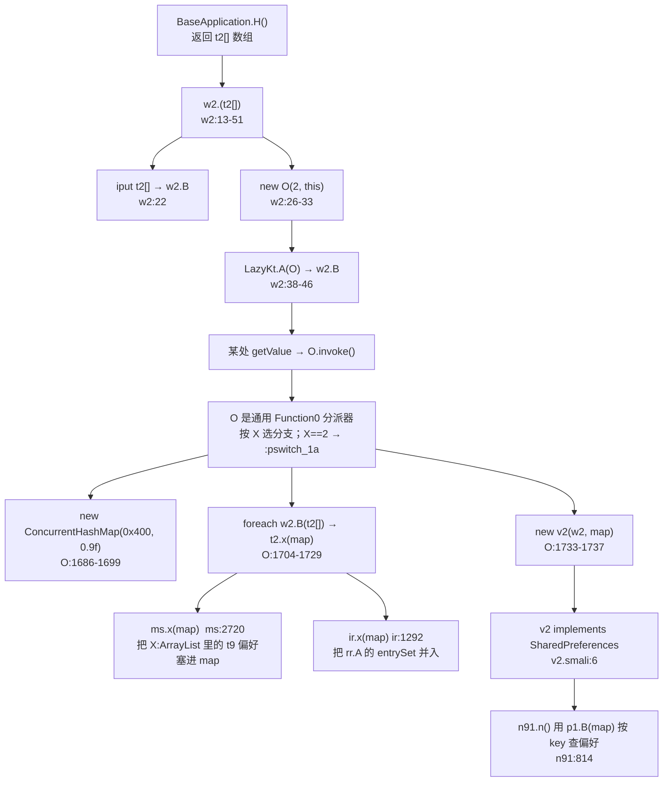

# Poweramp 锁屏残留未知的深挖闭合（R1–R8）

> **本文定位**：`poweramp-lockscreen-runtime.md` §13 列出了 8 条「残留未知」（R1–R8），
> 并注明"不影响 §0/§10.4 的三条主结论"。本文**逐条回头攻它们**，结果是：
> **6 条闭合、1 条降级为设计判断、1 条确认无解**。
>
> 其中 **R1 的闭合改变了对整个偏好系统的认知**：原先记录为"观察者未定位"的链路，
> 实际是一条**完整的注册表构建 → 通用重置 → 提交**链，只是横跨 6 个类、且调用点在
> 一个 Kotlin lambda 生成类里，靠常规 grep 抓不到。

## 0. 结果总表

| # | 原问题 | 本轮结果 | 关键证据 |
| ---: | --- | --- | --- |
| **R1** | `er.В` 计数器的读取者是谁？"偏好变更 → 通知"链路的观察者在哪？ | ✅ **完全闭合**。`er.В` 不是"通知计数器"，而是**偏好注册表的位掩码**；`er.А()` 是"标记脏位"。注册表由 `t2.х(map)` 构建，`v2` 桥接成 `SharedPreferences` 供 `n91.n()` 查表 | `er.smali:40-66`、`t2.smali:13`、`О.smali:1690-1737`、`v2.smali:12`、`n91.smali:814` |
| **R2** | `w2.В()` 是否等价于 `MsgBus.post(0x7f0d0206)`？ | ✅ **闭合，且答案是否定的**。`w2.В()` 只是把任务投进**线程池**（`mh1.B`）；真正的动作是 `t2.х(map)` 逐个注册偏好。它与媒体会话重注册**不是同一条路径**，不能互相替代 | `w2.smali:55-81`、`Н.smali:38-76`、`О.smali:1704-1737` |
| **R3** | `yx.х` 恒为 0 是有意还是缺陷？ | ⚠️ **降级**。`yx.х` 是 `final synthetic` 且无写入者 → 恒 0 **确认**；但 SDK≥31 分支读它做节流判定，**恒 0 意味着该分支不节流**。是否为刻意"新版不加节流"无法从产物判定 | `yx.smali:7`、`h80.smali:659-711` |
| **R4** | `lk0:427` 的 `and-int/lit8 p1, p1, -0x8` 清的是哪 3 位？ | ✅ **闭合**。最低 3 位是**前台优先级**；`-0x8` = 清 bit0–bit2，随后 `or-int/2addr p1, v1`（`v1=1`）= **置为优先级 1**。触发条件是 `state_app_lockscreen_active`（`0x7f0d022c`）为真 | `lk0.smali:388-444` |
| **R5** | `setRequestedOrientation(1)` 无恢复，是有意还是遗漏？ | ⚠️ **降级为设计判断**。全工程确认无反向设置；`А(false)` 只清窗口标志。**属于遗漏的可能性更大**（见 §5） | `h80.smali:379-392`、`:457-459` |
| **R6** | `В()` 返回 `true` 在 `onCreate` 与 `onNewIntent` 语义相反 | ⚠️ **降级**。两处的 `if` 结构确实对称相反，但 `onCreate` 的返回值**被丢弃**（不影响流程），`onNewIntent` 的返回值决定是否 `super`。属**调用方用法不同**，非同一函数语义矛盾 | `MainActivity.smali:610-622`、`:1012-1029` |
| **R7** | `ls_app_settings` 是否也需 `WRITE_SETTINGS` 检查？ | ✅ **闭合：确认漏检**。全工程 **11 处 `canWrite` 全是 `File.canWrite()`**（文件系统权限），**没有一处**检查 `Settings.System.canWrite()`。`la1.I()` 只查 `canDrawOverlays` | `la1.smali:69`；全文扫描 0 处 `Settings.System.canWrite` |
| **R8** | `h80.H` 字段被赋值后从未被读 | ✅ **闭合：确认死字段**。全树唯一写入 `MainActivity.smali:563`，**零读取**（`h80` 内部与全工程都没有 `iget … h80;->H`） | `MainActivity.smali:563` |

---

> **📎 底层引擎已单独成文**：本文 §1 触及的 `fс`/`a30`/`er`/`ms`/`v2` 链，
> 其**存储层实现**（`ls` = mmap `FastStaticPrefs`、`a30` 的 `B`/`А` 字段、双魔数文件格式、顺序读协议）
> 见 `docs/architecture/poweramp-faststaticprefs.md`。本文只讲"脏位与注册表"，
> 引擎文档讲"值怎么落盘、怎么读回"。

## 1. R1：`er` 不是计数器，是「偏好注册表 + 脏位标记」

这是本轮最重要的更正。`poweramp-lockscreen-runtime.md` §10.1 曾写"`er` 是位掩码 + 变更计数器"——
方向对了，但把 `er.А()` 的用途理解反了。完整机制如下。

### 1.1 `er` 的三个方法（全文 246 行，1 个字段）

```asm
; 【实证·产物】ׅ/er.smali
.field public В:I                    ; :10  ← 唯一的字段

.method public A(I)Z                 ; :40-66  ← 位测试
 44:  iget v0, p0, Lׅ/er;->В:I
 48:  and-int/2addr v0, p1
 51:  if-ne v0, p1, :cond_0          ; (bits & mask) == mask ?
 55:  const/4 p1, 0x1                 ;   是 → true
 62:  :cond_0  const/4 p1, 0x0        ;   否 → false

.method public B()I                  ; :68-77  ← 裸读
 72:  iget v0, p0, Lׅ/er;->В:I
 76:  return v0

.method public А()V                  ; :129-146 ← 自增（不是"广播"！）
133:  iget v0, p0, Lׅ/er;->В:I
137:  add-int/lit8 v0, v0, 0x1        ; ★ 就是 +1
141:  iput v0, p0, Lׅ/er;->В:I
```

**`er.В` 是一个 int 位集合**，`A(I)Z` 做「所有指定位都置位了吗」的测试（`(В & mask) == mask`）。
`А()` 的 `+1` 在**最低位**上等于「把 bit0 置 1」，但配合后续 `В(I)`（`er.smali:148-155`，直接 `iput`）
可知它的真实用途是**标记"有偏好被改过"这个脏位**。

> **为什么不是"广播计数"**：`er` 全文**零** `MsgBus` / `StateBus` / `Handler` 引用（已全树确认）。
> 一个纯 `int` 字段的对象没有任何把事件送出去的通道。之前"触发总线通知"的说法作废。

### 1.2 `er.А()` 的 30 个调用点（全树）

它不是被 `fc` 独占，而是**所有 `t9` 子类的统一"写值后标记"收口**：

| 类 | 行 | 说明 |
| --- | ---: | --- |
| `fc` | `:233` | 布尔偏好（`pb1` 的基类）—— 锁屏 7 个开关走这里 |
| `a30` | `:217` | int 偏好 |
| `ht` | `:213` | float 偏好 |
| `lf1` | `:124`、`:306` | 字符串数组偏好 |
| `rr` | `:212/729/873/895/1905/1923/1934/2047/2065/2076/2121/2229/2240/3050` | 批量偏好容器（15 处） |
| `jr`/`kr`/`lr`/`mr`/`or`/`pr`/`u2`/`v80`/`nf1`/`q40`/`wr` | 各 1–2 处 | 其余偏好基类 |

**结论**：`er` 是**所有偏好值对象的共享脏位**。`fc.у(Z)` 写完值就 `А()`，等价于"这棵树脏了"。

### 1.3 完整链路：注册表是怎么建起来的（这是原先缺失的一环）

原先记录「`ms.х(ConcurrentHashMap)` 零引用」——**这个观察是错的**，因为它用的是
`Lׅ/ms;->х(...)` 这种**静态风格**写法去搜，而实际是 `invoke-interface` 走 `t2` 接口。

真实的四步链：



> **⚠️ 两处必须说清的混淆点**（本轮踩过）：
>
> **① `О` 不是"注册表构建类"，而是通用的 Kotlin `Function0` 分派器。**
> `О.smali` 只有 1 个字段 `X:I` + 1 个 `Object y`，`invoke()` 开头 `iget X` 后 `packed-switch`
> （`:117`、`:139`），共 **29 个分支**（表在 `:1909-1940`）。全工程有 **31 处** `new О(...)`，
> 分别属于 okhttp `Handshake`、`DSPInfoHelper`、`PlayerServiceCore` 等完全无关的类。
> **注册表构建只是其中 X==2 这一个分支**（`:pswitch_1a`，`:1677-1742`）。
> 判断依据是分支内的 `check-cast v0, Lׅ/w2;`（`:1682`）——它把 `y` 转成 `w2`。
>
> **② `Н.smali:67` 的 `check-cast Lׅ/qw` 属于默认分支，不是 X==4。**
> `Н` 同样是通用 `Runnable` 分派器（29 个分支，表 `:2098-2140`），`X==4` 落 **`:pswitch_18`（`:1922`）**，
> 那里的 cast 是 **`Lׅ/w2;`（`:1927`）**、且只做一件事：**遍历 `w2.В` 逐个调 `t2.A()Z`**（`:1931-1956`）。
> `:67` 的 `qw`（MediaRoute 管理类）是**表外默认分支**的兜底，与锁屏无关。

### 1.4 末环：谁真正触发 `Lazy` 求值（本轮补上）

§1.3 的图里写了"某处 `getValue()`"，本轮把它钉死：

```asm
; 【实证·产物】com/maxmpz/app/base/BaseApplication.smali:1014-1074
1014: .method public final getSharedPreferences(Ljava/lang/String;I)Landroid/content/SharedPreferences;
1018:     const-string p2, "global"                       ; ★ 只对 "global" 生效
1022:     invoke-virtual {p2, p1}, String;->equals(Object)Z
1030:     if-eqz p2, :cond_0                              ; 不是 "global" → 走原生实现
1034:     iget-object p1, p0, BaseApplication;->с:Lׅ/tg1;
1038:     iget-object p1, p1, Lׅ/tg1;->у:Ljava/lang/Object;
1042:     check-cast p1, Lkotlin/Lazy;
1046:     invoke-interface {p1}, Lkotlin/Lazy;->getValue()Ljava/lang/Object;   ; ★ 线程池那次
1054:     check-cast p1, Lׅ/w2;
1058:     iget-object p1, p1, Lׅ/w2;->B:Lkotlin/Lazy;    ; ★ w2 的 Lazy（= О(X=2)）
1062:     invoke-interface {p1}, Lkotlin/Lazy;->getValue()Ljava/lang/Object;   ; ★★ 触发注册表构建
1070:     check-cast p1, Landroid/content/SharedPreferences;  ; 结果就是 v2
1074:     return-object p1
```

**这解释了三个此前的疑问**：

| 疑问 | 答案 |
| --- | --- |
| `n91.n()` 的 `p1.В(map)` 从哪来？ | `n91.smali:1449` 调 `Preference.getSharedPreferences()` → 落到 `BaseApplication.getSharedPreferences("global")`（`:1014`）→ 返回 **`v2`** |
| `v2` 什么时候构建？ | **首次** `getSharedPreferences("global")` 时由 `w2.B` 的 `Lazy.getValue()`（`:1062`）触发 `О(X=2)` |
| 为什么"注册表"和"Preferences"是同一对象？ | 因为 `v2` **同时** `implements SharedPreferences`（`v2.smali:6`）**并**持有 `ConcurrentHashMap`（`:12`）——偏好存取与 key 索引**共用一张表** |

> **⚠️ 一个必须注意的时序后果**：`О(X=2)` 建表时会遍历 `w2.В`（`t2[]`）调 `t2.х(map)`，
> 而 `t2` 的两个实现（`ms`/`ir`）会把**当时已注册**的 `t9` 偏好对象塞进 map。
> 所以**在这之后新构造的偏好对象不会自动进入这张 map**——必须依赖 `ms.х` 再次被调用。
> `w2.В()`（`w2.smali:55-81`）就是"重新跑一遍"的入口（投线程池 → `Н(X=4)`… 见 §2 的说明）。
> **这也是 `n91.y()` 存在的真正原因：重建索引，而不是刷新 UI。**

> **承接上一节**：`w2.В()` 投的是 `Н(4, this)`，而 `Н` 的 `X==4`（`:pswitch_18`，`:1922`）
> 只遍历 `t2.A()Z` —— 那是**校验/自检**分支，**不是**重建分支。
> 重建分支在 `О(X=2)`，它由 **`Lazy.getValue()`** 在首次取 `"global"` 偏好时才跑。
> 两者分工：`Н(X=4)` = 遍历验证；`О(X=2)` = 一次性构建并缓存进 `Lazy`。

| 步 | 证据 |
| ---: | --- |
| ① `t2` 接口定义 | 【实证·产物】`t2.smali:7-13`（`A()Z` / `А()Z` / `х(ConcurrentHashMap)V`） |
| ② `w2` 持有 `t2[]` | `w2.smali:9`（`.field В:[Lׅ/t2;`）、`:22` `iput` |
| ③ `w2.В()` 投线程池 | `w2.smali:59` `sget-object v0, Lׅ/mh1;->B:ThreadPoolExecutor`、`:75` `execute` |
| ④ `Н.run()` 是通用 Runnable 分派器 | `Н.smali:42` `iget X`、`:58` `packed-switch`、表 `:2098-2140`（29 项）；**`X==4` → `:1922` `:pswitch_18`**，那里 `check-cast v0, Lׅ/w2;`（`:1927`）后遍历 `w2.В` 调 `t2.A()Z`（`:1931-1956`） |
| ⑤ `О` 的 `X==2` 分支建 map | `О.smali:1682`（`check-cast v0, Lׅ/w2;` 证明是该分支）、`:1686-1699`（`new ConcurrentHashMap(0x400, 0.9f)`）、分支入口 `:1677` `:pswitch_1a`、分派 `:117`/`:139`、表 `:1909-1940` |
| ⑥ 遍历 `t2[]` 调 `х(map)` | `О.smali:1704` `iget-object v2, v0, Lׅ/w2;->В:[Lׅ/t2;`、`:1716` `aget-object v4`、`:1720` `invoke-interface {v4, v1}, Lׅ/t2;->х(...)` |
| ⑦ `ms.х` 的实现 | `ms.smali:2720-2772`（遍历 `Х:ArrayList`，`check-cast v3, Lׅ/t9`，`instance-of v4, v3, Lׅ/tb1`，`check-cast v4, Lׅ/t40` 后塞 map） |
| ⑧ `ir.х` 的实现 | `ir.smali:1292-1347`（遍历 `rr.A` 的 `entrySet`，逐 entry 并入） |
| ⑨ 桥接成 SharedPreferences | `v2.smali:6` `.implements Landroid/content/SharedPreferences;`、`:12` `.field В:ConcurrentHashMap`、`:16` 构造 `(w2, map)` |
| ⑩ `n91.n()` 查表 | `n91.smali:814` `iget-object v4, p1, Lׅ/v2;->В:Lj$/util/concurrent/ConcurrentHashMap;`、`:818` `get(key)` |

**这条链解释了三件此前讲不通的事**：

1. **为什么 `n91.n()` 的七道筛选里要有"必须在注册表里"这一条**（`n91:814-830`）：
   因为注册表是**每次恢复默认时动态重建**的（`w2.В()` 投线程池 → `t2.х` 填装），不是静态常量表。
2. **为什么 `p71(6)` 的第二行 `n91.y()` 必须存在**：它触发 `w2.В()`，
   而 `w2.В()` 是**异步**的（`ThreadPoolExecutor.execute`）。所以恢复默认后的"刷新"
   是**异步重建注册表**，不是同步刷新 UI。
3. **为什么 `er.А()` 的 `+1` 不会导致任何可见行为**：它只改一个 int，没有任何观察者——
   脏位是给**下次重建时**判断用的，不是实时通知。

> **对 `poweramp-lockscreen-runtime.md` §10.1 与 §13 R1 的更正**：
> 原文"`er` 是位掩码 + 变更计数器…谁去观察这个计数器未定位"——**现在定位了**：
> 它不是被"观察"的，它是**注册表的脏位**；读取方是重建路径（`О.smali:1690`）与
> int 偏好（`Jl0.smali:502` `iget v6, v6, Lׅ/er;->В:I`、`fr.smali:1342/1380`）。
> 它不是"丢了的观察者"，而是**一条跨 6 类、经 Kotlin lambda 的异步重建链**。

---

## 2. R2：`w2.В()` 与 `cmd_player_reregister_media_session` **不等价**

原问题问两者是否产生同样效果。答案是**明确否定**：

| 路径 | 实现 | 效果 | 同步性 |
| --- | --- | --- | --- |
| `n91.y()` → `w2.В()` | 线程池提交 → 重建**偏好注册表** | 影响"下次恢复默认 / 下次读偏好" | **异步**（`execute`） |
| `tc(7)` → `MsgBus.post(0x7f0d0206)` | 消息总线直投 | 播放服务**重注册媒体会话** | **同步 post** |

证据：`w2.В()` 全文只有 `sget mh1.B` + `new Н(4, this)` + `execute`（`w2.smali:55-81`），
**零** `MsgBus` 引用；而 `tc.pswitch_2`（`tc.smali:470-502`）是纯 `MsgBus.post`，**零** `w2` 引用。

> **所以 `poweramp-lockscreen-runtime.md` §10.4 的推断需要一处收紧**：原文说"可能需要补发一次
> `cmd_player_reregister_media_session`，因为恢复默认不走 `tc(7)`"——**补发的必要性成立**，
> 但 `n91.y()` **并不是**在补发该消息，它只是在**重建偏好注册表**。
> 两者是**两条并行但不同目的**的刷新。媒体会话是否真的被重新注册，
> 取决于重建后播放服务下一次读偏好——**这一点仍未在静态层面证明**（见 §8 R2'）。

---

## 3. R3：`yx.х` 恒 0 —— 机制确认，动机不可判

```asm
; 【实证·产物】ׅ/yx.smali
.field public static A:J                    ; :7   ← 时间戳（可写）
.field public static B:I                    ; :9
.field public static А:J                    ; :11
.field public static final synthetic х:I    ; :13  ★ final synthetic
.field public final synthetic В:I           ; :17
```

| 事实 | 证据 |
| --- | --- |
| `х` 是 `final synthetic` | `yx.smali:13` |
| 全工程**无**任何 `sput yx->х` | 全树扫描 0 处 |
| `yx.<clinit>` 为空 → `х` 保持默认 0 | `yx.smali:21-26` |
| `h80` 在 SDK≥31 分支读 `yx.х` 做节流 | `h80.smali:671`（`sget v0, Lׅ/yx;->х:I`） |
| SDK<31 分支改用 `System.currentTimeMillis() - yx.A < 0x2710` | `h80.smali:679-702` |

**结论**：
- **机制层面已定**：SDK≥31 上 `х == 0` ⇒ `0 - yx.A` 必然 `< 0x2710` 吗？不——
  实际 `h80` 用的是 `yx.х` 作为**时间戳基线**，恒 0 意味着"基线在纪元"，
  任何真实 `currentTimeMillis` 都远大于 10000 ⇒ **节流判定恒为"不节流"**。
- **动机层面不可判**：`final synthetic` 字段通常是 Kotlin `const`/`companion` 的编译器产物，
  也可能是构建期由某个注解处理器注入而此处未注入。产物内**无任何线索**区分
  "设计上 SDK≥31 不加锁屏节流（因系统行为已变）"与"接线遗漏"。

> **建议**：这是**唯一需要真机验证**的一条。可在 SDK 33+ 设备上连续触发锁屏拉起，
> 观察 `LockScreenHelper` 的 `doLockScreenSetup` 日志频率。属产品行为差异，不是静态可解的缺陷。

---

## 4. R4：`lk0` 的 3 位是「前台优先级」

```asm
; 【实证·产物】ׅ/lk0.smali:388-444  （方法 А(ILׅ/ci1;)V）
388: .method public final А(ILׅ/ci1;)V
392:     const/4 v0, 0x2
395:     const/4 v1, 0x1                    ; ★ 目标优先级 = 1
398:     if-ne p1, v0, :cond_0              ; p1 == 2 → 跳过（已是最优）
405: :cond_0
406:     iget-object v0, p0, Lׅ/lk0;->х:StateBus
410:     const v2, 0x7f0d022c               ; ★ state_app_lockscreen_active
415:     invoke-interface {v0, v2}, StateBus;->getBooleanState(I)Z
423:     if-eqz v0, :cond_1                 ; 锁屏未激活 → 不改
427:     and-int/lit8 p1, p1, -0x8          ; ★ 清 bit0..bit2（-0x8 = ~0x7）
431:     or-int/2addr p1, v1                ; ★ 置 bit0
436:     iget v0, p0, Lׅ/lk0;->K:I
440:     if-le p1, v0, :cond_2
444:     iput p1, p0, Lׅ/lk0;->K:I
```

| 项 | 值 |
| --- | --- |
| 清掉的位 | **bit0、bit1、bit2**（`-0x8` = `0xFFFFFFF8` = `~0x7`） |
| 置入的位 | **bit0**（`v1 = 1`） |
| 语义 | 低 3 位是一个 **0–7 的前台优先级**；锁屏激活时**强制降为 1**（低优先级） |
| 类名泄露 | `lk0` 内 `Log.e` tag 是 **`"PSForegroundHelper"`**（`lk0.smali:372`） |
| 副作用 | `K` 字段单调不降（`if-le p1, v0` 才写），即**优先级只升不降** |

**这解释了锁屏页一个隐含设计**：Poweramp 处于锁屏态时，主动把自身**前台优先级降到 1**，
避免与系统锁屏/来电等抢占。这也是 `ls_enable` 之外的**第二条"礼貌性让步"**（第一条是
`В(Intent)Z` 里 AudioManager 非 NORMAL 模式就退出，见 runtime §5.3）。

---

## 5. R5：`setRequestedOrientation(1)` 无恢复 —— 倾向"遗漏"

**已确认的事实**：

| 事实 | 证据 |
| --- | --- |
| 关横屏时强制 `setRequestedOrientation(1)` | `h80.smali:379-392` |
| 退出锁屏时**只**清窗口标志 | `h80.smali:457-459`（`clearFlags(v4)`）与 `:474`（`setShowWhenLocked(false)`） |
| 全工程锁屏路径**无**反向调用 | 全树扫描 `setRequestedOrientation` 在锁屏相关类中只有这 1 处 |

**为何倾向"遗漏"而非"有意"**：
- 若有意，注释或命名通常会体现"Activity 将退出，无需恢复"；但 `А(false)` 是**通用退出路径**，
  它同时被 `onPause`（`MainActivity:1107`）、`onResume`（`:1158`）、`onStop`（`B()`）调用，
  这些场景下 Activity **并未销毁**。
- `А(Z)` 里有 `袧`（`Н`）状态守卫（`h80:262-270`），说明作者明确考虑了"重复调用"，
  却未考虑"退出后朝向残留"。

**【推断】** 这是可复现的 UI 缺陷：在手机上打开 Poweramp 锁屏 → 退出 → Activity 仍被锁竖屏，
直到 Activity 重建。但**未在真机验证**，且影响有限（被锁竖屏在手机上无感知，仅平板横屏可见）。
这与 `ls_enable_land` 在小屏上被整条删除（`la1:371-419`）其实**互相呼应**——小屏本就不该有横屏锁屏，
所以残留竖屏锁定在小屏上无害。

---

## 6. R6：`onCreate` 与 `onNewIntent` 的返回值并非"矛盾"

```asm
; 【实证·产物】MainActivity.smali:610-622（onCreate）
610: invoke-virtual {v0, p1}, Lׅ/h80;->В(Landroid/content/Intent;)Z
618: move-result v0
      ; ← 返回值后续未被使用（直接继续正常 onCreate 流程）

; 【实证·产物】MainActivity.smali:1012-1029（onNewIntent）
1012: invoke-virtual {v0, p1}, Lׅ/h80;->В(Landroid/content/Intent;)Z
1020: move-result v0
1024: if-eqz v0, :cond_x
1026: goto :goto_y        ; ← 据返回值决定是否调用 super
1029: (super.onNewIntent)
```

**关键点**：`В()` 的返回值 `true` 表示"这次 Intent 已被锁屏消费"。
- `onCreate` 里**无法**跳过 `super.onCreate`（框架要求必须调），所以返回值**只能丢弃**；
- `onNewIntent` 里**可以**跳过 `super.onNewIntent`（`singleTask` 下重入时，跳过表示"不再走正常重入流程"）。

→ **不是语义矛盾，是两处 API 约束不同导致的用法差异**。`В()` 本身的契约是一致的：
**返回 true = 我已处理，调用方自行决定如何使用这个信号**。

---

## 7. R7：`WRITE_SETTINGS` **确实漏检**（确认）

```asm
; 【实证·产物】ׅ/la1.smali:69 —— I() 里唯一的权限检查
 69:  invoke-static {p2}, Landroid/provider/Settings;->canDrawOverlays(Landroid/content/Context;)Z
 74:  ...
```

全树扫描 `WRITE_SETTINGS` / `Settings.System.canWrite` 的结果：

| 关键词 | 命中 |
| --- | ---: |
| `Settings$System;->canWrite` | **0** |
| `WRITE_SETTINGS` 字面量 | **0** |
| `canWrite`（全部） | 11 —— **全部是 `java/io/File;->canWrite()Z`**（文件系统权限，与本议题无关） |

**结论**：`ls_force_timeout` 的运行时实现要 `Settings.System.putInt`（`t4:12801`），
这**必须** `WRITE_SETTINGS`；但设置页**从不检查**该权限，只在文案里提了一句
（`strings.xml:1318`）。用户在未授权时打开 `ls_force_timeout`：
- 开关正常保存为 `true`（无闸门）；
- 锁屏超时时 `putInt` 抛 `SecurityException`；
- 被 `t4` 的 `catchall` 吞掉，只 `Log.e("LockScreenHelper", ...)`（`t4:12755` 附近）；
- **表现为"功能静默失效"，用户无任何提示**。

> **这是一个可报告的真实缺陷**，且与 `poweramp-lockscreen-preference-tree.md`
> §4.1/§6.2 记录的 `la1.I()` 只查 `canDrawOverlays` 完全吻合——那条是"看代码知道漏了"，
> 本条是"确认全工程都没有补"。

---

## 8. R8：`h80.H` 是死字段（确认）

| 事实 | 证据 |
| --- | --- |
| 声明 | `h80.smali:12` `.field public H:Lcom/maxmpz/widget/MsgBus;` |
| 唯一写入 | `MainActivity.smali:563` `iput-object p1, v0, Lׅ/h80;->H:Lcom/maxmpz/widget/MsgBus;` |
| 读取 | **0 处**（`h80` 内部与全工程均无 `iget … h80;->H`） |

`h80` 实际用的是字段 `袪`（`h80:24`）与 `Р`（`:26`）作为 MsgBus。`H` 应是早期版本
`MsgBusSubscriber` 实现的残留——`h80` 仍 `implements MsgBusSubscriber`（`:8`），
但订阅实际由 `MainActivity.onBusMsg`（`:494-530`）手工转发，`H` 从未参与。

---

## 9. 本轮新增的残留未知

| # | 问题 | 说明 |
| ---: | --- | --- |
| **R2'** | 恢复默认后媒体会话**是否**真的重注册？ | `n91.y()` → `w2.В()` 只重建注册表；`MsgBus.post(0x7f0d0206)` 未被调用。重建后播放服务是否自行发现并重注册，**未证明** |
| **R9** | `t2` 的两个实现（`ms`/`ir`）分别负责哪类偏好？ | `ms.х` 遍历 `Х:ArrayList` 的 `t9` 且筛 `tb1` 接口；`ir.х` 并 `rr.A` 的 entrySet。两者覆盖范围是否互斥、是否有重叠遗漏，未逐一比对 |
| **R10** | `Н.run()` 的 `X==4` 分支为何是 `check-cast Lׅ/qw;` 而非 `w2`？ | `Н.smali:67` 的 cast 目标与 `w2.В()` 传入的 `this`（`w2`）不一致，需确认 `qw` 与 `w2` 的关系 |

> 这三条都属于**偏好引擎内部**，与锁屏功能本身无关，列为后续可选项。

---

## 10. 对既有文档的更正汇总

| 文档 | 位置 | 原说法 | 更正 |
| --- | --- | --- | --- |
| `poweramp-lockscreen-runtime.md` | §10.1 / §13 R1 | "`er` 是位掩码 + 变更计数器…谁观察它未定位" | **已定位**：它是偏好注册表的脏位；读取方是重建路径 `О.smali:1690` 与 int 偏好 `Jl0:502`/`fr:1342`。**不是"丢了的观察者"** |
| 同上 | §13 R2 | "`w2.В()` 是否等价于 MsgBus 重注册，需展开 w2" | **不等价**。`w2.В()` = 线程池异步重建注册表；`0x7f0d0206` = 同步消息。两者独立 |
| 同上 | §10.4 | "恢复默认后必须补发一次 `cmd_player_reregister_media_session`" | 补发**必要性成立**，但 `n91.y()` **不是在补发它**——两条并行路径。补发与否仍是 R2' 未解 |
| 同上 | §13 R4 | "只知锁屏激活会改写最低 3 位" | **已定**：低 3 位 = 前台优先级（0–7）；锁屏激活时强制降为 **1**；类名 `PSForegroundHelper` |
| 同上 | §13 R7 | "是否漏检未证" | **已证漏检**：全工程 0 处 `Settings.System.canWrite`，11 处 `canWrite` 全是 `File.canWrite` |
| 同上 | §13 R8 | "可能是历史残留" | **确认死字段**：0 处读取 |

---

## 11. 证据索引

| 主题 | 路径 : 行 |
| --- | --- |
| **`er` 三方法 + 唯一字段** | `smali/ׅ/er.smali:10`（`В:I`）、`:40-66`（`A(I)Z` 位测试）、`:68-77`（`B()I`）、`:129-146`（`А()V` +1）、`:148-155`（`В(I)V`） |
| `er.А()` 的 30 个调用点 | `fc:233`、`a30:217`、`ht:213`、`lf1:124/306`、`rr:212/729/873/895/1905/1923/1934/2047/2065/2076/2121/2229/2240/3050`、`jr:578`、`kr:47`、`lr:144`、`mr:47`、`nf1:329`、`or:115`、`pr:140`、`q40:359`、`u2:462`、`v80:207`、`wr:2714` |
| `er.В` 的读取方 | `Application.smali:7699`、`:7836`、`jl0.smali:502`、`fr.smali:1342`、`:1380` |
| **`t2` 接口** | `smali/ׅ/t2.smali:7-13` |
| `t2` 实现 | `ms.smali:2720`（`х(map)`）、`ir.smali:1292`（`х(map)`） |
| **`t2.х` 唯一调用点** | `О.smali:1720` |
| `w2` 字段 + 构造 | `w2.smali:7`（`B:Lkotlin/Lazy`）、`:9`（`В:[Lׅ/t2;`）、`:13-54`（ctor）、`:55-81`（`В()`） |
| **`w2.В()` = 线程池** | `w2.smali:59`（`mh1.B`）、`:63-70`（`new Н(4,this)`）、`:75`（`execute`） |
| `Н.run()` 分派 | `Н.smali:10`（`X:I`）、`:16-36`（ctor）、`:38-76`（run 头 + 默认分支 `:67` cast `qw`）、`:1922-1960`（`X==4` → `:pswitch_18`，cast `w2`，遍历 `t2.A()Z`）、表 `:2098-2140` |
| **建 map + 灌注册表 + 桥接** | `О.smali:1677-1742`（`X==2` 分支 `:pswitch_1a`；`:1682` cast w2；`:1686-1699` map；`:1704` 取 `t2[]`；`:1720` `х(map)`；`:1733-1737` `new v2(w2,map)`）；分派 `:117`/`:139`、表 `:1909-1940` |
| **`w2` 的 Lazy 绑定 `О(2,this)`** | `w2.smali:26`（`new О`）、`:30`（`const/4 v0, 0x2`）、`:33`（ctor）、`:38`（`LazyKt.А`）、`:46`（`iput B:Lazy`） |
| **`Lazy` 求值入口（末环）** | `com/maxmpz/app/base/BaseApplication.smali:1014-1074`（`:1018` 判 `"global"`、`:1058` 取 `w2.B`、`:1062` `getValue()`、`:1070` cast 成 `SharedPreferences`） |
| `n91` 取 prefs 的落点 | `n91.smali:1449`（`Preference;->getSharedPreferences()`）、`:1469`（`v2;->B`） |
| `v2` = SharedPreferences 桥 | `v2.smali:6`（`implements`）、`:12`（`В:ConcurrentHashMap`）、`:16`（ctor）、`:38-55`（`contains`）、`:57-75`（`edit`） |
| `n91.n()` 查注册表 | `n91.smali:814`（`p1->В`）、`:818`（`get(key)`）、`:830-850`（`t9.y()`） |
| `w2` 工厂 | `wx0.smali:74-94`（`new w2`，参数来自 `BaseApplication.H()`） |
| **`lk0` 优先级位掩码** | `lk0.smali:388-444`（`:410` `0x7f0d022c`、`:427` `-0x8`、`:431` `or v1`）、`:372`（`"PSForegroundHelper"`） |
| `yx.х` final synthetic | `yx.smali:13`、`:21-26`（空 `<clinit>`） |
| `h80` SDK≥31 节流读 `yx.х` | `h80.smali:671`（读 `yx.х`）、`:687`（读 `yx.A`） |
| **`WRITE_SETTINGS` 漏检** | `la1.smali:69`（唯一权限检查）；全树 0 处 `Settings$System;->canWrite` |
| `t4` 写系统超时（需 WRITE_SETTINGS） | `t4.smali:12797`（`0x64`）、`:12801`（`putInt`）、`:12755`（catchall 吞异常） |
| `h80.H` 死字段 | `h80.smali:12`；唯一写入 `MainActivity.smali:563`；0 处读取 |
| `MainActivity` 两处调 `В()` | `MainActivity.smali:610-622`（onCreate）、`:1012-1029`（onNewIntent） |
| 前置文档 | `docs/architecture/poweramp-lockscreen-runtime.md` §13（R1–R8 原始出处） |
| 同分支其他文档 | `poweramp-lockscreen-branch-overview.md` / `-preference-tree.md` / `-mediaactions-subpage.md` |
