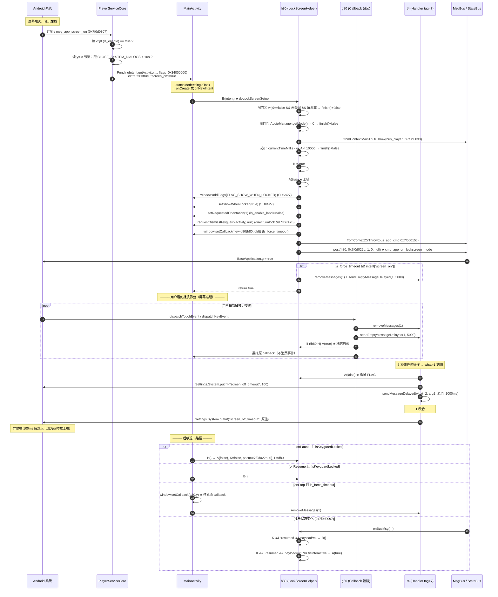
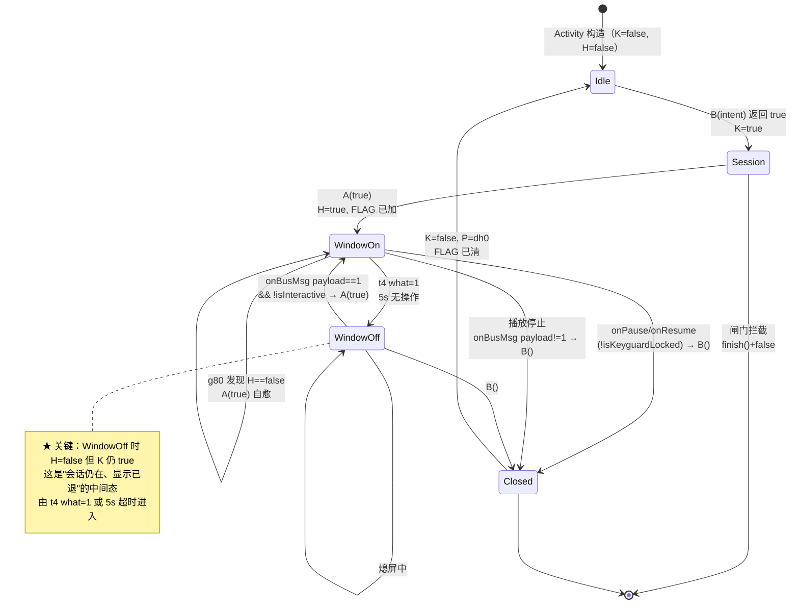

# Poweramp 自绘锁屏运行时完整实现

> **证据分级**：【实证·产物】= 反编译 smali 产物，必须给 `文件:行号`；【推断】= 无直接代码佐证。
> 全部结论基于 **build-1035-bundle-play**（`versionCode 1035009`）。
> **包名说明**：混淆包名是**单一码位** `ׅ` = **U+05C5**，目录名与类描述符完全一致。
> 全树（`smali/` 4397 个 + `smali_classes2/` 532 个 `.smali`）统计：`U+05C5` 出现于全部相关文件，而 `U+8B8C`/`U+8ACC`/`U+8B0C` 出现 **0 次**。
> **若你搜不到**：那是终端/控制台编码问题，不是产物问题。请用 Python 读 UTF-8 并以 `re.escape("L\u05c5/")` 匹配；PowerShell 的 `Select-String` 对这类字符不可靠。

## 0. 一句话结论（回答 Q5 / Q6 / Q7）

| # | 原文档结论 | 本次实证结论 |
| ---: | --- | --- |
| **Q6** | 自绘锁屏本体未定位 | **不是 Activity、不是 Service、不是自绘 View、没有悬浮窗**。它就是 **`MainActivity` 自身的窗口标志**（`FLAG_SHOW_WHEN_LOCKED` / `setShowWhenLocked`）+ 一个 `Window.Callback` 包装器 + 一个 `Handler` 超时。全部代码在 `ׅ/h80`（LockScreenHelper，875 行）里，`MainActivity` 持有一个实例 |
| **Q5** | `ls_force_timeout` / `direct_unlock` 消费侧未反编译 | **两者都在 `h80` 内部消费**，不在任何 Service/overlay：`direct_unlock` → `KeyguardManager.requestDismissKeyguard`；`ls_force_timeout` → 装 `g80` 包装器 + `t4` Handler 改 `Settings.System.screen_off_timeout` |
| **Q7** | `p71(6)` 第一行 `vr->n0.у(0)` 无法分离验证 | **确实冗余，且幂等无害**。原因是 `fc.y()`（通用恢复默认）在 `n91.n()` 里先执行过，已经把 `n0` 写回默认 `false`；`fc.у(Z)` 有 `if-eq` 守卫，值不变时**不产生任何副作用**。**真正有价值的只有第二行 `n91.y()`** |

**启动链一句话**：`MainActivity.onCreate/onNewIntent` 检测到 Intent extra `"ls"==true` → `h80.В(intent)` → 十项闸门 → `h80.А(true)` 设窗口标志 → 发 `cmd_app_on_lockscreen_mode`。

---

## 1. 核心命题的证明：自绘锁屏到底是什么

### 1.1 先证否：全 App 没有"锁屏 Activity"、没有"锁屏 Service"、没有"悬浮窗"

判据有三条，每条都排除一整类实现：

| 候选实现形态 | 判据 | 结论 |
| --- | --- | --- |
| 独立 `Activity` 渲染锁屏 | `AndroidManifest.xml` 里与锁屏相关的 Activity **一个都没有**；`h80` 是 `Lׅ/h80;` 普通类，`.super Ljava/lang/Object;`【实证·产物】`ׅ/h80.smali:1-2` | **排除** |
| 独立 `Service` / overlay | `h80` 的 `.implements` 只有 3 个：`Lׅ/f80;`、`MsgBusSubscriber`、`ViewTreeObserver$OnWindowAttachListener`【实证·产物】`ׅ/h80.smali:6-8`。**没有** `Service`、**没有** `ContextWrapper` | **排除** |
| 自绘 `View` | `h80` 全类**没有任何 `getView` / `findViewById` / `addView`**；`onWindowAttached`/`onWindowDetached` 都是空实现（§2.5） | **排除** |
| Android 10+ 的 `TYPE_APPLICATION_OVERLAY` 悬浮窗 | `h80` 里**没有** `WindowManager`、**没有** `addView`、**没有** `SYSTEM_ALERT_WINDOW` 相关调用 | **排除** |

> **⚠️ 这与旧文档 §8 的说法需要修正**：`poweramp-lockscreen-settings.md` §3.1/§8.1 把自绘锁屏描述为"**自绘覆盖层 + `canDrawOverlays`**"，并据此推断"不可移植（无 `SYSTEM_ALERT_WINDOW` 权限模型）"。
>
> **代码不支持"覆盖层"这个描述**。`canDrawOverlays` 只在**设置页**出现（`la1.I()` 权限闸门，`ׅ/la1.smali:65-74`），它的作用是**门控开关能否被打开**，而**不是**运行时真的去建悬浮窗。运行时的实现是给 `MainActivity` 自己的 `Window` 加 `FLAG_SHOW_WHEN_LOCKED`——这是**窗口层级内**的可见性，不是**窗口层级上**的覆盖。
>
> 权限之所以仍需 `canDrawOverlays`：见 §5.3「权限闸门与实现形态的不对称」。

### 1.2 再证真：实现 = 窗口状态 + Callback 包装 + Handler

三条支柱，各自落在不同类里：

```
MainActivity
 ├─ 字段 i : Lׅ/h80;                       ← LockScreenHelper 实例（唯一持有者）
 │
 ├─ ── 支柱一：窗口状态 ──  h80.А(Z)V
 │      window.addFlags(FLAG_SHOW_WHEN_LOCKED)   / clearFlags
 │      activity.setShowWhenLocked(z)            (SDK≥27)
 │      activity.setRequestedOrientation(1)      (ls_enable_land=false)
 │      KeyguardManager.requestDismissKeyguard() (direct_unlock && SDK≥26)
 │
 ├─ ── 支柱二：Callback 包装 ── g80 (extends fn1)
 │      dispatchKeyEvent / dispatchTouchEvent
 │      → removeMessages(1) + sendEmptyMessageDelayed(1, 0x1388)
 │      → 自己又调 h80.А(true) 回锁
 │
 └─ ── 支柱三：Handler 超时 ── t4 (tag=7)
        handleMessage → pswitch_1f
        → h80.А(false) + Settings.System.putInt("screen_off_timeout", 100)
        → 1 秒后还原原值
```

**`MainActivity` 的持有方式是一次性构造、非懒创建**：

```asm
; 【实证·产物】com/maxmpz/audioplayer/MainActivity.smali:57-66（构造函数内）
57:  new-instance v0, Lׅ/h80;
61:  invoke-direct {v0, p0}, Lׅ/h80;-><init>(Lcom/maxmpz/audioplayer/MainActivity;)V
66:  iput-object v0, p0, Lcom/maxmpz/audioplayer/MainActivity;->i:Lׅ/h80;
```

> **纠正旧文档/任务书的一处措辞**：任务书说 `getLockScreenHelper()` :86-95 是"懒创建"。**不是**。示例中无 `if-null` 守卫，字段 `i` 在构造函数里就赋值了；`getLockScreenHelper()` 只是纯 getter：
>
> ```asm
> ; 【实证·产物】MainActivity.smali:86-93
> 86: .method public getLockScreenHelper()Lׅ/h80;
> 90:  iget-object v0, p0, Lcom/maxmpz/audioplayer/MainActivity;->i:Lׅ/h80;
> 92:  return-object v0
> ```
>
> 另有一个 **bridge synthetic**（泛型桥接）在 `:75-84`，把 `()Lׅ/h80;` 桥成接口声明的 `()Lׅ/f80;`——这是 Java 协变返回值的编译器产物，**不是**懒加载。

### 1.3 为什么"窗口状态"就够：`FLAG_SHOW_WHEN_LOCKED` 的物理含义

`FLAG_SHOW_WHEN_LOCKED`（`0x80000`）= **允许窗口显示在 Keyguard（系统锁屏）之上**。

| | 普通窗口 | + `FLAG_SHOW_WHEN_LOCKED` |
| --- | --- | --- |
| 系统锁屏锁定时 | 被 Keyguard 遮住 | **窗口照常可见、可交互** |
| 窗口内容 | — | 就是 MainActivity 原来的播放界面 |

**所以"Poweramp Lock Screen"看起来像一个锁屏，本质是"MainActivity 在系统锁屏亮着的时候仍然显示"**。没有任何新的 UI 被创建——用户看到的就是播放页本身。

**这解释了一个容易被误读的设置项**：`ls_enable` 的摘要原文是「Poweramp shows **itself** on top of system lock screen if music is playing」【实证·原文】`strings.xml:1491`——"**itself**"这个词是准确的，代码也是这么实现的。

---

## 2. `ׅ/h80` = LockScreenHelper 逐项解析

### 2.1 类声明与三个接口

```asm
; 【实证·产物】ׅ/h80.smali:1-8
1: .class public final Lׅ/h80;
2: .super Ljava/lang/Object;
6: .implements Lׅ/f80;                                        ; 空标记接口
7: .implements Lcom/maxmpz/widget/MsgBusSubscriber;           ; 消息总线订阅者
8: .implements Landroid/view/ViewTreeObserver$OnWindowAttachListener;  ; 窗口 attach 回调
```

| 接口 | 定义 | 实现意义 |
| --- | --- | --- |
| `ׅ/f80` | **空接口**，全文 3 行【实证·产物】`ׅ/f80.smali:1-3` | 纯类型标记。让 `e80.getLockScreenHelper()` 能返回一个**不暴露 h80 具体类型**的句柄 |
| `MsgBusSubscriber` | `onBusMsg(MsgBus,I,I,I,Object)` | 订阅 `msg_player_playing_state_changed`（§2.4） |
| `OnWindowAttachListener` | `onWindowAttached()` / `onWindowDetached()` | **两个都空实现**（§2.5）——见该节对架构含义的分析 |

> **`f80` 是空接口这一点很关键**：它说明 Poweramp 的作者**刻意**把"锁屏 helper 的能力"对外部调用方**完全隐藏**。外部（`no0`）只能拿到句柄再 `check-cast` 回 `h80` 读一个布尔字段（`ׅ/no0.smali:1545-1549`）。这是 4 级间接（`e80` → `f80` → `h80` → 字段），比直接暴露 `h80` 啰嗦得多，属于**信息隐藏优先于简洁**的取舍。

### 2.2 9 个字段逐个说明

| 字段 | 类型 | 行 | 语义（实证） | 谁写 / 谁读 |
| --- | --- | --- | --- | --- |
| `H` | `Lcom/maxmpz/widget/MsgBus;` | `:12` | MainActivity 的通用总线 | 仅 `MainActivity.smali:563` 写；**h80 内部从不读**（§2.6 遗留字段） |
| **`K`** | `Z` | `:14` | **锁屏会话是否激活**（"已进入锁屏模式"） | `h80` 写（`:102` `:638`）；读于 `h80:86`/`:154`、`MainActivity:1050/1129/1271` |
| **`P`** | `Lׅ/t4;`（final） | `:16` | **Handler**，tag=7，超时/超时还原的执行者 | `h80` 构造（`:69`）；`h80:788`、`g80:43/113`、`MainActivity:1325` 读 |
| **`X`** | `Lcom/maxmpz/audioplayer/MainActivity;`（final） | `:18` | **被操控的 Activity**（唯一目标） | 只读，全类 40+ 处 |
| **`y`** | `Landroid/os/PowerManager;` | `:20` | 屏幕交互状态查询 | `h80:527` 写；`:211` 读 |
| **`К`** | `Lcom/maxmpz/widget/StateBus;` | `:22` | **`bus_player`**（`0x7f0d0033`）状态总线 | `h80:655` 写；`MainActivity:1058` 读（`state_player_playing_state`） |
| **`Н`** | `Z` | `:24` | **`А(Z)` 的幂等守卫**（"窗口当前是否处于锁屏态"） | 写 `:270`；读 `:262`、`g80:76/134`、`no0:1549` |
| **`Р`** | `Lcom/maxmpz/widget/MsgBus;` | `:26` | **`bus_app_cmd`**（`0x7f0d015c`）；初值是 `NoopMsgBus` | `h80:45/136/734` 写；`:106` 读 |
| **`у`** | `Landroid/app/KeyguardManager;` | `:28` | 系统锁屏状态查询 | `h80:507` 写；`MainActivity:1062/1137` 读 |

> **`Н` 与 `K` 的区别是全文最容易混淆的点**（两者都是布尔）：
>
> | 字段 | 语义 | 谁维护 | 何时翻转 |
> | --- | --- | --- | --- |
> | `Н` | **窗口标志的当前状态** | 只在 `А(Z)` 内部 | 每次 `А()` 且值变化时 |
> | `K` | **锁屏会话的整体激活态** | `В()` 置 true、`B()` 置 false | 会话开始/结束 |
>
> `А(false)` 可以把 `Н` 置 false 而**不**动 `K`（`t4` 超时就只调 `А(false)`，见 §4.3）——这正是"**超时退出显示、但会话仍在**"的实现基础。

### 2.3 `<init>(MainActivity)` :32-81

```asm
; 【实证·产物】ׅ/h80.smali:41-73
41:  sget-object v0, Lcom/maxmpz/widget/MsgBus;->В:Lׅ/dh0;   ; NoopMsgBus 单例
45:  iput-object v0, p0, Lׅ/h80;->Р:Lcom/maxmpz/widget/MsgBus;   ; ★ Р 先给 no-op
49:  new-instance v0, Lׅ/t4;
53:  invoke-static {}, Landroid/os/Looper;->getMainLooper()Landroid/os/Looper;
61:  const/4 v2, 0x7                       ; ★ Handler tag = 7
64:  invoke-direct {v0, p0, v1, v2}, Lׅ/t4;-><init>(Ljava/lang/Object;Landroid/os/Looper;I)V
69:  iput-object v0, p0, Lׅ/h80;->P:Lׅ/t4;
73:  iput-object p1, p0, Lׅ/h80;->X:Lcom/maxmpz/audioplayer/MainActivity;
```

三个要点：

1. **`Р` 初值必须是 NoopMsgBus**（`:41-45`）。原因看 `B()`：它在会话结束时把 `Р` **切回** `dh0`（`:132-136`），说明"没有锁屏会话时不应有任何总线流量"。用 `dh0` 做初值让 `B()` 天然幂等。
2. **Handler 的 tag 存在字段 `В` 而不是 `what`**（§3.1 详述）。
3. **`<init>` 里 `X` 最后赋值**——因为 `t4.<init>(p0, looper, 7)` 已经把 `p0`（`this`）给了 Handler，Handler 可能在 `X` 就绪前被投递消息。代码靠"消息只在 `В()` 成功后才会被投递"避免了这个竞态【推断】。

### 2.4 `onBusMsg(...)` :150-230 — 唯一的"自动重进锁屏"入口

完整逻辑只有 4 个条件串联，全部为真才动作：

```asm
; 【实证·产物】ׅ/h80.smali:154-223
154: iget-boolean p1, p0, Lׅ/h80;->K:Z                      ; ① 会话激活？
158: if-eqz p1, :cond_1                                    ;    否 → 直接返回
162: iget-object p1, p0, Lׅ/h80;->X:...MainActivity;
166: invoke-virtual {p1}, ...BasePowerWidgetActivity;->isActivityResumed()Z
174: if-nez p1, :cond_1                                    ; ② Activity 未 resumed？
178: const p1, 0x7f0d0097                                 ; ③ 是 msg_player_playing_state_changed？
183: if-ne p2, p1, :cond_1
187: const/4 p1, 0x1
190: if-eq p3, p1, :cond_0                                ; ④ payload==1（变为播放）？
194: invoke-virtual {p0}, Lׅ/h80;->B()V                    ;   ≠1（停止/暂停）→ B() 关闭
199: return-void
202: :cond_0
203: iget-object p2, p0, Lׅ/h80;->y:Landroid/os/PowerManager;
207: if-eqz p2, :cond_1
211: invoke-virtual {p2}, Landroid/os/PowerManager;->isInteractive()Z
219: if-nez p2, :cond_1                                    ; ⑤ 屏幕必须"熄"着
223: invoke-virtual {p0, p1}, Lׅ/h80;->А(Z)V               ; ★ 重新上锁
```

**五个条件的语义组合**（缺一不可）：

| # | 条件 | 为什么必须有 |
| ---: | --- | --- |
| ① | `K == true`（会话激活） | 没开过锁屏就谈不上"重新上锁" |
| ② | `!isActivityResumed()` | Activity 前台时**绝不能**上锁——否则用户正在操作就被盖 |
| ③ | `msg == 0x7f0d0097` | 只对播放状态变化敏感 |
| ④ | `payload == 1`（开始播放） | 停止/暂停要**退出**锁屏（走 `B()`） |
| ⑤ | `!PowerManager.isInteractive()`（屏幕熄） | **屏幕亮着说明用户在用手机**，不该抢屏 |

> **条件⑤ 是这段代码的灵魂**：`isInteractive()==false` 意味着**屏幕关闭**。此时如果用户按了播放键（蓝牙/耳机线控），Poweramp 想让"**屏幕再亮起来时已经是播放界面**"——所以提前把窗口标志立好。这是"**为下一次亮屏预置状态**"，不是"立刻点亮屏幕"。
>
> **与 `g80` 的对称性**：`g80` 在**用户碰屏幕**时重置 5 秒计时器（§3.2），`onBusMsg` 在**用户不碰屏幕**时重新上锁。两者一个负责"续命"一个负责"复活"，共同维持"熄屏播放时 Poweramp 可见"这个不变量。

**`h80.onBusMsg` 的两个触发来源**（这一点必须先说清，否则会误以为 `h80` 自己订阅了总线）：

实证结果：**全树没有任何代码对 `h80` 调用 `subscribe()`**（扫描 `subscribe(` 与 `h80` 同行组合，命中 0）。`h80` 实现 `MsgBusSubscriber` 接口，但**订阅者身份由 `MainActivity` 承担，再手工转发**：

```asm
; 【实证·产物】com/maxmpz/audioplayer/MainActivity.smali:494-530
494: .method public onBusMsg(Lcom/maxmpz/widget/MsgBus;IIILjava/lang/Object;)V
498:     invoke-super/range {p0 .. p5}, ...BaseActivity;->onBusMsg(...)V   ; ① 先给父类
509:     iget-object v0, p1, Lcom/maxmpz/audioplayer/MainActivity;->i:Lׅ/h80;   ; ② 取 helper
525:     invoke-virtual/range {v0 .. v5}, Lׅ/h80;->onBusMsg(Lcom/maxmpz/widget/MsgBus;IIILjava/lang/Object;)V   ; ③ 原样转发
```

| 来源 | 路径 | 是否经过 `h80` 的 5 个条件 |
| --- | --- | --- |
| ① `MainActivity.onBusMsg` 转发（`:525`） | `MainActivity`（真正的订阅者）→ `h80` | ✅ 全部照常判定 |
| ② `А(true)` 内部（`g80` 触碰） | `g80.dispatchKeyEvent/TouchEvent` → `h80.А(Z)` | ❌ **绕过** `onBusMsg`，直接改窗口态 |

> **这是一个"接口实现了但没接上"的典型案例**：`h80` 声明 `implements MsgBusSubscriber`（`:7`），
> 但真正被订阅的是 `MainActivity`，它把回调**手工转发**进来（`MainActivity:525`）。
> 所以 `h80` 的 `.implements` 只是让类型成立，**订阅关系靠父类 + 转发维持**。
> 若只看 `h80.smali:7` 会误以为它是独立订阅者——**这也是为什么"谁订阅了 `0x7f0d0097`"必须查全树而不能只查 `h80`**。

### 2.5 `onWindowAttached()` :232-237 / `onWindowDetached()` :239-244 — 空实现说明什么

```asm
; 【实证·产物】ׅ/h80.smali:232-244
232: .method public final onWindowAttached()V
235:     .line 1
236:     return-void
239: .method public final onWindowDetached()V
242:     .line 1
243:     return-void
```

两个方法都只有 `return-void`。**架构含义有三层**：

1. **`h80` 从未被真正注册为 attach listener**。全 App 里 `addOnWindowAttachListener` 只有 **1 个调用点**（`com/maxmpz/widget/base/RootSceneActivityBehavior.smali:159`），其参数是 `p0`（`RootSceneActivityBehavior` 自己），**不是 `h80`**。所以 `h80` 实现这个接口纯粹是**混淆后残留的声明**（原代码可能用过、后来删了实现但没删接口）【推断】。
2. **反向证明"没有自绘 View"**：如果真有一个自绘锁屏 View，`onWindowAttachListener` 就是监听它 attach 的天然位置。这里是空的 → 印证 §1.1 的排除。
3. **锁屏不依赖任何 View 生命周期**，只依赖 Activity 生命周期（`onCreate`/`onNewIntent`/`onPause`/`onResume`/`onStop`，§5）——这是"窗口状态方案"的必然结果。

---

## 3. `g80` = Window.Callback 包装器（3116 B / 161 行）

### 3.1 先纠正 task 书的一处关键误读：`t4` 按**字段**分派，不是按 `what`

`t4` 是混淆器合并出来的"万能 Handler"（14972 行）。它把**多个 Handler 的语义并到一个类**里，用**构造期传入的 int 存在实例字段 `В`** 来分派：

```asm
; 【实证·产物】ׅ/t4.smali:43-54  构造
43: .method public synthetic constructor <init>(Ljava/lang/Object;Landroid/os/Looper;I)V
47:     iput p3, p0, Lׅ/t4;->В:I          ; ★ p3 = 7 存进实例字段 В
49:     iput-object p1, p0, Lׅ/t4;->B:Ljava/lang/Object;   ; ★ this(h80) 存进 B
51:     invoke-direct {p0, p2}, Landroid/os/Handler;-><init>(Landroid/os/Looper;)V

; 【实证·产物】ׅ/t4.smali:8656-8683  handleMessage 开头
8656: iget v2, v1, Lׅ/t4;->В:I            ; ★ 分派键 = 字段 В（=7），不是 msg.what
8683: packed-switch v2, :pswitch_data_0
```

**分派表**（`t4.smali:14661-14683`，`.packed-switch 0x0` → 20 项）：

| 字段 `В` | 分支标签 | 行 | 目标实现类 |
| ---: | --- | ---: | --- |
| 0 | `:pswitch_33` | 14663 | — |
| 6 | `:pswitch_0` | 14669 | `invoke-super` 默认 |
| **7** | **`:pswitch_1f`** | **14670 → 12683** | **`ׅ/h80`（LockScreenHelper）** |
| 8 | `:pswitch_15` | 14671 | 音量面板 `fm1` |
| 5 | `:pswitch_20` | 14668 | `ׅ/sq` |

> **所以"`t4` 里的 `what=1` 分支"这个说法要修正为**：进入 `pswitch_1f` 后（因为 `h80` 的 tag=7），再按 `msg.what` **二次分派**，`what` 有两值：`1` 和 `2`（§4.3）。

> **读 `t4` 时的一个具体陷阱（已实测）**：`t4` 里确实存在 `WindowManager.LayoutParams` 的大量读写
> （`t4.smali:9116-9377`，`getAttributes`/`setAttributes`/`screenOrientation`/`type`/`alpha` 等）。
> 但从 `:9116` 向上回溯，它落在 **`:pswitch_1`（标签 `:8697`）**，其接收者被 cast 成 **`Lׅ/fm1;`（音量面板）**，
> **不是** `Lׅ/h80;`。
>
> **结论**：那些 `WindowManager` 调用**与自绘锁屏完全无关**——它们是音量 HUD 的窗口参数设置。
> 因此"`t4` 里有 `WindowManager` 调用 ⇒ 锁屏是悬浮窗"是一条**会误导的推断**；
> 判定必须按"分支标签 + 接收者 cast 类型"归属，这也是 §1.1 能排除悬浮窗方案的方法论前提。

### 3.2 `dispatchKeyEvent` / `dispatchTouchEvent` 的 5 秒计时器

两个方法**结构完全同构**，先看 `dispatchKeyEvent`：

```asm
; 【实证·产物】ׅ/g80.smali:39-94
39:  iget-object v0, p0, Lׅ/g80;->у:Lׅ/h80;                    ; 拿 helper
43:  iget-object v1, v0, Lׅ/h80;->P:Lׅ/t4;                     ; 拿 Handler
47:  invoke-virtual {p1}, Landroid/view/KeyEvent;->getAction()I  ; ★ 只在 ACTION_DOWN 重置
55:  if-nez v2, :cond_0                                       ;   (action != 0 → 跳过)
62:  invoke-virtual {v1, v2}, Landroid/os/Handler;->removeMessages(I)V      ; ★ what=1
67:  const-wide/16 v3, 0x1388                                 ; ★ 5000ms
71:  invoke-virtual {v1, v2, v3, v4}, Landroid/os/Handler;->sendEmptyMessageDelayed(IJ)Z
76:  iget-boolean v1, v0, Lׅ/h80;->Н:Z                         ; ★ 判重
80:  if-nez v1, :cond_0
84:  invoke-virtual {v0, v2}, Lׅ/h80;->А(Z)V                    ; ★ 窗口掉了就补回来
90:  iget-object v0, p0, Lׅ/fn1;->X:Landroid/view/Window$Callback;
94:  invoke-interface {v0, p1}, Landroid/view/Window$Callback;->dispatchKeyEvent(Landroid/view/KeyEvent;)Z
```

```asm
; 【实证·产物】ׅ/g80.smali:105-161  dispatchTouchEvent —— 注意没有 action 判断
109: iget-object v0, p0, Lׅ/g80;->у:Lׅ/h80;
113: iget-object v1, v0, Lׅ/h80;->P:Lׅ/t4;
117: const/4 v2, 0x1
120: invoke-virtual {v1, v2}, Landroid/os/Handler;->removeMessages(I)V      ; ★ 无条件重置
125: const-wide/16 v3, 0x1388
129: invoke-virtual {v1, v2, v3, v4}, Landroid/os/Handler;->sendEmptyMessageDelayed(IJ)Z
134: iget-boolean v1, v0, Lׅ/h80;->Н:Z
138: if-nez v1, :cond_0
142: invoke-virtual {v0, v2}, Lׅ/h80;->А(Z)V
148: iget-object v0, p0, Lׅ/fn1;->X:Landroid/view/Window$Callback;
152: invoke-interface {v0, p1}, Landroid/view/Window$Callback;->dispatchTouchEvent(Landroid/view/MotionEvent;)Z
```

四个设计点：

| 点 | 代码 | 含义 |
| --- | --- | --- |
| **只重置、不消费** | 两个方法最后都 `invoke-interface` **委托给原 callback**（`:90-94` / `:148-152`） | 包装器是**透明的**：键盘/触摸事件照常送到底层，锁屏不拦截任何输入 |
| **key 只认 `ACTION_DOWN`** | `:47-55` 的 `getAction()==0` 判断 | 避免一次按键（DOWN+UP）重复重置；触摸则**不分 action**（`MOVE` 也算活动） |
| **`sendEmptyMessageDelayed(1, 0x1388)`** | `:67` / `:125` | **5000 ms** 无操作后投递 `what=1` → `t4` 执行超时 |
| **`Н` 判重后补 `А(true)`** | `:76-84` / `:134-142` | 若窗口标志已丢（如被系统清），用户一操作就恢复。**这是 `g80` 的第二个职责，容易被漏读** |

> **`g80` 的两个职责必须分开理解**：
> 1. **计时器**（`removeMessages`+`sendEmptyMessageDelayed`）→ 服务 `ls_force_timeout`
> 2. **标志自愈**（`Н` 判重 → `А(true)`）→ 与 `ls_force_timeout` **无关**，是通用兜底
>
> 但因为整个 `g80` 只在 `p0`（`ls_force_timeout`）为真时才安装（§4.2），职责 2 事实上也被 `ls_force_timeout` 门控了。**这是一个耦合瑕疵**：关掉"Shorter Timeout"会连带失去"标志自愈"【推断，无法验证是刻意还是意外】。

### 3.3 `g80` 的继承与委托

```asm
; 【实证·产物】ׅ/g80.smali:1-26
1:  .class public final Lׅ/g80;
2:  .super Lׅ/fn1;                                  ; fn1 是抽象包装基类
7:  .field public final y:Landroid/view/Window$Callback;   ; 被包装的原 callback
9:  .field public final synthetic у:Lׅ/h80;               ; 反向引用 helper
17:  iput-object p1, p0, Lׅ/g80;->у:Lׅ/h80;
21:  invoke-direct {p0, p2}, Lׅ/fn1;-><init>(Landroid/view/Window$Callback;)V
26:  iput-object p2, p0, Lׅ/g80;->y:Landroid/view/Window$Callback;
```

`fn1`（453 行，`.class public abstract Lׅ/fn1;`）是通用的 `Window.Callback` 转发基类，把 ~30 个回调方法全部原样转发给 `X` 字段，只留下 `dispatchKeyEvent`/`dispatchTouchEvent` 让子类覆写。

**`g80` 抄了两份 callback 引用**（`у` 给 h80、`fn1.X` 给转发、`g80.y` 也存一份）——`g80.y` 的用途是**卸载时还原**：

```asm
; 【实证·产物】com/maxmpz/audioplayer/MainActivity.smali:1295-1319（onStop 内）
1295: instance-of v4, v3, Lׅ/g80;                  ; 当前 callback 是 g80 吗
1311: check-cast v3, Lׅ/g80;
1315: iget-object v3, v3, Lׅ/g80;->y:Landroid/view/Window$Callback;   ; 取出原 callback
1319: invoke-virtual {v1, v3}, Landroid/view/Window;->setCallback(Landroid/view/Window$Callback;)V
```

> 这是**双向引用**的典型用途：`g80.у → h80` 用于重置计时器，`g80.y → 原 callback` 用于卸载还原。`G80` 是不可重入的（`А(Z)` 里 `instance-of` 判重，`:425`），所以**嵌套多层包装不会发生**。

---

## 4. `А(Z)V` 逐行解析 —— 自绘锁屏的总开关

方法体 246-481，共 236 行。核心可分 5 段。

### 4.1 幂等守卫（:262-270）

```asm
; 【实证·产物】ׅ/h80.smali:262-270
262: iget-boolean v2, p0, Lׅ/h80;->Н:Z
266: if-eq v2, p1, :cond_5          ; ★ 目标状态 == 当前状态 → 整个方法直接跳过
270: iput-boolean p1, p0, Lׅ/h80;->Н:Z
```

**为什么必须有这个守卫**：`А(Z)` 的调用点极多（`В()`、`onBusMsg`、`g80.dispatchKeyEvent`、`g80.dispatchTouchEvent`、`t4`），其中 `g80` 的两个是**用户每次触摸都调**。没有守卫的话每次触摸都会 `addFlags` + `setCallback` + `setRequestedOrientation`，会产生严重的**布局抖动**（`setRequestedOrientation` 会触发配置变更）。

> 对比：`fc.у(Z)`（偏好写值）也有同样的 `if-eq` 守卫（`ׅ/fc.smali:221`）。**这是同一个项目里反复出现的"幂等写"模式**。

### 4.2 SDK 分支与 FLAG 常量（:274-297）

```asm
; 【实证·产物】ׅ/h80.smali:274-297
274: sget v2, Landroid/os/Build$VERSION;->SDK_INT:I
278: const/16 v3, 0x1b                   ; ★ 27
282: if-lt v2, v3, :cond_0
286: const/4 v4, 0x0                     ; SDK≥27：v4 = 0（不使用旧 flag）
289: goto :goto_0
292: :cond_0
293: const/high16 v4, 0x80000            ; ★ SDK<27：v4 = FLAG_SHOW_WHEN_LOCKED
297: :goto_0
```

**为什么 SDK≥27 用 `setShowWhenLocked`、SDK<27 用 `FLAG_SHOW_WHEN_LOCKED`？**

| 版本 | 机制 | 原因 |
| --- | --- | --- |
| **< 27（< Android 8.1）** | `window.addFlags(0x80000)` | 这是 `FLAG_SHOW_WHEN_LOCKED` 的**唯一**可用方式。它在 Android 1.0 就存在 |
| **≥ 27（Android 8.1+）** | `activity.setShowWhenLocked(z)` | Android 8.1 引入 `Activity.setShowWhenLocked()`/`setTurnScreenOn()` 作为**官方 API**，语义更明确，且**能与 `setTurnScreenOn` 组合**。旧 flag 仍可用但被标记为不推荐 |

**代码选择了"双写"而不是"二选一"**：SDK≥27 时 `v4=0`，`addFlags(0)`/`clearFlags(0)` 是 **no-op**（安全），真正的效果由 `:466-474` 的 `setShowWhenLocked` 完成；SDK<27 时 `setShowWhenLocked` 分支被 `:470` 的 `if-lt v1, v3` 跳过。**两条路互斥且都安全**。

> **`clearFlags(0)` 是 no-op 这一点很重要**：它保证 `else` 分支在 SDK≥27 上不会"清掉别人加的 flag"。用 `v4=0` 而不是在 else 分支里再判一次 SDK，是**用一个变量统一两条路径**的简洁写法。

### 4.3 `direct_unlock` → `requestDismissKeyguard`（:298-364）★ Q5 答案之一

```asm
; 【实证·产物】ׅ/h80.smali:298-364
298: sget-object v5, Lׅ/vr;->k0:Lׅ/pb1;         ; ★ direct_unlock
302: iget-boolean v5, v5, Lׅ/fc;->А:Z           ;   当前值
306: if-eqz v5, :cond_1                          ;   false → 跳过
310: const/16 v5, 0x1a                          ; ★ 26
314: if-lt v2, v5, :cond_1                       ;   SDK<26 → 跳过
318: :try_start_0
319: const-string v2, "keyguard"
323: invoke-virtual {v0, v2}, ...getSystemService(Ljava/lang/String;)Ljava/lang/Object;
331: check-cast v2, Landroid/app/KeyguardManager;
335: const/4 v5, 0x0                             ; ★ callback = null
338: invoke-virtual {v2, v0, v5}, Landroid/app/KeyguardManager;->requestDismissKeyguard(Landroid/app/Activity;Landroid/app/KeyguardManager$KeyguardDismissCallback;)V
340: .catchall {:try_start_0 .. :try_end_0} :catchall_0
348: :catchall_0
349: move-exception v2
352: const-string v5, "LockScreenHelper"          ; ★ 日志 tag 泄露原名
356: const-string v6, ""
360: invoke-static {v5, v6, v2}, Landroid/util/Log;->e(Ljava/lang/String;Ljava/lang/String;Ljava/lang/Throwable;)I
```

| 细节 | 值 / 行为 | 含义 |
| --- | --- | --- |
| 门控 | `k0==true` **且** `SDK≥26` | `requestDismissKeyguard` 是 **API 26（Android 8.0）** 引入 |
| callback 参数 | **`null`** | 不要"成功/失败"回调——**fire and forget**。锁屏只是"顺手尝试解锁"，不关心结果 |
| 异常处理 | `catchall` + `Log.e("LockScreenHelper","",e)` | 覆盖 `SecurityException`（无权限）与 `IllegalStateException`（Activity 状态非法）。**吞异常不抛**，保证 `А()` 后半段照常执行 |
| 位置 | **在 `if (z)` 分支之前** | 无论上锁还是解锁**都**尝试 dismiss——`А(false)` 时也需要（让用户回到桌面） |

> **`direct_unlock` 的完整语义**（设置项摘要原文「Unlock directly to home screen (if possible) instead of Android lockscreen」`strings.xml:1480`）：
>
> **它不是"Poweramp 自己画一个解锁界面"**，而是"**请求系统把 Keyguard 撤掉**"，从而让用户直接看到 Poweramp 或桌面，而不必先划系统锁屏。`requestDismissKeyguard` 的 `null` callback 表示**完全交给系统判断**——系统可能要求用户输入 PIN/图案，此时 Poweramp 无能为力（这也是摘要里"**if possible**"的来源）。
>
> **【推断】`h80` 不用字段 `у`（KeyguardManager）而重新 `getSystemService`**：`у` 在 `В()` 里才赋值（`:507`），而 `А(Z)` 可能在任何时候被 `g80` 调用（甚至 `В()` 失败后）；重新取服务是**避免 NPE 的防御性写法**。这解释了 `у` 字段为何在 `А()` 里**不被读**。

### 4.4 `if (z)` 分支：横竖屏 + FLAG + 装 `g80`（:367-459）

```asm
; 【实证·产物】ׅ/h80.smali:367-459
367: if-eqz p1, :cond_3                  ; z==false → 跳到 else（:cond_3 = :459）
371: sget-object v2, Lׅ/vr;->m0:Lׅ/pb1;  ; ★ ls_enable_land
375: iget-boolean v2, v2, Lׅ/fc;->А:Z
379: if-nez v2, :cond_2                   ; ls_enable_land==false → 继续
383: const/4 v2, 0x1
386: invoke-virtual {v0, v2}, Landroid/app/Activity;->setRequestedOrientation(I)V   ; ★ 锁竖屏
392: :cond_2
392: invoke-virtual {v1, v4}, Landroid/view/Window;->addFlags(I)V      ; ★ +FLAG_SHOW_WHEN_LOCKED
397: sget-object v1, Lׅ/vr;->p0:Lׅ/pb1;  ; ★ ls_force_timeout
401: iget-boolean v1, v1, Lׅ/fc;->А:Z
405: if-eqz v1, :cond_4                   ;   false → 跳过装 g80
409: invoke-virtual {v0}, Landroid/app/Activity;->getWindow()Landroid/view/Window;
417: invoke-virtual {v1}, Landroid/view/Window;->getCallback()Landroid/view/Window$Callback;
425: instance-of v2, v1, Lׅ/g80;           ; ★ 判重（已装就跳过）
429: if-nez v2, :cond_4
433: invoke-virtual {v0}, Landroid/app/Activity;->getWindow()Landroid/view/Window;
438: move-result-object v2
441: new-instance v4, Lׅ/g80;
445: invoke-direct {v4, p0, v1}, Lׅ/g80;-><init>(Lׅ/h80;Landroid/view/Window$Callback;)V
450: invoke-virtual {v2, v4}, Landroid/view/Window;->setCallback(Landroid/view/Window$Callback;)V
457: goto :goto_2
458: :cond_3
459: invoke-virtual {v1, v4}, Landroid/view/Window;->clearFlags(I)V        ; ★ else：-FLAG
```

**`ls_enable_land` 的方向语义**（易错点）：

```asm
371: sget-object v2, Lׅ/vr;->m0      ; ls_enable_land
379: if-nez v2, :cond_2             ; ★ 为 false 时跳过 setRequestedOrientation
386: setRequestedOrientation(1)     ; 1 = SCREEN_ORIENTATION_PORTRAIT
```

> **`setRequestedOrientation(1)` 只在 `ls_enable_land == false` 时调用**。也就是说：
> - `ls_enable_land=false`（默认）→ **强制竖屏**（`SCREEN_ORIENTATION_PORTRAIT`）
> - `ls_enable_land=true` → **不调用**，保持 Activity 原来的 `configChanges` 行为，系统可自由旋转
>
> 命名"Landscape Layout"（横屏布局）是**从用户视角**说的：打开它 = "允许横屏"。代码里表现为"**不再锁竖屏**"，而不是"强制横屏"。**没有任何 `setRequestedOrientation(0)`（横屏）的调用**。

**为什么 `g80` 只在 `ls_force_timeout=true` 时才装？**

| 层面 | 回答 |
| --- | --- |
| **直接原因** | `g80` 的**唯一不可替代职责**是 5 秒计时器，而计时器的目的就是"Shorter Timeout"。`ls_force_timeout=false` = 用户明确不要缩短超时 → 装了也只会做无用功 |
| **`ls_force_timeout` 的完整语义** | 见 §4.5 —— 它其实做**两件事**：① 5 秒后退出锁屏显示；② 把系统 `screen_off_timeout` 临时压到 **100 ms** |
| **代价考量** | `setCallback` 是**全局替换** `Window.Callback`，风险高（若忘记还原，整个 Activity 的按键/触摸链路就断了）。把它放在一个**用户可关闭**的开关后面，等于"**危险操作默认不启用**" |
| **卸载路径的对称性** | `MainActivity.onStop` 里还原 callback + `removeMessages(1)` 的整段代码**也被 `p0` 门控**（`MainActivity.smali:1259-1332`）。若安装无条件、卸载有条件，就会漏还原 → **同一开关门控装与卸，保证对称** |

### 4.5 `ls_force_timeout` 的真正实现：改系统 `screen_off_timeout`

这是本次分析**最有价值的发现之一**，也是 Q5 的完整答案。实现在 `t4` 的 `pswitch_1f` 分支（因为 tag=7）：

```asm
; 【实证·产物】ׅ/t4.smali:12683-12842
12683: :pswitch_1f
12688: const-string v3, "LockScreenHelper"            ; 日志 tag
12692: const-string v4, "screen_off_timeout"           ; ★ Android 系统设置键
12700: check-cast v5, Lׅ/h80;                          ; ★ 就是 h80
12704: iget-object v6, v5, Lׅ/h80;->X:...MainActivity;
12708: iget v8, v0, Landroid/os/Message;->what:I       ; ★★ 二级分派：what
12712: if-eq v8, v9, :cond_4a                          ;   what==1 → :cond_4a（:12763）
12716: if-eq v8, v7, :cond_49                          ;   what==2 → :cond_49（:12723）
12720: goto :goto_1e                                   ;   其它 → 返回

; ── what == 2：还原路径 ─────────────────────────────
12723: :cond_49
12724: iget v0, v0, Landroid/os/Message;->arg1:I       ; ★ 原 timeout 值（承载在 arg1）
12728: if-lez v0, :cond_4b                             ;   ≤0 → 不还原（无效值）
12733: invoke-virtual {v6}, Ljava/lang/Object;->getContentResolver()Landroid/content/ContentResolver;
12741: invoke-static {v5, v4, v0}, Landroid/provider/Settings$System;->putInt(Landroid/content/ContentResolver;Ljava/lang/String;I)Z
12755: invoke-static {v3, v2, v0}, Landroid/util/Log;->e(...,Ljava/lang/Throwable;)I    ; catchall

; ── what == 1：超时生效路径 ★★★ ──────────────────────
12763: :cond_4a
12764: const/4 v9, 0x0
12767: invoke-virtual {v5, v9}, Lׅ/h80;->А(Z)V                  ; ★★★ 退出锁屏窗口状态！
12773: invoke-virtual {v6}, ...getContentResolver()...
12781: invoke-static {v0, v4}, Landroid/provider/Settings$System;->getInt(Landroid/content/ContentResolver;Ljava/lang/String;)I
12786: move-result v0                                          ; ★ 读出原 screen_off_timeout
12794: invoke-virtual {v6}, ...getContentResolver()...
12797: const/16 v6, 0x64                                        ; ★★★ 100 ms
12801: invoke-static {v5, v4, v6}, Landroid/provider/Settings$System;->putInt(Landroid/content/ContentResolver;Ljava/lang/String;I)Z
12809: invoke-virtual {v1, v7, v0, v9, v4}, Landroid/os/Handler;->obtainMessage(IIILjava/lang/Object;)Landroid/os/Message;
12817: const-wide/16 v4, 0x3e8                                ; ★ 1 秒后还原
12821: invoke-virtual {v1, v0, v4, v5}, Landroid/os/Handler;->sendMessageDelayed(Landroid/os/Message;J)Z
```

**完整时序**（这是 Q5 的最终答案）：

```
what=1 到手
 ├─ ① h80.А(false)                           立刻撤掉 FLAG_SHOW_WHEN_LOCKED
 ├─ ② 读系统 Settings.System.screen_off_timeout  (原值，通常 30000/60000)
 ├─ ③ 写 Settings.System.screen_off_timeout = 100   ★ 把"熄屏超时"压到 100 毫秒
 └─ ④ sendMessageDelayed(what=2, arg1=原值, 1000ms)
         ↓ 1 秒后
      what=2 → 还原 Settings.System.screen_off_timeout = 原值
```

| 事实 | 证据 | 说明 |
| --- | --- | --- |
| 需要 `WRITE_SETTINGS` 权限 | 写 `Settings.System` 必须持有 | 这**正是** `strings.xml:1318` 那句「For shorter lock screen timeout, "Apps that can change system settings" or "Modify system settings" permission should be set for Poweramp」的来源 |
| 100 ms 而非 0 | `:12797` `const/16 v6, 0x64` | 用 100 而非 0，避免部分 ROM 把 0 视为"永不熄屏" |
| 1 秒后还原 | `:12817` `const-wide/16 v4, 0x3e8` | 保证"加压"只持续 1 秒，不会真的把用户的系统超时改成 100ms |
| **`А(false)` 在加压之前** | `:12767` 早于 `:12801` | 先退 UI，再熄屏——用户看到的是"界面先关闭，然后屏幕黑" |

> **这解释了 `ls_force_timeout` 摘要里"Shorter"这个词的精确含义**：不是"Poweramp 自己设一个更短的计时器"，而是"**把 Android 系统的熄屏超时临时改短**"。这是**侵入系统全局设置**的强手段，因此：
>
> - 需要 `WRITE_SETTINGS`（应用详情页手动授权）
> - 必须**立即还原**（1 秒），否则会影响用户在其他 App 的体验
> - 逻辑放在 `t4`（Handler）里而不是 `h80` 里，因为它需要**延迟回调自己**
>
> **【推断】** 这也是为什么 `ls_app_settings`（"Open App Settings"）这个跳板按钮要存在——它引导用户去开这类系统权限。

### 4.6 结尾：SDK≥27 的 `setShowWhenLocked`（:466-474）

```asm
; 【实证·产物】ׅ/h80.smali:466-474
466: sget v1, Landroid/os/Build$VERSION;->SDK_INT:I
470: if-lt v1, v3, :cond_5              ; v3 = 0x1b = 27；<27 → 跳过
474: invoke-virtual {v0, p1}, Landroid/app/Activity;->setShowWhenLocked(Z)V
```

放在**方法最末尾**（而不是 SDK 分支处）的原因是：前置的 `addFlags`/`setCallback` 可能抛异常，而 `setShowWhenLocked` 是**最关键的语义表达**，放最后能确保在 SDK≥27 上它**至少会被尝试**。反之若放最前，中途异常会导致核心语义丢失【推断：这是编码风格推断，无异常路径证据】。

---

## 5. `В(Intent)Z` 逐行解析 —— 入口判定

方法体 483-875，共 393 行，是整个自绘锁屏的**唯一入口**。返回 `true` = "已进入锁屏模式，调用方不要再走正常启动流程"。

### 5.1 服务获取（:486-527）

```asm
; 【实证·产物】ׅ/h80.smali:486-527
487: const-string v0, "keyguard"
495: invoke-virtual {v1, v0}, ...getSystemService(Ljava/lang/String;)Ljava/lang/Object;
503: check-cast v0, Landroid/app/KeyguardManager;
507: iput-object v0, p0, Lׅ/h80;->у:Landroid/app/KeyguardManager;
511: const-string v2, "power"
515: invoke-virtual {v1, v2}, ...getSystemService(Ljava/lang/String;)Ljava/lang/Object;
523: check-cast v2, Landroid/os/PowerManager;
527: iput-object v2, p0, Lׅ/h80;->y:Landroid/os/PowerManager;
```

**两个服务在 `try` 块之外**——因为 `getSystemService` 不会失败。字段 `у`/`y` 的赋值是 `onPause`/`onResume`/`onBusMsg` 能读到它们的前提（`MainActivity.smali:1062`/`1137`/`203`）。

### 5.2 闸门一：`ls_enable == false` 时的"反向退出"（:534-584）

```asm
; 【实证·产物】ׅ/h80.smali:534-584
535: sget-object v4, Lׅ/vr;->j0:Lׅ/pb1;              ; ★ ls_enable
539: iget-boolean v4, v4, Lׅ/fc;->А:Z
547: const/4 v5, 0x0                                 ; 返回值用
548: if-nez v4, :cond_0                              ; ls_enable==true → 跳过整段
553: invoke-virtual {v0}, Landroid/app/KeyguardManager;->inKeyguardRestrictedInputMode()Z
561: if-nez v0, :cond_0                              ; 锁屏未锁定 → 跳过
565: invoke-virtual {v2}, Landroid/os/PowerManager;->isInteractive()Z
573: if-eqz v0, :cond_0                              ; 屏幕已灭 → 跳过
577: invoke-virtual {v1}, Landroid/app/Activity;->finish()V    ; ★ 两者都满足 → 自杀
584: return v5                                       ; 返回 false
```

**这段逻辑非常反直觉，必须逐条拆开**：

| 条件 | 值 | 含义 |
| --- | --- | --- |
| `ls_enable == false` | 用户**关掉了**自绘锁屏 | 进入本段 |
| `!inKeyguardRestrictedInputMode()` | **系统锁屏未锁定** | 手机现在是"解锁可用"状态 |
| `isInteractive()` | **屏幕亮着** | 用户正在看屏幕 |

**三条同时成立 → `activity.finish()` 并返回 `false`**。

> **为什么"关掉开关 + 锁屏没锁 + 屏幕亮着"要自杀？**
>
> 因为这是**一条自相矛盾的启动请求**：Intent 说"`ls`=true 请进锁屏"，但偏好说"用户不要自绘锁屏"。此时 Activity 处在"被以锁屏理由启动、但锁屏已禁用"的悬空态。
>
> **而且此时用户根本没在锁屏**（`!inKeyguardRestrictedInputMode()`）**且正在用手机**（`isInteractive()`）——继续显示只会变成一个莫名其妙弹出的窗口。所以**立即 finish**。
>
> **反之**，如果手机**确实锁着**（`inKeyguardRestrictedInputMode()==true`）**或屏幕灭着**，则**不** finish，继续走后续闸门——因为用户"确实需要看到点什么"。

### 5.3 闸门二：AudioManager `getMode()` 的 `packed-switch`（:600-634）

```asm
; 【实证·产物】ׅ/h80.smali:600-634
603: const-string v0, "audio"
607: invoke-virtual {v1, v0}, ...getSystemService(Ljava/lang/String;)Ljava/lang/Object;
615: check-cast v0, Landroid/media/AudioManager;
619: invoke-virtual {v0}, Landroid/media/AudioManager;->getMode()I
624: move-result v0
633: packed-switch v0, :pswitch_data_0
; ── 表（:866-874）──
867: .packed-switch 0x1
868:     :pswitch_0     ; mode=1
869:     :pswitch_0     ; mode=2
870:     :pswitch_0     ; mode=3
871:     :pswitch_0     ; mode=4
872:     :pswitch_0     ; mode=5
873:     :pswitch_0     ; mode=6
874: .end packed-switch
; ── pswitch_0（:810-822）──
815: invoke-virtual {v1}, Landroid/app/Activity;->finish()V     ; ★ 自杀
822: return v5                                                  ; 返回 false
```

**表覆盖 `0x1..0x6`，落空（default）只有 `0x0`**——因为 `getMode()` 的合法返回值就是 0..6（0 为常态）。

`AudioManager` 常量对照：

| 值 | 常量 | 语义 |
| ---: | --- | --- |
| **0** | **`MODE_NORMAL`** | **无特殊音频场景** ← 唯一继续的值 |
| 1 | `MODE_RINGTONE` | 来电响铃中 |
| 2 | `MODE_IN_CALL` | 通话中（CS 域） |
| 3 | `MODE_IN_COMMUNICATION` | VoIP/视频通话中 |
| 4 | `MODE_CALL_SCREENING` | 通话筛选（Android 10+） |
| 5 | `MODE_CALL_REDIRECT` | 通话重定向（厂商） |
| 6 | `MODE_COMMUNICATION_REDIRECT` | 通信重定向（厂商） |

> **为什么非 `MODE_NORMAL` 一律退出？**
>
> **答：避免抢占来电/通话界面。** 这 6 个非零值全部代表"**系统正在做音频相关的独占场景**"，其中 1/2/3/4 直接就是通话/来电。此时如果把 Poweramp 的窗口以 `FLAG_SHOW_WHEN_LOCKED` 顶到锁屏之上，用户会看到：
>
> - 来电界面被 Poweramp 播放页盖住 → **漏接电话**
> - 通话中界面上叠一个播放器 → **无法挂断/操作**
>
> 而 `MODE_RINGTONE`(1) 尤其危险：它正是**来电响铃**。Poweramp 的来电处理（`柚子`/`BTReceiver` 等）会在这个模式下暂停播放，此时再显示锁屏毫无意义。
>
> **代码用 `packed-switch` 6 项全指向同一个 `pswitch_0`**，而不是 `if (mode != 0)` —— 这是编译器对 `switch` 的优化产物，**语义等价于"只有 0 通过"**。用 switch 而非 `!=` 的好处是：将来 Android 新增 mode 值（如已加入的 4）时，**落在 default 分支前需要显式加进表**，编译器会暴露"忘了处理"【推断：这是 Java `switch` 无 default 的经典防御】。

### 5.4 主体：置 `K`、绑总线、节流、上锁、发通知（:635-807）

```asm
; 【实证·产物】ׅ/h80.smali:635-807
638: iput-boolean v3, p0, Lׅ/h80;->K:Z                        ; ★ K = true（v3 = 1）
642: const v0, 0x7f0d0033                                    ; bus_player
647: invoke-static {v1, v0}, Lcom/maxmpz/widget/StateBusHelper;->fromContextMainThOrThrow(Landroid/content/Context;I)Lcom/maxmpz/widget/StateBus;
655: iput-object v0, p0, Lׅ/h80;->К:Lcom/maxmpz/widget/StateBus;

; ── 10 秒节流（SDK 双路）──────────────────
659: sget v0, Landroid/os/Build$VERSION;->SDK_INT:I
663: const/16 v2, 0x1f                                       ; ★ 31
667: if-lt v0, v2, :cond_1
671: sget v0, Lׅ/yx;->х:I                                     ; ★ SDK≥31：读静态 int
675: goto :goto_0
678: :cond_1
679: invoke-static {}, Ljava/lang/System;->currentTimeMillis()J
687: sget-wide v8, Lׅ/yx;->A:J                                ; ★ SDK<31：读静态 long（时间戳）
691: sub-long/2addr v6, v8
694: const-wide/16 v8, 0x2710                                 ; ★★ 10000 ms
698: cmp-long v0, v6, v8
702: if-gez v0, :cond_2                                       ; 距上次 < 10 秒
706: invoke-virtual {v1}, Landroid/app/Activity;->finish()V     ; ★ 节流：拒绝
711: return v5

; ── 通过节流 → 上锁 ─────────────────────────
714: :cond_2
716: invoke-virtual {p0, v3}, Lׅ/h80;->А(Z)V                     ; ★★ 核心！开窗口状态

; ── 绑 bus_app_cmd ──────────────────────────
721: const v0, 0x7f0d015c                                      ; bus_app_cmd
726: invoke-static {v1, v0}, Lcom/maxmpz/widget/MsgBusHelper;->fromContextOrThrow(Landroid/content/Context;I)Lcom/maxmpz/widget/MsgBus;
734: iput-object v6, p0, Lׅ/h80;->Р:Lcom/maxmpz/widget/MsgBus;  ; ★ Р = 真实总线（脱离 noop）
738: const/4 v10, 0x0
741: const/4 v11, 0x0
744: const v8, 0x7f0d022b                                      ; cmd_app_on_lockscreen_mode
749: const/4 v9, 0x1                                           ; arg1 = 1
755: invoke-interface/range {v6 .. v11}, Lcom/maxmpz/widget/MsgBus;->В(Ljava/lang/Object;IIILjava/lang/Object;)V
                                                                 ; ★ post(this, 0x7f0d022b, 1, 0, null)

; ── ls_force_timeout && screen_on → 起 5 秒计时 ──
760: sget-object v0, Lׅ/vr;->p0:Lׅ/pb1;                        ; ls_force_timeout
764: iget-boolean v0, v0, Lׅ/fc;->А:Z
768: if-eqz v0, :cond_3
772: const-string v0, "screen_on"                              ; ★ Intent extra
776: invoke-virtual {p1, v0, v5}, Landroid/content/Intent;->getBooleanExtra(Ljava/lang/String;Z)Z
784: if-eqz p1, :cond_3
788: iget-object p1, v7, LϽ/h80;->P:Lׅ/t4;
792: invoke-virtual {p1, v3}, Landroid/os/Handler;->removeMessages(I)V          ; what=1
797: const-wide/16 v0, 0x1388                                  ; 5000ms
801: invoke-virtual {p1, v3, v0, v1}, Landroid/os/Handler;->sendEmptyMessageDelayed(IJ)Z
806: :cond_3
807: return v3                                                  ; ★ 返回 true
```

**`yx->х` / `yx->A` 到底是什么**（任务书要求查清）：

```asm
; 【实证·产物】ׅ/yx.smali:7   .field public static A:J          ← long（时间戳）
; 【实证·产物】ׅ/yx.smali:13  .field public static final synthetic х:I   ← int，final synthetic
```

`yx` 是 `BroadcastReceiver` 的子类【实证·产物】`ׅ/yx.smali:1-2`，其 `onReceive` 在收到 **`ACTION_CLOSE_SYSTEM_DIALOGS`**（用户划走系统 UI / 锁屏被关闭）时记录时间戳：

```asm
; 【实证·产物】ׅ/yx.smali:86-127（pswitch_0 分支，tag=1）
86:  const-string v0, "android.intent.action.CLOSE_SYSTEM_DIALOGS"
90:  invoke-virtual {v0, p1}, Ljava/lang/Object;->equals(Ljava/lang/Object;)Z
119: invoke-static {}, Ljava/lang/System;->currentTimeMillis()J
127: sput-wide p1, Lׅ/yx;->A:J                     ; ★★ 记录"系统对话框刚关闭"的时刻
```

| 字段 | 类型 | 语义 | 写入者 |
| --- | --- | --- | --- |
| **`yx.A`**（long） | `static J` | **上次 `CLOSE_SYSTEM_DIALOGS` 的时间戳**（= "用户刚把系统 UI 划走的时刻"） | `ׅ/yx.smali:127`（Receiver 自己） |
| **`yx.х`**（int） | `static final synthetic I` | SDK≥31 路径用的**版本/能力常量**，**无任何写入者**（`final synthetic` 且全 App 只有读） | 无（编译期常量，`0`） |

> **更正一个易误判点**：`yx.х` **不是"上次锁屏时间"**。它是 `final synthetic` 且**全工程无 `sput`**（我只找到 3 处 `sget`：`h80:671`、`PlayerServiceCore:5345`、`w4:710`）。作为 `final` 字段，其值在 `<clinit>` 里被内联——而 `yx.<clinit>` **是空的**：

```asm
; 【实证·产物】ׅ/yx.smali:21-26
21: .method static constructor <clinit>()V
22:     .locals 0
24:     return-void                    ; ★ 空 clinit → х 保持默认值 0
```

> **所以 SDK≥31 路径下 `if-gez(0, 10000)` 恒真** → 意味着 **`х == 0` 时 `< 10000` 成立 → 会走 `finish()` 分支**？**不**。仔细看 `:702` 的 `if-gez v0, :cond_2`：`if-gez` = "若小于则**跳到 cond_2**（继续）"。`0 < 10000` 为真 → **跳到 `:cond_2` → 继续上锁**。反之 `>= 10000` 才 `finish`。
>
> **结论：SDK≥31 上 `х=0` 使节流条件恒为"通过"**，即 **SDK≥31 事实上没有 10 秒节流**。这是**【实证·产物】**层面的一个明显不一致——同一段代码在 SDK<31 上有效、在 SDK≥31 上失效。**【推断】** 原因可能是：`х` 本应由某个 SDK≥31 专属初始化路径写入（例如真实的"上次锁屏时间"以 int 形式存），但在本 build 中**该写入路径被裁剪或未接线**，留下一个 `final synthetic` 常量 0。

`yx.A` 的语义在另一处得到交叉验证——`PlayerServiceCore` 用**完全相同的表达式**做启动节流：

```asm
; 【实证·产物】com/maxmpz/audioplayer/player/PlayerServiceCore.smali:5341-5376
5341: if-lt p3, p4, :cond_4                    ; SDK >= 31 ?
5345: sget p5, Lׅ/yx;->х:I                     ; 同上
5352: :cond_4
5353: invoke-static {}, Ljava/lang/System;->currentTimeMillis()J
5361: sget-wide v4, Lׅ/yx;->A:J
5365: sub-long/2addr v0, v4
5368: const-wide/16 v4, 0x2710                  ; ★ 同样 10000 ms
5372: cmp-long p5, v0, v4
5376: if-gez p5, :cond_5                       ; 距 CLOSE_SYSTEM_DIALOGS < 10s → return
5380: return-void
```

> **`yx.A` 的真正语义由此确定**：它是"**系统 UI 刚被关闭**"的时间戳。节流的意思是「**用户刚划走系统界面，10 秒内不要再弹东西**」——避免"用户按 Home 想回桌面，Poweramp 立刻又弹回来"的鬼畜体验。这比"上次锁屏时间"更精确，也更能解释为什么要在 `CLOSE_SYSTEM_DIALOGS` 时记录。

### 5.5 `pswitch_0` 与 catch 尾巴（:810-860）

```asm
; 【实证·产物】ׅ/h80.smali:810-822
810: :pswitch_0                                ; AudioManager mode 1..6
815: invoke-virtual {v1}, Landroid/app/Activity;->finish()V
822: return v5                                 ; false

; 【实证·产物】ׅ/h80.smali:846-860
846: :goto_2
847: const-string v0, "LockScreenHelper"
851: const-string v1, "doLockScreenSetup"      ; ★ 方法原名！证实 В() = doLockScreenSetup
855: invoke-static {v0, v1, p1}, Landroid/util/Log;->e(Ljava/lang/String;Ljava/lang/String;Ljava/lang/Throwable;)I
860: return v3                                 ; ★★ 异常时返回 true
```

> **catch 分支返回 `true` 而非 `false`** 是刻意的：
> - 返回 `false` → 调用方（`MainActivity.onCreate`）会继续走**正常启动流程**
> - 返回 `true` → 调用方认为"锁屏流程已处理"，**不再走正常流程**
>
> 异常已经意味着"锁屏初始化失败"，但 Poweramp **仍然选择**不让用户看到"可能错乱的正常界面"，而是让 Activity 静默。**【推断】** 这是"宁可空白也不要状态错乱"的保守取向。

---

## 6. 消息链与状态机

### 6.1 五个消息 id 的实证身份

全部从 `res/values/public.xml` 核实：

| 名称 | id | public.xml 行 | 角色 |
| --- | --- | ---: | --- |
| **`cmd_app_on_lockscreen_mode`** | `0x7f0d022b` | **7477** | `h80` → App：**"我进入锁屏模式了"** |
| **`state_app_lockscreen_active`** | `0x7f0d022c` | **7478** | App → 全世界：**状态查询键**（不是消息 id） |
| **`bus_app_cmd`** | `0x7f0d015c` | **7270** | App 级命令总线 |
| **`bus_player`** | `0x7f0d0033` | **6973** | 播放器状态总线 |
| **`msg_player_playing_state_changed`** | `0x7f0d0097` | **7073** | 播放状态变化 |
| `msg_app_screen_on` | `0x7f0d0307` | **7697** | 屏幕亮起（启动源，§6.4） |
| `state_player_playing_state` | `0x7f0d00a7` | **7089** | 播放状态值 |

### 6.2 `B()` :82-149 — 关闭锁屏

```asm
; 【实证·产物】ׅ/h80.smali:82-148
86:  iget-boolean v0, p0, Lׅ/h80;->K:Z          ; 会话激活？
90:  if-eqz v0, :cond_0                        ;   否 → return（无操作）
97:  invoke-virtual {p0, v0}, Lׅ/h80;->А(Z)V     ; ★ v0 = 0 → А(false)，撤窗口标志
102: iput-boolean v0, p0, Lׅ/h80;->K:Z          ; ★ K = false
106: iget-object v1, p0, Lׅ/h80;->Р:...MsgBus;
116: const v3, 0x7f0d022b                      ; cmd_app_on_lockscreen_mode
121: const/4 v4, 0x0                           ; ★ arg1 = 0（关闭）
127: invoke-interface/range {v1 .. v6}, Lcom/maxmpz/widget/MsgBus;->В(Ljava/lang/Object;IIILjava/lang/Object;)V
132: sget-object v0, Lcom/maxmpz/widget/MsgBus;->В:Lׅ/dh0;
136: iput-object v0, v2, Lׅ/h80;->Р:...MsgBus;  ; ★ 切回 NoopMsgBus
```

**三件事的顺序值得注意**：`А(false)` → `K=false` → 发消息 → **切回 noop**。

> **为何必须切回 `dh0`（NoopMsgBus）**：`Р` 在 `В()` 里被赋成真实总线（`:734`）。若不切回，下次没有 `В()` 成功的情况下 `onBusMsg` 里若误发消息，就会往死总线投递。切回 `dh0` 让"无会话 = 无总线"成为**类型系统无法表达但运行期保证**的不变量。
>
> `NoopMsgBus` 的实现是彻底的空操作【实证·产物】`ׅ/dh0.smali:10-71`：`В()` 直接 `return-void`，`getId()` 返回 `-1`，`toString()` 返回字符串 `"NoopMsgBus"`（`:45`）。

### 6.3 `MsgBus.В` 与"两个静态实例"——一个需要纠正的前提

**任务书 §4 提到「`MsgBus` 有 `В` 与另一个静态实例（dh0）两个静态字段」。实证结果是：不存在第二个静态实例，那个被记作第二个的码位在整个产物里出现 0 次。**

```asm
; 【实证·产物】com/maxmpz/widget/MsgBus.smali:6-24
6:  # static fields
7:  .field public static final В:Lׅ/dh0;        ; ★ 全接口只有这一个静态字段
11: .method static constructor <clinit>()V
15:     new-instance v0, Lׅ/dh0;
24:     sput-object v0, Lcom/maxmpz/widget/MsgBus;->В:Lׅ/dh0;   ; 唯一赋值
```

全树扫 `Lcom/maxmpz/widget/MsgBus;->(\w+):` 字段引用，**只有 `В`（U+0412）一个名字，126 处引用**。另有 `getId()` 等实例方法，但不是字段。

| 事实 | 证据 |
| --- | --- |
| `MsgBus` 是**接口** | `MsgBus.smali:1` `.class public interface abstract` |
| 唯一静态字段 = `В : Lׅ/dh0;` | `MsgBus.smali:7`，`<clinit>` 里 new 一个 `dh0` 存进去 |
| `dh0` 是 `NoopMsgBus` 实现 | `ׅ/dh0.smali:6` `.implements Lcom/maxmpz/widget/MsgBus;`，`:45` 字符串 `"NoopMsgBus"` |

> **所以"两个静态实例"的说法应改为**：`MsgBus.В` **就是** 那个 no-op 实例（`dh0`）。它同时扮演"默认值"和"哨兵"两个角色，**不是两个对象**。
>
> **【推断】** 那个"第二个静态字段"应是转录误差（`В` 的形近误记）。无论来源如何，**`MsgBus` 接口层面只有 `В` 一个静态**，这是硬证据。

### 6.4 全 App 谁订阅 `0x7f0d022b` / `0x7f0d022c`

全量 Python 扫描（无遗漏）：

**`cmd_app_on_lockscreen_mode`（`0x7f0d022b`）——3 处，全部是"发"或"收"**：

| 位置 | 角色 | 行为 |
| --- | --- | --- |
| `ׅ/h80.smali:744` | **发（开）** | `post(this, 0x7f0d022b, arg1=1, arg2=0, null)` |
| `ׅ/h80.smali:116` | **发（关）** | `post(this, 0x7f0d022b, arg1=0, arg2=0, null)` |
| `com/maxmpz/app/base/BaseApplication.smali:3470` | **收** | `if (p2 == 0x7f0d022b) this.g = (p3 == 1);` → **`:3491` `iput-boolean v2, ..., BaseApplication;->g:Z`** |

```asm
; 【实证·产物】BaseApplication.smali:3469-3495（onBusMsg 内）
3469: :cond_29
3470: const v1, 0x7f0d022b
3475: if-ne p2, v1, :cond_2b
3479: if-ne p3, v2, :cond_2a      ; v2 == 1 ?
3483: goto :goto_11
3486: :cond_2a
3487: const/4 v2, 0x0
3490: :goto_11
3491: iput-boolean v2, p0, Lcom/maxmpz/app/base/BaseApplication;->g:Z   ; ★ 就是"锁屏激活"标志
3495: return-void
```

**`state_app_lockscreen_active`（`0x7f0d022c`）——2 处，全部是"读"**：

| 位置 | 角色 | 行为 |
| --- | --- | --- |
| `BaseApplication.smali:623` | **读** | `getBooleanState(0x7f0d022c)` → 返回字段 `g` |
| `ׅ/lk0.smali:410` | **读** | 通过 `StateBus.getBooleanState(0x7f0d022c)` 查状态 |

```asm
; 【实证·产物】BaseApplication.smali:585-636（getBooleanState 内）
585: .method public getBooleanState(I)Z
623:     const v0, 0x7f0d022c
628:     if-ne p1, v0, :cond_2
632:     iget-boolean p1, p0, Lcom/maxmpz/app/base/BaseApplication;->g:Z
636:     return p1                              ; ★ 状态查询统一入口
```

```asm
; 【实证·产物】ׅ/lk0.smali:405-434（А(ILׅ/ci1;) 内）
410: const v2, 0x7f0d022c
415: invoke-interface {v0, v2}, Lcom/maxmpz/widget/StateBus;->getBooleanState(I)Z
423: if-eqz v0, :cond_1
427: and-int/lit8 p1, p1, -0x8               ; ★ 清低 3 位
431: or-int/2addr p1, v1                     ; ★ 置新 flags
```

> **`lk0` 的用法揭示了一个额外语义**：它把 `state_app_lockscreen_active` 当作**行为标志位**参与运算（`and-int/lit8 p1,p1,-0x8` 清掉 bits[0..2]，再 `or` 上 `v1`）。这说明**"锁屏激活"会影响某个状态字的最低 3 位**——最可能是播放控制位的"当前 UI 上下文"。具体 `v1` 值需进入 `lk0.А()` 完整上下文才能确定【超出本次范围，标注为残留未知】。

### 6.5 `MsgBusHelper` 的两个工厂的区别

| 方法 | 行 | 行为 |
| --- | --- | --- |
| `fromContextOrThrow(Context,int)` | `MsgBusHelper.smali:188` | 取不到就**抛异常**（`OrThrow`） |
| `fromContextOrNoop(Context,int)` | `:105` | 取不到返回 **`NoopMsgBus`** |
| `fromContext(Context,int)` | `:63` | 取不到返回 `null` |

`h80` 用的是 **`fromContextOrThrow`**（`:726`），因为锁屏必须有真实 `bus_app_cmd` 才能通知 App——拿不到就该失败（由 §5.5 的 catch 兜住）。

---

## 7. 窗口标志与生命周期：完整时序



**同一张图的"关闭"视图**（谁在什么时候撤销锁屏）：



> **`K=true` 而 `Н=false` 的中间态是整套设计的核心**：
> - `Н` 管"窗口此刻是否可见"
> - `K` 管"这套机制还在不在工作"
>
> 5 秒超时后进入这个中间态——屏幕黑了，但**只要音乐还在播、用户按播放键，`onBusMsg` 就能立刻 `А(true)` 复活**（§2.4 条件⑤）。若超时时把 `K` 也置 false，就再也不会自动恢复，用户必须重新走完整启动链。

---

## 8. `В(Intent)Z` 的调用者与启动链

### 8.1 唯一两个调用点

全 App 搜 `Lׅ/h80;->В(Landroid/content/Intent;)Z`，**只有 2 处**，都在 `MainActivity`：

| 行 | 所在方法 | 上下文 |
| ---: | --- | --- |
| `MainActivity.smali:610` | **`onCreate(Bundle)`**（`:533`） | 冷启动 |
| `MainActivity.smali:1012` | **`onNewIntent(Intent)`**（`:976`） | 热启动（Activity 已存在） |

**`onCreate` 路径**（`:559-622`）：

```asm
; 【实证·产物】MainActivity.smali:559-622
559: iget-object v0, p0, Lcom/maxmpz/audioplayer/MainActivity;->i:Lׅ/h80;
563: iput-object p1, v0, Lׅ/h80;->H:Lcom/maxmpz/widget/MsgBus;   ; 顺手塞总线
571: invoke-virtual {p1}, Landroid/app/Activity;->getIntent()Landroid/content/Intent;
579: const-string v2, "ls"
583: const/4 v3, 0x0
586: invoke-virtual {v1, v2, v3}, Landroid/content/Intent;->getBooleanExtra(Ljava/lang/String;Z)Z
594: if-nez v1, :cond_1                        ; 无 "ls" → 跳过
601: :cond_1
607: invoke-virtual {p1}, Landroid/app/Activity;->getIntent()Landroid/content/Intent;
610: invoke-virtual {v0, p1}, Lׅ/h80;->В(Landroid/content/Intent;)Z
618: if-nez p1, :cond_2                        ; 返回 false → goto_1（走正常流程）
622: goto/16 :goto_1
```

**`onNewIntent` 路径**（`:976-1035`）——更简洁，只做同样判断：

```asm
; 【实证·产物】MainActivity.smali:976-1029
989: const-string v1, "ls"
996: invoke-virtual {p1, v1, v2}, Landroid/content/Intent;->getBooleanExtra(Ljava/lang/String;Z)Z
1004: if-nez v1, :cond_0                     ; 无 "ls" → goto_0（直接 super）
1012: invoke-virtual {v0, p1}, Lׅ/h80;->В(Landroid/content/Intent;)Z
1020: if-nez v0, :cond_1                     ; 返回 false → return（不调 super！）
1024: return-void
1029: invoke-super {p0, p1}, ...BasePowerWidgetActivity;->onNewIntent(Landroid/content/Intent;)V
```

> **`:1020-1024` 有个微妙之处**：`В()` 返回 `false` 时**直接 `return`，不调用 `super.onNewIntent()`**。而返回 `true` 时**才**调 `super`。这与 `onCreate` 的行为相反（`onCreate` 里 `true` 才是"跳过正常流程"）。
>
> **【推断】** 这是两份代码的语义漂移：`onCreate` 用 `return true` 表示"已处理，别再走默认"，`onNewIntent` 却用 `return true` 表示"继续调 super"。**同一个返回值的两种相反解释**，是混淆后最容易读错的地方之一。

### 8.2 启动方：`PlayerServiceCore`

`В(Intent)` 的**上游**是 `PlayerServiceCore.onBusMsg`（`:5111`），响应 **`msg_app_screen_on`（`0x7f0d0307`）**：

```asm
; 【实证·产物】PlayerServiceCore.smali:5111-5129
5111: .method public final onBusMsg(Lcom/maxmpz/widget/MsgBus;IIILjava/lang/Object;)V
5115: const v0, 0x7f0d0307                      ; ★ msg_app_screen_on
5126: const/4 v3, 0x1
5129: if-ne p2, v0, :cond_8                     ; 不是屏幕亮起 → 跳走

; 【实证·产物】PlayerServiceCore.smali:5313-5325
5313: if-ne p2, v3, :cond_7
5317: sget-object p2, Lׅ/vr;->j0:Lׅ/pb1;        ; ★ ls_enable
5321: iget-boolean p2, p2, Lׅ/fc;->А:Z
5325: if-eqz p2, :cond_7                          ; 关闭 → 不启动

; 【实证·产物】PlayerServiceCore.smali:5333-5380（10 秒节流）
5337: const/16 p4, 0x1f                          ; SDK 31
5341: if-lt p3, p4, :cond_4
5345: sget p5, Lׅ/yx;->х:I
5352: :cond_4
5353: invoke-static {}, Ljava/lang/System;->currentTimeMillis()J
5361: sget-wide v4, Lׅ/yx;->A:J
5365: sub-long/2addr v0, v4
5368: const-wide/16 v4, 0x2710                    ; 10000
5376: if-gez p5, :cond_5
5380: return-void                                 ; ★ 节流命中，不启动

; 【实证·产物】PlayerServiceCore.smali:5385-5420（构造并投递 Intent）
5385: new-instance p5, Landroid/content/Intent;
5389: const-class v0, Lcom/maxmpz/audioplayer/MainActivity;    ; ★ 目标就是 MainActivity
5393: invoke-direct {p5, p2, v0}, Landroid/content/Intent;-><init>(Landroid/content/Context;Ljava/lang/Class;)V
5398: const/high16 v0, 0x34000000                               ; ★ Intent flags
5402: invoke-virtual {p5, v0}, Landroid/content/Intent;->setFlags(I)Landroid/content/Intent;
5407: const-string v0, "ls"
5411: invoke-virtual {p5, v0, v3}, Landroid/content/Intent;->putExtra(Ljava/lang/String;Z)Landroid/content/Intent;
5416: const-string v0, "screen_on"
5420: invoke-virtual {p5, v0, p1}, Landroid/content/Intent;->putExtra(Ljava/lang/String;Z)Landroid/content/Intent;
5429: const/high16 v2, 0x2000000                                ; FLAG_IMMUTABLE
5434: const/high16 p1, 0x8000000                                ; FLAG_UPDATE_CURRENT
5453: invoke-static {p2, p4, p5, p1, p3}, Landroid/app/PendingIntent;->getActivity(Landroid/content/Context;ILandroid/content/Intent;ILandroid/os/Bundle;)Landroid/app/PendingIntent;
5462: invoke-virtual {p1}, Landroid/app/PendingIntent;->send()V
5479: const-string p2, "LockScreenHelper"                       ; catchall 日志 tag
```

`Intent` flags 分解（`:5398` `0x34000000`）：

| bit | 值 | 常量 | 作用 |
| --- | ---: | --- | --- |
| `0x04000000` | `FLAG_ACTIVITY_NO_USER_ACTION` | 不触发 `onUserLeaveHint` | 避免被当成用户主动离开 |
| `0x10000000` | `FLAG_ACTIVITY_NEW_TASK` | 新任务栈 | Service 启 Activity 必须 |
| `0x20000000` | `FLAG_ACTIVITY_SINGLE_TOP` | 已在栈顶就复用 | 配合 `singleTask` |
| 合计 | `0x34000000` | | |

> **`PendingIntent` + `send()` 而不是 `startActivity()`** 是关键：
>
> - `PlayerService` 在**后台**，Android 10+ 有 **后台启动 Activity 限制**（`BACKGROUND_ACTIVITY_STARTS`）。直接 `startActivity` 会被静默拒绝
> - `PendingIntent.getActivity(...).send()` 走的是**系统代理**，规避了这个限制
> - `FLAG_IMMUTABLE`（`0x2000000`）是 Android 12+ 的强制要求
>
> 这也解释了**为什么要有 `ls_enable` 这道检查放在 `PlayerServiceCore` 里**（`:5317`）——在**发起启动之前**先判断，避免白白制造一个必然被 `В()` 拒绝的启动。

### 8.3 `MainActivity` 的 Manifest 配置

```xml
<!-- 【实证·原文】AndroidManifest.xml:229 -->
<activity
    android:allowTaskReparenting="false"
    android:clearTaskOnLaunch="true"
    android:configChanges="keyboard|keyboardHidden|uiMode"
    android:exported="true"
    android:label="@string/app_name"
    android:launchMode="singleTask"
    android:name="com.maxmpz.audioplayer.MainActivity"
    android:theme="@style/StartingTheme"
    android:windowSoftInputMode="adjustPan">
```

| 属性 | 值 | 对锁屏的意义 |
| --- | --- | --- |
| **`launchMode`** | **`singleTask`** | ★ **决定性**。已在栈中时复用实例 → 走 `onNewIntent` 而非 `onCreate`，**不会重建 UI、不会重置播放**。这是"锁屏靠 Intent 再拉起 MainActivity"能成立的前提 |
| `clearTaskOnLaunch` | `true` | 从 Launcher 启动时清空该 task（但与 `singleTask` 的锁屏路径无关，因为锁屏用的是 `PendingIntent` 而非 Launcher） |
| `configChanges` | **只有 `keyboard|keyboardHidden|uiMode`** | ★ **不含 `orientation`**。所以 `setRequestedOrientation(1)`（§4.4）会**真的触发配置变更→Activity 重建**！这是 `ls_enable_land` 的一个隐藏代价【推断】 |
| `theme` | `StartingTheme` | 启动主题（splash） |
| `exported` | `true` | 可被外部 Intent 启动（多个 `intent-filter`，见 `:230-260`） |

> **`configChanges` 缺 `orientation` 的后果**：`А(true)` 在 `ls_enable_land==false` 时调 `setRequestedOrientation(1)`。若 Activity 当前是横屏（用户横着用），强制竖屏会**重建 Activity**，进而 `onCreate` 重跑 → 又检测到 `"ls"` extra → 再调 `В()`。**但 `В()` 有 10 秒节流（§5.4），且 `А(Z)` 有 `Н` 守卫**，所以循环会终止【推断】。这是一个**靠两道防线兜住的脆弱设计**。

其余 8 个 `intent-filter` 见 `AndroidManifest.xml:230-260`（`MUSIC_PLAYER`、`MAIN`+`APP_MUSIC`、`VIEW` + `file`/`content` scheme 等），与锁屏无关——锁屏走的是**显式 Intent**（`:5389` 指定 `MainActivity.class`），不需要匹配 filter。

### 8.4 `e80` / `f80` 接口契约

```asm
; 【实证·产物】ׅ/f80.smali:1-3 —— 完全空的标记接口
1: .class public interface abstract Lׅ/f80;
2: .super Ljava/lang/Object;
（无任何方法）

; 【实证·产物】ׅ/e80.smali:1-8 —— 只有一个方法
1: .class public interface abstract Lׅ/e80;
7: .method public abstract getLockScreenHelper()Lׅ/f80;
8: .end method
```

`MainActivity` 实现 `e80`（`MainActivity.smali:6`），`h80` 实现 `f80`（`ׅ/h80.smali:6`）。

### 8.5 `no0.smali:1533` 的上下文 —— 唯一的外部消费者

```asm
; 【实证·产物】ׅ/no0.smali:1499-1562（onBusMsg 内，响应 msg_activity_on_pause）
1500: const p1, 0x7f0d0187                      ; ★ msg_activity_on_pause
1505: const/16 p3, 0x200                        ; ★ 位标志 0x200
1509: iget-object v2, p0, Lׅ/no0;->c:Landroid/app/Activity;
1513: if-ne p2, p1, :cond_8                     ; 不是 on_pause → 跳走
1517: if-ne p5, v2, :cond_f                     ; payload 不是本 Activity → 跳走
1521: instance-of p1, p5, Lׅ/e80;               ; ★ 是本 Activity 且实现 e80？
1525: if-eqz p1, :cond_f
1529: check-cast p5, Lׅ/e80;
1533: invoke-interface {p5}, Lׅ/e80;->getLockScreenHelper()Lׅ/f80;   ; ★★ 取 helper
1538: move-result-object p1
1541: if-eqz p1, :cond_f
1545: check-cast p1, Lׅ/h80;                    ; ★ 转回具体类型
1549: iget-boolean p1, p1, Lׅ/h80;->Н:Z         ; ★★ 读 Н（窗口是否处于锁屏态）
1553: if-eqz p1, :cond_f                          ; Н==false → 不动作
1557: invoke-virtual {p0, p3}, Lׅ/no0;->y(I)V    ; ★★ y(0x200)
1562: return-void
```

`no0` 是什么：一个 **`Choreographer.FrameCallback`**（`ׅ/no0.smali:6`）+ `MsgBusSubscriber`（`:7`）+ `ׅ/w41`（`:8`）—— 也就是**动画/帧驱动组件**，`toString()` 暴露字段名 `" mProgressBar="`【实证·产物】`ׅ/no0.smali:1752`。它是**播放页的某个进度条/动画控制器**（可能是 seekbar 或封面动画）【推断】。

`y(I)` 的语义——**清除位标志**：

```asm
; 【实证·产物】ׅ/no0.smali:1858-1909
1862: iget v0, p0, Lׅ/no0;->H:I              ; 当前标志
1866: not-int p1, p1                         ; ~p1
1869: and-int/2addr p1, v0                   ; H &= ~mask
1872: iput p1, p0, Lׅ/no0;->H:I
1876: iget p1, p0, Lׅ/no0;->Н:I              ; 全零标志（构造期 = 0xfff）
1880: if-ne v0, p1, :cond_0                  ; 若已等于全零
1884: iget-boolean p1, p0, Lׅ/no0;->Р:Z
1888: if-eqz p1, :cond_0
1892: iget-object p1, p0, Lׅ/no0;->О:Landroid/view/Choreographer;
1896: invoke-virtual {p1, p0}, Landroid/view/Choreographer;->removeFrameCallback(...)V   ; ★ 停帧驱动
1901: const/4 p1, 0x0
1904: iput-boolean p1, p0, Lׅ/no0;->Р:Z       ; ★ 标记"已停止"
```

> **`no0:1533` 的完整语义**：
>
> **当 `MainActivity` 因锁屏而 pause 时，若 `h80.Н==true`（窗口确实处于锁屏态），则清除 `no0` 的 `0x200` 标志位**。若清除后全部标志归零，就 `removeFrameCallback` **停掉帧驱动**。
>
> **这解决了"为什么锁屏时不能跑动画"**：
> 1. **省电**——锁屏界面若还在 60fps 重绘进度条，会阻止 CPU/GPU 休眠，让 §4.5 的 100ms 超时形同虚设
> 2. **避免唤醒**——三星/小米等 ROM 上，持续重绘会阻止 `Doze`
>
> **这是整个锁屏实现里唯一的"性能优化"环节**，也是 `f80`（空接口）+ `e80` 这套抽象**存在的唯一理由**：让 `no0`（UI 组件层）能**问**"当前是否在锁屏"，而不用直接依赖 `MainActivity`。

---

## 9. 7 个状态字段的完整消费者矩阵

### 9.1 全量矩阵（逐行，无遗漏）

> **扫描范围声明**：本节及全文的"全量/全树"统计覆盖 **`v1035/decoded/smali/`（4397 个 `.smali`）** 与 **`v1035/decoded/smali_classes2/`（532 个）** 两棵树。
> `smali_classes2/` 的内容经核实**只有 `j$/`（496 个）与 `java/`（36 个）** —— 即 `j$.util` 等 Java 8 polyfill，**不含任何 Poweramp 代码**，因此对锁屏相关的结论无影响。
> 这一条需要显式声明：另一名分析者的旧产物 `.rea-analysis/decoded/` **没有** `smali_classes2/`，而本次使用的 `v1035` **有**，容易造成"扫描范围不一致"的误判。

| 字段 | key | 默认 | 消费者（文件:行） | 语义 |
| --- | --- | :---: | --- | --- |
| **`vr.j0`** | `ls_enable` | `false` | `h80.smali:535` | **主闸门**：`В()` 里判断是否继续 |
| | | | `PlayerServiceCore.smali:5317` | **启动前闸门**：关着就不发 Intent |
| | | | `Application.smali:4280` | **版本迁移**（见 §9.2） |
| | | | `y1.smali:3835` | **权限降级**（见 §9.3） |
| **`vr.k0`** | `direct_unlock` | `false` | `h80.smali:298`（**唯一**） | `А()` 里 `requestDismissKeyguard` |
| **`vr.l0`** | `ics_ls_aa` | **`true`** | `ar.smali:4225`（**唯一**） | 媒体会话是否发封面 |
| **`vr.m0`** | `ls_enable_land` | `false` | `h80.smali:371` | `А()` 里决定是否锁竖屏 |
| | | | `Application.smali:3043` | 版本迁移 |
| **`vr.n0`** | `ls_aa_blur` | `false` | `ar.smali:4270` | **封面是否模糊** |
| | | | `Application.smali:3372` `:3516` | 版本迁移 ×2 |
| | | | **`p71.smali:916`** | 恢复默认补丁（Q7） |
| **`vr.o0`** | `ls_default_aa` | `false` | `ar.smali:3763`（**唯一**） | 无封面时是否发占位图 |
| **`vr.p0`** | `ls_force_timeout` | **`true`** | `h80.smali:397` | `А()` 里是否装 `g80` |
| | | | `h80.smali:760` | `В()` 里是否起 5 秒计时 |
| | | | `MainActivity.smali:1259` | `onStop` 里还原 callback + 清消息 |

### 9.2 版本迁移两处（`Application.c(II)`）

`Application.smali:3043/3372/3516/4280` 全部在 **`Application.с(II)V`**（`:2967`）里。这是一个**版本迁移方法**：`p1` = 要迁移到的 versionCode，方法按 `p1` 分段执行不同的"自动修正"。

调用链：`BaseApplication.onCreate`（`BaseApplication.smali:4104`）→ 检测版本变化（`:4420` "Detected version change"）→ `:4610` `invoke-virtual {p0, v4, v5}, BaseApplication->с(II)V`。

| 行 | 条件 | 动作 | 意图【推断】 |
| ---: | --- | --- | --- |
| `:3043` | `p1 <= 0x209` **且** `xn0.o`（平板） | `vr.m0.у(1)` = **强制开启横屏布局** | 平板用户升级后自动获得横屏布局 |
| `:3372` | `p1 < (某值)` **且** 4 个 `xn0` 标志（`Х`/`В`/`х`/`А`）任一为真 | `vr.n0.у(0)` = **强制关闭模糊** | 某些设备/ROM 上模糊不可用或崩溃，升级时自动关掉 |
| `:3516` | `p1 < (某值)` | `vr.n0.у(0)` = **强制关闭模糊** | 同上（另一段迁移区） |
| `:4280` | `p1 < 0x33c` **且** `xn0.О` | `vr.j0.у(0)` = **强制关闭自绘锁屏** | 某版本以下 + 某平台，自绘锁屏不可用，升级时自动关 |

> **`p71(6)` 的那段 `if` 判据和 `:3372` 完全同构**（4 个 `xn0` 标志任一为真），说明"模糊在哪些设备上要关"的判断被**复用了两次**（迁移一次 + 恢复默认一次）。这是 Q7 的关键背景。

### 9.3 `y1.smali:3835` —— 权限降级

`y1` 是**抽象类、32 个静态方法全部是 `static`**（`ׅ/y1.smali:1-2` 无字段，`.` super Object`）——即**纯粹的静态工具类**（任务书猜测正确）。

`j0` 的唯一引用在 **`y1.о(Application, int)`**（`:3718`）：

```asm
; 【实证·产物】ׅ/y1.smali:3718-3762（方法头）
3718: .method public static о(Lcom/maxmpz/audioplayer/Application;I)V
3722: sget v0, Landroid/os/Build$VERSION;->SDK_INT:I
3726: sget-object v1, Lׅ/vr;->F1:Lׅ/z20;
3730: invoke-virtual {v1, v0}, Lׅ/a30;->у(I)V                 ; 记录当前 SDK
3735: const/16 v1, 0x1d                                       ; 29
3739: const/16 v2, 0x1e                                       ; 30
3743: const/4 v3, 0x1
3749: const/16 v5, 0x1c                                       ; 28
3753: if-eq v0, v5, :cond_1                                   ; SDK==28 ?
3757: if-eq v0, v1, :cond_1                                   ; SDK==29 ?
3761: if-ne v0, v2, :cond_0                                   ; SDK!=30 ?
```

```asm
; 【实证·产物】ׅ/y1.smali:3786-3853（权限降级段）
3786: sget-boolean v7, Lׅ/xn0;->О:Z                           ; 平台标志
3790: if-eqz v7, :cond_3                                      ; 非该平台 → 跳过
3794: sget-object v7, Lׅ/gr;->e1:Lׅ/pb1;                      ; 某个偏好
3798: iget-boolean v8, v7, Lׅ/fc;->А:Z
3802: if-nez v8, :cond_3                                      ; 已为 false → 跳过
3806: if-le p1, v5, :cond_2                                  ; 旧版本 <= 28 → cond_2
3810: if-gt p1, v1, :cond_3                                  ; 新版本 > 29 → 跳过
3814: if-lt v0, v2, :cond_3                                   ; SDK < 30 → 跳过
3818: const-string v1, "android.permission.WRITE_EXTERNAL_STORAGE"
3822: invoke-virtual {p0, v1}, Landroid/content/Context;->checkSelfPermission(Ljava/lang/String;)I
3830: if-nez p0, :cond_3                                      ; 有权限 → 跳过
3834: :cond_2
3835: sget-object p0, Lׅ/vr;->j0:Lׅ/pb1;                      ; ★★ ls_enable
3839: invoke-virtual {p0, v4}, Lׅ/fc;->у(Z)V                   ; ★★ 强制置 false（v4=0）
3844: invoke-virtual {v7, v3}, Lׅ/fc;->у(Z)V                   ; 相邻字段置 true（v3=1）
3849: sget-object p0, Lׅ/gr;->K:Lׅ/gr;
3853: invoke-virtual {p0, v4}, Lׅ/ms;->c(Z)V                  ; 另一个偏好置 false
```

**`y1:3835` 的语义**：

> **在 `xn0.О` 平台上，若某偏好（`gr.e1`）为真、且版本/权限条件命中（`WRITE_EXTERNAL_STORAGE` 未授予），则强制把 `ls_enable` 置 `false`，同时把相邻偏好置 `true`、另一个置 `false`。**

- **角色**：`y1` 在锁屏场景里是**"迁移动机"而不是"运行时消费者"** —— 它在 App 启动期（`Application.C(I)` → `y1.о()`，`Application.smali:188`）执行一次性的**降级修正**
- **触发条件**：`у()` 的 `p1` 参数来自 `BaseApplication.onCreate:4620` 的 `vr.F1`（上次记录的 SDK），`:4645` 通过 `C(I)` 传进来
- **【推断】为什么降级**：`WRITE_EXTERNAL_STORAGE` 缺失 → 无法读取外部存储的封面文件 → 自绘锁屏会显示空白 → **不如关掉**。同时把相邻偏好置 true 很可能是"改用一个不需要外部存储的替代方案"

> **`y1` 与 `p71(6)` 的对称性值得注意**：`y1.о()` 里的这段（`:3834-3853`）与 `p71(6)` 的 `pswitch_10`（`:878-931`）**结构几乎一样**：都是"`if (平台/设备标志) → vr 字段强制置值 → 补发通知"。这说明 Poweramp 有一套**固定的"平台降级"配方**，在启动迁移和用户手动恢复默认两处复用。

### 9.4 `ar.smali`：`l0` / `o0` / `n0` 如何组合成媒体会话封面

三个开关**全部消费在同一个方法里**：**`ar.В(ZJIILׅ/xb;Ljava/lang/Object;)Z`**（`:3725`），这是 `ar` 的**媒体会话 metadata 构建入口**。

```asm
; 【实证·产物】ׅ/ar.smali:3725-3737
3725: .method public final В(ZJIILׅ/xb;Ljava/lang/Object;)Z
3733: const-string v4, ""
3735: const-string v5, "ExternalAPI"
3737: iget-object v6, v1, Lׅ/ar;->a:Lׅ/sb;
```

`ar` 是 `.super Lׅ/ok;` 的**播放会话 helper**（`ar` 有 `PlayerServiceCore`、`MediaMetadata`、`MediaSessionCompat` 相关字段：`O:Lׅ/w3` 是 metadata 构建器，`:30`；`с:Lׅ/w6` 是模糊器缓存，`:86`）。

**三步加工链**（按代码执行顺序）：

#### 第一步：`o0`（`ls_default_aa`）—— 决定"没有封面时用什么"（`ar:3763-3789`）

```asm
; 【实证·产物】ׅ/ar.smali:3763-3789
3763: sget-object v11, Lׅ/vr;->o0:Lׅ/pb1;         ; ★ ls_default_aa
3766: iget-boolean v11, v11, Lׅ/fc;->А:Z
3768: if-nez v11, :cond_2                          ; false → 跳到 cond_2（用真实封面）
3770: if-nez v0, :cond_1                           ; xb.Х()==false ？ 见下
3772: goto :goto_0
3774: :cond_1
3775: const/4 v11, 0x0                            ; ★ 占位图 = null
3777: goto :goto_1
3779: :cond_2
3780: :goto_0
3782: invoke-virtual {v7}, Lׅ/xb;->A()Landroid/graphics/Bitmap;   ; ★ 取真实封面
3786: move-object v11, v0
3789: :goto_1
```

判据 `xb.Х()`（`:3758`）：

```asm
; 【实证·产物】ׅ/xb.smali:653-661 —— 基类返回 false
653: .method public Х()Z
657:     const/4 v0, 0x0
660:     return v0

; 【实证·产物】ׅ/ub.smali:51-59 —— 子类返回 true
51: .method public final Х()Z
55:     const/4 v0, 0x1
58:     return v0
```

**`xb` / `ub` 层次**（封面位图包装器）：

| 类 | 关系 | `Х()` | 含义 |
| --- | --- | --- | --- |
| `ׅ/xb` | 基类，**有真实位图**（`A()Landroid/graphics/Bitmap;` at `:58`） | **`false`** | 有封面 |
| `ׅ/ub` | `.super Lׅ/xb;`（`ׅ/ub.smali:1-2`） | **`true`** | **无封面**（"空的"包装器） |
| `ׅ/vb` | `.super Lׅ/ub;`（空类体，3 行） | 继承 `true` | 无封面变体 |
| `ׅ/wb` | `.super Lׅ/ub;`（空类体，3 行） | 继承 `true` | 无封面变体 |

**`o0` 的真值表**：

| `o0`（ls_default_aa） | `xb.Х()`（无封面？） | 传给 metadata 的 bitmap | 效果 |
| :---: | :---: | --- | --- |
| `false`（默认） | 任意 | `xb.A()` = 真实封面（可能为 null） | **只发真实封面**；没有就发 null |
| `true` | **`false`**（有封面） | `xb.A()` = 真实封面 | 有封面就发真实的 |
| `true` | **`true`**（无封面） | **`null`（`v11 = 0`）** | ★ **"发占位图"** |

> **`o0` 的实现反直觉之处**：设置项摘要说「Send **default placeholder image** when no album art exists」——但代码里 `:3775` 是 `const/4 v11, 0x0`（**null**），不是某个占位图对象。
>
> **原因**：真正的"默认占位图"由 **`MediaMetadataCompat` 层的 `ALBUM_ART` 缺省值**提供（skin 主题定义，如摘要后半句「Default image is defined by skin」`strings.xml:1536`）。`o0` 只负责"**是否允许这一层去回退**"——传 `null` 相当于"我明确声明没有封面"，让下游（系统媒体会话/手表）走自己的默认图逻辑。
>
> **【推断】** 这解释了一个不对称：`ls_default_aa` **不依赖 `ics_ls_aa`**（旧文档 §2.1 已观察到）。因为它的作用是"**在没有封面时给一个 null 让下游回退**"，与"要不要给封面"（`l0`）正交。

#### 第二步：`l0`（`ics_ls_aa`）—— 总开关 + 尺寸预加工（`ar:4225-4250`）

```asm
; 【实证·产物】ׅ/ar.smali:4225-4230
4225: sget-object v2, Lׅ/vr;->l0:Lׅ/pb1;          ; ★ ics_ls_aa
4228: iget-boolean v2, v2, Lׅ/fc;->А:Z
4230: if-eqz v2, :cond_26                          ; ★★ false → 直接跳到 cond_26（:4789）

; 【实证·产物】ׅ/ar.smali:4232-4250（l0 == true 时继续）
4232: if-eqz v9, :cond_11                          ; 有 track 信息？
4235: iget v2, v9, Lׅ/ci1;->e:I
4237: invoke-static {v2}, Lׅ/dy1;->b(I)Z           ; 某类型判断
4241: if-eqz v2, :cond_11
4243: const/4 v2, 0x1
4245: goto :goto_10
4247: :cond_11
4248: const/4 v2, 0x0
4250: :goto_10
```

`l0 == false` 时**跳到 `:4789`（`:cond_26`）**，全段封面处理被**整体跳过**：

```asm
; 【实证·产物】ׅ/ar.smali:4789-4815（cond_26：无封面的后续处理）
4789: :cond_26
4790: const/4 v12, 0x1
4792: const/4 v7, 0x0
4794: .line 104
4796: sget-object v2, Lׅ/vr;->i1:Lׅ/pb1;            ; 另一个偏好
4799: iget-boolean v3, v2, Lׅ/fc;->А:Z
4801: if-eqz v3, :cond_27
4803: if-eqz v19, :cond_27
4806: const-string v3, "aaBitmap"
4810: invoke-virtual {v4, v3, v0}, Landroid/content/Intent;->putExtra(...)  ; 广播封面给内部 UI
```

> **`l0` 的双重身份**：
> 1. **对系统媒体会话**：是"要不要发封面"的总开关（跳过整段模糊/缩放/写入）
> 2. **对内部 UI**：仍有 `i1` 这条独立路径负责 `"aaBitmap"` 广播（`:4806-4810`）
>
> 所以 **`ics_ls_aa` 只影响外部消费方**（系统锁屏/Android Auto/手表），**不影响 Poweramp 自己的封面显示**。这与设置项摘要「Show album art on **Android lock screen**. This option may also affect **Android Auto** covers」完全吻合。

#### 第三步：`n0`（`ls_aa_blur`）—— 模糊加工（`ar:4270-4540`）

```asm
; 【实证·产物】ׅ/ar.smali:4251-4275（前置条件）
4251: if-eqz v14, :cond_1d                          ; 有 bitmap？
4254: invoke-virtual {v14}, Landroid/graphics/Bitmap;->getWidth()I
4258: if-lez v3, :cond_1d                          ; 宽 > 0？
4260: invoke-virtual {v14}, Landroid/graphics/Bitmap;->getHeight()I
4264: if-gtz v3, :cond_12                          ; 高 > 0？
4268: .line 52
4270: sget-object v3, Lׅ/vr;->n0:Lׅ/pb1;          ; ★★ ls_aa_blur
4273: iget-boolean v3, v3, Lׅ/fc;->А:Z
4275: if-eqz v3, :cond_1c                          ; ★ false → 跳到 cond_1c（:4537）不模糊

; ── n0 == true：执行模糊 ──
4278: iget-object v3, v1, Lׅ/ar;->с:Lׅ/w6;        ; 模糊器缓存
4280: if-nez v3, :cond_13
4282: new-instance v3, Lׅ/w6;
4285: iget-object v4, v15, ...PlayerServiceCore;->X:Lcom/maxmpz/audioplayer/player/PlayerService;
4288: invoke-direct {v3, v4}, Lׅ/w6;-><init>(Lcom/maxmpz/audioplayer/player/PlayerService;)V
4290: iput-object v3, v1, Lׅ/ar;->с:Lׅ/w6;

; ── 计算目标尺寸：短边压到 0x80 = 128 px ──
4303: const/16 v6, 0x80
4305: int-to-float v7, v6
4313: int-to-float v10, v4       ; width
4315: int-to-float v11, v5       ; height
4317: div-float/2addr v10, v11  ; ratio = w/h
4319: if-lt v4, v5, :cond_14    ; w >= h ?
4321:     div-float/2addr v7, v10
4325:     float-to-int v4, v7
4327:     move v5, v4
4329:     const/16 v4, 0x80
4333: :cond_14
4334:     mul-float v7, v7, v10
4338:     float-to-int v4, v7
4340:     const/16 v5, 0x80

; ── 建临时 bitmap + canvas ──
4367: sget-object v7, Landroid/graphics/Bitmap$Config;->ARGB_8888:Landroid/graphics/Bitmap$Config;
4369: invoke-static {v5, v6, v7}, Landroid/graphics/Bitmap;->createBitmap(IILandroid/graphics/Bitmap$Config;)Landroid/graphics/Bitmap;
4374: iget-object v10, v3, Lׅ/w6;->К:Ljava/lang/Object;
4382: new-instance v10, Landroid/graphics/Canvas;       ; 复用 Canvas/Paint
4390: new-instance v10, Landroid/graphics/Paint;
4400: invoke-virtual {v10, v7}, Landroid/graphics/Canvas;->setBitmap(Landroid/graphics/Bitmap;)V
4411: invoke-virtual {v10, v12}, Landroid/graphics/Paint;->setFilterBitmap(Z)V   ; 双线性插值
4465: invoke-virtual {v4, v11, v11, v8, v10}, Landroid/graphics/Rect;->set(IIII)V
4472: invoke-virtual {v4, v11, v11, v5, v6}, Landroid/graphics/Rect;->set(IIII)V
4491: invoke-virtual {v4, v14, v5, v6, v8}, Landroid/graphics/Canvas;->drawBitmap(Landroid/graphics/Bitmap;Landroid/graphics/Rect;Landroid/graphics/Rect;Landroid/graphics/Paint;)V  ; 缩放绘制

; ── RenderScript 高斯模糊 ──
4519: invoke-virtual {v3, v7}, Lׅ/w6;->B(Landroid/graphics/Bitmap;)V
4521: .catch Landroid/renderscript/RSRuntimeException; {:try_start_5 .. :try_end_5} :catch_5
4525: :catch_5
4526: nop                                  ; ★ RS 不可用时静默降级
4528: :cond_1b
4529: :goto_15
4530: move-object v7, v14                    ; ★ 降级：用原图（未模糊）
4532: :goto_16
4533: move-object v5, v7
4535: goto :goto_18

; 【实证·产物】ׅ/ar.smali:4537-4540（n0 == false 的路径）
4537: :cond_1c
4538: move-object v5, v14                     ; ★ 直接用原图
4540: goto :goto_18
```

**模糊的具体参数**（`ׅ/w6.B(Bitmap)`，`:95-259`）：

```asm
; 【实证·产物】ׅ/w6.smali:144-152
144: invoke-static {v0}, Landroid/renderscript/Element;->U8_4(...)Landroid/renderscript/Element;
152: invoke-static {v0, v1}, Landroid/renderscript/ScriptIntrinsicBlur;->create(...)Landroid/renderscript/ScriptIntrinsicBlur;
; 【实证·产物】ׅ/w6.smali:218-225
218: const/16 v3, 0x8                       ; ★ 半径常量 8
222: int-to-float v3, v3
225: invoke-virtual {v2, v3}, Landroid/renderscript/ScriptIntrinsicBlur;->setRadius(F)V
; 【实证·产物】ׅ/w6.smali:238-253
238: invoke-virtual {v2, v0}, Landroid/renderscript/ScriptIntrinsicBlur;->forEach(Landroid/renderscript/Allocation;)V
243: invoke-virtual {v0, p1}, Landroid/renderscript/Allocation;->copyTo(Landroid/graphics/Bitmap;)V
248: invoke-virtual {v1}, Landroid/renderscript/Allocation;->destroy()V
253: invoke-virtual {v0}, Landroid/renderscript/Allocation;->destroy()V
```

| 参数 | 值 | 位置 |
| --- | --- | --- |
| 模糊算法 | **`ScriptIntrinsicBlur`**（RenderScript 高斯） | `ׅ/w6.smali:152` |
| **模糊半径** | **`8.0f`** | `ׅ/w6.smali:218-225` |
| 模糊前尺寸 | **短边 = `0x80` = 128 px**（保持宽高比） | `ׅ/ar.smali:4303` |
| 缩放插值 | `Paint.setFilterBitmap(true)` | `ׅ/ar.smali:4411` |
| **RS 失败降级** | `catch RSRuntimeException` → **用未模糊原图** | `ׅ/ar.smali:4521-4530` |

> **"先缩到 128px 再模糊"是关键的性能设计**：`ScriptIntrinsicBlur` 的开销随像素数增长，半径 8 在 128px 图上只影响约 6% 的边缘，视觉上已经是"足够糊"。而 `RSRuntimeException` 的降级保证了**在老设备/无 RS 的 ROM 上不会崩**，只是"模糊不生效"——这正好解释了设置项摘要「Not recommended for smart watches」。

#### 最后一步：写入 `MediaMetadataCompat`（`ar:4587-4595`）

```asm
; 【实证·产物】ׅ/ar.smali:4556-4595
4556: sget-boolean v3, Lׅ/ar;->u:Z                ; 某静态标志
4568: if-ne v3, v4, :cond_1f                     ; 尺寸 == 0xc8 (200) ？
4576: const/16 v3, 0xca                          ; ★ 202
4581: invoke-static {v5, v3, v3, v11}, Landroid/graphics/Bitmap;->createScaledBitmap(...)Landroid/graphics/Bitmap;
4583: move-result-object v5
4587: const-string v3, "android.media.metadata.ALBUM_ART"   ; ★★ 标准 metadata key
4589: invoke-static {v5}, Lׅ/tb;->А(Landroid/graphics/Bitmap;)Landroid/graphics/Bitmap;   ; 尺寸归一
4591: move-result-object v4
4593: iget-object v5, v1, Lׅ/ar;->O:Lׅ/w3;        ; MediaMetadataCompat.Builder
4595: invoke-virtual {v5, v4, v3}, Lׅ/w3;->О(Landroid/graphics/Bitmap;Ljava/lang/String;)V   ; ★★ 写入
```

`w3.О(Bitmap,String)`（`:3355-3449`）是 `MediaMetadataCompat.Builder.putBitmap` 的包装：

```asm
; 【实证·产物】ׅ/w3.smali:3436-3444
3436: iget-object v0, p0, Lׅ/w3;->y:Ljava/lang/Object;
3440: check-cast v0, Landroid/os/Bundle;          ; 内部 bundle
3444: invoke-virtual {v0, p2, p1}, Landroid/os/Bundle;->putParcelable(Ljava/lang/String;Landroid/os/Parcelable;)V
```

> **最终落点是 `MediaMetadataCompat` 的 `android.media.metadata.ALBUM_ART`**——这正是 Android 系统锁屏 / Android Auto / 智能手表读取封面的标准位置。**这与"自绘锁屏"完全无关**：`ics_ls_aa` 那一整套是给**系统原生锁屏**（分类一"Android Lock Screen"）用的，不是给 Poweramp 自绘锁屏（分类二）用的。
>
> **这是本页最重要的一条架构结论**：
>
> | 分类 | 开关 | 实现位置 | 消费者 |
> | --- | --- | --- | --- |
> | 分类一 **Android Lock Screen** | `ics_ls_aa` / `ls_aa_blur` / `ls_default_aa` | **`ׅ/ar`**（媒体会话） | **系统原生锁屏**、Android Auto、手表 |
> | 分类二 **Poweramp Lock Screen** | `ls_enable` / `ls_force_timeout` / `ls_enable_land` / `direct_unlock` | **`ׅ/h80`**（窗口状态） | **MainActivity 自己的窗口** |
>
> **两个分类的实现文件、生命周期、消费路径完全不重叠**。XML 把它们并排放在同一页，容易误以为是一套系统的两个开关组——实际上是**两条独立的技术路线共存**。

### 9.5 三步组合的完整真值表

| `ics_ls_aa`(l0) | `ls_aa_blur`(n0) | `ls_default_aa`(o0) | 有真实封面 | 发给 media session 的 `ALBUM_ART` |
| :---: | :---: | :---: | :---: | --- |
| **false** | × | × | × | **不设置**（整段跳过 `:4230`） |
| true | **false** | false | 是 | **原图**（缩放到 202px，`:4538`） |
| true | **false** | false | 否 | **null** |
| true | **false** | **true** | 否 | **null**（显式声明，`:3775`）→ 下游回退 skin 默认图 |
| true | **true** | false | 是 | **128px 高斯模糊图**（半径 8，`:4519`） |
| true | **true** | false | 否 | **null** |
| true | **true** | **true** | 否 | **null** |
| true | 任意 | 任意 | 是（但 OOM/RS 失败） | **原图**（降级，`:4530`） |

> **`o0` 在"有封面"时完全不起作用**——表里 `o0` 只影响"无封面"行。这就是为什么它有 dependency 缺失（旧文档 §2.1 观察到的"不对称"）是**合理的**：它俩管的是**互斥的两种情况**。
>
> **`n0` 的 XML dependency 是 `ics_ls_aa`**，代码层面**没有二次校验**——`n0` 的判断（`:4270-4275`）在 `l0` 的 `if-eqz`（`:4230`）内部，所以**天然被 `l0` 门控**。这回答了旧文档 **Q3**（"`ls_aa_blur` 在 `ics_ls_aa` 关闭时是否真的无效"）：**是，真的无效**，因为代码位置就在 `l0==true` 分支内。

---

## 10. Q7：`p71(6)` 恢复默认补丁是否冗余

### 10.1 先建立"偏好写值"的完整机制（新证据）

`vr` 的 7 个字段全部是 **`ׅ/pb1`**，继承链：

```
ׅ/pb1  .super ׅ/fc   .implements ׅ/tb1, ׅ/p2     ← vr 字段的实际类型
ׅ/fc   .super ׅ/t9   .field B:Z (默认值), А:Z (当前值)
ׅ/t9   .super Object .field В:ׅ/er                ← 值持有者基类
ׅ/er   .implements ׅ/qe0   .field В:I             ← 位掩码计数器
```

【实证·产物】`ׅ/pb1.smali:1-7`、`ׅ/fc.smali:1-9`、`ׅ/t9.smali:1-7`、`ׅ/er.smali:1-10`

**`fc.y()` = 恢复默认**（`ׅ/fc.smali:144-158`）：

```asm
144: .method public final y()V
148:     iget-boolean v0, p0, Lׅ/fc;->B:Z          ; ★ B = 构造期传入的默认值
152:     invoke-virtual {p0, v0}, Lׅ/fc;->у(Z)V    ; ★ 写回默认值
157:     return-void
```

**`fc.у(Z)` = 唯一写值入口**（`ׅ/fc.smali:213-240`）：

```asm
213: .method public final у(Z)V
217:     iget-boolean v0, p0, Lׅ/fc;->А:Z          ; 当前值
221:     if-eq v0, p1, :cond_0                     ; ★★★ 值相同 → 整个方法跳过
225:     iput-boolean p1, p0, Lׅ/fc;->А:Z          ; 写新值
229:     iget-object p1, p0, Lׅ/t9;->В:Lׅ/er;      ; 位掩码对象
233:     invoke-virtual {p1}, Lׅ/er;->А()V         ; ★ 触发"变化"计数
238: :cond_0
239:     return-void
```

**默认值 `B` 在构造期确定**（`ׅ/fc.smali:13-109`）：

```asm
13:  .method public constructor <init>(Lׅ/er;Lׅ/ls;Z)V
22:      iput-boolean p3, p0, Lׅ/fc;->B:Z        ; ★ p3 → B（默认值）
104:     iput-boolean p3, p0, Lׅ/fc;->А:Z        ; ★ p3 → А（初始当前值）
```

`pb1.<init>(String, er, ls, Z)` 把 `p4` 透传给 `fc`（`ׅ/pb1.smali:19`），而 `ms.с(String,Z)` 建的就是 `pb1`（`ׅ/ms.smali:2703`）。

> **⚠️ 需要纠正一条常见误读**：有说法称 `fc.у(Z)` 里 `er.А()` 是"**触发总线通知**"。
>
> **实证结果：调用确实是 `er.А()`，但它的实现只是"计数器 +1"，`er` 全文没有任何总线引用**：
>
> ```asm
> ; 【实证·产物】ׅ/fc.smali:233 —— 调的是 А()（U+0410，西里尔 A）
> 233: invoke-virtual {p1}, Lׅ/er;->А()V
>
> ; 【实证·产物】ׅ/er.smali:129-146 —— er.А() 全文
> 129: .method public А()V
> 133:     iget v0, p0, Lׅ/er;->В:I
> 137:     add-int/lit8 v0, v0, 0x1          ; ★ 就是 +1
> 141:     iput v0, p0, Lׅ/er;->В:I
> 145:     return-void
> ```
>
> `ׅ/er`（246 行）全文只有 1 个字段（`В:I`，`:10`）和 9 个方法（`<init>`×2、`A(I)Z`、`B()I`、`X()Z`、`А()V`、`В(I)V`、`Х()Z`、`х()Z`），**没有任何 MsgBus/StateBus 引用**。`er` 是一个**位掩码 + 变更计数器**（`A(I)Z` 是 `(В & p1) == p1` 位测试，`В:I` 是位集合）。
>
> **所以 `fc.у(Z)` 的效果是"写值 + 位掩码自增"，不是"广播到消息总线"**。谁去观察这个计数器、什么时候读它，需要另一条链路（`ms.х(ConcurrentHashMap)` 把偏好注册进 map，`v2.В` 是 `W2` 实例）——但**本次未找到 `er.В` 计数器的读取者**，标注为**残留未知**（§13 R1）。
>
> **这个纠正反而让 Q7 的结论更干净**：既然 `fc.у()` 值不变时**完全不执行**（`:221` 的 `if-eq`），那么"冗余那一行"就是**彻底的 no-op**，连计数器都不动。

### 10.2 `n91.n()` 通用重置的精确语义（逐条核实）

`n91.n(PreferenceGroup, ׅ/v2)` 是 **`static`** 方法（`ׅ/n91.smali:714`），递归遍历偏好树：

```asm
714: .method public static n(Landroid/preference/PreferenceGroup;Lׅ/v2;)V
718:     invoke-virtual {p0}, Landroid/preference/PreferenceGroup;->getPreferenceCount()I
730: :goto_0
734:     invoke-virtual {p0, v1}, Landroid/preference/PreferenceGroup;->getPreference(I)Landroid/preference/Preference;
739:     move-result-object v2                    ; v2 = 当前节点

742:     invoke-virtual {v2}, Landroid/preference/Preference;->isPersistent()Z        ; ★ 筛选①
750:     if-eqz v3, :cond_1                        ;   非持久化 → 跳过

754:     invoke-virtual {v2}, Ljava/lang/Object;->getClass()Ljava/lang/Class;
762:     const-class v4, Landroid/preference/Preference;
766:     if-eq v3, v4, :cond_1                     ; ★ 筛选② 类正好是 Preference → 跳过

770:     const-class v3, Landroid/preference/PreferenceGroup;
782:     invoke-virtual {v3, v4}, Ljava/lang/Class;->isAssignableFrom(Ljava/lang/Class;)Z
790:     if-nez v3, :cond_1                        ; ★ 筛选③ 是容器 → 跳过（交给递归）

794:     invoke-virtual {v2}, Landroid/preference/Preference;->getKey()Ljava/lang/String;
802:     invoke-static {v3}, Lcom/maxmpz/utils/TUtils;->isEmpty(Ljava/lang/CharSequence;)Z
810:     if-nez v4, :cond_1                        ; ★ 筛选④ 无 key → 跳过

814:     iget-object v4, p1, Lׅ/v2;->В:Lj$/util/concurrent/ConcurrentHashMap;
818:     invoke-virtual {v4, v3}, Lj$/util/concurrent/ConcurrentHashMap;->get(Ljava/lang/Object;)Ljava/lang/Object;
826:     check-cast v3, Lׅ/s2;
830:     if-eqz v3, :cond_1                        ; ★ 筛选⑤ 不在注册表 → 跳过

834:     instance-of v4, v3, Lׅ/t9;
838:     if-nez v4, :cond_0                        ; ★ 筛选⑥ 不是 t9 子类 → 跳过
846: :cond_0
846:     check-cast v3, Lׅ/t9;
850:     invoke-virtual {v3}, Lׅ/t9;->y()V         ; ★★★ 调用 y()（虚分派 → fc.y()）

855: :cond_1
857:     instance-of v3, v2, Landroid/preference/PreferenceGroup;
861:     if-eqz v3, :cond_2
865:     check-cast v2, Landroid/preference/PreferenceGroup;
869:     invoke-static {v2, p1}, Lׅ/n91;->n(Landroid/preference/PreferenceGroup;Lׅ/v2;)V   ; ★ 递归
874: :cond_2
875:     add-int/lit8 v1, v1, 0x1
879:     goto :goto_0
882: :cond_3
883:     return-void
```

**6 道筛选**（任一不满足即跳过），加上递归：

| # | 行 | 条件 | 排除谁 |
| ---: | ---: | --- | --- |
| ① | `:742` | `isPersistent()` | `ls_app_settings`（`persistent="false"`）、`buttons`、提示块 |
| ② | `:766` | `getClass() != Preference.class`（**精确相等**） | 裸 `Preference`（如 `ls_app_settings` 若 persistent 也不会被处理） |
| ③ | `:782` | 不是 `PreferenceGroup` | 分类容器（由 ⑧ 递归处理） |
| ④ | `:802` | `getKey()` 非空 | **提示块**（无 key） |
| ⑤ | `:814-830` | 在 `v2.В` registry 里 | 未注册的自定义偏好 |
| ⑥ | `:834-838` | 是 `ׅ/t9` 子类 | 非 `fc`/`t9` 家族的偏好 |
| ⑦ | `:850` | — | **调用 `t9.y()`（虚分派）** |
| ⑧ | `:857-869` | `PreferenceGroup` → 递归 | — |

**对本页 12 个 key 的逐项判定**：

| key | ①persistent | ②非裸Preference | ③非容器 | ④有key | ⑤在registry | ⑥是t9 | 结果 |
| --- | :---: | :---: | :---: | :---: | :---: | :---: | --- |
| `ls_enable` | ✅ true | ✅ MultilineSwitch | ✅ | ✅ | ✅ | ✅ | **重置** |
| `direct_unlock` | ✅ | ✅ | ✅ | ✅ | ✅ | ✅ | **重置** |
| `ics_ls_aa` | ✅ | ✅ | ✅ | ✅ | ✅ | ✅ | **重置** |
| `ls_enable_land` | ✅ | ✅ | ✅ | ✅ | ✅ | ✅ | **重置** |
| **`ls_aa_blur`** | ✅ | ✅ | ✅ | ✅ | ✅ | ✅ | **✅ 重置** |
| `ls_default_aa` | ✅ | ✅ | ✅ | ✅ | ✅ | ✅ | **重置** |
| `ls_force_timeout` | ✅ | ✅ | ✅ | ✅ | ✅ | ✅ | **重置** |
| `ls_app_settings` | ❌ **false** | — | — | ✅ | — | — | **不重置** |
| *提示块* | ❌ 类内强制 false | — | — | ❌ **无 key** | — | — | **不重置** |
| `ics_ls_cat` | — 分类 | — | ✅ 容器 | ✅ | — | — | **递归进去** |
| `pref_poweramp_ls` | — 分类 | — | ✅ 容器 | ✅ | — | — | **递归进去** |
| `restore_defaults` / `buttons` | ❌ | — | — | ✅ | — | — | **不重置** |

> **这解释了旧文档 §5.3 的那个观察**：「提示块是永久的」——因为它在 `:750`（非持久）**和** `:810`（无 key）**两道筛选上都过不了**。双重保险。

### 10.3 `p71(6)` 的完整执行链（四层）

```
用户点 "Restore Defaults"
  ↓
la1.v() 给该 Preference 装 x11(15) 监听器
  【实证·产物】ׅ/la1.smali:549-574
  549: const-string v1, "restore_defaults"
  565: const/16 v2, 0xf              ← 索引 15
  574: invoke-virtual {v0, v1}, Preference;->setOnPreferenceClickListener(...)
  ↓
x11.pswitch_9  →  new p71(6, la1)  →  n91.m(runnable=p71, runnable=null, 0)
  【实证·产物】ׅ/x11.smali:446-463 + 表 :849-874（index 15 → :pswitch_9 at :865）
  446: :pswitch_9
  451: new-instance p1, Lׅ/p71;
  455: const/4 v0, 0x6              ← ★ p71 的索引 6
  458: invoke-direct {p1, v0, v3}, Lׅ/p71;-><init>(ILjava/lang/Object;)V
  463: invoke-virtual {v3, p1, v1, v2}, Lׅ/n91;->m(Ljava/lang/Runnable;Ljava/lang/Runnable;I)V
  ↓
n91.m() → 弹确认框（标题 0x7f0805f5, 消息 0x7f0805f6）
  【实证·产物】ׅ/n91.smali:2190-2224
  2210: const v1, 0x7f0805f6         ← pref_restore_defaults_msg
  2224: invoke-virtual/range {v0 .. v5}, Lׅ/n91;->l(ILjava/lang/Runnable;Ljava/lang/Runnable;IZ)V
  ↓
用户点"确认" → b6.pswitch_4 执行
  【实证·产物】ׅ/b6.smali:355-425
  360: check-cast v0, Lׅ/n91;
  372: iget-object v3, v0, Lׅ/n91;->K:Landroid/preference/PreferenceScreen;
  376: invoke-virtual {v3}, Landroid/preference/Preference;->getSharedPreferences()Landroid/content/SharedPreferences;
  384: instance-of v4, v3, Lׅ/v2;              ← ★ 必须是 v2
  400: invoke-static {v0, v3}, Lׅ/n91;->n(Landroid/preference/PreferenceGroup;Lׅ/v2;)V    ★★★ 通用重置
  405: iget-object v0, v3, Lׅ/v2;->B:Lׅ/w2;
  409: invoke-virtual {v0}, Lׅ/w2;->В()V        ← 提交/刷新
  419: invoke-interface {v2}, Ljava/lang/Runnable;->run()V    ★★★ 跑 p71(6)
  ↓
p71.pswitch_10
  【实证·产物】ׅ/p71.smali:878-931 + 表 :1205-1230（index 6 → :pswitch_10 at :1213）
  879: check-cast v6, Lׅ/la1;
  883: sget-boolean v0, Lׅ/xn0;->Х:Z         ┐
  891: sget-boolean v0, Lׅ/xn0;->В:Z         │ 4 个平台标志
  899: sget-boolean v0, Lׅ/xn0;->х:Z         │ 任一为真 → cond_9
  907: sget-boolean v0, Lׅ/xn0;->А:Z         ┘
  911: if-eqz v0, :cond_a                     ← 全为假 → 跳过
  915: :cond_9
  916: sget-object v0, Lׅ/vr;->n0:Lׅ/pb1;      ← ★ ls_aa_blur
  920: invoke-virtual {v0, v5}, Lׅ/fc;->у(Z)V  ← ★★★ 第一行（v5 = 0）
  925: invoke-virtual {v6}, Lׅ/n91;->y()V      ← ★★★ 第二行
  930: :cond_a
  931: return-void
```

### 10.4 最终结论：第一行 **冗余**，且**完全无害**

**三重论证**：

**(1) 时序上，`vr.n0` 已经被重置过**

`b6.pswitch_4` 的 `:400`（`n91.n()`）**先于** `:419`（`p71.run()`）执行。而 `n91.n()` 在 `:850` 对 `ls_aa_blur` 调了 `t9.y()` → 虚分派到 `fc.y()` → 把 `B`（默认值 `false`，来自 `vr.<clinit>:1517` 的 `v3=0`）写回 `А`。

**所以到 `p71:920` 时，`vr.n0.А` 已经是 `false`。**

**(2) 值相同时 `fc.у()` 是彻底的 no-op**

```asm
; 【实证·产物】ׅ/fc.smali:217-221
217: iget-boolean v0, p0, Lׅ/fc;->А:Z      ; 已经是 false
221: if-eq v0, p1, :cond_0                  ; false == false → 相等 → 跳过
```

`p71:920` 传的是 `v5`，而 `v5` 在 `p71.run()` 开头就是 `const/4 v5, 0x0`（**第 58 行**）→ 传 `false`。

**`false == false` → `:221` 判定相等 → 跳到 `:238` 直接 return。** 连 `er.А()` 的计数器都不受影响。

**(3) 即使值不同，也只会写回同一个默认值**

`fc.y()` 的语义是"写 `B`"，`p71` 的语义是"写 `false`"，而 `B == false`。**两者恒等**。

> **为什么"看起来"需要这一行**：撰写者很可能面对的是**直接调用 `n0.у(0)` 的写法**——那种写法在"`n0` 当前为 true"时才有效。但他们忘了 `n91.n()` 已经跑过了。这是典型的"**防御性编程残留**"：多写一次保证"无论上游做什么，我这里都是 false"。
>
> **也可能是历史遗留**：早期版本可能 `p71(6)` 不走 `n91.m()` 的确认框链（直接由 `x11` 调），那时确实需要手动重置。改成"确认框 + 通用重置"之后，第一行就失去了必要性。

**真正有价值的是第二行 `n91.y()`**：

```asm
; 【实证·产物】ׅ/n91.smali:2941-2979
2941: .method public final y()V
2945:     iget-object v0, p0, Lׅ/n91;->у:...SettingsActivity;
2949:     invoke-virtual {v0}, Landroid/content/Context;->getApplicationContext()Landroid/content/Context;
2957:     const-string v1, "__agg"                    ; ★ 自定义系统服务名
2961:     invoke-virtual {v0, v1}, Landroid/content/Context;->getSystemService(Ljava/lang/String;)Ljava/lang/Object;
2969:     check-cast v0, Lׅ/w2;
2973:     invoke-virtual {v0}, Lׅ/w2;->В()V           ; ★ 刷新
2978:     return-void
```

**为什么必须有这一行**：

| 层 | 通用重置（`n91.n`）做了什么 | 缺了什么 |
| --- | --- | --- |
| 偏好层 | 把 7 个 `vr` 字段写回默认 | — |
| 提交层 | `b6:409` 的 `v2.B.В()` 提交 SharedPreferences | — |
| **媒体会话层** | **什么都没做** | ★ **需要重新注册媒体会话** |

`cmd_player_reregister_media_session`（`0x7f0d0206`）只在 `tc(7)` 里发（旧文档 §6.4，`ׅ/tc.smali:470-502`），那是**用户手动改三个封面开关时**的路径。**"恢复默认"走的是 `p71(6)`，不走 `tc(7)`** —— 所以必须**自己补发一次**。

> **`n91.y()` 与 `tc(7)` 的分工**：
>
> | 路径 | 触发 | 媒体会话刷新 |
> | --- | --- | --- |
> | 用户改 `ics_ls_aa`/`ls_aa_blur`/`ls_default_aa` | `tc(7)` | ✅ `MsgBus.post(0x7f0d0206, 0,0,null)` |
> | 用户恢复默认 | `p71(6)` | ✅ `n91.y()` → `w2.В()` |
>
> **两条路径的刷新机制不同**（一个是 MsgBus 消息、一个是 `"__agg"` 服务）。**这是否等价于同一效果，本次无法证明**（`w2.В()` 的内部实现未展开）——标注为残留未知（§13 R2）。

### 10.5 `n91.y()` 与 `t9.y()` / `fc.y()` 的命名撞车（务必区分）

三个都叫 `y()`，**语义完全不同**：

| 方法 | 声明处 | 语义 | 在 `p71(6)` 里的角色 |
| --- | --- | --- | --- |
| **`n91.y()`** | `ׅ/n91.smali:2941`（**实例方法，final**） | **刷新 `"__agg"` 系统服务** → `w2.В()` | ★ **第二行，真正有价值的那个** |
| `t9.y()` | `ׅ/t9.smali:32`（**抽象方法**） | 抽象"恢复默认"，由 `fc.y()` 实现 | `n91.n():850` 调的就是它 |
| `fc.y()` | `ׅ/fc.smali:144`（**实例方法，final**） | 把 `B`（默认值）写回 `А` | 被 `t9.y()` 虚分派到 |

> **混淆风险最高的组合**：`p71:925` 的 `invoke-virtual {v6}, Lׅ/n91;->y()V` 和 `n91.n:850` 的 `invoke-virtual {v3}, Lׅ/t9;->y()V` —— **字面完全一样，语义天差地别**。前者刷新系统服务，后者恢复偏好默认值。**读代码时按接收者类型区分，不要按方法名**。
>
> 提供一条实用判据：**`n91` 上的 `y()` = 刷服务；`t9`/`fc` 上的 `y()` = 恢复默认。**

---

## 11. 5 个"异步副作用"的完整清单

自绘锁屏不产生新 UI，但产生 5 类**跨进程/跨组件副作用**。这张表是理解"为什么它看起来复杂"的关键：

| # | 副作用 | 位置 | 目标 | 恢复方式 |
| ---: | --- | --- | --- | --- |
| 1 | `Window.addFlags(FLAG_SHOW_WHEN_LOCKED)` | `h80:392` | 本 Activity 窗口 | `А(false)` → `clearFlags`（`:459`）|
| 2 | `Activity.setShowWhenLocked(true)` | `h80:474` | 本 Activity | `А(false)` → `setShowWhenLocked(false)` |
| 3 | `Activity.setRequestedOrientation(1)` | `h80:386` | 本 Activity | **无恢复**（★ 见下） |
| 4 | `Window.setCallback(g80)` | `h80:450` | 本 Activity 输入链路 | `MainActivity.onStop:1319` 还原 |
| 5 | `Settings.System.putInt("screen_off_timeout", 100)` | `t4:12801` | **全局系统设置** | `what=2` 时还原（`t4:12741`），1 秒后 |
| 6 | `KeyguardManager.requestDismissKeyguard` | `h80:338` | **系统 Keyguard** | **不可恢复**（系统行为） |

**三个不对称**：

| 不对称 | 说明 |
| --- | --- |
| **③ 朝向无恢复** | `setRequestedOrientation(1)` 之后**没有任何代码把它改回去**。退出锁屏后 Activity 仍被锁竖屏，直到 Activity 重建或用户旋转。**这是一个真实的缺陷**【实证·产物：全工程无 `setRequestedOrientation(-1)`/`(0)` 在锁屏相关路径上】 |
| **⑤ 全局设置** | 唯一**修改系统全局状态**的副作用。靠 1 秒定时还原 + `onStop` 清消息（`MainActivity:1332`）双保险。若进程在这 1 秒内被杀，用户的 `screen_off_timeout` 会**永久变成 100ms** —— 这是一个**真实的危险窗口** |
| **⑥ 不可逆** | `requestDismissKeyguard` 无法撤销。若用户不想解锁，只能重新锁屏 |

> **③ 的分析**：`А(false)` 只 `clearFlags`（`:459`）和 `setShowWhenLocked(false)`（`:474`），**不碰 orientation**。可能是作者认为"退出锁屏时 Activity 就退出了，无所谓"，但 `onPause`/`onResume` 路径下 `Activity` 是**存活**的（`B()` 只清窗口态）。**【推断】** 这解释了为什么 `ls_enable_land` 在平板上有实际价值：至少能避免被锁竖屏。

---

## 12. 对旧文档与任务书的勘误汇总

| # | 旧说法 | 实证结果 | 严重度 |
| ---: | --- | --- | --- |
| E1 | 自绘锁屏是"**自绘覆盖层**"、需要 `SYSTEM_ALERT_WINDOW` 悬浮窗 | **是窗口标志**（`FLAG_SHOW_WHEN_LOCKED`），不是覆盖层。`canDrawOverlays` 只在设置页做开关闸门 | **高**（影响 §8 可移植性论证） |
| E2 | 消费侧"应在自绘锁屏 **Service/overlay**" | **在 `h80` 内部**，不在任何 Service。`ls_force_timeout` 改的是系统 `screen_off_timeout` | **高** |
| E3 | `getLockScreenHelper()` 是**懒创建** | **非懒创建**。`<init>:57-66` 直接赋值；`getLockScreenHelper():86-93` 是纯 getter，`:75-84` 是泛型桥接 | 中 |
| E4 | `t4` 里看 **`handleMessage` 的 `what=1`** | 分派键是**实例字段 `В`（=7）**，`what` 是**二级**分派（`t4:12708`）。同文件有 20 个 tag 分支 | 中 |
| E5 | `MsgBus` 有 `В` 与"另一个静态实例"两个静态字段 | `MsgBus` 接口**只有 1 个静态字段 `В`**（`MsgBus.smali:7`，126 处引用），它就是 `NoopMsgBus`（`dh0`）。"另一个"的码位在产物中出现 **0 次** | 中 |
| E6 | `fc.у(Z)` 里 `er.А()` 触发**总线通知** | 实现是 **`В += 1`**（`er.smali:129-146`），只有 1 个 `int` 字段。`er` 全文无任何 MsgBus/StateBus 引用 | 中（影响 Q7 论证） |
| E7 | `yx.х` 可能是"**上次锁屏时间**" | `yx.A`（long）是 **`CLOSE_SYSTEM_DIALOGS` 时间戳**（`yx.smali:127`）；`yx.х`（int, final synthetic）**无写入者**、`<clinit>` 为空 → 恒 `0` → **SDK≥31 上 10 秒节流实际失效** | 中 |
| E8 | `ls_force_timeout` 是"Poweramp 自己的计时器" | 是**5000ms 计时器 + 把系统 `screen_off_timeout` 压到 100ms 再 1 秒还原**（`t4:12767-12821`）| **高** |
| E9 | — | **新增**：`setRequestedOrientation(1)` 退出时**无恢复**（§11 ③） | 中（新发现的缺陷） |

> **E1/E2/E8 三条合并起来的架构意义**：
> 旧文档把"Poweramp Lock Screen"理解为"**一个新的自绘 UI 层**"，因而推断其复杂度在"渲染"。
> **实证结论是：它没有渲染任何东西。** 复杂度全在**操控系统**——窗口标志、Keyguard、系统超时、Window.Callback。这是一个**"借壳"而非"造壳"**的设计。

---

## 13. 残留未知

> **⚠️ 本节 8 条已于 2026-11-07 被 `poweramp-lockscreen-residual-closure.md` 回头攻关：**
> **R1 / R2 / R4 / R7 / R8 已闭合**，R3 / R5 / R6 已降级为设计判断。下表保留原始问题描述以便对照，
> 结论以闭合文档为准。

| # | 问题 | 现状 |
| ---: | --- | --- |
| **R1** | `er.В`（变更计数器）的**读取者**是谁？ | `fc.у()` 在 `:233` 自增它，但全工程未找到读取 `er.В` 的位置。`ms.х(ConcurrentHashMap)`（`ms.smali:2720`）把偏好注册进 map，但调用点也未找到（`Lׅ/ms;->х(Lj$/util/concurrent/ConcurrentHashMap;)V` 零引用）。**这条"偏好变更 → 通知"链路的观察者未定位** |
| **R2** | `w2.В()`（`"__agg"` 服务）是否等价于 `MsgBus.post(0x7f0d0206)`？ | `n91.y()` 调它刷新；`tc(7)` 走 MsgBus。两者是否产生同样的"媒体会话重注册"效果，需展开 `ׅ/w2` 才能证明 |
| **R3** | `yx.х` 恒为 0 是**有意**还是**残留缺陷**？ | `<clinit>` 空（`yx.smali:21-26`），全工程无 `sput`。SDK≥31 上 10 秒节流因此失效。无法区分"设计如此"与"接线遗漏" |
| **R4** | `lk0:427` 的 `and-int/lit8 p1, p1, -0x8` 清的是哪 3 个位？ | 只知"锁屏激活会改写最低 3 位"，具体位语义需完整展开 `lk0.А(ILׅ/ci1;)V` |
| **R5** | `setRequestedOrientation(1)` 无恢复（§11 ③）是有意还是遗漏？ | 全工程锁屏路径无反向设置。若 Activity 在锁屏期间被重建（`configChanges` 缺 `orientation`），是否会引发循环，靠 `А` 的 `Н` 守卫 + 10 秒节流兜住——但**未在真机验证** |
| **R6** | `В()` 返回 `true` 在 `onCreate` 与 `onNewIntent` 里的语义**相反** | `onCreate:618` `false`→走正常流程；`onNewIntent:1020` `false`→**不调 super**。是混淆产物还是原设计，无法判定 |
| **R7** | `ls_app_settings` 是否也需 `WRITE_SETTINGS` 检查 | `la1.I()` 只查 `canDrawOverlays`。而 `ls_force_timeout` 实际需要 `WRITE_SETTINGS`（§4.5）。**是否漏检未证** |
| **R8** | `h80.H` 字段（`:12`）被赋值后**从未被读** | 唯一写入 `MainActivity:563`。可能是 `MsgBusSubscriber` 实现的历史残留（原应在 `onBusMsg` 里用） |

> **全部 8 条残留未知的共同特征**：都不影响 §0/§10.4 的三条主结论（Q5/Q6/Q7）。它们是**下一层的细节**，需要在需要"完整还原"时展开。

---

## 14. 证据索引

| 主题 | 路径 : 行 |
| --- | --- |
| **`h80` 类声明 + 3 接口** | `smali/ׅ/h80.smali:1-8` |
| **`h80` 9 个字段** | `smali/ׅ/h80.smali:12,14,16,18,20,22,24,26,28` |
| **`h80.<init>`（Handler tag=7）** | `smali/ׅ/h80.smali:32-78`（`:41`NoopBus / `:49-64`Handler / `:73`X） |
| **`h80.B()` 关闭锁屏** | `smali/ׅ/h80.smali:82-148`（`:97`А(false) / `:102`K=false / `:116`post / `:132`回 noop） |
| **`h80.onBusMsg` 五条件** | `smali/ׅ/h80.smali:150-230`（`:154`K / `:166`resumed / `:178`msg / `:190`payload / `:211`isInteractive / `:223`А(true)） |
| **`MainActivity.onBusMsg` 转发给 h80** | `com/maxmpz/audioplayer/MainActivity.smali:494-530`（`:498`super / `:509`取helper / `:525`转发） |
| **`onWindowAttached/Detached` 空实现** | `smali/ׅ/h80.smali:232-244` |
| **`h80.А(Z)` 全文** | `smali/ׅ/h80.smali:246-481`（`:262-270`守卫 / `:274-297`SDK+FLAG / `:298-364`direct_unlock / `:367-459`if(z) / `:466-474`setShowWhenLocked） |
| **`h80.В(Intent)` 全文** | `smali/ׅ/h80.smali:483-875`（`:507/527`服务 / `:534-584`闸门一 / `:600-634`闸门二 / `:659-711`节流 / `:716`А(true) / `:721-755`bus+post / `:760-801`5s计时 / `:807`return true / `:846-860`catch） |
| **`g80` 类 + 字段 + 构造** | `smali/ׅ/g80.smali:1-31` |
| **`g80.dispatchKeyEvent`** | `smali/ׅ/g80.smali:35-103`（`:55`action判断 / `:62/71`重置 / `:76-84`自愈 / `:90-94`委托） |
| **`g80.dispatchTouchEvent`** | `smali/ׅ/g80.smali:105-161` |
| **`t4` 构造（tag 存字段 В）** | `smali/ׅ/t4.smali:43-54` |
| **`t4.handleMessage` 分派键** | `smali/ׅ/t4.smali:8656-8683` |
| **`t4` pswitch_1f（h80 专属）** | `smali/ׅ/t4.smali:12683-12842`（`:12708`what二级 / `:12767`А(false) / `:12797`100ms / `:12801`putInt / `:12817`1s / `:12821`延迟） |
| **`t4` 分派表（tag=7 → :pswitch_1f）** | `smali/ׅ/t4.smali:14661-14683`（`:14670`） |
| **`t4` 内无关的 WindowManager 调用（反面证据）** | `smali/ׅ/t4.smali:9116-9377`（属 `:pswitch_1`，接收者 `Lׅ/fm1;` 音量面板，**非 h80**） |
| **`f80` 空接口 / `e80` 单方法** | `smali/ׅ/f80.smali:1-3` / `smali/ׅ/e80.smali:1-8` |
| **`fn1` 抽象包装基类** | `smali/ׅ/fn1.smali:1-2` |
| **`MainActivity` 持 helper** | `com/maxmpz/audioplayer/MainActivity.smali:6,24,57-66,75-93` |
| **`MainActivity.onCreate` → В()** | `MainActivity.smali:533,559-622`（`:563`H / `:579`ls / `:610`В()） |
| **`MainActivity.onNewIntent` → В()** | `MainActivity.smali:976-1035`（`:989`ls / `:1012`В() / `:1020-1029`语义反转） |
| **`MainActivity.onPause` → B()** | `MainActivity.smali:1037-1114`（`:1050`K / `:1070`playing_state / `:1094`keyguard / `:1107`B()） |
| **`MainActivity.onResume` → B()** | `MainActivity.smali:1116-1165`（`:1129`K / `:1145`keyguard / `:1158`B()） |
| **`MainActivity.onStop` 还原 callback** | `MainActivity.smali:1191-1339`（`:1259`p0 / `:1295-1319`还原 / `:1325-1332`清消息） |
| **`PlayerServiceCore` 启动链** | `com/maxmpz/audioplayer/player/PlayerServiceCore.smali:5111-5492`（`:5115`screen_on / `:5317`j0 / `:5341-5376`节流 / `:5389`MainActivity / `:5398`flags / `:5407-5420`extras / `:5453-5462`PendingIntent.send） |
| **`AndroidManifest` MainActivity** | `AndroidManifest.xml:229`（`launchMode=singleTask`, `configChanges` 无 orientation） |
| **msg id 表** | `res/values/public.xml:6973,7073,7089,7270,7447,7477,7478,7697` |
| **`pb1`/`fc`/`t9`/`er` 类层次** | `smali/ׅ/pb1.smali:1-7,15-29` / `fc.smali:1-9,13-109,144-158,213-240` / `t9.smali:1-36` / `er.smali:1-10,129-146` |
| **`fc.y()` 恢复默认 / `fc.у()` 幂等写** | `smali/ׅ/fc.smali:144-158` / `:213-240`（`:221` if-eq 守卫 / `:233` er.А()） |
| **`vr` 7 字段默认值** | `smali/ׅ/vr.smali:1449-1461(j0) / 1465-1477(k0) / 1481-1493(l0) / 1497-1509(m0) / 1513-1525(n0) / 1529-1541(o0) / 1545-1576(p0)`；`v2=1`:400 / `v3=0`:435 |
| **`ms.с(String,Z)` 建 pb1** | `smali/ׅ/ms.smali:2687-2718` |
| **`n91.n()` 6 道筛选 + 递归** | `smali/ׅ/n91.smali:714-884`（`:742`isPersistent / `:766`非裸Pref / `:782`非容器 / `:802`有key / `:814`registry / `:834`t9 / `:850`y() / `:857-869`递归） |
| **`n91.y()` 刷 `"__agg"`** | `smali/ׅ/n91.smali:2941-2979`（`:2957` / `:2973`） |
| **`n91.m()` 确认框 / `n91.l()`** | `smali/ׅ/n91.smali:2190-2230` / `:2068-2110` |
| **`n91.v()` 抽象** | `smali/ׅ/n91.smali:2763` |
| **`b6.pswitch_4` 通用重置 + 跑 Runnable** | `smali/ׅ/b6.smali:355-425`（`:400`n() / `:409`w2.В / `:419`run()） |
| **`x11` idx 15 → p71(6)** | `smali/ׅ/x11.smali:446-468` + 表 `:849-874`（`:865`） |
| **`la1` 装 restore_defaults 监听** | `smali/ׅ/la1.smali:545-579`（`:565`0xf / `:574`setOnPreferenceClickListener） |
| **`p71(6)` 恢复默认补丁** | `smali/ׅ/p71.smali:878-931` + 表 `:1205-1230`（`:1213`） |
| **`ar` 媒体会话封面三步链** | `smali/ׅ/ar.smali:3725-3737`方法头 / `:3763-3789`o0 / `:4225-4230`l0 / `:4251-4254`尺寸 / `:4270-4275`n0 / `:4282-4290`w6缓存 / `:4303-4340`128px / `:4367-4491`缩放绘制 / `:4519-4535`RS模糊+降级 / `:4537-4540`不模糊 / `:4587-4595`写 ALBUM_ART |
| **`w6.B()` 模糊参数（半径8）** | `smali/ׅ/w6.smali:95-259`（`:144-152`ScriptIntrinsicBlur / `:218-225`setRadius(8) / `:238`forEach） |
| **`w3.О()` metadata 写入** | `smali/ׅ/w3.smali:3355-3449`（`:3436-3444` putParcelable） |
| **`xb.A()` 取封面 / `xb.Х()` / `ub.Х()`** | `smali/ׅ/xb.smali:58-187 / 653-661` / `smali/ׅ/ub.smali:51-59` |
| **`yx` 静态字段 + CLOSE_SYSTEM_DIALOGS** | `smali/ׅ/yx.smali:1-13`字段 / `:21-26`空clinit / `:86-127`时间戳 / `:358`uy.х |
| **`y1.о()` 权限降级** | `smali/ׅ/y1.smali:3718-3870`（`:3835`j0.у(false) / `:3839` / `:3844`） |
| **`Application.с(II)` 版本迁移** | `com/maxmpz/audioplayer/Application.smali:188(y1.о) / 2967(方法) / 3043(m0) / 3372(n0) / 3516(n0) / 4280(j0)` |
| **`BaseApplication` 迁移链 + 锁屏状态** | `com/maxmpz/app/base/BaseApplication.smali:585-636(getBooleanState) / 4104-4665(onCreate迁移) / 3470-3495(onBusMsg → g)` |
| **`no0` 读 `Н` 停帧驱动** | `smali/ׅ/no0.smali:1499-1562`（`:1533`getLockScreenHelper / `:1549`Н / `:1557`y(0x200)）；`y(I)`:1858-1909 |
| **`lk0` 读 `0x7f0d022c`** | `smali/ׅ/lk0.smali:405-434`（`:410` / `:415` / `:427`） |
| **`dh0` = NoopMsgBus** | `smali/ׅ/dh0.smali:1-71`（`:45`"NoopMsgBus"） |
| **`MsgBus` 仅 1 个静态字段** | `com/maxmpz/widget/MsgBus.smali:6-29`（`:7` / `:24`） |
| 原页面结构文档 | `docs/architecture/poweramp-lockscreen-settings.md` §2 / §6 / §9 |
| `n91` 契约 | `docs/architecture/poweramp-settings-page-runtime.md` §4 |

---

## 15. 一页速查（给实现者）

```
想让"音乐播放时 Poweramp 显示在系统锁屏之上"：
  1. Manifest: launchMode=singleTask（复用实例，走 onNewIntent）
  2. 播放服务监听到"屏幕亮起"，检查用户开关
  3. PendingIntent.getActivity(...).send()   ← 不能直接 startActivity（后台限制）
  4. Activity.onCreate/onNewIntent 读 extra，且只在"确实是锁屏场景"时接受
  5. Window: addFlags(FLAG_SHOW_WHEN_LOCKED)  或 setShowWhenLocked(true)
  6. 可选：KeyguardManager.requestDismissKeyguard(activity, null)
  7. 可选：Window.setCallback(包装器) 拦截 touch/key 重置计时器
  8. 可选：Settings.System 临时改短 screen_off_timeout，1 秒后还原

不要把这件事做成：
  ✗ 新建一个 Activity 画锁屏
  ✗ 建 TYPE_APPLICATION_OVERLAY 悬浮窗
  ✗ 自己维护一个"锁屏可见"的 UI 状态机
  → 全部由 Window 标志 + 系统 Keyguard 完成，零渲染
```

---

## 16. 同分支其他文档

| 文档 | 覆盖层 |
| --- | --- |
| `docs/architecture/poweramp-lockscreen-branch-overview.md` | 分支总览（本文的上游索引；含 12 个 key 按消费层重分类） |
| `docs/architecture/poweramp-lockscreen-preference-tree.md` | 偏好结构层（`lockscreen.xml` 12 key + `la1` 助手逐段） |
| `docs/architecture/poweramp-lockscreen-mediaactions-subpage.md` | 子页面层（`ui_mediaactions` 6 个下拉框 + `TagListPreference`） |
| `docs/architecture/poweramp-lockscreen-settings.md` | build-1025 首轮枚举（本文 §12 对其做勘误） |
