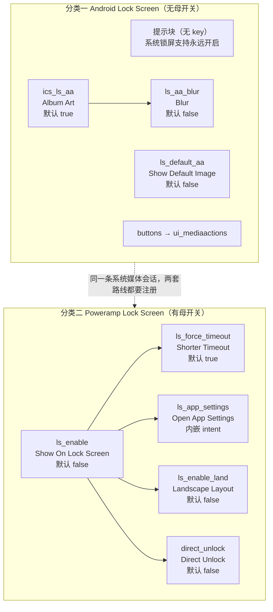

# Poweramp「设置 → 锁屏」偏好结构

> **⚠️ 本文已被同一分支的四份新文档取代（2026-11-07）。**
>
> | 文档 | 覆盖层 |
> | --- | --- |
> | `poweramp-lockscreen-branch-overview.md` | 分支总览（入口索引，建议先读） |
> | `poweramp-lockscreen-preference-tree.md` | 偏好结构层（本文 12 个 key 的逐条复核 + 10 条纠正 + 12 条新发现） |
> | `poweramp-lockscreen-runtime.md` | 运行时层（**解出了本文 §9 的 Q5/Q6/Q7**） |
> | `poweramp-lockscreen-mediaactions-subpage.md` | 子页 `ui_mediaactions`（本文 §7 只用一句话带过的那个目标） |
>
> **本文保留原样仅供对照**（`status: draft`，build-1025 口径）。
> 最重要的修订是：**自绘锁屏不是"自绘覆盖层"**，而是 `MainActivity` 的窗口标志 +
> `Window.Callback` 包装 + `Handler` 超时——本文 §3.1/§8.1 的"覆盖层 + `canDrawOverlays`"定性
> **不成立**，据此推出的"不可移植（无 `SYSTEM_ALERT_WINDOW` 权限模型）"论证基础也需改写。

> **证据分级**：【实证·原文】= XML/资源原文；【实证·产物】= 反编译 smali 产物；【推断】= 无直接代码佐证。所有结论基于 **build-1035-bundle-play**（`versionCode 1035009`）。

## 0. 一句话结论

本页 **21 行 XML / 15 个元素 / 12 个 key**，结构是一个**对立双分类**：左边「Android Lock Screen」**没有母开关**（系统锁屏通知强制开启、不可关闭），右边「Poweramp Lock Screen」有母开关 `ls_enable` 带 **4 个 dependent 子项**。它是全 App **唯一内嵌 `<intent>`** 的设置页，也是 helper（`la1`，13557 B）**比 XML 大 4 倍**的页面——因为锁屏要处理**悬浮窗权限闸门、动态 summary、屏幕尺寸门槛、恢复默认后补丁**四件纯代码的事。

## 1. 页面身份

| | |
| --- | --- |
| XML 文件 / 资源 id | `res/xml/lockscreen.xml` / **`0x7f16001d`**【实证·原文】`public.xml:11076` |
| 行数 / 字节 | **21** / **3224** |
| 元素总数 | **15**（14 偏好元素 + **1 嵌套 `<intent>`**） |
| `android:key` | **12**（7 状态 + 2 分类 + 1 跳转 + 2 动作） |
| 无 key 条目 | **1**（分类一的 `RawTextPreference` 提示块） |
| 页面标题 / 摘要 | **Lock Screen**（`pref_lock_screen`）/ **Poweramp lock screen options**（`pref_summary_lock_screen`） |
| 设置页 helper | **`ׅ/la1.smali`**（13557 B / **580 行**） |
| 状态字段注册表 | **`ׅ/vr.smali`**（4044 行）的 `<clinit>` |
| 分发表 / 辅助标志 | `u61.smali:852-870`【实证·产物】 / `ׅ/xn0`（屏幕平台）、`ׅ/nr0`（SDK≥33） |
| 搜索索引 | 根节点无 `skipSearch` → 整份 XML 进 FTS；单条目级**无排除** |

**12 个 key 的语义四分**：

| 类型 | 数量 | key |
| --- | ---: | --- |
| **状态键**（写 `"global"`） | **7** | `ics_ls_aa`、`ls_aa_blur`、`ls_default_aa`、`ls_enable`、`ls_force_timeout`、`ls_enable_land`、`direct_unlock` |
| 分类键 | 2 | `ics_ls_cat`、`pref_poweramp_ls`（后者被 helper 当删除锚点，§6.3） |
| 跳转键 | 1 | `buttons`（→ `ui_mediaactions`） |
| 动作键 | 2 | `ls_app_settings`（内嵌 intent）、`restore_defaults` |

> **唯一无 key 的提示块是与耳机页最明显的结构差异**：耳机页 0 个提示块，锁屏页有 1 个——因为要解释"系统锁屏**为什么没有开关**"，这属于**分类级说明**，塞不进任何条目的 summary。

---

## 2. 15 个元素逐条（按 XML 实际顺序）

本页默认值是**双源**（XML + `vr`），已核对 7/7 一致（§5.1）。

### 2.1 分类一 `@string/pref_ics_ls` = 「Android Lock Screen」（key `ics_ls_cat`，5 项）

| # | key | 控件类型 | 标题（英文实文） | 摘要（英文实文） | 默认 | dep |
| ---: | --- | --- | --- | --- | --- | --- |
| 1 | *（无 key）* | **RawText** | —（无标题） | **Android Lock Screen support is always enabled, as it's required for Bluetooth track info, smart watch support, other apps, etc.** | — | — |
| 2 | `ics_ls_aa` | MultilineSwitch | **Album Art** | Show album art on Android lock screen. This option may also affect Android Auto covers. Not supported by some devices/ROMs | **true** | — |
| 3 | `ls_aa_blur` | MultilineSwitch | **Blur** | Lock screen album art is blurred. The album art background isn't shown by some devices. This option is not recommended for smart watches or apps that use Poweramp album art | **false** | **`ics_ls_aa`** |
| 4 | `ls_default_aa` | MultilineSwitch | **Show Default Image** | Send default placeholder image when no album art exists for the track. Also affects smart watches, other apps utilizing media APIs. Default image is defined by skin | **false** | — |
| 5 | `buttons` | **Redirect** | **Buttons** | Media action buttons | — | — |

> **`#4` 没有 dependency 是一个易忽略的不对称**：它同样"给系统媒体会话提供封面"，但不依赖 `ics_ls_aa`——因为它的作用对象是**占位图**，即使锁屏不显示封面，手表/其他应用仍可能拉取占位图。

### 2.2 分类二 `@string/pref_poweramp_ls` = 「Poweramp Lock Screen」（key `pref_poweramp_ls`，5 项）

| # | key | 控件类型 | 标题（英文实文） | 摘要（英文实文） | 默认 | dep |
| ---: | --- | --- | --- | --- | --- | --- |
| 6 | `ls_enable` | MultilineSwitch | **Show On Lock Screen** | Poweramp shows itself on top of system lock screen if music is playing. Settings, deletion, edit tag, etc. actions trigger device lock screen | **false** | — |
| 7 | `ls_force_timeout` | MultilineSwitch | **Shorter Timeout** | Apply shorter screen timeout when Poweramp is on lock screen | **true** | `ls_enable` |
| 8 | `ls_app_settings` | **`Preference`**（原生类） | **Open App Settings** | **XML 无**；运行期由 `la1` 写入（§6.2） | — | `ls_enable` |
| 9 | `ls_enable_land` | MultilineSwitch | **Landscape Layout** | Enable rotation to landscape layout | **false** | `ls_enable` |
| 10 | `direct_unlock` | MultilineSwitch | **Direct Unlock** | Unlock directly to home screen (if possible) instead of Android lockscreen | **false** | `ls_enable` |

### 2.3 页尾

| # | key | 控件类型 | 标题 | 备注 |
| ---: | --- | --- | --- | --- |
| 11 | `restore_defaults` | Preference | **Restore Defaults** | `x11(15)` 绑定（§6.6） |

### 2.4 唯一的嵌套 `<intent>`

```xml
<Preference android:persistent="false"
            android:title="@string/pref_open_app_settings"
            android:key="ls_app_settings"
            android:dependency="ls_enable">
    <intent android:action="android.settings.APPLICATION_DETAILS_SETTINGS"
            android:data="package:com.maxmpz.audioplayer" />
</Preference>
```
【实证·原文】`lockscreen.xml:14-16`

| 属性 | 值 | 意义 |
| --- | --- | --- |
| `android:persistent="false"` | 非持久化 | 不写偏好、不占 `"global"` 状态位；它是**命令**不是**设置** |
| 内嵌 `<intent>` | `APPLICATION_DETAILS_SETTINGS` + `package:com.maxmpz.audioplayer` | 点击拉起**系统"应用详情"页**（不是 Poweramp 自己的 Activity） |
| `android:dependency="ls_enable"` | 依赖母开关 | **动作项被开关门控**（§3.4） |
| 无 `android:summary` | — | 摘要在运行期由 `la1` 写入（§6.2） |

> **`<intent>` 是 Android `Preference` 框架的内建能力**：解析子节点 `<intent>` 存入 `mIntent`，`performClick()` 时 `startActivity`。**Poweramp 没为它写一行代码**——`la1` 对这个条目的唯一动作是 `setSummary()`。

### 2.5 XML 属性使用矩阵

| 属性 | 次数 | 分布 |
| --- | ---: | --- |
| `android:key` / `android:title` | 12 / 12 | 除提示块与 `<intent>` 外的全部偏好元素 + 2 分类 + 根 |
| `android:summary` | 9 | 根 + #2/3/4/5/6/7/10；**`ls_app_settings` 无** |
| **`android:defaultValue`** / `persistent="true"` | **7 / 7** | 7 个状态键**全部**有，两者**完全重合** |
| `android:persistent="false"` | **2** | `ls_app_settings`（显式）；提示块（**类内强制**，§5.3） |
| `android:dependency` | **5** | `ls_aa_blur`→`ics_ls_aa`；4 项→`ls_enable` |
| `android:background` / `w:keepPaddings` / `w:target` | 各 1 | 提示块 ×2、`buttons` |

> **与耳机页的对照**：耳机页 `defaultValue` **0 个**、`persistent="true"` 8 个（冗余显式）；本页 `defaultValue` **7 个**、`persistent="true"` 7 个，**一一对应**。两页默认值策略完全相反（§5.1）。

---

## 3. 分类结构与分组逻辑

### 3.1 为什么是"对立双分类"

两个分类不是"功能块 A / B"，而是**两种实现路线**的并列：

| 分类 | 路线 | 母开关 | 可关闭 | 可控维度 |
| --- | --- | :---: | :---: | --- |
| **Android Lock Screen** | 走**系统原生**媒体通知（`MediaSession`） | **无** | **不可** | 只有 3 个"内容修饰"开关 |
| **Poweramp Lock Screen** | 走**Poweramp 自绘**锁屏覆盖层 | `ls_enable` | 可 | 4 个 dependent 子项 |



### 3.2 分类一为什么没有母开关：提示块已把答案写在脸上

提示块原文：**"Android Lock Screen support is always enabled, as it's required for Bluetooth track info, smart watch support, other apps, etc."**

| 层 | 内容 |
| --- | --- |
| 事实 | **always enabled** —— 不存在关闭入口 |
| 原因 | **required for** 蓝牙曲目信息 / 智能手表 / 其他应用 |
| 结论 | 不是"Poweramp 想不想给"，而是**系统媒体会话是共享基础设施**，关掉会破坏第三方消费方 |

> **架构含义**：`ics_ls_aa` 等 3 项只能调"**往这条通道里塞什么内容**"，不能调"通道开不开"。与耳机页形成互补——耳机页全是"可选能力"，锁屏页一半是"不可选的基础设施"。

### 3.3 分类一内部三个开关不是并列的

| 开关 | 依赖 | 被门控 | 作用对象 |
| --- | --- | :---: | --- |
| `ics_ls_aa` | — | 永不变灰 | 是否发送封面位图 |
| `ls_aa_blur` | `ics_ls_aa` | **变灰** | 发送前是否先模糊 |
| `ls_default_aa` | **无** | **永不变灰** | 无封面时是否发占位图 |

> 三个开关是"**数据加工链上的三个独立阀门**"（要不要发 / 发了模糊吗 / 没有时发占位吗），**不是"总开关 + 2 个子项"**。真正的总开关是那个**不存在的**开关。

### 3.4 分类二：母开关 + 4 个语义不同的 dependent

| 子项 | 与 `ls_enable` 的关系 | 为什么受门控 |
| --- | --- | --- |
| `ls_force_timeout` / `ls_enable_land` | **真子功能** | 只有自绘锁屏存在时才谈"缩短超时"/横屏布局 |
| `direct_unlock` | **行为修饰** | 只有自绘锁屏存在时才谈"解锁去哪" |
| **`ls_app_settings`** | **⚠️ 补救入口（不是子功能）** | 见下 |

> ### ⚠️ `ls_app_settings` 的语义异常：一个"去系统设置开权限"的按钮被开关门控
>
> 这个条目**不是**锁屏的子功能，它是**帮助用户解决"自绘锁屏显示不出来"的跳板**（跳系统"应用详情"去开"显示在其他应用上层"）。受 `ls_enable` 门控的含义是：**只有用户想用自绘锁屏（`ls_enable=true`）时，"去开权限"才相关；关掉后这个按钮变成无用噪声，所以置灰。**
>
> 所以 `android:dependency` 在本页承担了**两种不同语义**：
>
> | 语义 | 子项 | 机制 |
> | --- | --- | --- |
> | **能力从属**（父不做，子无意义） | `ls_force_timeout` / `ls_enable_land` / `direct_unlock` | 标准"母开关 + 子项" |
> | **相关性门控**（父不做，子的提示也无关） | `ls_app_settings` | 借同一属性表达"上下文相关性" |
>
> **这是本页最值得借鉴、也最容易被误读的设计点**：光看 XML 会以为它是第 4 个子功能。

---

## 4. 依赖关系图与门控

| 边 | 类型 | 变灰条件 | 变灰后值 |
| --- | --- | --- | --- |
| `ics_ls_aa` → `ls_aa_blur` | 能力从属 | Album Art 关 | 保留用户选择 |
| `ls_enable` → `ls_force_timeout` / `ls_enable_land` / `direct_unlock` | 能力从属 | Show On Lock Screen 关 | 保留 |
| `ls_enable` → `ls_app_settings` | **相关性门控** | 同上 | 无值（非持久化） |

| 模式 | 本页实例 | 说明 |
| --- | --- | --- |
| **母开关 + 子项变灰** | `ls_enable` → 4 项；`ics_ls_aa` → 1 项 | 母关则子灰，**值保留** |
| **独立子开关**（母开时可单独关） | **本页全部子项都是** | 4 个 dependent 都是独立布尔 |
| **母开子必开** | **不存在** | 本页无强制联动 |

| 层级 | key |
| --- | --- |
| **L0** | `ls_enable`、`ics_ls_aa` |
| **L1** | `ls_force_timeout`、`ls_app_settings`、`ls_enable_land`、`direct_unlock`、`ls_aa_blur` |

> 与耳机页对照：耳机母开关管"**要不要响应**"，锁屏母开关管"**要不要显示**"。**两页子项都可独立关闭，无一例外。**
>
> **本页最大深度 2，耳机页是 3**（`enable_headset_controls → headset_beep → beep_more`）。锁屏页没有"孙项"。

**依赖不参与 helper**：`la1.smali` 全文**没有** `setEnabled` / `notifyDependencyChange`。全部依赖边由框架在 inflate 时解析 `mDependencyKey` 后自动处理。唯一"接近"的是 `ls_enable_land` 的**整条删除**（§6.3)——那是"存在性"而非"变灰"，走 `removePreference`。

---

## 5. 资源的完整解析

### 5.1 默认值：双源且 7/7 一致

| # | key | XML `defaultValue` | `vr` 字段 | `vr` 默认 | 一致? | `vr.smali` 行 |
| ---: | --- | --- | --- | --- | :---: | ---: |
| 2 | `ics_ls_aa` | `true` | **`l0`** | **true**（`v2=1`） | ✅ | 1481 / 1493 |
| 3 | `ls_aa_blur` | `false` | **`n0`** | **false**（`v3=0`） | ✅ | 1513 / 1525 |
| 4 | `ls_default_aa` | `false` | **`o0`** | false | ✅ | 1529 / 1541 |
| 6 | `ls_enable` | `false` | **`j0`** | false | ✅ | 1449 / 1461 |
| 7 | `ls_force_timeout` | `true` | **`p0`** | **true** | ✅ | 1545 / 1576 |
| 9 | `ls_enable_land` | `false` | **`m0`** | false | ✅ | 1497 / 1509 |
| 10 | `direct_unlock` | `false` | **`k0`** | false | ✅ | 1465 / 1477 |

> **`v2=1` / `v3=0` 是 `<clinit>` 里预置的两个布尔常量**【实证·产物】`vr.smali:400`（`const/4 v2, 0x1`）、`:435`（`const/4 v3, 0x0`）。所有 `с(key, v2)` = 默认 true，`с(key, v3)` = 默认 false。
>
> **7/7 一致说明当前默认值维护是同步的**——但两处改一处会失配，属**潜在维护风险**（§9 Q1）。对比耳机页 0 处 XML 默认值（单源），反而没有这个风险。

### 5.2 全部 `@string` 落成英文文案

| 用途 | 标题实文 | 摘要实文 | 标题行 | 摘要行 |
| --- | --- | --- | ---: | ---: |
| 页面 | **Lock Screen**（`pref_lock_screen`） | **Poweramp lock screen options** | 1190 | 1531 |
| 分类一 / 二 | **Android Lock Screen** / **Poweramp Lock Screen** | — | 1162 / 1316 | — |
| 提示块 | — | Android Lock Screen support is always enabled, as it's required for Bluetooth track info, smart watch support, other apps, etc. | — | 1460 |
| #2 | **Album Art** | Show album art on Android lock screen. This option may also affect Android Auto covers. Not supported by some devices/ROMs | 1108 | 1490 |
| #3 | **Blur** | Lock screen album art is blurred. The album art background isn't shown by some devices. This option is not recommended for smart watches or apps that use Poweramp album art | 1201 | 1535 |
| #4 | **Show Default Image** | Send default placeholder image when no album art exists for the track. Also affects smart watches, other apps utilizing media APIs. Default image is defined by skin | 1202 | 1536 |
| #5 | **Buttons** | **Media action buttons** | 174 | 840 |
| #6 | **Show On Lock Screen** | Poweramp shows itself on top of system lock screen if music is playing. Settings, deletion, edit tag, etc. actions trigger device lock screen | 1109 | 1491 |
| #7 | **Shorter Timeout** | Apply shorter screen timeout when Poweramp is on lock screen | 1204 | 1538 |
| #8 | **Open App Settings** | —（运行期写，§6.2） | 1264 | — |
| #9 | **Landscape Layout** | Enable rotation to landscape layout | 1203 | 1537 |
| #10 | **Direct Unlock** | Unlock directly to home screen (if possible) instead of Android lockscreen | 1076 | 1480 |
| #11 | **Restore Defaults** | — | 1366 | — |

**运行期才出现的文案（不在 XML）**：

| 常量 | 资源名 | 英文实文 | 行 | 用在哪 |
| --- | --- | --- | ---: | --- |
| `0x7f0805c2` | `pref_poweramp_ls` | Poweramp Lock Screen | 1316 | 权限弹框**标题**（复用分类名） |
| `0x7f0805c3` | `pref_poweramp_ls_permissions` | Some devices may require additional Lock Screen permission manually set in Android settings ➔ Apps for Poweramp | 1317 | **`ls_app_settings` summary 第 1 段** |
| `0x7f0805c4` | `pref_poweramp_ls_permissions2` | For shorter lock screen timeout, "Apps that can change system settings" or "Modify system settings" permission should be set for Poweramp | 1318 | summary 第 2 段 / 弹框正文第 2 段 |
| `0x7f0805c5` | `pref_poweramp_ls_permissions_10` | Android 10 requires "Display over other apps permission" to show Poweramp Lock Screen | 1319 | **弹框正文第 1 段** |
| `0x7f080816` / `0x7f0800f9` | `setup_permissions` / `cancel` | **Setup Permissions** / **Cancel** | 1879 / 209 | 弹框正 / 负按钮 |
| `0x7f0805f5` / `0x7f0805f6` | `pref_restore_defaults` / `_msg` | Restore Defaults / All options on this page will be restored to the default values | 1366 / 1367 | 恢复默认确认框 |

> **四段权限文案分工精准**：`permissions`（通用：去应用详情手动设）→ `permissions2`（为"更短超时"需"修改系统设置"）→ `permissions_10`（Android 10 的"显示在其他应用上层"）。**它们是三种不同权限的说明，不是同一句话的三份副本。**

### 5.3 无 key 提示块与 `settings_quote_background`

| 项 | 值 |
| --- | --- |
| 类 / 内容位置 | `RawTextPreference` / `android:summary`（**不是** `w:line1`） |
| 背景 | `@drawable/settings_quote_background`（`0x7f020576`），`w:keepPaddings="true"` |
| 持久化 | **类内强制 `false`**【实证·产物】`RawTextPreference.smali:177`（构造函数无条件 `setPersistent(false)`） |

【实证·原文】`res/drawable/settings_quote_background.xml:1-11`：`<layer-list>` 单 item，`left=16dip top=8dip right=16dip bottom=4dip`，内部 `<shape>` 为 `corners=16dip` + `stroke=1px`（`?android:textColorHint`）+ `padding 36/3/37/4`——**只有描边、无填充**，用主题属性取色**自动跟随深浅**。`drawable-v23` 下另有变体。

> ### 关于"提示块是否被移除"的更正
>
> 运行时文档 §5.2.1 已确认：带动画移除的 `n91.i(RawTextPreference)` **全 App 仅 2 个调用点**（`BaseBuyFvPref:852`、`ManageAppWarnPref:1020`）；**各页 helper 命令式删除一律瞬时无动画**。
>
> 对本页而言结论更简单：**`la1` 从未删除这个提示块**。`la1.smali` 全文没有任何针对该条目的 `removePreference`——它无 key，连 `findPreference` 都无法定位。**所以这个提示块是永久的**，"Android Lock Screen support is always enabled"这句话本身也不需要条件。

---

## 6. helper `ׅ/la1` 的逐条运行时动作

`la1` 继承 `ׅ/n91`【实证·产物】`:1-3`，580 行由两部分组成：

| 部分 | 行 | 内容 |
| --- | ---: | --- |
| `static I(la1, Preference, Object)` | `:7-288` | **权限闸门**（`ls_enable` 的唯一业务逻辑） |
| `v()` | `:292-579` | **7 个装配动作**（§6.8） |

> **`la1` 比 `u91`（耳机页）大一倍的根本原因就在这 288 行 `I()`**——耳机页没有任何开关需要"拦截并回滚"。

### 6.1 `I()`：全 App 少见的"返回 false 回滚开关"

判定链（`la1.smali:7-288`）：

```
newValue == false?          → :27    return true（关锁屏永不被拦）
xn0.О 平台能力标志为假?      → :31    n91.G() 纯提示框（只有 OK）→ return true
SDK_INT < 23?               → :53-61  同上 → return true
canDrawOverlays() 已授予?    → :65-74 → :77 return true
                    未授予    → :210-213 弹双重权限框 → return FALSE ★ 开关回滚
```

> **这是与耳机页最本质的区别**：`s91`（耳机监听器）**每个分支都 `return true`**（弹框只是告知）；`la1.I()` 权限缺失时 **`return 0`**，`TwoStatePreference` 收到 `false` 后**把开关拨回原位**。
>
> **"告知型弹框" vs "闸门型弹框"**：前者 `true`+弹框 = "提醒但允许"，后者 `false`+弹框 = "提醒并阻止"。**两者代码形状几乎一样，语义完全相反**——这是静态分析最容易搞错的地方。

**弹框两个按钮**：正 = `setup_permissions`（`0x7f080816`）→ `n2(la1, 0xd, ls_enable)`；负 = `cancel`（`0x7f0800f9`）→ `null`。正按钮落地【实证·产物】`n2.smali:182-256`：

```asm
204: check-cast p2, Landroid/preference/SwitchPreference
208: invoke-virtual {p2, v4}, TwoStatePreference;->setChecked(Z)V   ; ★ 手动把开关置回 true
214: iget-object p1, p1, Lׅ/n91;->К:SettingsActivity
222: const-string v0, "android.settings.action.MANAGE_OVERLAY_PERMISSION"
231: invoke-virtual {p1, p2}, SettingsActivity;->startActivity(Intent)
245: const-string p2, "SettingsHelperLockscreen"          ; ★ 日志 tag 泄露原名
```

| 细节 | 含义 |
| --- | --- |
| `setChecked(true)` **手工补设** | 因为 `I()` 返回 `false`，框架回滚了视觉状态；点"Setup Permissions"时**由代码重新置 true**，表达"用户已表达意图" |
| 只跳 `MANAGE_OVERLAY_PERMISSION`，**不带 `package:`** | 跳**全局**"显示在其他应用上层"列表，不是本应用详情页（对比 `ls_app_settings` 的 `package:com.maxmpz.audioplayer`） |
| `Log.e("SettingsHelperLockscreen", ...)` | **混淆器没改字符串常量**，直接证实本 helper 原名就是 `SettingsHelperLockscreen` |

### 6.2 `ls_app_settings` 的动态 summary（唯一改文案的条目）

```asm
458: findPreference("ls_app_settings")
483: const v2, 0x7f0805c3            ; pref_poweramp_ls_permissions
492-500: getString / append
505: const-string v2, "\n\n"        ; ★ 两段分隔
514: const v2, 0x7f0805c4            ; pref_poweramp_ls_permissions2
519-527: getString / append
540: invoke-virtual {v0, v1}, Preference;->setSummary(CharSequence)
```
【实证·产物】`la1.smali:458-540`。渲染结果是 `permissions` + 空行 + `permissions2` 两段。

> **为什么必须运行期写**：XML 只能写一个 `@string`，无法表达 `\n\n` 分隔的两段。**对照**：`aa_bg` 用 `w:line1`/`w:line2` 表达两段（`RawTextPreference` 的专属属性），而本页这条是**原生 `Preference`**（不支持 `w:line1`），只能走代码。

### 6.3 `ls_enable_land`：按屏幕尺寸整条删除

```asm
371: sget-boolean v0, Lׅ/xn0;->o:Z
375: if-nez v0, :cond_0                  ; o != 0 → 跳过删除
379: sget-boolean v0, Lׅ/xn0;->С:Z
383: if-nez v0, :cond_0                  ; С != 0 → 跳过删除
391: const-string v1, "pref_poweramp_ls"
402: check-cast v0, Landroid/preference/PreferenceCategory;   ; ★ 转成分类
407: const-string v1, "ls_enable_land"
411: invoke-virtual {v0, v1}, PreferenceGroup;->findPreference
419: invoke-virtual {v0, v1}, PreferenceGroup;->removePreference   ; ★ 从分类移除
```
【实证·产物】`la1.smali:371-424`

| 标志 | 计算方式（【实证·产物】`BasePowerWidgetApplication.smali`） | 含义 |
| --- | --- | --- |
| `xn0->o` | `screenLayout & 0xf == 4`（XLARGE）**或**（`== 3`（LARGE）且 `max(w,h) > 1000`）`:646-700` | **平板型** |
| `xn0->С` | `height > 1000` **或** `width > 1000` `:757-762` | **大屏** |

> **两个都为假（小屏手机）→ 删除横屏开关；任一为真 → 保留。**
>
> **【推断】** 小屏设备上自绘锁屏的横屏布局没有实际场景（锁屏强制竖屏），故整条移除以免误导。
>
> **与 `u91` 完全同构的手法**：`findPreference(分类key)` → `check-cast` 成 `PreferenceGroup` → 分类内 `removePreference`。**两页都在"分类里删子项"，都必须自己写**（`n91.h()` 只在根 `K` 上查，运行时文档 §5.1）。

### 6.4 三个封面开关共用监听器 `tc(7)`

```asm
300: const/4 v1, 0x7                           ; ★ 索引 7
308-324: "ics_ls_aa"     → setOnPreferenceChangeListener(v0)   ; ①
329-345: "ls_aa_blur"    → 同一个 v0                            ; ②
350-366: "ls_default_aa" → 同一个 v0                            ; ③
```
【实证·产物】`la1.smali:296-366`。索引 7 落 `tc.smali:470-502` 的 `:pswitch_2`：取 `bus_player_cmd`（`0x7f0d0034`）总线 → `MsgBus.post(0x7f0d0206, 0, 0, null)`。

| 项 | 值 |
| --- | --- |
| 消息 id | **`0x7f0d0206`** = `cmd_player_reregister_media_session`【实证·原文】`public.xml:7440` |
| payload / 触发者 | **全空**（`0,0,null`）→ 纯信号 / `ics_ls_aa`、`ls_aa_blur`、`ls_default_aa` **三个** |
| 行为 | 让播放服务**重新注册媒体会话**（参数变了，需重新宣告 metadata/capabilities） |

> **一个监听器服务三个开关是精准的**：这三项只影响"发往系统媒体会话的封面数据"，而媒体会话注册是**一次性快照**，改参数必须**重新注册**才生效。**与 `ls_enable` 处理不同**：`ls_enable` 用 `f81(3)`，因为自绘锁屏启停**不是媒体会话的事**，而是 overlay 服务的事。

### 6.5 `ls_enable` → `f81(3)` → 透传 `I()` 返回值

`la1.smali:445` 用 `const/4 v2, 0x3` 构造 `f81`，第 3 参是 `ls_enable` 这个 `Preference` 本身（`:448`）。`f81` 表（`:470-476`）：`3→pswitch_0`，该分支只有三行（`:104-121`）：

```asm
113: invoke-static {v4, v3, p2}, Lׅ/la1;->I(la1, Preference, Object)Z
118: move-result p1
121: return p1                              ; ★ 把 I() 的返回值原样透传
```

> **`f81(3)` 是纯转发器**（`f81` 三个字段：`В`=索引、`А`=la1、`B`=Preference）。`onPreferenceChange` 直接调 `la1.I()` 并**原样返回布尔值**——这是 `return false` 能真正回滚开关的**必要条件**（中间任何一层不转发就失效）。

### 6.6 `restore_defaults` → `x11(15)` → `p71(6)`

`la1.smali:565` 的 `const/16 v2, 0xf` → 索引 15 → `x11.smali:848-875` 的表（0→`pswitch_18` … 15→**`pswitch_9`**）→ `pswitch_9`（`:446-468`）：`const/4 v0, 0x6` → `p71(6)` → `n91.m(null, p71(6), 0)`。

即 **恢复默认 = 弹"All options on this page will be restored to the default values"确认框 → 确认后跑 `p71(6)`**。

### 6.7 `p71(6)`：恢复默认后的"补丁"（与耳机页的关键差异）

`p71` 表（`:1205-1230`）共 23 项，索引 **6** → **`pswitch_10`**（`:878-931`）：

```asm
879: check-cast v6, Lׅ/la1;
883-911: 四个 xn0 标志（Х / В / х / А）全为 0 → 跳过
916: sget-object v0, Lׅ/vr;->n0:Lׅ/pb1;         ; ★ ls_aa_blur 字段
920: invoke-virtual {v0, v5}, Lׅ/fc;->у(Z)V      ; ★ 强制置 false（v5 = 0）
925: invoke-virtual {v6}, Lׅ/n91;->y()V          ; ★ 再刷一次系统服务
```
【实证·产物】`p71.smali:878-931`。4 个 `xn0` 标志（`Х`/`В`/`х`/`А`）任一为真才执行，然后：`vr->n0.у(0)`（**强制把 `ls_aa_blur` 写回 false**）→ `n91.y()`（取 `"__agg"` 系统服务 `n91.smali:2941-2979` → `w2.В()` → **刷新媒体会话/服务**）。

> **为什么恢复默认后要单独补一刀**：`ls_aa_blur` 的默认值已经是 `false`（§5.1），且 `n91.n()`（通用重置）会处理所有 `isPersistent()` 的偏好子类（`ls_aa_blur` 正是）——**所以第一行看起来是冗余的**。
>
> **【推断】真正目的是第二行 `n91.y()`**：恢复默认改动了 3 个封面开关，而通用重置**不会**发 `cmd_player_reregister_media_session`（那只在 `tc(7)` 里发）。所以恢复默认后**必须补发一次媒体会话刷新**，否则"恢复默认"在系统锁屏上要等下次播放才生效。
>
> **这正是耳机页没有的东西**：`headset` 的恢复默认 Runnable 是 `x2(4)` = **空实现**（耳机文档 §5.5）。**"恢复默认后要不要补发副作用"，是两页 helper 规模差异的主要来源。**

### 6.8 `la1.v()` 七个动作、覆盖率与成本

| # | key | 默认 | helper 触及 | 行为来源 | 行 |
| ---: | --- | --- | :---: | --- | --- |
| 1 | *提示块* | — | ❌ | 静态文案，永久存在 | — |
| 2-4 | `ics_ls_aa` / `ls_aa_blur` / `ls_default_aa` | true / false / false | ✅ `tc(7)` ×3 | 媒体会话重注册 | `:296-366` |
| 5 | `buttons` | — | ❌ | `RedirectPreference` 内建跳转 | — |
| 6 | `ls_enable` | false | ✅ `f81(3)`→`I()` | **权限闸门 + 回滚** | `:425-453` |
| 7 | `ls_force_timeout` | true | ❌ | 纯框架 + dependency | — |
| 8 | `ls_app_settings` | — | ✅ `setSummary` | 动态两段文案；跳转靠 `<intent>` | `:458-540` |
| 9 | `ls_enable_land` | false | ✅ 删除 | 屏幕尺寸门控 | `:371-424` |
| 10 | `direct_unlock` | false | ❌ | 纯框架 + dependency | — |
| 11 | `restore_defaults` | — | ✅ `x11(15)` | 通用链 + `p71(6)` 补丁 | `:545-574` |

| 部分 | 行数 | 占比 | 可否省掉 |
| --- | ---: | ---: | --- |
| `I()` 权限闸门 | 288 | ~50% | **不可**（框架无"改变前拦截"声明式属性） |
| `v()` 的 7 个装配 | ~290 | ~50% | ④⑥ 不可省；①②③⑦ 可省（会失去功能） |
| 监听器/Runnable 实现 | 0（在 `f81`/`tc`/`n2`/`p71`/`x11`） | 0% | — |

**与耳机页对照**：行数 297 → **580**；每 key 字节 381 → **1130**；权限闸门 无 → **288 行**；动态文案 无 → 1 处；平台门控删除 2 处（SDK）→ 1 处（屏幕）；恢复默认 空实现 → **补发消息**。

> **锁屏页的"贵"全在四件事上**：权限、文案、屏幕、补丁。这四件**耳机页一件都没有**。

---

## 7. 跨页跳转与 `buttons` 键重名

### 7.1 `buttons` → `ui_mediaactions`

| 项 | 值 |
| --- | --- |
| key / 标题 / 摘要 | **`buttons`** / **Buttons** / **Media action buttons** |
| `w:target` | `ui_mediaactions`（`0x7f16002d`，helper `y61`）；**不 skipSearch** → 参与索引 |

> 跳转机制见运行时文档 §7 与根文档 §4.1，不重述。

### 7.2 `buttons` 在三个页面重名——是冲突还是有意？

| 页面 | 行 | key | target | helper 是否处理 |
| --- | ---: | --- | --- | --- |
| `lockscreen.xml` | 9 | **`buttons`** | `ui_mediaactions` | **`la1` 完全不引用** |
| `ui_notify.xml` | 7 | **`buttons`** | `ui_mediaactions` | `z61.R()` **SDK<33 时删除它** |
| `misc.xml` | 10 | **`buttons`** | `ui_mediaactions` | `sa1` 不引用 |

3 处**完全同构**（同 key、同标题、同摘要、同 target）——是一个"同一入口在三处出现的刻意捷径"。

**它是"冲突"吗？——不是，因为该 key 从不承载状态**：`RedirectPreference extends RawTextPreference`（`RedirectPreference.smali:2`），而 `RawTextPreference` 构造函数**无条件** `setPersistent(false)`【实证·产物】`RawTextPreference.smali:174-177`；三处 XML 也都**没有** `android:persistent` 属性，走类内默认。

> **结论（有证据，非猜测）**：`buttons` **从来不写入 `"global"` SharedPreferences**。它在三页的唯一作用是让 `findPreference` 能定位、搜索索引能记录、深链 `settings/<page>#buttons` 能命中。
>
> **所以运行时文档 §6.2 提出的"同名 key 互相覆盖"风险，在这个 key 上不成立**——双方都不写值。真正风险只在**持久化键**上（`restore_defaults` 也三页同名，但同样是原生 `Preference` 且无值）。

**两个真实差异**：

| 差异 | 说明 |
| --- | --- |
| **可见性不一致** | `z61.R()` 在 `SDK < 33`（`nr0.В == false`，`nr0.smali:15-38`）时把该条目从 `ui_notify` **删掉**（`z61.smali:541-558`）；但 `la1` 与 `sa1` **都不删**。即：**同一入口在 Android 13 以下的"通知设置"页消失，却在"锁屏"和"其他"页仍在** |
| **深链锚点歧义** | `settings/lockscreen#buttons`、`settings/ui_notify#buttons`、`settings/misc#buttons` 三个锚点都有效但指向**同一页面**；搜索索引也会出现 3 条同名结果 |

> **【推断】删除动机**：`ui_mediaactions` 配的是**通知动作按钮**，Android 13 起通知媒体控件由系统统一管理（`MediaControls`），自定义按钮语义变化；锁屏页与 misc 页的入口是"通用媒体按钮"，不受此影响——所以只有通知页需要隐藏。**无法判断** `la1`/`sa1` 不做门控究竟是有意还是遗漏（§9 Q8）。

### 7.3 本页无锚点出口、但自己是锚点目标

| 方向 | 内容 |
| --- | --- |
| 本页 → 外部 | **只有 1 个**：`buttons` → `ui_mediaactions` |
| 外部 → 本页 | `settings/lockscreen`（根页面 `lockscreen` 项，根文档 §2.3）；`settings/lockscreen#buttons` 亦有效 |

> **本页没有 `#` 锚点出口**（不像耳机页的 `misc#long_volume_controls`）——它是**跳转链末端**，只推去**另一整页**。

---

## 8. 对 SpMusic 的可借鉴 / 不建议照抄

SpMusic 是 **Tauri + React 的桌面本地音乐播放器**（无 Android、无系统锁屏）。

### 8.1 根本不可移植

| 本页能力 | 桌面端现实 |
| --- | --- |
| **Android Lock Screen** 整个分类（3 开关 + 提示块） | **不可移植**。桌面无"锁屏媒体通知"概念 |
| **Poweramp Lock Screen**（自绘覆盖层 + `canDrawOverlays`） | **不可移植**。桌面无 `SYSTEM_ALERT_WINDOW` 权限模型 |
| `ls_force_timeout` / `direct_unlock` / `ls_enable_land` | **不可移植**（无控制屏幕超时、无锁屏跳转、无锁屏布局） |
| `APPLICATION_DETAILS_SETTINGS` 内嵌 intent | **不可移植**（Windows 可用 `ms-settings:appsfeatures` 近似，语义不同） |

> **诚实结论**：12 个 key **桌面端一个都不需要**。剩下的价值全在**设计模式**，不在条目。

### 8.2 值得借鉴的 4 个设计

**(1) 「基础设施永开 / 自绘可选」的双轨制**（本页最强的架构思想）：系统媒体会话（`ics_ls_cat`）**永开无开关**——蓝牙/手表/其他应用依赖它，关掉会破坏**第三方契约**；自绘覆盖层（`pref_poweramp_ls`）可关——纯本应用增强。

- **SpMusic 直接对应**：系统媒体集成（Windows **SMTC** / Linux **MPRIS**）**应永远暴露**——它被系统音量浮层、耳机按键、Discord/StreamDeck 等第三方读取；而"桌面歌词窗""迷你播放器悬浮窗"应各自有开关
- **可写成架构约束**：*任何被外部消费方依赖的接口，不得提供关闭开关；只有纯自用的增强才有开关*

**(2) 提示块解释"为什么没有开关"**：本页在无母开关的分类**顶部**放一段提示，说清"always enabled + 原因 + 受影响方"。要点：**提示必须给出原因和受影响方**，只写"不可关闭"会引发困惑。SpMusic 若暴露 SMTC/MPRIS，UI 应有类似说明，**避免用户反复找关闭入口**。

**(3) 权限闸门：`return false` 回滚 + 正按钮代打勾**（`la1.I()` 的完整模式）：

```
用户开启某能力 → 检查前置权限 → 不足则
  ① 弹框说明缺什么   ② 正按钮 = 打开系统设置页
  ③ 返回值 false → 开关视觉回滚   ④ 用户返回并再次开启时才通过
```

- 关键细节：**开关状态必须回滚**，否则用户以为已开启
- 关键细节：点"去授权"时**代码手动把开关置 true**（`n2` 的 `setChecked(true)`），表达"记住用户意图"
- **桌面可直接复用**：Windows "开机自启需计划任务权限"、Linux "媒体键需 uinput 权限"是同一形状

**(4) 两级文案：简述在 summary，详述在弹框**：`ls_app_settings` 的 summary 是 `permissions` + `\n\n` + `permissions2`；弹框正文是 `permissions_10` + `\n\n` + `permissions2`。同一功能在**不同触发路径**给**不同详略**的说明。SpMusic 可套用：设置项 summary 给"怎么做"，拦截弹框给"为什么被拦 + 缺什么权限"。

### 8.3 不建议照抄的 3 点

| 做法 | 问题 |
| --- | --- |
| **默认值双源**（XML `defaultValue` + `vr`，7/7 手工同步） | 改一处忘另一处就失配，**无任何静态检查**。应单源（TS schema 常量） |
| **用 `android:dependency` 表达两种语义**（能力从属 + 相关性门控，§3.4） | `ls_app_settings` 与 `ls_force_timeout` 在 XML 里长得一样，语义完全不同。schema 应区分 `dependsOn`（能力）与 `relevantWhen`（相关性） |
| **同一入口在不同页有不同可见性**（`buttons` 在 `ui_notify` 被 SDK 门控、另两页不被门控，§7.2） | 用户在不同入口看到不同结果且无提示。若做多入口，**门控条件必须集中定义** |

---

## 9. 未解问题

| # | 问题 | 现状 |
| ---: | --- | --- |
| Q1 | 默认值双源是否有生成机制保证一致？ | 7/7 当前一致，但未见构建期校验代码。**维护风险** |
| Q2 | `xn0.О`（闸门第一条件）的精确语义 | `xn0.<clinit>` 由 SDK 与 `PREVIEW_SDK_INT` 计算（`:79-121`：SDK<29 → true；SDK≥29 → `ac.Х()`（`PREVIEW_SDK_INT`）>0 时 true）。**为何把 "preview SDK" 作为"需要权限提示"的条件，未解** |
| Q3 | `ls_aa_blur` 在 `ics_ls_aa` 关闭时是否真的无效 | XML 声明了 dependency，但**消费方是否二次检查**未验证 |
| Q4 | `ics_ls_aa` 的 "Not supported by some devices/ROMs" 具体指什么 | 文案自陈限制，未在代码里找到 fallback 分支 |
| Q5 | `ls_force_timeout` / `direct_unlock` 的消费代码 | helper 完全不碰；消费侧应在自绘锁屏 Service/overlay，未反编译 |
| Q6 | 自绘锁屏本体在哪 | `ls_enable` 只写偏好；**渲染自绘锁屏的 Activity/Service 未定位** |
| Q7 | `p71(6)` 第一行 `vr->n0.у(0)` 是否冗余 | §6.7 推断真正目的是第二行 `n91.y()`；但两行在同一 `if` 内，无法分离验证 |
| Q8 | `buttons` 在 lockscreen/misc 不做 SDK<33 门控是有意还是遗漏 | `la1`/`sa1` 完全不引用该 key，**无法区分"有意"与"忘了"** |
| Q9 | `ls_app_settings` 是否也需"修改系统设置"权限检查 | 文案 `permissions2` 提到该权限，但 `I()` 只检查悬浮窗。**是否漏检未证** |

> **静态分析拿不到的东西**：① **真机上的条目可见性**——取决于 `xn0.o`/`xn0.С`（屏幕）与 `xn0.О`（平台）；② **自绘锁屏的实际行为**——本页所有开关的消费方都不在本 helper 内；③ **权限弹框的实际触发频率**——取决于 Android 版本与 ROM 的 `canDrawOverlays` 默认值（部分 ROM 默认授予）；④ **`<intent>` 在无"应用详情"页的设备上的行为**——`Preference` 未捕获 `ActivityNotFoundException` 的话会崩溃【推断，未验证】。

---

## 10. 证据索引

| 主题 | 路径 : 行 |
| --- | --- |
| **页面结构 / 15 元素** | `v1035/decoded/res/xml/lockscreen.xml:1-21` |
| **内嵌 `<intent>`** | `res/xml/lockscreen.xml:14-16` |
| 资源 id `0x7f16001d` | `res/values/public.xml:11076` |
| 分发表登记 | `ׅ/u61.smali:852-870` |
| **全部标题/摘要文案** | `res/values/strings.xml`（§5.2 逐条标行号） |
| 四段权限文案 | `strings.xml:1317,1318,1319,1879` |
| **`buttons` 三处重名** | `lockscreen.xml:9` / `ui_notify.xml:7` / `misc.xml:10` |
| `RedirectPreference extends RawTextPreference` | `com/maxmpz/audioplayer/preference/RedirectPreference.smali:2` |
| **`RawTextPreference` 强制非持久** | `com/maxmpz/audioplayer/preference/RawTextPreference.smali:174-177` |
| `settings_quote_background` | `res/drawable/settings_quote_background.xml:1-11`（id `0x7f020576`） |
| **`la1.I()` 权限闸门全文** | `ׅ/la1.smali:7-288`（判定点 `:27` / `:31` / `:53-61` / `:65-74`；**`return 0` `:210-213`**） |
| **`n2` 正按钮：置回 true + 跳权限页** | `ׅ/n2.smali:182-256`（`setChecked` `:208`、Intent `:222-231`、日志 tag `:245`） |
| **`la1.v()` 七个动作** | `ׅ/la1.smali:292-579`（`tc(7)`×3 `:296-366`；**屏幕门控 `:371-424`**；`f81(3)` `:425-453`；**动态 summary `:458-540`**；`x11(15)` `:545-574`） |
| **`tc` idx 7 → `cmd_player_reregister_media_session`** | `ׅ/tc.smali:470-502`（id `0x7f0d0206`）+ 表 `:898-910` |
| **`f81(3)` → `pswitch_0` → 透传返回值** | `ׅ/f81.smali:104-121` + 表 `:470-476` |
| `x11` idx 15 → `pswitch_9` → `p71(6)` | `ׅ/x11.smali:446-468` + 表 `:848-875` |
| **`p71(6)` 恢复默认补丁** | `ׅ/p71.smali:878-931` + 表 `:1205-1230` |
| `n91.y()` 取 `"__agg"` 服务 / `n91.m()` 确认框 | `ׅ/n91.smali:2941-2979` / `:2190-2230` |
| **`vr` 7 个状态字段** | `ׅ/vr.smali:1449,1465,1481,1497,1513,1529,1545`（`v2=1` / `v3=0` 常量 `:400` / `:435`） |
| `ms.с(String,Z)` | `ׅ/ms.smali:2687` |
| **`xn0.o`（平板）/ `xn0.С`（大屏）** | `com/maxmpz/widget/app/BasePowerWidgetApplication.smali:646-700` / `:757-762` |
| **`xn0.О`（闸门第一条件）/ `nr0.В`（SDK≥33）** | `ׅ/xn0.smali:79-121` / `ׅ/nr0.smali:15-38` |
| **`z61.R()` SDK<33 删 `buttons`** | `ׅ/z61.smali:521-558`（调用点 `:1306`） |
| `n91` 契约 / `restore_defaults` 通用链 / 提交点 | `poweramp-settings-page-runtime.md` §4 / §5.5 / §6 |
| `w:target` 三态与深链协议 | `poweramp-settings-root-structure.md` §4.1 / §4.2 |
| 母开关依赖对照样本 | `poweramp-headset-settings.md` §3 / `poweramp-background-settings.md` §2.2 |
