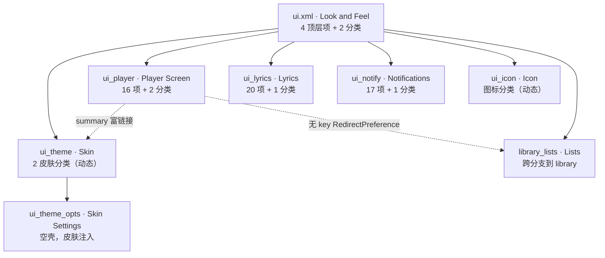

# Poweramp「设置 → 外观」偏好结构（外部实现）

## 0. 文档定位

本文记录外部实现 Poweramp 的**「设置 → 外观（Look and Feel）」**分支完整结构。

| 文档 | 覆盖范围 | 关系 |
| --- | --- | --- |
| `poweramp-settings-root-structure.md` | 根页面、`w:target` 机制、深链协议、搜索索引 | **前置**，本文不重述 |
| **本文** | 外观分支 8 个 XML 的全部偏好项、选项值、提示文案、动态填充点 | — |
| `poweramp-audio-settings-structure.md` | 音频分支 | **边界外** |

### 0.1 证据分级

| 标记 | 含义 |
| --- | --- |
| **【实证·原文】** | 可在解码 XML / strings.xml / arrays.xml 直接查到 |
| **【实证·产物】** | 可在 smali 查到确切方法体与行号 |
| **【推断】** | 本文作者推理，可能出错 |

### 0.2 计数口径

沿用根页面文档：**配置项**=有 key 且承载状态/动作；**提示行**=`RawTextPreference`；**偏好行**=含分类内子项的全部元素。

## 1. 分支总览

### 1.1 八个 XML 与规模

| 文件 | 行数 | 标题（文案） | 直接子节点 | 分类数 | 分类内子项 | 元素总数 | 提示行 | 动态填充 |
| --- | ---: | --- | ---: | ---: | ---: | ---: | ---: | --- |
| `ui.xml` | 27 | Look and Feel | 6 | 2 | 14 | 20 | 1 | — |
| `ui_theme.xml` | 8 | Skin | 3 | 2（容器） | 0 | 3 | 1 | **2 个皮肤分类** |
| `ui_theme_opts.xml` | 4 | Skin Settings | 0 | 0 | 0 | 0 | 0 | **整页由皮肤注入** |
| `ui_player.xml` | 36 | Player Screen | 16 | 2 | 11 | 27 | 4 | — |
| `ui_lyrics.xml` | 25 | Lyrics | 16 | 1 | 3 | 19 | 6 | — |
| `ui_notify.xml` | 21 | Notifications | 9 | 1 | 6 | 15 | 2 | — |
| `ui_icon.xml` | 7 | Icon | 2 | 1（容器） | 0 | 2 | 1 | **图标列表** |
| `library_lists.xml` | 39 | Lists | 4 | 3 | 27 | 31 | 0 | — |
| **合计** | **159** | — | **56** | **10** | **61** | **117** | **15** | **4 处** |

> 计数口径：**直接子节点**=`PreferenceScreen` 的一级子元素；**元素总数**=直接子节点 + 分类内子项；**提示行**=`RawTextPreference` 全递归计数。
> 注意 `ui_theme.xml` 与 `ui_icon.xml` 的"分类"在 XML 里是**空容器**（自定义 Category 类，无子项），故分类内子项为 0。

#### 1.1.1 覆盖度自检（94 个 key 全覆盖）

本文档已逐 key 核对 8 个 XML 中的**全部 94 个 `android:key`**，覆盖率 100%：

| XML | key 数 | 覆盖 |
| --- | ---: | :---: |
| `ui.xml` | 16 | ✅ |
| `ui_theme.xml` | 2 | ✅ |
| `ui_theme_opts.xml` | 0（空壳） | ✅ |
| `ui_player.xml` | 20 | ✅ |
| `ui_lyrics.xml` | 12 | ✅ |
| `ui_notify.xml` | 14 | ✅ |
| `ui_icon.xml` | 1 | ✅ |
| `library_lists.xml` | 29 | ✅ |
| **合计** | **94** | **100%** |

另外，`poweramp_builtin_skins.xml` 的 **17 个皮肤选项 key**（Light/Dark 共有 14 + 仅 Light 2 + 仅 Dark 1）也已全覆盖。

**本文档能回答的问题类型**：

| 问题 | 可查位置 |
| --- | --- |
| 某个设置项存在吗、标题摘要是什么 | §2–§9 各页表格 |
| 它存在哪个 pref 文件/字段、默认值多少 | §2.3.1、§5.3.1、§6.1.3、§7.2.1、§9.1 |
| 它的选项数组取值 | §13 及各页「选项表」 |
| 它在运行时会消失/变灰吗 | §7.1.1（通知）、§10.1（featurePack） |
| 点击后跳到哪里 | §4.2、§5.3.1、§6.1、§9.1.3 |
| 皮肤能覆盖它吗 | §4.5、§14 |
| 某个废弃/隐藏属性是什么 | §13、§15 |

### 1.2 偏好树



> **注意**：`library_lists.xml` 虽在 `ui.xml` 内跳转，但它的 `searchBreadcrumb1` 是 `@string/pref_library`（**归属媒体库**），且同样被 `library.xml` 引用。这是一个**双归属页**。

## 2. `ui.xml` —— 外观主页（27 行）

### 2.1 顶层 4 项（无分类）

| key | 控件 | 标题 | 摘要 | 默认值 |
| --- | --- | --- | --- | --- |
| `ui_theme` | RedirectPreference | Skin | Change Poweramp visual theme. Set per-skin options like extra Pro Buttons, Static Seekbar | — |
| `follow_night_mode` | MultilineSwitchPreference | Follow Day/Night Mode | Follow system Day/Night Mode if selected skin supports light/dark themes | `false` |
| `settings_theme` | TagListPreference | Settings Theme | — | `0` |
| `settings_font` | TagListPreference | Settings Font | — | `2` |

**`settings_theme` 选项**（`@array/pref_settings_theme_labels`）：Default / Light / Dark / Follow Day/Night Mode

**`settings_font` 选项**（`@array/pref_settings_font_labels`）：Default / Alternative font / Bold / Bold+

> ⚠️ **两套"主题"要区分**：`settings_theme`/`settings_font` 是**设置页自身**的外观；`ui_theme`（皮肤）是**播放器界面**的主题。二者独立，互不影响。

#### 2.1.1 `settings_theme` 的四态如何解析成主题

存储：`prefs/В->K0`（默认 0）。解析函数 `SettingsActivity.getThemeResId(Context)`【实证·产物】`SettingsActivity.smali:102-172`：

| 值 | 含义 | 返回主题 | 逻辑 |
| ---: | --- | --- | --- |
| 0 | Default | `ActivityTheme_Settings`（`0x7f0e02dc`） | 固定 |
| 1 | Light | `ActivityTheme_SettingsLight`（`0x7f0e02dd`） | 固定 |
| 2 | Dark | `ActivityTheme_SettingsDark`（`0x7f0e02de`） | 固定 |
| 3 | Follow Day/Night | 按系统 `uiMode` 动态选 | **SDK≥29 恒 Dark**；否则看 `uiMode & 0x30`：`0x10`(NIGHT_NO)→Light、`0x20`(NIGHT_YES)→Dark、其他→Dark |

> 注意值 3 在 **Android 10+ 直接返回 Dark**，不再跟随系统——因为它依赖 `Configuration.uiMode`，而 SDK≥29 下该判断被短路了（`if-lt v0, 0x1d` 即 SDK<29 才走 uiMode 分支）。

同时还有 `isProbablyADarkTheme(Context)`（`:174-200`）用同一个 `K0` 值判断当前是否暗色，供状态栏/导航栏图标配色使用。

#### 2.1.2 `settings_font` 四态

存储：`prefs/В->L0`（默认 `2`=Bold）。生效点：`Application.smali:2783-2785` 读 `L0` 后调用 `褍(int)` 写入全局字体缩放基准。

> **注意默认值是 2（Bold）而非 0** —— 这与截图一致（截图里「设置字体」默认选中「粗体」）。

#### 2.1.3 `follow_night_mode` 与 `settings_theme` 的语义重叠

两者不是同一层：

| 项 | 作用对象 |
| --- | --- |
| `settings_theme` | **设置页自身**的明暗 |
| `follow_night_mode` | **播放器界面（皮肤）**是否跟随系统日夜模式 |

`follow_night_mode` 存 `widget/player/h0->V`（默认 false）【实证·产物】`h0.smali:704-710`。它要求**当前皮肤同时提供 light 与 dark 两套主题**（`poweramp_builtin_skins.xml` 里 Light 皮肤有 `darkMode` 属性、Dark 皮肤有 `lightMode` 属性，正是为此）。

### 2.2 分类 General（4 项）

| key | 控件 | 标题 | 摘要 |
| --- | --- | --- | --- |
| `ui_player` | RedirectPreference | Player Screen | — |
| `ui_lyrics` | RedirectPreference | Lyrics | — |
| `ui_notify` | RedirectPreference | Notifications | — |
| *（无 key）* | RedirectPreference | — | Press here for the additional List UI options like Filename As Title, Show Track Number, etc. |

> 第 4 项 **无标题、无 key**，`w:target="library_lists"`、`w:skipSearch="true"` —— 它是通向列表 UI 设置的**隐藏入口**，只靠摘要文字提示。

### 2.3 分类 Misc（10 项）

| key | 控件 | 标题 | 摘要 | 默认 | 备注 |
| --- | --- | --- | --- | --- | --- |
| `lang` | ListPreference | Language | `%s` | `""` | 31 种语言 |
| `ui_icon` | RedirectPreference | Icon | Set launcher icon | — | |
| `orientation` | TagListPreference | Screen Orientation | — | `0` | Default/Portrait/Landscape |
| `anim_speed` | TagListPreference | Animations | Disable/enable or change UI animation speed where possible | `false` | **featurePack=1** |
| `start_at_lib` | MultilineSwitchPreference | Start at Library | Changes startup screen. Back action returns from the Player Screen to the current list | `false` | |
| `hide_status_bar` | MultilineSwitchPreference | Hide Status Bar | — | `false` | persistent=true |
| *（提示行）* | RawTextPreference | — | Some firmwares are unable to change status bar/nav bar dynamically... | — | skipSearch |
| `keep_screen_on` | MultilineSwitchPreference | Keep Screen On | Always keep screen on in the app | — | |
| `num_settings_tags` | SeekbarPreference | Settings Shortcuts in Main Menu | `%s` | — | min=0 max=10 |
| `restore_defaults` | Preference | Restore Defaults | — | — | |

**`lang` 选项**（`@array/pref_language_entries` / `pref_language_values`）：共 **31 条**，首项 Auto（空串），其后 ar/bn/in/cs/zh_CN/zh_TW/da/de/en_US/es/fa/fr/el/iw/hi/it/ro/hu/nl/ja/ko/pl/pt_BR/ru/sk/sr/th/vi/tr/uk。

**`anim_speed` 选项**（`@array/anim_speed_entries` / `anim_speed_values`）：Disabled=0 / Fast=**2** / Default=1（⚠️ 值与显示顺序不一致）

#### 2.3.1 Misc 10 项的存储与生效位置【实证·产物】

| key | 存储字段 | 生效位置 |
| --- | --- | --- |
| `lang` | `h0->Р`（String，默认 `""`） | `common/j.smali:1530-1560` → `Locale.setDefault` + `Resources.updateConfiguration` |
| `orientation` | `h0->P`（int，默认 0） | 各 Activity 的 `setRequestedOrientation` |
| `anim_speed` | `h0` 内的 int（默认 1） | 全局动画时长的倍数因子 |
| `start_at_lib` | `h0->芯`（bool，默认 false） | 启动路由：进播放器界面还是媒体库 |
| `hide_status_bar` | `h0->褉`（bool，默认 false） | 窗口 decorView 的 systemUiVisibility |
| `keep_screen_on` | `h0->p`（bool，默认 false） | `Window.addFlags(FLAG_KEEP_SCREEN_ON)` |
| `num_settings_tags` | `h0->t0`（int，默认 **5**） | 主菜单里「设置」快捷入口的显示数量上限 |
| `follow_night_mode` | `h0->V`（bool，默认 false） | 皮肤日夜主题切换 |
| `settings_theme` | `prefs/В->K0`（int，默认 0） | `getThemeResId()` |
| `settings_font` | `prefs/В->L0`（int，默认 **2**） | `Application.smali:2783` 字体缩放 |

#### 2.3.2 语言（`lang`）的完整切换链【实证·产物】

这是本页最复杂的一项，涉及三层：

```
用户在 ListPreference 选中语言 code（如 "zh_CN"）
 → 存 h0->Р（String，空串 = Auto/跟随系统）
 → BaseApplication.smali:2000-2016（onConfigurationChanged 路径）
    取 common/j->褏 解析出的 Locale
    → Locale.setDefault(locale)
    → Configuration.setLocale(locale) + updateConfiguration()
 → common/j.smali:1530-1560（启动路径）
    if (SDK < 某阈值) 用 j->啸（系统 Locale）否则用解析结果
    → 同样 setDefault + updateConfiguration
```

**关键点**：

- 值为**空串**时表示 **Auto（跟随系统）**，不是"禁用"
- 语言切换**不需要重启 App**：直接 `updateConfiguration` 并重建 Resources
- 截图里的「自动」正是空串的显示文案

#### 2.3.3 `num_settings_tags` 的特殊之处

`SeekbarPreference` 的 `w:entries="@array/zero_index_disabled_entries"` 只有一个元素 `Disabled`，作用是让**值 0 显示为 "Disabled"** 而不是数字 0。

默认值 **5**（`h0.smali:1231` 的 `const/4 v2, 0x5`），范围 0–10。控制主菜单中「设置」快捷方式的显示条数（截图显示值为 5）。

## 3. `ui_theme.xml` —— 皮肤选择（8 行）

### 3.1 结构

| key | 控件 | 标题 | 说明 |
| --- | --- | --- | --- |
| `theme_list` | BuiltinSkinsPreferenceCategory | Built-in Skins | **XML 无子项，运行时填充** |
| `theme_list_3rdparty` | ThirdPartySkinsPreferenceCategory | 3rd Party Skins | **XML 无子项，运行时填充** |
| *（无 key）* | RawTextPreference | — | To get more skins, search in Google Play for "Poweramp v3 skin" |

页级属性：`w:searchIndexer="...SettingsHelperUiTheme$SearchIndexer"`、`w:searchBreadcrumb1="@string/pref_look_and_feel"`【实证·原文】

### 3.2 内置皮肤只有 2 个

`poweramp_builtin_skins.xml`（资源 id `0x7f160021`）声明 **2 个 `<skin>`**【实证·原文】：

| # | name | style | 说明 |
| --- | --- | --- | --- |
| 1 | `@string/skin_light` = **Light** | `@style/ActivityTheme_White` | 含 `darkMode` 属性 |
| 2 | `@string/skin_black` = **Dark** | `@style/ActivityTheme_Black` | 含 `lightMode` 属性 |

每个皮肤声明 **23 个子节点**，类型分布【实证·原文】：

| 类型 | Light | Dark | 作用 |
| --- | ---: | ---: | --- |
| `globalOption` | 2 | 2 | 全局选项（评级相关） |
| `radio` | 1 | 1 | `alt_layout` 布局单选（带图标） |
| `multiSwitch` | 10 | 10 | 多状态切换 |
| `option` | 4 | 3 | 布尔开关 |
| `msg` | 5 | 6 | 提示行 |

**皮肤选项 key 清单**（Light/Dark 共有）：`alt_layout`、`track_labels_align`、`labels_bg`、`player_buttons_bg`、`mu_colors`(minSdk=31)、`font_variant`、`rounding`、`seekbar`、`more_buttons`、`light_buttons`(仅Light)、`knob_hilite`、`graphic_frs_color`、`force_light_navbar`(仅Light)、`statusbar_bg`(仅Dark)、`navbar_bg`、`navbar_offset`、`android_navbar`

### 3.3 皮肤发现机制

| 来源 | 机制 | 证据 |
| --- | --- | --- |
| 内置 | `BuiltinSkinsPreferenceCategory.B(List)` → 构造 `player/bt/В(ctx, 2)` → `x(1, list)` → 读取 `0x7f160021` 的 `<skin>` 节点 | 【实证·产物】`BuiltinSkinsPreferenceCategory.smali:20-38` |
| 第三方 | 扫描所有 APK 的 `AndroidManifest` 中 **meta-data 键 `com.maxmpz.PowerampSkins`**，读取其 `<skins>` XML | 【实证·产物】`Application.smali` 静态字段 `F = {"com.maxmpz.PowerampSkins"}`；`player/bt/В.smali:463-530` |

> 失败时打 log `SkinDiscovery: Failed to load skins from apks`【实证·产物】`player/bt/В.smali:1691`

**填充流程**【实证·产物】`BaseSkinsPreferenceCategory.smali:20-188`：

```
A()  ← 基类统一流程
 ├─ 从 Bundle 取 theme_pak / theme_id（当前选中皮肤）
 ├─ 调抽象 B(ArrayList) 拿皮肤列表（内置/第三方各自实现）
 ├─ 遍历 SkinInfo：
 │   ├─ 比较 (skinId, skinName) 判定是否为当前选中 → checked
 │   ├─ В(ctx, skinInfo, checked) 创建 SkinRadioPreference
 │   └─ addPreference(radio)
 └─ 非首项 setShowOwnDivider(true)
```

### 3.4 皮肤相关的 11 个自定义控件

| 控件 | 用途 |
| --- | --- |
| `SkinRadioPreference` | 皮肤列表项（单选），持 `SkinInfo` |
| `SkinGearRadioPreference` | 带"齿轮"的皮肤项，点击进 `ui_theme_opts` |
| `SkinRestoreDefaultPreference` | 恢复该皮肤默认值 |
| `SkinSwitchPreference` | 皮肤内的布尔选项 |
| `SkinSelectableOptionPreference` | 基类：可选皮肤选项 |
| `SkinSwitchOptionPreference` | 对应 `<option>` |
| `SkinSelectablePopupOptionPreference` | 弹出式选择 |
| `SkinSelectableRadiosOptionPreference` | 对应 `<radio>` |
| `SkinSelectableSeekbarOptionPreference` | 滑杆型 |
| `SkinSelectableMultiSwitchOptionPreference` | 对应 `<multiSwitch>` |
| `BaseSkinSelectableOptionPreference` | 以上共同基类 |

## 4. `ui_theme_opts.xml` —— 皮肤选项页（4 行，空壳）

```xml
<PreferenceScreen android:title="@string/pref_skin_settings" w:skipSearch="true" ... />
```

| | |
| --- | --- |
| 静态子节点 | **0 个** |
| 内容来源 | **100% 由当前皮肤动态注入**（解析 `poweramp_builtin_skins.xml` 里该 `<skin>` 的 23 个子节点，或第三方皮肤同名节点） |
| 搜索 | 整份 `skipSearch="true"`，不进索引 |
| 增量重建 | 唯一被增量重建搜索索引的 XML（`0x7f160034`）——因为皮肤变了选项就变 |

> 这是**"数据驱动 UI"**的典型：皮肤包不只是样式，还是一份**声明式设置页面**。切换皮肤后，页面里的选项集合会整体变化。

### 4.1 由谁填充：`f1`（SettingsHelperUiThemeOpts）

**分派入口**【实证·产物】`f0.smali:289-304`：`resId == 0x7f160035`（`ui_theme_opts`）时实例化专用 helper **`f1`**（`super = v1`）。

**填充流程**【实证·产物】`f1.smali:99-450`：

```
l()  ← 初始化入口
 ├─ 从 Bundle 取 theme_pak（皮肤包名）与 theme_id（皮肤资源 id）
 │   └─ 若为 0，回退读 Intent extra "theme_pak" / "theme_id"
 ├─ 若都取不到 → log "setup FAIL pak=... resId=0x..." 然后 finish + 重开 ui_theme
 ├─ 取 theme_page_path（皮肤内部子页面路径，形如 "0/1/2"）
 ├─ 若 theme_page_path 为空：
 │   └─ 只创建一个 SkinSwitchPreference（单项开关），setPersistent(false)
 ├─ 否则：
 │   └─ new player/r(ctx, skinInfo)
 │       └─ r.x(prefScreen, false, false, theme_page_path)   ← 按路径解析并注入整页
 └─ 注入后按 SkinPageOptions 设置 ActionBar 标题
```

> **`theme_page_path`**（`f1.smali:377`、`SkinRadioPreference.smali:212`）是**皮肤内部子页面的层级路径**，用 `/` 分隔的数字索引（如 `"0/1"`），逐级在皮肤的选项树里下钻。格式非法会打 `createOptions bad basePagePath=`（`player/r.smali:973`）。

### 4.2 皮肤选项如何进设置页

`SkinRadioPreference.onAttachedToHierarchy`【实证·产物】`SkinRadioPreference.smali:148-244`：

```
onAttachedToHierarchy(pm)
 ├─ 取当前页面的 args Bundle
 ├─ 读 theme_page_path
 └─ new player/r(ctx, skinInfo)
     └─ r.x(父PreferenceGroup, showOptions, showOwnDividers, theme_page_path)
        → 返回 SkinPageOptions，并把皮肤选项直接 addPreference 到皮肤列表项之下
```

> **重要**：皮肤选项在**皮肤列表页内联展开**（作为皮肤项的缩进子项），而不是必须跳转到独立页面。`ui_theme_opts` 那条路径是"齿轮按钮"进入的独立页形态，两者共用 `SkinPageOptions` 构建器。

### 4.3 皮肤项的点击行为

`SkinRadioPreference.onClick`【实证·产物】`SkinRadioPreference.smali:246-286`：

| 点击目标 | 行为 |
| --- | --- |
| 齿轮按钮（view id `0x7f0d02e9`） | `setFragment(K)` + `onPreferenceStartFragment(this)` → 跳 `ui_theme_opts` 独立页 |
| 其他区域 | `super.onClick()` → 选中该皮肤 |

> 这也解释了截图里皮肤项为什么同时有"选中"和"进设置"两种交互。

### 4.4 两个内置皮肤的全部选项（46 个节点）

`poweramp_builtin_skins.xml` 共 141 行，**2 个 `<skin>`**，各 **23 个子节点**。

**皮肤级属性**：

| 属性 | Light | Dark |
| --- | --- | --- |
| `name` | `@string/skin_light` = **Light** | `@string/skin_black` = **Dark** |
| `style` | `@style/ActivityTheme_White` | `@style/ActivityTheme_Black` |
| `author` | `@string/pa_plugin_author` = **Poweramp Team** | 同左 |
| `description` | Light skin with optional static seekbar and "Pro" track/category change buttons | Black skin with optional static seekbar and "Pro" track/category change buttons |
| `forceGlobalOptions` | **true** | **true** |
| 反向主题 | `darkMode="@style/ActivityTheme_Black"` | `lightMode="@style/ActivityTheme_White"` |

**完整选项表**（按 XML 出现顺序）：

| # | 节点 | key | 选项名 | 选项文案（英文原文） | 覆盖方式 |
| ---: | --- | --- | --- | --- | --- |
| 1-2 | `globalOption` ×2 | — | — | `OptionRatingDisabled` / `OptionRatingStarsMenu` | overlapAttr |
| 3 | `radio` | `alt_layout` | 布局 Layout | **Default** / **Alternative layout** / **Full cover** | 带图标 |
| 4 | `msg` | — | — | Use Player Screen and Lyrics options to hide/show menu/lyrics/Chromecast buttons and rating | — |
| 5 | `multiSwitch` | `track_labels_align` | Track Labels | Default / **Centered** | dep=`alt_layout` |
| 6 | `msg` | — | — | Centered · Applied for Alternative layout/Full cover | — |
| 7 | `multiSwitch` | `labels_bg` | Labels Background | **Enabled** / **Hidden** | dep=`alt_layout` |
| 8 | `msg` | — | — | Hidden · Applied for Alternative layout/Full cover · Applied on the Player Screen · You may want to additionally adjust Background… | — |
| 9 | `multiSwitch` | `player_buttons_bg` | Player Buttons Background | Enabled / Hidden | — |
| 10 | `msg` | — | — | Hidden · You may want to additionally adjust Background… | — |
| 11 | `multiSwitch` | `mu_colors` | Material You colors | **Disabled** / **More pronounced** / **Less pronounced** | `minSdk=31` |
| 12 | `multiSwitch` | `font_variant` | Font | Default / **Alternative font** / **Bold** | 默认= Bold |
| 13 | `multiSwitch` | `rounding` | Rounded Corners | **More rounded** / **Less rounded** | — |
| 14 | `multiSwitch` | `seekbar` | Seekbar Style | **Default** / **Static Seekbar** / **Simple Seekbar (with Pro Buttons)** | — |
| 15 | `option` | `more_buttons` | Pro Buttons | 布尔开关 | `checkedByDefault=true` |
| 16 | `option` | `light_buttons` | More Light | 布尔开关 | **仅 Light**，`checkedByDefault=false` |
| 17 | `multiSwitch` | `knob_hilite` | Knob Highlight | **None** / **Monochromatic** / **Colorful** | 默认=Colorful |
| 18 | `multiSwitch` | `graphic_frs_color` | Eq. Graphic Mode Curve | **Monochromatic** / **Colorful** | 默认=Colorful |
| 19 | `option` | `force_light_navbar` | Force Light Nav. Bar | 布尔开关 | **仅 Light** |
| 20 | `msg` | — | — | Some firmwares are unable to change status bar/nav bar dynamically… | — |
| 21 | `multiSwitch` | `statusbar_bg` | Transparent Status Bar | Default / **No Background** | **仅 Dark** |
| 22 | `msg` | — | — | Some covers may make status bar icons not readable… | 仅 Dark |
| 23 | `multiSwitch` | `navbar_bg` | Transparent Navbar | **Default** / **Semi-transparent** / **No Background** | summary=Applied on the Player Screen |
| 24 | `option` | `navbar_offset` | Offset Navbar | 布尔开关 | — |
| 25 | `multiSwitch` | `android_navbar_bg` | Android Navigation Bar | **Default** / **No Background** | — |

> **Light 与 Dark 的唯一差异**：Light 独有 `light_buttons`、`force_light_navbar`；Dark 独有 `statusbar_bg`。其余 16 个选项两者完全相同。

**选项摘要文案**：

| key | 摘要 |
| --- | --- |
| `alt_layout` = Default | Track labels and buttons on cover. Best for small or wide screens |
| `alt_layout` = Alternative layout | Moves track labels below cover, makes on-cover buttons smaller and faded |
| `alt_layout` = Full cover | Moves all track labels and buttons below cover. Works best on long screen phones |
| `more_buttons` | Track and category change buttons. **Always enabled for Simple Seekbar** |
| `light_buttons` | White background for buttons and labels |
| `force_light_navbar` | For devices with default dark Android navigation bar |
| `navbar_offset` | Move Navbar slightly away from the corners (for display with large corner radius) |

### 4.5 `overlap` 覆盖机制（皮肤系统的核心）

皮肤选项不是直接改颜色，而是**动态叠加一层 style 到当前主题上**。

**两组配对的属性**【实证·原文】`attrs.xml`：

| 组 | 数量 | 作用 |
| --- | ---: | --- |
| `Option*` | 22 个 | **当前生效值**（主题里指向某个 `@style/Option*`） |
| `overlap_*` | 16 个 | **覆盖值**（皮肤声明"选此项时改成什么"） |

**基线定义**在 `Base_ActivityTheme_Core`（`styles.xml:10112`）中，22 个 `Option*` 全部指向同名的空 style：

```xml
<item name="OptionRatingStars">@style/OptionRatingStars</item>
<item name="OptionRatingLikeUnlike">@style/OptionRatingLikeUnlike</item>
<item name="OptionCounter">@style/OptionCounter</item>
<item name="OptionNoHeaderButtons">@style/OptionNoHeaderButtons</item>
<item name="OptionCCDisabled">@style/OptionCCDisabled</item>
<item name="OptionCCInMenu">@style/OptionCCInMenu</item>
<item name="OptionCCMainUIAndInMenu">@style/OptionCCMainUIAndInMenu</item>
<item name="OptionHeaderMeta">@style/OptionHeaderMeta</item>
<item name="OptionRatingStarsMenu">@style/OptionRatingStarsMenu</item>
<item name="OptionHideMenu">@style/OptionHideMenu</item>
<item name="OptionAAKeepAspect">@style/OptionAAKeepAspect</item>
<item name="OptionCCMainUIButton">@style/OptionCCMainUIButton</item>
<item name="OptionAACrop">@style/OptionAACrop</item>
<item name="OptionEquFRSRounded">@style/OptionEquFRSRounded_Light</item>
<item name="OptionHideLyricsButton">@style/OptionHideLyricsButton</item>
<item name="OptionLocalizedAZScroll">@style/OptionLocalizedAZScroll</item>
<item name="OptionRatingDisabled">@style/OptionRatingDisabled</item>
<item name="OptionRoundedScreenCorners">@style/OptionRoundedScreenCorners</item>
<item name="OptionAnimLongLabelsInLists">@style/OptionAnimLongLabelsInLists</item>
```

> 注意多数 `@style/OptionXxx` 是**空 style**（无 item），即"默认不覆盖任何东西"。真正的视觉差异来自 `overlap_*` 指向的那些**有内容的** style（如 `ActivityTheme_Whitepro_StaticSeekbar`、`ActivityTheme_Blackpro_TransparentNavbar`）。

**三种覆盖语义**：

| XML 写法 | 语义 |
| --- | --- |
| `overlapAttr=""` | **不覆盖**（空 → 保持基线） |
| `overlapAttr="@attr/overlap_xxx"` | 选中时把 `overlap_xxx` 的值赋给 `OptionXxx` |
| `overlapStyle="@style/Xxx"` | 直接指定一个具体 style 覆盖 |

> 因此 `rounding` 的 `More rounded` 用 `overlapStyle=""`（=默认更圆，无需覆盖），而 `Less rounded` 用 `overlapAttr="@attr/overlap_less_rounding"`（要主动改成"更少圆角"）。

**`forceGlobalOptions="true"`**：Light 与 Dark 都声明了它。作用是让该皮肤的 `globalOption`（`OptionRatingDisabled`、`OptionRatingStarsMenu`）**强制生效**，即覆盖 `ui_player.xml` 的 `rating_type` 设置——这解释了为什么在某些皮肤下评级类型改不动。

**渲染成设置项**：`player/r.smali` 的 `x(PreferenceGroup, ZZ String)` 按 `theme_page_path` 递归下钻，最终由 `褍(List, int, int[])`（`r.smali:473-535`）按索引定位到具体的 `SkinPageOptions`，再实例化成对应的 `Skin*Preference` 控件。

## 5. `ui_player.xml` —— 播放界面（36 行，27 元素）

> 结构：**16 个直接子节点**（含 2 个提示行、2 个分类）+ 分类内 11 项 = **27 元素**。

### 5.1 顶部（4 项）

| key | 控件 | 标题 | 摘要 | 默认 | featurePack |
| --- | --- | --- | --- | --- | :---: |
| *（无 key）* | RedirectPreference | — | Press here for the additional Skin options like Static Seekbar, Pro Buttons. 3rd party skins may support even more options | — | — |
| `aa_anim` | MultilineSwitchPreference | Album Art Animation | Animate on track advance. Also applies to bottom bar | `true` | — |
| `anim_long_labels` | MultilineSwitchPreference | Animate Long Labels | Animate long track title and album/artist labels | `true` | — |
| `anim_long_labels_in_lists` | MultilineSwitchPreference | Animate Long Labels Everywhere | Animate long track labels also in lists and the miniplayer | `true` | — |

> `anim_long_labels_in_lists` 依赖 `anim_long_labels`（父关则子灰）。

**三个动画项的存储与生效位置**【实证·产物】：

| key | 存储 | 生效位置 |
| --- | --- | --- |
| `aa_anim` | `prefs/В->E`（默认 true） | 列表点击时决定用平滑滚动还是瞬时跳转 |
| `anim_long_labels` | `widget/player/h0->M`（默认 true） | `MarqueeFastTextView` 的 `D0` 开关 |
| `anim_long_labels_in_lists` | `widget/player/h0->O0`（默认 true） | 仅在 `M && O0` 同时为真时应用 `?OptionAnimLongLabelsInLists` |

**跑马灯触发阈值的真实判定**【实证·产物】`widget/base/MarqueeFastTextView.smali:133-200`：

```
O(offset) {
  if (D0 == false) return;          // anim_long_labels 关闭
  if (FastTextView.H != 1) return;  // 必须是跑马灯模式
  if (FastTextView.x != 4) return;  // 必须是单行/特定布局
  ...
  remaining = textWidth - offset;
  if (remaining > 0) {
      if (remaining > 10) {         // ← 阈值：剩余可滚宽度 > 10px
          B0 = remaining;
          W();                       // 启动动画
      }
  }
}
```

> **"标签超宽才动画"的判定 = 文本宽度超出可视宽度，且剩余滚动距离 > 10px**。小于 10px 不启动（避免抖动式的微小滚动）。

### 5.2 分类 Player Screen Buttons（5 项，**全部 featurePack=1**）

| key | 控件 | 标题 | 摘要 |
| --- | --- | --- | --- |
| *（提示行）* | RawTextPreference | — | 三行说明（见 §12 提示文案表） |
| `edit_player_screen_buttons` | **EditButtonsRedirPref** | Edit Player Screen Buttons | 带 `<intent android:action="com.maxmpz.audioplayer.ACTION_OPEN_MAIN">` |
| `sub_aa_buttons_no_gap` | MultilineSwitchPreference | Prefer No Gap | Minimize gaps between buttons for the centered layout |
| `sub_aa_buttons_no_lp_edit` | MultilineSwitchPreference | Do Not Edit On Long Press | Prevents accidental long press started button editing |
| *（无 key）* | **PaEditableButtonsRestorePref** | Restore Player Screen Buttons | — |

> 这 5 项构成**"播放器界面按钮自定义"**完整功能：编辑入口 + 两个行为开关 + 恢复默认。

### 5.3 分类 Other Buttons（6 项）

| key | 控件 | 标题 | 摘要 | 默认 | featurePack |
| --- | --- | --- | --- | --- | :---: |
| `cc_button` | TagListPreference | Chromecast Button | — | `1` | — |
| `rating_type` | TagListPreference | Rating Type | — | `1` | — |
| `hint_5stars` | RawTextPreference | — | Swipe over stars to select rating... | — | — |
| `hide_menu` | TagListPreference | Menu Button | Menu can be opened by long pressing the cover | — | — |
| `menu_button_long_press` | TagListPreference | Menu Button Long Press | Long press action for the track menu button | — | **1** |
| `main_lyrics_button` | TagListPreference | Lyrics Button | Button on the Player Screen/cover | — | — |

**选项表**：

| key | 数组 | 选项（值） |
| --- | --- | --- |
| `cc_button` | pref_cc_button_entries/values | Disabled=0 / Player Screen=1 / Player Screen Button=**4** / Main Menu=**2** / Player Screen and Main Menu=3 ⚠️非连续 |
| `rating_type` | pref_rating_type_entries | Disabled / Like-unlike thumbs / 5 stars / 5 stars (menu/lists only)，按下标取值 |
| `hide_menu` | pref_hide_menu_entries/values | Disabled=**1** / Enabled=**0** ⚠️**值与显示反序** |
| `menu_button_long_press` | menu_button_long_press_entries | Disabled / Delete / Add to Playlist / Info-Tags / Album Art / Artist / Album / Folder / Genre / Share / Like / Unlike |
| `main_lyrics_button` | pref_main_lyrics_button_entries/values | Disabled=0 / When local lyrics available=1 / Always=2 |

> `hide_menu` 同时带 `w:disableDependenciesValue="1"` + `w:booleanType="true"` —— 因为值 1 代表"隐藏/禁用"，取反语义必须靠 `disableDependenciesValue` 修正，否则依赖它的 `menu_button_long_press` 门控会反。

#### 5.3.1 "播放器界面按钮自定义"数据模型（**核心功能**）

这一组功能（分类「Player Screen Buttons」5 项）背后是一套**独立的按钮布局配置系统**，存在**独立 SharedPreferences 文件 `futp`** 中（`widget/player/h0` 继承 fastprefs，构造名 `futp`），与主设置文件 `ftp` 分离。

**横竖屏各存一套，共 8 个字段**【实证·产物】`widget/player/h0.smali`：

| pref key | 类型 | 默认 | 含义 |
| --- | --- | --- | --- |
| `sub_aa_buttons_port` / `_land` | int[] | 5 个初始按钮 | **按钮集合 + 顺序 + 显隐** |
| `sub_aa_buttons_layout_port` / `_land` | int | 0 | 0=centered 经典居中，1=compact 紧凑行 |
| `sub_aa_buttons_small_buttons_port` / `_land` | boolean | false | 普通 / 小按钮 |
| `sub_aa_buttons_lines_port` / `_land` | int | 0 | 行数；**==2 表示两行** |
| `sub_aa_buttons_no_gap` | boolean | false | 居中布局时压缩按钮间隙 |
| `sub_aa_buttons_no_lp_edit` | boolean | false | 屏蔽长按进入编辑 |

**默认按钮数组**：`{vis, sleeptimer, <counter 或 0>, shuffle, repeat}`（第 3 位由 `show_counter` 决定）。

**可选按钮共 29 个**【实证·原文】`arrays.xml` 的 `<array name="sub_aa_buttons">`：

`vis` / `sleeptimer` / `counter` / `shuffle` / `repeat` / `menu` / `cast` / `delete` / `add_to_pl` / `bookmark` / `aa` / `info` / `lyrics` / `tags` / `artist` / `album` / `genre` / `folder` / `like` / `unlike` / `like_unlike` / `love` / `unlove` / `loveUnloveButton` / `prevcat` / `nextcat` / `minus10s` / `plus10s` / `audio_info`

> **注意**：`ui_mediaactions.xml` **不是**这一套。`ui_mediaactions` 只管通知栏 / Android Auto 的 6 个动作（`notify_action1..6`），与播放器界面按钮是两回事。

**两个开关的确切作用**【实证·产物】`widget/player/SubAAButtonsLayout.smali`：

| key | 作用点 | 具体行为 |
| --- | --- | --- |
| `sub_aa_buttons_no_gap` | `onMeasure` | 仅对 **centered 布局**生效：按「可用宽度 / (按钮数 + 间距)」重新均分，空隙压到最小。不影响 compact 布局 |
| `sub_aa_buttons_no_lp_edit` | `performLongClick` | 为 true 时**跳过进入按钮编辑模式**，只走普通长按。它是防误触，**不影响**设置页里"Edit Player Screen Buttons"这条入口 |

**编辑入口的完整链路**【实证·产物】`EditButtonsRedirPref.smali:98-160`：

```
onClick()
 ├─ MsgBus.post(0x7f0d02ef = cmd_app_close_settings)   ← 先关闭设置页
 ├─ getIntent().setPackage(自身包名)
 ├─ startActivity(ACTION_OPEN_MAIN)                    ← 跳主界面
 └─ 延迟 0x96 或 0x1f4 ms（取决于当前屏索引是否变化）后刷新
```

> 没有通过 intent extra 传"编辑模式"标志——编辑态是主界面侧的**全局状态**，设置页只是负责关掉自己再把用户送过去。

#### 5.3.2 `cc_button`（Chromecast 按钮）五个取值的精确含义

这是本页最容易混淆的一项——**值非连续（0/1/4/2/3）**，且「Player Screen」与「Player Screen Button」两个名称极像。

存储 `h0->J`，默认 **1**。主题分派在 `common/j.smali:340-436`【实证·产物】，每个值 apply 一个不同的主题属性：

| 值 | 文案（英文原文） | 主题属性 | 实际 UI 位置 |
| ---: | --- | --- | --- |
| 0 | **Disabled** | `OptionCCDisabled`（`0x7f0105ba`） | 完全不显示 |
| 1 | **Player Screen** | `OptionCCMainUI`（`0x7f010798`） | **播放界面**里作为一个普通按钮显示（不占底部按钮行） |
| 2 | **Main Menu** | `OptionCCInMenu`（`0x7f0105bb`） | 只在**主菜单**里出现 |
| 3 | **Player Screen and Main Menu** | `OptionCCMainUIAndInMenu`（`0x7f0105bc`） | 两处都显示 |
| 4 | **Player Screen Button** | `OptionCCMainUIButton`（`0x7f010693`） | 作为**播放界面底部按钮行**里的一个可配置按钮（进 29 个 PRO 按钮体系） |

> **值 1 与值 4 的关键区别**：
> - 值 **1（Player Screen）**：按钮由皮肤/主题固定呈现，**不在按钮自定义体系内**
> - 值 **4（Player Screen Button）**：按钮进入 `sub_aa_buttons` 那 29 个可配置按钮体系 —— 证据是数组里确实存在 `@id/subaabutton_cast` 这一项【实证·原文】`arrays.xml`
>
> 所以值 4 排在数组末尾、取值独立于 2/3，是**后加的第四种形态**（早期只有 0/1/2/3）。

> ⚠️ 另需注意：`audioplayer/widget/Н.smali:167` 也读 `h0->J`，但那是在**投屏按钮加载失败**时把 `cc_button` 强制写 0（`褍(0)`）的兜底逻辑，不是常规分派路径。

**恢复默认**【实证·产物】`PaEditableButtonsRestorePref.smali:87-190`：不是只恢复按钮，而是把上述 **8 个字段全部恢复出厂**（按钮数组、布局模式、按钮尺寸、行数，横竖屏各一套）。弹确认框后先发 `cmd_gui_reset_modal`，延迟 100ms 再执行并异步落盘。

### 5.4 分类外散项（7 项）

| key | 控件 | 标题 | 摘要 | 默认 | featurePack |
| --- | --- | --- | --- | --- | :---: |
| `line2_click` | TagListPreference | Line2 Press | Handle press on the 2nd track text line | — | **1** |
| `line2_long_click` | TagListPreference | Line2 Long Press | Handle long press on the 2nd track text line | — | **1** |
| `show_counter` | MultilineSwitchPreference | Track Counter | Show track number/total tracks counter (if supported by skin) | `false` | — |
| `_counter_hint` | RawTextPreference | — | Track Counter is available via Player Screen Buttons customization | — | — |
| `previous_resets` | MultilineSwitchPreference | `<<` Button Resets Current Track | First press rewinds track, second press changes track... | `false` | — |
| `long_skip_rewind` | MultilineSwitchPreference | -10/+10s Rewind Pro Buttons | Change `<<<` `>>>` to -10/+10s rewinding buttons for long tracks | `true` | — |
| *（无 key）* | RedirectPreference | — | Press here to set long track duration | — | — |
| `menu_nav_to_folders` | MultilineSwitchPreference | Navigate to the Folders | Track menu / Folders button navigates to the Folders category instead of the Folders Hierarchy | `false` | — |
| `restore_defaults` | Preference | Restore Defaults | — | — | — |

**跨页锚点**：第 7 项 `w:target="library#restore_pos_min_dur"` —— 直接跳到媒体库页并滚动到「Track Duration For Per Track Progress」【实证·原文】`ui_player.xml:32`

**富链接摘要**：`long_skip_rewind` 的 `w:summary2` 含 `Requires <a href=settings/ui_theme#more_buttons>Pro Buttons</a> skin option enabled`，配合 `w:allowLinks="true"` 使「Pro Buttons」可点击，跳到皮肤选项页的 `more_buttons` 项【实证·原文】

## 6. `ui_lyrics.xml` —— 歌词（25 行，19 元素）

> 结构：**16 个直接子节点**（含 6 个提示行、7 个配置项、1 个 RedirectPreference、1 个分类、1 个 restore_defaults）+ 分类内 3 项 = **19 元素**。

### 6.1 主体项

| key | 控件 | 标题 | 摘要 |
| --- | --- | --- | --- |
| `main_lyrics_swipe` | TagListPreference | Lyrics Swipe Up | Swipe action on the Player Screen/cover |
| `main_lyrics_button` | TagListPreference | Lyrics Button | Button on the Player Screen/cover |
| `lyrics_in_menu` | TagListPreference | Lyrics Item In The Track Menu | — |
| `lyrics_keep_screen` | MultilineSwitchPreference | Keep Screen On | Keep screen on for the lyrics |
| `lyrics_offset` | SeekbarPreference | Lyrics Time Offset | Applied to synced lyrics in addition to the offset tag |
| `list_zoom_lyrics` | TagListPreference | Lyrics Size | Pinch-to-zoom `[icon]` for zooming |
| `lyrics_plugin` | NumberListPreference | Preferred Lyrics App | 3rd party app to search lyrics when no lyrics found (if installed): `%s` |
| `lyrics_custom_url` | EditTextPreference | Custom URL | For the Browser via custom URL |

**关键参数**：

| 项 | 参数 |
| --- | --- |
| `lyrics_offset` | min=**-5000**、max=**5000**、step=**50**、centerLabel=0、左 -5000 / 右 5000、`w:summary2="%dms"` |
| `lyrics_plugin` | 8 个选项，**值非连续** |
| `list_zoom_lyrics` | Small Font=-1 / Default=0 / Large Font=1 |

**`lyrics_plugin` 选项与实际跳转**【实证·产物】`dialogs/LyricsActivity.smali:46-122`、`dialogs/K.smali:169-733`：

| 显示 | 值 | 实际 Intent 目标 |
| --- | ---: | --- |
| None | -1 | 不跳转 |
| Browser via custom URL | 6 | 见下「自定义 URL 分支」 |
| Google | 2 | `ACTION_WEB_SEARCH` + query |
| Google (Web) | 3 | `ACTION_VIEW` → `https://google.com/search` |
| MusiXmatch | 0 | `com.musixmatch.android.lyrify` + `RemoteScrobblingService` |
| Genius | 1 | `com.genius.android`，`ACTION_SEARCH`，extras `query`/`artistName`/`songName` |
| QuickLyric | 4 | `com.geecko.QuickLyric.MainActivity`，action `com.geecko.QuickLyric.getLyrics`，extra `TAGS[]` |
| Walkman Lyrics Extension | 5 | `net.akihiro.walkmanlyricsextension.SearchDummyActivity`，`intent_title`/`intent_artist` |

**自定义 URL 分支**（值 6）【实证·产物】`dialogs/K.smali:582-720`：

1. 读 `lyrics_custom_url`，默认值 `https://www.google.com/search?q=lyrics %ARTIST% %TITLE%`
2. 不以 `http` 开头 → **自动补 `http://`**
3. 占位符替换：`%ALBUM%` `%ARTIST%` `%TITLE%` `%TRACKNUMBER%`；同时把 `[-_]` 全部换成空格
4. `Uri.parse` 失败 → 放弃跳转

> **`lyrics_custom_url` 仅在 `lyrics_plugin == 6` 时可用**（`preference/j0.smali:244-268` 初始化、`i3.smali:36-62` 每次切换插件后重算 `setEnabled`）。smali 层**没有 URL 语法校验**，只有 `Uri.parse` 的 try/catch。

> ⚠️ **`main_lyrics_button` 与 `main_lyrics_swipe` 是两个独立 key**，各自独立存储（`main_lyrics_swipe` 默认 **2=Always**、`main_lyrics_button` 默认 **1=When local lyrics available**），只是**复用同一 entries/values 数组**、共用同一 `OnPreferenceChangeListener`。
> 另外 `main_lyrics_button` 这个 key 在 `ui_player.xml` 与 `ui_lyrics.xml` **重复定义**，两处操作同一偏好值。

#### 6.1.1 歌词加载优先级链【实证·产物】`data/lyrics/х.smali:971-1113`

用 `LinkedHashSet` 的插入序表达优先级，**取第一个非 null 结果**：

```
1. resolveLrcFile          ← 仅当 lrc_files_id 非空（即 lrc_scan 开启且已索引到 .lrc）
2. resolveLyricsTag        ← 内嵌标签（file_type != 0x17 时）
3. resolveLrcFileStreamAndRaw
4. resolveViaPlugin        ← 永远最后
```

**结论：LRC 文件优先于内嵌标签；插件只在前三者全失败后调用。**

`lrc_scan` 关闭时，扫描器不索引 `.lrc`（`scanner/folder/X.smali:1808-1860`，受大小 0x20..0x100000 与扩展名约束），`lrc_files_id` 恒空 → 链条退化为 **标签 → 插件**。

#### 6.1.2 `lyrics_offset` 的三层偏移叠加【实证·产物】

这是个容易误解的点：偏移不是预烘焙时间轴，而是**实时定位平移**，且共有三层叠加：

| 层 | 来源 | 方向 |
| ---: | --- | --- |
| 1 | LRC 文件的 `[offset:]` 标签 | 解析期已取负 |
| 2 | 用户 `lyrics_offset`（±5000ms） | 取负后相加 |
| 3 | per-output `state_player_total_presendation_latency` | 正 |

实现：`list/q.smali:383-399` 取 latency，`neg-int` 后叠加 offset，存入 `q->L`，最终 `pos - L`。这也解释了提示文案「Per-output Visualization/Lyrics latency is also applied」。


| key | 存储 | 类型 | 默认值 |
| --- | --- | --- | ---: |
| `main_lyrics_swipe` | `widget/player/h0->f0` | int | **2**（Always） |
| `main_lyrics_button` | `widget/player/h0->g0` | int | **1**（When local lyrics available） |
| `lyrics_in_menu` | `widget/player/h0->k0` | int | **0**（Open lyrics UI） |
| `lyrics_keep_screen` | `widget/player/h0->u0` | bool | false |
| `lyrics_offset` | `widget/player/h0->v0` | int | 0 |
| `list_zoom_lyrics` | `rest/library/褍->h1` | int | **0**（Default） |
| `lyrics_plugin` | `prefs/В->t1` | int | **2**（Google） |
| `lyrics_custom_url` | `prefs/В->b2` | String | `https://www.google.com/search?q=lyrics %ARTIST% %TITLE%` |
| `lrc_scan` | `prefs/В->d2` | bool | — |
| `lrc_utf8` | `prefs/В->c2` | bool | — |

> **注意**：`main_lyrics_swipe` 默认 **Always(2)** 而 `main_lyrics_button` 默认 **When local lyrics available(1)** —— 两者默认值不同，说明设计意图是"上滑手势总是可用，但按钮默认只在有本地歌词时显示"。

#### 6.1.3 八个选项的存储字段与默认值【实证·产物】
#### 6.1.4 `main_lyrics_swipe` 与 `main_lyrics_button` 的消费差异

虽然共用同一组选项数组，但作用于不同 UI 元素【实证·产物】：

| key | 消费点 | 控制对象 |
| --- | --- | --- |
| `main_lyrics_swipe` | `list/ListWidget.smali:1670`、`list/n0.smali:1441` | **上滑手势**：在封面上向上滑动是否唤出歌词 |
| `main_lyrics_button` | `common/j.smali:275`、`list/provider/Н.smali:24` | **歌词按钮**：播放界面/封面上的按钮是否显示 |

**两者的语义映射**（同一数组 `pref_main_lyrics_button_entries`）：

| 值 | 文案 | 对滑动的含义 | 对按钮的含义 |
| ---: | --- | --- | --- |
| 0 | Disabled | 上滑不唤出歌词 | 不显示按钮 |
| 1 | When local lyrics available | 仅当有本地歌词时可滑 | 仅当有本地歌词时显示 |
| 2 | Always | 总是可滑 | 总是显示 |

#### 6.1.5 `lyrics_in_menu` 的两种行为

| 值 | 文案 | 行为 |
| ---: | --- | --- |
| 0 | Open lyrics UI | 曲目菜单里点「歌词」→ 打开 Poweramp 内置歌词界面 |
| 1 | Open 3rd party app | 点「歌词」→ 直接跳转到 `lyrics_plugin` 选择的第三方 App |

> **长按始终强制第三方**：无论此设置为 0 还是 1，**长按**菜单里的歌词项都会直接打开第三方 App（对应两条提示行「Long press on lyrics item in track menu always opens 3rd party app」）。

#### 6.1.6 `lyrics_keep_screen` 与 `list_zoom_lyrics`

| key | 行为 |
| --- | --- |
| `lyrics_keep_screen` | 歌词界面是否保持屏幕常亮（独立于 `ui.xml` 的 `keep_screen_on`，后者作用于整个 App） |
| `list_zoom_lyrics` | 歌词字号：Small=-1 / Default=0 / Large=1，实际渲染时会被夹取到合法范围 |

> 与 `library_lists.xml` 的 `hier_files_zoom` **无关系** —— 后者是"文件夹层级里只含文件时沿用 Files 缩放"的布尔策略开关，两者不共享数值空间。

### 6.2 分类 Scanner（3 项）

| key | 控件 | 标题 | 摘要 |
| --- | --- | --- | --- |
| `rescan_lyrics_tags` | ProgressPreference | Rescan Lyrics Tags | Force rescan tracks which may contain lyrics tags, including SYLT |
| `lrc_scan` | MultilineSwitchPreference | Scan LRC Files | Poweramp searches for LRC files in Music Folders, matching by tags, file names, and folders |
| `lrc_utf8` | MultilineSwitchPreference | Always Use UTF-8 | If disabled, Tag Encoding setting is used for non-Unicode files |

**`rescan_lyrics_tags` 的完整链路**【实证·产物】：

```
点击 (h3.smali:53-70)
 → ScanDispatcherService.A(ctx, "pref rescan_lyrics_tags", F, F, T, 0)
 → Intent ACTION_SCAN_TAGS + extra rescanLyricsTags=true
 → scanner/library/K.smali:1078-1084 读入字段 О
进度：StateBus state_app_scanning (0x7f0d004c)
 → MsgBus msg_app_tag_scan_started/finished (0x7f0d0047/48)
 → ProgressPreference.setProgress → 切换进度条可见性
```

> **范围不是整库重扫**，而是「可能含歌词标签」的曲目。

**字符集优先级**【实证·产物】：**单文件 `lrc_files.is_utf8`（DB 列） > `lrc_utf8` 全局开关 > `tag_encoding`**

- `data/lyrics/А.smali:1090-1128`：`is_utf8 || lrc_utf8` 决定是否强制 UTF-8
- 关闭时走 `tag_encoding`（UI 在 `library_scanner.xml`），默认 `_default_` → 俄语用 Windows-1251、其他用 ISO-8859-1

### 6.3 本页 8 个提示行

见 §12。其中第 1 条含**内嵌图标** `Pinch-to-zoom  for zooming`，不是纯文本。

## 7. `ui_notify.xml` —— 通知（21 行，15 元素）

> 结构：**9 个直接子节点**（7 项配置 + 1 分类 + 1 restore_defaults）+ 分类内 6 项 = **15 元素**。

### 7.1 主体（8 项）

| key | 控件 | 标题 | 摘要 | 默认 |
| --- | --- | --- | --- | --- |
| `notification_type` | TagListPreference | Notification Type | — | `0` |
| `notification_colors` | TagListPreference | Notification Colors | Adjust if notification text/icons are not visible due to the non-standard colors | `0` |
| `notify_colorize` | MultilineSwitchPreference | Colorize Notification | Match notification colors and background to the track album art image | `true` |
| `buttons` | RedirectPreference | Buttons | Media action buttons | — |
| `status_lib` | MultilineSwitchPreference | Navigate to the List | Notification navigates to the current list on touch | `false` |
| `notify_prefer_nav` | MultilineSwitchPreference | Show Previous Track Action (`<<`) | `<<` is shown instead of close action (x) in the small notification | `false` |
| `notify_prio` | TagListPreference | Notification Priority | Defines Poweramp notification position | — |

**选项表**：

| key | 选项 |
| --- | --- |
| `notification_type` | Auto / Media-Colorized / Media with the custom cover / Legacy（按下标） |
| `notification_colors` | Auto / Black / White（按下标） |
| `notify_prio` | Max=2 / High=1 / Default=0 / Low=-1 / Min=-2 |

> `buttons` 的 `w:target="ui_mediaactions"` —— 跳到媒体按钮配置页（与 `misc.xml` 里 Android Auto 的 `buttons` 是同一目标）。

#### 7.1.1 运行期动态行为（**关键**）

本页有 4 项会按 **SDK 版本**与 **`notification_type` 取值**动态增删/灰显【实证·产物】`k0.smali`：

| 项 | 触发条件 | 行为 | 证据 |
| --- | --- | --- | --- |
| `notify_prio` | `SDK_INT >= 26`（0x1a） | **整项被 `removePreference` 移除**；<26 才保留 | `k0.smali:2018-2041` |
| `notify_colorize` | `SDK_INT < 26` | 整项移除 | `k0.smali:1484-1490` |
| `notify_colorize` | `SDK >= 26` 且 `type != 1` | `setEnabled(false)` → **灰显** | `k0.smali:1464-1478` |
| `notification_colors` | `type == 1` | `setEnabled(false)` → **灰显** | `k0.smali:1524-1534` |
| `notify_resume` | `SDK < 30` | 整项 + 提示行被移除 | `k0.smali:2043-2096` |
| `notify_prefer_nav` | `SDK >= 33` | 整项被移除 | `k0.smali:2098-2118` |
| `notification_type_msg` | `type == 0`（Auto） | 不插入提示行 | `k0.smali:1540-1586` |

**两条核心结论**：

1. **`notify_colorize` 与 `notification_colors` 互斥**，由 `notification_type` 决定谁可用：
   - `type == 1`（Media-Colorized）→ 用 `notify_colorize`（`setColorized`），`notification_colors` 灰显
   - `type != 1` → 用自定义配色，`notify_colorize` 灰显
2. **`notify_prio` 在 Android 8+ 完全失效**：SDK≥26 直接移除该项。因为 Android 8 引入通知频道后，重要性由 `NotificationChannel` 固定（代码里频道名硬编码 `"main-1"`，importance=2/IMPORTANCE_LOW），改偏好已无效。

#### 7.1.2 `notification_type` 四档对应实现

| 值 | 文案 | 实现类 | 说明 |
| ---: | --- | --- | --- |
| 0 | Auto | 启发式选择 | SDK≤23→Legacy；vendor 命中→MediaStyle；SDK≥26→MediaStyle；否则→自绘 |
| 1 | Media / Colorized | `player/К` | `setStyle(MediaStyle)` + `setCategory("transport")` |
| 2 | Media with the custom cover | `player/K` | `DecoratedCustomViewStyle` + 自绘 RemoteViews；SDK<24 回落 MediaStyle |
| 3 | Legacy | `player/y` | 手工 `new Notification`，直接塞 RemoteViews，无 Style |

> **Legacy 的意义**：给不认 `MediaStyle` 的旧 ROM 降级。另外某些 ROM 上 Auto 会被强制写成 3。

#### 7.1.3 `notify_prio` 曾经的映射（仅 <26 生效）

`Max=2 / High=1 / Default=0 / Low=-1 / Min=-2` → 直接传给 `Notification.Builder.setPriority(int)`。

### 7.2 分类 Notification Keeping（key=`notification_keeping`，6 项）

> 分类容器本身带 `android:key="notification_keeping"`【实证·原文】`ui_notify.xml:11`，标题 `@string/pref_notification_keeping`。

| key | 控件 | 标题 | 摘要 | summary2 |
| --- | --- | --- | --- | --- |
| `keep_notification` | MultilineSwitchPreference | Keep Notification | Notification stays even if Poweramp paused in its UI... | — |
| *（提示行）* | RawTextPreference | — | 两行说明 | — |
| `notify_resume` | MultilineSwitchPreference | Keep Inactive Media Notification | Player can be resumed via Media Notification suggestion when inactive | — |
| `_notify_resume_hint` | RawTextPreference | — | 两行说明 | — |
| `keep_service` | MultilineSwitchPreference | Keep Service | Poweramp player service won't be unloaded when in idle | On Android 8+ this option works reliable only with the active notification |
| `no_keep_notif_on_dscn` | MultilineSwitchPreference | Remove Notification on Disconnection | Notification is removed on Headset/BT disconnection if player is paused | This option may temporarily keep Poweramp idle service if required |

**四者的实际作用对象**【实证·产物】：

| key | 存储字段 | 类型 | 作用对象 | 默认值 |
| --- | --- | --- | --- | --- |
| `keep_notification` | `prefs/В->M` | bool | 暂停后**通知与服务是否保活** | 随 SDK（SDK≥33 为 true） |
| `notify_resume` | `prefs/В->h1` | bool | 非活跃状态下的**可恢复型媒体通知** | SDK<30 时整项移除 |
| `keep_service` | `prefs/В->L` | bool | idle 时是否**卸载 PlayerService** | — |
| `no_keep_notif_on_dscn` | `prefs/В->N` | bool | 断连事件触发 **`cmd_player_remove_notif`** | — |

**组合关系**（非互斥，但有先后）【实证·产物】`player/С.smali:330-336`：

```
是否保活服务 = (state == 1) || !keep_service || (no_keep_notif_on_dscn && 已断连 && A())
```

> 即 `no_keep_notif_on_dscn` **只在 `keep_service == false` 时才参与判定**。

#### 7.2.1 通知页 11 个字段的完整映射

| key | 存储 | 类型 | 默认 | 说明 |
| --- | --- | --- | ---: | --- |
| `notification_type` | `prefs/В->G0` | int | 0 | 四档通知形态 |
| `notification_colors` | `prefs/В->F0` | int | 0 | Auto/Black/White |
| `notify_colorize` | `prefs/В->f1` | bool | true | `setColorized`（仅 type==1 且 SDK≥26） |
| `status_lib` | `prefs/В->c1` | bool | false | 通知点击去向 |
| `notify_prefer_nav` | `prefs/В->g1` | bool | false | compact view 按钮集 |
| `notify_prio` | `prefs/В->e1` | int | 2 | 仅 <26 生效 |
| `keep_notification` | `prefs/В->M` | bool | 随 SDK | 通知保活 |
| `notify_resume` | `prefs/В->h1` | bool | — | 可恢复型通知 |
| `keep_service` | `prefs/В->L` | bool | — | 服务保活 |
| `no_keep_notif_on_dscn` | `prefs/В->N` | bool | — | 断连移除通知 |

**`status_lib` 与 `notify_prefer_nav` 的具体差异**【实证·产物】：

| key | 作用于 | 值 | 效果 |
| --- | --- | --- | --- |
| `status_lib` | **通知的 PendingIntent action** | true | `ACTION_SHOW_CURRENT` → 点击跳到**当前列表** |
| | | false | `ACTION_OPEN_MAIN` → 点击回到**主界面** |
| `notify_prefer_nav` | **compact view 的按钮索引集合** | true | `setShowActionsInCompactView({0,1,2})` → 用小通知显示「上一曲 `<<`」 |
| | | false | `{1,2,3}` → 保留「关闭 x」 |

> 两者**互不影响**：一个改点击去向（PendingIntent），一个改小通知的按钮排布（`setShowActionsInCompactView`）。

## 8. `ui_icon.xml` —— 启动图标（7 行）

| key | 控件 | 说明 |
| --- | --- | --- |
| *（提示行）* | RawTextPreference | 两行：图标外观受 Android 版本/启动器/系统设置影响；启动器更新图标需数秒 |
| `icon_list` | PreferenceCategory（title=Icons） | **XML 无子项，运行时填充** |

### 8.1 图标列表机制【实证·产物】`preference/f3.smali:6-175`

```
l()  ← SettingsHelperUiIcon
 ├─ getPackageInfo(自身包名, GET_ACTIVITIES | GET_META_DATA)
 ├─ 遍历 PackageInfo.activities：
 │   ├─ 只保留 targetActivity == "com.maxmpz.audioplayer.MainActivity" 的项
 │   ├─ 读 meta-data 键 "_icon_name"（string 资源 id）
 │   ├─ 解析为 "_icon_name_resolved" 存入 metaData
 │   └─ icon 非 0 才加入候选列表
 ├─ 排序（比较器 index=1）
 └─ 每个候选项创建 RadioPreference → addPreference
```

> **实现要点**：图标切换靠 **`activity-alias` + `_icon_name` 元数据** 实现。每个 alias 指向 `MainActivity`，各自声明一个图标名与图标资源。

#### 8.1.1 切换机制与"需数秒生效"的原因

**API 与状态机**【实证·产物】`preference/x0.smali`（监听器由 `f3.smali:312-318` 注册）：

```
onPreferenceChange(pref):
  1. key = pref.getKey()                        // = alias 全名
  2. setComponentEnabledSetting(new ComponentName(pkg, key), 1, 1)
     // 1 = COMPONENT_ENABLED_STATE_ENABLED, 1 = DONT_KILL_APP
  3. 遍历所有「当前已启用」的 alias，对 className != key 的：
     setComponentEnabledSetting(cn, 2, 1)
     // 2 = COMPONENT_ENABLED_STATE_DISABLED
  4. Toast: @string/done = "Done"
```

> **这是单选互斥**：启用新的，同时禁用其余的。`DONT_KILL_APP` 保证进程不被杀。

**为什么"需数秒生效"**【实证·产物】：代码里**没有任何**主动刷新 launcher 的调用——无 `ACTION_PACKAGE_CHANGED` 广播、无 `LauncherApps` 调用、无 shortcut 重建。只依赖系统在 `setComponentEnabledSetting` 之后**异步**发 `ACTION_PACKAGE_CHANGED`，launcher 收到后自行重载图标列表。加上 `DONT_KILL_APP` 不重建进程，图标不会立即重绘 → 这就是提示「It may take a few seconds for the launcher to update the icon」的真实原因。

**当前选中项如何判定**【实证·产物】`f3.smali:196-252`：

```
state = pm.getComponentEnabledSetting(new ComponentName(pkg, aliasName))
checked = (state == 2 /*DISABLED*/) ? false : true
```

> ⚠️ `COMPONENT_ENABLED_STATE_DEFAULT(0)` 被当作**启用**处理。因此 manifest 里 `android:enabled="true"` 的 `standard_adaptive` 会被正确识别为首选。
> 遍历中**第一个** `checked==true` 的项被高亮；若异常情况下多个 alias 同时启用，只有第一个显示为选中。

### 8.2 可选图标完整清单（15 个 alias）【实证·原文】`AndroidManifest.xml`

`AndroidManifest.xml` 共 **16 个 `activity-alias`**，其中 **15 个** `targetActivity` 指向 `com.maxmpz.audioplayer.MainActivity`：

| # | alias 组件名 | `_icon_name` 资源 | 文案 |
| ---: | --- | --- | --- |
| 1 | `…audioplayer.standard_adaptive` | `@string/_default` | **Default** |
| 2 | `…audioplayer.standard_mu` | `@string/_default` | **Default** |
| 3 | `…audioplayer.PlayListActivity` | `@string/white_play` | **White Play** |
| 4 | `…audioplayer.white_play_adaptive` | `@string/white_play` | **White Play** |
| 5 | `…audioplayer.black_play_adaptive` | `@string/black_play` | **Black Play** |
| 6 | `…audioplayer.classic` | `@string/classic` | **Classic** |
| 7 | `…audioplayer.white_round` | `@string/pref_white` | **White** |
| 8 | `…audioplayer.black_round` | `@string/pref_black` | **Black** |
| 9 | `…audioplayer.round` | `@string/round` | **Round** |
| 10 | `…audioplayer.zap_adaptive` | `@string/zap` | **Zap** |
| 11 | `…audioplayer.zap_round` | `@string/zap` | **Zap** |
| 12 | `…audioplayer.zap_plain_adaptive` | `@string/just_zap` | **Just Zap** |
| 13 | `…audioplayer.rounded_mu` | `@string/skin_rounded_corners` | **Rounded Corners** |
| 14 | `…audioplayer.rounded_play_mu` | `@string/white_play` | **White Play** |
| 15 | `…audioplayer.rounded_inverted_mu` | `@string/skin_rounded_corners` | **Rounded Corners** |

> **注意**：文案有重复——**Default**、**White Play**、**Zap**、**Rounded Corners** 各出现 2–3 次，说明同一显示名下对应不同的实际图标资源（adaptive icon vs 传统 icon、圆角 vs 标准）。列表项的区分靠 `icon` 字段（`f3.smali:167` 要求 `icon != 0`）而非文案。
>
> `skin_rounded_corners` = "Rounded Corners" 这个字符串本是皮肤选项名，被复用作图标名，属历史遗留的命名复用。

## 9. `library_lists.xml` —— 列表界面（39 行，31 元素）

> 结构：**4 个直接子节点**（3 个分类 + 1 个 restore_defaults）+ 分类内 27 项 = **31 元素**。

> **双归属**：既从 `ui.xml` 进入，也从 `library.xml` 进入；`searchBreadcrumb1="@string/pref_library"` 归属媒体库。

### 9.1 分类 Look and Feel（14 项）

| key | 控件 | 标题 | 摘要 | 默认 | featurePack |
| --- | --- | --- | --- | --- | :---: |
| `library_list_opts` | Preference | Library List Options | Select top visible Library categories. Also available from Library header menu | — | — |
| `static_navbar` | MultilineSwitchPreference | Static Navbar | Don't move Navbar away in lists | `false` | — |
| `navbar_seekbar` | MultilineSwitchPreference | Seekbar in Navbar | Show track seekbar in Navbar. Increases Navbar size | `false` | — |
| `headers_meta` | MultilineSwitchPreference | Headers With Meta | Show number of songs and some other meta information in headers | `true` | — |
| `az_scroll` | MultilineSwitchPreference | A-Z Scroll | Use alphabetical A-Z scroll in lists | `true` | — |
| `localized_az` | MultilineSwitchPreference | Localized A-Z Scroll | A-Z scroll includes alphabet for the selected UI language | `false` | — |
| `list_header_buttons` | TagListPreference | Header Buttons | Action buttons shown in the list header | — | — |
| `list_bottom_toolbar` | TagListPreference | Bottom Buttons | Action buttons displayed on the bottom of lists when header scrolled away | — | — |
| `track_num_type` | TagListPreference | Show Track Number | — | `0` | — |
| `track_disc_meta` | MultilineSwitchPreference | Show Disc | Disc tag is shown in the track meta | `false` | — |
| `title_filename` | MultilineSwitchPreference | Filename As Title | Always use track filename instead of tag | `false` | — |
| `list_action_resets` | MultilineSwitchPreference | Click Restarts Track | If disabled, continue playing the same track... | `false` | — |
| `list_item_action` | TagListPreference | List Item Action | — | `1` | — |
| `enable_deletion` | MultilineSwitchPreference | Delete Action | Enable the Delete menu action that deletes song files | `true` | — |

**选项表**：

| key | 选项 |
| --- | --- |
| `list_header_buttons` | Disabled / Enabled |
| `list_bottom_toolbar` | Disabled / Semi-transparent / Enabled |
| `track_num_type` | Disabled / Separate number - relevant categories / In the meta - relevant categories / In the title - everywhere |
| `list_item_action` | Play and go to Main UI=1 / Play and stay in the list=2 / Enqueue and stay in the list=3 |

**依赖**：`localized_az` → `az_scroll`；`track_disc_meta` → `track_num_type`

#### 9.1.1 `track_num_type` 四种形态的**精确格式串**

这是此前一直没解出的一项。格式串**不在 XML、也不在 SQL**，而在 View 渲染层 `AAItemView.L0(...)`【实证·产物】`widget/player/list/AAItemView.smali:355-460`。

拼接逻辑原文：

```java
// 编号列（Q 控件）——"In the title" 走这里
sb.setLength(0);
sb.append(trackNum);           // 例如 3
sb.append(". ");               // ← 分隔串：点 + 空格
sb.append(title);
→ "3. Song Title"

// meta 行（G 控件）
sb.setLength(0);
sb.append(trackNum);           // 3
if (totalTracks > 0) {
    sb.append(" / ");          // ← 总轨数分隔串：空格 + 斜杠 + 空格
    sb.append(totalTracks);    // 12
}
if (disc.length() > 0) {
    sb.append(" | ");          // ← disc 分隔串：空格 + 竖线 + 空格
    sb.append(disc);
}
→ "3 / 12 | 1"
```

| 值 | 文案 | 实际渲染（**已解**） |
| ---: | --- | --- |
| 0 | Disabled | 不显示编号 |
| 1 | Separate number - relevant categories | **独立编号列**，只显示数字本身（如 `3`），单独占一列 |
| 2 | In the meta - relevant categories | **并入 meta 行**：`3 / 12`，若开启 `track_disc_meta` 则变 `3 / 12 \| 1` |
| 3 | In the title - everywhere | **并入标题**：`3. Song Title`（对所有分类生效） |

> **重要发现**：**不补零** —— 就是 `3` 而不是 `03`。总轨数用 `" / "` 分隔（前后各一个空格），disc 用 `" | "` 分隔。
> 这也解答了此前标注为"未解"的 `track_num_type` 精确格式问题。

> **`track_disc_meta` 只在值非 0 时才有意义**：代码里 `if (T != 0 && track_disc_meta)` 才取 `disc` 列（`t0.smali:772-788`）。

#### 9.1.2 `list_bottom_toolbar` 三态的渲染差异

存储 `h0->c0`，取值 0/1/2【实证·产物】`widget/player/list/К.smali:13-48`：

| 值 | 文案 | 渲染 |
| ---: | --- | --- |
| 0 | Disabled | 不显示底部工具栏 |
| 1 | **Semi-transparent** | 传入构造器的 `transparent` 标志 = **true**（`if (c0 == 1) v9 = 1 else v9 = 0`），底栏半透明 |
| 2 | Enabled | 普通不透明底栏 |

> 三态的本质是「不显示 / 显示且半透明 / 显示且不透明」，**半透明是独立的中间态**，不是"透明度"数值。

#### 9.1.3 `list_header_buttons` 与 `list_bottom_toolbar` 的关系

两者**不是同一概念**：

| key | 位置 | 选项 |
| --- | --- | --- |
| `list_header_buttons` | **列表顶部 header** 的动作按钮 | Disabled / Enabled |
| `list_bottom_toolbar` | **列表底部**的工具栏 | Disabled / Semi-transparent / Enabled |

摘要文案点明了联动关系：底部按钮「when header is scrolled away or header buttons are disabled」——即**头按钮被禁用或滚出屏幕时，底栏才顶替显示**。

#### 9.1.4 其余项的关键行为

| key | 关键点 |
| --- | --- |
| `headers_meta` | 控制 header 里是否显示「歌曲数量 + 其他元信息」；关闭后 header 只剩分类名 |
| `static_navbar` | 为 true 时列表里**不隐藏导航栏**（默认滚动时导航栏会移走） |
| `navbar_seekbar` | 在导航栏里加一条进度条，**会使导航栏变高** |
| `az_scroll` | 关闭后列表右侧的 A-Z 快速索引条消失，同时 SQL 不再取 `_sort_az` 列 |
| `title_filename` | 对所有分类生效，用文件名替代 title 标签 |
| `list_action_resets` | 关闭后点列表项若为同一曲则续播，但仍会切换分类并重新 shuffle |
| `list_item_action` | 1=播放并跳主界面 / 2=播放并留在列表 / 3=入队并留在列表 |
| `enable_deletion` | 控制菜单里是否出现「Delete Files」项（删的是文件，不是库记录） |

### 9.2 分类 Albums（6 项）

| key | 控件 | 标题 | 摘要 | 默认 | featurePack |
| --- | --- | --- | --- | --- | :---: |
| `join_albums` | MultilineSwitchPreference | Join Albums | If disabled, separate albums are shown for tracks without album artist tag | `true` | — |
| `use_albumartist` | MultilineSwitchPreference | Album Artist Label for Tracks | Show Album Artist tag instead of Artist tag for tracks | `false` | — |
| `use_albumartist_albums` | MultilineSwitchPreference | Album Artist Label for Albums | ... for Albums. Also changes sorting by Artist | `false` | — |
| `use_albumartist_albumartists` | MultilineSwitchPreference | Album Artist Label for Album Artist Tracks | ... for Album Artists tracks | `true` | — |
| `hide_unknown_album` | MultilineSwitchPreference | Hide Unknown Album | No Unknown Album shown in track labels | `true` | — |
| `hide_unknown_artist` | MultilineSwitchPreference | Hide Unknown Artist | No Unknown Artist shown when possible | `false` | **1** |

**关键区别：只有 `join_albums` 改变分组，其余三个只改显示标签与排序**【实证·产物】：

| key | 影响面 | 实现 |
| --- | --- | --- |
| `join_albums` | **改分组**（唯一） | `g1.smali:2226-2234` 执行 SQL `UPDATE folder_files SET album_id = ...`，把无 album artist 标签的曲目按 album_artist 合并 |
| `use_albumartist` | 只改标签 + 排序 | `p0.smali:1540 e1()` 组装 `artist + ' - ' + album` 表达式 |
| `use_albumartist_albums` | 只改标签 + 排序 | `b1.smali:73-95`（`LEFT JOIN album_artists`） |
| `use_albumartist_albumartists` | 只改标签 + 排序 | `f.smali:106-137`、`g.smali:229` |

> **为何 `use_albumartist_albumartists` 默认为 `true`**：Album Artists 分类的**实体身份本身就是 album artist**，若此处退回纯 Artist 标签，同一实体会显示成错误的合作歌手名，且排序键与分类键不一致 → **"必须为真才自洽"**，故出厂即 true。另两个改的是长期以来的传统显示行为，为兼容既有认知默认关。
> ⚠️ 这段"动机"是**推断**，代码中无注释佐证；能证实的只有「默认值」与「各自影响的 SQL 列/排序」。

#### 9.2.1 列表界面的两个重要运行时行为

**`localized_az` 对中文/日文完全无效且直接被移除**【实证·产物】：

- 字母表来源：`localized_az ? @string/localized_azChars : @string/azChars`
- 默认两者**内容完全相同**：`"0ABCDEFGHIJKLMNOPQRSTUVWXYZ#"`
- 全仓库**唯一**的 locale 覆盖是 `values-ru`（追加俄文字母）
- 更关键：`k0.smali:2969-3004` 中，**locale 语言不是 `ru` 时直接 `removePreference(localized_az)`**

> **结论：中文用户的「外观 → 列表界面」里根本看不到 `Localized A-Z Scroll` 这一项。** 该功能只为俄语实现。

**`library_list_opts` 打开的是独立 Activity**【实证·产物】：

- 点击 → `com.maxmpz.audioplayer.dialogs.ListOptsActivity`（全屏多选），不是普通 Preference 多选列表
- 选项来源：`rest/library/b3` 里**硬编码 20 个分类描述符**，每个 `a3.B = 1 << index` 作为位标志
- 存储：`prefs.H0`（int bitmask）+ `prefs.I0`（home 分类索引）
- **默认值 `0xfffbf`** → 20 位中**只有 bit6 被清零** → **「Album Artists」默认不在顶部列表显示**
- **与 Library 头菜单共用同一 Activity**（`list/n0.smali:1595`），仅 requestCode 不同

20 个分类索引：

| idx | 分类 | idx | 分类 |
| ---: | --- | ---: | --- |
| 0 | Files | 10 | Composers |
| 1 | Long | 11 | Playlists |
| 2 | Folders | 12 | Stream Files |
| 3 | Folders Hierarchy | 13 | Queue |
| 4 | Albums | 14 | Bookmarks |
| 5 | Artists | 15 | Most Played |
| 6 | Album Artists | 16 | Top Rated |
| 7 | Albums By Artist | 17 | Low Rated |
| 8 | Genres | 18 | Recently Played |
| 9 | Years | 19 | Recently Added |

### 9.3 分类 Advanced（7 项）

| key | 控件 | 标题 | 摘要 | 默认 |
| --- | --- | --- | --- | --- |
| `show_unsplit_cats` | MultilineSwitchPreference | Show Unsplit Combined Categories | Unsplit combined Artists, Album Artists, Composers are visible | `false` |
| `hier_no_advance` | MultilineSwitchPreference | No "Play All Categories" For Hier Folders | Don't apply Play All Categories mode when playback started with header play button | `false` |
| `root_hier_immediate` | MultilineSwitchPreference | Folders Hierarchy Immediate Root | If only one root music folder exists, show its contents immediately | `false` |
| `hier_files_zoom` | MultilineSwitchPreference | Hierarchy Files Zoom Level | Apply Folder Files zoom level when folder contains files only | `false` |
| `no_sort_field` | MultilineSwitchPreference | Don't Ignore Articles For Sort | Don't ignore "the", "a", "an" in the beginning of names | `false` |
| `show_cue_source` | MultilineSwitchPreference | Show CUE Disc Image Files | Big undivided CUE disc image files visible in lists | `false` |
| `stream_name_in_title` | MultilineSwitchPreference | Stream Name In Title | Use "Stream - Track Title" pattern | — |

> **本页无任何 RawTextPreference**，是 8 页中唯一没有提示块的设置页。

## 10. 控件语义详解

### 10.1 `w:featurePack` —— 付费门控（关键机制）

| | |
| --- | --- |
| attr id | `0x7f0109fe`【实证·原文】`public.xml` |
| styleable | `у->W`（12 元素数组，**索引 8**）【实证·产物】`у.smali:1916-1929, 789` |
| 读取点 | `preference/q.smali:215-221` → `getInteger(8)` 存入字段 `小`【实证·产物】 |

**门控行为**——分**两层独立逻辑**【实证·产物】`q.smali:223-291` 与 `q.smali:327-425`：

**第一层：徽标（无条件显示）** `q.smali:327-425`

```
A(原始摘要) {                                  // 摘要渲染钩子
    if (小 > 0) {                              // 只要该属性有值
        检查是否已购买（prefs 位图）
        badge = "📦 " + getString(0x7f0801e5)  // emoji 0x1F4E6 + "Feature Package #1"
        if (未购买)
            给 badge 挂 URLSpan("settings/feature_packages")   // 可点击深链
        return 原摘要 + "\n" + badge(0.75f 字号)
    }
}
```

> **关键**：徽标是**常驻**的，不管买没买都会显示 `📦 Feature Package #1`；只有**未购买**时才挂上跳转链接。

**第二层：可点性（条件禁用）** `q.smali:263-293`

```
if (小 > 0) {
    if (小 == 1) { select 包 #1 的购买标志 }
    if (已购买)  → 什么都不做（保持可用）
    else {
        setShouldDisableView(true);
        setEnabled(false);      // ← 变灰不可点
        褋 = true;              // 记录"付费未解锁"状态
    }
}
```

> **⚠️ 修正说明**：早期表述为"带 featurePack 就一定禁用"是不准确的。实际是 **徽标常驻 + 未购买才禁用**。
> 截图实测：`ui.xml` 的「动画」项显示了 `📦 功能套餐 #1` 徽标，同时三个选项（已禁用/快/默认）**仍可点选**——说明该设备/该构建下特性包 #1 已解锁，徽标保留但不禁用。
>
> **与 `removeAsNeeded` 的区别**：`removeAsNeeded` 是**彻底从页面移除**（如根页面的购买块）；`featurePack` 是**始终可见**，未购买时禁用 + 可点徽标引导购买。

**外观分支中带 `featurePack=1` 的 9 项**：

| 页面 | key |
| --- | --- |
| `ui.xml` | `anim_speed` |
| `ui_player.xml` | `edit_player_screen_buttons`、`sub_aa_buttons_no_gap`、`sub_aa_buttons_no_lp_edit`、`PaEditableButtonsRestorePref`、`menu_button_long_press`、`line2_click`、`line2_long_click` |
| `library_lists.xml` | `hide_unknown_artist` |

### 10.2 `TagListPreference` —— 外观分支最常用的控件

| | |
| --- | --- |
| 父类 | `android.preference.Preference`（**不是** `ListPreference`）|
| styleable | `у->B0`（6 元素）【实证·产物】`у.smali:1069-1071, 2198-2206` |
| 使用次数 | 外观分支 **13 次**（ui 2、ui_player 6、ui_lyrics 4、ui_notify 3、library_lists 4）|

**属性索引表**【实证·产物】`TagListPreference.smali:36-127`：

| 索引 | attr | 读取方式 | 存入字段 | 语义 |
| ---: | --- | --- | --- | --- |
| 0 | `entries` | `getTextArray(0)` | `A` | 显示文案数组 |
| 1 | `values` | `getResourceId(1)` → `getIntArray` | `x` | 取值数组（int） |
| 2 | `summaries` | `getResourceId(2)` → `getTextArray` | `y` | 每项摘要数组 |
| 3 | `disableDependenciesValue` | `getInt(3)` | `p` | 哪个值代表"禁用"，用于修正依赖门控 |
| 4 | `booleanType` | `getBoolean(4)` | `X` | 是否按布尔语义处理 |
| 5 | `icons` | `getResourceId(5)` | `K` | 每项图标数组 |

**`android:summary="%s"` 的意义**：不是格式化，而是**占位符**——运行时被替换为当前选中项的文案。

**为何需要 `disableDependenciesValue`**：`hide_menu` 的 `Disabled=1 / Enabled=0` 与直觉相反。若框架按"值非 0 即启用"判断，依赖它的 `menu_button_long_press` 会反向灰显。`disableDependenciesValue="1"` 显式声明"值为 1 时视为禁用"，`booleanType="true"` 声明按布尔处理。

### 10.3 `SeekbarPreference`

出现在 `ui.xml`（`num_settings_tags`）与 `ui_lyrics.xml`（`lyrics_offset`）。

| 属性 | 语义 |
| --- | --- |
| `w:min` / `w:max` | 取值边界 |
| `w:step` | 步进（`lyrics_offset` 为 50） |
| `w:leftLabel` / `w:rightLabel` / `w:centerLabel` | 刻度两端与中点标签 |
| `w:tickMark` | 刻度图（`@drawable/pref_seekbar_tickmark`） |
| `w:summary2` | 数值后缀（`lyrics_offset` 用 `@string/d_ms` = `%dms`） |
| `w:scale` / `w:floatScale` | 单位换算（`misc` 的流参数用，本分支未用） |
| `w:entries` | 特殊用途：`num_settings_tags` 用 `@array/zero_index_disabled_entries`，使值 **0 显示为 "Disabled"** |

### 10.4 `MultilineSwitchPreference`

外观分支 **40+ 次**，是开关类的标准控件。

| 属性 | 语义 |
| --- | --- |
| `w:summary2` | **第二行摘要**（主摘要下方的小字说明） |
| `android:persistent` | `true` 强制持久化；省略则走默认 |
| `w:allowLinks` | 允许摘要中的 `<a href=...>` 深链可点击（`long_skip_rewind` 使用） |
| `android:dependency` | 标准依赖，父项关闭时子项变灰 |

### 10.5 `RawTextPreference` —— 提示行

外观分支共 **18 处**。

| 属性 | 语义 |
| --- | --- |
| `w:line1` / `line2` / `line3` | 三行文本 |
| `w:smallLine1` | 小字行（**本分支 8 个 XML 中一次未用**；皮肤 XML 里大量使用） |
| `w:keepPaddings` | 保留内边距（用于带背景的引用块） |
| `w:zeroTopPad` | 去掉上内边距（用于紧贴上一项的补充说明） |
| `w:addDots` | 末尾加省略号 |
| `w:iconAlignedTop` | 图标顶部对齐 |
| `android:background` | `@drawable/settings_quote_background` 表示"引用块"样式 |
| `android:gravity="center"` | 居中（`ui_theme` 尾部提示用） |

> `RawTextPreference` 本身**不持久化**（构造里强制 `setPersistent(false)`）【实证·产物】`RawTextPreference.smali:118`。给 `android:key` 只是为了便于定位，不代表存储状态。

### 10.6 其余控件

| 控件 | 出现位置 | 语义 |
| --- | --- | --- |
| `EditButtonsRedirPref` | `ui_player:10` | 带 `<intent ACTION_OPEN_MAIN>`，点击跳主界面并进入按钮编辑模式 |
| `PaEditableButtonsRestorePref` | `ui_player:15` | 恢复播放界面按钮默认布局 |
| `ProgressPreference` | `ui_lyrics:19` | 点击触发后台任务并显示进度（歌词标签重扫） |
| `NumberListPreference` | `ui_lyrics:16` | 数字取值的列表对话框（插件 ID） |
| `EditTextPreference` | `ui_lyrics:17` | 文本输入（自定义 URL） |
| `ListPreference`（自定义） | `ui:15` | 语言选择，标准 entries/entryValues |
| `RadioPreference` | 图标/皮肤列表 | 动态创建的单项选择 |

## 11. `restore_defaults` 的作用域与实现

5 个页面有 `restore_defaults`：`ui`、`ui_player`、`ui_lyrics`、`ui_notify`、`library_lists`（`ui_theme`、`ui_theme_opts`、`ui_icon` 无）。

### 11.1 作用域：**本页（page-scoped）**【实证·原文】

弹框文案直接给出了界定：

| 资源 | 文案 |
| --- | --- |
| `pref_restore_defaults`（标题 `0x7f0805d1`） | **Restore Defaults** |
| `pref_restore_defaults_msg`（正文 `0x7f0805d2`） | **All options on this page will be restored to the default values** |

> 明确写的是 **"this page"**，不是"all settings"。对比音频输出页 `c1` 用的是另一套文案（`pref_restore_output_defaults` / `pref_restore_all_outputs_defaults`），说明恢复粒度是**按页/按对象**设计的。

### 11.2 实现链【实证·产物】

```
用户点击 restore_defaults
  └─ 各页 helper（k0/c1/j0/...）里 findPreference("restore_defaults")
     └─ setOnPreferenceClickListener(匿名类)
        └─ v1.e(Runnable before, Runnable action, int delayMs)     [v1:1201-1221]
           └─ v1.d(titleId, msgId, before, action, delayMs)        [v1:1139-1199]
              ├─ setTitle(0x7f0805d1 = pref_restore_defaults)
              ├─ setMessage(0x7f0805d2 = pref_restore_defaults_msg)
              ├─ setDismissOnPositive(false)   ← 先不关，等重置完成
              ├─ 正按钮 = OK   → n1.onClick
              └─ 负按钮 = Cancel → null（直接关闭）
```

**确认后的执行**【实证·产物】`n1.smali`：

```java
onClick(dialog, which) {
    v1.о();            // 钩子（基类空实现，子类可覆写）
    before.run();      // 前置动作
    handler.postDelayed(
        () -> { action.run(); dialog.dismiss(); },   // 延迟执行重置
        delayMs);
}
```

> 因此"重置具体哪些 key"由**各页 helper 传入的 `Runnable`** 决定，而非框架统一遍历 XML 树。

### 11.3 延迟执行的原因

`delayMs` + `setDismissOnPositive(false)` 的组合说明：重置动作可能涉及**异步落盘或重扫**，弹框要等到动作完成才关闭，避免出现"已关闭但数据未刷新"的中间态。

## 12. 提示文案全表

| 页面 | 位置 | 字段 | 文案原文 |
| --- | --- | --- | --- |
| ui | :21 | line1 | Some firmwares are unable to change status bar/nav bar dynamically. You may need to exit/enter the app once for these options to apply |
| ui_player | :9 | line1 | Player screen buttons appear as an optionally scrollable row below the track cover |
| ui_player | :9 | line2 | The button customizations are separate for portrait and landscape orientations |
| ui_player | :9 | line3 | To customize, long-press the empty space between buttons or use the item below |
| ui_player | :20 | summary | Swipe over stars to select rating. Touch an empty space where star should be placed for immediate rating. Long press to toggle between 5 or 0 stars |
| ui_player | :28 | line1 | Track Counter is available via Player Screen Buttons customization |
| ui_player | :30 | summary | To reset a track to 0:00 on the Player Screen use a long press on Elapsed time (left to Play button) |
| ui_lyrics | :4 | line1 | When lyrics swipe is enabled, swipe album art up to show lyrics. |
| ui_lyrics | :4 | line2 | Return from lyrics by swipe to side or scrolling up. |
| ui_lyrics | :4 | line3 | Pinch-to-zoom `[img: zoom_arrows_12dp]` for zooming ← **内嵌图标** |
| ui_lyrics | :6 | line1 | Local lyrics: lyrics tag, LRC file, or lyrics previously downloaded by a lyrics plugin |
| ui_lyrics | :6 | line2 | Full Rescan is required |
| ui_lyrics | :8 | line1 | Long press on lyrics button always opens 3rd party app |
| ui_lyrics | :10 | line1 | Long press on lyrics item in track menu always opens 3rd party app |
| ui_lyrics | :13 | line1 | Positive value makes lyrics text appear earlier |
| ui_lyrics | :13 | line2 | Negative value delays lyrics text |
| ui_lyrics | :13 | line3 | Per-output Visualization/Lyrics latency is also applied |
| ui_lyrics | :15 | line1 | Poweramp loads lyrics from track tags or from the LRC file |
| ui_lyrics | :15 | line2 | If lyrics plugin is installed, Poweramp also queries the plugin for the lyrics |
| ui_lyrics | :15 | line3 | If no lyrics found, lyrics text can be searched in the preferred lyrics app or in browser |
| ui_notify | :13 | line1 | If disabled, notification still stays when player is paused via notification |
| ui_notify | :13 | line2 | Notification can be removed by swiping away, X button, using Stop action in Poweramp, etc. |
| ui_notify | :15 | line1 | Media Notification for an inactive player has only the play button |
| ui_notify | :15 | line2 | If enabled, this notification can't be removed by player on pause. When disabled, phone reboot may be needed to apply |
| ui_notify | :16 | summary2 | On Android 8+ this option works reliable only with the active notification |
| ui_notify | :17 | summary2 | This option may temporarily keep Poweramp idle service if required |
| ui_icon | :4 | line1 | Actual icon look may vary depending on Android version, launcher, and system settings |
| ui_icon | :4 | line2 | It may take a few seconds for the launcher to update the icon |
| ui_theme | :6 | summary | To get more skins, search in Google Play for "Poweramp v3 skin" |

## 13. 数组 / key 命名陷阱

编写实现或做映射时容易踩的坑：

| 陷阱 | 说明 |
| --- | --- |
| `num_settings_tags` → `zero_index_disabled_entries` | 名称完全无关，且该数组只有 1 项 "Disabled" |
| `list_item_action` → `pref_playlist_item_action_*` | key 无 playlist 前缀，数组有 |
| `lyrics_plugin` → `pref_lyrics_plugin_labels` | 唯一用 `labels` 而非 `entries` |
| `settings_theme` / `settings_font` → `*_labels` | 同样用 `labels` |
| `hide_menu` values 反序 | Disabled=1、Enabled=0 |
| `cc_button` values 非连续 | Player Screen Button=**4**、Main Menu=**2** |
| `lyrics_plugin` values 非连续 | -1/6/2/3/0/1/4/5 |
| `pref_line2_click_icons` | 是普通 `<array>`，内容全是 `@drawable`/`@null` |
| `pref_orientation_entries[1]` | 字符串名 `sensor`，文案却是 **Default** |
| `main_lyrics_button` | 在 `ui_player` 与 `ui_lyrics` **重复定义**同一 key |
| `anim_speed` | 唯一不带 `pref_` 前缀的数组族；Fast=2、Default=1 |
| 无 values 的数组 | `rating_type`、`track_num_type`、`notification_type`、`notification_colors`、`list_header_buttons`、`list_bottom_toolbar`、`menu_button_long_press` —— 按下标取值 |

## 14. 皮肤能覆盖哪些设置

皮肤（`poweramp_builtin_skins.xml`）通过 `globalOption` / `overlapAttr` 机制覆盖主设置。相关提示文案：

| 提示 | 出处 |
| --- | --- |
| `skin_may_override_option` = "Skin may override and disable this option" | `aa_bg.xml` |
| `skin_navbar_firmware_warn` | `ui.xml:21` 提示行 |
| `skin_more_player_ui_opts_avail` | 皮肤 XML `<msg>` |
| `summary_skin_transparent_statusbar` | 皮肤 XML，指向 `settings/aa_bg` |

**`forceGlobalOptions="true"`**：Light 与 Dark 两个内置皮肤都声明了它，表示该皮肤**强制应用**其 `globalOption`（如 `OptionRatingDisabled`、`OptionRatingStarsMenu`），会覆盖 `ui_player` 的 `rating_type` 设置。

> **皮肤覆盖的具体清单未完全解出**：`overlapAttr` 指向的自定义属性（如 `@attr/overlap_more_buttons`）如何与主设置项做优先级仲裁，未逐项追踪。见 §15。

## 15. 未解问题

### 15.1 已在本轮解决（原列于此，现移出）

以下问题在本轮深挖中已查清，保留索引便于追溯：

| 原问题 | 解决情况 | 位置 |
| --- | --- | --- |
| `restore_defaults` 的恢复范围 | ✅ 页级；弹框原文 "All options **on this page**" | §11 |
| `EditButtonsRedirPref` 后续流程 | ✅ `cmd_app_close_settings` → `ACTION_OPEN_MAIN`，无 extra | §5.3.1 |
| `rescan_lyrics_tags` 后台任务 | ✅ `ScanDispatcherService` + `ACTION_SCAN_TAGS` | §6.2 |
| `lyrics_custom_url` 校验规则 | ✅ 无语法校验，仅 `Uri.parse` try/catch + 自动补 `http://` | §6.1 |
| 皮肤选项由谁注入 | ✅ `f1` + `SkinPageOptions` + `theme_page_path` | §4.1 |
| **`track_num_type` 的精确文本格式** | ✅ 格式串在 `AAItemView.L0`：`"3. Title"` / `"3 / 12"` / `"3 / 12 \| 1"`，**不补零** | §9.1.1 |
| **"标签超宽才动画"的阈值** | ✅ `remaining > 10px` 才启动动画 | §5.1 |
| **`cc_button` 值 1 与值 4 的区别** | ✅ 1=主题固定呈现；4=进入 `sub_aa_buttons` 29 个可配置按钮 | §5.3.2 |
| **皮肤优先级仲裁** | ✅ `forceGlobalOptions` 强制覆盖；三种 overlap 写法语义已解 | §4.5 |
| `settings_theme` 四态解析 | ✅ 值 3 在 SDK≥29 短路为 Dark | §2.1.1 |
| 歌词 8 项存储与默认值 | ✅ 全部定位，含 `swipe`=2 / `button`=1 的差异 | §6.1.3 |
| 通知 11 项存储与默认值 | ✅ 全部定位 | §7.2.1 |
| `ui.xml` 10 项存储与生效位置 | ✅ 全部定位，含语言三层切换链 | §2.3.1 |

### 15.2 仍未解

1. **`list_action_resets` 的完整状态机**：主分支已解（`!a0 && (flags&7)==5` → 同曲续播判定），但 shuffle 重排在何时触发未完全还原。
2. **`SettingsHelperUiTheme$SearchIndexer` 的索引字段**：已知给皮肤列表建索引，具体索引哪些字段未确认。
3. **`show_counter` 在皮肤缺失 `TopEditableCounterSubAaButton` 时的确切降级行为**：只验证了取 style 的路径，未验证 skin 校验/降级代码。
4. **`no_sort_field` 是否真的绕过冠词剥离**：开关控制「用 sort 列还是原列」，而冠词剥离发生在扫描期生成 `album_sort` 时；两者是否真的联动，缺少扫描期消费点。
5. **`sub_aa_buttons_layout_*` 是否存在 0/1 之外的第三值**：只见到 0=centered、1=compact 两条写入路径。
6. **`rescanLyricsTags` 判定"可能含歌词"的具体 DB 谓词**：smali 中无字面 `SYLT`，实际 SQL 过滤条件未定位。
7. **`hide_menu` 的 `booleanType` 与 `disableDependenciesValue` 完整判定链**：只确认两者配合修正反向依赖，框架内部完整链路未逐行验证。
8. **`list_item_action` 值 1 的「跳转主界面」具体路由**：已知返回 null 触发跳转，但哪个组件接收该 null 未逐层追踪。
9. **`library_list_opts` 的 20 个分类里 `Long`（长音频）的确切判定**：索引 1 对应 Long，但其筛选条件未查。
