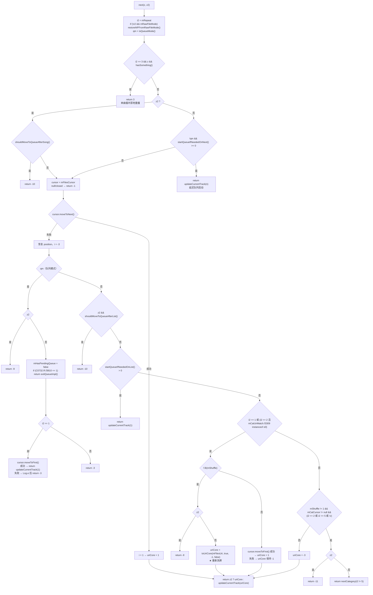
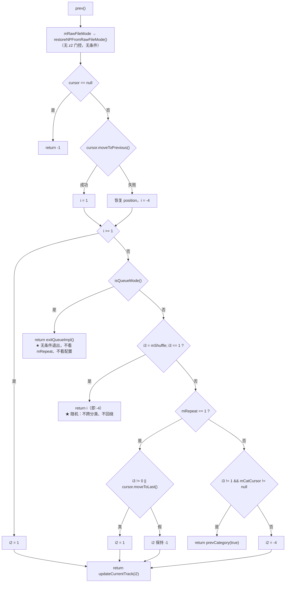

# Poweramp 播放队列运行逻辑参考记录（外部实现）

## 0. 文档定位声明（必读）

**本文记录的是外部实现 Poweramp 的行为，不是 SpMusic 的现状描述，也不是要求照抄的规格。**

用途只有一个：为 SpMusic 队列行为（尤其随机播放、上一首、跨分类导航）的设计取舍提供**一个有实证支撑的对照物**。凡涉及「我们该怎么做」的内容，全部集中在第 10 章且明确标注为提案。

### 证据分级（全文统一使用）

| 标记 | 含义 | 可信度 |
| --- | --- | --- |
| **【实证·产物】** | 能在 `D:\SpMusic\.rea-analysis\` 的 md 中直接查到的反编译结论／字面量／方法体 | 最高 |
| **【实证·任务卡】** | 仅来自任务描述，**未**落在 `.rea-analysis` 产物文件中 | 中（无法独立复核） |
| **【推断】** | 本文作者的推理，可能出错 | 低 |

### 关于「队列方法体」的证据状态（本轮已升级）

| 版本 | 状态 |
| --- | --- |
| 本文 v1（task-6） | 8 个队列方法体**不在**任何产物文件中，只能标【实证·任务卡】。当时于 §11 提出 Q1 要求复核 |
| 本文 v2（task-7，当前） | **Q1 已关闭**。9 个方法（`isQueueMode` / `modesSupportCategoryNavigation` / `supportsCategoryNavigation` / `next` / `prev` / `nextCategory` / `prevCategory` / `shouldMoveToQueueAfterSong` / `shouldMoveToQueueAfterList`）的 JADX 方法体**原文**已落入 **`.rea-analysis/findings-queue.md`**，每条附 Evidence ID |

⇒ **本文第 2–8 章涉及的队列方法体，现在全部是【实证·产物】级**，可直接引用 `findings-queue.md` 的小节与 Evidence ID 复核（索引见 §12.1）。

**仍未闭环的部分（不得当作事实使用）**：

| 项 | 内容 | 位置 |
| --- | --- | --- |
| **Q2** | 随机播放是否对全局文件库洗牌。取决于 `loadFilesCursorAndSetState` / `prepareFilesUri` 内部，**本轮未取** | §5.3、§11 |
| **Q8** | `androidx.appcompat.widget.f.B(int)` 的判定逻辑（混淆复刻类，未反编译） | §5.4、§11 |
| **Q3 剩余** | `C0732.Q.f3810` / `C0732.R.f3810` 的**取值集合与来源**（存在性与用途已实证） | §7.3、§11 |

## 1. 目标标识

| | |
| --- | --- |
| 包名 | `com.maxmpz.audioplayer` |
| 版本 | `build-1025-uni`（versionCode `1025009`） |
| APK SHA-256 | `4467fdac3e89b98485866e454bc3b7dc2d73d788d7a1aa9c73ea1028d36b82e0` |
| 体积 / 类数 | 20,449,483 B / 6,218 个顶层类（单 `classes.dex`，强混淆） |
| SDK | minSdk 21 / targetSdk 35 / compileSdk 36 |
| Native | `libpowerampcore.so` (3.59 MB)、`libffmpeg_neon.so`、`libyayicn.so` |
| 队列管理器 | `com.maxmpz.audioplayer.player.b0`（91 方法 / 45 字段），日志 tag `RestNowPlaying` |
| 反编译引擎 | JADX headless 0.7.1 via REA（`mode: "java"`、`fell_back: false`） |
| 混淆说明 | 类名／字段名均为混淆后标识，本文保留原样以便回溯 |

分析产物：

| 文件 | 覆盖内容 | 含队列导航方法体 |
| --- | --- | --- |
| `REPORT-playlist-loading.md` | 总报告：存储／查询／加载链路、导入导出、CUE | 否 |
| `findings-core.md` | `b0` 字段与导航 API 清单、`toUriCore`、Provider／URI | 否（仅 API 清单） |
| `findings-db.md` | `folders.db` schema、SQL 组装、分页引擎 `h1.C`、`m3` vs `k3` | 否 |
| `findings-format.md` | M3U／M3U8／PLS／WPL／CUE 格式 | 否 |
| **`findings-queue.md`** | **9 个队列方法的 JADX 方法体原文 + Evidence ID** | **是（本文 §2–§8 的实证来源）** |

## 2. 状态模型

### 2.1 字段

| 字段 | 类型 | 作用 | 证据 |
| --- | --- | --- | --- |
| `mFilesCursor` | `Cursor` | **队列本体**（结果集游标，非物化数组） | 【实证·产物】`findings-core.md:68` |
| `mCatCursor` | `Cursor` | 父分类游标（如「播放列表」列表页） | 【实证·产物】`findings-core.md:69` |
| `mFilesEntity` / `mCatUriMatch` | `rest.library.o0` / `f4` | 当前实体 + URI 匹配描述符 | 【实证·产物】`findings-core.md:70` |
| `mContentProvider` | `rest.RestProvider` | 取游标的 ContentProvider | 【实证·产物】`findings-core.md:64` |
| `mDb` | `SQLiteDatabase` | 直接句柄（洗牌结果写回） | 【实证·产物】`findings-core.md:66` |
| `mStatementCache` | `rest.library.c3` | 预编译语句缓存 | 【实证·产物】`findings-core.md:67` |
| `mCurrentTrack` | `player.g0` | 当前曲目模型（47 字段） | 【实证·产物】`findings-core.md:71` |
| `mShuffle` | `int` | 随机模式；`1` = 纯随机（见 §2.2） | 取值域见 §2.2 |
| `mRepeat` | `int` | 循环模式；`1`／`2`／`3`／`5`（见 §2.2） | 取值域见 §2.2 |
| `mRawFileMode` | `boolean` | 播放库外裸文件模式 | 【实证·产物】`findings-core.md:74` |
| `mHasPendingQueue` | `boolean` | 未决队列（延迟队列）标志 | 【实证·产物】`findings-core.md:75` |

### 2.2 `mShuffle` / `mRepeat` 取值域

产物未给出枚举定义，以下由**方法体中的比较字面量**归纳（【实证·产物】+ 归纳）：

| 字段 | 出现过的比较 | 证据 |
| --- | --- | --- |
| `mShuffle` | `== 1`（`modesSupportCategoryNavigation`、`prev`、`next`）、`!= 1`（`next`）、`!= 0`（`prev`） | `findings-queue.md:44`、`:180`、`:132`、`:184`、`:188` |
| `mRepeat` | `== 3`、`== 1`、`== 2`、`== 5`（均见 `next`／`prev`） | `findings-queue.md:75`、`:108`、`:122`、`:136`、`:183` |

> `mShuffle == 1` 是「纯随机」的唯一字面量；其余非零值只能由 `f.B(int)`（§5.4）与 `!= 0` 判定，**具体值域未解**。

### 2.3 队列模式判定

```java
private boolean isQueueMode() {
    return this.mFilesEntity instanceof m3;
}
```

【实证·产物】`findings-queue.md:32-36`，Evidence `ev_d77ba8c3563c026139cd1be2d40b7837d953db0339024bac51986a5c251003f9`。

`m3` = 队列表实体（`g1.getQueue()`，`findings-core.md:198`）。

### 2.4 实体分类（理解「分类导航」的前提）

`rest.library.g1` 是统一媒体库门面（`findings-core.md:191-207`）：

| 访问器 | 实体类 | 含义 |
| --- | --- | --- |
| `getQueue()` | `m3` | 当前播放队列（独立表 `queue`） |
| `getFiles()` | `n0` | 全部音频文件 |
| `getPlaylists()` | `j3` | 播放列表集合 |
| `j3.Z0()` | `k3` | 某播放列表的成员 |
| `getRawFiles()` | `p3` | 库外裸文件 |
| `getFolders()` / `getFoldersHier()` | `t0` / `x0` | 文件夹／层级 |

**关键架构事实**：队列不是数组，而是一个**活游标**。上／下一首 = 移动游标；顺序由 SQL `ORDER BY` 决定；随机 = 换掉 `ORDER BY`，而非重排数据【实证·产物】`REPORT-playlist-loading.md:28-29`。

## 3. 三条主路径的决策树

> 本轮全部升级为 **【实证·产物】**，方法体原文见 `findings-queue.md` §4–§7。

### 3.1 `next(boolean z, boolean z2)`

- `z` = 允许跨分类
- `z2` = 仅探测不执行（预取模式）



【实证·产物】`findings-queue.md:66-143`，Evidence `ev_8bff79453f5e6398e74d15254f7e892027c8a7c5eb9024bda34f57eeab929b33`。

**本轮从方法体新确认的细节**（任务卡与本文 v1 均未提）：

| # | 事实 | 影响 |
| --- | --- | --- |
| 1 | **`mRawFileMode` 恢复受 `z2` 门控**：`if (!z2 && this.mRawFileMode) restoreNPFromRawFileMode();` | 预取探测**不会**触发裸文件模式恢复；对比 `prev()`／`nextCategory()` 都是无条件恢复 |
| 2 | **队列模式越界退出由配置决定，不由 `mRepeat` 决定**：`if (C0732.R.f3810 == 1) return exitQueueImpl();` 位于 `if (i2 == 1)` **之前** | 见 §6.1（v1 此处有误） |
| 3 | **队列模式 `z2` 分支提前 `return -9`，且不清理 `mHasPendingQueue`** | `mHasPendingQueue = false` 只在非 `z2` 路径执行。预取探测**无副作用** |
| 4 | **`uriCore` 初始化为 `-1`**，`moveToFirst()` 失败时不赋值 | 该分支最终返回 `-1`（游标错误语义），而非 `-3` |
| 5 | **重洗牌用 `f.B(mShuffle)`，换分类用 `mShuffle != 1`** | 同一方法内两套「是否随机」判定，见 §5.4 |
| 6 | `i >= 0` 判定（非 `> 0`） | 因 `i` 只可能为 `1` 或 `-3`，二者等价；记录以免误读 |

### 3.2 `prev()`

```java
public int prev() {
    int i;
    if (this.mRawFileMode) {
        restoreNPFromRawFileMode();
    }
    Cursor cursor = this.mFilesCursor;
    int i2 = -1;
    if (cursor == null) {
        return -1;
    }
    int position = cursor.getPosition();
    if (cursor.moveToPrevious()) {
        i = 1;
    } else {
        cursor.moveToPosition(position);
        i = -4;
    }
    if (i >= 1) {
        i2 = i;
    } else {
        if (isQueueMode()) {
            return exitQueueImpl();
        }
        int i3 = this.mShuffle;
        if (i3 == 1) {
            return i;
        }
        if (this.mRepeat == 1) {
            if (i3 != 0 || cursor.moveToLast()) {
                i2 = 1;
            }
        } else {
            if (i3 != 1 && this.mCatCursor != null) {
                return prevCategory(true);
            }
            i2 = -4;
        }
    }
    return updateCurrentTrack(i2);
}
```

【实证·产物】`findings-queue.md:156-195`，Evidence `ev_a36863ee9cd575acb4b221527e19bc779647d36827ecef53d8a2b613541c3575`。



**Q4 已关闭**：`if (i3 == 1) return i;` 位于 `if (this.mRepeat == 1)` **之前**，因此随机模式下 `prev` 在头部**直接返回 `-4`**，永不进入 `mRepeat == 1` 的回绕分支。

⇒「随机 + 循环下 `prev` 回绕」**不成立**。本文 v1 §4.2 曾标注「若分支顺序相反则结论反转」，现确认**不反转**。

**死条件（本轮新增）**：`if (i3 != 1 && this.mCatCursor != null)` 中的 `i3 != 1` **恒为真**——因为 `i3 == 1` 已在上方 `return`。这是反编译忠实还原的**冗余条件**（源码本来就写了，不是反编译笔误）。等价写法是 `if (this.mCatCursor != null)`。

**一处细微行为后果（【推断】）**：`if (i3 != 0 || cursor.moveToLast())` 使用短路 `||`。由于 `i3 == 1` 已返回，此处 `i3` 只可能是 `0` 或 `>= 2`：

| `mShuffle` | `mRepeat == 1` 且到头部时 | 是否调用 `moveToLast()` |
| --- | --- | --- |
| `0`（关） | 求值 `cursor.moveToLast()`，成功则 `i2 = 1` | **是** |
| `1`（随机） | 不可达（上方已 `return -4`） | — |
| `>= 2`（分类型随机） | `i3 != 0` 短路为真，`i2 = 1` | **否**（游标停在恢复后的原位置） |

⇒ 对 `mShuffle >= 2`，`mRepeat == 1` 时「上一首到头」的游标**不被重定位**却报告成功（`i2 = 1`）。若 `updateCurrentTrack(1)` 只是转述状态码而不移动位置，则表现为**原地重播同一首**。这依赖 `updateCurrentTrack` 语义（未反编译），标记为 §11 Q9。

### 3.3 `nextCategory(boolean z)`

```java
public int nextCategory(boolean z) {
    if (this.mRawFileMode) {
        restoreNPFromRawFileMode();
    }
    if (!supportsCategoryNavigation()) {
        return -6;
    }
    if (isQueueMode()) {
        return exitQueueImpl();
    }
    int iStartQueueIfNeededOnList = startQueueIfNeededOnList();
    if (iStartQueueIfNeededOnList > 0) {
        return updateCurrentTrack(iStartQueueIfNeededOnList);
    }
    Cursor cursor = this.mCatCursor;
    if (cursor == null) {
        return -6;
    }
    int position = cursor.getPosition();
    if (!cursor.moveToNext() && (!z || cursor.getCount() <= 1 || !cursor.moveToFirst())) {
        cursor.moveToPosition(position);
        return -3;
    }
    o0 o0Var = this.mFilesEntity;
    if (o0Var == null) {
        Log.w("RestNowPlaying", "nextCategory !mFilesEntity");
        return -6;
    }
    int iLoadFilesCursorFromCatCursor = loadFilesCursorFromCatCursor(
            cursor, o0Var, this.mCatUriMatch, this.mShuffle, true, 0, false, false);
    if (iLoadFilesCursorFromCatCursor > 0) {
        iLoadFilesCursorFromCatCursor = 2;
    }
    return updateCurrentTrack(iLoadFilesCursorFromCatCursor);
}
```

【实证·产物】`findings-queue.md:208-242`，Evidence `ev_f89e759f57279115c59bbcc64853c92a8358086ff29f45cceccf60a99da3358b`。

| 顺序 | 条件 | 结果 |
| --- | --- | --- |
| 0 | `mRawFileMode` | `restoreNPFromRawFileMode()`（**有条件恢复**） |
| 1 | `!supportsCategoryNavigation()` | `return -6` |
| 2 | `isQueueMode()` | **`return exitQueueImpl()`（直接返回）** |
| 3 | `startQueueIfNeededOnList() > 0` | `return updateCurrentTrack(...)` |
| 4 | `mCatCursor == null` | `return -6` |
| 5 | `!moveToNext() && (!z \|\| count <= 1 \|\| !moveToFirst())` | 恢复 position，`return -3` |
| 6 | `mFilesEntity == null` | `Log.w` + `return -6` |
| 7 | 成功换分类 | `loadFilesCursorFromCatCursor(...)`，`>0` 归为 `2`，`return updateCurrentTrack(...)` |

⚠️ **对本文 v1 的更正**：v1 在 `isQueueMode()` 一行写「`exitQueueImpl()`（随后继续，非直接返回）」，**这是错的**。实际是 `return exitQueueImpl();` —— **直接返回**，后续步骤（含 `startQueueIfNeededOnList`）全部不执行。

**换分类后不移动 `mFilesCursor`** —— 新分类的游标停在首项位置（`loadFilesCursorFromCatCursor` 装入后未显式定位）。与 `prevCategory` 相反，见 §3.4。

### 3.4 `prevCategory(boolean z)`

```java
private int prevCategory(boolean z) {
    if (!supportsCategoryNavigation()) {
        return -6;
    }
    if (isQueueMode()) {
        return exitQueueImpl();
    }
    Cursor cursor = this.mCatCursor;
    if (cursor == null) {
        return -6;
    }
    int position = cursor.getPosition();
    if (!cursor.moveToPrevious() && (cursor.getCount() <= 0 || !cursor.moveToLast())) {
        cursor.moveToPosition(position);
        return -4;
    }
    o0 o0Var = this.mFilesEntity;
    if (o0Var == null) {
        Log.w("RestNowPlaying", "nextCategory !mFilesEntity");
        return -6;
    }
    int iLoadFilesCursorFromCatCursor = loadFilesCursorFromCatCursor(
            cursor, o0Var, this.mCatUriMatch, this.mShuffle, true, 0, false, false);
    Cursor cursor2 = this.mFilesCursor;
    if (z && iLoadFilesCursorFromCatCursor > 0 && cursor2 != null) {
        cursor2.moveToLast();
    }
    if (iLoadFilesCursorFromCatCursor > 0) {
        iLoadFilesCursorFromCatCursor = 2;
    }
    return updateCurrentTrack(iLoadFilesCursorFromCatCursor);
}
```

【实证·产物】`findings-queue.md:252-283`，Evidence `ev_c73da790d9bb677ffe972dc53ba640200826a4226b3749fc77b9d30032508f4f`。

**`prevCategory` 与 `nextCategory` 的五处不对称**（本轮新增；任务卡与本文 v1 均未提）：

| # | 维度 | `nextCategory` | `prevCategory` | 判定 |
| --- | --- | --- | --- | --- |
| 1 | `mRawFileMode` 恢复 | **有** | **无** | **缺失（缺陷）** |
| 2 | `startQueueIfNeededOnList()` | **有**（`>0` 则启动挂起队列并返回） | **无** | **缺失（缺陷）** |
| 3 | 换分类后游标落点 | 不移动（停在首项） | `z && loadResult > 0 && mFilesCursor != null` 时 **`moveToLast()`**（进入该分类**最后一首**） | 对称（方向一致） |
| 4 | 回绕判据 | `count <= 1` | `count <= 0` | 对称（「当前项是否计入」基准不同，方向语义一致） |
| 5 | 日志文案 | `"nextCategory !mFilesEntity"` | `"nextCategory !mFilesEntity"` | **复制粘贴错误** |

### 3.5 分类导航门控

```java
public boolean supportsCategoryNavigation() {
    return (this.mCatCursor != null && modesSupportCategoryNavigation(this.mShuffle)) || isQueueMode();
}
private boolean modesSupportCategoryNavigation(int i) {
    return (this.mRawFileMode || i == 1) ? false : true;
}
```

【实证·产物】`findings-queue.md:43-58`：
- `modesSupportCategoryNavigation` → Evidence `ev_51deccfbbbc83d75235d772904918b4c7b7ca05f188c8ee9e77197617ee0e8d8`
- `supportsCategoryNavigation` → Evidence `ev_2ca2704d614077e753bee9d449ea2133326061039910395ec3482bf490c254fa`

⇒ **`mShuffle == 1`（随机）或 `mRawFileMode` 时分类导航返回 `false`**。

门控用 `||`：**队列模式下即使随机也「支持」分类导航**（第二项短路为真）。但此时 `nextCategory`／`prevCategory` 的下一步是 `return exitQueueImpl()`（§3.3 步骤 2、§3.4 步骤 2）——即队列模式下调分类导航只会退出队列，**不会真的换分类**。此组合语义现已由方法体确认。

## 4. `next` vs `prev` 不对称专章

### 4.1 逐格对照（基于方法体原文）

| 维度 | `next(z, z2)` | `prev()` | 判定 |
| --- | --- | --- | --- |
| 签名参数 | `(z, z2)` 两个 | 无参数 | **不对称** |
| `mRawFileMode` 恢复 | `!z2 && mRawFileMode` 时恢复 | 无条件恢复 | **不对称** |
| 单曲循环 `mRepeat == 3` | `z && hasSomething()` → `return 3` | **无对应分支** → 落入 `mRepeat != 1` 的 `else`，即 `prevCategory(true)` | **不对称** |
| 成功前进 | `moveToNext()` → `i=1` | `moveToPrevious()` → `i=1` | 对称 |
| 失败语义 | `i = -3`（**末尾**） | `i = -4`（**开头**） | 对称（方向相反） |
| 队列入队／出队副作用 | 越界时 `mHasPendingQueue = false`（非 `z2` 路径） | 无此副作用 | **不对称** |
| 队列模式越界 | **先看 `C0732.R.f3810 == 1`** 决定退出；否则 `mRepeat == 1` 决定重播；否则 `-3` | **无条件** `exitQueueImpl()` | **不对称（核心）** |
| 随机（`mShuffle == 1`）到边界 | 进入越界链，**可能**重洗牌（见下） | **`return -4`**，不进任何后续分支 | **不对称（核心）** |
| 越界后是否重洗牌 | **可能**（条件见下） | **从不** | **不对称（核心）** |
| 越界后是否进下一分类 | **可能**（条件见下） | **可能**（`prevCategory(true)`） | 对称（方向相反） |
| 延迟队列启动 | `startQueueIfNeededOnNext()` / `startQueueIfNeededOnList()` | **无** | **不对称** |
| 预取信号 | `-8` / `-9` / `-10` / `-11` | 无 `z2`，无信号 | **不对称** |
| 末尾返回值 | `return z2 ? uriCore : updateCurrentTrack(uriCore)` | `return updateCurrentTrack(i2)` | **不对称**（`z2` 时不更新） |

**`next` 越界链的两个精确条件**（v1 写得过粗，此处修正）：

| 分支 | 精确条件（`findings-queue.md:122`、`:132`） |
| --- | --- |
| 重洗牌路径 | `i2 == 1 \|\| (i2 == 2 && mCatUriMatch.f3309 instanceof o0)` **且** `f.B(mShuffle)` 为真 |
| 换分类路径 | `mShuffle != 1 && mCatCursor != null && (i2 == 2 \|\| i2 == 5 \|\| !z)` |

> v1 曾写作「`mRepeat == 1 \|\| (== 2 && 父实体为 o0)` 时若随机则重洗牌，否则 `moveToFirst()`；其余走 `nextCategory(mRepeat != 5)`」。方向正确，但漏了三点：①`f.B(mShuffle)` 与 `mShuffle != 1` 是**两套独立判定**（§5.4）；②`!z` 也是换分类的触发条件之一；③`z2` 在每个分支都会先返回专用信号码。

### 4.2 「随机 `prev` 直接 `-4`」：有意设计还是历史包袱？

**判断：有意的工程取舍（数据结构约束所致），但在用户可见层留下未兑现的产品承诺。**

**依据一：随机由 SQL `ORDER BY` 实现，游标没有「反向历史」可走。**

- `?shs` 参数触发实体 `V0()` 生成洗牌 ORDER BY，**不改 `sort` 列**【实证·产物】`findings-db.md:308`
- 洗牌结果持久化在 `playlists.shuffle_order` / `playlist_entries.shuffle_order` / `queue.shuffle_order`【实证·产物】`findings-db.md:111`、`:359`、`:65`
- `mDb` 字段用途注释即 "shuffle writes"【实证·产物】`findings-core.md:66`
- **`findings-db.md` 的完整表清单中没有任何 shuffle-history 表或列**

⇒ `mFilesCursor` 只能对一份**已物化的单向顺序**前后移动。`moveToPrevious()` 在同一次物化内可用；但「跨到上一轮洗牌」需要历史栈，而 schema 里没有。

**依据二：`next` 越界重洗牌成本低且语义自洽。**

`toUriCore(mFilesUri, true, -1, false)` 的第二个参数即 reshuffle 开关（`findings-core.md:91` 签名 `toUriCore(Uri, boolean reshuffle, int shuffleModeOverride, boolean noCur)`）。重洗 = 重发一次带 `reshf` 的查询，成本与首次加载同阶。

**依据三：UI 文案暴露了未兑现的意图。**

【实证·产物】`findings-core.md:50-53`：

```
-4 → shuffle_history_start_reached  (当 getShuffleMode() != 0)
   → start_reached                  (否则)
```

**存在 `shuffle_history_start_reached` 这个专属文案**，说明产品层假设「随机播放有一个可回退的历史起点」。但代码里既无历史栈、`prev` 也不回绕——**文案承诺了「洗牌历史」，实现只有「物理游标头部」**。

> **结论**：这是「产品意图（有历史）」与「工程实现（无栈）」的落差。判为**有意取舍**（数据结构确实不支持，文案属预留），而非纯历史包袱。但它**是已知的不一致，不应作为设计范例照抄**。

### 4.3 不对称的合理性评价

| 不对称项 | 判定 | 理由 |
| --- | --- | --- |
| 越界重洗牌（next 有 / prev 无） | 合理 | 数据结构只支持单向物化顺序；反向需历史栈 |
| 单曲循环仅在 `z` 为真时生效 | 合理 | 「不跨分类的单曲循环」语义模糊，交由调用方决定 |
| 单曲循环下 `prev` 落到「上一分类」 | **可疑** | `mRepeat == 3` 时 `next` 原地重播，`prev` 却跳去上一分类（`findings-queue.md:187-190`）。同一模式下两个方向语义完全不同 |
| 队列越界：next 看配置+repeat / prev 无条件退出 | **可疑** | 同一个「队列越界」事件，两个方向后果不同 |
| `next` 恢复 `mRawFileMode` 受 `z2` 门控，`prev` 不受 | 合理 | `z2` 是只读探测，不应有副作用。注意 `nextCategory` 也无条件恢复，说明 `prev`／`nextCategory` 属「有副作用」路径 |
| 无预取参数（prev 缺 `z2`） | 合理 | 只预取前进方向 |
| `count <= 1` vs `count <= 0` | 合理（非缺陷） | 见 §3.4 第 4 条：因「当前项是否计入」基准不同，方向语义一致 |
| `prevCategory` 缺 `mRawFileMode` 恢复 | **可疑** | 与 `nextCategory` 不对称，且无 `z2` 可解释——疑为遗漏 |
| `prevCategory` 缺 `startQueueIfNeededOnList()` | **可疑** | 延迟队列只在前进时启动，后退时挂起队列被忽略 |
| `prevCategory` 日志打印 `"nextCategory ..."` | **缺陷（无功能影响）** | 复制粘贴错误，仅影响日志可读性 |

## 5. 「随机播放」语义的完整推导

### 5.1 观测事实链

| # | 事实 | 证据 |
| --- | --- | --- |
| 1 | `modesSupportCategoryNavigation(i)` 在 `i == 1` 或 `mRawFileMode` 时返回 `false` | 【实证·产物】`findings-queue.md:43-46` |
| 2 | `supportsCategoryNavigation()` = `(mCatCursor != null && modes...) \|\| isQueueMode()` | 【实证·产物】`findings-queue.md:55-57` |
| 3 | ⇛ 非队列模式下随机 ⇒ 分类导航 `false` ⇒ `nextCategory`／`prevCategory` 返回 `-6` | 【推断】由 1+2 直接推得 |
| 4 | `prev()` 在 `mShuffle == 1` 时直接 `return i`（`-4`），早于 `mRepeat` 判定 | 【实证·产物】`findings-queue.md:179-182` |
| 5 | `next()` 的**换分类**分支显式要求 `mShuffle != 1` | 【实证·产物】`findings-queue.md:132` |
| 6 | `next()` 的**重洗牌**分支用 `f.B(mShuffle)`，**不是** `mShuffle == 1` | 【实证·产物】`findings-queue.md:123` |
| 7 | 随机加载时 `loadFilesCursorAndSetState` **重建 URI 为 `getFiles()` + `shs=1`**，而非从 `playlist_entries` 读 | 【实证·产物】`findings-core.md:161-165` |
| 8 | 队列独立于播放列表：`queue INNER JOIN folder_files`，**无 `playlist_id` 谓词** | 【实证·产物】`findings-db.md:819`、`:835-838` |
| 9 | 洗牌结果落 `shuffle_order` 持久列，不破坏 `sort` | 【实证·产物】`findings-db.md:308` |

### 5.2 因果链（把事实 7 与事实 3 连起来）

```
随机播放某播放列表
      ↓
loadFilesCursorAndSetState 把 URI 换成 getFiles() + ?shs=1
      ↓
队列游标 = 「全局所有音频文件」的洗牌视图
         （不再是「这个播放列表的成员集合」）
      ↓
mCatCursor（父分类 = 「播放列表」列表）与当前游标不再有成员关系
      ↓
「下一个分类」失去定义（当前游标不属于任何播放列表）
      ↓
modesSupportCategoryNavigation(1) == false
      ↓
nextCategory → -6 ；prev → -4
```

**⇒ Poweramp 的「随机」不是「在某个列表内打乱顺序」，而是「把播放源整体切换成全局文件库的洗牌视图」。**

这解释了三个原本看似无关的行为：

| 现象 | 解释 | 证据 |
| --- | --- | --- |
| 随机时分类导航被禁用 | 队列已不属于任何分类，无「下一个分类」可言 | 事实 1–3 |
| 随机时 `prev` 到头返回 `-4`，文案叫 `shuffle_history_start_reached` | 洗牌视图是物化顺序，物理头部就是「洗牌历史的开头」 | 事实 4 + `findings-core.md:53` |
| 随机时 `next` 越界能重洗牌 | 重洗 = 对同一个源再发一次 `reshf` 查询，天然可行 | 事实 6 + `findings-core.md:91` |

### 5.3 一个反直觉的后果（**Q2，仍开放**）

既然随机队列 = 全局文件洗牌视图，那么：

> **「随机播放某播放列表」与「随机播放全部歌曲」在队列层面可能是同一件事。**

**为什么本轮仍无法定论**：这取决于 `loadFilesCursorAndSetState`／`prepareFilesUri` 内部是否给 `getFiles()` URI 附加了「限制在播放列表范围内」的参数。产物 `findings-core.md:120-121` 列出的 query 参数只有 `reshf`／`shf_no_cur`（及下层 `shs`／`lim`／`no_empty`），**没有任何范围／过滤参数**。

- 支持「无范围限制」的线索：`toUriCore` 给 `filesUri` 附加的是 `encodedFragment(String.valueOf(id))`（`REPORT-playlist-loading.md:284`），其中 `id` 是目标曲目 id——那是**定位起点**，不是**限制范围**。
- 反证线索：`shf_no_cur`（洗牌时排除当前曲目）的存在说明洗牌确有参数化能力，但它是排除单曲，不是限制集合。

⚠️ **本文立场：Q2 保持「待验证」，不写入结论。** 评估 SpMusic 取舍时不得基于此推断做决定。见 §11 Q2。

### 5.4 新增未解点：`f.B(int)` 不等价于 `mShuffle == 1`（本轮新增）

方法体显示 `next()` 的重洗牌判定是：

```java
if (androidx.appcompat.widget.f.B(this.mShuffle)) {   // findings-queue.md:123
    if (z2) { return -8; }
    uriCore = toUriCore(this.mFilesUri, true, -1, false);
} else if (cursor.moveToFirst()) {
    uriCore = 1;
}
```

而同一方法的换分类分支用的是**字面量** `this.mShuffle != 1`（`:132`）。

⇒ **同一方法内存在两套「是否随机」的判定**：

| 判定 | 形式 | 已知语义 |
| --- | --- | --- |
| 换分类门控 | `this.mShuffle != 1` | 只有 `1` 被排除 |
| 重洗牌门控 | `f.B(this.mShuffle)` | **未知**，可能是「任意随机模式」的集合判定 |

这是**本轮新发现的未解点**。可能的解释（均属【推断】）：
- `f.B(int)` 判断「该值属于随机类模式集合」（如 `{1,2,3,4}`），比 `== 1` 宽；
- 或它判断「当前是否已按随机排序」（读另一个状态），与 `mShuffle` 取值只是间接相关。

`findings-queue.md:351` 已把它列入未闭环。**影响**：若 `f.B` 对 `mShuffle >= 2` 也返回真，则「分类型随机」在列表末尾也会走重洗牌路径，而非 `moveToFirst()`——这会改变 §4.1「重洗牌 vs 回绕」的完整语义。见 §11 Q8。

## 6. 队列模式（`m3`）的特殊行为

`isQueueMode()` 为真时，四条路径都与普通模式不同：

| # | 行为 | 精确条件 | 证据 |
| --- | --- | --- | --- |
| 1 | **`next` 越界** | `z2` → `return -9`；否则 `mHasPendingQueue = false`，然后 **`C0732.R.f3810 == 1` → `return exitQueueImpl()`**；否则 `mRepeat == 1` 且 `moveToFirst()` 成功 → `updateCurrentTrack(1)`；否则 `-3` | 【实证·产物】`findings-queue.md:100-115` |
| 2 | **`prev` 越界** | **无条件** `return exitQueueImpl()`，不看 `mRepeat`、不看配置 | 【实证·产物】`findings-queue.md:176-178` |
| 3 | **分类导航** | `supportsCategoryNavigation()` 因 `\|\| isQueueMode()` 短路为真，但 `nextCategory`／`prevCategory` 随后 `return exitQueueImpl()` ⇒ 只退出队列，**不换分类** | 【实证·产物】`findings-queue.md:56`、`:215-217`、`:256-258` |
| 4 | **加载时定位失败** | `moveFilesCursorToId` 失败且队列模式 → `moveToFirstNotPlayedQueueEntryOrLast()` | 【实证·产物】`findings-core.md:114-115` |

### 6.1 与本文 v1 的差异（更正）

v1 §6 第 1 条写作「`next` 越界：若 `mRepeat == 1` 则 `moveToFirst()` 重播队列；否则 `exitQueueImpl()` 退出队列模式」。

**这是错的。** 实际顺序是：

```
if (C0732.R.f3810 == 1) return exitQueueImpl();   ← 配置优先
if (mRepeat == 1) { ... moveToFirst() ... }
return i;                                          ← -3
```

即：**是否退出队列由配置 `C0732.R.f3810` 决定**，与 `mRepeat` 无关；`mRepeat == 1` 只在未配置退出时才决定「重播」。v1 把「配置开关」误当成「`mRepeat` 的 else 分支」。

### 6.2 结构性事实（补充）

- `queue` 是**独立表**：`CREATE TABLE queue (_id INTEGER PRIMARY KEY, folder_file_id INTEGER, created_at INTEGER NOT NULL DEFAULT 0, sort INTEGER)`（`findings-db.md:147-148`）
- 队表查询 `m3.X0`：`queue INNER JOIN folder_files ON queue.folder_file_id = folder_files._id`，**无谓词、无 CUE 过滤**，`ORDER BY queue.sort`（`findings-db.md:819-828`）
- 对比播放列表 `k3.X0`：`playlist_entries LEFT JOIN … WHERE playlist_id=? AND cue_folder_id IS NULL ORDER BY sort`（`findings-db.md:237-248`）
- ⇛ **「加入队列」= 把行复制进 `queue` 表，不是对 `playlist_entries` 建视图**（`findings-db.md:858`）

> 第 1 条与第 2 条的差异正是「可疑」项的具体体现：**在队列里按上一首到头部会直接退出队列模式，而按下一首到尾部在配置／循环下可能重播或不退出。**

## 7. 延迟队列机制

### 7.1 两个判定**不同型**（更正任务卡与本文件 v1）

```java
private boolean shouldMoveToQueueAfterSong() {
    if (!this.mHasPendingQueue || isQueueMode()) {
        return false;
    }
    int i = C0732.Q.f3810;
    return i == 2 || i == 1;
}

private boolean shouldMoveToQueueAfterList() {
    if (!this.mHasPendingQueue || isQueueMode()) {
        return false;
    }
    int i = C0732.Q.f3810;
    return i == 1 || i == 2 || i == 3;
}
```

【实证·产物】`findings-queue.md:298-318`：
- `shouldMoveToQueueAfterSong` → Evidence `ev_5fbded7b8b35abb6447506cb805559378910e67cf48313f1043729d5996186a1`
- `shouldMoveToQueueAfterList` → Evidence `ev_fadb8e8b109de8293c67c1db02d83ca0c850fdcefade173e3cab3cf11dd86db4`

⚠️ **修正**：任务卡称两者「同型」，**实为不同型**。`i == 3` **只在 `AfterList` 成立**。

#### 真值表

| `C0732.Q.f3810` | `shouldMoveToQueueAfterSong()` | `shouldMoveToQueueAfterList()` | 行为含义 |
| --- | --- | --- | --- |
| `1` | ✅ | ✅ | 单曲播完**或**列表播完都切队列 |
| `2` | ✅ | ✅ | 同 `1`（在这两个方法内无差异） |
| `3` | ❌ | ✅ | **仅**列表播完后切队列；单曲播完**不**切 |
| 其它 | ❌ | ❌ | 永不自动切队列（挂起队列保持挂起） |

> 值 `1` 与 `2` 在**这两个方法内**行为相同。它们必须在别处有差异（否则不会存在两个取值），但差异点**未解**——可能影响切队列时的定位或其他参数。属 §11 Q7。

### 7.2 接入点

| 接入点 | 位置 | 证据 |
| --- | --- | --- |
| 单曲播完 → 转队列（预取探测） | `next` 的 `z2` 分支：`shouldMoveToQueueAfterSong()` → `-10` | `findings-queue.md:78-81` |
| 列表播完 → 转队列（预取探测） | `next` 越界且 `z2`：`shouldMoveToQueueAfterList()` → `-10` | `findings-queue.md:116-118` |
| 前进时启动挂起队列 | `next`：`!qm && startQueueIfNeededOnNext() >= 0` → `updateCurrentTrack(n)` | `findings-queue.md:82-84` |
| 越界时启动挂起队列 | `next` 越界：`startQueueIfNeededOnList() > 0` → `updateCurrentTrack(1)` | `findings-queue.md:119-121` |
| 分类导航时启动 | `nextCategory`：`startQueueIfNeededOnList() > 0` → `updateCurrentTrack(...)` | `findings-queue.md:218-221` |
| **（缺失）** | `prevCategory` **无** `startQueueIfNeededOnList()` | `findings-queue.md:252-283` 全文无该调用 |

### 7.3 `C0732` 常量：两个**不同字段**（更正任务卡与本文件 v1）

| 引用 | 出现位置 | 语义 | 取值状态 |
| --- | --- | --- | --- |
| `C0732.Q.f3810` | `shouldMoveToQueueAfterSong` / `shouldMoveToQueueAfterList` | **延迟队列触发时机**（1/2/3） | 存在性与用途【实证·产物】；**取值集合与来源未解** |
| `C0732.R.f3810` | `next()` 队列越界分支 | **队列播完是否退出**（`== 1` 时 `exitQueueImpl()`） | 存在性与用途【实证·产物】；**取值集合与来源未解** |

⚠️ **这是同一常量类 `C0732` 下不同内部类（`Q` / `R`）的同名字段 `f3810`，语义完全不同。** 任务卡与本文 v1 曾把二者混提为「延迟队列配置开关」，**已在此更正**。

另注意与 `C0742` 的区别：

| 常量类 | 已知引用 | 用途 |
| --- | --- | --- |
| `C0732` | `.a1.f3789`（M3U UTF-8，`findings-format.md:724`）、`.U.f3789`（CUE remap，`findings-core.md:107`）、`.Q.f3810`、`.R.f3810` | 队列与格式相关开关 |
| `C0742` | `.U.f3810`（播放列表列表排序，`findings-db.md:230`）、`.O.f3789`、`.f1`、`.f3414`、`.f3418` | 媒体库／列投影／排序开关 |

**两个类的初始化均未反编译**（`findings-db.md:469`：`C0742` "not enumerated"；`findings-queue.md:352`：`C0732` 取值集合未解）。

## 8. 错误码语义表

| 码 | 含义 | 精确触发条件 | 证据 |
| --- | --- | --- | --- |
| `1` | 成功前进／后退一首 | `next`：`moveToNext()` 成功；`prev`：`moveToPrevious()` 成功 | `findings-queue.md:91-92`、`:167-168` |
| `2` | 成功且**换了分类** | `nextCategory`／`prevCategory` 中 `loadFilesCursorFromCatCursor(...) > 0` 时改写为 `2` | `findings-queue.md:238-240`、`:279-281` |
| `3` | 单曲循环原地重播 | `next`：`i2 == 3 && z && hasSomething()` | `findings-queue.md:75-77` |
| `-1` | 游标 null／已关闭；或 `uriCore` 未被赋值 | `next`：`mFilesCursor == null \|\| isClosed()`；`prev`：`mFilesCursor == null`；`next` 重洗牌分支中 `moveToFirst()` 失败时 `uriCore` 保持 `-1` | `findings-queue.md:87-89`、`:163-165`、`:128-130` |
| `-3` | 到达末尾 | `next` 越界且无可走分支 | `findings-queue.md:93-96`、`:138` |
| `-4` | 到达开头 | `prev` 越界后（随机／无分类游标）；`prevCategory` 回绕失败 | `findings-queue.md:169-172`、`:181`、`:264-267` |
| `-6` | 不支持 | `!supportsCategoryNavigation()`；`mCatCursor == null`；`mFilesEntity == null`；`toUriCore` 实体解析失败 | `findings-queue.md:212-213`、`:223-225`、`:231-235`；`findings-core.md:101`、`:118` |
| `-8` | 预取：该重洗牌 | `next` 重洗牌分支且 `z2` | `findings-queue.md:124-126` |
| `-9` | 预取：队列已到末尾 | `next` 越界 + 队列模式 + `z2` | `findings-queue.md:101-103` |
| `-10` | 预取：该转队列 | `next`：`z2 && shouldMoveToQueueAfterSong()`；或越界时 `z2 && shouldMoveToQueueAfterList()` | `findings-queue.md:78-81`、`:116-118` |
| `-11` | 预取：该换分类 | `next` 换分类分支且 `z2` | `findings-queue.md:133-135` |

**本轮更正**：`-8` / `-9` / `-11` 的具体条件首次确认（v1 只写「语义未说明」）。

### 8.1 错误码 → UI Toast 映射

【实证·产物】`findings-core.md:50-53`（映射发生在 `PlayerService.L(...)`，不在 `b0` 内）：

```
i == -1  →  too_many_failed  /  no_files_in_the_db
i == -3  →  end_reached
i == -4  →  shuffle_history_start_reached   (当 getShuffleMode() != 0)
         →  start_reached                    (否则)
```

⚠️ `-1` 映射到**两个**文案（`too_many_failed` / `no_files_in_the_db`），二者选择条件未在产物中说明。`findings-queue.md:353` 注明该映射本次未复核。

> `b0.next/prev` 只返回整数码，UI 语义在上层决定。

## 9. 与 SpMusic 的对照表

SpMusic 侧事实来源：`playbackModes.ts`、`pageShuffleSession.ts`、`playbackQueue.ts`、`useAudioPlayer.ts`（本工作区已核对代码）。

| 维度 | Poweramp | SpMusic | 差异性质 |
| --- | --- | --- | --- |
| **队列本体** | **活游标** `mFilesCursor` | **物化 `Vec`**：`PlaybackQueueSelection.entries` → `PlaybackQueuePlaylist.tracks`（`useAudioPlayer.ts:3933-3940`） | 根本性：游标 vs 数组 |
| **顺序权威** | SQL `ORDER BY sort`（`k3.X0`）／`queue.sort`（`m3.X0`） | 后端 `tracks` 顺序（`playlist.rs:197-203` 按文件名），前端仅随机／循环改索引 | 排序发生的层不同 |
| **前进** | `moveToNext()`；越界转入「重洗牌／下个分类／重播队列／退出队列」分支链 | `resolveNextTrackIndex(tracks, idx, +1, mode)`（`playbackModes.ts:73-79`），数组索引回绕 | Poweramp 有真实「终点」；SpMusic 结构性回绕 |
| **随机（一般）** | 纯随机 `mShuffle==1` + 分类型随机（`!=1` 且非 0）；纯随机 = **全局文件洗牌视图**（Q2 待验证） | `shuffle-all` = 在**当前队列数组内**随机取索引 | 见 9.1 |
| **随机算法** | SQL `ORDER BY V0()` 物化洗牌结果到 `shuffle_order` 列，**需持久化** | ⚠️ `shuffle-all` 每次 `Math.random()` 现算（`playbackModes.ts:38-40`），**已播集合不去重** | 见 9.2 |
| **随机 + 跨分类** | **禁止**：`modesSupportCategoryNavigation(1)==false` ⇒ 分类导航禁用 | **允许**：`shuffle-category-order`／`shuffle-category-random` 显式实现跨分类（`playbackModes.ts:42-71`） | 见 9.3 |
| **随机下的上一首** | **`-4` 直接失败**，不跨分类、不回绕（Q4 已关闭） | ⚠️ `shuffle-all` 下 `resolveShuffleAllIndex` **无 `direction` 参数**（`playbackModes.ts:38-40`）⇒ prev 与 next 行为相同 | 见 9.4 |
| **随机 + 循环的上一首** | **永不回绕**（`mShuffle==1` 先 `return -4`，`mRepeat==1` 分支不可达） | `shuffle-all` + `all-categories-until-stop` 时改用 `pageShuffleSession`：**Fisher-Yates 固定序列，prev 可正确后退，到头返回 `null`** | SpMusic 在特定组合下更完整 |
| **单曲循环** | `next` 且 `mRepeat==3 && z` → `return 3`；`prev` **无对应分支**，落到「上一分类」 | `repeat-one` 时 `targetIndex = currentIndex`（`useAudioPlayer.ts:3131-3133`），**next/prev 都原地** | SpMusic 更对称 |
| **队列表** | **独立表** `queue`（`INNER JOIN`，无谓词）；加入队列 = 复制行 | **无独立表**；队列是内存 `Vec`；持久化靠 localStorage 快照 | Poweramp 可跨会话保留队列 |
| **队列作用域** | `queue` 全局，无「来源」概念 | `kind: 'playlist'` **必须**带非空 `sourceScope`；`kind: 'all-songs'` **刻意不带**（`playbackQueue.ts:30-31`） | SpMusic 显式建模了「队列来源」 |
| **延迟队列** | 有：`mHasPendingQueue` + 两个**不同型**判定（值 3 = 仅列表播完才切） | **无对应机制** | SpMusic 缺该能力 |
| **分类来源** | **数据库游标** `mCatCursor`（父分类列表） | **每首歌自带的标签字段**：`track.category ?? track.album`（`playbackModes.ts:21-27`） | 见 9.3 |
| **队列越界退出** | 队列模式越界会 `exitQueueImpl()`（next 受配置门控，prev 无条件） | 无「队列模式」概念，不会退出 | 概念差异 |
| **预取探测** | `next(z, z2)` 的 `z2` 返回 `-8/-9/-10/-11` 信号，且**无副作用** | 无预取探测码；预取由 `prefetchAdjacentPlaylistTracks` 独立完成 | 接口形态不同 |

### 9.1 关键差异：随机到底在哪个集合上洗牌

- **Poweramp**：随机 = 把播放源**切换**成 `getFiles()` + `?shs=1`【实证·产物】`findings-core.md:161-165`。当前播放列表的成员关系**不再是队列的定义**（但范围是否有额外限制 ⇒ **Q2 待验证**）。
- **SpMusic**：随机 = 在**当前队列数组**（`queueTracks`）内部选下一个索引（`useAudioPlayer.ts:3133`）。队列的集合身份不变，只有遍历顺序变随机。

这决定了后续所有差异：Poweramp 的随机是「换集合 + 换顺序」，SpMusic 的随机是「保留集合 + 换顺序」。前者的行为后果（丢失分类上下文）迫使它禁用分类导航；后者不需要。

### 9.2 关键差异：随机是否有历史

| | Poweramp | SpMusic（`shuffle-all` + 非 `all-categories-until-stop`） | SpMusic（`shuffle-all` + `all-categories-until-stop`） |
| --- | --- | --- | --- |
| 算法 | SQL `ORDER BY` 物化 | 每次 `Math.random()` 现算 | Fisher-Yates 生成固定序列 |
| 是否有序列 | 有（持久化到 `shuffle_order`） | **无** | 有（`pageShuffleSession.order`，运行时） |
| 已播是否去重 | 是（序列天然不重复） | **否** | 是 |
| 能否 prev | 仅能走物理游标倒退；到头 `-4`，**不回绕** | **不能**（prev 同样随机跳） | **能**（`resolvePageShuffleTarget` 支持 `direction = -1`） |
| 到头行为 | `-4` + `shuffle_history_start_reached` | 无「到头」概念 | 返回 `null` ⇒ 调用方判定终止（`useAudioPlayer.ts:2585-2586`） |

> SpMusic 里**已经存在**一种「洗牌序列 + 可回退 + 到头终止」的实现（`pageShuffleSession.ts`），只是被 `repeatMode === 'all-categories-until-stop'` 这个额外条件门控（`useAudioPlayer.ts:612`）。这是评估改动成本时最重要的内部事实。

### 9.3 关键差异：为什么 Poweramp 必须禁止随机跨分类，而 SpMusic 可以允许

**Poweramp 的约束是结构性的，不是偏好**：

```
分类 = mCatCursor（数据库父分类游标的当前行）
随机 = 把队列换成全局文件洗牌视图
     ⇒ 队列不再属于某个分类
     ⇒ mCatCursor 与 mFilesCursor 失去成员关系
     ⇒ 「下一个分类」无定义
     ⇒ 必须禁用（modesSupportCategoryNavigation(1) == false）
```

**SpMusic 没有这个约束**：

```
分类 = 每首歌的 track.category ?? track.album（playbackModes.ts:21-23）
     ⇒ 分类是「歌的属性」，不是「游标的位置」
     ⇒ 无论顺序怎么随机，当前曲目的分类始终可知
     ⇒ 「下一个分类」永远可算
     ⇒ 不需要禁用
```

**评价：SpMusic 的建模更适合「允许随机跨分类」。**

理由：
1. **分类作为数据属性是更弱的耦合**。它不依赖游标状态，因此与任何遍历策略正交，可自由组合。
2. **Poweramp 的禁用是「实现泄漏到产品」**。用户在大列表里开了随机就无法用「下一个专辑」，而这恰是最需要跨专辑跳跃的场景。禁用的根因是用游标实现分类，而非产品判断。
3. **SpMusic 的代价是每个候选曲目都要算 `getTrackCategory`**（`playbackModes.ts:49`、`:59`、`:68` 都做全数组 `map`+`filter`）。复杂度 O(n) per 跳转，对万级列表是实际开销。这是「更灵活」换来的成本，可优化但不必回退设计。

> 但要注意：SpMusic 两个模式名里的「order」／「random」**指向对象不明确**，容易误读。按代码（`playbackModes.ts:42-71`、`:75-76`）：
>
> | 模式 | 分类选择 | 分类内选择 | 实现函数 |
> | --- | --- | --- | --- |
> | `shuffle-category-order` | **顺序**（当前分类索引 + direction） | **随机** | `resolveCategoryOrderRandomIndex` |
> | `shuffle-category-random` | **随机**（边界处随机选分类） | **顺序**（分类内按序走） | `resolveCategoryRandomSequentialIndex` |
>
> 即两名字里各有一个词描述分类、一个词描述分类内，但**哪个词对应哪一层并未统一**：`-order` 读作「分类有顺序」成立；`-random` 读作「分类内随机」则不成立。本文不判定为缺陷，仅记录为**命名歧义**（属本文范围之外）。

### 9.4 SpMusic 的一处缺陷级事实

`resolveShuffleAllIndex` 的签名是 `(tracks, currentIndex)`，**没有 `direction` 参数**（`playbackModes.ts:38-40`）：

```ts
function resolveShuffleAllIndex(tracks: readonly TrackSummary[], currentIndex: number) {
  return randomFromIndexes(tracks.map((_, index) => index), currentIndex, currentIndex)
}
```

而 `resolveNextTrackIndex` 把它无差别用于两个方向（`playbackModes.ts:74`）。

⇒ **在 `shuffle-all` 模式下，`prev` 与 `next` 行为完全相同：随机跳到另一首。** 「上一首」在纯随机模式下语义丢失。

与 Poweramp 对照：Poweramp「随机下 prev 返回 `-4`」至少**如实告诉用户「回不去」**；SpMusic 则**给出一个看似成功但方向错误的跳转**。就用户困惑程度而言二者是**两种不同的失败方式**，不能简单说谁更优。

⚠️ **适用范围**（否则易误判为全局缺陷）：仅对 `repeatMode !== 'all-categories-until-stop'` 成立。当 repeat 为 `all-categories-until-stop` 时 `getPageShuffleSession` 介入（`useAudioPlayer.ts:611-623`），`resolvePageShuffleTarget(..., -1)` 能正确后退。此组合门控是否为有意设计，代码注释未说明——`useAudioPlayer.ts:617-618` 只解释了「运行时遍历、不恢复未保存历史」，未解释为何与 repeat 绑定。

更准确的说法是：**SpMusic 存在两种并存的随机实现**——「无方向的纯随机跳转」（`shuffle-all` 常规路径）与「有方向的洗牌序列」（`pageShuffleSession`）；后者只在特定 repeat 组合下启用，导致 `prev` 语义随 repeat 模式变化。

## 10. 可借鉴 / 不建议照抄（提案，非现状）

> 本章全部为**提案**，不代表已批准范围，也不是对 SpMusic 现状的描述。

### 10.1 可借鉴

| # | 做法 | 理由 | 对应 SpMusic 现状 |
| --- | --- | --- | --- |
| A1 | **显式的「到达端点」返回码 + 专属文案** | Poweramp 用 `-3`／`-4` 明确区分「到尾」「到头」，随机时换成 `shuffle_history_start_reached`。比「静默回绕」对用户更诚实——用户知道播放停止了，而不是以为播放器还在工作 | SpMusic 用 `(idx + dir + len) % len` 结构性回绕（`playbackModes.ts:78`），**没有「到头」状态**。`sequential`／`all-categories-until-stop` 已有 `stopsAtPlaylistEnd` 判定（`useAudioPlayer.ts:2587-2588`），但随机路径没有 |
| A2 | **把「洗牌序列」与「显示顺序」分离，且不破坏原始顺序** | Poweramp 用独立 `shuffle_order` 列，`sort` 永不被改写（`findings-db.md:308`）。SpMusic 的 `pageShuffleSession` 也是这个思路（只存运行时 `order`，不动 `tracks`，`pageShuffleSession.ts:5` 注释明确） | 已有正确实现，**但只在 `all-categories-until-stop` 组合下启用**。可考虑推广到全部随机模式 |
| A3 | **区分「播放列表」与「播放队列」两个概念** | Poweramp 是两张表；SpMusic 用 `PlaybackQueueOrigin.kind` 区分，且 `all-songs` 刻意不带 `sourceScope`（`playbackQueue.ts:30`） | 已具备，**且建模更显式**（Poweramp 的 `queue` 表没有来源概念） |
| A4 | **`z2`（只读探测）作为显式参数，且保证无副作用** | `next(z, z2)` 的 `z2` 路径有 4 个专用信号（`-8/-9/-10/-11`），且**不执行** `mHasPendingQueue = false`、不移动游标、不做 `updateCurrentTrack`。这让「预取」与「执行」共用一套判定逻辑而不互相污染 | SpMusic 的预取由 `prefetchAdjacentPlaylistTracks` 独立实现，与换曲逻辑不共享判定。Poweramp 的「同判定、双模式」在需要保证预取与真实换曲一致时更可靠 |
| A5 | **游标／惰性迭代而非全量物化** | Poweramp 队列是游标，5 万首列表不一次性进内存 | SpMusic 是物化 `Vec`。**但对本地桌面播放器，物化带来的可控性（稳定索引、易做可视化、易做队列编辑）通常比内存收益更重要**。不建议为省内存改成游标 |
| A6 | **「延迟队列」的产品概念，且区分「单曲播完切」与「仅列表播完切」** | 用户从列表开始播放，队列挂起，播完自动接管。值 `3` = 仅列表播完才切，粒度更细 | SpMusic 无对应能力。若未来做「下一首播放」，可参考其状态建模（`mHasPendingQueue` + 两个**不同型**判定） |

### 10.2 不建议照抄

| # | 反模式 | 理由 |
| --- | --- | --- |
| N1 | **随机时完全禁用分类导航** | 「用游标实现分类」导致的结构性限制（§9.3），不是产品判断。SpMusic 的分类是曲目属性，没有这个约束，**不应人为引入** |
| N2 | **`prev` 在随机下直接失败（`-4`）** | 对用户是能力缺失：随机播放中想回上一首是合理诉求。SpMusic 的 `pageShuffleSession` 已证明「洗牌序列 + 可回退」可实现且成本不高 |
| N3 | **`next` / `prev` 在队列越界时行为不同构** | `next` 走「配置 → repeat → `-3`」三步，`prev` 无条件退出（§6 第 1/2 条）。同一个「越界」事件两个方向两种后果，不可辩护 |
| N4 | **`prevCategory` 缺 `startQueueIfNeededOnList()`** | 延迟队列只在前进时启动，后退时挂起队列被忽略。属遗漏而非设计【推断】 |
| N5 | **`prevCategory` 缺 `mRawFileMode` 恢复** | `nextCategory` 有、`prevCategory` 无，且无 `z2` 可解释。疑为遗漏【推断】 |
| N6 | **`prevCategory` 日志打印 `"nextCategory ..."`** | 复制粘贴错误。虽无功能影响，但会让日志排障时误判方向 |
| N7 | **单曲循环下 `prev` 落到「上一分类」** | `mRepeat == 3` 时 `next` 原地重播、`prev` 跳上一分类（`findings-queue.md:187-190`）。同一模式两个方向语义完全不同，用户无法预测 |
| N8 | **依赖未解出的混淆配置常量作为行为开关** | `C0732.Q.f3810` / `C0732.R.f3810` **取值与来源均未解**（§7.3）。任何「配置为 N 时行为如何」的描述都只是基于比较字面量的推断 |
| N9 | **洗牌结果持久化到 DB 列** | `shuffle_order` 落库意味着洗牌状态跨会话留存。对本地播放器，`pageShuffleSession` 这种「运行时序列 + 不持久化」更简单，且避免「昨天的洗牌顺序今天还在」。SpMusic 注释已明此立场（`pageShuffleSession.ts:5`） |
| N10 | **同一方法内两套「是否随机」判定并存** | `next()` 里换分类用 `mShuffle != 1`、重洗牌用 `f.B(mShuffle)`（§5.4）。即使 `f.B` 最终等价，这种写法也让行为难以静态推断。属可读性／可维护性反模式 |
| N11 | **冗余的死条件** | `prev()` 的 `if (i3 != 1 && ...)` 中 `i3 != 1` 恒真（§3.2）。虽被混淆器保留、无功能影响，但会让读代码的人误以为存在第三种情形 |

### 10.3 若只做一件事

**建议优先修 SpMusic 的 `shuffle-all` 下 `prev` 语义丢失（§9.4）** —— 因为：

1. 这是**用户可感知的功能缺陷**（按上一首会随机跳到另一首），而 Poweramp 至少给出明确的「回不去」反馈；
2. **修复成本低**：`pageShuffleSession` 已实现完整的「洗牌序列 + 双向遍历 + 到头终止」，只需放宽其启用条件（当前被 `repeatMode === 'all-categories-until-stop'` 门控，`useAudioPlayer.ts:612`）；
3. 它同时解决 A1（到头终止）、A2（序列与顺序分离）与 A4（判定复用）三个借鉴点。

## 11. 待验证清单（诚实标注）

### 11.1 状态总览

| # | 问题 | 状态 | 说明 |
| --- | --- | --- | --- |
| **Q1** | 8 个方法体是否如任务卡所述 | ✅ **已关闭** | 8/8 全部属实（`findings-queue.md`）。但发现 1 处任务卡描述错误（`shouldMoveToQueueAfter*` 不同型）与多处遗漏，已在 §7、§4、§6 更正 |
| **Q2** | 随机播放是否对全局文件库洗牌 | ⚠️ **保持开放** | 取决于 `loadFilesCursorAndSetState`／`prepareFilesUri` 内部，**本轮未取**。见 §5.3 |
| **Q3** | `C0732.Q.f3810` / `C0732.R.f3810` 是否存在 | 🟡 **部分关闭** | **存在性与用途已实证**。**取值集合、资源来源、`Q`／`R` 初始化均未解**。见 §7.3 |
| **Q4** | `prev()` 中 `mShuffle==1` 与 `mRepeat==1` 的分支先后 | ✅ **已关闭** | `mShuffle==1` 在前并直接 `return -4` ⇒「随机+循环下 prev 回绕」**不成立**。见 §3.2、§4.2 |
| **Q8** | `androidx.appcompat.widget.f.B(int)` 的判定逻辑 | ⚠️ **新增，开放** | 混淆复刻类未反编译。**不等价于 `mShuffle == 1`**。见 §5.4 |
| **Q9** | `updateCurrentTrack(int)` 的语义 | ⚠️ **新增，开放** | 参数是状态码还是游标位置？决定 §3.2「`mShuffle >= 2` + `mRepeat == 1` 到头是否原地重播」的解释 |
| **Q5** | `-1` 到 Toast 的完整映射（`too_many_failed` vs `no_files_in_the_db`） | ⚠️ 开放 | 已有两条文案（`findings-core.md:50-53`），选择条件未解；本次未复核（`findings-queue.md:353`） |
| **Q6** | 队列模式下 `exitQueueImpl()` 的返回码 | ⚠️ 开放 | `next`/`prev`/`nextCategory`/`prevCategory` 都 `return exitQueueImpl()`，其返回值未读 |
| **Q7** | `C0732.Q.f3810` 值 `1` 与 `2` 的行为差异点 | ⚠️ **新增，开放** | 两个判定内 1/2 完全等价（§7.1 真值表）。既然存在两个取值，差异必在别处（影响切队列时的定位或其它参数），未解 |
| — | 实体 URI 段字符串（如 `/playlists` vs `/playlist`） | 低优先 | 与队列行为无关（`findings-core.md:243-245`、`findings-db.md:465`） |

### 11.2 已关闭项的复核方式

| 项 | 复核入口 |
| --- | --- |
| Q1 | `.rea-analysis/findings-queue.md` §4–§7（方法体原文）+ §11（Evidence ID 索引） |
| Q4 | `.rea-analysis/findings-queue.md:179-182`（`if (i3 == 1) return i;` 位置）+ `:198`（结论） |
| Q3（存在性） | `.rea-analysis/findings-queue.md:303`（`C0732.Q.f3810`）、`:105`（`C0732.R.f3810`）、`:334-342`（常量对照表） |

### 11.3 本轮对任务卡的更正汇总

| # | 任务卡原文 | 实证事实 | 证据 |
| --- | --- | --- | --- |
| 1 | 「另有 `shouldMoveToQueueAfterSong()` **同型**」 | **不同型**：`AfterSong` = `i==2 \|\| i==1`；`AfterList` = `i==1 \|\| i==2 \|\| i==3`。值 `3` 仅存在于 `AfterList` | `findings-queue.md:304`、`:316` |
| 2 | 把 `C0732.Q.f3810` 与 `C0732.R.f3810` 混提为「配置开关」 | **不同内部类的同名字段**：`Q` = 延迟队列时机；`R` = 队列播完是否退出 | `findings-queue.md:105`、`:303`、`:315` |
| 3 | `prev` 中「`mRepeat == 1`：`if (mShuffle != 0 \|\| cursor.moveToLast()) i2 = 1` ← 随机时不回绕」（表述让读者以为分支顺序未定） | **已定**：`mShuffle==1` 的 `return` 在前，该分支对随机**不可达**；且 `i3 != 1` 是死条件 | `findings-queue.md:179-186` |

### 11.4 对本文 v1 自身的更正汇总

| # | v1 说法 | 更正 |
| --- | --- | --- |
| 1 | §6 第 1 条：「`next` 队列越界：若 `mRepeat == 1` 则重播，否则退出」 | 顺序相反：**先看 `C0732.R.f3810 == 1`** 决定退出；`mRepeat` 只在其后决定重播 |
| 2 | §3.3：`nextCategory` 的 `isQueueMode()` 「`exitQueueImpl()`（随后继续，非直接返回）」 | 实际是 **`return exitQueueImpl();` 直接返回** |
| 3 | §4.1：「重洗牌条件 = `mRepeat==1 \|\| (==2 && 父实体为 o0)` 时若随机」 | 需拆成两套判定：`f.B(mShuffle)`（重洗牌）与 `mShuffle != 1`（换分类）；且 `!z` 也是换分类触发条件 |
| 4 | §7：「两者同型」 | **不同型**（见 §11.3 第 1 条） |
| 5 | §8：`-8`/`-9`/`-11`「语义未说明」 | 条件已确认（见 §8 表） |
| 6 | §11 Q1 状态「待验证」 | **已关闭** |
| 7 | §0「重要诚实声明」称 8 个方法体不在产物中 | **已改写**（迁移为 §0「关于队列方法体的证据状态」），现为【实证·产物】 |

## 12. 附录：证据索引

### 12.1 队列方法体（本轮新增，Evidence ID 出自 `findings-queue.md:359-369`）

| 方法 | `findings-queue.md` 小节 | Evidence ID |
| --- | --- | --- |
| `isQueueMode` | §1 | `ev_d77ba8c3563c026139cd1be2d40b7837d953db0339024bac51986a5c251003f9` |
| `modesSupportCategoryNavigation` | §2 | `ev_51deccfbbbc83d75235d772904918b4c7b7ca05f188c8ee9e77197617ee0e8d8` |
| `supportsCategoryNavigation` | §3 | `ev_2ca2704d614077e753bee9d449ea2133326061039910395ec3482bf490c254fa` |
| `next` | §4 | `ev_8bff79453f5e6398e74d15254f7e892027c8a7c5eb9024bda34f57eeab929b33` |
| `prev` | §5 | `ev_a36863ee9cd575acb4b221527e19bc779647d36827ecef53d8a2b613541c3575` |
| `nextCategory` | §6 | `ev_f89e759f57279115c59bbcc64853c92a8358086ff29f45cceccf60a99da3358b` |
| `prevCategory` | §7 | `ev_c73da790d9bb677ffe972dc53ba640200826a4226b3749fc77b9d30032508f4f` |
| `shouldMoveToQueueAfterSong` | §8.1 | `ev_5fbded7b8b35abb6447506cb805559378910e67cf48313f1043729d5996186a1` |
| `shouldMoveToQueueAfterList` | §8.2 | `ev_fadb8e8b109de8293c67c1db02d83ca0c850fdcefade173e3cab3cf11dd86db4` |

### 12.2 其它证据

| 主题 | 位置 |
| --- | --- |
| 队列本体是游标 | `findings-core.md:68`、`REPORT-playlist-loading.md:28-29` |
| `b0` 字段全表 | `findings-core.md:61-76` |
| `b0` 导航 API 清单 | `findings-core.md:82-85` |
| `toUriCore` 签名与 11 步算法 | `findings-core.md:89-122` |
| 随机 = `getFiles()` + `shs=1` | `findings-core.md:161-165` |
| 递归保护 3 层 | `findings-core.md:157-159` |
| Provider 基址 URI | `findings-core.md:171-181` |
| 实体分类表 | `findings-core.md:191-207` |
| `queue` 表 DDL | `findings-db.md:147-148` |
| `m3.X0` 队表查询 | `findings-db.md:817-831` |
| `k3.X0` 播放列表查询 | `findings-db.md:235-248` |
| `m3` vs `k3` 差异表 | `findings-db.md:833-843` |
| 洗牌列（`shuffle_order`） | `findings-db.md:111`、`:308`、`:356-358` |
| 分页引擎 `h1.C` | `findings-db.md:707-790` |
| `C0742` 常量未枚举声明 | `findings-db.md:469` |
| `C0732.a1.f3789`（M3U UTF-8） | `findings-format.md:724` |
| 错误码 → Toast 映射 | `findings-core.md:50-53` |
| `f.B(int)` 未闭环声明 | `findings-queue.md:351` |
| `C0732` 取值未解声明 | `findings-queue.md:352` |
| SpMusic `resolveNextTrackIndex` | `src/features/player/model/playbackModes.ts:73-79` |
| SpMusic `resolveShuffleAllIndex`（无 direction） | `src/features/player/model/playbackModes.ts:38-40` |
| SpMusic 分类来源 | `src/features/player/model/playbackModes.ts:21-27` |
| SpMusic `pageShuffleSession` | `src/features/player/model/pageShuffleSession.ts:1-30` |
| SpMusic 洗牌会话门控 | `src/features/player/hooks/useAudioPlayer.ts:611-623` |
| SpMusic 换曲主路径 | `src/features/player/hooks/useAudioPlayer.ts:3125-3151` |
| SpMusic 队列 origin 契约 | `src/features/player/model/playbackQueue.ts:5-42` |
| SpMusic 队列构造 | `src/features/player/hooks/useAudioPlayer.ts:3905-3956` |
