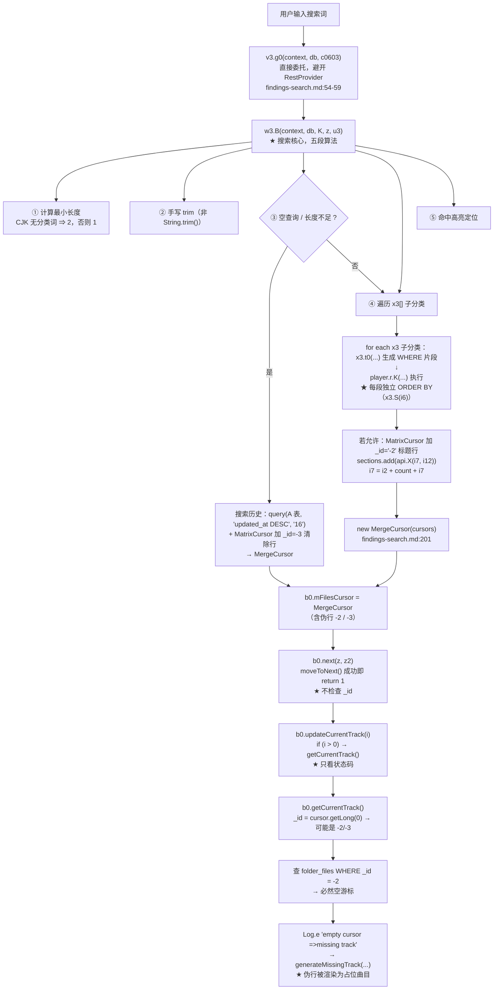

# Poweramp 搜索逻辑及其对播放队列的影响（外部实现）

## 0. 文档定位声明（必读）

**本文记录的是外部实现 Poweramp 的搜索侧行为与它对播放队列的影响，不是 SpMusic 的现状描述，也不是照抄规格。**

### 0.1 与既有两份文档的边界

| 文档 | 覆盖范围 | 本文关系 |
| --- | --- | --- |
| `docs/architecture/poweramp-queue-runtime-reference.md` | 队列状态机（`mFilesCursor`/`mCatCursor`/`mShuffle`/`mRepeat`）、`next`/`prev`/`nextCategory`/`prevCategory`/`isQueueMode` 等 9 个方法体、错误码、Q1–Q9 待验证清单 | **交叉引用，不重复**。本文提到 `next()` 时只写「它不检查 `_id`」这一点，不重述其分支链 |
| `.rea-analysis/findings-queue.md` | 上述 9 个方法的 JADX 原文 + Evidence ID | **交叉引用**。本文只引用其行号 |
| **本文** | **只补搜索侧**：`v3`/`w3` 类结构、`w3.B` 五段算法、`_id = -2/-3` 伪行、伪行与队列的接合点、massops 分离 | — |

### 0.2 证据分级：本文只用两级

前一份文档（`poweramp-queue-runtime-reference.md`）使用三级：【实证·产物】/【实证·任务卡】/【推断】。**本文降为两级**：

| 标记 | 含义 |
| --- | --- |
| **【实证·产物】** | 能在 `.rea-analysis/findings-search.md`（或本文明确引用的其它产物文件）中直接查到的 JADX 原文／字面量 |
| **【推断】** | 本文作者的推理，可能出错 |

**为何合并**：第三级【实证·任务卡】原指「由 Lead 口头转述、尚未落盘的反编译结论」。到 task-7 时该级已无实例（所有方法体都已落盘）；本轮搜索侧证据同样一次性落盘在 `findings-search.md`。继续保留一个**必然为空的等级**只会让读者怀疑「是不是有隐藏在任务卡里、我查不到的证据」。**两级制意味着：本文任何标【实证·产物】的结论，你都能在产物文件中逐行找到。**

### 0.3 对源材料的诚实标注

`findings-search.md:3` 声称「本文全部为 JADX 反编译原文实证，非推断」。**这个表述过强**，实际存在少量推断与未读点：

| 位置 | 实际性质 |
| --- | --- |
| `findings-search.md:257-260`（`toUriCore` 如何把搜索实体当普通 `o0` 处理） | 描述的是 `toUriCore` 行为，而 `toUriCore` 方法体不在 `findings-search.md` 内；其细节属**转述**（源头为 `findings-core.md`） |
| `findings-search.md:344`（`generateMissingTrack` 内部处理） | 该文件已自行标注为「唯一残留推断」 |
| `findings-search.md` S2–S8 | 均为明示的未解项 |

本文据此把这些位置一律降级标注，不以源文件的自评「全部实证」为准。

### 0.4 源文件的两处编号/笔误（不影响结论，但引用时注意）

| # | 现象 | 影响 |
| --- | --- | --- |
| 1 | `findings-search.md` 出现**两个 §5.4**（`:335`「四个已验证的后果」、`:346`「与播放普通列表的差异总结」） | 引用时须带行号，不能只说「§5.4」 |
| 2 | `findings-search.md:3` 自评「全部实证」与实际不符 | 见 §0.3 |

## 1. 目标标识

| | |
| --- | --- |
| 包名 | `com.maxmpz.audioplayer` |
| 版本 | `build-1025-uni`（versionCode `1025009`） |
| APK SHA-256 | `4467fdac3e89b98485866e454bc3b7dc2d73d788d7a1aa9c73ea1028d36b82e0` |
| 搜索实体 | `com.maxmpz.audioplayer.rest.library.v3`（40 方法 / 5 字段），`extends p0`，`implements x2` 【实证·产物】`findings-search.md:24-28` |
| 搜索执行器 | `com.maxmpz.audioplayer.rest.library.w3`（5 方法 / 7 字段） 【实证·产物】`findings-search.md:33` |
| 队列管理器 | `com.maxmpz.audioplayer.player.b0`（交叉引用：`poweramp-queue-runtime-reference.md` §2） |
| 反编译引擎 | JADX headless 0.7.1 via REA（`mode: "java"`、`fell_back: false`） |

## 2. 一句话结论

**Poweramp 的搜索结果是「多个分类子查询 + 分节标题」拼成的 `MergeCursor`（虚拟列表），不是一个独立实体；播放搜索结果没有专用路径，走标准 `toUriCore()`。**

因此 `mFilesCursor` 会指向这个 `MergeCursor`——**其中混有 `_id = -2`（分节标题）与 `_id = -3`（清除历史）两种非曲目伪行**。而队列侧的消费方（`next()`、`getCurrentTrack()`）**不检查 `_id`**，导致伪行被当成「文件丢失」渲染成占位曲目。

这是本文最有价值的结论，展开见 §5、§6。

## 3. 数据流图



## 4. 类结构与「绕开通用 SQL 链」

### 4.1 `v3 extends p0`

`v3` 字段【实证·产物】`findings-search.md:30-37`：

| 字段 | 类型 | 作用 |
| --- | --- | --- |
| `H` | `w3` | **搜索执行器** |
| `f3386` | `x3[]` | 参与搜索的子分类数组 |
| `f3384` | `int` | 搜索模式 |
| `P` | `String` | 搜索词 |
| `f3385` | `d` | — |

### 4.2 `v3.X0(...)` 是空实现——搜索绕开标准 SQL 组装

```java
@Override
public final String[] X0(Uri uri, com.maxmpz.audioplayer.player.r rVar, String str,
                         StringBuilder sb, ArrayList arrayList, i1 i1Var) {
    throw new AssertionError();
}
```

【实证·产物】`findings-search.md:39-47`，Evidence `ev_3b7a655ff6c09a23f1e3a6db9de9b1b21c955a61bb9d53a0a970cb113137a11a`。

**这解释了为什么普通实体走「实体 `X0` → `player.r.K` → `rawQuery`」，而搜索不走**——`v3` 继承来的 `X0` 一旦被调用就抛 `AssertionError`。搜索必须由 `w3.B` 自己驱动（它仍是**逐段**调用 `player.r.K`，只是段循环在 `w3` 里）。

> 对照：普通实体（`j3`/`k3`/`m3`）的 `X0` 设置 `rq.A`（表/JOIN）并追加 WHERE，见 `findings-db.md:222-248`。

### 4.3 `v3.g0` 委托给 `w3.B`

```java
@Override   // com.maxmpz.audioplayer.rest.library.j1
public final Cursor g0(Context context, SQLiteDatabase sQLiteDatabase, C0603 c0603) {
    com.maxmpz.audioplayer.data.api.K k = (com.maxmpz.audioplayer.data.api.K) c0603;
    k.f2658 = -1;
    return this.H.B(context, sQLiteDatabase, k, false, new u3(k));
}
```

【实证·产物】`findings-search.md:54-59`，Evidence `ev_3456bc738d2a90bba78cc336dd8c571132b935d8818cb9a2bb75f4f4eede21c7`。

`g0` 是 `j1` 接口方法——即 `RestProvider.A` 路径中「entity 自己造游标」的钩子。搜索在此处**接管**，不再走 `RestProvider` 的 SQL 组装。

> ⚠️ 【推断】这一节与 `findings-db.md:166-189` 描述的 `RestProvider.A` 分支（`w0` / `com.maxmpz.rest.B` / `AbstractC0735`）之间的**精确衔接点**未被反编译。`g0` 属于 `j1` 接口，但 `RestProvider.A` 的已读分支里没有出现 `j1` 的名字——两者如何对接**未读**。已列入 §9 S9。本文不假设其细节。

## 5. `w3.B` 五段算法

签名：`B(Context, SQLiteDatabase, K query, boolean z, u3 callback) → Cursor`
【实证·产物】`findings-search.md:65-221`，Evidence `ev_0850f0407c20ba473addacd1bbbeda88c7e7a3254b0a7874281d305b3ea0dade`。

### 5.1 第一段：语言相关的最小搜索长度

```java
String strX = c0603.x();                        // 分类过滤词（URI 路径）
if (strX == null || strX.length() == 0) strX = null;

int i4 = (strX != null || z || w3Var.f3393 || !isCjkLocale(Locale.getDefault())) ? 1 : 2;
```

【实证·产物】`findings-search.md:73-97`。

等效逻辑：

| 条件 | 最小搜索长度 |
| --- | --- |
| 非 CJK 语言环境 | `1` |
| CJK，但**有**分类过滤词 `strX` | `1` |
| CJK，但 `z` 为真 | `1` |
| CJK，但 `f3393` 为真 | `1` |
| CJK 且无 `strX` 且无 `z` 且无 `f3393` | **`2`** |

CJK 判定用 `String.hashCode()` 硬编码：

```java
iHashCode == 3383 ? !language.equals("ja")
: iHashCode == 3428 ? language.equals("ko")
: iHashCode == 3886 && language.equals("zh")
```

（`3383`=`"ja".hashCode()`、`3428`=`"ko"`、`3886`=`"zh"`）【实证·产物】`findings-search.md:91-97`。

> 【推断】这是一处**有意的性能/体验权衡**：CJK 单字搜索的召回几乎等于全表扫描（一个汉字能匹配大量条目），所以要求两个字。而一旦用户已经限定在某分类（`strX != null`），结果集本就小，单字即可。`z` 与 `f3393` 的作用未解（S3/S4）。

### 5.2 第二段：手写 trim

```java
String strX2 = c0603.X();
// 手写双指针：从左跳 <=32 的字符，从右跳 <=32 的字符
// Intrinsics.compare(strX2.charAt(pos), 32) <= 0
string = strX2.subSequence(i5, length + 1).toString();
```

【实证·产物】`findings-search.md:101-106`。

> 【推断】用 `<= 32` 而非 `Character.isWhitespace()`，说明它只剥 ASCII 控制字符与空格，**不剥全角空格（U+3000）与 Unicode 空白**。对 CJK 输入法常见的全角空格，搜索词首尾可能被保留。这是可观察的行为差异，但未做运行时验证。

### 5.3 第三段：空查询 → 搜索历史分支

```java
if (string == null || string.length() < i4) {
    String str2 = w3Var.A;                      // A = 历史表名
    if (str2 != null && strX == null && (string == null || string.length() == 0)) {
        c0603.f2664 = null;
        c0603.c = true;                         // ← 标记为"历史模式"
        String str3 = w3Var.X;
        String[] strArr = (str3 == null || str3.length() == 0)
            ? new String[]{"'-3' AS _id ", "term"}
            : new String[]{"'-3' AS _id ", "term", str3};
        Cursor cursorQuery = sQLiteDatabase.query(
            str2, strArr, null, null, null, null,
            "updated_at DESC", "16");           // ← 最近 16 条
        if (cursorQuery == null || cursorQuery.getCount() == 0) return cursorQuery;
        MatrixCursor matrixCursor = new MatrixCursor(AbstractC0735.f3405);
        matrixCursor.addRow(new Object[]{-3L,
            context.getString(R.string.clear_search_history)});   // ← "清除历史"，_id = -3
        return new MergeCursor(new Cursor[]{cursorQuery, matrixCursor});
    }
    if (!z) { c0603.f2664 = null; return null; }   // ← 无历史且非强制 → null
    str = null;                                    // ← 强制模式：空词也搜
}
```

【实证·产物】`findings-search.md:110-131`。

要点：

| 项 | 值 |
| --- | --- |
| 历史条数上限 | **16** |
| 历史排序 | `updated_at DESC` |
| 「清除历史」伪行 `_id` | **`-3`**（**Long 类型** `-3L`） |
| 历史表投影首列 | `"'-3' AS _id "` —— 历史行本身也把 `_id` 覆写为 `-3` |
| 无历史且 `z == false` | 返回 `null`（不是空游标） |
| `z == true` | 空词也进「全量列举」模式 |

**⚠️ 一处值得单独记录的细节（本文新增）**：历史行的投影是 `"'-3' AS _id"`——即**每一条历史记录的 `_id` 都是 `-3`，不是真实行 id**。真正的历史项 id 由 `term` 列承载。这意味着若消费方用 `_id` 去关联，整段历史的 `_id` 全部相同。

### 5.4 第四段：多分类循环 → 拼 `MergeCursor`

```java
x3[] x3VarArr = c0603.O;          // 参与搜索的子分类
for (int i6 = 0; i6 < length3; i6++) {
    x3 x3Var = x3VarArr[i6];
    com.maxmpz.audioplayer.player.r rVar = new com.maxmpz.audioplayer.player.r();
    i1 i1Var = new i1();
    ArrayList args = new ArrayList();
    StringBuilder sb = new StringBuilder();

    // ★ 每个子分类用自己的 t0 生成 WHERE 片段
    String[] proj = x3Var.t0(uriB0, rVar, strArr4, str, sb, args, i1Var, i6, c0603);

    if (proj == null) { cursorK = null; }
    else {
        if (!z5) i1Var.B = x3Var.S(i6);       // ★ 每段自己的排序表达式
        // ★★ 统一走 player.r.K 执行（与普通实体同一个执行器）
        cursorK = com.maxmpz.audioplayer.player.r.K(
            rVar, sQLiteDatabase, proj, sb.toString(), args.toArray(...),
            i1Var.f3335, i1Var.B, i1Var.f3334);
    }
    if (cursorK != null && cursorK.getCount() > 0) {
        // 分节标题行
        if (!w3Var.B || (uriBuild != null && (!w3Var.f3390 || i6 <= 0))) { i2 = 0; }
        else {
            sections.add(new com.maxmpz.audioplayer.data.api.X(i7, i12));
            String label = x3Var.mo2433(context2, i6);
            MatrixCursor mc = new MatrixCursor(strArr2);
            mc.addRow(new Object[]{"-2", label});   // ← 标题伪行 _id = "-2"（String！）
            arrayList6.add(mc);
            i2 = 1;
        }
        arrayList6.add(cursorK);
        if (u3Var != null) u3Var.invoke(x3Var, cursorK, Integer.valueOf(i13));
        i7 = i2 + count + i7;                        // 累计全局位置
    } else if (cursorK != null) { cursorK.close(); }
}
return cursors.size() > 0 ? new MergeCursor(cursors.toArray(new Cursor[0])) : null;
```

【实证·产物】`findings-search.md:142-201`。

要点：

| 项 | 事实 |
| --- | --- |
| SQL 生成 | **每个子分类用自己的 `x3.t0(...)`** 产出投影 + WHERE 片段 |
| SQL 执行 | **统一走 `player.r.K`**——与普通实体同一个执行器（`findings-db.md:446`） |
| 排序 | **每段独立**：`i1Var.B = x3Var.S(i6)`（`S(i6)` = 该分类自己的排序表达式） |
| 段间顺序 | 由 `c0603.O`（`x3[]`）数组顺序决定——**未解**（S5） |
| 标题行 `_id` | **`"-2"`（String 字面量）** |
| 全局位置累积 | `i7 = i2 + count + i7`，其中 `i2 ∈ {0, 1}` 表示本段是否有标题行 |
| 空结果段 | `cursorK.close()` 且**不加标题行** |
| 全部为空 | 返回 `null`（不是空 `MergeCursor`） |

### 5.5 第五段：命中高亮定位

```java
if (z2 && c0603.f2665 == -1 && c0603.H != 0
    && (iArr2 = c0603.o) != null && !ArraysKt.m3163(iArr2, i6)
    && (iC = androidx.appcompat.widget.n.c(cursorK, c0603.H, -1, -1, -1, false)) != -1) {
    c0603.f2665 = iC + i13;        // ← 记录命中项在全局 MergeCursor 中的位置
}
```

【实证·产物】`findings-search.md:206-211`。

要点：命中判定用**全局位置**（`iC + i13`）——即高亮位置是在合并后的 `MergeCursor` 坐标系里算的，**已包含标题行的偏移**。这从侧面证明 `w3.B` 自身把标题行视作结果集的一部分。

收尾【实证·产物】`findings-search.md:216-221`：

```java
c0603.C = iArr3;                               // 分节图标资源 id 数组
if (z2 && c0603.f2665 == -1) c0603.H = 0;      // 未命中 → 清空高亮目标
c0603.f2672 = str;                             // 回写实际搜索词
return mergeCursor;
```

> **注意**：`c0603.C`（分节图标数组）与 `sections`（`api.X` 分节区间）都是**旁路元数据**，不进入游标。这意味着**分节结构存在两套表示**：一份在游标里（`_id = -2` 行），一份在旁路对象里（`api.X` 区间 + 图标数组）。两者必须保持同步，否则 UI 与游标会不一致。本文未找到同步校验代码（属 §9 S10 观察项）。

## 6. 伪行专章（本文核心）

### 6.1 `_id` 常量表

| `_id` | 含义 | 来源（`findings-search.md`） | 字面量类型 |
| --- | --- | --- | --- |
| **`-2`** | **分节标题行** | `:184` `mc.addRow(new Object[]{"-2", label})` | **String** `"-2"` |
| **`-3`** | **「清除搜索历史」行** | `:125-126` `matrixCursor.addRow(new Object[]{-3L, ...})` | **Long** `-3L` |
| 正数 | 真实文件 `folder_files._id` | 各子分类 `cursorK` | Long |

**⚠️ 本文新增观察**：两种伪行的 `_id` **字面量类型不一致**——标题用 `String` `"-2"`，清除行用 `Long` `-3L`。

后果分析：
- Android `Cursor.getLong(int)` 对 TEXT 列会做数字解析，`"-2"` → `-2`，所以**当前代码能工作**；
- 但 `getString()` 会得到 `"-2"` 与 `"-3"`（后者也会被格式化）；
- 若某处改用 `cursor.getType(0)` 或 `isNull()` 判定，两种伪行会表现不同。

这是一处**潜在脆弱点**：同一语义域（负 id 哨兵）用了两种存储类型。记入 §10 N 项。

### 6.2 伪行消费链：四段实证

#### 证据 A：`b0.updateCurrentTrack(int)` 只判 `i > 0`，**完全不看 `_id`**

```java
private int updateCurrentTrack(int i) {
    if (i > 0) {
        this.mMetaTrackInfo = null;
        if (!this.mRawFileMode) {
            this.mCurrentTrack = getCurrentTrack();
        }
    }
    return i;
}
```

【实证·产物】`findings-search.md:268-278`，Evidence `ev_34d53ef2d222595cf862f286a094d44324a4e96fe976a8b95a2a9b347f83a142`。

⇒ `i` 是**状态码**（来自 `next()` 等），不是曲目 id。只要状态码为正就无条件 `getCurrentTrack()`。**伪行不会被这一层拦截。**

#### 证据 B：`b0.getFilesCursorMayBeEntryId` 直读该值

```java
private static long getFilesCursorMayBeEntryId(Cursor cursor, o0 o0Var) {
    return o0Var.o1() ? cursor.getLong(cursor.getColumnCount() - 1) : cursor.getLong(0);
}
```

【实证·产物】`findings-search.md:283-287`，Evidence `ev_29f6f083d020f442e0268cd75bdb0e1a2fa7732e545d397e8307075a05c592be`。

⇒ 停在伪行时返回值就是 `-2` 或 `-3`。**没有任何负值检查。**

⚠️ 该函数依赖 `o0Var.o1()` 决定读**首列**还是**末列**——这是 **S8**，未解，直接影响伪行判定的可靠性（见 §9）。

#### 证据 C：`b0.getCurrentTrack` 查空 → `generateMissingTrack`

```java
private g0 getCurrentTrack() {
    Cursor cursor = this.mFilesCursor;
    if (cursor == null || cursor.isAfterLast() || cursor.isBeforeFirst()
        || (o0Var = this.mFilesEntity) == null) {
        return null;
    }
    long j7 = cursor.getLong(0);                                  // ← 可能是 -2/-3
    long filesCursorMayBeEntryId = getFilesCursorMayBeEntryId(cursor, this.mActualLoadedFilesEntity);
    ...
    Cursor currentTrackCursor = getCurrentTrackCursor(this.mActualLoadedFilesEntity, filesCursorMayBeEntryId);
    if (currentTrackCursor == null) {
        Log.e("RestNowPlaying", "getCurrentTrack null cursor");
        return null;
    }
    if (currentTrackCursor.moveToFirst()) {
        ... 构造 g0 track ...
    } else {
        Log.e("RestNowPlaying", "getCurrentTrack empty cursor =>missing track");
        n0 files3 = this.mRestLibrary.getFiles();
        g0VarGenerateMissingTrack = generateMissingTrack(
            j8, count, position, files3.m(), files3, a0Var2,
            this.mRestLibrary.getFiles().B0(), uri3,
            this.mRestLibrary.getFiles(), uri3);
    }
}
```

【实证·产物】`findings-search.md:292-317`，Evidence `ev_cd77550878cdc54b8c0f352233083b64cba2efe5d1c8859cbf00366c46c08e85`。

⇒ 伪行 `_id = -2/-3` 去查 `folder_files` **必然得到空游标**，于是：
1. 打印 `"getCurrentTrack empty cursor =>missing track"`
2. 调用 `generateMissingTrack(...)` 构造「缺失曲目」占位 `g0`

**⇒ 伪行不会被静默跳过，而是被当作「缺失文件」渲染。**

#### 证据 D：`next()` 本身也没有 `_id` 过滤

```java
if (cursor.moveToNext()) { i = 1; } else { cursor.moveToPosition(position); i = -3; }
...
return z2 ? uriCore : updateCurrentTrack(uriCore);
```

【实证·产物】`findings-search.md:326-333`；方法体全文见 `findings-queue.md:85-142`（交叉引用，`next()` 的完整分支链不在此重述）。

⇒ 停在标题行时 `moveToNext()` 成功、`i = 1`，队列认为「前进成功」。

### 6.3 结论

**伪行不被跳过，被当作「缺失曲目」渲染。**

完整链条：

```
搜索结果 MergeCursor（含 _id=-2 标题行）
   ↓ 用户点播放 / next()
next() → moveToNext() 成功 → i = 1
   ↓
updateCurrentTrack(1) → i > 0 → getCurrentTrack()
   ↓
getFilesCursorMayBeEntryId() → -2
   ↓
SELECT ... WHERE folder_files._id = -2 → 空
   ↓
Log.e "empty cursor =>missing track"
   ↓
generateMissingTrack(...) → 占位 g0
   ↓
UI 渲染一个「文件丢失」的曲目
```

## 7. 对队列的四个已验证后果

| # | 后果 | 证据级别 | 依据 |
| --- | --- | --- | --- |
| 1 | **`next()` 会停在 `-2`/`-3` 伪行上** | 【实证·产物】 | `next()` 无 `_id` 检查（`findings-search.md:326-333`、`findings-queue.md:85-142`）+ `getFilesCursorMayBeEntryId` 直读该值（`:283-287`） |
| 2 | **伪行被当作「缺失曲目」渲染**，而非跳过 | 【实证·产物】 | `getCurrentTrack` 的 `empty cursor =>missing track` 分支（`:310-316`） |
| 3 | **`mFilesCursor.getCount()` 含标题行**；可播数 = 总数 − 分节数（− 历史「清除」行） | 【实证·产物】 | `w3.B` 的 `i7 = i2 + count + i7` 累积逻辑（`:191`）、标题行独立加入 `arrayList6`（`:185`） |
| 4 | 改搜索词／切分类 → `x3[]` 变化 ⇒ **新的 `MergeCursor`**，旧队列游标失效 | 【实证·产物】 | `w3.B` 每次 `new MergeCursor(...)`（`:201`） |

⚠️ **唯一残留推断**：`generateMissingTrack` 对 `id <= 0` 的**内部**处理（构造何种占位曲目、是否返回 null）**未读方法体**。但**调用点已实证**。见 §9 S2。

> 后果 3 的一个具体含义：一个含 3 个分类命中、共 40 首的搜索结果，`getCount()` 可能返回 43（3 个标题 + 40 首）。任何用 `getCount()` 当作「可播曲目数」或进度分母的 UI 都会偏大。

## 8. 与「播放普通列表」的对照

| 维度 | 普通列表（`k3` / `m3` / `n0`） | 搜索结果（`v3`） |
| --- | --- | --- |
| SQL 生成 | 实体 `X0` 设置 `rq.A` + WHERE（`findings-db.md:222-248`） | **`w3.B` 循环调各子分类 `x3.t0`**，`v3.X0` 抛 `AssertionError` |
| SQL 执行 | `player.r.K` | **同一个** `player.r.K`（每段各调一次） |
| 游标类型 | 单一 `Cursor` | **`MergeCursor`（多段拼接）** |
| 是否含伪行 | 否 | **是**（`-2` 标题、`-3` 清除历史） |
| 排序 | 单一 `ORDER BY`（`k3` 为 `"sort"`、`m3` 为 `"queue.sort"`） | **每段独立**（`x3.S(i6)`），段间固定顺序 |
| 分页 | `h1.C` 按 id 集合重查（`findings-db.md:707-790`） | **`MergeCursor` 本身无分页** |
| 队列 `kind` | `playlist` / `all-songs`（`playbackQueue.ts`） | **复用其一，无专用 kind**（`v3.mo2422` 返回自身） |
| 空结果 | 空游标或 null | `w3.B` 返回 `null`（非空 `MergeCursor`） |

## 9. massops（批量操作）路径与搜索**分离**

```java
public com.maxmpz.utils.y mo2455(RestProvider restProvider, Uri uri, long[] jArr,
                                 int i, int i2, int i3, UriAndIds uriAndIds, boolean z) {
    ...
    if (e0(uri, jArr, i, i2, i3, sb, sb2, false)
        && (cursorA = restProvider.A(uri, j(), sb.toString(), null, sb2.toString(), false)) != null) {
        ...
        if (n.m312(sb, V(), yVarM2443.B, 0, yVarM2443.A) && sb.length() > 0) {
            int iDelete = restProvider.delete(uri, sb.toString(), null);
            if (iDelete > 0 && z) {
                k3 k3VarZ0 = g1Var.getPlaylists().Z0();   // 同时清理播放列表引用
                if (n.m312(sb3, "folder_file_id", jArr2, 0, i5)) {
                    restProvider.delete(k3VarZ0.B0(), sb3.toString(), null);
                }
            }
            ...
        }
    }
}
```

【实证·产物】`findings-search.md:363-399`，Evidence `ev_2de43efb44c7d52833a6ff48ca0b1c03c04e3074783dc738004bb5f2dd6a489e`。

**关键分层**：`mo2455` 用 `e0(...)` + `restProvider.A(...)`，**不是** `w3.B`。

⇒ **massops 针对真实实体 URI 操作；搜索的 `MergeCursor` 不参与批量删除。** 批量删除的对象是「用户选中项的实体 URI」，与搜索结果的虚拟游标无关。

> 【推断】这是一处**清晰且正确的分层**：搜索结果只是**展示用视图**，所有写操作都回到实体。伪行污染只影响读/播放路径，不影响写路径——这是为什么 Poweramp 的搜索删除功能没被伪行搞坏。

## 10. 待验证清单 S1–S10

| # | 问题 | 状态 | 为何重要 |
| --- | --- | --- | --- |
| **S1** | `b0` 在 `next()`/`prev()` 中是否跳过 `_id < 0` 的伪行 | ✅ **已关闭** | **不跳过**。见 §6.2 证据 D + §7 后果 1。`next()` 方法体全文见 `findings-queue.md:85-142` |
| **S2** | `generateMissingTrack` 内部对 `id <= 0` 的处理 | ⚠️ **开放** | 调用点已实证；**内部实现未读**——决定「占位曲目」长什么样（空标题？显示 `-2`？） |
| **S3** | `w3.B` 的 `boolean z` 参数语义 | ⚠️ **开放** | 看起来是「强制搜索/全量列举」，未确认。影响空查询行为 |
| **S4** | `w3.B` 的 `f3390` / `f3392` / `f3393` 三个 boolean 字段各自含义 | ⚠️ **开放** | 影响**分节标题出现条件**（`f3390`）与**最小搜索长度**（`f3393`） |
| **S5** | `x3` 子分类数组 `c0603.O` 的构成顺序 | ⚠️ **开放** | 决定搜索结果的**分节顺序**（歌曲/专辑/艺术家/文件夹…） |
| **S6** | `AbstractC0735.f3405`（`MatrixCursor` 列定义） | ⚠️ **开放** | 「清除历史」伪行的列结构；与 §6.1 的 `_id` 类型不一致问题相关 |
| **S7** | 搜索结果的排序是否受 `mShuffle` 影响 | ⚠️ **开放** | `next()` 的洗牌分支会 `toUriCore(..., true, ...)`；对 `MergeCursor` 重洗的行为**未知** |
| **S8** | **`o0.o1()` 的语义** | ⚠️ **开放（高优先）** | **它决定 `getFilesCursorMayBeEntryId` 读首列还是末列。** 搜索实体 `v3` 继承自 `p0`，其 `o1()` 返回值未读。若读错列，伪行判定与真实曲目 id 都可能取错 |
| **S9** | （本文新增）`v3.g0`（`j1` 接口）与 `RestProvider.A` 已读分支（`w0` / `com.maxmpz.rest.B` / `AbstractC0735`）如何衔接 | ⚠️ **开放** | 见 §4.3 注。`RestProvider.A` 的已读分支中未出现 `j1`，衔接点未反编译 |
| **S10** | （本文新增）游标内 `_id = -2` 行与旁路 `sections`（`api.X` 区间）/ `c0603.C`（图标数组）的同步保障 | ⚠️ **开放** | 见 §5.5 注。两套表示必须一致，但未找到校验代码 |

### 10.1 S8 专项说明（为什么它排最高优先）

`getFilesCursorMayBeEntryId` 的整个逻辑是：

```java
return o0Var.o1() ? cursor.getLong(cursor.getColumnCount() - 1) : cursor.getLong(0);
```

- 若 `o1()` 为 `false` → 读**第 0 列**
- 若 `o1()` 为 `true` → 读**最后一列**

而 `w3.B` 的投影由各子分类 `x3.t0(...)` 各自决定——**不同分类的列数/列序可能不同**（`findings-db.md:273-281` 显示 `k3` 有多套 COALESCE 投影常量）。

⇒ 若搜索实体 `v3` 的 `o1()` 返回 `true`，则它假设「last column 是 id」；但 `MergeCursor` 各段的列结构未必统一（标题行 `MatrixCursor` 只有 2 列）。

**这可能导致：**
- 对标题行：`getColumnCount()` 可能是 2（`_id` + `label`），读 `getLong(1)` → 对 `label` 字符串取 long → 异常或 0
- 对真实行：读末列，若末列不是 id → 取到错误值

**这是伪行影响链上唯一会「放大」问题的未解点**：不仅伪行本身，连真实曲目的 id 也可能取错。S8 关闭前，本文对「伪行判定可靠性」的所有结论都只到「按 `_id` 语义看应当如此」的程度。

## 11. 可借鉴 / 不建议照抄（提案，非现状）

> 本章全部为**提案**，不代表已批准范围，也不是对 SpMusic 现状的描述。

### 11.1 可借鉴

| # | 做法 | 理由 |
| --- | --- | --- |
| A1 | **伪行（sentinel row）模式：把分节标题与特殊操作行编入同一游标** | 避免维护「实体列表 + 独立标题列表」两套结构并手工对齐索引。一个游标就是完整视图，滚动、高亮、位置计算都只需一套坐标系。**这是好设计** —— 但见 §11.3 的反讽 |
| A2 | **按语言切换最小搜索长度**（CJK=2 / 拉丁=1） | CJK 单字召回过宽（一个汉字可命中大量条目），要求 2 字能显著降低无效扫描与噪音。**但 SpMusic 的机制不同**：SpMusic 搜索是内存字符串过滤（`PlaylistLibraryPanel.tsx:158-162`、`FolderHierarchyPanel.tsx:151-153` 的 `.filter(...includes(...))`），没有最小长度门槛。若要借鉴，属于**在内存过滤上加门槛**，成本比 DB 侧更低，可考虑 |
| A3 | **搜索历史复用同一游标**（空查询 → 历史表 + 「清除」伪行） | UI 只需一个数据源、一套渲染逻辑即可覆盖「有结果 / 无结果但有历史 / 有历史且可清除」三种状态 |
| A4 | **massops 与搜索结果彻底分离** | 批量操作始终针对**真实实体 URI**，绝不针对虚拟 `MergeCursor`。这让「伪行污染」被限制在读/播放路径，写路径不受影响（§9）。这是本文认为**最值得照抄的一条** |
| A5 | **命中位置用全局合并坐标系**（`iC + i13`） | 高亮位置天然与最终游标一致，不需要 UI 侧做二次偏移换算（§5.5） |

### 11.2 不建议照抄

| # | 反模式 | 理由 |
| --- | --- | --- |
| N1 | **消费方不校验 `_id` 正负** | 伪行被当成「文件丢失」渲染（§6.3）。这是本次最重要的负面教训 |
| N2 | **同一语义域用两种字面量类型** | 标题 `"-2"`（String）vs 清除 `-3L`（Long）（§6.1）。当前靠 `getLong()` 的隐式解析侥幸工作，但任何改用 `getType`/`getString`/`isNull` 的地方都会分叉 |
| N3 | **状态码与实体 id 混在同一层传递** | `updateCurrentTrack(int i)` 的 `i` 是状态码（`>0` 即成功），但同层又在处理「当前曲目 id」。两个语义共用一个 `int`，使「成功但停在伪行」这种状态无法表达 |
| N4 | **分节结构双表示**（游标 `-2` 行 + 旁路 `sections`/图标数组） | 两套表示必须同步，但未见校验（S10）。任一更新遗漏就会 UI/游标不一致 |
| N5 | **空结果返回 `null` 而非空游标** | `w3.B` 与历史分支都在「无结果」时返回 `null`（`findings-search.md:123`、`:129`、`:201`）。调用方必须处处判空，比空游标更易漏 |
| N6 | **手写 ASCII-only trim** | 只剥 `<= 32`，**不剥全角空格（U+3000）与其它 Unicode 空白**（§5.2）。对 CJK 输入场景是实际缺陷。**注意不要把它当成「和 JS `trim()` 一样」**——见 §11.5 |

### 11.3 本文最想强调的一条：伪行模式的反讽

**伪行模式本身是好设计，但 Poweramp 自己的消费方没跟上，正是这个模式的反例。**

拆开看：

| 层面 | 评价 |
| --- | --- |
| **模式设计** | ✅ **好**。标题与数据同游标，避免了「两套列表手工对齐」这一整类 bug。分节顺序、滚动位置、命中高亮全部统一坐标系（A1、A5） |
| **模式约定的隐含前提** | ⚠️ 必须有一条**明确的契约**：「本游标可能包含非曲目行，消费方必须按 `_id` 分类处理」 |
| **Poweramp 的实际实现** | ❌ **违约**。`next()`、`updateCurrentTrack()`、`getFilesCursorMayBeEntryId()` 三处都不看 `_id`（§6.2 A/B/D） |
| **后果** | 伪行被渲染为「文件丢失」的占位曲目（§6.2 C） |
| **更深的问题** | 违约的不是边缘代码，而是**队列主路径**。说明这个前提从未被写成契约，也没有测试覆盖 |

**这就是最值得记的教训**：一个模式的价值不取决于它本身多优雅，而取决于**它的不变量是否被所有消费方遵守**。伪行模式把「如何区分数据行与元数据行」的责任推给了每个消费方——一旦消费方有 N 个，就有 N 次违约机会，而 Poweramp 在**第一个**消费方（`next()`）就违约了。

**推论（给 SpMusic 的建议性思考）**：如果要引入类似的「混合游标」模式，两种做法比「靠约定」更可靠：

1. **类型化游标**：让 API 返回 `{ sections: Section[], rows: Row[] }` 而不是扁平游标，把区分责任放回**生产方**；
2. **或显式谓词**：若必须扁平，则提供 `isPlayableRow(cursor)` 之类的**唯一判定入口**，强制所有消费方经过它（而不是各自判断 `_id > 0`）。

Poweramp 选了「扁平游标 + 无判定入口」，于是每个消费方都要自己记得这件事——这是它失败的结构性原因。

### 11.4 SpMusic 侧现状参照（仅用于定位差异，非评价）

| 维度 | Poweramp | SpMusic |
| --- | --- | --- |
| 搜索机制 | DB 查询 + `MergeCursor` 拼接 | **内存过滤**：`.filter(item => \`${title} ${artist} ${album}\`.toLocaleLowerCase().includes(query))`（`PlaylistLibraryPanel.tsx:160-162`、`FolderHierarchyPanel.tsx:146-153`） |
| 分节 | 有（`_id = -2` 伪行 + 旁路 `sections`） | 无（扁平结果集） |
| 伪行 | 有（`-2` / `-3`） | **无**（结果集只含真实 `AllSongsItem`） |
| 最小长度 | CJK=2 / 拉丁=1 | **无门槛** |
| 搜索历史 | DB 表 + 伪行 | 无 |
| 受影响路径 | `mFilesCursor` → `next()` | 过滤后的数组 → `onPlaySong`（`all-songs` kind） |

> **关键差异**：SpMusic 的搜索结果是**纯数据行数组**，不存在伪行，因此本文 §6 的整条污染链在 SpMusic **结构上不可能发生**。SpMusic 若引入分节，才需要面对 §11.3 的契约问题。
>
> ⚠️ 需要澄清：`findings-search.md:442` 称「SpMusic 当前无此区分，中文单字搜索体验可能需评估」。该说法**结论成立**（确实无 CJK 区分），但原因不是「Poweramp 有 DB 门槛而 SpMusic 忘了」，而是**两者搜索机制根本不同**（DB 查询 vs 内存过滤）。门槛在内存过滤里意义更小（没有 SQL 全表扫描成本），但「单字召回噪音」的问题依然存在。

### 11.5 一处不能直接类比的 trim 差异（本文新增）

Poweramp 用 `<= 32` 手写 trim（§5.2）。SpMusic 用 JS 原生 `trim()`：

- `PlaylistLibraryPanel.tsx:158`、`:161` — `query.trim().toLocaleLowerCase()`
- `PlaylistPanel.tsx:345` — `filter.trim().toLowerCase()`
- `FolderHierarchyPanel.tsx:146` — `currentSearch.query.trim().toLocaleLowerCase()`

**两者不等价**，方向还相反：

| | Poweramp 手写 trim | JS `String.prototype.trim()` |
| --- | --- | --- |
| 判定依据 | 码点 `<= 32` | Unicode `White_Space` + 行终止符 |
| ASCII 空格 / `\t\n\r` | 剥 | 剥 |
| **全角空格 U+3000** | **不剥** | **剥** |
| NBSP U+00A0 | 不剥（> 32） | 剥 |
| 不换行空格 U+FEFF | 不剥 | 剥（作为 BOM 处理） |

⇒ **SpMusic 的 trim 比 Poweramp 更宽**（能剥全角空格），这对中文输入更好。所以 N6 是**Poweramp 的缺陷**，不是 SpMusic 需要改进的点——写在这里是为了防止后续有人看到「手写 trim」就误以为「我们也该手写」。

> 另外注意 SpMusic 三处用的是 `toLowerCase()` 与 `toLocaleLowerCase()` 混用（`PlaylistPanel.tsx:345` 用前者，另两处用后者）。对土耳其语等特殊 locale 二者结果不同（`I`/`i` 映射），属独立的小问题，不在本文范围。

## 12. 证据 ID 索引

出自 `findings-search.md:405-421`，共 12 条。

| 方法 / 类 | Evidence ID |
| --- | --- |
| `v3` 类摘要（40 方法 / 5 字段） | `ev_df6c4097218a3fa1d245f35a5c9f2b1451eb0a2e859aba3f687f241999ed58f3` |
| `v3.X0`（空实现 `AssertionError`） | `ev_3b7a655ff6c09a23f1e3a6db9de9b1b21c955a61bb9d53a0a970cb113137a11a` |
| `v3.g0`（委托 `w3.B`） | `ev_3456bc738d2a90bba78cc336dd8c571132b935d8818cb9a2bb75f4f4eede21c7` |
| `w3` 类摘要（5 方法 / 7 字段） | `ev_025e497fdf2d6aa4ee8bce40486b394fc801bfa118bb60dccafc409fcea08929` |
| **`w3.B`（搜索核心）** | `ev_0850f0407c20ba473addacd1bbbeda88c7e7a3254b0a7874281d305b3ea0dade` |
| `v3.m0`（追加 `massops` 路径） | `ev_47acff4c00f5714781cb4787721950b3d968df4adb9f3c587f42d72f334d47e0` |
| `p0` 类摘要（62 方法 / 8 字段） | `ev_2fab886e7e1aa600afc2a8cd65f456cca6ae189838055fb980048a70ee553755` |
| `p0.mo2455`（批量删除） | `ev_2de43efb44c7d52833a6ff48ca0b1c03c04e3074783dc738004bb5f2dd6a489e` |
| `v3.mo2422`（返回自身） | `ev_d4b5daf3894284b383e49adfe238292d4c29d2d2694bbaeb35c9b6cc15afd2af` |
| **`b0.updateCurrentTrack`（无 `_id` 检查）** | `ev_34d53ef2d222595cf862f286a094d44324a4e96fe976a8b95a2a9b347f83a142` |
| **`b0.getFilesCursorMayBeEntryId`（伪行直读）** | `ev_29f6f083d020f442e0268cd75bdb0e1a2fa7732e545d397e8307075a05c592be` |
| **`b0.getCurrentTrack`（伪行 → missing track）** | `ev_cd77550878cdc54b8c0f352233083b64cba2efe5d1c8859cbf00366c46c08e85` |

（加粗者为本文 §6「伪行消费链」的四条关键证据所在——第四条 `next()` 无 `_id` 检查的证据同时引用 `findings-queue.md:85-142`。）

## 13. 交叉引用索引

| 主题 | 位置 |
| --- | --- |
| 队列状态机（`mFilesCursor`/`mCatCursor`/`mShuffle`/`mRepeat`） | `docs/architecture/poweramp-queue-runtime-reference.md` §2 |
| `next(z, z2)` 完整分支链 | 同上 §3.1；原文 `findings-queue.md:66-143` |
| `prev()` / Q4 闭环 | 同上 §3.2、§4.2 |
| `isQueueMode()` | 同上 §2.3；原文 `findings-queue.md:32-36` |
| 错误码表 | 同上 §8 |
| `toUriCore` 11 步算法 | `.rea-analysis/findings-core.md:89-122` |
| 实体分类（`j3`/`k3`/`m3`/`n0`/`p3`） | `.rea-analysis/findings-core.md:191-207` |
| `RestProvider.A` 分派 / LIMIT 注入防护 | `.rea-analysis/findings-db.md:166-189`、`:443` |
| `player.r.K` / `player.r.X` SQL 执行与拼装 | `.rea-analysis/findings-db.md:446-448` |
| `h1.C` id 集合分页 | `.rea-analysis/findings-db.md:707-790` |
| `k3` 多套 COALESCE 投影常量 | `.rea-analysis/findings-db.md:273-281` |
| `queue` 表 DDL 与 `m3.X0` | `.rea-analysis/findings-db.md:147-148`、`:817-831` |
| SpMusic 搜索实现（内存过滤） | `src/features/player/components/PlaylistLibraryPanel.tsx:158-162`、`FolderHierarchyPanel.tsx:146-153`、`PlaylistPanel.tsx:345-350` |
