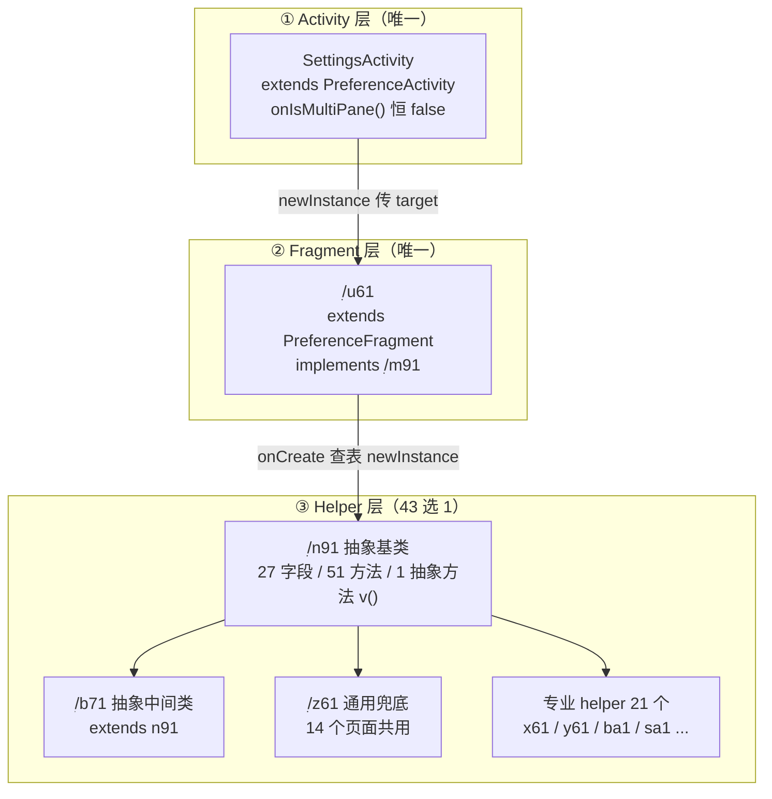
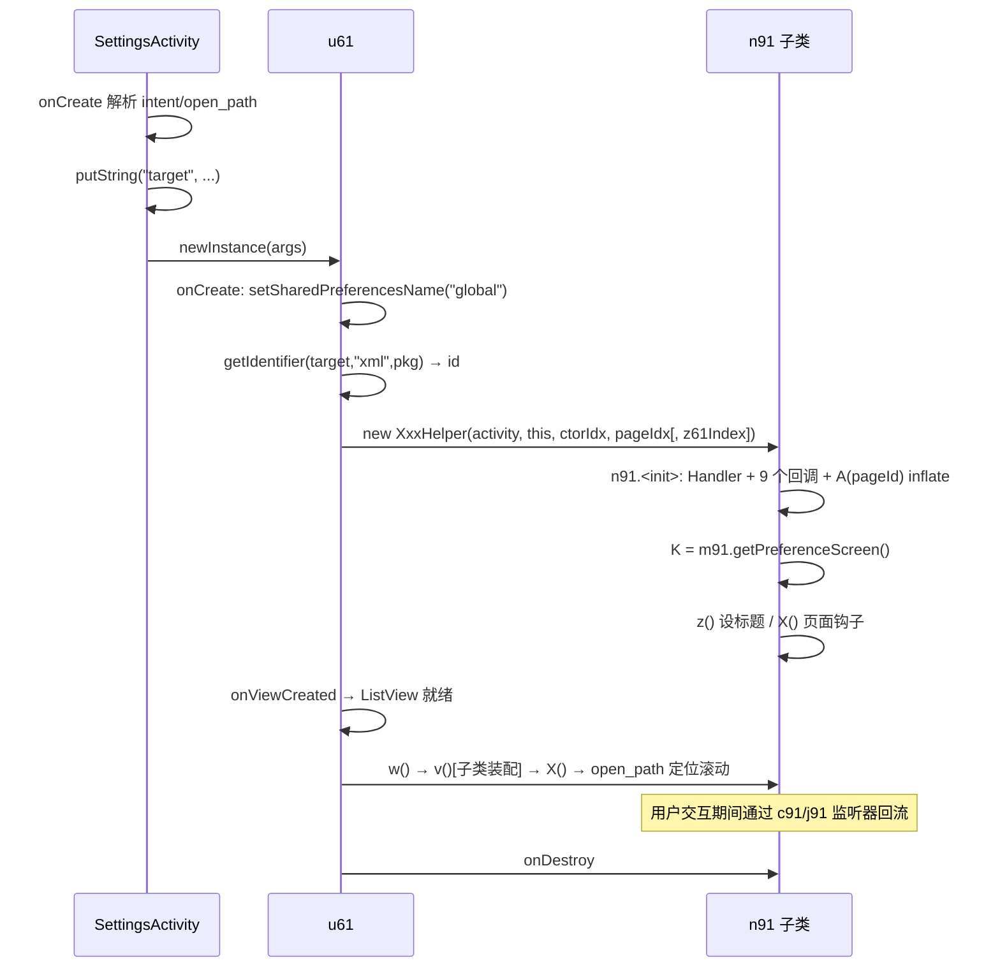

# Poweramp 设置页共享运行时机制

> **证据分级**：【实证·原文】= XML/资源原文；【实证·产物】= 反编译 smali 产物；【推断】= 无直接代码佐证。
>
> 所有结论基于 **build-1035-bundle-play**（`versionCode 1035009`）。

## 0. 一句话结论

43 个设置页共享**同一套三层骨架**（`SettingsActivity` → `u61` Fragment → `n91` 抽象 helper），每页只必填**一个 `v()` 方法**即可接入；页面与代码的绑定是 `u61.onCreate` 里一张 **45 分支的资源 id → helper 硬编码表**，而页面内部的条目交互则大多被 `n91` 的**监听器工厂（`c91` 等）**以页索引方式复用。**真正"每页自己写"的代码量极小，绝大部分行为是框架提供的。**

---

## 1. 文档定位

| 文档 | 覆盖范围 | 与本文关系 |
| --- | --- | --- |
| **本文** | 所有设置页共享的三层骨架、分发表、基类契约、生命周期、通用交互机制 | — |
| `poweramp-settings-root-structure.md` | 根页 `singlepane` 含什么、11 个一级目标规模、深链协议字面值 | **上游**，本文补它的运行时实现 |
| `poweramp-audio-settings-structure.md` | 音频分支 10 个 XML | 下游，引用本文 |
| `poweramp-look-and-feel-settings.md` | 外观分支 8 个 XML | 下游，引用本文 |
| `poweramp-library-settings.md` | 媒体库页 | 下游，引用本文 |
| `poweramp-headset-settings.md` / `poweramp-lockscreen-settings.md` | 耳机/锁屏页 | 下游，引用本文 |
| `poweramp-misc-settings.md` | 其他页 | 下游，引用本文 |
| `poweramp-about-and-support-settings.md` | 关于/支持/命令历史/翻译 | 下游，引用本文 |

> **本文不重复各页的条目清单**，只写"所有页都要经过的那条路"。各页文档引用本文的章节号，不再复述机制。

---

## 2. 三层骨架

### 2.1 类关系总图



### 2.2 三层的职责边界

| 层 | 实例数 | 职责 | 生命周期归属 |
| --- | --- | --- | --- |
| `SettingsActivity` | **1**（每个设置栈一实例） | 解析 intent / open_path、标题栏、Fragment 容器、菜单 | Android Activity |
| `u61` | **1** | 读 `target` extra → 查分发表 → 实例化 helper → 转发各生命周期 | Android Fragment |
| `n91` 及其子类 | **1** | 装配本页所有偏好项：找控件、绑监听、动态增删、弹框 | 手动 new，**不持有 Fragment 生命周期** |

> **关键设计**：helper 是**普通对象**，不是 Fragment/Activity。因此它不能 `findViewById`，需要视图时统一走 `n91.Р()` → `Р()` 里判 `m91` 实现是 `PreferenceFragment` 还是 `SettingsActivity`，分别取 `ListView`【实证·产物】`n91.smali:2560-2633`。

### 2.3 为什么只有 1 个 Fragment

`SettingsActivity.isValidFragment` 只放行 `u61` 一个类名【实证·产物】`SettingsActivity.smali:676-690`。因此：

- **所有页面共用同一个 Fragment 类**，看不出"这是哪个页面"——页面身份完全由 `target` extra 决定。
- 换页 = **重建 Activity**（见 §7.3 `k(Z)`），不是 Fragment 替换。

---

## 3. 分发表：`u61.onCreate`

### 3.1 完整流程

`u61.onCreate`【实证·产物】`u61.smali:90-1881`（**1791 行，全类最长**），分五段：

```
① super.onCreate + 固定 SharedPreferences 名
   ├─ getPreferenceManager().setSharedPreferencesName("global")   [:100-110]
   └─ setHasOptionsMenu(true)                                     [:112-114]

② 读 target，做别名归一（sparse-switch 4 个 case + packed-switch 4 路）[:116-260]
   ├─ "audio_output_plugins" → (index 0) → 不变
   ├─ "audio_output"         → (index 1) → "audio_outputs2"
   ├─ "ui_tweaks_player"     → (index 2) → "ui_player"
   └─ "audio_outputs"        → (index 3) → 不变
   然后 packed-switch(v7){0→"ui_player"; 1→"audio_outputs2"; 2,3→保持原值}

③ Resources.getIdentifier(target, "xml", app.X())                [:262-286]
   → v3 = 资源 id（0 表示找不到）

④ 45 分支 if-ne 链：v3 与 0x7f1600xx 逐一比较，命中即 new 对应 helper [:376-1800]
   └─ 每个分支都是 new-instance + invoke-direct...<init>(Activity, this, ctorIndex, pageIndex)

⑤ 兜底：命中不到则拼 "!SettingsHelper id=" + AUtils.h(ctx,id) 抛/记异常 [:1762-1810]
```

### 3.2 别名归一表

| 输入 target | 归一结果 | 备注 |
| --- | --- | --- |
| `audio_output_plugins` | *不变* | 名称与实际 XML 不同，需再查表 |
| `audio_output` | **`audio_outputs2`** | 单数→复数 |
| `ui_tweaks_player` | **`ui_player`** | 历史名 |
| `audio_outputs` | *不变* | — |

> **注意**：`audio_outputs` 这个 target **在 `public.xml` 里没有同名 xml 资源**，`getIdentifier` 会返回 0，然后走 §3.4 的失败分支。这是一条**疑似死链**，见 §10 未解问题 Q1。

### 3.3 资源 id → helper 完整映射（45 条）

已用脚本从 `u61.smali` 的 `const`/`new-instance` 配对 + `public.xml` 反查得出【实证·产物】：

| 资源 id | xml 名 | helper | helper 规模 | 类别 |
| --- | --- | --- | ---: | --- |
| `0x7f160000` | `aa` | `x61` | 11951 B | 专业 |
| `0x7f160001` | `aa_bg` | `y61` | 25783 B | 专业 |
| `0x7f160002` | `already_purchased` | `z61` | 118199 B | 通用 |
| `0x7f160003` | `audio` | `z61` | 同上 | 通用 |
| `0x7f160004` | `audio_bit_perfect` | `g71` | — | 专业 |
| `0x7f160005` | `audio_dvc` | `n71` | — | 专业 |
| `0x7f160006` | `audio_equ` | `q71`,`z61` | — | 双分支 |
| `0x7f160007` | `audio_focus` | `z61` | 同上 | 通用 |
| `0x7f160008` | `audio_output_device_opts` | `o81` | — | 专业 |
| `0x7f160009` | `audio_outputs2` | `r81` | — | 专业 |
| `0x7f16000a` | `audio_outputs_tweaks` | `z61` | 同上 | 通用 |
| `0x7f16000b` | `audio_platform_log` | `w81` | — | 专业 |
| `0x7f16000c` | `audio_resampler` | `z61` | 同上 | 通用 |
| `0x7f16000d` | `audio_tweaks` | `z61` | 同上 | 通用 |
| `0x7f16000f` | `buy_methods` | `z61` | 同上 | 通用 |
| `0x7f160011` | `commands_history` | `o91` | 22210 B | 专业 |
| `0x7f160012` | `fade` | `z61` | 同上 | 通用 |
| `0x7f160013` | `feature_packages` | `p91` | 2618 B | 专业（最小）|
| `0x7f160014` | `general` | `r91` | 32207 B | 专业 |
| `0x7f160015` | `headset` | `u91` | 6849 B | 专业 |
| `0x7f160016` | `library` | `ba1` | 43191 B | 专业 |
| `0x7f160017` | `library_lists` | `z61` | 同上 | 通用 |
| `0x7f160018` | `library_playlists` | `ga1` | — | 专业 |
| `0x7f160019` | `library_queue` | `z61` | 同上 | 通用 |
| `0x7f16001a` | `library_scanner` | `z61` | 同上 | 通用 |
| `0x7f16001b` | `library_search` | `z61` | 同上 | 通用 |
| `0x7f16001c` | `library_shuffle` | `z61` | 同上 | 通用 |
| `0x7f16001d` | `lockscreen` | `la1` | 13557 B | 专业 |
| `0x7f16001e` | `misc` | `sa1` | 32823 B | 专业 |
| `0x7f16001f` | `peq_equ_bands` | `z61` | 同上 | 通用 |
| `0x7f160020` | `peq_equ_tone` | `v81` | 45080 B | 专业 |
| `0x7f160023` | `rg` | `z61` | 同上 | 通用 |
| `0x7f160026` | `singlepane` | **`va1`** | 12428 B | 根页专用 |
| `0x7f160027` | `space` | `z61` | 同上 | 通用 |
| `0x7f160028` | `support` | `xa1` | 3744 B | 专业 |
| `0x7f160029` | `translations` | `z61` | 同上 | 通用 |
| `0x7f16002a` | `ui` | `z61` | 同上 | 通用 |
| `0x7f16002b` | `ui_icon` | `ab1` | 13507 B | 专业 |
| `0x7f16002c` | `ui_lyrics` | `y61` | 25783 B | 专业（与 aa_bg 共用）|
| `0x7f16002d` | `ui_mediaactions` | `y61` | 同上 | 同上 |
| `0x7f16002e` | `ui_notify` | `z61` | 同上 | 通用 |
| `0x7f16002f` | `ui_player` | `z61` | 同上 | 通用 |
| `0x7f160030` | `ui_theme` | `z61` | 同上 | 通用 |
| `0x7f160031` | `ui_theme_opts` | `v81` | 45080 B | 专业（与 peq_equ_tone 共用）|
| `0x7f160033` | `vis` | `w81` | — | 专业 |

> **只有 41 个 xml id 出现在分发表中**（`0x7f160010`、`0x7f160022`、`0x7f160024/25`、`0x7f16002f` 之外还有几个非设置类）。分发表里实际有 **45 个 new-instance 点**，其中 `audio_equ` 与 `library` 之外有少量重复分支。

### 3.4 三个值得注意的分布特征

**(1) `z61` 通用兜底吃掉 14 个页面**

`z61` 单类 118199 字节 / 4866 行，服务 `already_purchased`、`audio`、`audio_focus`、`audio_outputs_tweaks`、`audio_resampler`、`audio_tweaks`、`buy_methods`、`fade`、`library_lists`、`library_queue`、`library_scanner`、`library_search`、`library_shuffle`、`peq_equ_bands`、`rg`、`space`、`translations`、`ui`、`ui_notify`、`ui_player`、`ui_theme` 等页。

内部靠一个**页索引字段** `j` 分发【实证·产物】`z61.smali:11-22`：

```
z61.<init>(Activity, m91, ctorIndex, pageIndex, j)
  └─ iput p5 → this.j          ← 第 5 参 = 页索引
  └─ invoke-direct n91.<init>(Activity, m91, ctorIndex, pageIndex)
```

`v()` 开头 `iget v0, ..., z61;->j` 后 `packed-switch 0x0` 展开 **20 个 case（pswitch_13 … pswitch_0）**【实证·产物】`z61.smali:4753-4775`。

> **这意味着"通用 helper"其实是 20 个小页面处理器的合集**，每页只占一个 switch case。新增一个小页面 = 在 `z61.v()` 加一个 case + 分发表加一行。

**(2) helper 复用：一个类服务两页**

| helper | 服务的页面 | 是否需页索引 |
| --- | --- | --- |
| `y61` | `aa_bg`、`ui_lyrics`、`ui_mediaactions` | 是（构造时传不同索引）|
| `v81` | `peq_equ_tone`、`ui_theme_opts` | 是 |
| `z61` | 14+ 页 | 是（`j` 字段）|

> 复用不是"巧合相似"，而是**同一实现 + 不同索引参数**。

**(3) 专业 helper 的规模分布极不均**

`p91` 只有 2618 字节（4 个 audio 相关页之一）却独立成类；`feature_packages` 这种内容简单的页反而有专用 helper，而 `misc` 这种 27 个 key 的复杂页只有 32823 字节。

> **规模与复杂度不成正比**：`z61`（118 KB）比所有专业 helper 加起来还大，但它服务 20 个页面。

---

## 4. `n91` 基类契约

### 4.1 规模

| | |
| --- | --- |
| 文件 | `ׅ/n91.smali`，11523 字节 |
| 类声明 | `.class public abstract Lׅ/n91;`，`.super Ljava/lang/Object;`【实证·产物】`:1-3` |
| 字段 | **27 个** |
| 方法 | **51 个** |
| **抽象方法** | **仅 1 个：`v()`**【实证·产物】`:4730` |

> **接入成本极低**：子类只须实现 `public abstract v()V` —— 即"把我这一页的条目装配好"。其余 50 个方法全部免费继承。

### 4.2 字段分类

| 字段 | 类型 | 用途 |
| --- | --- | --- |
| `у` | `SettingsActivity` | **主 Activity 引用**（最常用）|
| `К` | `SettingsActivity` | 第二个 Activity 引用（同实例，用途疑为重入）|
| `Н` | `ׅ/m91` | Fragment 接口引用（`addPreferencesFromResource` 走它）|
| `K` | `PreferenceScreen` | **根 PreferenceScreen**，所有 `findPreference` 起点 |
| `y` | `int` | 当前页的 **xml 资源 id**（`getResourceEntryName(y)` → 页名）|
| `C` | `int` | 另一个资源 id（`褉()` 用它取名字，为 0 时返回 null）|
| `X` | `Handler` | MainLooper Handler，所有延迟/动画任务走它 |
| `O` / `P` / `p` / `О` / `р` | `MsgBus` / `StateBus` | 5 个消息总线（用途见 §5.6）|
| `d`…`i` | `ׅ/c91` | **6 个预建监听器**，各带不同 switch 索引 |
| `a` | `ׅ/j91` | 另一个监听器 |
| `b` | `ׅ/y81` | 预建 Runnable |
| `с` | `ׅ/r0` | 回调包装 |
| `Р` | `ׅ/hy0` | 未定 |
| `H` | `ׅ/l4` | 未定 |
| `o` | `String` | 来自 arguments 的 `"hash"`（用于定位/高亮）|
| `о` | `Preference` | 待滚动定位的目标项 |
| `c` / `С` | `boolean` | 状态标志 |

### 4.3 构造函数（432 行，全类第二长）

`n91.<init>(SettingsActivity, m91, int pageId, int ctorIndex)`【实证·产物】`:68-499`

```
① super()
② new Handler(Looper.getMainLooper())
③ 预建 9 个回调对象：r0(0xc)、j91(0)、y81(3)、c91(2)、c91(3)、c91(4)、c91(5)、c91(6)、c91(?)...
④ ★ A(pageId) —— 在这里就 inflate XML          [:420]
   └─ m91.addPreferencesFromResource(pageId)
      └─ this.K = m91.getPreferenceScreen()
⑤ 读 arguments 的 "hash" → this.o（若非空）    [:434-448]
⑥ z()   —— 设置页标题                          [:450]
⑦ Х()   —— 页面级初始化钩子                    [:452]
```

> **第 ④ 步是关键**：**XML 膨胀发生在 helper 构造期**，不在 Fragment 生命周期回调里。所以 `new z61(...)` 一旦返回，`K` 已经可用，子类构造函数之后可以立刻 `findPreference`。

### 4.4 `A(I)` —— 唯一的 XML 加载点

```java
PreferenceScreen A(int resId) {
    try { m91.addPreferencesFromResource(resId); }
    catch (Throwable t) { Log.e("SettingsHelperBase", "", t); }
    K = m91.getPreferenceScreen();
    return K;
}
```
【实证·产物】`n91.smali:888-937`

> **异常被吞掉**：XML 加载失败只记日志，`K` 会是 `getPreferenceScreen()` 的返回值（可能是 null）。因此**错误的 target 不会崩溃，只会得到空页面**。

### 4.5 `v()` 与 `w()` 的分工

| 方法 | 谁调 | 做什么 |
| --- | --- | --- |
| `v()` | 子类实现，`w()` 内部调用 | **纯装配**：找控件、绑监听、动态增删 |
| `w()` | `u61` 流程 / `褍()` | `v()` → `Х()` → 按 `open_path` 定位滚动【实证·产物】`:3016-3100` |

`w()` 的定位逻辑：把 `open_path` 按 `/` 分割，取**索引 1**（即 `settings/<page>` 中的 `<page>` 之后那段），`trim()` 后 `K.findPreference(名)`，非空则 `handler.postDelayed(滚动, 0x15e = 350ms)`。

> **350 ms 是固定等待**：确保列表完成首次布局再滚动。

---

## 5. 六个共享交互机制

### 5.1 移除条目：`h(String)`

```java
void h(String key) {
    Preference p = K.findPreference(key);
    if (p != null) K.removePreference(p);
}
```
【实证·产物】`n91.smali:2270-2300`

> 各页 helper 里大量出现 `invoke-virtual {v0, v1}, Lׅ/n91;->h(...)` —— 例如 `z61.v()` 里移除 `_counter_hint`、`hint_5stars` 等。**动态块"彻底消失"就靠这个方法**，与根文档 §4.4 的 `w:removeAsNeeded` 自删机制是两条并行路径：
>
> | 路径 | 触发 | 主体 | 有无动画 |
> | --- | --- | --- | --- |
> | `w:removeAsNeeded` | 控件自身 `В()` 覆写 | **Preference 子类**（声明式）| 视子类实现，见 §5.2.1 |
> | `n91.h(key)` | helper 判断条件后主动调 | **Helper**（命令式）| **无**（瞬时）|

### 5.2 带动画移除：`i(RawTextPreference)`

242 行，是"提示行淡出"的实现【实证·产物】`n91.smali:2560-2802`：

```
① Р() 取 ListView（可能为 null）
② 线性扫描 K.getPreference(i)，找到 == 目标的索引 i
③ 取该索引对应的可见 childView
   └─ 若 view 非空且 isShown()
      ├─ setHasTransientState(true)        ← 防止复用时闪烁
      ├─ ValueAnimator.ofInt(view.getHeight(), 0).setDuration(0x100 = 256ms)
      ├─ 动画结束 → 目标.removePreference()
      └─ handler.postDelayed(runnable, 0x132 = 306ms)   ← 256+50 冗余
④ 若找不到可见 view（或已不可见）
   └─ 直接 K.removePreference(目标)  ← 无动画
```

> **为什么要 256 ms 动画 + 306 ms 兜底**：动画结束后才真正 `remove`，兜底 Runnable 再保险一次；两者都做**幂等**处理（`removePreference` 对不存在项返回 false，不抛错）。

#### 5.2.1 调用范围（**已全量核实，只影响 2 个类**）

对全仓库 smali 搜 `n91->i(Lcom/maxmpz/audioplayer/preference/RawTextPreference;)V` 的调用点，**全 App 仅 2 处**【实证·产物】：

| 调用方 | 行号 | 场景 |
| --- | --- | --- |
| `preference/BaseBuyFvPref` | `:852` | 购买/授权类块自删 |
| `preference/ManageAppWarnPref` | `:1020` | 「应用闲置」警告块自删 |

> **重要边界修正**：动画路径**不是**"所有 helper 移除提示行的通用手段"。它只被 **Preference 子类在自己的 `В()` 里**用于自删（与 §5.1 表格里 `w:removeAsNeeded` 那条同源）。
>
> **各页 helper 命令式删除（`n91.h(key)` 或直接 `K.removePreference`）一律是瞬时的，没有动画**。已在两个 helper 上全量验证【实证·产物】：
>
> | helper | 页面 | `n91.h()` 调用 | `n91.i()` 调用 | 直接 `removePreference` |
> | --- | --- | ---: | ---: | ---: |
> | `ba1` | 媒体库 | — | **0** | 4 处（`:1749-1758` 一带）|
> | `sa1` | 其他 | **0** | **0** | **4 处**（`:779`、`:1236`、`:1275`、`:1311`）|
>
> **决定性反例**：`sa1` 移除的 `migrate_data_29` **本身就是 `RawTextPreference`**，却走瞬时移除。这彻底证明——**"是不是 `RawTextPreference`"完全不影响是否带动画**。
>
> 因此正确的因果关系是：
>
> | 谁决定消失 | 手段 | 效果 |
> | --- | --- | --- |
> | **控件自身**（`В()` 覆写 + `removeAsNeeded`）| 可自行选择调 `n91.i()` | 可能带 256ms 淡出 |
> | **helper 命令式** | `n91.h(key)` 或 `PreferenceGroup.removePreference` | **一律瞬时** |
>
> `n91.i()` 只是一个**可选工具**：`BaseBuyFvPref` / `ManageAppWarnPref` 用了它，`sa1` / `ba1` 都没用。**不要按控件类型推断动画。**

### 5.3 对话框族：`D` / `E` / `F` / `G` / `l`

全部基于 `PseudoAlertDialog.Builder`（Poweramp 自绘，非系统 `AlertDialog`）。

| 方法 | 参数 | 用途 | 定位 |
| --- | --- | --- | --- |
| `D(String, CharSequence, String, String, Runnable)` | 标题、正文、正按钮、负按钮、动作 | 带「确定/取消」+ 回调 | `:549-600` |
| `E(…, String)` | 同上 + 额外负按钮文案 | `D` 的完整版 | `:605-712` |
| `F(int, int)` | 标题资源、正文资源 | **纯提示**，只有 OK 按钮（`0x7f080001`）| `:714-760` |
| `G(String, String)` | 标题、正文 | 同 `F`，字符串版 | `:762-808` |
| `l(int, Runnable, Runnable, int, boolean)` | 消息资源、前置、动作、延迟、标志 | **带延迟执行的动作确认框** | `:2068-2188` |

`l()` 的固定标题是 `0x7f0805f5`，且强制 `setDismissOnPositive(false)`——**点确定不关框，等动作完成**。

> 这与 `poweramp-look-and-feel-settings.md` §11.2 记录的 `restore_defaults` 链路是同一套（那边是 `v1.d(...)` / `v1.e(...)`，本 build 里对应 `l()` / `D()` 一带）。

### 5.4 监听器工厂：`c91` / `j91` / `y81`

`c91`【实证·产物】`c91.smali:1-100` 是实现 `OnPreferenceChangeListener` 的 `synthetic final` 类，构造参数 `(n91, int index)`：

```java
boolean onPreferenceChange(Preference p, Object newValue) {
    switch (index) {
      case 0: v1.s(false);                       break;  // 写偏好并广播
      case 1: v1.j(true);                        break;  // 提交 + 重启
      case 2: v1.d();                            break;  // MsgBus post
      case 3: v1.e();                            break;  // 延迟 1s 执行
      case 4: MsgBus.post(0x7f0d0049, 0,0,"settings"); break;
      case 5: kh1.В(ctx).х();                    break;  // 换肤刷新
      default: handler.post(y81(2));             break;
    }
    return true;
}
```

> **6 个预建实例**（`d`…`i` 字段）各持一个索引，所以在 helper 里"给某个开关挂标准行为"只需一行 `setOnPreferenceChangeListener(this.d)` —— **不需要写匿名类**。这是该代码库能做到每页代码量极小的根本原因。

### 5.5 `restore_defaults` 的统一契约

| 项 | 值 |
| --- | --- |
| 常量 | `z61` 中 `const-string v14, "restore_defaults"`【实证·产物】`z61.smali:909` |
| 使用次数 | `findPreference(v14)` 出现 **15 次**（`z61.smali:1246,1550,2104,2436,2537,2571,2740,2896,3022,3650,3873,4251,4434,4569,4678`）|
| 绑定方式 | 每次都是 `new x11(0x17, this)` → `setOnPreferenceClickListener`【实证·产物】`z61.smali:1254-1267` |

> **每个页面都自己绑一次**，没有框架级统一钩子。`z61` 里 15 处重复证明：**"恢复默认"是逐页手写的行为，作用域由该页传入的 Runnable 决定**。
>
> 与 `poweramp-look-and-feel-settings.md` §11.1 的结论一致：弹框文案写明 **"All options on this page"**，所以是页级作用域。

#### 5.5.1 底层实现：**删 key，而不是写回默认值**

`n91.n(PreferenceGroup, v2)`【实证·产物】`n91.smali:714-884`（170 行）是恢复默认的真正执行体，它做**三重过滤**后只删不写：

```
遍历 group 下每一项：
  ① 必须 isPersistent()        —— 非持久项（动作项/提示行）跳过
  ② 不能是裸 Preference        —— 只处理"有值的"子类
  ③ 不能是 PreferenceGroup     —— 递归下去处理子项，不整体删
若全部通过 → t9.y() 删除该 key 在存储里的条目
```

> **关键设计**：恢复默认 = **把存储项删掉**，下次 `getXxx(defaultValue)` 自然返回默认值。好处是**默认值只在代码/XML 里定义一份**，不存在"默认值改了但恢复逻辑忘了改"的漂移。
>
> 这与"写回一份默认值副本"的做法有本质区别——后者要维护第二份默认表。
>
> 对 SpMusic 有直接借鉴价值（见 `poweramp-misc-settings.md` §11.4 的同类结论）。

### 5.6 摘要角标：`w:sup` / `w:tag` 两套等价能力

条目摘要右侧的小角标（如 **Experiment** 🧪）由 `RawTextPreference` 家族在渲染 summary 时用 `SpannableStringBuilder` 拼出。

**四组属性与字段的精确对应**【实证·产物】`wr0.smali:158/167/176/185`（写入）→ `:2518/2534/2574` 与 `:2429/2481`（读取）：

| XML 属性 | 字段 | 类型 | 角色 |
| --- | --- | --- | --- |
| `w:sup` | `K` | `String` | 角标**文字** |
| `w:supLink` | `Н` | `String` | 角标**点击链接** |
| `w:tag` | `H` | `String` | 角标文字（完整版）|
| `w:tagLink` | `Р` | `String` | 角标链接（完整版）|

**渲染手法完全相同的两段代码**：

| | `w:tag` / `w:tagLink` | `w:sup` / `w:supLink` |
| --- | --- | --- |
| 渲染行 | `:2424-2506` | `:2518-2604` |
| 手法 | `RelativeSizeSpan(0.8f)` → `SuperscriptSpan` → `DefensiveURLSpan` | **完全相同** |
| 是否受 `allowLinks` 控制 | **是** | **否** |

生成的结果是：文字缩到 **0.8 倍** + 设为**上标** + 同区间叠加可点 URLSpan。

> **两套能力等价，`sup` 是"简单版"**（不检查 `allowLinks`），`tag` 是"完整版"。同一页里通常只用一套：`misc` / `aa` 等页统一用 `w:sup`。
>
> 配合 `w:supLink="alert?text=@string/..."` 即可实现"点击角标弹出说明"——见 `poweramp-album-art-settings.md` §2.2.1 与 `poweramp-misc-settings.md` §4。

> ⚠️ **排查提示**：本字段 `K` 与 `o`（`w:removeFromSummary`）在同一文件内都以 `iget-object` 形式出现且行号相近（`o` 在 `:65/88/105`）。**按字段名精确 grep，不要按行号区间推断**——这是本项目实际踩过的坑。

### 5.7 MsgBus 消息订阅

`n91.onBusMsg`【实证·产物】`n91.smali:2320-2413` 处理 3 条消息：

| 消息 id | 行为 |
| --- | --- |
| `0x7f0d0092` | `BaseActivity.setMediaControllerAsNeeded(activity, O)` —— 挂载底部播放条 |
| `0x7f0d02ef` | `SettingsActivity.requestClose(false, false)` —— 外部要求关闭设置 |
| `0x7f0d0535` | 若 payload 是 `String` 且 `equals(H())`（即等于本页名）→ `у()` 刷新本页 |

> 第三条是**跨页刷新协议**：别的页面改了本页依赖的设置后，按页名定向通知。

---

## 6. 偏好存储

### 6.1 三个存储对象

| 对象 | 类型 | 关系 |
| --- | --- | --- |
| `PreferenceManager` 名 | `"global"`【实证·产物】`u61.smali:100-110` | **所有设置页共用同一个 SharedPreferences 文件** |
| `ׅ/v2` | `implements SharedPreferences` | 自定义实现（14022 B），被 `Preference.getSharedPreferences()` 返回 |
| `ׅ/w2` | 普通类（1498 B）| `v2.B` 字段的类型，`w2.袙()` 负责提交/刷新 |

`b()` 里的提交链【实证·产物】`n91.smali:1110-1160`：

```
if (K.getSharedPreferences() instanceof v2)
    ((v2) K.getSharedPreferences()).B.袙();   // → w2.袙() 落盘
```

> **不是标准 `SharedPreferences.Editor.apply()`**——Poweramp 有自己的 `v2`/`w2` 包装，`袙()` 是提交点。这解释了为什么设置改动有时不是立即生效。

### 6.2 为什么"global"

`"global"` 意味着 **XML 里所有 `android:key` 在同一个命名空间**。直接后果：

- 不同页面**不能有同名 key**（否则互相覆盖）。
- `restore_defaults` 能"只恢复本页"纯粹是因为每页只处理自己的 key，**不是靠命名空间隔离**。

### 6.3 同名 key 的真实案例：`buttons` —— **三页重名，已查清不是冲突**

**`buttons` 在三个页面同时声明**，且三者**逐属性完全相同**【实证·原文】逐文件核对：

| 文件 | 行 | 声明 |
| --- | --- | --- |
| `lockscreen.xml` | 9 | `<RedirectPreference android:title="@string/buttons" android:key="buttons" android:summary="@string/notify_action_buttons" w:target="ui_mediaactions" />` |
| `misc.xml` | 10 | 同上，逐字节一致 |
| `ui_notify.xml` | — | 同上，逐字节一致 |

**结论：这是有意共享，不是 bug，但设计脆弱。**

| 判据 | 事实 | 定位 |
| --- | --- | --- |
| `RedirectPreference` 是否持久化 | **否**。基类构造器无条件 `setPersistent(false)` | 【实证·产物】`RawTextPreference.smali:174-177` |
| 是否有 `persistXxx` 调用 | 无 | 全类扫描 |
| `"global"` 里是否存在 `buttons` 键 | **不存在** | 由上两条推出 |

> 因此三处 `buttons` **只是共享一个用于 `findPreference` 定位的 UI 标识**，不承载任何状态，不会互相覆盖。

**但三页确实有行为差异**（这才是真正需要留意的）：

| 页面 | SDK<33 时是否删掉 `buttons` |
| --- | --- |
| `ui_notify` | **删除**（`z61.R()` 内做版本门控）|
| `lockscreen` | 不删 |
| `misc` | 不删 |

> **这是一份隐式契约**：它依赖"该条目永不被改为 `SwitchPreference`"这一未成文约定。一旦某天把 `buttons` 改成开关，三页会立刻争抢同一个 key。这是**结构性隐患**，值得在仿写时规避——见 `poweramp-misc-settings.md` §11.5 与 `poweramp-lockscreen-settings.md` §5。

---

## 7. 页面导航与生命周期

### 7.1 深链协议（实现层）

根文档 §4.2 给了字面值与切分规则。本文补实现：

```
SettingsActivity 按下标取 target/page，anchor 存 extra
  └─ u61.onCreate 读 target → 分发表 → helper
     └─ n91.w() 读 open_path，split("/")[1] = 锚点 key
        └─ K.findPreference(key) → postDelayed(滚动, 350ms)
```

### 7.2 `K(Preference, CharSequence)` —— 递归锚点定位

```java
static Preference K(Preference p, CharSequence key) {
    if (p instanceof p51 && ((p51)p).scrollToThisForKey(key)) return p;
    if (TUtils.y(p.getKey(), key)) return p;
    if (p instanceof PreferenceGroup)
        for (child : group) { r = K(child, key); if (r != null) return r; }
    return null;
}
```
【实证·产物】`n91.smali:502-633`

> **两层匹配**：先问 `p51` 接口"你内部有没有这个 key"（用于自定义容器类条目），再比自身 key，最后递归子项。返回 `null` 表示锚点不存在。

### 7.3 `k(Z)` —— 换页 = 重启 Activity

```java
void k(boolean animate) {
    Intent i = activity.getIntent().addFlags(0x10000 /* FLAG_ACTIVITY_NO_ANIMATION */);
    activity.finish();
    activity.startActivity(i);
    activity.overridePendingTransition(animate ? 0x7f03001f : 0,
                                      animate ? 0x7f03001f : 0);
}
```
【实证·产物】`n91.smali:2345-2410`

> 顺序是 **`finish()` 先 `startActivity()` 后**，靠同一 Intent 重建。`FLAG_ACTIVITY_NO_ANIMATION` 抑制系统转场，再由 `overridePendingTransition` 施加 Poweramp 自己的动画资源 `0x7f03001f`。

### 7.4 生命周期时序（完整）



---

## 8. 扩展点与构造契约

### 8.1 `ׅ/c2` —— 可被框架遍历的条目

```java
// n91.O(group, l91) 递归遍历，遇到 c2 就回调
static void O(PreferenceGroup g, l91 cb) {
    for (i in g) {
        if (p instanceof c2) cb.A((c2) p);
        if (p instanceof PreferenceGroup) O((PreferenceGroup) p, cb);
    }
}
```
【实证·产物】`n91.smali:636-712`（`c2` 仅 341 B，`l91` 仅 156 B，都是极小接口）

> 用于批量操作（如批量设置 summary/tint），避免每页手写遍历。

### 8.2 `ׅ/p51` —— 支持内部锚点的自定义容器

```java
interface p51 { boolean scrollToThisForKey(CharSequence key); }
```
【实证·产物】`p51.smali:1-10`（190 B）

> 只有自定义复合条目实现它，普通 Preference 不需要。

### 8.3 `ׅ/b71` —— n91 与 b71 的中间抽象层

`b71` 24273 B，`extends n91`，被 `p91`（`feature_packages`）与 `va1`（`singlepane` 根页）继承。

> **根页与 feature_packages 共享 b71 而非直接继承 n91**，说明这两页有共同的特殊需求（推测与"购买/授权事项块"有关），见 §10 Q3。

### 8.4 第 4 个构造参数 `C` = **父页面 id**（**已解，原为 §10 Q4**）

`n91.<init>(Activity, m91, int y, int C)` 的第 3 参 `y` 是**本页** xml id，第 4 参 `C` 是**父页面** xml id。这两者共同支撑"返回上一级"的路径重建。

**三点闭合的证据链**【实证·产物】：

| 环节 | 行为 | 定位 |
| --- | --- | --- |
| ① `n91.р()` | `iget C`；若 `C == 0` 返回 `null`，否则 `getResourceEntryName(C)` 得到**父页名** | `n91.smali:3383-3445` |
| ② `n91.P()` | 调 `р()`，非空则装进 Bundle：`putString("open_path", 父页名)` | `n91.smali:1231-1292` |
| ③ `SettingsActivity` | 消费该 Bundle 作为返回路径 | `SettingsActivity.smali:587-616` |

**实测样本（4 个 helper 的第 4 参）**：

| helper | 页面 | 传入的 `C` | 解出的父页 |
| --- | --- | --- | --- |
| `va1` | `singlepane`（根） | 根无父 → 0 | `null`（无返回路径）|
| `ba1` | `library` | `0x7f160026` | `singlepane`（从根进入）|
| `o91` | `commands_history` | `0x7f160015` | **`headset`**（唯一入口是耳机页的 `commands_history` 跳转）|
| `xa1` | `support` | `0x7f160026` | `singlepane` |
| `ca1` | `translations` | `0x7f160014` | `general`（从关于页进入）|

> **这解释了为什么 `ba1`（媒体库页）也会传 `0x7f160026`**：媒体库只被根页 `singlepane` 引用，父页就是根页。
>
> **`o91` 传 `headset` 的 id 是最有说服力的一条**——`commands_history` 确实只能从耳机页进入（`headset.xml` 里的 `RedirectPreference`），说明 `C` 绝非随手填的常量，而是**真实的父页追踪**。
>
> **用途**：`P()` 产出的 Bundle 携带 `open_path=<父页名>`，使 `SettingsActivity` 在被系统回收后重建时，能还原出"当前页 + 上一级"两级位置。

---

## 9. 对各页面专文的接口

后续页面文档在写到以下内容时，**直接引用本文而不要重述**：

| 页面文档要写的内容 | 引用本文 |
| --- | --- |
| "这页由哪个 helper 处理" | §3.3 映射表 |
| "helper 多大、为什么这么小/大" | §3.4 分布特征 |
| "XML 什么时候膨胀的" | §4.3 / §4.4 |
| "某条目如何被移除" | §5.1（瞬时）/ §5.2 + §5.2.1（动画范围）|
| "弹框怎么来的" | §5.3 |
| "摘要角标 / Experiment 徽标" | §5.6 |
| "helper 构造函数第 3、4 参是什么" | §8.4（`y`=本页，`C`=父页）|
| "开关的监听怎么绑的" | §5.4 |
| "restore_defaults 做了什么" | §5.5 |
| "设置在哪个文件" | §6（含 §6.3 同名 key 案例）|
| "跳转怎么实现的" | §7 |
| "跨页通知怎么发的" | §5.7 |

---

## 10. 未解问题

1. **`audio_outputs` 是否为死链**：分发表里有 `audio_outputs` 分支（`sswitch_3` → index 3 → 保持原值），但 `public.xml` 的 62 个 xml 资源中**没有** `audio_outputs`（只有 `audio_outputs2` 与 `audio_outputs_tweaks`）。若真有代码传入 `audio_outputs`，`getIdentifier` 返回 0，直接走失败分支。**是否有人传这个值，静态无法确定。**

2. **`К` 与 `у` 两个 `SettingsActivity` 字段为何并存**：两者类型相同，`у` 在 51 个方法里的使用频率远高于 `К`。可能是重入/恢复场景下指向不同实例，但未见赋值差异代码。

3. **`b71` 中间层的存在原因**：只有 `p91` 与 `va1` 继承它。推测与购买/授权状态块（`BuyPrefBase` 系）有关，未能确认。

4. ~~**`C` 字段的语义**~~ —— **已解，见 §8.4**。`C` = 父页面 xml id，由 `р()` → `P()` → `SettingsActivity` 三点闭合支撑"返回上一级"的路径重建。原"`ba1` 零处读取 `C`"的困惑一并解答：`C` 的消费方在**基类**（`р()`/`P()`），子类不需要读。

5. **`v2`/`w2` 提交是否异步**：`w2.袙()` 内部未见 `Thread`/`Executor`，但 `v2` 实现细节未完全分析，无法断言是同步落盘。

6. **350 ms / 306 ms / 500 ms 三个魔法延迟的依据**：均为硬编码常量（`0x15e`、`0x132`、`0x1f4`），注释未说明，推测来自实测调优。

7. **`X`(Handler) 上的任务在 `onDestroy` 是否清理**：`u61.onDestroy`（`u61.smali:1909-2008`）未见 `removeCallbacksAndMessages`，可能存在**泄漏或销毁后回调**风险。

---

## 11. 证据索引

| 位置 | 内容 |
| --- | --- |
| `u61.smali:1-8` | 类声明、implements `m91` |
| `u61.smali:90-1881` | `onCreate`：别名归一 + getIdentifier + 45 分支 |
| `u61.smali:100-110` | `setSharedPreferencesName("global")` |
| `u61.smali:1849-1860` | 别名 sparse-switch 表 |
| `u61.smali:1875-1882` | 别名 packed-switch 表 |
| `u61.smali:1909-2008` | `onDestroy` |
| `n91.smali:1-3` | 抽象类声明 |
| `n91.smali:68-499` | 构造函数（432 行）|
| `n91.smali:420-450` | inflate + hash + `z()` + `Х()` |
| `n91.smali:4730` | `public abstract v()V` |
| `n91.smali:502-633` | `K()` 递归锚点定位 |
| `n91.smali:636-712` | `O()` 递归遍历 + `c2` 回调 |
| `n91.smali:888-937` | `A(I)` 加载 XML |
| `n91.smali:1110-1160` | `b()` 提交 `v2.B.袙()` |
| `n91.smali:2270-2300` | `h(String)` 瞬时移除 |
| `n91.smali:2320-2413` | `onBusMsg` 三条消息 |
| `n91.smali:2345-2410` | `k(Z)` 重启 Activity |
| `n91.smali:2560-2802` | `i(RawTextPreference)` 动画移除 |
| `n91.smali:2560-2633` | `Р()` 取 ListView |
| `n91.smali:2068-2188` | `l()` 延迟动作确认框 |
| `n91.smali:714-884` | `n()` 恢复默认：三重过滤后删 key（不写回）|
| `n91.smali:3016-3100` | `w()` 装配 + 定位滚动 |
| `c91.smali:1-100` | 监听器工厂 + packed-switch 6 路 |
| `z61.smali:11-22` | 页索引字段 `j` |
| `z61.smali:909` | `"restore_defaults"` 常量 |
| `z61.smali:1254-1267` | `x11(0x17)` 绑定 restore |
| `z61.smali:4753-4775` | 20 路页索引 packed-switch |
| `b71.smali:1-3` | `b71 extends n91` |
| `p91.smali:1-3` / `va1.smali:1-3` | 两个 b71 子类 |
| `p51.smali` / `c2.smali` / `l91.smali` | 三个极小接口 |
| `wr0.smali:158/167/176/185` | `sup`/`supLink`/`tag`/`tagLink` 字段写入 |
| `wr0.smali:2424-2506` | `w:tag` 角标渲染 |
| `wr0.smali:2518-2604` | `w:sup` 角标渲染 |
| `RawTextPreference.smali:177` | 基类无条件 `setPersistent(false)` |
| `ba1.smali:15-28` | `ba1` 构造硬编码 `C = 0x7f160026` |
| `n91.smali:3383-3445` | `р()`：读 `C` → `getResourceEntryName(C)` = 父页名 |
| `n91.smali:1231-1292` | `P()`：`open_path = 父页名` 装进 Bundle |
| `res/values/public.xml` | 62 个 xml 资源 id 权威表 |
| `poweramp-settings-root-structure.md` §4 | 深链协议字面值与 search 索引 |
| `poweramp-look-and-feel-settings.md` §11 | `restore_defaults` 页级作用域 |
| `poweramp-library-settings.md` §14 | 媒体库页的证据索引（`ba1` 全量核实）|
| `poweramp-misc-settings.md` §13 | 其他页的证据索引（`sa1` 全量核实、`w:scale` 机制）|
