# Poweramp「设置」根页面结构（外部实现）

## 0. 文档定位

本文记录**外部实现 Poweramp 的「设置」根页面**的组织方式与跳转机制，是后续逐个二级页面深挖的**总索引**。

| 文档 | 覆盖范围 | 与本文关系 |
| --- | --- | --- |
| **本文** | 根页面 `singlepane.xml` 含什么、11 个一级目标的规模、跳转/深链/搜索三大机制 | — |
| `poweramp-audio-settings-structure.md` | 「音频」分支的 10 个 XML 详析 | **交叉引用**，本文只给规模 |
| `poweramp-look-and-feel-settings.md` | 「外观」分支的 8 个 XML 详析 | **交叉引用**，本文只给规模 |
| `real-audio-playback.md` | SpMusic 自身音频契约 | **边界外** |

### 0.1 证据分级

| 标记 | 含义 |
| --- | --- |
| **【实证·原文】** | 可在 `.rea-analysis/decoded/res/xml/*.xml` 直接查到的 XML 属性/结构 |
| **【实证·产物】** | 可在反编译 smali 中查到的确切方法体与行号 |
| **【推断】** | 本文作者推理，可能出错 |

### 0.2 计数口径

| 术语 | 定义 |
| --- | --- |
| **配置项** | 有 `android:key` 且承载状态或动作的偏好元素 |
| **提示行** | `RawTextPreference`，仅展示文本，无状态 |
| **动态块** | 声明在 XML 但运行期按条件自删的条目（见 §4） |
| **偏好行** | 含分类内子项的全部偏好元素（含提示行与 restore_defaults） |

## 1. 根页面身份

| | |
| --- | --- |
| 布局文件 | `res/xml/singlepane.xml`，33 行，资源 id `0x7f160026`【实证·原文】`public.xml` |
| 根节点 | `<PreferenceScreen android:title="@string/settings" w:ignoreTitle="true">` |
| 宿主 Activity | `com.maxmpz.audioplayer.preference.SettingsActivity`【实证·产物】`SettingsActivity.smali:971` |
| 宿主 Fragment | `preference/f0`（唯一允许的 Fragment，`isValidFragment` 只放行它）【实证·产物】`SettingsActivity.smali:676-690` |
| 实际标题 | `w:ignoreTitle` 使 XML 标题失效，由 `setTitle(pref_poweramp_settings)` 写死为 **"Poweramp Settings"**【实证·产物】`SettingsActivity.smali:1398-1404` |
| 双栏支持 | 无。`onIsMultiPane()` 恒返回 false【实证·产物】`SettingsActivity.smali:1537-1543` |

### 1.1 加载链（完整调用序）

```
SettingsActivity.onCreate
  └─ 解析 open path / intent extra，得出 target 字符串
     └─ putString("target", "singlepane")                    [SettingsActivity:1305-1309]
        └─ f0.onCreate
           ├─ getArguments().getString("target")             [f0:75-83]
           ├─ getIdentifier(target, "xml", pkg)              [f0:109-133]  ← target 当资源名用
           └─ id == 0x7f160026(singlepane) → new z2(...)     [f0:153-160]  ← 根页专用 helper
              └─ v1.В(id) → addPreferencesFromResource(id)   [v1:1783-1814, 调用点 :1789]
```

> **关键结论**：`w:target` 的值**就是目标 XML 的资源文件名**。整套一层跳转没有硬编码映射表，靠 `Resources.getIdentifier` 动态解析。因此新增一个设置页只需加 XML + 一个 `w:target`。

## 2. 根页面含什么

根 `singlepane.xml` 共 **24 个带 key 项**（26 个元素）= 顶部 9 个动态块 + 2 个分类共 15 个静态项【实证·原文】逐节点枚举。

### 2.1 结构骨架

```mermaid
flowchart TD
  ROOT["singlepane.xml<br/>Poweramp Settings<br/>24 key / 26 元素"]

  ROOT --> DYN["顶部动态区（9 个）<br/>全部运行期按条件自删"]
  ROOT --> C1["分类一 @string/settings<br/>10 项 · 全 RedirectPreference"]
  ROOT --> C2["分类二 @string/pref_other<br/>5 项"]

  DYN --> D1["manage_app_warn"]
  DYN --> D2["perm_warn"]
  DYN --> D3["LicenseStatusPref"]
  DYN --> D4["buy_play_fv / buy_rustore_fv / buy_huawei_fv"]
  DYN --> D5["fp1"]
  DYN --> D6["already_purchased"]
  DYN --> D7["feature_packages"]

  C1 --> P1["ui 外观"]
  C1 --> P2["audio 音频"]
  C1 --> P3["vis 可视化"]
  C1 --> P4["aa_bg 背景"]
  C1 --> P5["aa 专辑封面"]
  C1 --> P6["folders_library 媒体库"]
  C1 --> P7["headset 耳机/蓝牙"]
  C1 --> P8["lockscreen 锁屏"]
  C1 --> P9["misc 其他"]
  C1 --> P10["general 关于"]

  C2 --> Q1["equalizer_for_spot_ytm_etc<br/>唯一外链"]
  C2 --> Q2["get_support 技术支持"]
  C2 --> Q3["settings_export"]
  C2 --> Q4["settings_import"]
  C2 --> Q5["send_errors"]
```



### 2.2 顶部动态区（9 个，截图里全部不可见）

| # | key | 控件类 | skipSearch | removeAsNeeded | 消失条件（摘要） |
| --- | --- | --- | :---: | :---: | --- |
| 1 | `manage_app_warn` | ManageAppWarnPref | ✅ | — | 未触发"应用闲置"警告，或点击后 7 天抑制期内 |
| 2 | `perm_warn` | RawTextPreference | ✅ | — | SDK≥31 且已授予 `BLUETOOTH_CONNECT` |
| 3 | *（无 key）* | LicenseStatusPref | ✅ | ✅ | 授权有效时移除 |
| 4 | `buy_play_fv` | BuyPlayFvPref | ✅ | ✅ | 已购买 / 商店不可用 |
| 5 | `buy_rustore_fv` | BuyRustoreFvPref | ✅ | ✅ | 非 RuStore 环境必移除 |
| 6 | `buy_huawei_fv` | BuyHuaweiFvPref | ✅ | ✅ | **常量 true，uni 包恒移除** |
| 7 | `fp1` | FeaturePackPref | ✅ | ✅ | 已购买特性包 #1 |
| 8 | `already_purchased` | AlreadyPurchasedRedirectPref | ✅ | ✅ | 已购买 |
| 9 | `feature_packages` | FeaturePackRedirectPref | — | ✅ | 已购买特性包 |

> 9 个块中 8 个带 `w:skipSearch="true"`，`feature_packages` 例外（它参与搜索）。

### 2.3 分类一「设置」——10 项，全部 `RedirectPreference`

| # | key | 标题文案 | 摘要文案 | w:target |
| --- | --- | --- | --- | --- |
| 1 | `ui` | Look and Feel（外观） | Skin, player interface, language, notifications | `ui` |
| 2 | `audio` | Audio（音频） | Crossfade, replay gain, volume, output | `audio` |
| 3 | `vis` | Visualization（可视化） | Faded controls opacity, preset duration | `vis` |
| 4 | `aa_bg` | Background（背景） | Blur, details, intensity, saturation | `aa_bg` |
| 5 | `aa` | Album Art（专辑封面） | Download, quality, cache cleanup | `aa` |
| 6 | `folders_library` | Library（媒体库） | Rescan, music folders, list, queue options | `library` ⚠️ |
| 7 | `headset` | Headset/Bluetooth（耳机/蓝牙） | Pause/resume on connection, headset buttons | `headset` |
| 8 | `lockscreen` | Lock Screen（锁屏） | Poweramp lock screen options | `lockscreen` |
| 9 | `misc` | Misc（其他） | Scrobbling, Android Auto, other tweaks | `misc` |
| 10 | `general` | About（关于） | Version/changelog, translations info | `general` |

> ⚠️ **`folders_library` 是唯一 key 与目标文件名不一致的项**：key 为 `folders_library`，但 `w:target="library"`。按 key 去猜文件名会找错。

### 2.4 分类二「其他」——5 项（key=`other`）

| # | key | 控件类 | 标题文案 | 行为 |
| --- | --- | --- | --- | --- |
| 1 | `equalizer_for_spot_ytm_etc` | RedirectPreference | Equalizer for Spotify and YouTube Music | **唯一外链** → Google Play 商店 URL |
| 2 | `get_support` | RedirectPreference | Get Support | → `support.xml` |
| 3 | `settings_export` | Preference | Export Settings/Data | 动作项，点击绑回调 |
| 4 | `settings_import` | Preference | Import Settings/Data | 动作项，点击绑回调 |
| 5 | `send_errors` | MultilineSwitchPreference | Send Errors To Developer | 开关，默认 `true` |

## 3. 11 个一级目标的规模

### 3.1 规模总表（**build-1035 实测口径**）

| 目标 | 中文名 | XML 行数 | 字节 | 元素 | 带 key | 跳转 | 专文 |
| --- | --- | ---: | ---: | ---: | ---: | ---: | --- |
| `ui` | 外观 | 26 | 4214 | 21 | **16** | **6** | `poweramp-look-and-feel-settings.md` |
| `audio` | 音频 | 16 | 2320 | 12 | 9 | 0※ | `poweramp-audio-settings-structure.md` |
| `vis` | 可视化 | 30 | 5874 | 26 | **24** | 0 | `poweramp-visualization-settings.md` |
| `aa_bg` | 背景 | 19 | 3486 | 16 | 11 | 0 | `poweramp-background-settings.md` |
| `aa` | 专辑封面 | 25 | 4842 | 20 | **18** | 0 | `poweramp-album-art-settings.md` |
| `library` | 媒体库 | 29 | 5394 | 25 | **21** | **6** | `poweramp-library-settings.md` |
| `headset` | 耳机/蓝牙 | 26 | 4437 | 21 | **18** | **3** | `poweramp-headset-settings.md` |
| `lockscreen` | 锁屏 | 21 | 3224 | 15 | 12 | 1 | `poweramp-lockscreen-settings.md` |
| `misc` | 其他 | 38 | 6909 | 31 | **27** | 1 | `poweramp-misc-settings.md` |
| `general` | 关于 | 25 | 2563 | 18 | 13 | 2 | `poweramp-about-and-support-settings.md` |
| `support` | 技术支持 | 8 | 707 | 5 | 4 | 0 | `poweramp-about-and-support-settings.md` |

> 合计 **263 行 / 43 970 字节 / 210 个元素（含根）/ 173 个 key / 19 个跳转点**【实证·原文】逐文件正则统计。
>
> ※ `audio.xml` 自身的 9 个条目全部是 `RedirectPreference`，但 `w:target` **由运行时按插件/设备动态写入**，XML 里没有静态 `w:target`，故"跳转"列记 0。详见 `poweramp-audio-settings-structure.md` §4。

> **口径变更说明**：本表已更新为 **build-1035**（`versionCode 1035009`）实测值。早期版本基于 build-1025，行数与手工计数的"偏好行"存在 ±1～3 的差异；`misc` 由旧记 37 行更正为 **38 行**，`aa` 由 17 项更正为 **18 项**。以本表为准。

### 3.2 二级下钻索引（19 个目标）

| 来源页 | 下钻目标 |
| --- | --- |
| `ui` | `ui_theme`、`ui_player`、`ui_lyrics`、`ui_notify`、`ui_icon`、`library_lists`（跨分支） |
| `library` | `library_lists`、`library_search`、`library_queue`、`library_playlists`、`library_shuffle`、`library_scanner` |
| `headset` | `audio_focus`（跨分支）、`commands_history`、`misc#long_volume_controls`（跨页锚点） |
| `lockscreen` | `ui_mediaactions`（跨分支） |
| `misc` | `ui_mediaactions`（跨分支） |
| `general` | `feature_packages`、`translations` |

> 去重后实际涉及 **16 个不同的目标 XML**（`library_lists` 被 `ui` 与 `library` 双引用；`ui_mediaactions` 被 `lockscreen` 与 `misc` 双引用）。
>
> 偏好树是**网状而非纯树状**：`ui → library_lists`、`headset → audio_focus`、`lockscreen/misc → ui_mediaactions` 多条边横跨了不同的一级分支。

### 3.3 各分支要点速览

- **`ui` 外观**：皮肤、语言、动画、方向、通知、播放界面按钮、歌词。下钻最深，含 4 个运行时填充点。
- **`audio` 音频**：详见专文，核心是三层输出结构（插件列表 → 单插件 → 设备级）。
- **`vis` 可视化**：23 个偏好行，`milk_*` 系列是 MilkDrop 参数；`list_3rdparty` 分类运行时由插件填充；`vis_extra_delay_info` 声明为 RedirectPreference 却**无 target**（跳转由运行时决定）。
- **`aa_bg` 背景**：典型「1 母开关 + 3 子开关 + 4 从属滑杆」依赖结构，`aa_blur_enabled` 是母开关。
- **`aa` 专辑封面**：无任何 RawTextPreference，提示全靠 `w:sup`/`w:summary2`；`w:sup`+`w:supLink` 实现"实验性"角标。
- **`library` 媒体库**：5 个提示行，`music_folders_button` 是**伪装成按钮的 RawTextPreference**；独有 `reset_stats`。
- **`headset` 耳机/蓝牙**：三层依赖链 `enable_headset_controls → headset_beep → beep_more`。
- **`lockscreen` 锁屏**：唯一带内嵌 `<intent>`（跳到系统"应用详情"）的分类内项 `ls_app_settings`。
- **`misc` 其他**：最长页（37 行），4 个分类；两个 `EditTextPreference`（`shutdown_intent`/`user_agent`）全 App 仅此页有；`migrate_data_29` 是伪装成文本行的动作项。
- **`general` 关于**：自定义控件密度最高（4 种非标准控件），`addons` 与 `privacy` 是运行时填充点。
- **`support` 技术支持**：唯一纯跳转页，4 项全为 `Preference` + 运行时 URL，无分类、无恢复默认。

## 4. 三大机制

### 4.1 点击分发：`w:target` 三态

`RawTextPreference.setTarget(String)`【实证·产物】`RawTextPreference.smali:1782-1855`：

| target 形态 | 分支 | 行为 |
| --- | --- | --- |
| `http:` / `https://` 开头 | 外链 | `Intent(ACTION_VIEW)` 打开浏览器/商店 |
| 其他非空字符串 | 内部深链 | 拼成 `"settings/" + target`，经 MsgBus `cmd_app_open_settings` 重启 SettingsActivity |
| `null` / 空 | 无跳转 | 纯文本展示，不可点 |

> `RedirectPreference` 自己**不解析** `w:target`，它继承自 `RawTextPreference` 的构造期 `obtainStyledAttributes`（styleable `у->m0` **索引 4**）【实证·产物】`RawTextPreference.smali:197-203`。

### 4.2 深链协议：`settings/<page>#<key>`

- 字符串资源里硬编码了 **16 处** `href=settings/<page>#<key>` 富链接【实证·原文】`strings.xml`，把长文案变成可跳转的说明。
- `SettingsActivity` 按 `#`（0x23）切出锚点、按 `/` 切出页面名【实证·产物】`SettingsActivity.smali:1069-1146`。
- `c1` 用 `袪.b(target)` 解析 `page#key` 并 `findPreference` 定位滚动【实证·产物】`c1.smali:190-268`。
- 已确认的跨页锚点示例：`misc#long_volume_controls`、`library#restore_pos_min_dur`、`library_lists#show_unsplit_cats`。

**特殊 target 值**：

| 值 | 含义 |
| --- | --- |
| `singlepane` | 根页面本身（target 为空时的回落值） |
| `__search` | 搜索态入口 |
| `ui_tweaks_player` | 别名，`f0` 内部改写成 `ui_player` |
| `theme`（intent extra `open`） | 按 `theme_pak` 是否存在 → `ui_theme` 或 `ui_theme_opts` |
| `buy`（intent extra `open`） | → `buy_methods` |

### 4.3 搜索索引：两级 `w:skipSearch`

`PrefSearchIndexer` **直接 reread 所有 XML** 建 FTS 表（`pref_search` + `pref_search_fts`），不依赖运行期偏好树【实证·产物】`PrefSearchIndexer.smali:42,50`。

| 层级 | 消费点 | styleable | 效果 |
| --- | --- | --- | --- |
| 整份 XML | `PrefSearchIndexer.smali:139` | `у->K0` 索引 1 | 整份文档不进索引 |
| 单条目 | `preference/В.smali:461-474` | `у->z` 索引 8 | 该条目跳过不落库 |

**根页面的索引结果**：

- 整份**会**被索引——`singlepane.xml` 根节点自身无 `skipSearch`，且它是 `Application.x()` 返回的 44 个 XML 里的**第 1 个**【实证·产物】`Application.smali:1448-1505`。
- 单条目级排除 8 个（见 §2.2），参与索引 15 个。
- 外链条目（`equalizer_for_spot_ytm_etc`）入库时 `getString(5)` 含 `"://"` 会被置空 uri → **可搜到但不写可跳转地址**【实证·产物】`В.smali:513-525`。

> 对比：`space.xml`、`translations.xml`、`buy_methods.xml`、`already_purchased.xml` 等是**根节点**带 `skipSearch`，整份不进搜索。

### 4.4 动态块自删机制：`w:removeAsNeeded`

该属性无法按字符串 grep 到（被索引化进 styleable 数组）【实证·产物】：

| styleable | 布局 | 读取方 |
| --- | --- | --- |
| `у->q` | `{buttonOnly, removeAsNeeded}`，removeAsNeeded 在**索引 1** | `BuyPrefBase:72-92` → 字段 `t`（4 个 Buy/FeaturePack 类共用） |
| `у->n0` | `{removeAsNeeded}`，在**索引 0** | `LicenseStatusPref:60`、`AlreadyPurchasedRedirectPref:48`、`FeaturePackRedirectPref:35` |

**执行点**是统一钩子：`PrefBase.onAttachedToActivity` / `onAttachedToHierarchy` → `В()`【实证·产物】`PrefBase.smali:124-160`。各实现类覆写 `В()` 后自调 `removePreference(this)`。

> 这解释了为什么这些条目是**彻底消失**而不是变灰或被禁用。

## 5. 其他入口与变体

| 入口 | 说明 |
| --- | --- |
| 通知设置（`CATEGORY_NOTIFICATION_PREFERENCES`） | 系统通知设置跳转 → 强制 `target="ui_notify"` |
| `SettingsActivityManageSpace` | `manageSpaceActivity`，`onCreate` 前强制 `open_path="space"` → 落到 `space.xml` |
| `activity-alias com.maxmpz.audioplayer.SettingsActivity` | 对外导出的别名 |
| 搜索浮层 | `merge_settings_search.xml` 是**搜索覆盖层**（`SettingsSearchLayout`），不是根页面变体 |

> **不存在第二套根页面**：所有子页面共用同一个 Fragment `f0`，只靠 target 区分 XML。

## 6. 未解问题

1. **`prefs` 字段语义未解**：`B->H`（与 `0xe5`/`0x110` 比较，int）、`В->s2`、`B->O`（字符串）、`B->P`（秒级时间戳）究竟是"授权类型/版本/激活状态"的哪一个，静态无法定论。
2. **`h0->w0` 位掩码含义未解**：由 `fastprefs.m->K()` 生成、无 key 字符串；按位 0x1/0x2/0x4 分别驱动 FeaturePackPref / BuyPlayFvPref / BuyHuaweiFvPref，位含义未知。
3. **`BuyHuaweiFvPref.X()` 恒 true 的意图未解**：使其在 uni 包恒被移除；是否存在构建变体改写无法从本 dex 判断。
4. **`ManageAppWarnPref` 的初始抑制状态未解**：仅确认点击后置 7 天时间戳。
5. **`settings_feature_pak_list_button.xml` / `settings_feature_pak_vote_button.xml` 用途未解**：dex 与布局均无引用，疑似插件/skin 使用或历史遗留。
6. **`skipOnSinglePane`（`0x7f0102d6`）未解**：在 `public.xml` 与 `attrs.xml` 中存在（`res/values/attrs.xml` 有 `<attr name="skipOnSinglePane" format="boolean" />`），但全 smali 与全 xml 零引用。**build-1035 已复核，结论不变。**

7. **运行时实际显示集合无法静态确定**：所有"显示/移除"都依赖 prefs 值、许可状态与设备能力；本文只能给出条件判据。

8. **`F0`（`0x7f160030` `ui_theme`）与 `ui_theme_opts` 的极简规模未解**：前者 4 行仅 2 key，后者 1 行 **0 key**，但两者共用 45080 字节的 `v81` helper。为何 XML 几乎为空而 helper 极大，与"运行时动态生成皮肤选项"有关，详见外观专文。

9. **分发表里有但 `public.xml` 里没有的资源 id 分支**：详见 `poweramp-settings-page-runtime.md` §10 Q1（`audio_outputs` 疑似死链）。

## 7. 后续深挖清单

### 7.1 共享运行时机制（所有页面上游）

- [x] **`poweramp-settings-page-runtime.md`** —— 三层骨架（`SettingsActivity` → `u61` → `n91`）、45 分支资源 id 分发表、`v()` 单抽象方法契约、`n91` 的 51 方法能力清单、五大通用交互机制（瞬时/动画移除、对话框族、监听器工厂、`restore_defaults` 删 key 语义、MsgBus 订阅）、`"global"` 共享存储。
  > **所有页面专文都引用它，不重述机制。**

### 7.2 11 个一级目标的专文

| 目标 | 专文 | 状态 |
| --- | --- | --- |
| 外观 `ui` | `poweramp-look-and-feel-settings.md` | ✅ |
| 音频 `audio` | `poweramp-audio-settings-structure.md` | ✅ |
| 可视化 `vis` | `poweramp-visualization-settings.md` | ✅ |
| 背景 `aa_bg` | `poweramp-background-settings.md` | ✅ |
| 专辑封面 `aa` | `poweramp-album-art-settings.md` | ✅ |
| 媒体库 `library` | `poweramp-library-settings.md`（根页）<br/>**`poweramp-library-full-implementation.md`（根页 + 6 子页完整实现）** | ✅✅ |
| 耳机/蓝牙 `headset` | `poweramp-headset-settings.md` | ✅ |
| 锁屏 `lockscreen` | `poweramp-lockscreen-settings.md` | ✅ |
| 其他 `misc` | `poweramp-misc-settings.md` | ✅ |
| 关于 `general` + 技术支持 `support` + 命令历史 `commands_history` + 翻译 `translations` | `poweramp-about-and-support-settings.md` | ✅ |

> **11 个一级目标已全覆盖**（`general`/`support` 两页 + 2 个子页合并为一份）。

### 7.3 仍未单独立文的页面（按价值排序）

| 目标 | 规模 | 为什么值得写 | 现状 |
| --- | --- | --- | --- |
| ~~`library` 子树（7 页 / 92 key）~~ | 140 行 / 25 533 B | ~~6 个子页~~ | ✅ **已完整覆盖** → `poweramp-library-full-implementation.md` |
| `audio_output_device_opts`（**63 key**） | 15282 B | **全设置树最大页**，设备级输出选项 | 音频专文已覆盖机制，条目未逐条列 |
| `audio_dvc` / `audio_equ` / `audio_focus` / `audio_resampler` / `audio_tweaks` / `audio_bit_perfect` | 4～15 key | 音频分支二级页 | 音频专文已覆盖 |
| `feature_packages` / `translations` / `commands_history` | 6 / 1 / 0 key | 付费与杂项子页 | 已合并入关于专文 |
| `space`（3 key） | 891 B | `SettingsActivityManageSpace` 专用 | 未覆盖 |
| `buy_methods` / `already_purchased`（5 / 6 key） | 2574 / 2333 B | 购买流程 | 未覆盖 |

> **媒体库子树已完整闭环**：7 个页面（根 + 6 子页）的 92 个 key、`ba1`/`ga1`/`z61`(idx 8–12) 三套 helper、5 套监听器工厂的索引语义、`w:searchBreadcrumb1` 面包屑机制，全部记录在 `poweramp-library-full-implementation.md`（807 行）。


## 8. 文档地图（全部 23 份 Poweramp 文档）

> 本仓库的 Poweramp 逆向文档分**两条线索**：**A. 设置树**（本文所属）与 **B. 媒体库视图与运行时**（另一条）。
> 下表是完整索引，便于按需查阅。

### 8.1 A 线：设置树（本文域）

| 层级 | 文档 | 覆盖 |
| --- | --- | --- |
| **根** | **本文** | `singlepane` 根页 24 key、11 个一级目标规模、深链/搜索/自删三机制 |
| **共享层** | `poweramp-settings-page-runtime.md` | 三层骨架、45 分支分发表、`n91` 契约、六大通用机制、`C`=父页 id |
| 分支 | `poweramp-look-and-feel-settings.md` | 外观 `ui` + 6 个二级页 |
| 分支 | `poweramp-audio-settings-structure.md` | 音频 `audio` + 9 个二级页 |
| 分支 | `poweramp-visualization-settings.md` | 可视化 `vis`（MilkDrop 引擎） |
| 分支 | `poweramp-background-settings.md` | 背景 `aa_bg`（模糊/渐变） |
| 分支 | `poweramp-album-art-settings.md` | 专辑封面 `aa` |
| 分支 | `poweramp-library-settings.md` | 媒体库根页 `library`（21 key 逐条） |
| 分支·深 | `poweramp-library-full-implementation.md` | 媒体库**整棵子树**（7 页 92 key + 实现机制） |
| 分支 | `poweramp-headset-settings.md` | 耳机/蓝牙 `headset`（偏好结构视角）|
| 分支·深 | `poweramp-headset-full-implementation.md` | 耳机/蓝牙**完整实现**（`u91`/`s91`/`rk0`/消息链）|
| 分支 | `poweramp-lockscreen-settings.md` | 锁屏 `lockscreen` |
| 分支 | `poweramp-misc-settings.md` | 其他 `misc`（27 key，最长页） |
| 分支 | `poweramp-about-and-support-settings.md` | 关于/支持/命令历史/翻译 4 页合并 |

### 8.2 B 线：媒体库视图与运行时（非本文域，交叉引用）

| 文档 | 覆盖 |
| --- | --- |
| `poweramp-library-three-views.md` | 媒体库三视图（所有歌曲/文件夹/文件夹层次）的关系 |
| `poweramp-entity-views.md` | 实体视图（专辑/艺术家/专辑艺术家/作曲家） |
| `poweramp-category-views.md` | 容器类分类页（年份/流派） |
| `poweramp-recents-views.md` | 派生列表（最近播放/最近添加/最多播放/长/Top Rated/Low Rated） |
| `poweramp-bookmarks-view.md` | 书签（独立表 + 播放位置快照） |
| `poweramp-streams-view.md` | 流（从创建到消费的完整链路） |
| `poweramp-queue-view.md` | 队列（独立表 + 入队时间戳驱动） |
| `poweramp-queue-runtime-reference.md` | 队列运行逻辑（next/prev、随机、延迟队列） |
| `poweramp-search-and-queue-impact.md` | 搜索逻辑及其对队列的影响 |
| `poweramp-audio-output-pipeline.md` | 音频输出链路与独占输出（Native 层） |

> **两线的关系**：设置树改的是**行为参数**，B 线文档描述的是**这些参数如何影响实际数据流**。例如 `library_lists` 的 `join_albums`（设置）↔ `entity-views.md` 的专辑归并（数据）；`misc` 的队列入队选项（设置）↔ `queue-runtime-reference.md` 的入队决策（运行时）。

---
