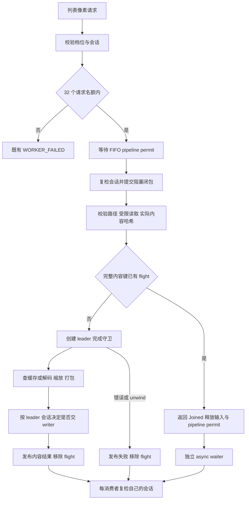

# 播放列表封面后端并发候选的安全契约

## 结论与范围

本轮建立默认 N=1 的安全基础，以及仅由编译期 feature 将 N 改为 2 的实验候选。先修复单飞异常清理、实际内容身份、真实工作所有权和请求数量边界，再由 Test Agent 独立验证。本文件允许本轮内部实现与合成夹具测试，不代表批准默认 N=2、真实 UI 实验或产品性能验收。

Rust/Tauri Agent 负责 `cover_pixels.rs` 与 Cargo feature；Test Agent 负责独立验证；Architecture Agent 只维护本文。前端视觉槽保持 2，不增依赖、权限、命令、事件、持久化结构或用户配置。播放器大图通道、writer 双限与退出策略、SPXR v1、列表档位及现有路径/输入/输出限制继续生效。历史约 1.95 倍的 P2 数字只支持研究方向；安全结构变化后的性能需重新配对。

本文件替代临时实验合同中以原样路径作单飞键、无界 waiter、单靠 544/1088 MiB 记账证明安全，以及无需异常完成守卫的约定。它不改变其他文档的产品批准状态。

## 最小实施合同

1. `PLAYLIST_DECODE_PERMITS` 默认 1；`sp022-playlist-decode-n2` 只把同一实现的该常量变为 2。全部限制、错误处理、缓存和测试钩子在两臂相同。
2. 一个 pipeline permit 覆盖受限读取、实际内容哈希、缓存查找及必要的完整解码/缩放/打包。先取得 permit，再提交阻塞闭包；闭包拥有 permit，调用方 future 取消不释放仍在使用的槽位。
3. 路径校验及受限读取在 permit 内完成，然后以实际读取字节的 BLAKE3、根目录身份、档位及版本注册单飞。每个请求都独立完成路径校验，不能经路径快捷合并绕过它。
4. flight leader 在阻塞闭包内持有完成守卫。成功、普通错误和 unwind panic 都使 flight 一次完成并移除；外层请求被取消也不影响发布。
5. 阻塞闭包遇到已有 flight，返回内部 `Joined(receiver)`，释放输入及 pipeline permit；调用方在 async 侧等待自己的容量 1 通道。无需第二级准备池、常驻调度器或阻塞线程等待其他 worker。
6. 应用拥有的请求总数上限为 32，每个 flight 保存的 waiter 上限也为 32；满额立即返回既有 `WORKER_FAILED`、`recoverable=false`。这是新增资源拒绝触发，不得描述为所有错误语义完全不变。
7. 内存报告区分已受限的模块缓冲与未知 codec scratch。撤销 544 MiB 是单请求硬内存上界的表述；不能把计数器未超限当作进程内存已受硬限制。

## 模块边界与流程

命令层继续 await 后端函数，调用方向不变。`Prepared/Joined/Leader` 等内部返回类型不能进入序列化命令接口。缓存落盘由既有 writer 持有，不由 flight 所有权管理磁盘队列。

### 内容键

键至少包含：

| 字段 | 约束 |
| --- | --- |
| 缓存根身份 | 校验后的 canonical covers 根或能唯一确定对应 thumbnails 根的等价身份；不同沙箱不互相复用写入结果 |
| source_hash | 对本次受限读取的实际完整字节计算 BLAKE3；不信任文件名哈希或 mtime |
| max_edge | 128、256 或 512，档位间不合并 |
| transform_version | 沿用现有变换版本 |
| disk_version | 沿用现有磁盘编码版本 |

不同路径但相同内容与完整键可以共享；同路径内容改变得到不同键。哈希后解码必须消费同一份已读字节，不得重开路径读取另一个版本。文件并发写入的原子快照问题沿用既有缓存读取边界，不扩大为本轮原图写入改造。

所有源读取在 pipeline permit 内，因此准入前没有新建的原图缓冲或读图任务。N=1 时同内容后续请求可能在首请求完成后才读取，通过 writer pending/磁盘命中复用；不要求此时 `joined==3`。N=2 的同键并发和独立 registry 测试必须真正覆盖等待者。

### Flight 的终态与异常清理

注册、追加 waiter、终态发布和移除均在同一短临界区串行化。leader 的 RAII 完成守卫绑定完整键及该条目的身份；若实现使用唯一 entry id，结束时只处理自己拥有的条目。正常完成后解除守卫，重复 finish 是空操作，不得删除同键后来新建的条目。

共享结果只包含不可变像素或与会话无关的失败信息。`STALE_REQUEST` 不进入共享结果。错误至少保留既有 code/recoverable，内部失败可用固定 message；不把某个 client 的错误上下文传播给另一 client。

守卫 Drop 必须在普通 Rust unwind 时使所有 waiter 最终得到 `WORKER_FAILED`、`recoverable=false` 并移除条目。Drop 中避免分配错误字符串、panic、阻塞 await 或重复取锁；可共享轻量失败枚举，在消费者处还原错误结构，也可移除条目并关闭全部等待通道，由消费者将无结果关闭转换为同一错误。Mutex poison 的恢复不能再触发 panic。若无 waiter，仍移除 entry。

这同时保证 permit 与 flight 都清理。只在 `.await` 的 JoinError 分支清理不够，因为外层 future 可能已经取消。进程 abort、OOM abort 或 OS 强制终止不经过 Rust Drop，不能写成已覆盖的“panic 全场景恢复”。

正常缓存 miss 的顺序为：得到完整像素 → leader 会话复检 → 对既有 writer 执行非阻塞 `try_enqueue` → 发布结果并移除 flight。接受写入时 pending 应在移除 flight 前可见。以下情况允许后续重新解码：stale leader 禁止入队、writer 因已有限额/关闭拒绝持久化、缓存淘汰或损坏；不得为了跨这些情况维持永久恰好一次而引入无界驻留结果。

### 会话与取消

- 每个消费者在登记/等待前校验自己的 client/generation，取得 pipeline permit 后再次校验；阻塞工作不共享其他消费者的会话结论。
- leader 解码后在交 writer 前复检。若已陈旧，向有效 waiter 发布成功像素但不入队，leader 自己返回 `STALE_REQUEST`。
- 每个成功响应，包括缓存命中与 Joined，都在交回自身调用方前再次检查其 generation。位于旧列表的消费者不能通过其他 client 的有效性提交响应。
- 排队 future 取消应从 FIFO 等待中退出，释放请求名额且不提交阻塞工作。活动 worker 取消外层 future 后继续完成，直到闭包退出才释放其实际工作资源。
- waiter 取消只丢弃自己的 receiver 与请求名额，不中止 leader 或其他 waiter。leader 外层取消也不取消其已开始的 blocking flight。
- 计数器若横跨 await，使用取消安全守卫；不得只在 await 后递减而留下假阳性的等待账本。

这里约束保护位置和可观察行为，不以 ensure_current 的字面调用次数作为验收依据；历史 A0 与加入单飞/取消修正的 N=1 不具备逐位等价性。

### 请求数量、FIFO 与错误兼容

全局请求名额为 `MAX_PLAYLIST_REQUESTS=32`，包含等待准入、活动读取/解码、Joined 等待以及调用方已取消但 worker 未结束的后台工作。入口只做 try-acquire；满额不再把请求放入第二个无界队列。名额 guard 在工作转移时随其所有权转移，不能在外层取消时提前归还给仍工作的闭包。

每个 flight 的 waiter sender 数量独立限制为 32。注册前可清理已关闭 sender，但不能仅依赖请求名额证明 Vec 有界：反复 join/cancel 会归还名额并累积关闭 sender。追加达到上限时返回上述资源拒绝；注册表条目数由真实 pipeline permit 数限制为 ≤N。

FIFO 的对象是通过入口资格检查、等待 pipeline permit 的请求，按实际进入 async Mutex 等待队列的顺序；它不是跨线程调用时钟的全序，也不是按内容识别后另建的解码公平队列。未知内容需要先受限读取，Joined 请求此前消耗过一个读取槽位，之后退出 pipeline 队列。取消者退出、陈旧者取到许可后退出，其余有效请求应继续。保留 mpsc 令牌池时，收发及 Drop 归还不能丢令牌或双归还。

不新增公共错误码，不复用 `STALE_REQUEST` 伪装过载，也不在后端增加自动重试。使用 `WORKER_FAILED`、`recoverable=false` 与既有内部工作失败字段保持兼容，但新增了容量拒绝原因。现有前端按 `WORKER_FAILED/ALLOCATION_FAILED/STALE_REQUEST` 的 code 执行最多两次重试，并不依赖 recoverable；因此满额仍可能走既有有限重试。过载下有效视口的最终完成率属于后续 UI 验证，不在本轮宣称通过。

## 内存：实际覆盖与不能证明的部分

必须保留现有 16 MiB 压缩输入、16,384 源边、64 Mi 像素、256 MiB 解码输出检查和列表 512 最大输出档。pipeline permit 在读取前取得、真实闭包退出时释放，因此模块同时持有的源输入数量 ≤N，不能先在无限排队任务里读图。

| 资源 | 本轮必须成立的边界或证据 |
| --- | --- |
| 输入字节 | ≤N 份受限读取，逻辑长度每份 ≤16 MiB；Vec capacity 与读取哨兵字节需单列，不能只统计 len |
| 缓存校验暂存 | 现有磁盘读取在校验 SPXR 档位前按通用上限允许约 36 MiB+84 字节/任务；坏缓存暂存及读取 Vec capacity 不能套用最终列表响应 1 MiB 的上界 |
| 解码源像素 | 每任务已验证总字节 ≤256 MiB；维度/像素数在进入完整解码前检查 |
| 方向校正 | 允许旧图与旋转副本短暂共存；估算须计双份，不能声称两者不同时存活 |
| Lanczos 中间图 | 固定 image 0.25.10 的 f32 临时图为 source_width×target_height×16，保守 ≤128 MiB/任务；不得沿用只按 8192 方图算出的 64 MiB |
| 输出与共享 | SPXR 列表响应每份 ≤40+512×512×4；区分 leader Vec、Arc 共享及每消费者返回副本，不把 Arc 克隆计为像素拷贝，也不漏计 Vec 克隆 |
| waiter/flight | entry ≤N，sender/entry ≤32，请求 ≤32；取消后条目及关闭通道不得无界积累 |
| writer | 已有 128 项/32 MiB 单列；不能把 writer 持有的响应误报为 flight 泄漏 |
| 前端/IPC/进程分配器 | 本模块 guard 归还后，已返回的响应、Tauri 传输、Renderer/GPU 与分配器高水位不受该 guard 约束，需后续单列测量 |

上述规则对已知模块缓冲建立数量与尺寸约束，并限制许可归还之后仍由 waiter 持有的像素。实现可以提供按所有权增减的输入/响应/条目账本，或在明确持有点的可控测试中证明边界；不要求为本轮引入自定义 allocator。对容量增长、转换副本与返回值移交必须在实现说明交代，不能把 `N×常量` 的自验证当作实际持有量测量。

**codec scratch 仍有明确限制**：本机锁定的 image 0.25.10 `src/io/limits.rs` 将 `max_alloc` 定义为非严格、部分 decoder 可忽略的限制。现有 `set_limits` 及输出检查保留，但 `+1×decoded` 不能当作 scratch 的经证明硬上界。不得仅提高 544 MiB 常量来宣布修复，也不得将某批小图的外部峰值作为恶意/边界图片上界。

因此本轮可完成默认 N=1 的所有权、单飞和请求边界修正，以及合成夹具下 N=2 功能验证；**完整 Rust RSS 硬预算尚未建立是 N=2 产品化的剩余门槛**。大图压力测试须独立于真实用户 profile、逐级增加，并报告实际 private/working-set 峰值及采样限制。若要声称覆盖全部 codec 内部分配的硬限，需要另行提供每个已启用 codec 的可审核分配上界或受限执行机制，再由 PM 界定范围；本轮不以此引入进程沙箱/新解码器框架。

## 备选与取舍

| 方案 | 取舍 |
| --- | --- |
| 保留旧路径键与无界 waiter | 改动少，但源身份、取消积累与异常悬挂缺口未闭环，拒绝 |
| 本文单 pipeline permit + 内容 flight + async Joined | 复用已有限制，读图也有界，重复读取少量发生；默认 N=1 仍可能依赖 pending/磁盘避免重复解码，采用 |
| follower 持 permit 在 Condvar 等待 | 可在无依赖环前提下安全实现，但占用 blocking 线程及工作槽，使新不同键等待，当前不采用 |
| 独立读取池/解码池/字节预算调度器 | 更精细，但带来跨池所有权、取消与公平性复杂度，缺乏本轮必要性，暂不采用 |
| 仅改 544/1088 MiB 或提高并发 | 不能覆盖实际 scratch/响应生命周期，不作为安全修正 |

## 可验证验收标准

以下是 Rust/Tauri 与 Test Agent 的共同合同。优先使用模块内可控门与合成夹具，不启动应用、不触碰真实封面缓存。测试实现不得照搬旧补丁全部 harness；按本轮最小不变量编写。

| 项目 | 必须提供的证据 |
| --- | --- |
| 两臂身份 | 默认 N=1、feature N=2；同一代码其他限制不变；两臂 compile/test 通过 |
| 活动及取消 | N+2 不同内容争用时真实阻塞工作 ≤N；外层取消后活动 worker 仍持许可/名额，完成后回零 |
| 同内容与键边界 | 不同文件相同内容只产生一个重叠完整解码；同路径改内容不复用旧键；档位、版本、不同根隔离；无效路径不能借同飞绕过校验 |
| panic/错误 | leader 已注册且至少一个有效 waiter 后注入 unwind；waiter 有限时间返回 WORKER_FAILED，flight/许可/名额清零；相同键下一次可成功，重复 finish 不损坏新条目 |
| 独立消费者 | 只取消 waiter、只取消 leader 外层、只推进 leader generation、只推进 waiter generation，各自验证其他有效消费者取得正确像素 |
| 排队与 FIFO | 占满许可后登记不同内容请求，取消队首/中间并推进部分 generation；余下有效请求按准入队序继续，无名额泄漏 |
| 请求/等待上限 | 32 个名额占满后第 33 个返回既有码且不提交阻塞工作；重复 join/cancel 不使 waiter Vec 超 32；结束后可重新准入 |
| 内存持有 | 输入、返回副本、共享 payload、writer、flight 分别核对；取消/失败/共享响应移交不提前归还仍被使用的名额；不声称 codec 全部内部分配已受硬限 |
| 缓存交接 | 正常 writer 接受时 pending 在 flight 移除前可见；stale/拒绝持久化后的重做作为显式例外；缓存坏条目回源等既有测试通过 |
| 相邻回归 | 既有封面、playlist generation、默认与 feature Release 检查；播放器 coordinator 不被列表 request cap 或 generation 串用 |

N=1 的公共入口无法在同一阻塞槽内同时制造两个读取后的 flight 消费者时，可用 registry 层测试验证等待/异常终态，并在 N=2 通过公共入口复核；不能通过不受许可约束的生产旁路伪造覆盖。单元测试中的超时仅用于发现悬挂，不是生产超时/重试功能。

## 演进、回退与未完成事项

Rust/Tauri Agent 按本文实现并注明实质偏差；Test Agent 独立核对源码和结果。任一异常挂起、generation 互相污染、真实活动超限或 guard 提前释放，应停止候选 N=2，保留可复现证据并修正；默认 N=1 也必须通过同一安全集合，不能以切回 N=1 掩盖共享缺陷。

本轮没有 UI 隔离入口，不妨碍完成纯后端实现与合成测试；它阻塞后续真实 UI 运行。P3/P4 的目录/profile 隔离、端到端延迟/完成率/帧、长期资源、普通 Release 运行身份、codec 硬预算证明及最终性能门槛仍分别由后续阶段提供，不能将本文或单元测试当作已验收。

## 本轮实现的只读复核记录

2026-10-20，Architecture Agent 只读核对当前 `cover_pixels.rs` 与 Cargo feature，未运行编译、测试或应用。未发现阻塞本轮默认 N=1 安全基础及 feature N=2 合成验证的新增正确性问题；测试是否通过以 Test Agent 独立报告为准。

- 源路径校验、受限读取和实际字节哈希先于内容 flight；正常 writer 交接先于 flight 发布。request reservation 随 blocking、Complete/Joined 及最后的响应克隆转移，不能通过取消外层 future 提前释放真实工作名额。
- leader Drop 已采用移除条目并关闭等待通道，由接收端构造 `WORKER_FAILED`，避免 unwind 中分配错误字符串；原有 JoinError 日志保留。等待通道容量为 1，关闭 sender 清理与 waiter 数量上限独立于请求名额存在。
- 新增 FIFO 测试先手动 poll 建立实际排队顺序，取消队首和中间项，再逐令牌验证存活者按 1、3、4 继续；补齐此前“全部取消”不能证明有效请求继续的覆盖缺口。这是准入池测试，不宣称完整 UI 调度公平性。
- 新增 root/档位/变换版本/磁盘版本的 registry 键隔离测试，以及 Complete 内部结果持有 reservation 至消费/丢弃的测试。前者验证键字段隔离，不代替真实多 profile 隔离；后者验证内部结果所有权，不代替完整 IPC 缓冲测量。
- 默认构建包含 8 组新增安全测试；另外 2 组需要真实双槽的消费者取消/generation/失败场景使用 feature 条件编译，N=2 共 10 组。默认 N=1 不再通过 early return 将不适用场景计为已执行。

本次复核没有为 codec scratch、完整 RSS 硬限、长期资源或真实 UI 收益给出通过结论，也没有批准启用默认 N=2。
